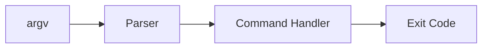

# CLI Applications

## Overview

- **What is it?** CLI applications expose commands via terminal interfaces using argparse, click, or typer.
- **Why is it important?** Operators and developers automate workflows from the shell.
- **Where is it used?** DevOps tools, data utilities, codegen, admin tasks.

## Learning Objectives

- **Skills gained:** Practical command of CLI Applications.
- **Concepts covered:**

- Parse args and subcommands.
- Provide --help and sensible defaults.
- Return proper exit codes.

- **Expected outcome:** You ship user-friendly command-line tools in Python.

## Real World Applications

- SRE tooling
- Data ops
- Security scanners
- Build systems

- **Business applications:** Automate workflows, reduce manual errors, accelerate delivery.
- **Career relevance:** Required knowledge for Python roles from junior developer to senior engineer.

## Core Concepts

### argparse

- **Definition:** Stdlib CLI parser.
- **Visual explanation:** `argparse` → process → result
- **Practical example:**

```python
import argparse
p = argparse.ArgumentParser()
p.add_argument('name')
args = p.parse_args(['Ada'])
print(args.name)
```

### subcommands

- **Definition:** Nested CLI verbs.
- **Visual explanation:** `subcommands` → process → result
- **Practical example:**

```python
COMMANDS = {'run': lambda: 0, 'status': lambda: 0}
print(COMMANDS['run']())
```

### exit codes

- **Definition:** Signal success/failure.
- **Visual explanation:** `exit codes` → process → result
- **Practical example:**

```python
import sys
sys.exit(0)
```

## Infographic Summary

| Block | Summary |
| --- | --- |
| 📌 Concept | CLI = argv parsing + action + exit status. |
| ⚡ Purpose | Automate tasks from terminal and scripts. |
| 🔥 Benefits | Scriptable, remote-friendly, fast iteration. |
| 🎯 Use Cases | Deploy tools, ETL triggers, db migrations. |
| 🚀 Best Practices | Support --help; validate input; log to stderr; test CLI. |
| ❌ Common Mistakes | Printing only help on error, no exit codes, hidden global state. |

## Syntax Guide

### Basic Syntax

```python
if __name__ == '__main__':
    main()
```

### Standard Structure

```python
parse args -> dispatch command -> exit code
```

### Code Pattern

```python
parser = argparse.ArgumentParser()
parser.parse_args()
```

## Examples

### Beginner Example

```python
import sys

if len(sys.argv) > 1:
    print(f'Hello, {sys.argv[1]}')
else:
    print('Hello, world')
```

### Intermediate Example

```python
import argparse


def main(argv=None):
    parser = argparse.ArgumentParser(description='Greet users')
    parser.add_argument('name')
    args = parser.parse_args(argv)
    print(f'Hello, {args.name}')


main(['Ada'])
```

### Advanced Example

```python
import argparse


def build_parser():
    parser = argparse.ArgumentParser(prog='tool')
    sub = parser.add_subparsers(dest='command', required=True)
    run = sub.add_parser('run')
    run.add_argument('--dry-run', action='store_true')
    return parser


args = build_parser().parse_args(['run', '--dry-run'])
print(args.command, args.dry_run)
```

## Workflow Diagram



---
