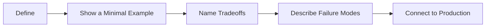

# Python Interview Questions

[← Knowledge base](../README.md)

Use these prompts for active recall, mock interviews, or instructor-led reviews. Strong answers explain tradeoffs and include a small example.

## Beginner

1. What is the difference between an object, a variable, and a type?
2. When would you choose a tuple instead of a list?
3. How do truthiness, `and`, and `or` affect conditional execution?
4. What is the difference between `break`, `continue`, and `pass`?
5. Why are mutable default arguments dangerous?
6. How does local scope differ from global and nonlocal scope?
7. What guarantees does a `with open(...)` block provide?
8. How would you isolate a project’s dependencies?

## Intermediate

1. Compare composition and inheritance. When does each reduce coupling?
2. Explain the iterator protocol and how a generator implements it.
3. What does a decorator replace, and how do you preserve metadata?
4. When should an application log an exception versus raise it?
5. Compare threads, processes, and async tasks for I/O- and CPU-bound work.
6. How do parameterized SQL queries prevent injection?
7. Where should API validation, business logic, and persistence live?
8. What distinguishes a unit test from an integration test?
9. How do mocks help, and how can excessive mocking make tests misleading?
10. What files are required to package and publish a modern Python project?

## Advanced

1. How do descriptors participate in attribute lookup?
2. What problem can a metaclass solve that a class decorator cannot?
3. Explain reference counting and cyclic garbage collection in CPython.
4. How does the GIL affect concurrency choices?
5. What consistency, availability, and failure tradeoffs arise in distributed systems?
6. How would you design an idempotent ETL pipeline?
7. Which metrics reveal that Python code needs optimization?
8. How do you prevent cascading failures between microservices?
9. What belongs in a container image versus runtime configuration?
10. How would you secure, observe, and scale a Python API?

## Model Answer Skeletons

Use these as scoring rubrics during mock interviews. Expand them with your own code.

### Mutable default arguments

- **Define:** Defaults are evaluated once at function definition time.
- **Example:** `def append_item(item, bucket=[]):` shares one list across calls.
- **Fix:** Use `None` and create a new list inside the function.
- **Production rule:** Prefer immutable defaults; treat mutable defaults as a code-review blocker.

### Threads vs processes vs asyncio

- **Define:** Threads share memory; processes isolate memory; asyncio multiplexes waiting work on one thread.
- **Choose threads** for blocking I/O with shared state and locks.
- **Choose processes** for CPU-bound work that benefits from multiple cores.
- **Choose asyncio** for many concurrent network waits with cooperative tasks.
- **Production rule:** Measure the bottleneck first; the GIL often makes processes better for CPU work in CPython.

### Parameterized SQL

- **Define:** Placeholders send values separately from SQL text so the driver escapes safely.
- **Example:** `cursor.execute("SELECT * FROM users WHERE id = ?", (user_id,))`
- **Failure mode:** Building SQL with f-strings enables injection.
- **Production rule:** Never interpolate untrusted input into SQL; prefer an ORM or query builder with binds.

## Answer Framework

For each answer, aim to provide: a precise definition, one concrete example, alternatives, edge cases, and a production decision rule.
