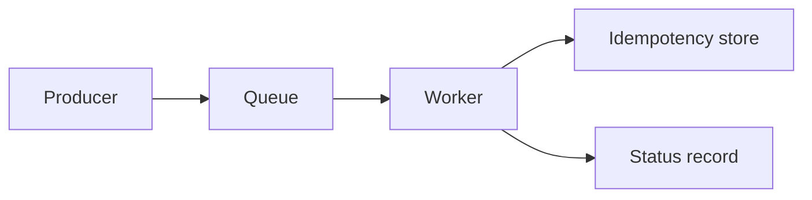

# Distributed Job Platform

[← Project catalog](./README.md) · [Distributed Systems](../Advanced/12-distributed-systems.md)

**Level:** Advanced  
**Lessons:** queues, workers, idempotency, retries, system design

## Problem

A data team wants a small job platform where a producer enqueues work and a worker processes each job once, even if the queue delivers it twice.

## Non-goals

- No multi-cloud deployment.
- No processing of untrusted code submitted by anonymous users.

## Requirements

- Represent a job with an id, a payload, and a status.
- A duplicate delivery of the same job id does not apply the business effect twice.
- A failed job records the attempt count and a retry decision.
- Draw the flow from producer to worker to status store.

## Starter

```python
def handle(job, completed):
    if job["id"] in completed:
        return {"status": "duplicate", "attempts": job["attempts"]}
    completed.add(job["id"])
    job["attempts"] += 1
    return {"status": "done", "attempts": job["attempts"]}


def main():
    completed = set()
    job = {"id": "batch-1", "attempts": 0}
    print(handle(job, completed))
    print(handle(job, completed))


if __name__ == "__main__":
    main()
```

## Acceptance checks

- The second delivery returns `duplicate` and does not increment a business counter.
- A handler exception leaves the job eligible for retry until a maximum attempt count.
- The design note explains the status store and what happens if the worker crashes after the effect but before the acknowledgement.
- The README includes a workflow diagram.

## Extension

Separate the business effect from the acknowledgement using an outbox table.


