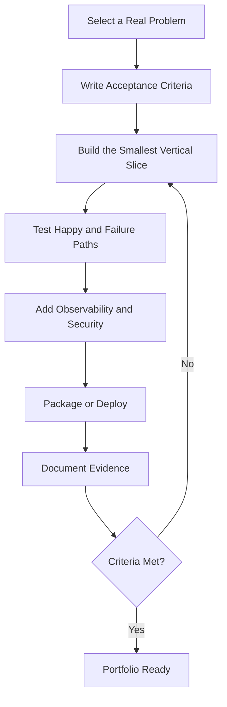

# Python Portfolio Projects

[← Knowledge base](../README.md)

Each brief has a problem statement, non-goals, requirements, a runnable starter, and acceptance checks. Implement the brief in your own repository. The starter is a vertical slice, not the finished project.

## Progressive Project Catalog

| Level | Project | Core capabilities | Acceptance evidence |
| --- | --- | --- | --- |
| Beginner | [Expense tracker CLI](./01-expense-tracker-cli.md) | Input, types, functions, files, exceptions | Validated entries persist and reload |
| Beginner | [Text analytics tool](./02-text-analytics-tool.md) | Strings, dictionaries, sorting | Frequency report handles empty input |
| Beginner | [Quiz engine](./03-quiz-engine.md) | Control flow, collections, modules | Score and missed-answer review |
| Intermediate | [Installable task CLI](./04-installable-task-cli.md) | Packaging, argparse, logging, tests | Clean install plus automated tests |
| Intermediate | [API data synchronizer](./05-api-data-synchronizer.md) | HTTP, JSON, config, retries | Idempotent sync and failure logs |
| Intermediate | [Inventory service](./06-inventory-service.md) | OOP, SQLite, pytest | Stock rules with an isolated test database |
| Intermediate | [Concurrent URL checker](./07-concurrent-url-checker.md) | Threads or asyncio, timeouts | Bounded concurrency and summary report |
| Advanced | [FastAPI order service](./08-fastapi-order-service.md) | API design, validation, persistence | OpenAPI docs, tests, container image |
| Advanced | [Resilient ETL pipeline](./09-resilient-etl-pipeline.md) | Quality checks, idempotent load | Restart-safe stages and lineage notes |
| Advanced | [ML inference service](./10-ml-inference-service.md) | Versioned scoring, validation | Stable score and latency field |
| Advanced | [Cloud automation controller](./11-cloud-automation-controller.md) | Dry-run, allowlists, least privilege | Plan-only default and permission notes |
| Advanced | [Distributed job platform](./12-distributed-job-platform.md) | Queues, workers, idempotency | Duplicate delivery does not double-apply |

## Definition of Done

- A concise problem statement and explicit non-goals.
- Reproducible setup with pinned or constrained dependencies.
- Tests for important behavior and failure paths.
- Structured logging without secrets or personal data.
- Configuration outside source code.
- Security assumptions and threat notes.
- Architecture or workflow diagram.
- A README that explains operation, tradeoffs, and limitations.

