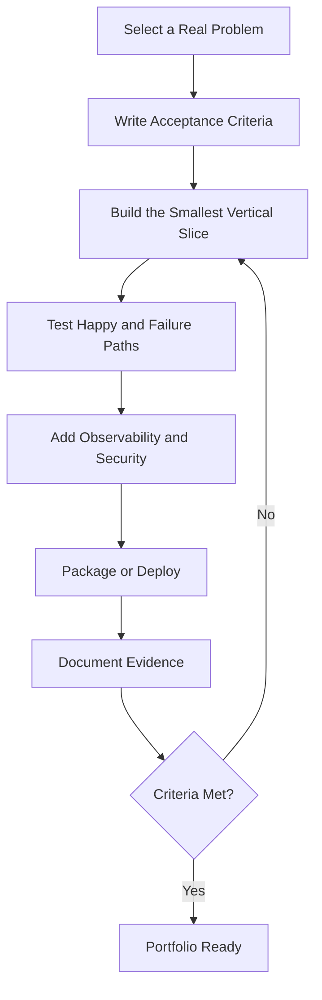

# Python Portfolio Projects

[← Knowledge base](../README.md)

## Progressive Project Catalog

| Level | Project | Core capabilities | Acceptance evidence |
| --- | --- | --- | --- |
| Beginner | Expense tracker CLI | Input, types, functions, files, exceptions | Validated entries persist and reload |
| Beginner | Text analytics tool | Strings, dictionaries, sorting | Frequency report handles empty input |
| Beginner | Quiz engine | Control flow, collections, modules | Score and missed-answer review |
| Intermediate | Installable task CLI | Packaging, argparse, logging, tests | Clean install plus automated tests |
| Intermediate | API data synchronizer | Requests, JSON, config, retries | Idempotent sync and failure logs |
| Intermediate | Inventory service | OOP, SQLite, SQLAlchemy, pytest | CRUD flow with isolated test database |
| Intermediate | Concurrent URL checker | Threads or asyncio, timeouts | Bounded concurrency and summary report |
| Advanced | FastAPI order service | API design, validation, persistence | OpenAPI docs, tests, container image |
| Advanced | Resilient ETL pipeline | Pandas/PySpark, quality checks | Restart-safe stages and lineage notes |
| Advanced | ML inference service | NumPy/ML, FastAPI, monitoring | Versioned model and latency metrics |
| Advanced | Cloud automation controller | SDK, security, CI/CD | Dry-run mode and least-privilege policy |
| Advanced | Distributed job platform | Queues, workers, idempotency | Retry strategy and architecture diagram |

## Definition of Done

- A concise problem statement and explicit non-goals.
- Reproducible setup with pinned or constrained dependencies.
- Tests for important behavior and failure paths.
- Structured logging without secrets or personal data.
- Configuration outside source code.
- Security assumptions and threat notes.
- Architecture or workflow diagram.
- A README that explains operation, tradeoffs, and limitations.

