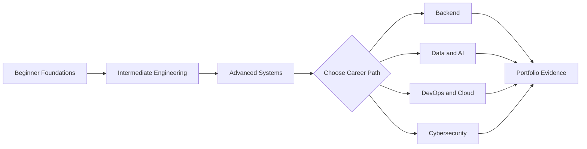

# Python Mastery Knowledge Base

> A portable, topic-by-topic edition of the [canonical Python Learning Roadmap](../README.md), designed for GitHub, NotebookLM, Obsidian, Notion, and documentation portals.

## Knowledge Base at a Glance

| Metric | Coverage |
| --- | ---: |
| Learning levels | 3 |
| Beginner lessons | 35 |
| Intermediate lessons | 35 |
| Advanced lessons | 40 |
| Total topic documents | 110 |
| Examples per topic | 3 progressive examples |
| Visual learning | Infographic table and Mermaid workflow per topic |

## How to Study

1. Read the **Overview** and **Learning Objectives** to set a goal.
2. Recreate each **Core Concepts** example instead of copying it.
3. Move through the beginner, intermediate, and advanced examples.
4. Explain the **Workflow Diagram** aloud in your own words.
5. Follow a [study guide](./Study-Guides/) if you want a 12- or 24-week calendar.
6. Build one project from the [Projects](./Projects/) catalog.
7. Use the [career roadmaps](./Roadmaps/) to select deeper topics.



## Level 1: Beginner

| # | Topic | Learning document |
| ---: | --- | --- |
| 01 | Introduction to Python | [Open lesson](./Beginner/01-introduction-to-python.md) |
| 02 | Installing Python | [Open lesson](./Beginner/02-installing-python.md) |
| 03 | IDE Setup | [Open lesson](./Beginner/03-ide-setup.md) |
| 04 | Python Syntax | [Open lesson](./Beginner/04-python-syntax.md) |
| 05 | Variables | [Open lesson](./Beginner/05-variables.md) |
| 06 | Data Types | [Open lesson](./Beginner/06-data-types.md) |
| 07 | Type Casting | [Open lesson](./Beginner/07-type-casting.md) |
| 08 | Input and Output | [Open lesson](./Beginner/08-input-and-output.md) |
| 09 | Operators | [Open lesson](./Beginner/09-operators.md) |
| 10 | Conditional Statements | [Open lesson](./Beginner/10-conditional-statements.md) |
| 11 | Loops | [Open lesson](./Beginner/11-loops.md) |
| 12 | Nested Loops | [Open lesson](./Beginner/12-nested-loops.md) |
| 13 | Break Continue Pass | [Open lesson](./Beginner/13-break-continue-pass.md) |
| 14 | Strings | [Open lesson](./Beginner/14-strings.md) |
| 15 | String Methods | [Open lesson](./Beginner/15-string-methods.md) |
| 16 | Lists | [Open lesson](./Beginner/16-lists.md) |
| 17 | List Methods | [Open lesson](./Beginner/17-list-methods.md) |
| 18 | Tuples | [Open lesson](./Beginner/18-tuples.md) |
| 19 | Sets | [Open lesson](./Beginner/19-sets.md) |
| 20 | Dictionaries | [Open lesson](./Beginner/20-dictionaries.md) |
| 21 | Functions | [Open lesson](./Beginner/21-functions.md) |
| 22 | Arguments and Parameters | [Open lesson](./Beginner/22-arguments-and-parameters.md) |
| 23 | Return Statements | [Open lesson](./Beginner/23-return-statements.md) |
| 24 | Scope | [Open lesson](./Beginner/24-scope.md) |
| 25 | Lambda Functions | [Open lesson](./Beginner/25-lambda-functions.md) |
| 26 | Modules | [Open lesson](./Beginner/26-modules.md) |
| 27 | Packages | [Open lesson](./Beginner/27-packages.md) |
| 28 | Date and Time | [Open lesson](./Beginner/28-date-and-time.md) |
| 29 | Math Module | [Open lesson](./Beginner/29-math-module.md) |
| 30 | Random Module | [Open lesson](./Beginner/30-random-module.md) |
| 31 | File Handling | [Open lesson](./Beginner/31-file-handling.md) |
| 32 | Exception Handling | [Open lesson](./Beginner/32-exception-handling.md) |
| 33 | Debugging Basics | [Open lesson](./Beginner/33-debugging-basics.md) |
| 34 | Virtual Environments | [Open lesson](./Beginner/34-virtual-environments.md) |
| 35 | Basic Project Structure | [Open lesson](./Beginner/35-basic-project-structure.md) |

## Level 2: Intermediate

| # | Topic | Learning document |
| ---: | --- | --- |
| 01 | Object Oriented Programming | [Open lesson](./Intermediate/01-object-oriented-programming.md) |
| 02 | Classes | [Open lesson](./Intermediate/02-classes.md) |
| 03 | Objects | [Open lesson](./Intermediate/03-objects.md) |
| 04 | Constructors | [Open lesson](./Intermediate/04-constructors.md) |
| 05 | Encapsulation | [Open lesson](./Intermediate/05-encapsulation.md) |
| 06 | Inheritance | [Open lesson](./Intermediate/06-inheritance.md) |
| 07 | Polymorphism | [Open lesson](./Intermediate/07-polymorphism.md) |
| 08 | Abstraction | [Open lesson](./Intermediate/08-abstraction.md) |
| 09 | Magic Methods | [Open lesson](./Intermediate/09-magic-methods.md) |
| 10 | Iterators | [Open lesson](./Intermediate/10-iterators.md) |
| 11 | Generators | [Open lesson](./Intermediate/11-generators.md) |
| 12 | Decorators | [Open lesson](./Intermediate/12-decorators.md) |
| 13 | Context Managers | [Open lesson](./Intermediate/13-context-managers.md) |
| 14 | Regular Expressions | [Open lesson](./Intermediate/14-regular-expressions.md) |
| 15 | JSON Processing | [Open lesson](./Intermediate/15-json-processing.md) |
| 16 | CSV Processing | [Open lesson](./Intermediate/16-csv-processing.md) |
| 17 | XML Processing | [Open lesson](./Intermediate/17-xml-processing.md) |
| 18 | Logging | [Open lesson](./Intermediate/18-logging.md) |
| 19 | Configuration Management | [Open lesson](./Intermediate/19-configuration-management.md) |
| 20 | Multithreading | [Open lesson](./Intermediate/20-multithreading.md) |
| 21 | Multiprocessing | [Open lesson](./Intermediate/21-multiprocessing.md) |
| 22 | Async Programming | [Open lesson](./Intermediate/22-async-programming.md) |
| 23 | API Development | [Open lesson](./Intermediate/23-api-development.md) |
| 24 | API Consumption | [Open lesson](./Intermediate/24-api-consumption.md) |
| 25 | Requests Library | [Open lesson](./Intermediate/25-requests-library.md) |
| 26 | Database Fundamentals | [Open lesson](./Intermediate/26-database-fundamentals.md) |
| 27 | SQLite | [Open lesson](./Intermediate/27-sqlite.md) |
| 28 | MySQL Integration | [Open lesson](./Intermediate/28-mysql-integration.md) |
| 29 | PostgreSQL Integration | [Open lesson](./Intermediate/29-postgresql-integration.md) |
| 30 | SQLAlchemy ORM | [Open lesson](./Intermediate/30-sqlalchemy-orm.md) |
| 31 | Unit Testing | [Open lesson](./Intermediate/31-unit-testing.md) |
| 32 | Pytest | [Open lesson](./Intermediate/32-pytest.md) |
| 33 | Mocking | [Open lesson](./Intermediate/33-mocking.md) |
| 34 | Packaging Python Projects | [Open lesson](./Intermediate/34-packaging-python-projects.md) |
| 35 | CLI Applications | [Open lesson](./Intermediate/35-cli-applications.md) |

## Level 3: Advanced

| # | Topic | Learning document |
| ---: | --- | --- |
| 01 | Data Structures Internals | [Open lesson](./Advanced/01-data-structures-internals.md) |
| 02 | Algorithms in Python | [Open lesson](./Advanced/02-algorithms-in-python.md) |
| 03 | Design Patterns | [Open lesson](./Advanced/03-design-patterns.md) |
| 04 | SOLID Principles | [Open lesson](./Advanced/04-solid-principles.md) |
| 05 | Memory Management | [Open lesson](./Advanced/05-memory-management.md) |
| 06 | Garbage Collection | [Open lesson](./Advanced/06-garbage-collection.md) |
| 07 | Python Internals | [Open lesson](./Advanced/07-python-internals.md) |
| 08 | Metaclasses | [Open lesson](./Advanced/08-metaclasses.md) |
| 09 | Descriptors | [Open lesson](./Advanced/09-descriptors.md) |
| 10 | Concurrency | [Open lesson](./Advanced/10-concurrency.md) |
| 11 | Parallel Computing | [Open lesson](./Advanced/11-parallel-computing.md) |
| 12 | Distributed Systems | [Open lesson](./Advanced/12-distributed-systems.md) |
| 13 | Network Programming | [Open lesson](./Advanced/13-network-programming.md) |
| 14 | Socket Programming | [Open lesson](./Advanced/14-socket-programming.md) |
| 15 | Cybersecurity Automation | [Open lesson](./Advanced/15-cybersecurity-automation.md) |
| 16 | Web Scraping | [Open lesson](./Advanced/16-web-scraping.md) |
| 17 | Automation Frameworks | [Open lesson](./Advanced/17-automation-frameworks.md) |
| 18 | ETL Development | [Open lesson](./Advanced/18-etl-development.md) |
| 19 | Data Engineering | [Open lesson](./Advanced/19-data-engineering.md) |
| 20 | Pandas | [Open lesson](./Advanced/20-pandas.md) |
| 21 | NumPy | [Open lesson](./Advanced/21-numpy.md) |
| 22 | PySpark | [Open lesson](./Advanced/22-pyspark.md) |
| 23 | Machine Learning | [Open lesson](./Advanced/23-machine-learning.md) |
| 24 | Deep Learning | [Open lesson](./Advanced/24-deep-learning.md) |
| 25 | NLP | [Open lesson](./Advanced/25-nlp.md) |
| 26 | Computer Vision | [Open lesson](./Advanced/26-computer-vision.md) |
| 27 | FastAPI | [Open lesson](./Advanced/27-fastapi.md) |
| 28 | Django | [Open lesson](./Advanced/28-django.md) |
| 29 | Flask | [Open lesson](./Advanced/29-flask.md) |
| 30 | Microservices | [Open lesson](./Advanced/30-microservices.md) |
| 31 | Docker with Python | [Open lesson](./Advanced/31-docker-with-python.md) |
| 32 | Kubernetes Integration | [Open lesson](./Advanced/32-kubernetes-integration.md) |
| 33 | Cloud Development | [Open lesson](./Advanced/33-cloud-development.md) |
| 34 | AWS with Python | [Open lesson](./Advanced/34-aws-with-python.md) |
| 35 | Azure with Python | [Open lesson](./Advanced/35-azure-with-python.md) |
| 36 | GCP with Python | [Open lesson](./Advanced/36-gcp-with-python.md) |
| 37 | DevOps Automation | [Open lesson](./Advanced/37-devops-automation.md) |
| 38 | CI/CD Pipelines | [Open lesson](./Advanced/38-ci-cd-pipelines.md) |
| 39 | Performance Optimization | [Open lesson](./Advanced/39-performance-optimization.md) |
| 40 | System Design with Python | [Open lesson](./Advanced/40-system-design-with-python.md) |

## Companion Learning Resources

| Resource | Purpose |
| --- | --- |
| [Infographics](./Infographics/) | Visual mental models, level maps, and career-path map |
| [Cheat Sheets](./CheatSheets/) | Fast syntax reference split by beginner, intermediate, and advanced |
| [Interview Questions](./Interview-Questions/) | Recall, discussion, and system-design prompts |
| [Projects](./Projects/) | Progressive portfolio briefs and acceptance criteria |
| [Roadmaps](./Roadmaps/) | Complete and role-specific learning sequences |
| [Study Guides](./Study-Guides/) | NotebookLM/Obsidian/Notion import, 12- and 24-week plans, deep-dive crosswalk |
| [Deep-dive curriculum](../python-learning-roadmap/) | Nested units, practice questions, and runnable examples |
| [Supplemental book](../A%20Smarter%20Way%20to%20Learn%20Python%20.pdf) | Additional practice reading (241-page PDF) |

## Directory Map

```text
Python-Mastery/
├── Beginner/              # 35 topic documents
├── Intermediate/          # 35 topic documents
├── Advanced/              # 40 topic documents
├── Infographics/
├── CheatSheets/
├── Interview-Questions/
├── Projects/
├── Roadmaps/
├── Study-Guides/
└── README.md
```

## Publishing Notes

- Markdown headings and relative links work directly on GitHub and Obsidian.
- Each topic is self-contained for NotebookLM source selection.
- Mermaid-enabled portals render the workflow blocks as diagrams.
- Notion users can import the folders or individual Markdown files.
- The repository root `README.md` remains the canonical single-page edition.
