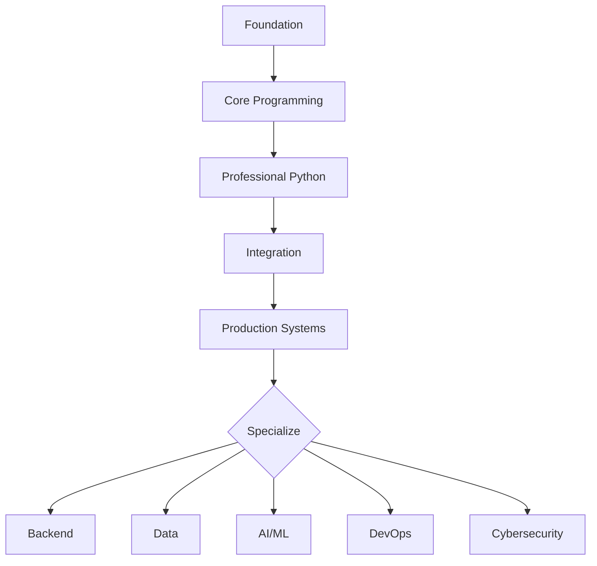

# Complete Python Roadmap

[← All roadmaps](./README.md) · [12-week plan](../Study-Guides/12-week-plan.md)

Shared foundations every Python career path reuses. Complete these phases before specializing.

## Who This Is For

Learners who want one sequence from first syntax to a production-style portfolio, then a role fork.

## Infographic Summary

| Block | Takeaway |
| --- | --- |
| 📌 Concept | Python mastery is a staged path from scripts to systems, not a list of unrelated tutorials. |
| ⚡ Purpose | Prevent gaps: syntax without testing, APIs without persistence, models without serving. |
| 🔥 Benefits | Transferable skills across backend, data, AI, DevOps, and security roles. |
| 🎯 Use Cases | Career switching, instructor pacing, hiring-manager evidence planning. |
| 🚀 Best Practices | Finish each phase with a runnable artifact listed in **Build Evidence**. |
| ❌ Common Mistakes | Jumping to frameworks before functions, files, tests, and virtual environments. |

## Phase Plan

| Phase | Topics | Build Evidence |
| --- | --- | --- |
| Foundation | Syntax, variables, data types, casting, IO, operators, conditions, loops | Calculator, text formatter, quiz app |
| Core Programming | Strings, collections, functions, modules, packages, files, exceptions | CLI utility, file processor, reusable module |
| Professional Python | OOP, iterators, generators, decorators, context managers, regex, JSON/CSV/XML, logging | Tested library, data parser, automation tool |
| Integration | APIs, requests, databases, ORMs, configuration, packaging, CLIs | REST client, CRUD API, installable CLI |
| Production Systems | Async, multiprocessing, design patterns, security, Docker, Kubernetes, cloud, CI/CD | Deployed service with monitoring and tests |
| Specialization | Data engineering, AI, backend, DevOps, cybersecurity, performance, system design | Portfolio project aligned to target role |

## Recommended Lessons by Phase

| Phase | Start here | Also study |
| --- | --- | --- |
| Foundation | [Introduction to Python](../Beginner/01-introduction-to-python.md) | [Variables](../Beginner/05-variables.md), [Operators](../Beginner/09-operators.md), [Loops](../Beginner/11-loops.md) |
| Core Programming | [Strings](../Beginner/14-strings.md) | [Dictionaries](../Beginner/20-dictionaries.md), [Functions](../Beginner/21-functions.md), [File Handling](../Beginner/31-file-handling.md), [Exception Handling](../Beginner/32-exception-handling.md) |
| Professional Python | [Object Oriented Programming](../Intermediate/01-object-oriented-programming.md) | [Generators](../Intermediate/11-generators.md), [Decorators](../Intermediate/12-decorators.md), [Logging](../Intermediate/18-logging.md) |
| Integration | [API Development](../Intermediate/23-api-development.md) | [Requests Library](../Intermediate/25-requests-library.md), [SQLAlchemy ORM](../Intermediate/30-sqlalchemy-orm.md), [CLI Applications](../Intermediate/35-cli-applications.md) |
| Production Systems | [Async Programming](../Intermediate/22-async-programming.md) | [Docker with Python](../Advanced/31-docker-with-python.md), [CI/CD Pipelines](../Advanced/38-ci-cd-pipelines.md), [System Design with Python](../Advanced/40-system-design-with-python.md) |
| Specialization | [Roadmaps index](./README.md) | Pick Backend, Data, AI, DevOps, or Cybersecurity |

## Portfolio Gate

Ship one project from [Projects](../Projects/README.md) that you can run, test, and explain. Then open the matching role roadmap.
