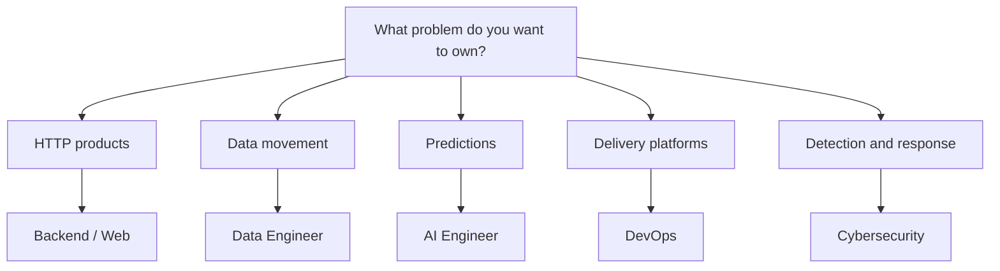

# Python Career Paths

[← All roadmaps](./README.md) · [Projects](../Projects/README.md)

Choose a role after you can write tested Python, persist data, and consume or expose an HTTP API.

## Path Comparison

| Career Path | Focus | Portfolio Evidence |
| --- | --- | --- |
| Backend Python Engineer | APIs, databases, auth, testing, observability, and system design | Deployed CRUD API with auth, tests, OpenAPI docs, and container notes |
| Data Engineer | ETL, SQL, orchestration, Pandas, PySpark, warehouses, and data quality | Restart-safe ETL pipeline with quality checks and lineage documentation |
| AI/ML Engineer | NumPy, model training, NLP, computer vision, serving, and MLOps | Trained model served behind an API with metrics and versioning |
| Automation Engineer | Scripts, CLIs, files, APIs, scheduling, and workflow automation | Installable CLI that automates a real ops or business workflow |
| DevOps / Platform Engineer | Cloud SDKs, CI/CD, containers, Kubernetes, monitoring, and infrastructure automation | Pipeline that builds, tests, and deploys a Python service with rollback |
| Cybersecurity Automation Engineer | Log parsing, network scripting, scanning workflows, enrichment, and response automation | Alert enrichment tool with secure coding notes and incident playbook |
| Full-Stack / Web Developer | Django, Flask, FastAPI, frontend integration, databases, and deployment | Full feature slice from UI through API to persistence and deploy |

## Open a Role Roadmap

| Path | Document |
| --- | --- |
| Shared sequence | [Complete Python Roadmap](./01-complete-python-roadmap.md) |
| Generalist developer | [Python Developer Roadmap](./03-python-developer-roadmap.md) |
| Backend | [Backend Engineer Roadmap](./04-backend-engineer-roadmap.md) |
| Data | [Data Engineer Roadmap](./05-data-engineer-roadmap.md) |
| AI | [AI Engineer Roadmap](./06-ai-engineer-roadmap.md) |
| DevOps | [DevOps Engineer Roadmap](./07-devops-engineer-roadmap.md) |
| Cybersecurity | [Cybersecurity Engineer Roadmap](./08-cybersecurity-engineer-roadmap.md) |

## Decision Guide

Pick the path whose **Portfolio Evidence** you are willing to build in public. The Demonstrate column on each role page is required, not optional reading.
