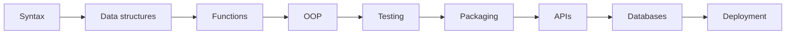

# Python Developer Roadmap

[← All roadmaps](./README.md) · [Beginner index](../Beginner/01-introduction-to-python.md)

A generalist path from first script to an installable, tested, documented project.

## Stage Plan

| Stage | Learn | Demonstrate |
| --- | --- | --- |
| 1 | Syntax | Write a small, readable script that runs from the terminal |
| 2 | Data structures | Model real records and edge cases with lists, dicts, and sets |
| 3 | Functions | Extract reusable helpers with clear inputs and return values |
| 4 | OOP | Build a small domain model with classes and validated state |
| 5 | Testing | Add automated tests for happy paths and failure cases |
| 6 | Packaging | Ship an installable package or CLI with `pyproject.toml` |
| 7 | APIs | Expose or consume a JSON HTTP API with error handling |
| 8 | Databases | Persist data with parameterized SQL or an ORM |
| 9 | Deployment | Document and deploy a production-style portfolio project |

## Lesson Sequence

| Stage | Primary lessons |
| ---: | --- |
| 1 | [Python Syntax](../Beginner/04-python-syntax.md), [IDE Setup](../Beginner/03-ide-setup.md) |
| 2 | [Lists](../Beginner/16-lists.md), [Dictionaries](../Beginner/20-dictionaries.md), [Sets](../Beginner/19-sets.md) |
| 3 | [Functions](../Beginner/21-functions.md), [Arguments and Parameters](../Beginner/22-arguments-and-parameters.md), [Modules](../Beginner/26-modules.md) |
| 4 | [Classes](../Intermediate/02-classes.md), [Encapsulation](../Intermediate/05-encapsulation.md) |
| 5 | [Unit Testing](../Intermediate/31-unit-testing.md), [Pytest](../Intermediate/32-pytest.md) |
| 6 | [Packaging Python Projects](../Intermediate/34-packaging-python-projects.md), [Virtual Environments](../Beginner/34-virtual-environments.md) |
| 7 | [API Development](../Intermediate/23-api-development.md), [Requests Library](../Intermediate/25-requests-library.md) |
| 8 | [SQLite](../Intermediate/27-sqlite.md), [SQLAlchemy ORM](../Intermediate/30-sqlalchemy-orm.md) |
| 9 | [Docker with Python](../Advanced/31-docker-with-python.md), [CI/CD Pipelines](../Advanced/38-ci-cd-pipelines.md) |

## Evidence Project

Build the [installable task CLI](../Projects/README.md), then add persistence or an HTTP client. Keep configuration out of source and tests next to the code.
