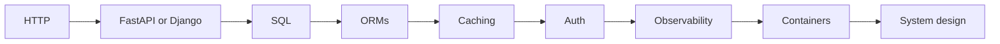

# Backend Engineer Roadmap

[← All roadmaps](./README.md) · [FastAPI](../Advanced/27-fastapi.md)

Own HTTP services: contracts, persistence, auth, observability, and safe deploys.

## Stage Plan

| Stage | Learn | Demonstrate |
| --- | --- | --- |
| 1 | HTTP | Explain methods, status codes, and idempotency with examples |
| 2 | FastAPI or Django | Build CRUD endpoints with validation and OpenAPI docs |
| 3 | SQL | Design a normalized schema and write safe parameterized queries |
| 4 | ORMs | Map domain models and relationships without N+1 surprises |
| 5 | Caching | Cache hot reads and document invalidation rules |
| 6 | Auth | Protect routes with tokens or sessions and least privilege |
| 7 | Observability | Emit structured logs, metrics, and request correlation IDs |
| 8 | Containers | Package the service in Docker with a health check |
| 9 | System design | Diagram capacity, failure modes, and scaling tradeoffs |

## Lesson Sequence

| Stage | Primary lessons |
| ---: | --- |
| 1 | [API Development](../Intermediate/23-api-development.md), [API Consumption](../Intermediate/24-api-consumption.md) |
| 2 | [FastAPI](../Advanced/27-fastapi.md), [Django](../Advanced/28-django.md), [Flask](../Advanced/29-flask.md) |
| 3 | [Database Fundamentals](../Intermediate/26-database-fundamentals.md), [PostgreSQL Integration](../Intermediate/29-postgresql-integration.md) |
| 4 | [SQLAlchemy ORM](../Intermediate/30-sqlalchemy-orm.md) |
| 5 | [Performance Optimization](../Advanced/39-performance-optimization.md) |
| 6 | [Configuration Management](../Intermediate/19-configuration-management.md), [Cybersecurity Automation](../Advanced/15-cybersecurity-automation.md) |
| 7 | [Logging](../Intermediate/18-logging.md) |
| 8 | [Docker with Python](../Advanced/31-docker-with-python.md), [Kubernetes Integration](../Advanced/32-kubernetes-integration.md) |
| 9 | [Microservices](../Advanced/30-microservices.md), [System Design with Python](../Advanced/40-system-design-with-python.md) |

## Evidence Project

Ship the [FastAPI order service](../Projects/README.md): validation, tests, OpenAPI, a container image, and a short failure-mode diagram.
