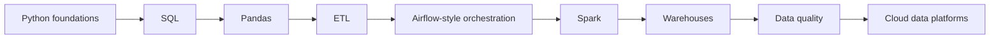

# Data Engineer Roadmap

[← All roadmaps](./README.md) · [ETL Development](../Advanced/18-etl-development.md)

Move data reliably: extract, transform, load, test quality, and make jobs restart-safe.

## Stage Plan

| Stage | Learn | Demonstrate |
| --- | --- | --- |
| 1 | Python foundations | Clean and reshape messy tabular files with scripts |
| 2 | SQL | Write joins, window functions, and incremental extracts |
| 3 | Pandas | Build reproducible DataFrame transforms with tests |
| 4 | ETL | Implement extract → transform → load with checkpoints |
| 5 | Airflow-style orchestration | Schedule DAGs with retries and clear dependencies |
| 6 | Spark | Process larger-than-memory datasets with PySpark jobs |
| 7 | Warehouses | Load curated tables into a warehouse or lakehouse |
| 8 | Data quality | Add schema checks, freshness alerts, and quarantine paths |
| 9 | Cloud data platforms | Deploy the pipeline on a cloud data stack with IAM notes |

## Lesson Sequence

| Stage | Primary lessons |
| ---: | --- |
| 1 | [File Handling](../Beginner/31-file-handling.md), [CSV Processing](../Intermediate/16-csv-processing.md), [JSON Processing](../Intermediate/15-json-processing.md) |
| 2 | [Database Fundamentals](../Intermediate/26-database-fundamentals.md), [PostgreSQL Integration](../Intermediate/29-postgresql-integration.md) |
| 3 | [Pandas](../Advanced/20-pandas.md), [NumPy](../Advanced/21-numpy.md) |
| 4 | [ETL Development](../Advanced/18-etl-development.md) |
| 5 | [Automation Frameworks](../Advanced/17-automation-frameworks.md), [Logging](../Intermediate/18-logging.md) |
| 6 | [PySpark](../Advanced/22-pyspark.md), [Parallel Computing](../Advanced/11-parallel-computing.md) |
| 7 | [Data Engineering](../Advanced/19-data-engineering.md) |
| 8 | [Exception Handling](../Beginner/32-exception-handling.md), [Unit Testing](../Intermediate/31-unit-testing.md) |
| 9 | [AWS with Python](../Advanced/34-aws-with-python.md), [GCP with Python](../Advanced/36-gcp-with-python.md), [Azure with Python](../Advanced/35-azure-with-python.md) |

## Evidence Project

Deliver the [resilient ETL pipeline](../Projects/README.md) with checkpoints, schema checks, and lineage notes. Blind reruns must not duplicate business facts.
