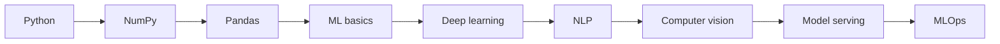

# AI Engineer Roadmap

[← All roadmaps](./README.md) · [Machine Learning](../Advanced/23-machine-learning.md)

Go from datasets to a served model with metrics, versions, and monitoring hooks.

## Stage Plan

| Stage | Learn | Demonstrate |
| --- | --- | --- |
| 1 | Python | Prepare datasets and experiment scripts cleanly |
| 2 | NumPy | Implement vectorized feature transforms |
| 3 | Pandas | Build labeled training tables with documented splits |
| 4 | ML basics | Train a baseline model and report evaluation metrics |
| 5 | Deep learning | Fine-tune or train a neural model for a real task |
| 6 | NLP | Ship a text classification or extraction prototype |
| 7 | Computer vision | Build an image model with augmentation and metrics |
| 8 | Model serving | Serve predictions through a FastAPI endpoint |
| 9 | MLOps | Version models, monitor drift, and automate retraining hooks |

## Lesson Sequence

| Stage | Primary lessons |
| ---: | --- |
| 1 | [Basic Project Structure](../Beginner/35-basic-project-structure.md), [File Handling](../Beginner/31-file-handling.md) |
| 2 | [NumPy](../Advanced/21-numpy.md) |
| 3 | [Pandas](../Advanced/20-pandas.md), [CSV Processing](../Intermediate/16-csv-processing.md) |
| 4 | [Machine Learning](../Advanced/23-machine-learning.md) |
| 5 | [Deep Learning](../Advanced/24-deep-learning.md) |
| 6 | [NLP](../Advanced/25-nlp.md) |
| 7 | [Computer Vision](../Advanced/26-computer-vision.md) |
| 8 | [FastAPI](../Advanced/27-fastapi.md), [Docker with Python](../Advanced/31-docker-with-python.md) |
| 9 | [CI/CD Pipelines](../Advanced/38-ci-cd-pipelines.md), [Performance Optimization](../Advanced/39-performance-optimization.md) |

## Evidence Project

Ship the [ML inference service](../Projects/README.md): a versioned artifact, latency notes, and an API that fails closed on invalid input.
