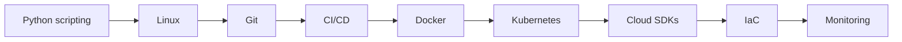

# DevOps Engineer Roadmap

[← All roadmaps](./README.md) · [CI/CD Pipelines](../Advanced/38-ci-cd-pipelines.md)

Automate delivery: scripts, images, pipelines, cloud resources, and incident-ready monitoring.

## Stage Plan

| Stage | Learn | Demonstrate |
| --- | --- | --- |
| 1 | Python scripting | Automate a repetitive ops task with clear exit codes |
| 2 | Linux | Navigate processes, permissions, and service logs confidently |
| 3 | Git | Maintain branches, reviews, and release tags cleanly |
| 4 | CI/CD | Build a pipeline that tests and packages on every commit |
| 5 | Docker | Containerize an app with a minimal, secure image |
| 6 | Kubernetes | Deploy, roll out, and roll back a workload |
| 7 | Cloud SDKs | Provision or inspect cloud resources from Python |
| 8 | IaC | Codify infrastructure and document state management |
| 9 | Monitoring | Wire health checks, alerts, and runbooks for incidents |

## Lesson Sequence

| Stage | Primary lessons |
| ---: | --- |
| 1 | [Functions](../Beginner/21-functions.md), [File Handling](../Beginner/31-file-handling.md), [CLI Applications](../Intermediate/35-cli-applications.md) |
| 2 | [Logging](../Intermediate/18-logging.md), [Exception Handling](../Beginner/32-exception-handling.md) |
| 3 | [Basic Project Structure](../Beginner/35-basic-project-structure.md), [Packaging Python Projects](../Intermediate/34-packaging-python-projects.md) |
| 4 | [CI/CD Pipelines](../Advanced/38-ci-cd-pipelines.md), [Pytest](../Intermediate/32-pytest.md) |
| 5 | [Docker with Python](../Advanced/31-docker-with-python.md) |
| 6 | [Kubernetes Integration](../Advanced/32-kubernetes-integration.md) |
| 7 | [AWS with Python](../Advanced/34-aws-with-python.md), [Azure with Python](../Advanced/35-azure-with-python.md), [GCP with Python](../Advanced/36-gcp-with-python.md) |
| 8 | [Cloud Development](../Advanced/33-cloud-development.md), [DevOps Automation](../Advanced/37-devops-automation.md) |
| 9 | [System Design with Python](../Advanced/40-system-design-with-python.md), [Configuration Management](../Intermediate/19-configuration-management.md) |

## Evidence Project

Build the [cloud automation controller](../Projects/README.md) with a dry-run mode, least-privilege notes, and a pipeline that can roll back.
