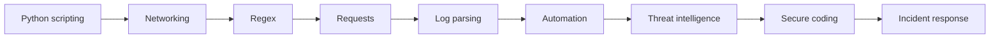

# Cybersecurity Engineer Roadmap

[← All roadmaps](./README.md) · [Cybersecurity Automation](../Advanced/15-cybersecurity-automation.md)

Use Python for defense: parse logs, enrich alerts, automate response, and write secure code.

This path is for **authorized defensive automation**, log analysis, and secure engineering. It does not teach offensive exploitation.

## Stage Plan

| Stage | Learn | Demonstrate |
| --- | --- | --- |
| 1 | Python scripting | Build a safe utility for log or file triage |
| 2 | Networking | Explain ports, protocols, and packet flows with examples |
| 3 | Regex | Extract indicators of compromise from messy text |
| 4 | Requests | Query APIs for enrichment without leaking secrets |
| 5 | Log parsing | Normalize multi-source logs into structured events |
| 6 | Automation | Orchestrate scan → enrich → ticket workflows |
| 7 | Threat intelligence | Correlate IOCs against feeds and produce analyst context |
| 8 | Secure coding | Eliminate injection, secret leakage, and unsafe deserialization |
| 9 | Incident response | Deliver a playbook-driven containment and reporting script |

## Lesson Sequence

| Stage | Primary lessons |
| ---: | --- |
| 1 | [File Handling](../Beginner/31-file-handling.md), [Exception Handling](../Beginner/32-exception-handling.md), [CLI Applications](../Intermediate/35-cli-applications.md) |
| 2 | [Network Programming](../Advanced/13-network-programming.md), [Socket Programming](../Advanced/14-socket-programming.md) |
| 3 | [Regular Expressions](../Intermediate/14-regular-expressions.md), [Strings](../Beginner/14-strings.md) |
| 4 | [Requests Library](../Intermediate/25-requests-library.md), [JSON Processing](../Intermediate/15-json-processing.md) |
| 5 | [Logging](../Intermediate/18-logging.md), [CSV Processing](../Intermediate/16-csv-processing.md) |
| 6 | [Automation Frameworks](../Advanced/17-automation-frameworks.md), [Cybersecurity Automation](../Advanced/15-cybersecurity-automation.md) |
| 7 | [API Consumption](../Intermediate/24-api-consumption.md), [Configuration Management](../Intermediate/19-configuration-management.md) |
| 8 | [Database Fundamentals](../Intermediate/26-database-fundamentals.md), [Web Scraping](../Advanced/16-web-scraping.md) |
| 9 | [System Design with Python](../Advanced/40-system-design-with-python.md) |

## Evidence Project

Produce an **alert enrichment** tool: parse logs you are authorized to read, query a documented API, never log secrets, and attach a short incident playbook. Prefer parameterized queries and explicit allowlists over scraping untrusted HTML when enrichment data is available as an API.
