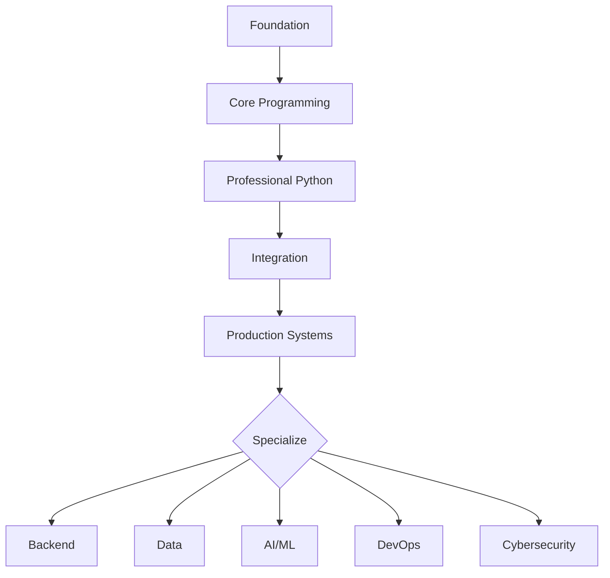
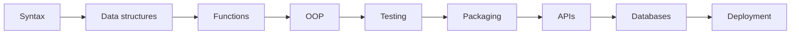
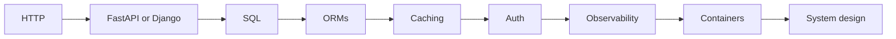
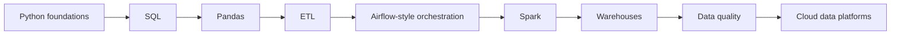
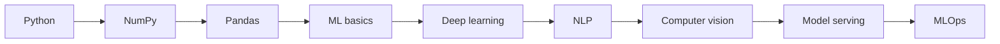
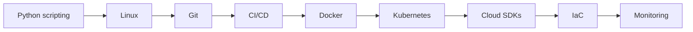
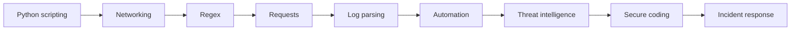

# Python Career Roadmaps

[← Knowledge base](../README.md)

Use the complete roadmap for shared foundations, then choose one role path. The **Demonstrate** column is a portfolio requirement, not an optional reading task.

## Complete Python Roadmap

| Phase | Topics | Build Evidence |
| --- | --- | --- |
| Foundation | Syntax, variables, data types, casting, IO, operators, conditions, loops | Calculator, text formatter, quiz app |
| Core Programming | Strings, collections, functions, modules, packages, files, exceptions | CLI utility, file processor, reusable module |
| Professional Python | OOP, iterators, generators, decorators, context managers, regex, JSON/CSV/XML, logging | Tested library, data parser, automation tool |
| Integration | APIs, requests, databases, ORMs, configuration, packaging, CLIs | REST client, CRUD API, installable CLI |
| Production Systems | Async, multiprocessing, design patterns, security, Docker, Kubernetes, cloud, CI/CD | Deployed service with monitoring and tests |
| Specialization | Data engineering, AI, backend, DevOps, cybersecurity, performance, system design | Portfolio project aligned to target role |

## Python Career Paths

| Career Path | Focus | Portfolio Evidence |
| --- | --- | --- |
| Backend Python Engineer | APIs, databases, auth, testing, observability, and system design | Deployed CRUD API with auth, tests, OpenAPI docs, and container notes |
| Data Engineer | ETL, SQL, orchestration, Pandas, PySpark, warehouses, and data quality | Restart-safe ETL pipeline with quality checks and lineage documentation |
| AI/ML Engineer | NumPy, model training, NLP, computer vision, serving, and MLOps | Trained model served behind an API with metrics and versioning |
| Automation Engineer | Scripts, CLIs, files, APIs, scheduling, and workflow automation | Installable CLI that automates a real ops or business workflow |
| DevOps / Platform Engineer | Cloud SDKs, CI/CD, containers, Kubernetes, monitoring, and infrastructure automation | Pipeline that builds, tests, and deploys a Python service with rollback |
| Cybersecurity Automation Engineer | Log parsing, network scripting, scanning workflows, enrichment, and response automation | Alert enrichment tool with secure coding notes and incident playbook |
| Full-Stack / Web Developer | Django, Flask, FastAPI, frontend integration, databases, and deployment | Full feature slice from UI through API to persistence and deploy |

## Python Developer Roadmap

| Stage | Learn | Demonstrate |
| --- | --- | --- |
| 1 | Syntax | Write a small, readable script that runs from the terminal |
| 2 | Data structures | Model real records and edge cases with lists, dicts, and sets |
| 3 | Functions | Extract reusable helpers with clear inputs and return values |
| 4 | OOP | Build a small domain model with classes and validated state |
| 5 | Testing | Add automated tests for happy paths and failure cases |
| 6 | Packaging | Ship an installable package or CLI with `pyproject.toml` |
| 7 | APIs | Expose or consume a JSON HTTP API with error handling |
| 8 | Databases | Persist data with parameterized SQL or an ORM |
| 9 | Deployment | Document and deploy a production-style portfolio project |

## Backend Engineer Roadmap

| Stage | Learn | Demonstrate |
| --- | --- | --- |
| 1 | HTTP | Explain methods, status codes, and idempotency with examples |
| 2 | FastAPI or Django | Build CRUD endpoints with validation and OpenAPI docs |
| 3 | SQL | Design a normalized schema and write safe parameterized queries |
| 4 | ORMs | Map domain models and relationships without N+1 surprises |
| 5 | Caching | Cache hot reads and document invalidation rules |
| 6 | Auth | Protect routes with tokens or sessions and least privilege |
| 7 | Observability | Emit structured logs, metrics, and request correlation IDs |
| 8 | Containers | Package the service in Docker with a health check |
| 9 | System design | Diagram capacity, failure modes, and scaling tradeoffs |

## Data Engineer Roadmap

| Stage | Learn | Demonstrate |
| --- | --- | --- |
| 1 | Python foundations | Clean and reshape messy tabular files with scripts |
| 2 | SQL | Write joins, window functions, and incremental extracts |
| 3 | Pandas | Build reproducible DataFrame transforms with tests |
| 4 | ETL | Implement extract → transform → load with checkpoints |
| 5 | Airflow-style orchestration | Schedule DAGs with retries and clear dependencies |
| 6 | Spark | Process larger-than-memory datasets with PySpark jobs |
| 7 | Warehouses | Load curated tables into a warehouse or lakehouse |
| 8 | Data quality | Add schema checks, freshness alerts, and quarantine paths |
| 9 | Cloud data platforms | Deploy the pipeline on a cloud data stack with IAM notes |

## AI Engineer Roadmap

| Stage | Learn | Demonstrate |
| --- | --- | --- |
| 1 | Python | Prepare datasets and experiment scripts cleanly |
| 2 | NumPy | Implement vectorized feature transforms |
| 3 | Pandas | Build labeled training tables with documented splits |
| 4 | ML basics | Train a baseline model and report evaluation metrics |
| 5 | Deep learning | Fine-tune or train a neural model for a real task |
| 6 | NLP | Ship a text classification or extraction prototype |
| 7 | Computer vision | Build an image model with augmentation and metrics |
| 8 | Model serving | Serve predictions through a FastAPI endpoint |
| 9 | MLOps | Version models, monitor drift, and automate retraining hooks |

## DevOps Engineer Roadmap

| Stage | Learn | Demonstrate |
| --- | --- | --- |
| 1 | Python scripting | Automate a repetitive ops task with clear exit codes |
| 2 | Linux | Navigate processes, permissions, and service logs confidently |
| 3 | Git | Maintain branches, reviews, and release tags cleanly |
| 4 | CI/CD | Build a pipeline that tests and packages on every commit |
| 5 | Docker | Containerize an app with a minimal, secure image |
| 6 | Kubernetes | Deploy, roll out, and roll back a workload |
| 7 | Cloud SDKs | Provision or inspect cloud resources from Python |
| 8 | IaC | Codify infrastructure and document state management |
| 9 | Monitoring | Wire health checks, alerts, and runbooks for incidents |

## Cybersecurity Engineer Roadmap

| Stage | Learn | Demonstrate |
| --- | --- | --- |
| 1 | Python scripting | Build a safe utility for log or file triage |
| 2 | Networking | Explain ports, protocols, and packet flows with examples |
| 3 | Regex | Extract indicators of compromise from messy text |
| 4 | Requests | Query APIs for enrichment without leaking secrets |
| 5 | Log parsing | Normalize multi-source logs into structured events |
| 6 | Automation | Orchestrate scan → enrich → ticket workflows |
| 7 | Threat intelligence | Correlate IOCs against feeds and produce analyst context |
| 8 | Secure coding | Eliminate injection, secret leakage, and unsafe deserialization |
| 9 | Incident response | Deliver a playbook-driven containment and reporting script |

