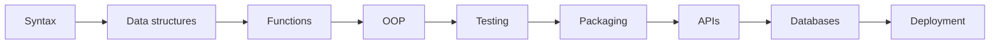
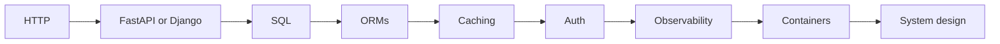
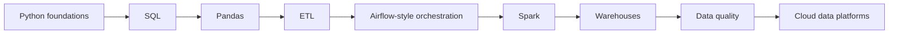
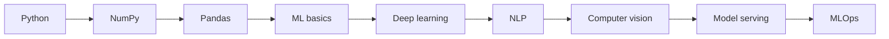
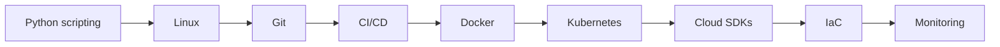
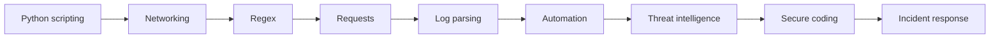

# Python Career Roadmaps

[← Knowledge base](../README.md)

Use the complete roadmap for shared foundations, then choose one role path. The “Demonstrate” column is a portfolio requirement, not an optional reading task.

## Complete Python Roadmap

| Phase | Topics | Build Evidence |
| --- | --- | --- |
| Foundation | Syntax, variables, data types, casting, IO, operators, conditions, loops | Calculator, text formatter, quiz app |
| Core Programming | Strings, collections, functions, modules, packages, files, exceptions | CLI utility, file processor, reusable module |
| Professional Python | OOP, iterators, generators, decorators, context managers, regex, JSON/CSV/XML, logging | Tested library, data parser, automation tool |
| Integration | APIs, requests, databases, ORMs, configuration, packaging, CLIs | REST client, CRUD API, installable CLI |
| Production Systems | Async, multiprocessing, design patterns, security, Docker, Kubernetes, cloud, CI/CD | Deployed service with monitoring and tests |
| Specialization | Data engineering, AI, backend, DevOps, cybersecurity, performance, system design | Portfolio project aligned to target role |

## Python Career Paths

| Career Path | Focus | Portfolio Evidence |
| --- | --- | --- |
| Backend Python Engineer | APIs, databases, auth, testing, observability, and system design | A documented project with tests, README, diagrams, and deployment notes. |
| Data Engineer | ETL, SQL, orchestration, Pandas, PySpark, warehouses, and data quality | A documented project with tests, README, diagrams, and deployment notes. |
| AI/ML Engineer | NumPy, model training, NLP, computer vision, serving, and MLOps | A documented project with tests, README, diagrams, and deployment notes. |
| Automation Engineer | Scripts, CLIs, files, APIs, scheduling, and workflow automation | A documented project with tests, README, diagrams, and deployment notes. |
| DevOps / Platform Engineer | Cloud SDKs, CI/CD, containers, Kubernetes, monitoring, and infrastructure automation | A documented project with tests, README, diagrams, and deployment notes. |
| Cybersecurity Automation Engineer | Log parsing, network scripting, scanning workflows, enrichment, and response automation | A documented project with tests, README, diagrams, and deployment notes. |
| Full-Stack / Web Developer | Django, Flask, FastAPI, frontend integration, databases, and deployment | A documented project with tests, README, diagrams, and deployment notes. |

## Python Developer Roadmap

| Stage | Learn | Demonstrate |
| --- | --- | --- |
| 1 | Syntax | Write a small, readable script. |
| 2 | Data structures | Model real data and edge cases. |
| 3 | Functions | Create a reusable component. |
| 4 | OOP | Connect to external tools or services. |
| 5 | Testing | Add tests and observability. |
| 6 | Packaging | Handle errors, security, and configuration. |
| 7 | APIs | Package or deploy the solution. |
| 8 | Databases | Document tradeoffs and architecture. |
| 9 | Deployment | Build a production-style portfolio project. |

## Backend Engineer Roadmap

| Stage | Learn | Demonstrate |
| --- | --- | --- |
| 1 | HTTP | Write a small, readable script. |
| 2 | FastAPI or Django | Model real data and edge cases. |
| 3 | SQL | Create a reusable component. |
| 4 | ORMs | Connect to external tools or services. |
| 5 | Caching | Add tests and observability. |
| 6 | Auth | Handle errors, security, and configuration. |
| 7 | Observability | Package or deploy the solution. |
| 8 | Containers | Document tradeoffs and architecture. |
| 9 | System design | Build a production-style portfolio project. |

## Data Engineer Roadmap

| Stage | Learn | Demonstrate |
| --- | --- | --- |
| 1 | Python foundations | Write a small, readable script. |
| 2 | SQL | Model real data and edge cases. |
| 3 | Pandas | Create a reusable component. |
| 4 | ETL | Connect to external tools or services. |
| 5 | Airflow-style orchestration | Add tests and observability. |
| 6 | Spark | Handle errors, security, and configuration. |
| 7 | Warehouses | Package or deploy the solution. |
| 8 | Data quality | Document tradeoffs and architecture. |
| 9 | Cloud data platforms | Build a production-style portfolio project. |

## AI Engineer Roadmap

| Stage | Learn | Demonstrate |
| --- | --- | --- |
| 1 | Python | Write a small, readable script. |
| 2 | NumPy | Model real data and edge cases. |
| 3 | Pandas | Create a reusable component. |
| 4 | ML basics | Connect to external tools or services. |
| 5 | Deep learning | Add tests and observability. |
| 6 | NLP | Handle errors, security, and configuration. |
| 7 | Computer vision | Package or deploy the solution. |
| 8 | Model serving | Document tradeoffs and architecture. |
| 9 | MLOps | Build a production-style portfolio project. |

## DevOps Engineer Roadmap

| Stage | Learn | Demonstrate |
| --- | --- | --- |
| 1 | Python scripting | Write a small, readable script. |
| 2 | Linux | Model real data and edge cases. |
| 3 | Git | Create a reusable component. |
| 4 | CI/CD | Connect to external tools or services. |
| 5 | Docker | Add tests and observability. |
| 6 | Kubernetes | Handle errors, security, and configuration. |
| 7 | Cloud SDKs | Package or deploy the solution. |
| 8 | IaC | Document tradeoffs and architecture. |
| 9 | Monitoring | Build a production-style portfolio project. |

## Cybersecurity Engineer Roadmap

| Stage | Learn | Demonstrate |
| --- | --- | --- |
| 1 | Python scripting | Write a small, readable script. |
| 2 | Networking | Model real data and edge cases. |
| 3 | Regex | Create a reusable component. |
| 4 | Requests | Connect to external tools or services. |
| 5 | Log parsing | Add tests and observability. |
| 6 | Automation | Handle errors, security, and configuration. |
| 7 | Threat intelligence | Package or deploy the solution. |
| 8 | Secure coding | Document tradeoffs and architecture. |
| 9 | Incident response | Build a production-style portfolio project. |

