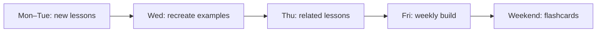

# 12-Week Intensive Python Plan

[← Study guides](./README.md) · [Beginner lessons](../Beginner/01-introduction-to-python.md)

This plan covers all **110** topic lessons in twelve weeks. Budget 10–15 hours per week: study the lesson, run all three examples, then complete the weekly build.

## Weekly Rhythm

1. Read the overview and infographic table first.
2. Recreate the beginner example from memory.
3. Change one input in the intermediate example.
4. Explain the advanced example in plain language.
5. End the week with the listed build, not extra reading.

## Schedule

| Week | Focus | Lessons | Weekly build |
| ---: | --- | --- | --- |
| 1 | Setup and data | [Introduction](../Beginner/01-introduction-to-python.md) through [Operators](../Beginner/09-operators.md) | Terminal calculator with typed inputs |
| 2 | Control flow and collections | [Conditionals](../Beginner/10-conditional-statements.md) through [Tuples](../Beginner/18-tuples.md) | Quiz engine that stores missed answers |
| 3 | Reuse | [Sets](../Beginner/19-sets.md) through [Packages](../Beginner/27-packages.md) | Module that formats and totals records |
| 4 | Files and hygiene | [Date and Time](../Beginner/28-date-and-time.md) through [Project Structure](../Beginner/35-basic-project-structure.md) | [Expense tracker CLI](../Projects/01-expense-tracker-cli.md), then the [beginner checkpoint](../Assessments/01-beginner-checkpoint.md) |
| 5 | Objects | [OOP](../Intermediate/01-object-oriented-programming.md) through [Magic Methods](../Intermediate/09-magic-methods.md) | Inventory domain model with validation |
| 6 | Protocols and data files | [Iterators](../Intermediate/10-iterators.md) through [Logging](../Intermediate/18-logging.md) | CSV/JSON parser with structured logs |
| 7 | Concurrency and persistence | [Configuration](../Intermediate/19-configuration-management.md) through [SQLite](../Intermediate/27-sqlite.md) | Config-driven SQLite CRUD tool |
| 8 | Quality and packaging | [MySQL](../Intermediate/28-mysql-integration.md) through [CLI Applications](../Intermediate/35-cli-applications.md) | [Installable task CLI](../Projects/04-installable-task-cli.md), then the [intermediate checkpoint](../Assessments/02-intermediate-checkpoint.md) |
| 9 | Internals | [Data Structures Internals](../Advanced/01-data-structures-internals.md) through [Concurrency](../Advanced/10-concurrency.md) | Benchmark two data-structure choices |
| 10 | Data platforms | [Parallel Computing](../Advanced/11-parallel-computing.md) through [Pandas](../Advanced/20-pandas.md) | Restart-safe ETL sketch with quality checks |
| 11 | AI and web | [NumPy](../Advanced/21-numpy.md) through [Microservices](../Advanced/30-microservices.md) | FastAPI service with a baseline model or CRUD slice |
| 12 | Production | [Docker](../Advanced/31-docker-with-python.md) through [System Design](../Advanced/40-system-design-with-python.md) | Containerized service, the [advanced checkpoint](../Assessments/03-advanced-checkpoint.md), and [career roadmap](../Roadmaps/README.md) evidence |

## Completion Gate

You finish the intensive track when all of the following are true:

- Every weekly build runs from a virtual environment.
- One project from [Projects](../Projects/README.md) meets the definition of done.
- You score at least 10/12 on each [checkpoint](../Assessments/README.md).
- You can teach one beginner, one intermediate, and one advanced topic without notes.
- You have followed one role path in [Roadmaps](../Roadmaps/README.md) through its **Demonstrate** column.
