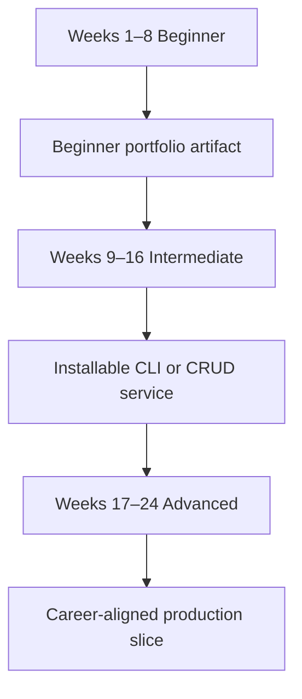

# 24-Week Python Mastery Plan

[← Study guides](./README.md) · [Roadmaps](../Roadmaps/README.md)

This plan is for working learners. Study about **five topics per week**, keep a running notes file, and ship a small artifact every fourth week.

## Cadence

| Day | Action |
| --- | --- |
| Day 1–2 | Read two lessons and run their beginner examples |
| Day 3 | Recreate one intermediate example with new data |
| Day 4 | Read the next two lessons |
| Day 5 | Explain one workflow diagram aloud and answer two [interview prompts](../Interview-Questions/README.md) |
| Weekend | Optional: extend the current four-week artifact |

## Beginner · Weeks 1–8

| Week | Lessons | Artifact |
| ---: | --- | --- |
| 1 | [Introduction](../Beginner/01-introduction-to-python.md) → [Variables](../Beginner/05-variables.md) | `hello.py` that prints a typed report |
| 2 | [Data Types](../Beginner/06-data-types.md) → [Operators](../Beginner/09-operators.md) | Conversion and calculator functions |
| 3 | [Conditionals](../Beginner/10-conditional-statements.md) → [Strings](../Beginner/14-strings.md) | Decision-based text formatter |
| 4 | [String Methods](../Beginner/15-string-methods.md) → [Tuples](../Beginner/18-tuples.md) | Contact list stored as tuples and lists |
| 5 | [Sets](../Beginner/19-sets.md) → [Return Statements](../Beginner/23-return-statements.md) | Deduplicating report function |
| 6 | [Scope](../Beginner/24-scope.md) → [Packages](../Beginner/27-packages.md) | Small package with `__init__.py` |
| 7 | [Date and Time](../Beginner/28-date-and-time.md) → [File Handling](../Beginner/31-file-handling.md) | Dated log writer |
| 8 | [Exceptions](../Beginner/32-exception-handling.md) → [Project Structure](../Beginner/35-basic-project-structure.md) | [Expense tracker CLI](../Projects/01-expense-tracker-cli.md) and the [beginner checkpoint](../Assessments/01-beginner-checkpoint.md) |

## Intermediate · Weeks 9–16

| Week | Lessons | Artifact |
| ---: | --- | --- |
| 9 | [OOP](../Intermediate/01-object-oriented-programming.md) → [Encapsulation](../Intermediate/05-encapsulation.md) | Validated domain class |
| 10 | [Inheritance](../Intermediate/06-inheritance.md) → [Iterators](../Intermediate/10-iterators.md) | Custom collection with `__iter__` |
| 11 | [Generators](../Intermediate/11-generators.md) → [Regex](../Intermediate/14-regular-expressions.md) | Log extractor generator |
| 12 | [JSON](../Intermediate/15-json-processing.md) → [Logging](../Intermediate/18-logging.md) | JSON/CSV transformer with logs |
| 13 | [Configuration](../Intermediate/19-configuration-management.md) → [Async](../Intermediate/22-async-programming.md) | Bounded concurrent URL checker |
| 14 | [API Development](../Intermediate/23-api-development.md) → [Database Fundamentals](../Intermediate/26-database-fundamentals.md) | HTTP handler with parameterized SQL notes |
| 15 | [SQLite](../Intermediate/27-sqlite.md) → [SQLAlchemy](../Intermediate/30-sqlalchemy-orm.md) | [Inventory service](../Projects/06-inventory-service.md) |
| 16 | [Unit Testing](../Intermediate/31-unit-testing.md) → [CLI Applications](../Intermediate/35-cli-applications.md) | [Installable task CLI](../Projects/04-installable-task-cli.md) and the [intermediate checkpoint](../Assessments/02-intermediate-checkpoint.md) |

## Advanced · Weeks 17–24

| Week | Lessons | Artifact |
| ---: | --- | --- |
| 17 | [Data Structures Internals](../Advanced/01-data-structures-internals.md) → [Memory Management](../Advanced/05-memory-management.md) | Complexity notes on a real function |
| 18 | [Garbage Collection](../Advanced/06-garbage-collection.md) → [Concurrency](../Advanced/10-concurrency.md) | Thread vs process vs async comparison |
| 19 | [Parallel Computing](../Advanced/11-parallel-computing.md) → [Cybersecurity Automation](../Advanced/15-cybersecurity-automation.md) | Safe log-triage utility |
| 20 | [Web Scraping](../Advanced/16-web-scraping.md) → [Pandas](../Advanced/20-pandas.md) | [Resilient ETL pipeline](../Projects/09-resilient-etl-pipeline.md) sketch |
| 21 | [NumPy](../Advanced/21-numpy.md) → [Computer Vision](../Advanced/26-computer-vision.md) | Baseline model notebook or script |
| 22 | [FastAPI](../Advanced/27-fastapi.md) → [Docker](../Advanced/31-docker-with-python.md) | OpenAPI service in a container |
| 23 | [Kubernetes](../Advanced/32-kubernetes-integration.md) → [DevOps Automation](../Advanced/37-devops-automation.md) | CI pipeline notes and health checks |
| 24 | [CI/CD](../Advanced/38-ci-cd-pipelines.md) → [System Design](../Advanced/40-system-design-with-python.md) | Architecture diagram, the [advanced checkpoint](../Assessments/03-advanced-checkpoint.md), and a chosen [roadmap](../Roadmaps/README.md) |

## Four-Week Review Questions

At the end of weeks 8, 16, and 24, answer these without looking:

1. What failed this month, and how did you debug it?
2. Which collection, object, or service boundary would you change?
3. What evidence would you show a hiring manager?
