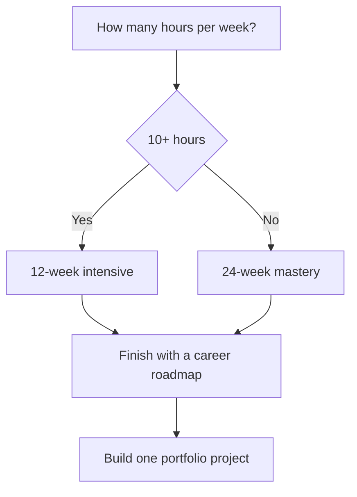

# Python Study Guides

[← Knowledge base](../README.md)

Use these guides when you want a calendar, a publishing recipe, or a map between the 110 topic lessons and the older deep-dive curriculum.

## Guides

| Guide | Best for |
| --- | --- |
| [NotebookLM, Obsidian, and Notion](./notebooklm-obsidian-notion.md) | Importing this knowledge base into a notes app or NotebookLM source set |
| [12-week intensive plan](./12-week-plan.md) | Full-time learners covering all 110 topics plus one portfolio project |
| [24-week mastery plan](./24-week-plan.md) | Working learners studying about five topics per week with spaced practice |
| [Deep-dive crosswalk](./deep-dive-crosswalk.md) | Moving between `Python-Mastery/` lessons and `python-learning-roadmap/` units |

## How to Choose a Pace

## Companion Starting Points

| If you want… | Start here |
| --- | --- |
| Visual overview | [Infographics](../Infographics/) |
| Fast syntax lookup | [Cheat Sheets](../CheatSheets/) |
| Active recall | [Interview Questions](../Interview-Questions/) |
| Portfolio briefs | [Projects](../Projects/) |
| Role sequences | [Roadmaps](../Roadmaps/) |
