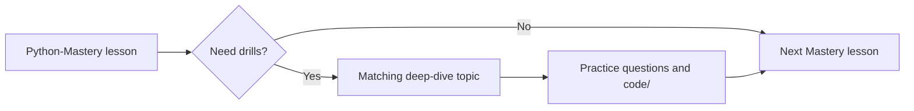

# Deep-Dive Curriculum Crosswalk

[← Study guides](./README.md) · [Deep-dive curriculum](../../python-learning-roadmap/README.md)

`Python-Mastery/` is the canonical 110-topic knowledge base. `python-learning-roadmap/` is the older nested companion with practice questions and runnable example files. Use this table to move between them without losing your place.

## How to Use Both Editions

| Need | Use |
| --- | --- |
| One lesson per concept, NotebookLM/Obsidian friendly | `Python-Mastery/{Beginner,Intermediate,Advanced}/` |
| Nested units, practice questions, and `.py` example files | `python-learning-roadmap/level-*/` |
| Single-page search | Root [`README.md`](../../README.md) |

## Level 1 · Beginner

| Deep-dive topic | Python-Mastery lessons |
| --- | --- |
| [Python Setup and Program Execution](../../python-learning-roadmap/level-1-beginner/01-python-setup-and-program-execution/) | [Introduction](../Beginner/01-introduction-to-python.md), [Installing Python](../Beginner/02-installing-python.md), [IDE Setup](../Beginner/03-ide-setup.md), [Python Syntax](../Beginner/04-python-syntax.md) |
| [Variables, Data Types, and Operators](../../python-learning-roadmap/level-1-beginner/02-variables-data-types-and-operators/) | [Variables](../Beginner/05-variables.md), [Data Types](../Beginner/06-data-types.md), [Type Casting](../Beginner/07-type-casting.md), [Input and Output](../Beginner/08-input-and-output.md), [Operators](../Beginner/09-operators.md) |
| [Strings and Collections](../../python-learning-roadmap/level-1-beginner/03-strings-and-collections/) | [Strings](../Beginner/14-strings.md), [String Methods](../Beginner/15-string-methods.md), [Lists](../Beginner/16-lists.md), [List Methods](../Beginner/17-list-methods.md), [Tuples](../Beginner/18-tuples.md), [Sets](../Beginner/19-sets.md), [Dictionaries](../Beginner/20-dictionaries.md) |
| [Control Flow](../../python-learning-roadmap/level-1-beginner/04-control-flow/) | [Conditionals](../Beginner/10-conditional-statements.md), [Loops](../Beginner/11-loops.md), [Nested Loops](../Beginner/12-nested-loops.md), [Break Continue Pass](../Beginner/13-break-continue-pass.md) |
| [Functions, Modules, and Files](../../python-learning-roadmap/level-1-beginner/05-functions-modules-and-files/) | [Functions](../Beginner/21-functions.md) through [Basic Project Structure](../Beginner/35-basic-project-structure.md) |

## Level 2 · Intermediate

| Deep-dive topic | Python-Mastery lessons |
| --- | --- |
| [Object-Oriented Programming](../../python-learning-roadmap/level-2-intermediate/06-object-oriented-programming/) | [OOP](../Intermediate/01-object-oriented-programming.md) through [Magic Methods](../Intermediate/09-magic-methods.md) |
| [Comprehensions, Iterators, and Generators](../../python-learning-roadmap/level-2-intermediate/07-comprehensions-iterators-and-generators/) | [Iterators](../Intermediate/10-iterators.md), [Generators](../Intermediate/11-generators.md) |
| [Exceptions, Debugging, and Logging](../../python-learning-roadmap/level-2-intermediate/08-exceptions-debugging-and-logging/) | [Exception Handling](../Beginner/32-exception-handling.md), [Debugging Basics](../Beginner/33-debugging-basics.md), [Logging](../Intermediate/18-logging.md) |
| [Testing, Typing, and Code Quality](../../python-learning-roadmap/level-2-intermediate/09-testing-typing-and-code-quality/) | [Unit Testing](../Intermediate/31-unit-testing.md), [Pytest](../Intermediate/32-pytest.md), [Mocking](../Intermediate/33-mocking.md) |
| [Virtual Environments, Packaging, and Dependencies](../../python-learning-roadmap/level-2-intermediate/10-virtual-environments-packaging-and-dependencies/) | [Virtual Environments](../Beginner/34-virtual-environments.md), [Packaging](../Intermediate/34-packaging-python-projects.md), [CLI Applications](../Intermediate/35-cli-applications.md) |

## Level 3 · Advanced

| Deep-dive topic | Python-Mastery lessons |
| --- | --- |
| [Decorators, Context Managers, and Metaprogramming](../../python-learning-roadmap/level-3-advanced/11-decorators-context-managers-and-metaprogramming/) | [Decorators](../Intermediate/12-decorators.md), [Context Managers](../Intermediate/13-context-managers.md), [Metaclasses](../Advanced/08-metaclasses.md), [Descriptors](../Advanced/09-descriptors.md) |
| [Concurrency, Parallelism, and Async IO](../../python-learning-roadmap/level-3-advanced/12-concurrency-parallelism-and-async-io/) | [Multithreading](../Intermediate/20-multithreading.md), [Multiprocessing](../Intermediate/21-multiprocessing.md), [Async](../Intermediate/22-async-programming.md), [Concurrency](../Advanced/10-concurrency.md), [Parallel Computing](../Advanced/11-parallel-computing.md) |
| [Data Engineering, APIs, and Databases](../../python-learning-roadmap/level-3-advanced/13-data-engineering-apis-and-databases/) | [JSON](../Intermediate/15-json-processing.md) through [SQLAlchemy](../Intermediate/30-sqlalchemy-orm.md), plus [ETL](../Advanced/18-etl-development.md), [Data Engineering](../Advanced/19-data-engineering.md), [Pandas](../Advanced/20-pandas.md), [NumPy](../Advanced/21-numpy.md), [PySpark](../Advanced/22-pyspark.md) |
| [Performance, Memory, and Profiling](../../python-learning-roadmap/level-3-advanced/14-performance-memory-and-profiling/) | [Data Structures Internals](../Advanced/01-data-structures-internals.md), [Algorithms](../Advanced/02-algorithms-in-python.md), [Memory](../Advanced/05-memory-management.md), [Garbage Collection](../Advanced/06-garbage-collection.md), [Python Internals](../Advanced/07-python-internals.md), [Performance Optimization](../Advanced/39-performance-optimization.md) |
| [Production Architecture, Security, and Deployment](../../python-learning-roadmap/level-3-advanced/15-production-architecture-security-and-deployment/) | [Design Patterns](../Advanced/03-design-patterns.md), [SOLID](../Advanced/04-solid-principles.md), [FastAPI](../Advanced/27-fastapi.md) through [System Design](../Advanced/40-system-design-with-python.md) |
