# PYTHON LEARNING ROADMAP

> A complete Python knowledge base in README format for GitHub, NotebookLM, Obsidian, Notion, and documentation portals.

This guide is written for students, instructors, technical writers, curriculum architects, and working engineers who need a structured path from first Python syntax to production-grade systems.

## How to Use This Knowledge Base

- Study one topic at a time: overview, objectives, real-world value, concepts, infographic, syntax, examples, and workflow.
- Run the beginner example, modify the intermediate example, and explain the advanced example.
- Use the final roadmaps to connect topics to career outcomes.
- Use [`Python-Mastery/`](./Python-Mastery/) for the ready-made, topic-by-topic NotebookLM, Obsidian, Notion, and documentation-portal edition.

## Choose Your Edition

| Edition | Best for | Open |
| --- | --- | --- |
| Single-page knowledge base | GitHub browsing, full-text search, and one-source import | Continue below |
| Topic-by-topic knowledge base | NotebookLM source selection, Obsidian vaults, Notion imports, and focused study | [`Python-Mastery/`](./Python-Mastery/) |
| Deep-dive curriculum | Smaller learning units, practice questions, and runnable examples | [`python-learning-roadmap/`](./python-learning-roadmap/) |
| Supplemental book | Additional repetition and practice | [`A Smarter Way to Learn Python .pdf`](./A%20Smarter%20Way%20to%20Learn%20Python%20.pdf) |

## Knowledge Base Architecture

| Level | Purpose | Outcome |
| --- | --- | --- |
| Level 1: Beginner | Learn syntax, data, control flow, functions, files, and setup. | Build small scripts confidently. |
| Level 2: Intermediate | Learn OOP, data formats, logging, concurrency, APIs, databases, testing, and packaging. | Build maintainable applications and tools. |
| Level 3: Advanced | Learn internals, architecture, data/AI, frameworks, cloud, DevOps, security, and performance. | Design production-grade Python systems. |

## Complete Topic Index

#

## Level 1: Beginner

---

# Introduction to Python

## Overview
- **What is it?** Python is a high-level, general-purpose language whose readable source code is executed by a Python interpreter.
- **Why is it important?** Its small syntax and large standard library let beginners turn ideas into working programs quickly.
- **Where is it used?** Python powers automation, web services, data analysis, testing, education, and machine learning.

## Learning Objectives
- Distinguish source code, the interpreter, and program output.
- Run a Python statement and read a simple traceback.
- Recognize Python's strengths and the trade-off of choosing a general-purpose language.

## Real World Applications
- Automate repetitive file or reporting tasks.
- Prototype web, data, and scientific ideas.
- Write readable utilities that teams can maintain.

## Core Concepts

### Interpreter and source
- **Definition:** A `.py` file contains text; the interpreter parses and executes that text as instructions.
- **Visual explanation:** `program.py -> Python interpreter -> effects and output`
- **Practical example:** A first statement sends text to standard output.

```python
print("Hello, Python!")
```

### Values and operations
- **Definition:** Python programs create values and combine them with operations such as addition or function calls.
- **Visual explanation:** `values -> expression -> new value`
- **Practical example:** A numeric expression is evaluated before it is printed.

```python
minutes = 2 * 60
print(minutes)
```

### Readable composition
- **Definition:** Larger programs combine named data, decisions, repetition, and reusable functions.
- **Visual explanation:** `data + control flow + functions -> program`
- **Practical example:** A function turns a name into a reusable greeting.

```python
def greet(name):
    return f"Welcome, {name}!"

print(greet("Mina"))
```

## Infographic Summary

| Infographic Block | Topic-Specific Takeaway |
| --- | --- |
| 📌 Concept | Python is a high-level, general-purpose language whose readable source code is executed by a Python interpreter. |
| ⚡ Purpose | Turn readable source code into executable instructions and useful program output. |
| 🔥 Benefits | Its small syntax and large standard library let beginners turn ideas into working programs quickly. |
| 🎯 Use Cases | Python powers automation, web services, data analysis, testing, education, and machine learning. |
| 🚀 Best Practices | Start with a small runnable program, then change one thing and observe the result. |
| ❌ Common Mistakes | Treating Python as only a calculator instead of learning how values and statements compose. |

## Syntax Guide

### Basic Syntax

```python
print("Python is running")
```

### Standard Structure

```python
language = "Python"
version = 3
print(f"{language} {version}")
```

### Code Pattern

```python
def describe(topic):
    message = f"Learning {topic}"
    return message

print(describe("Python"))
```

## Examples

### Beginner Example

```python
print("Hello, world!")
```

### Intermediate Example

```python
name = "Ari"
hours = 3
print(f"{name} practiced Python for {hours} hours.")
```

### Advanced Example

```python
def progress_report(name, completed, total):
    percent = completed / total * 100
    return f"{name}: {percent:.0f}% complete"

print(progress_report("Ari", 7, 10))
```

## Workflow Diagram

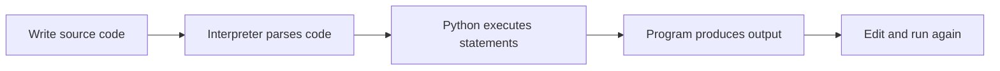

[Back to complete topic index](#complete-topic-index)

---

# Installing Python

## Overview
- **What is it?** Installing Python provides the interpreter, standard library, and package installer needed to run local programs.
- **Why is it important?** A verified installation prevents command, version, and path problems before coding begins.
- **Where is it used?** Developers install Python on workstations, build servers, classrooms, and automation hosts.

## Learning Objectives
- Choose a supported Python 3 release from a trusted source.
- Verify the interpreter and pip through the same Python executable.
- Diagnose a missing command or unexpected executable path.

## Real World Applications
- Prepare a laptop for coursework.
- Match a team's supported runtime version.
- Confirm which interpreter a deployment or script uses.

## Core Concepts

### Interpreter installation
- **Definition:** The installation places a Python executable and its standard library on the system.
- **Visual explanation:** `installer -> executable + standard library`
- **Practical example:** Python can report its own runtime version.

```python
import platform
print(platform.python_version())
```

### Command resolution
- **Definition:** The shell searches its `PATH` to decide which executable a command name starts.
- **Visual explanation:** `python command -> PATH search -> executable`
- **Practical example:** The `sys.executable` path identifies the running interpreter.

```python
import sys
print(sys.executable)
```

### Installer verification
- **Definition:** `python -m pip` runs pip with the selected interpreter, avoiding a mismatched standalone pip command.
- **Visual explanation:** `selected Python -> -m pip -> matching site-packages`
- **Practical example:** Python can invoke pip's version check as a subprocess.

```python
import subprocess
import sys

subprocess.run([sys.executable, "-m", "pip", "--version"], check=True)
```

## Infographic Summary

| Infographic Block | Topic-Specific Takeaway |
| --- | --- |
| 📌 Concept | Installing Python provides the interpreter, standard library, and package installer needed to run local programs. |
| ⚡ Purpose | Provide a verified interpreter, standard library, and package installer for local Python work. |
| 🔥 Benefits | A verified installation prevents command, version, and path problems before coding begins. |
| 🎯 Use Cases | Developers install Python on workstations, build servers, classrooms, and automation hosts. |
| 🚀 Best Practices | Use the official installer or operating-system package manager and verify both version and executable path. |
| ❌ Common Mistakes | Running `pip` and `python` from different installations without checking which interpreter owns the packages. |

## Syntax Guide

### Basic Syntax

```python
import sys
print(sys.version)
```

### Standard Structure

```python
import sys
print(f"Executable: {sys.executable}")
print(f"Version: {sys.version_info.major}.{sys.version_info.minor}")
```

### Code Pattern

```python
import shutil
import sys

command = shutil.which("python3") or shutil.which("python")
print({"running": sys.executable, "shell_command": command})
```

## Examples

### Beginner Example

```python
import platform
print(platform.python_version())
```

### Intermediate Example

```python
import sys
minimum = (3, 10)
print("Supported:", sys.version_info >= minimum)
```

### Advanced Example

```python
import subprocess
import sys

result = subprocess.run(
    [sys.executable, "-c", "print(6 * 7)"],
    capture_output=True,
    text=True,
    check=True,
)
print(result.stdout.strip())
```

## Workflow Diagram

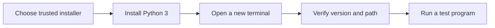

[Back to complete topic index](#complete-topic-index)

---

# IDE Setup

## Overview
- **What is it?** IDE setup connects an editor to a chosen Python interpreter, terminal, formatter, linter, and debugger.
- **Why is it important?** Correct configuration shortens the write-run-inspect cycle and exposes mistakes early.
- **Where is it used?** The same workflow supports lessons, scripts, team projects, and remote development.

## Learning Objectives
- Select the intended interpreter for a workspace.
- Run a file and pause execution with a breakpoint.
- Separate editor assistance from behavior enforced by Python itself.

## Real World Applications
- Navigate and edit multi-file projects.
- Inspect variables while troubleshooting.
- Apply consistent formatting and diagnostics across a team.

## Core Concepts

### Interpreter selection
- **Definition:** The IDE must launch the same Python environment that owns the project's dependencies.
- **Visual explanation:** `workspace -> selected interpreter -> run and debug`
- **Practical example:** The running file can display the selected executable.

```python
import sys
print(sys.executable)
```

### Feedback tools
- **Definition:** A formatter changes layout, while a linter reports suspicious or inconsistent code.
- **Visual explanation:** `source -> formatter and linter -> clearer source`
- **Practical example:** Type annotations give IDEs useful information without forcing runtime types.

```python
def total(items: list[float]) -> float:
    return sum(items)

print(total([2.5, 3.0]))
```

### Debugger state
- **Definition:** A debugger pauses at a breakpoint so the current call stack and variable values can be inspected.
- **Visual explanation:** `breakpoint -> paused frame -> inspect -> step or continue`
- **Practical example:** This loop provides changing state worth stepping through.

```python
running_total = 0
for amount in [4, 7, 2]:
    running_total += amount
print(running_total)
```

## Infographic Summary

| Infographic Block | Topic-Specific Takeaway |
| --- | --- |
| 📌 Concept | IDE setup connects an editor to a chosen Python interpreter, terminal, formatter, linter, and debugger. |
| ⚡ Purpose | Connect an editor to the project interpreter and tools used to run, inspect, and debug code. |
| 🔥 Benefits | Correct configuration shortens the write-run-inspect cycle and exposes mistakes early. |
| 🎯 Use Cases | The same workflow supports lessons, scripts, team projects, and remote development. |
| 🚀 Best Practices | Open the project folder, select its interpreter, and run a known file before installing optional editor extensions. |
| ❌ Common Mistakes | Trusting an IDE's default interpreter when the terminal or project uses a different one. |

## Syntax Guide

### Basic Syntax

```python
print("IDE run configuration works")
```

### Standard Structure

```python
import sys
print({"python": sys.executable, "debug": __debug__})
```

### Code Pattern

```python
def average(values: list[int]) -> float:
    return sum(values) / len(values)

scores = [80, 92, 88]
print(average(scores))
```

## Examples

### Beginner Example

```python
message = "Set a breakpoint here"
print(message)
```

### Intermediate Example

```python
subtotal = 0
for price in [12, 8, 5]:
    subtotal += price
print(subtotal)
```

### Advanced Example

```python
def find_first_even(numbers):
    for index, number in enumerate(numbers):
        if number % 2 == 0:
            return index, number
    return None

print(find_first_even([3, 9, 12, 15]))
```

## Workflow Diagram

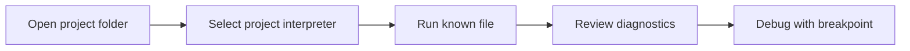

[Back to complete topic index](#complete-topic-index)

---

# Python Syntax

## Overview
- **What is it?** Python syntax is the grammar that defines valid tokens, expressions, statements, indentation, and code blocks.
- **Why is it important?** Syntax determines how Python groups instructions; invalid grammar stops before the program can run.
- **Where is it used?** Every Python file, interactive command, function, class, and control-flow block follows these rules.

## Learning Objectives
- Use indentation and colons to form blocks.
- Distinguish expressions, statements, comments, and identifiers.
- Interpret a `SyntaxError` location and correct the grammar.

## Real World Applications
- Express business rules as readable blocks.
- Review code structure before runtime behavior.
- Create scripts that tools can parse consistently.

## Core Concepts

### Statements and expressions
- **Definition:** An expression produces a value; a statement performs an action such as assignment or import.
- **Visual explanation:** `tokens -> expression or statement -> parsed instruction`
- **Practical example:** The right side is an expression inside an assignment statement.

```python
total = 4 + 6
print(total)
```

### Indented blocks
- **Definition:** A colon starts a suite whose consistently indented statements belong to the preceding construct.
- **Visual explanation:** `header with colon -> indented suite -> next outer statement`
- **Practical example:** Only the indented print belongs to the `if` block.

```python
ready = True
if ready:
    print("Starting")
print("Finished")
```

### Names and comments
- **Definition:** Identifiers name program elements; comments begin with `#` and are ignored by the parser.
- **Visual explanation:** `identifier = expression  # explanation`
- **Practical example:** Valid snake_case names make statement roles visible.

```python
# Calculate the price after a discount.
base_price = 50
discounted_price = base_price * 0.8
print(discounted_price)
```

## Infographic Summary

| Infographic Block | Topic-Specific Takeaway |
| --- | --- |
| 📌 Concept | Python syntax is the grammar that defines valid tokens, expressions, statements, indentation, and code blocks. |
| ⚡ Purpose | Define the valid grammar and block structure that the Python interpreter can parse. |
| 🔥 Benefits | Syntax determines how Python groups instructions; invalid grammar stops before the program can run. |
| 🎯 Use Cases | Every Python file, interactive command, function, class, and control-flow block follows these rules. |
| 🚀 Best Practices | Indent with four spaces, close delimiters, and read syntax errors from the indicated line plus the line before it. |
| ❌ Common Mistakes | Confusing syntax rules with variable design: syntax permits `x`, but clear naming determines whether `x` communicates meaning. |

## Syntax Guide

### Basic Syntax

```python
course = "Python"
print(course)
```

### Standard Structure

```python
temperature = 18
if temperature < 20:
    print("Bring a jacket")
else:
    print("Light clothing is enough")
```

### Code Pattern

```python
def label_score(score):
    if score >= 90:
        return "excellent"
    return "developing"

print(label_score(94))
```

## Examples

### Beginner Example

```python
message = "Valid Python syntax"
print(message)
```

### Intermediate Example

```python
for number in range(3):
    square = number ** 2
    print(number, square)
```

### Advanced Example

```python
def shipping_cost(total, member=False):
    if member or total >= 75:
        return 0
    return 8

print(shipping_cost(54, member=True))
```

## Workflow Diagram

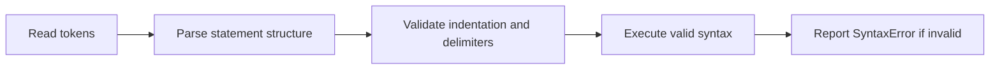

[Back to complete topic index](#complete-topic-index)

---

# Variables

## Overview
- **What is it?** A variable is a name bound to a Python object; assignment changes which object that name references.
- **Why is it important?** Meaningful names let programs retain and update state without repeating literal values.
- **Where is it used?** Variables represent measurements, configuration, user state, counters, and intermediate results.

## Learning Objectives
- Create and reassign names with `=`.
- Choose descriptive snake_case identifiers and constants by convention.
- Explain aliasing when two names refer to the same mutable object.

## Real World Applications
- Track an order total or game score.
- Store configuration used by several statements.
- Name intermediate calculations for review and debugging.

## Core Concepts

### Name binding
- **Definition:** Assignment evaluates the right side, then binds the resulting object to the name on the left.
- **Visual explanation:** `expression -> object <- variable name`
- **Practical example:** The name describes the value used later.

```python
lesson_count = 35
print(lesson_count)
```

### Reassignment
- **Definition:** Reassignment points an existing name at a new object; it does not edit the old immutable value.
- **Visual explanation:** `score -> 10, then score -> 15`
- **Practical example:** A counter is rebound after addition.

```python
score = 10
score = score + 5
print(score)
```

### Aliasing mutable data
- **Definition:** Assigning one list name to another copies the reference, so mutation through either name affects one list.
- **Visual explanation:** `first -> list object <- second`
- **Practical example:** Appending through the alias changes the shared object.

```python
primary = ["red", "blue"]
alias = primary
alias.append("green")
print(primary)
```

## Infographic Summary

| Infographic Block | Topic-Specific Takeaway |
| --- | --- |
| 📌 Concept | A variable is a name bound to a Python object; assignment changes which object that name references. |
| ⚡ Purpose | Bind meaningful names to values so program state can be read, reused, and updated. |
| 🔥 Benefits | Meaningful names let programs retain and update state without repeating literal values. |
| 🎯 Use Cases | Variables represent measurements, configuration, user state, counters, and intermediate results. |
| 🚀 Best Practices | Name values by purpose, initialize them near first use, and copy mutable data when independent state is required. |
| ❌ Common Mistakes | Assuming `alias = original` creates an independent copy of a list. |

## Syntax Guide

### Basic Syntax

```python
student_name = "Noor"
completed_lessons = 4
```

### Standard Structure

```python
unit_price = 12.50
quantity = 3
subtotal = unit_price * quantity
print(subtotal)
```

### Code Pattern

```python
items = ["book", "pen"]
backup = items.copy()
items.append("paper")
print(items, backup)
```

## Examples

### Beginner Example

```python
city = "Lagos"
print(city)
```

### Intermediate Example

```python
balance = 100
withdrawal = 35
balance -= withdrawal
print(balance)
```

### Advanced Example

```python
cart = {"items": 3, "subtotal": 48.0}
tax_rate = 0.075
tax = cart["subtotal"] * tax_rate
grand_total = cart["subtotal"] + tax
print(f"${grand_total:.2f}")
```

## Workflow Diagram

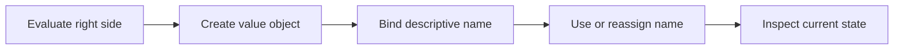

[Back to complete topic index](#complete-topic-index)

---

# Data Types

## Overview
- **What is it?** A data type defines a value's representation, supported operations, and behavior.
- **Why is it important?** Choosing the right type prevents meaningless operations and models information accurately.
- **Where is it used?** Programs use numbers, booleans, text, collections, mappings, and `None` for missing values.

## Learning Objectives
- Identify common built-in types with `type` and `isinstance`.
- Select scalar or collection types that fit the data.
- Explain mutability and why it affects updates and sharing.

## Real World Applications
- Represent prices, labels, and yes/no flags.
- Group records in lists, tuples, sets, or dictionaries.
- Model an intentionally absent result with `None`.

## Core Concepts

### Scalar types
- **Definition:** `int`, `float`, `bool`, and `NoneType` represent individual numeric, logical, or absent values.
- **Visual explanation:** `value -> type -> allowed operations`
- **Practical example:** Different literal forms create different types.

```python
count = 3
rate = 1.5
active = True
print(type(count), type(rate), type(active))
```

### Collection types
- **Definition:** Lists and tuples are sequences, sets hold unique hashable values, and dictionaries map keys to values.
- **Visual explanation:** `many values -> sequence, set, or mapping`
- **Practical example:** One record uses a dictionary while tags use a set.

```python
course = {"title": "Python", "lessons": 35}
tags = {"beginner", "python"}
print(course["title"], tags)
```

### Mutability
- **Definition:** Mutable objects can change in place; immutable objects require a new value for any apparent update.
- **Visual explanation:** `list -> mutate same object; string -> create new string`
- **Practical example:** The list changes, while `upper` is a separate string.

```python
topics = ["syntax"]
topics.append("types")
name = "python"
upper = name.upper()
print(topics, name, upper)
```

## Infographic Summary

| Infographic Block | Topic-Specific Takeaway |
| --- | --- |
| 📌 Concept | A data type defines a value's representation, supported operations, and behavior. |
| ⚡ Purpose | Represent each kind of information with the operations and behavior it requires. |
| 🔥 Benefits | Choosing the right type prevents meaningless operations and models information accurately. |
| 🎯 Use Cases | Programs use numbers, booleans, text, collections, mappings, and `None` for missing values. |
| 🚀 Best Practices | Model meaning first, then select a type whose operations and mutability match that meaning. |
| ❌ Common Mistakes | Using a string for every value and discovering too late that numeric or boolean operations are needed. |

## Syntax Guide

### Basic Syntax

```python
age = 21
price = 9.99
is_open = False
name = "Kai"
```

### Standard Structure

```python
values = [42, 3.5, "answer", True, None]
for value in values:
    print(value, type(value).__name__)
```

### Code Pattern

```python
profile = {
    "name": "Kai",
    "scores": [88, 92],
    "skills": {"Python", "Git"},
}
print(isinstance(profile["scores"], list))
```

## Examples

### Beginner Example

```python
temperature = 23.5
print(type(temperature).__name__)
```

### Intermediate Example

```python
inventory = {"pens": 12, "notebooks": 5}
in_stock = inventory["pens"] > 0
print(in_stock)
```

### Advanced Example

```python
readings = [18.2, 19.1, 18.7]
summary = {
    "minimum": min(readings),
    "maximum": max(readings),
    "count": len(readings),
}
print(summary)
```

## Workflow Diagram

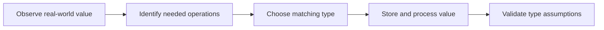

[Back to complete topic index](#complete-topic-index)

---

# Type Casting

## Overview
- **What is it?** Type casting explicitly converts a value to another type by calling constructors such as `int`, `float`, or `str`.
- **Why is it important?** Conversion turns text input and external data into forms suitable for calculation, comparison, or display.
- **Where is it used?** Forms, files, environment settings, and APIs commonly deliver values that need conversion.

## Learning Objectives
- Convert between compatible strings, numbers, and booleans.
- Recognize lossy conversions such as `int(3.9)`.
- Validate text before or while handling a failed conversion.

## Real World Applications
- Turn an entered quantity into an integer.
- Format numeric identifiers or totals as text.
- Normalize imported measurements before analysis.

## Core Concepts

### Constructor conversion
- **Definition:** Calling a built-in type creates a value of that type when the source representation is valid.
- **Visual explanation:** `"42" -> int -> 42`
- **Practical example:** Text representations become numeric values.

```python
whole = int("42")
price = float("7.50")
print(whole, price)
```

### Loss and representation
- **Definition:** Some conversions discard information or use formatting rules, so the target may not preserve the source exactly.
- **Visual explanation:** `3.9 -> int -> 3, not rounded 4`
- **Practical example:** Integer conversion truncates toward zero.

```python
measurement = 3.9
truncated = int(measurement)
print(truncated)
```

### Conversion failure
- **Definition:** Invalid representations raise `ValueError`; reliable programs catch it or reject the input.
- **Visual explanation:** `"many" -> int -> ValueError`
- **Practical example:** A helper returns `None` when text is not an integer.

```python
def parse_count(text):
    try:
        return int(text)
    except ValueError:
        return None

print(parse_count("12"), parse_count("many"))
```

## Infographic Summary

| Infographic Block | Topic-Specific Takeaway |
| --- | --- |
| 📌 Concept | Type casting explicitly converts a value to another type by calling constructors such as `int`, `float`, or `str`. |
| ⚡ Purpose | Convert values at data boundaries into the types required by calculations and comparisons. |
| 🔥 Benefits | Conversion turns text input and external data into forms suitable for calculation, comparison, or display. |
| 🎯 Use Cases | Forms, files, environment settings, and APIs commonly deliver values that need conversion. |
| 🚀 Best Practices | Convert at the system boundary, keep internal values typed consistently, and make failure behavior explicit. |
| ❌ Common Mistakes | Using `bool('False')` expecting `False`; every non-empty string is truthy. |

## Syntax Guide

### Basic Syntax

```python
count = int("8")
ratio = float("0.75")
label = str(2026)
```

### Standard Structure

```python
raw_price = "19.95"
quantity = 2
total = float(raw_price) * quantity
print(f"${total:.2f}")
```

### Code Pattern

```python
def parse_yes_no(text):
    normalized = text.strip().lower()
    if normalized in {"yes", "y"}:
        return True
    if normalized in {"no", "n"}:
        return False
    raise ValueError("Enter yes or no")

print(parse_yes_no(" Yes "))
```

## Examples

### Beginner Example

```python
year = int("2026")
print(year + 1)
```

### Intermediate Example

```python
values = ["4", "7", "11"]
numbers = [int(value) for value in values]
print(sum(numbers))
```

### Advanced Example

```python
def convert_temperature(text):
    try:
        celsius = float(text)
    except ValueError:
        return "Invalid temperature"
    fahrenheit = celsius * 9 / 5 + 32
    return f"{fahrenheit:.1f} F"

print(convert_temperature("21.5"))
```

## Workflow Diagram

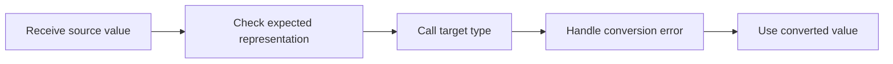

[Back to complete topic index](#complete-topic-index)

---

# Input and Output

## Overview
- **What is it?** Input and output move information between a program and users or external streams; `input()` reads terminal text and `print()` writes display text.
- **Why is it important?** Interaction makes a program responsive, but entered text must be converted and validated before use.
- **Where is it used?** Command-line tools, questionnaires, games, and administrative scripts all use terminal I/O.

## Learning Objectives
- Read text with `input` and display values with `print`.
- Convert and validate user input before calculation.
- Separate interaction from calculation so logic remains testable.

## Real World Applications
- Collect a user's name or menu choice.
- Display a formatted receipt or progress report.
- Build a small command-line calculator or questionnaire.

## Core Concepts

### Reading input
- **Definition:** `input(prompt)` displays a prompt, waits for a line, removes the trailing newline, and always returns a string.
- **Visual explanation:** `keyboard text -> input -> str`
- **Practical example:**

```python
name = input("Name: ")
print(f"Hello, {name}!")
```

### Producing output
- **Definition:** `print` converts objects to text and writes them to standard output with configurable separators and endings.
- **Visual explanation:** `values -> string conversion -> stdout`
- **Practical example:**

```python
item = "notebook"
price = 4.5
print(item, price, sep=": $")
```

### Boundary validation
- **Definition:** Interactive text should be normalized, converted, and checked before business logic consumes it.
- **Visual explanation:** `raw input -> strip -> convert -> validate -> calculate`
- **Practical example:**

```python
raw = input("Quantity: ")
try:
    quantity = int(raw)
    print("Accepted:", quantity) if quantity > 0 else print("Must be positive")
except ValueError:
    print("Enter a whole number")
```

## Infographic Summary

| Infographic Block | Topic-Specific Takeaway |
| --- | --- |
| 📌 Concept | Input and output move information between a program and users or external streams; `input()` reads terminal text and `print()` writes display text. |
| ⚡ Purpose | Exchange text with users through prompts and clearly formatted terminal output. |
| 🔥 Benefits | Interaction makes a program responsive, but entered text must be converted and validated before use. |
| 🎯 Use Cases | Command-line tools, questionnaires, games, and administrative scripts all use terminal I/O. |
| 🚀 Best Practices | Keep `input` and `print` at the edge of the program; pass clean values into functions that compute results. |
| ❌ Common Mistakes | Performing arithmetic directly on `input()` results without converting the returned strings. |

## Syntax Guide

### Basic Syntax

```python
answer = input("Favorite color: ")
print("You chose", answer)
```

### Standard Structure

```python
name = input("Name: ").strip()
age = int(input("Age: "))
print(f"{name} will be {age + 1} next year.")
```

### Code Pattern

```python
def calculate_total(price, quantity):
    return price * quantity

price = float(input("Unit price: "))
quantity = int(input("Quantity: "))
print(f"Total: ${calculate_total(price, quantity):.2f}")
```

## Examples

### Beginner Example

```python
city = input("City: ")
print(f"Weather lookup requested for {city}.")
```

### Intermediate Example

```python
raw_score = input("Score from 0 to 100: ")
score = int(raw_score)
if 0 <= score <= 100:
    print(f"Recorded: {score}")
else:
    print("Score out of range")
```

### Advanced Example

```python
def prompt_positive_integer(prompt):
    while True:
        raw = input(prompt).strip()
        try:
            value = int(raw)
        except ValueError:
            print("Use digits only.")
            continue
        if value > 0:
            return value
        print("Value must be positive.")

seats = prompt_positive_integer("Seats: ")
print(f"Reserved {seats} seat(s).")
```

## Workflow Diagram

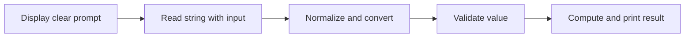

[Back to complete topic index](#complete-topic-index)

---

# Operators

## Overview
- **What is it?** Operators are symbols or keywords that perform arithmetic, comparison, logical, assignment, membership, and identity operations.
- **Why is it important?** Operator families form expressions that calculate values and decide which code paths apply.
- **Where is it used?** Pricing, filtering, validation, search, and state updates all depend on operators.

## Learning Objectives
- Use arithmetic and assignment operators correctly.
- Combine comparison, logical, and membership operators into conditions.
- Distinguish equality `==` from identity `is` and apply precedence deliberately.

## Real World Applications
- Calculate totals, remainders, and powers.
- Check ranges and combine eligibility rules.
- Test collection membership or whether a value is `None`.

## Core Concepts

### Arithmetic and assignment
- **Definition:** Arithmetic operators compute numbers; assignment forms such as `+=` bind the updated result to a name.
- **Visual explanation:** `operands -> + - * / // % ** -> result`
- **Practical example:**

```python
subtotal = 17 * 3
remainder = 17 % 3
subtotal += 5
print(subtotal, remainder)
```

### Comparison and logic
- **Definition:** Comparisons produce booleans; `and`, `or`, and `not` combine or invert truth conditions.
- **Visual explanation:** `comparisons -> booleans -> logical result`
- **Practical example:**

```python
age = 20
has_ticket = True
can_enter = age >= 18 and has_ticket
print(can_enter)
```

### Membership and identity
- **Definition:** `in` searches for membership, while `is` checks whether two references point to the same object.
- **Visual explanation:** `value in container; name is singleton`
- **Practical example:**

```python
roles = {"editor", "viewer"}
role = "editor"
selection = None
print(role in roles, selection is None)
```

## Infographic Summary

| Infographic Block | Topic-Specific Takeaway |
| --- | --- |
| 📌 Concept | Operators are symbols or keywords that perform arithmetic, comparison, logical, assignment, membership, and identity operations. |
| ⚡ Purpose | Build expressions that calculate, compare, combine, assign, and test values. |
| 🔥 Benefits | Operator families form expressions that calculate values and decide which code paths apply. |
| 🎯 Use Cases | Pricing, filtering, validation, search, and state updates all depend on operators. |
| 🚀 Best Practices | Use parentheses when mixed operator precedence could make the intended grouping unclear. |
| ❌ Common Mistakes | Using `is` for value equality; use `==` for equal values and reserve `is` for identity, especially `None`. |

## Syntax Guide

### Basic Syntax

```python
a = 11
b = 4
print(a + b, a - b, a * b, a / b, a // b, a % b, a ** 2)
```

### Standard Structure

```python
score = 84
passed = score >= 60
honors = passed and score >= 90
print(passed, honors)
```

### Code Pattern

```python
allowed_roles = {"admin", "editor"}
user_role = "editor"
account_active = True
authorized = account_active and user_role in allowed_roles
print(authorized)
```

## Examples

### Beginner Example

```python
price = 15
quantity = 3
print(price * quantity)
```

### Intermediate Example

```python
temperature = 24
comfortable = 18 <= temperature <= 26
print("Comfortable:", comfortable)
```

### Advanced Example

```python
cart_total = 82
is_member = False
coupon = "SAVE10"
discounted = (cart_total >= 75 or is_member) and coupon == "SAVE10"
final_total = cart_total * 0.9 if discounted else cart_total
print(f"${final_total:.2f}")
```

## Workflow Diagram

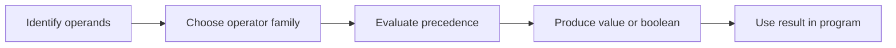

[Back to complete topic index](#complete-topic-index)

---

# Conditional Statements

## Overview
- **What is it?** Conditional statements select a code block according to boolean conditions using `if`, `elif`, and `else`.
- **Why is it important?** Branching translates rules and alternative outcomes into executable control flow.
- **Where is it used?** Programs use conditions for permissions, grading, validation, pricing, and status messages.

## Learning Objectives
- Write mutually exclusive `if`/`elif`/`else` branches.
- Order conditions from specific to general.
- Use truth values without unnecessary comparisons to `True`.

## Real World Applications
- Classify a score or measurement.
- Allow or reject an action based on policy.
- Choose discounts, shipping tiers, or status labels.

## Core Concepts

### Boolean branch
- **Definition:** An `if` suite runs only when its condition is truthy.
- **Visual explanation:** `condition true -> run suite; false -> skip`
- **Practical example:**

```python
balance = 40
if balance > 0:
    print("Funds available")
```

### Exclusive chain
- **Definition:** In an `if`/`elif`/`else` chain, Python runs the first true branch and skips the rest.
- **Visual explanation:** `test top to bottom -> first match -> exit chain`
- **Practical example:**

```python
score = 78
if score >= 90:
    grade = "A"
elif score >= 70:
    grade = "B"
else:
    grade = "C"
print(grade)
```

### Guard condition
- **Definition:** A guard handles an invalid or exceptional case early so the normal path stays simple.
- **Visual explanation:** `invalid? -> reject; otherwise -> continue`
- **Practical example:**

```python
def safe_average(total, count):
    if count == 0:
        return None
    return total / count

print(safe_average(42, 6))
```

## Infographic Summary

| Infographic Block | Topic-Specific Takeaway |
| --- | --- |
| 📌 Concept | Conditional statements select a code block according to boolean conditions using `if`, `elif`, and `else`. |
| ⚡ Purpose | Select exactly which block should run for the current conditions. |
| 🔥 Benefits | Branching translates rules and alternative outcomes into executable control flow. |
| 🎯 Use Cases | Programs use conditions for permissions, grading, validation, pricing, and status messages. |
| 🚀 Best Practices | Make branches exhaustive when every input needs an outcome, and test values at each boundary. |
| ❌ Common Mistakes | Placing a broad condition before a more specific one, making the later branch unreachable. |

## Syntax Guide

### Basic Syntax

```python
temperature = 12
if temperature < 15:
    print("Wear a coat")
```

### Standard Structure

```python
hours = 17
if hours < 12:
    greeting = "Good morning"
elif hours < 18:
    greeting = "Good afternoon"
else:
    greeting = "Good evening"
print(greeting)
```

### Code Pattern

```python
def shipping_band(weight, express):
    if weight <= 0:
        return "invalid"
    if express and weight <= 5:
        return "express-small"
    if weight <= 20:
        return "standard"
    return "freight"

print(shipping_band(4, True))
```

## Examples

### Beginner Example

```python
logged_in = True
if logged_in:
    print("Dashboard ready")
```

### Intermediate Example

```python
purchase = 120
if purchase >= 100:
    discount = 0.15
elif purchase >= 50:
    discount = 0.05
else:
    discount = 0
print(purchase * (1 - discount))
```

### Advanced Example

```python
def access_level(age, verified, suspended):
    if suspended:
        return "blocked"
    if not verified:
        return "verify account"
    if age >= 18:
        return "full access"
    return "limited access"

print(access_level(20, True, False))
```

## Workflow Diagram

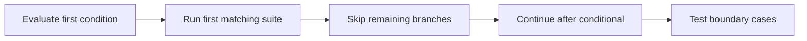

[Back to complete topic index](#complete-topic-index)

---

# Loops

## Overview
- **What is it?** Loops repeat a block: `for` consumes items from an iterable, while `while` repeats while a condition remains true.
- **Why is it important?** Iteration processes collections and repeated state changes without copied statements.
- **Where is it used?** Loops drive batch processing, searches, counters, polling, and report generation.

## Learning Objectives
- Iterate over sequences and numeric ranges with `for`.
- Write a terminating `while` loop with an explicit state update.
- Use `enumerate`, accumulators, and loop `else` where appropriate.

## Real World Applications
- Calculate totals from many records.
- Repeat prompts until input is valid.
- Transform or inspect every item in a collection.

## Core Concepts

### For iteration
- **Definition:** A `for` loop requests each item from an iterable and binds it to the loop variable.
- **Visual explanation:** `iterable -> next item -> suite -> next item`
- **Practical example:**

```python
for language in ["Python", "SQL", "Git"]:
    print(language)
```

### While repetition
- **Definition:** A `while` loop checks its condition before every iteration and stops when it becomes false.
- **Visual explanation:** `check condition -> suite -> update -> check again`
- **Practical example:**

```python
countdown = 3
while countdown > 0:
    print(countdown)
    countdown -= 1
```

### Accumulation
- **Definition:** An accumulator starts with an identity value and is updated once per item.
- **Visual explanation:** `initial total -> add item repeatedly -> final total`
- **Practical example:**

```python
total = 0
for amount in [12, 7, 9]:
    total += amount
print(total)
```

## Infographic Summary

| Infographic Block | Topic-Specific Takeaway |
| --- | --- |
| 📌 Concept | Loops repeat a block: `for` consumes items from an iterable, while `while` repeats while a condition remains true. |
| ⚡ Purpose | Repeat work across an iterable or while a condition remains true. |
| 🔥 Benefits | Iteration processes collections and repeated state changes without copied statements. |
| 🎯 Use Cases | Loops drive batch processing, searches, counters, polling, and report generation. |
| 🚀 Best Practices | Choose `for` for a finite iterable and `while` for condition-driven repetition; prove how the loop terminates. |
| ❌ Common Mistakes | Writing a `while` condition whose controlling value never changes, creating an accidental infinite loop. |

## Syntax Guide

### Basic Syntax

```python
for number in range(1, 4):
    print(number)
```

### Standard Structure

```python
total = 0
for price in [5.0, 2.5, 8.0]:
    total += price
print(f"${total:.2f}")
```

### Code Pattern

```python
attempts = 3
while attempts > 0:
    password = "demo" if attempts == 1 else "wrong"
    if password == "demo":
        print("Access granted")
        break
    attempts -= 1
else:
    print("Locked out")
```

## Examples

### Beginner Example

```python
for letter in "Python":
    print(letter)
```

### Intermediate Example

```python
scores = [72, 95, 81]
for position, score in enumerate(scores, start=1):
    print(position, score)
```

### Advanced Example

```python
transactions = [25, -8, 13, -4]
balance = 0
for transaction in transactions:
    balance += transaction
    status = "credit" if transaction >= 0 else "debit"
    print(status, transaction, balance)
```

## Workflow Diagram

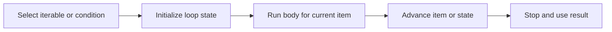

[Back to complete topic index](#complete-topic-index)

---

# Nested Loops

## Overview
- **What is it?** A nested loop places one loop inside another so every outer item can be paired with or traversed across inner items.
- **Why is it important?** This structure represents grids, tables, combinations, and grouped records.
- **Where is it used?** Nested iteration appears in seating charts, matrices, schedules, and comparison tasks.

## Learning Objectives
- Trace outer and inner loop execution order.
- Generate coordinates or pairwise combinations.
- Estimate total iterations and avoid unnecessary quadratic work.

## Real World Applications
- Process each cell in a table.
- Create combinations of colors and sizes.
- Render rows and columns of a board.

## Core Concepts

### Outer and inner cycles
- **Definition:** The inner loop completes all its iterations for each single outer-loop item.
- **Visual explanation:** `outer item -> all inner items -> next outer item`
- **Practical example:**

```python
for row in range(2):
    for column in range(3):
        print(row, column)
```

### Two-dimensional data
- **Definition:** Rows can be iterables whose elements are visited by an inner loop.
- **Visual explanation:** `matrix -> row -> cell`
- **Practical example:**

```python
grid = [[1, 2], [3, 4]]
for row in grid:
    for cell in row:
        print(cell)
```

### Cost of nesting
- **Definition:** If outer and inner loops each visit `n` items, the body may execute `n²` times.
- **Visual explanation:** `n outer x n inner = n squared pairs`
- **Practical example:**

```python
items = ["A", "B", "C"]
pairs = 0
for left in items:
    for right in items:
        pairs += 1
print(pairs)
```

## Infographic Summary

| Infographic Block | Topic-Specific Takeaway |
| --- | --- |
| 📌 Concept | A nested loop places one loop inside another so every outer item can be paired with or traversed across inner items. |
| ⚡ Purpose | Traverse grids, grouped data, and combinations across two or more dimensions. |
| 🔥 Benefits | This structure represents grids, tables, combinations, and grouped records. |
| 🎯 Use Cases | Nested iteration appears in seating charts, matrices, schedules, and comparison tasks. |
| 🚀 Best Practices | Name loop variables by dimension and calculate the expected body executions before processing large inputs. |
| ❌ Common Mistakes | Using nested loops for a membership lookup that a set could perform directly. |

## Syntax Guide

### Basic Syntax

```python
for row in range(2):
    for column in range(2):
        print(f"({row}, {column})")
```

### Standard Structure

```python
colors = ["red", "blue"]
sizes = ["S", "M", "L"]
for color in colors:
    for size in sizes:
        print(color, size)
```

### Code Pattern

```python
matrix = [[3, 5, 7], [2, 4, 6]]
row_totals = []
for row in matrix:
    total = 0
    for value in row:
        total += value
    row_totals.append(total)
print(row_totals)
```

## Examples

### Beginner Example

```python
for row in range(3):
    for column in range(2):
        print(row, column)
```

### Intermediate Example

```python
teams = ["North", "South", "West"]
for index, home in enumerate(teams):
    for away in teams[index + 1:]:
        print(home, "vs", away)
```

### Advanced Example

```python
sales = [[12, 9], [8, 14], [10, 11]]
grand_total = 0
for day_index, day in enumerate(sales, start=1):
    day_total = 0
    for amount in day:
        day_total += amount
    grand_total += day_total
    print(f"Day {day_index}: {day_total}")
print("All days:", grand_total)
```

## Workflow Diagram

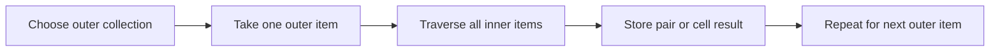

[Back to complete topic index](#complete-topic-index)

---

# Break Continue Pass

## Overview
- **What is it?** `break` exits the nearest loop, `continue` skips to its next iteration, and `pass` is a statement that intentionally does nothing.
- **Why is it important?** These statements express early exit, selective skipping, and temporarily empty suites.
- **Where is it used?** Searches, input filters, parsers, and staged implementations use these controls.

## Learning Objectives
- Exit a search as soon as a match is found.
- Skip invalid items without skipping the entire loop.
- Use `pass` only where Python requires a suite and no behavior is intended yet.

## Real World Applications
- Stop reading after a sentinel value.
- Ignore malformed or irrelevant records.
- Sketch a function or class body before implementation.

## Core Concepts

### Break
- **Definition:** `break` immediately terminates only the innermost enclosing `for` or `while` loop.
- **Visual explanation:** `loop -> match -> break -> after loop`
- **Practical example:**

```python
for number in [3, 8, 11]:
    if number % 2 == 0:
        print(number)
        break
```

### Continue
- **Definition:** `continue` abandons the rest of the current iteration and requests the next item.
- **Visual explanation:** `item -> reject -> continue -> next item`
- **Practical example:**

```python
for value in [4, -1, 7]:
    if value < 0:
        continue
    print(value)
```

### Pass
- **Definition:** `pass` satisfies Python's requirement for a statement but has no runtime effect.
- **Visual explanation:** `required suite -> pass -> continue normally`
- **Practical example:**

```python
def planned_feature():
    pass

print(planned_feature())
```

## Infographic Summary

| Infographic Block | Topic-Specific Takeaway |
| --- | --- |
| 📌 Concept | `break` exits the nearest loop, `continue` skips to its next iteration, and `pass` is a statement that intentionally does nothing. |
| ⚡ Purpose | Exit, skip, or intentionally leave empty parts of a control-flow structure. |
| 🔥 Benefits | These statements express early exit, selective skipping, and temporarily empty suites. |
| 🎯 Use Cases | Searches, input filters, parsers, and staged implementations use these controls. |
| 🚀 Best Practices | Prefer clear loop conditions; use `break` and `continue` when they make exceptional paths easier to read. |
| ❌ Common Mistakes | Expecting `break` in an inner loop to exit every enclosing loop. |

## Syntax Guide

### Basic Syntax

```python
for number in range(10):
    if number == 3:
        break
    print(number)
```

### Standard Structure

```python
for text in ["12", "bad", "7"]:
    if not text.isdigit():
        continue
    print(int(text) * 2)
```

### Code Pattern

```python
def find_user(records, target_id):
    for record in records:
        if "id" not in record:
            continue
        if record["id"] == target_id:
            return record
    return None

users = [{}, {"id": 2, "name": "Ada"}]
print(find_user(users, 2))
```

## Examples

### Beginner Example

```python
for letter in "code":
    if letter == "d":
        break
    print(letter)
```

### Intermediate Example

```python
valid_scores = []
for score in [88, -5, 104, 73]:
    if not 0 <= score <= 100:
        continue
    valid_scores.append(score)
print(valid_scores)
```

### Advanced Example

```python
commands = ["status", "", "quit", "ignored"]
for command in commands:
    if not command:
        continue
    if command == "quit":
        print("Stopping")
        break
    print("Running", command)
else:
    print("All commands completed")
```

## Workflow Diagram

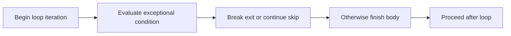

[Back to complete topic index](#complete-topic-index)

---

# Strings

## Overview
- **What is it?** A string is an immutable sequence of Unicode characters written with quotes.
- **Why is it important?** Strings model human-readable text and support indexing, slicing, concatenation, and interpolation.
- **Where is it used?** Names, messages, identifiers, file content, and serialized data are commonly represented as strings.

## Learning Objectives
- Create strings with appropriate quoting and escape sequences.
- Access characters and substrings by index or slice.
- Build readable output with f-strings while respecting immutability.

## Real World Applications
- Display personalized messages.
- Extract parts of codes or filenames.
- Compose labels, logs, and reports from data.

## Core Concepts

### Unicode text sequence
- **Definition:** Each string contains an ordered sequence of characters and has a measurable length.
- **Visual explanation:** `text -> character at index 0, 1, 2 ...`
- **Practical example:**

```python
word = "Python"
print(len(word), word[0], word[-1])
```

### Slicing
- **Definition:** A slice returns a new string from a start index up to, but not including, a stop index.
- **Visual explanation:** `text[start:stop:step] -> new text`
- **Practical example:**

```python
code = "PY-2026-BEGIN"
print(code[:2], code[3:7])
```

### Immutability and formatting
- **Definition:** Characters cannot be assigned in place; operations and f-strings create new strings.
- **Visual explanation:** `original string -> operation -> new string`
- **Practical example:**

```python
name = "Sam"
lessons = 5
message = f"{name} completed {lessons} lessons."
print(message)
```

## Infographic Summary

| Infographic Block | Topic-Specific Takeaway |
| --- | --- |
| 📌 Concept | A string is an immutable sequence of Unicode characters written with quotes. |
| ⚡ Purpose | Represent and compose immutable Unicode text. |
| 🔥 Benefits | Strings model human-readable text and support indexing, slicing, concatenation, and interpolation. |
| 🎯 Use Cases | Names, messages, identifiers, file content, and serialized data are commonly represented as strings. |
| 🚀 Best Practices | Use f-strings for interpolation, explicit encodings for files, and slices whose boundaries are easy to explain. |
| ❌ Common Mistakes | Trying to assign `text[0] = 'X'`; strings are immutable, so construct a new string instead. |

## Syntax Guide

### Basic Syntax

```python
single = "Python"
multiline = """First line
Second line"""
print(single, multiline)
```

### Standard Structure

```python
language = "Python"
print(language[0])
print(language[1:4])
print(language[::-1])
```

### Code Pattern

```python
customer = "Rina"
subtotal = 47.5
receipt = f"Customer: {customer}\nTotal: ${subtotal:,.2f}"
print(receipt)
```

## Examples

### Beginner Example

```python
greeting = "Hello"
print(greeting + " Python")
```

### Intermediate Example

```python
filename = "report.csv"
stem = filename[:-4]
extension = filename[-3:]
print(stem, extension)
```

### Advanced Example

```python
product = "Notebook"
quantity = 3
unit_price = 4.25
line = f"{product:<12} {quantity:>2} x ${unit_price:>5.2f} = ${quantity * unit_price:>6.2f}"
print(line)
```

## Workflow Diagram

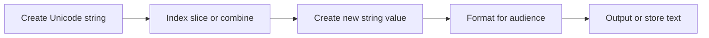

[Back to complete topic index](#complete-topic-index)

---

# String Methods

## Overview
- **What is it?** String methods are built-in operations that inspect or return transformed versions of immutable strings.
- **Why is it important?** They provide dependable tools for normalization, searching, splitting, replacing, and joining text.
- **Where is it used?** Text cleaning, parsing, validation, and presentation rely on method chains.

## Learning Objectives
- Normalize whitespace and case with methods.
- Split text into pieces and join pieces into a string.
- Choose predicate and search methods without confusing returned values.

## Real World Applications
- Clean names and email addresses from forms.
- Parse comma-separated labels.
- Search and replace controlled pieces of text.

## Core Concepts

### Non-mutating transformations
- **Definition:** Methods such as `strip`, `lower`, and `replace` return new strings because the original cannot change.
- **Visual explanation:** `original text -> method -> transformed copy`
- **Practical example:**

```python
raw = "  Python Basics  "
clean = raw.strip().lower()
print(clean, raw)
```

### Split and join
- **Definition:** `split` produces a list of substrings; `separator.join(iterable)` combines strings with that separator.
- **Visual explanation:** `string -> split -> list -> join -> string`
- **Practical example:**

```python
line = "red,green,blue"
colors = line.split(",")
print(" | ".join(colors))
```

### Search and predicates
- **Definition:** Methods such as `find`, `startswith`, and `isdigit` report positions or boolean facts about text.
- **Visual explanation:** `text -> inspection method -> index or bool`
- **Practical example:**

```python
filename = "lesson_15.md"
print(filename.startswith("lesson_"), filename.endswith(".md"))
print("15".isdigit())
```

## Infographic Summary

| Infographic Block | Topic-Specific Takeaway |
| --- | --- |
| 📌 Concept | String methods are built-in operations that inspect or return transformed versions of immutable strings. |
| ⚡ Purpose | Inspect, normalize, search, split, and combine text with built-in operations. |
| 🔥 Benefits | They provide dependable tools for normalization, searching, splitting, replacing, and joining text. |
| 🎯 Use Cases | Text cleaning, parsing, validation, and presentation rely on method chains. |
| 🚀 Best Practices | Store the returned string, and prefer explicit method sequences over dense chains when intermediate states matter. |
| ❌ Common Mistakes | Calling a method such as `strip()` without using its return value and expecting the original string to change. |

## Syntax Guide

### Basic Syntax

```python
name = "  ADA lovelace  "
print(name.strip().title())
```

### Standard Structure

```python
tags = "python, beginner, methods"
clean_tags = [tag.strip() for tag in tags.split(",")]
print("-".join(clean_tags))
```

### Code Pattern

```python
def normalize_username(text):
    cleaned = text.strip().lower().replace(" ", "_")
    if not cleaned.replace("_", "").isalnum():
        raise ValueError("Use letters, numbers, or spaces")
    return cleaned

print(normalize_username("  Ada Learns  "))
```

## Examples

### Beginner Example

```python
message = "hello python"
print(message.upper())
```

### Intermediate Example

```python
record = "  alice@example.com | active  "
email, status = [part.strip() for part in record.split("|")]
print(email.lower(), status)
```

### Advanced Example

```python
def title_from_slug(slug):
    words = slug.removesuffix(".md").split("-")
    return " ".join(words).title()

files = ["python-syntax.md", "list-methods.md"]
for filename in files:
    print(title_from_slug(filename))
```

## Workflow Diagram

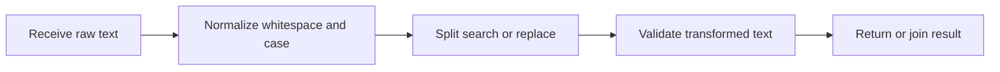

[Back to complete topic index](#complete-topic-index)

---

# Lists

## Overview
- **What is it?** A list is an ordered, mutable collection whose elements can have any Python type.
- **Why is it important?** Lists model sequences that need indexing, iteration, growth, replacement, or removal.
- **Where is it used?** Shopping carts, task queues, readings, and search results are often stored in lists.

## Learning Objectives
- Create, index, slice, and update lists.
- Explain mutable list state and shallow copying.
- Use list comprehensions for clear one-to-one transformations.

## Real World Applications
- Track an ordered set of tasks.
- Collect measurements for later aggregation.
- Build a transformed result from source records.

## Core Concepts

### Order and indexing
- **Definition:** A list preserves insertion order and exposes zero-based positive and negative indexes.
- **Visual explanation:** `list -> index 0, 1, 2 ...`
- **Practical example:**

```python
cities = ["Accra", "Lima", "Oslo"]
print(cities[0], cities[-1])
```

### Mutable elements
- **Definition:** Index assignment changes a list element in place while preserving the list object's identity.
- **Visual explanation:** `list before -> assign index -> same list after`
- **Practical example:**

```python
statuses = ["new", "new"]
statuses[1] = "done"
print(statuses)
```

### Slices and comprehensions
- **Definition:** A slice copies a range; a comprehension constructs a new list by transforming or filtering an iterable.
- **Visual explanation:** `source -> expression for item if condition -> new list`
- **Practical example:**

```python
numbers = [1, 2, 3, 4]
squares = [number ** 2 for number in numbers if number % 2 == 0]
print(squares)
```

## Infographic Summary

| Infographic Block | Topic-Specific Takeaway |
| --- | --- |
| 📌 Concept | A list is an ordered, mutable collection whose elements can have any Python type. |
| ⚡ Purpose | Store and update an ordered sequence of related values. |
| 🔥 Benefits | Lists model sequences that need indexing, iteration, growth, replacement, or removal. |
| 🎯 Use Cases | Shopping carts, task queues, readings, and search results are often stored in lists. |
| 🚀 Best Practices | Keep list elements conceptually consistent and copy before mutation when another part of the program needs the original. |
| ❌ Common Mistakes | Modifying a list while iterating over it, which can skip or unexpectedly revisit elements. |

## Syntax Guide

### Basic Syntax

```python
tasks = ["read", "practice", "review"]
print(tasks[0], len(tasks))
```

### Standard Structure

```python
scores = [72, 81, 90]
scores[0] = 75
first_two = scores[:2]
print(scores, first_two)
```

### Code Pattern

```python
temperatures = [18.5, 21.0, 16.8, 23.2]
warm = [value for value in temperatures if value >= 20]
average = sum(temperatures) / len(temperatures)
print(warm, average)
```

## Examples

### Beginner Example

```python
fruits = ["apple", "pear", "mango"]
print(fruits[1])
```

### Intermediate Example

```python
prices = [3.5, 8.0, 2.25]
with_tax = [round(price * 1.1, 2) for price in prices]
print(with_tax)
```

### Advanced Example

```python
orders = [
    {"id": 1, "total": 25},
    {"id": 2, "total": 80},
    {"id": 3, "total": 55},
]
large_order_ids = [order["id"] for order in orders if order["total"] >= 50]
print(large_order_ids)
```

## Workflow Diagram

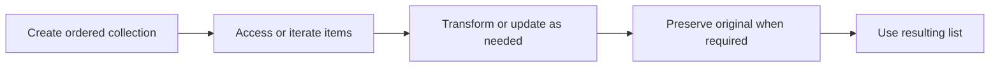

[Back to complete topic index](#complete-topic-index)

---

# List Methods

## Overview
- **What is it?** List methods are operations attached to lists for adding, removing, locating, ordering, and copying elements.
- **Why is it important?** They expose list mutation directly and make collection maintenance concise.
- **Where is it used?** Task managers, carts, rankings, and processing queues use these methods to update state.

## Learning Objectives
- Use append, extend, insert, remove, and pop intentionally.
- Sort in place and distinguish `list.sort` from `sorted`.
- Copy a list and inspect method return values correctly.

## Real World Applications
- Add or remove cart items.
- Reorder scores or names.
- Consume queued work while retaining the removed item.

## Core Concepts

### Adding items
- **Definition:** `append` adds one object, `extend` adds each item from an iterable, and `insert` adds at an index.
- **Visual explanation:** `list -> append one or extend many -> mutated list`
- **Practical example:**

```python
topics = ["syntax"]
topics.append("lists")
topics.extend(["tuples", "sets"])
print(topics)
```

### Removing items
- **Definition:** `remove` deletes the first equal value, while `pop` deletes and returns an item by index.
- **Visual explanation:** `list -> remove by value or pop by position`
- **Practical example:**

```python
queue = ["first", "second"]
served = queue.pop(0)
print(served, queue)
```

### Ordering and copying
- **Definition:** `sort` mutates and returns `None`; `sorted` returns a new list, and `copy` makes a shallow list copy.
- **Visual explanation:** `source -> sorted copy; source.sort -> source reordered`
- **Practical example:**

```python
scores = [82, 95, 74]
ranked = sorted(scores, reverse=True)
print(scores, ranked)
```

## Infographic Summary

| Infographic Block | Topic-Specific Takeaway |
| --- | --- |
| 📌 Concept | List methods are operations attached to lists for adding, removing, locating, ordering, and copying elements. |
| ⚡ Purpose | Add, remove, locate, copy, and reorder elements in mutable lists. |
| 🔥 Benefits | They expose list mutation directly and make collection maintenance concise. |
| 🎯 Use Cases | Task managers, carts, rankings, and processing queues use these methods to update state. |
| 🚀 Best Practices | Check whether mutation is intended, and never assign the result of a method such as `append` or `sort`. |
| ❌ Common Mistakes | Writing `items = items.append(value)`, which replaces the list name with `None`. |

## Syntax Guide

### Basic Syntax

```python
tasks = ["read"]
tasks.append("practice")
print(tasks)
```

### Standard Structure

```python
names = ["Zoe", "ana", "Mika"]
names.sort(key=str.lower)
print(names)
```

### Code Pattern

```python
history = ["login", "view", "logout"]
working = history.copy()
last_event = working.pop()
working.insert(0, "session-start")
print(last_event, working, history)
```

## Examples

### Beginner Example

```python
colors = ["red"]
colors.extend(["green", "blue"])
print(colors)
```

### Intermediate Example

```python
inventory = ["pen", "book", "pen"]
inventory.remove("pen")
removed = inventory.pop()
print(inventory, removed)
```

### Advanced Example

```python
records = [
    {"name": "Ari", "score": 78},
    {"name": "Bea", "score": 91},
]
records.append({"name": "Chen", "score": 84})
records.sort(key=lambda record: record["score"], reverse=True)
print(records)
```

## Workflow Diagram

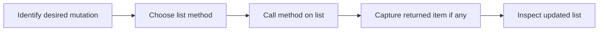

[Back to complete topic index](#complete-topic-index)

---

# Tuples

## Overview
- **What is it?** A tuple is an ordered, immutable collection commonly used for fixed groups of values.
- **Why is it important?** Its immutability communicates that the collection's positions and membership should not change.
- **Where is it used?** Coordinates, database rows, configuration pairs, and multi-value returns often use tuples.

## Learning Objectives
- Create single- and multi-item tuples.
- Index, unpack, and compare tuple values.
- Choose a tuple over a list when a fixed record is intended.

## Real World Applications
- Represent latitude and longitude.
- Return a minimum and maximum together.
- Use immutable composite keys in dictionaries.

## Core Concepts

### Tuple construction
- **Definition:** Commas create tuples; parentheses improve grouping, and a one-item tuple requires a trailing comma.
- **Visual explanation:** `value, value -> tuple`
- **Practical example:**

```python
point = (4, 7)
single = ("only",)
print(point, single)
```

### Unpacking
- **Definition:** Iterable unpacking binds tuple elements to matching names in one assignment.
- **Visual explanation:** `(x, y) -> x and y names`
- **Practical example:**

```python
location = ("Nairobi", "Kenya")
city, country = location
print(city, country)
```

### Immutable records
- **Definition:** Tuple elements cannot be replaced, though a mutable object stored inside a tuple can still change.
- **Visual explanation:** `fixed tuple positions -> safe record shape`
- **Practical example:**

```python
rgb = (120, 80, 200)
red, green, blue = rgb
print(max(rgb), red + green + blue)
```

## Infographic Summary

| Infographic Block | Topic-Specific Takeaway |
| --- | --- |
| 📌 Concept | A tuple is an ordered, immutable collection commonly used for fixed groups of values. |
| ⚡ Purpose | Group a fixed ordered set of values into one immutable record. |
| 🔥 Benefits | Its immutability communicates that the collection's positions and membership should not change. |
| 🎯 Use Cases | Coordinates, database rows, configuration pairs, and multi-value returns often use tuples. |
| 🚀 Best Practices | Use tuples for small fixed-shape records and unpack them into descriptive names instead of relying on unexplained indexes. |
| ❌ Common Mistakes | Forgetting the comma in `(value,)`, which creates a parenthesized value rather than a tuple. |

## Syntax Guide

### Basic Syntax

```python
dimensions = (1920, 1080)
print(dimensions[0])
```

### Standard Structure

```python
name, score = ("Mia", 92)
print(f"{name}: {score}")
```

### Code Pattern

```python
def bounds(values):
    return min(values), max(values)

low, high = bounds([5, 2, 9, 4])
print({"low": low, "high": high})
```

## Examples

### Beginner Example

```python
months = ("Jan", "Feb", "Mar")
print(months[-1])
```

### Intermediate Example

```python
coordinate = (12.4, -8.1)
latitude, longitude = coordinate
print(f"{latitude=}, {longitude=}")
```

### Advanced Example

```python
routes = {
    ("Lagos", "Accra"): 460,
    ("Accra", "Kumasi"): 250,
}
journey = ("Lagos", "Accra")
print(routes[journey])
```

## Workflow Diagram

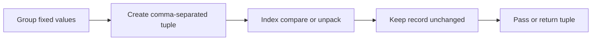

[Back to complete topic index](#complete-topic-index)

---

# Sets

## Overview
- **What is it?** A set is a mutable, unordered collection of unique hashable elements.
- **Why is it important?** Sets remove duplicates and provide fast membership plus union, intersection, and difference operations.
- **Where is it used?** Permissions, tags, unique identifiers, and comparisons between groups are natural set use cases.

## Learning Objectives
- Create non-empty and empty sets correctly.
- Add, remove, and test unique elements.
- Apply union, intersection, difference, and subset operations.

## Real World Applications
- Deduplicate imported labels.
- Find shared skills or missing permissions.
- Track identifiers already processed.

## Core Concepts

### Uniqueness and membership
- **Definition:** Adding an equal element has no effect, and membership does not depend on a visible position.
- **Visual explanation:** `many repeated values -> set -> unique values`
- **Practical example:**

```python
tags = {"python", "beginner", "python"}
print(len(tags), "python" in tags)
```

### Set algebra
- **Definition:** Union combines members, intersection keeps shared members, and difference keeps members found only on the left.
- **Visual explanation:** `A | B union; A & B shared; A - B left only`
- **Practical example:**

```python
team_a = {"Ana", "Bo"}
team_b = {"Bo", "Cy"}
print(team_a | team_b, team_a & team_b, team_a - team_b)
```

### Hashable elements
- **Definition:** Set members must have stable hashes, so immutable values such as strings and tuples work but lists do not.
- **Visual explanation:** `hashable value -> set member`
- **Practical example:**

```python
visited = {("row1", 2), ("row2", 4)}
visited.add(("row3", 1))
print(visited)
```

## Infographic Summary

| Infographic Block | Topic-Specific Takeaway |
| --- | --- |
| 📌 Concept | A set is a mutable, unordered collection of unique hashable elements. |
| ⚡ Purpose | Represent unique values and compare groups with membership and set algebra. |
| 🔥 Benefits | Sets remove duplicates and provide fast membership plus union, intersection, and difference operations. |
| 🎯 Use Cases | Permissions, tags, unique identifiers, and comparisons between groups are natural set use cases. |
| 🚀 Best Practices | Use `set()` for an empty set and sort only when presentation requires deterministic order. |
| ❌ Common Mistakes | Writing `{}` for an empty set; that literal creates an empty dictionary. |

## Syntax Guide

### Basic Syntax

```python
unique_scores = set([80, 90, 80, 75])
print(unique_scores)
```

### Standard Structure

```python
required = {"read", "write"}
granted = {"read", "share"}
missing = required - granted
print(missing)
```

### Code Pattern

```python
enrolled = {"Ada", "Ben", "Chao"}
completed = {"Ada", "Chao", "Dina"}
print("Completed and enrolled:", enrolled & completed)
print("Still pending:", enrolled - completed)
print("All known learners:", enrolled | completed)
```

## Examples

### Beginner Example

```python
colors = {"red", "blue"}
colors.add("green")
print("green" in colors)
```

### Intermediate Example

```python
raw_ids = [101, 102, 101, 103]
unique_ids = set(raw_ids)
print(len(raw_ids) - len(unique_ids), "duplicate(s)")
```

### Advanced Example

```python
required_skills = {"python", "git", "sql"}
candidate_skills = {"python", "git", "linux"}
coverage = required_skills & candidate_skills
gaps = required_skills - candidate_skills
qualified = required_skills <= candidate_skills
print(coverage, gaps, qualified)
```

## Workflow Diagram

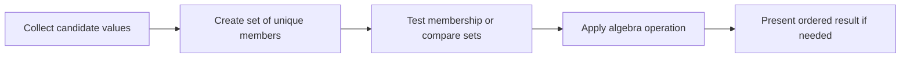

[Back to complete topic index](#complete-topic-index)

---

# Dictionaries

## Overview
- **What is it?** A dictionary is a mutable mapping from unique hashable keys to values.
- **Why is it important?** Key-based access models named fields and provides direct lookup without searching every item.
- **Where is it used?** Profiles, configuration, counters, indexes, and structured records commonly use dictionaries.

## Learning Objectives
- Create, read, add, update, and delete key-value pairs.
- Use `get`, membership, and iteration safely.
- Build counters and nested records with clear key choices.

## Real World Applications
- Represent a user or product record.
- Count occurrences by category.
- Look up configuration or inventory by name.

## Core Concepts

### Key-value mapping
- **Definition:** Each unique key maps to one value; assigning an existing key replaces its value.
- **Visual explanation:** `key -> value, key -> value`
- **Practical example:**

```python
student = {"name": "Ivy", "score": 88}
student["score"] = 91
print(student["name"], student["score"])
```

### Safe lookup
- **Definition:** `key in mapping` tests existence, while `get` returns a default instead of raising `KeyError` for a missing key.
- **Visual explanation:** `requested key -> found value or chosen default`
- **Practical example:**

```python
stock = {"pens": 12}
print(stock.get("books", 0))
```

### Dictionary iteration
- **Definition:** Iteration can expose keys, values, or key-value pairs through `keys`, `values`, or `items`.
- **Visual explanation:** `mapping.items -> key value pairs`
- **Practical example:**

```python
prices = {"tea": 2.5, "cake": 4.0}
for item, price in prices.items():
    print(item, price)
```

## Infographic Summary

| Infographic Block | Topic-Specific Takeaway |
| --- | --- |
| 📌 Concept | A dictionary is a mutable mapping from unique hashable keys to values. |
| ⚡ Purpose | Associate unique keys with values for structured records and direct lookup. |
| 🔥 Benefits | Key-based access models named fields and provides direct lookup without searching every item. |
| 🎯 Use Cases | Profiles, configuration, counters, indexes, and structured records commonly use dictionaries. |
| 🚀 Best Practices | Use stable meaningful keys, test optional keys explicitly, and avoid deeply nested records when a class would be clearer. |
| ❌ Common Mistakes | Indexing an optional key directly and allowing a preventable `KeyError`. |

## Syntax Guide

### Basic Syntax

```python
book = {"title": "Python 101", "pages": 240}
print(book["title"])
```

### Standard Structure

```python
inventory = {"pen": 10}
inventory["book"] = 4
inventory["pen"] -= 1
print(inventory.get("eraser", 0), inventory)
```

### Code Pattern

```python
words = ["red", "blue", "red", "green", "blue", "red"]
counts = {}
for word in words:
    counts[word] = counts.get(word, 0) + 1
print(counts)
```

## Examples

### Beginner Example

```python
profile = {"name": "Luz", "active": True}
print(profile["name"])
```

### Intermediate Example

```python
settings = {"theme": "dark", "notifications": True}
for key, value in settings.items():
    print(f"{key}={value}")
```

### Advanced Example

```python
orders = [
    {"product": "pen", "quantity": 2},
    {"product": "book", "quantity": 1},
    {"product": "pen", "quantity": 3},
]
totals = {}
for order in orders:
    product = order["product"]
    totals[product] = totals.get(product, 0) + order["quantity"]
print(totals)
```

## Workflow Diagram

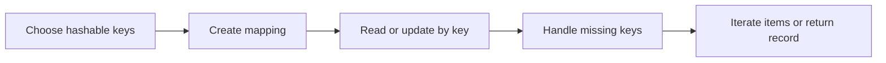

[Back to complete topic index](#complete-topic-index)

---

# Functions

## Overview
- **What is it?** A function is a named reusable block defined with `def` and executed when it is called.
- **Why is it important?** Functions isolate responsibilities, reduce duplication, and make behavior easier to test.
- **Where is it used?** Programs organize calculations, validation, transformations, and workflows into functions.

## Learning Objectives
- Define and call a function.
- Separate a function's interface from its implementation.
- Keep functions focused and document behavior with names and docstrings.

## Real World Applications
- Reuse a price calculation in several places.
- Hide validation details behind a clear operation.
- Test a unit of behavior independently.

## Core Concepts

### Definition and call
- **Definition:** A `def` statement creates a function object; a call expression runs its body.
- **Visual explanation:** `def -> function object; name() -> execute body`
- **Practical example:**

```python
def say_hello():
    print("Hello")

say_hello()
```

### Function interface
- **Definition:** The name, parameters, and returned result form an interface callers can use without knowing each internal step.
- **Visual explanation:** `arguments -> function boundary -> result`
- **Practical example:**

```python
def area(width, height):
    return width * height

print(area(4, 3))
```

### Single responsibility
- **Definition:** A focused function performs one coherent task, making naming, testing, and reuse straightforward.
- **Visual explanation:** `one purpose -> small function -> predictable behavior`
- **Practical example:**

```python
def is_valid_score(score):
    return 0 <= score <= 100

print(is_valid_score(84))
```

## Infographic Summary

| Infographic Block | Topic-Specific Takeaway |
| --- | --- |
| 📌 Concept | A function is a named reusable block defined with `def` and executed when it is called. |
| ⚡ Purpose | Package one focused behavior behind a reusable name and interface. |
| 🔥 Benefits | Functions isolate responsibilities, reduce duplication, and make behavior easier to test. |
| 🎯 Use Cases | Programs organize calculations, validation, transformations, and workflows into functions. |
| 🚀 Best Practices | Use verb-based names, keep side effects visible, and split a function when its description needs the word 'and'. |
| ❌ Common Mistakes | Defining a function but forgetting to call it, or mixing input, calculation, and printing into every function. |

## Syntax Guide

### Basic Syntax

```python
def greet():
    print("Welcome!")

greet()
```

### Standard Structure

```python
def rectangle_area(width, height):
    return width * height

area = rectangle_area(5, 8)
print(area)
```

### Code Pattern

```python
def summarize_scores(scores):
    if not scores:
        return {"count": 0, "average": None}
    return {
        "count": len(scores),
        "average": sum(scores) / len(scores),
    }

print(summarize_scores([75, 88, 92]))
```

## Examples

### Beginner Example

```python
def announce():
    print("Lesson started")

announce()
```

### Intermediate Example

```python
def final_price(subtotal, tax_rate=0.08):
    return subtotal * (1 + tax_rate)

print(f"${final_price(50):.2f}")
```

### Advanced Example

```python
def partition_even(numbers):
    even = []
    odd = []
    for number in numbers:
        target = even if number % 2 == 0 else odd
        target.append(number)
    return even, odd

print(partition_even([1, 2, 3, 4, 5]))
```

## Workflow Diagram

```mermaid
flowchart LR
    A[Identify one responsibility]
    B[Define function interface]
    C[Implement focused body]
    D[Call with data]
    E[Test returned behavior]
    A --> B
    B --> C
    C --> D
    D --> E
```

[Back to complete topic index](#complete-topic-index)

---

# Arguments and Parameters

## Overview
- **What is it?** Parameters are names in a function definition; arguments are the actual values supplied in a function call.
- **Why is it important?** They let one function operate on different data while expressing required, optional, and named inputs.
- **Where is it used?** APIs, calculations, formatting helpers, and reusable business rules all depend on clear function inputs.

## Learning Objectives
- Distinguish parameters from arguments.
- Use positional, keyword, and default arguments.
- Collect variable positional and keyword arguments only when the interface benefits.

## Real World Applications
- Configure a reusable notification function.
- Pass records into validation and calculation functions.
- Offer optional formatting without duplicating behavior.

## Core Concepts

### Parameters versus arguments
- **Definition:** A parameter receives a value inside the function; an argument is the expression supplied by the caller.
- **Visual explanation:** `call argument -> definition parameter -> function body`
- **Practical example:**

```python
def greet(name):
    print(f"Hello, {name}")

greet("Ada")
```

### Positional keyword and defaults
- **Definition:** Positional arguments match by order, keyword arguments match by name, and defaults fill omitted optional values.
- **Visual explanation:** `call bindings -> named parameters -> body`
- **Practical example:**

```python
def power(base, exponent=2):
    return base ** exponent

print(power(3), power(base=2, exponent=5))
```

### Variable argument collections
- **Definition:** `*args` gathers extra positional arguments into a tuple; `**kwargs` gathers extra keywords into a dictionary.
- **Visual explanation:** `many call inputs -> args tuple + kwargs dict`
- **Practical example:**

```python
def describe(*items, **details):
    return {"items": items, "details": details}

print(describe("pen", "book", owner="Mira"))
```

## Infographic Summary

| Infographic Block | Topic-Specific Takeaway |
| --- | --- |
| 📌 Concept | Parameters are names in a function definition; arguments are the actual values supplied in a function call. |
| ⚡ Purpose | Supply required and optional inputs to reusable functions. |
| 🔥 Benefits | They let one function operate on different data while expressing required, optional, and named inputs. |
| 🎯 Use Cases | APIs, calculations, formatting helpers, and reusable business rules all depend on clear function inputs. |
| 🚀 Best Practices | Keep required parameters first, use keyword calls for meaning, and avoid mutable objects as default values. |
| ❌ Common Mistakes | Using a list or dictionary as a default parameter and unintentionally sharing it across calls. |

## Syntax Guide

### Basic Syntax

```python
def add(left, right):
    return left + right

print(add(4, 6))
```

### Standard Structure

```python
def label(name, prefix="Student"):
    return f"{prefix}: {name}"

print(label("Nia"))
print(label("Omar", prefix="Mentor"))
```

### Code Pattern

```python
def build_profile(name, *skills, active=True, **details):
    return {
        "name": name,
        "skills": list(skills),
        "active": active,
        "details": details,
    }

print(build_profile("Nia", "Python", "SQL", city="Accra"))
```

## Examples

### Beginner Example

```python
def multiply(a, b):
    return a * b

print(multiply(3, 7))
```

### Intermediate Example

```python
def create_email(user, domain="example.com"):
    return f"{user}@{domain}"

print(create_email("learner"))
print(create_email(user="admin", domain="school.org"))
```

### Advanced Example

```python
def total_cost(*prices, discount=0):
    subtotal = sum(prices)
    return subtotal * (1 - discount)

print(total_cost(12.0, 8.5, 4.0, discount=0.10))
```

## Workflow Diagram

```mermaid
flowchart LR
    A[Define parameter contract]
    B[Caller supplies arguments]
    C[Bind by position or keyword]
    D[Apply defaults and collect extras]
    E[Execute with bound names]
    A --> B
    B --> C
    C --> D
    D --> E
```

[Back to complete topic index](#complete-topic-index)

---

# Return Statements

## Overview
- **What is it?** A `return` statement ends a function call and sends a result object back to its caller.
- **Why is it important?** Returning data separates computation from display and lets callers compose, store, or test results.
- **Where is it used?** Calculators, parsers, searches, and transformations return values for later decisions.

## Learning Objectives
- Return a computed value and capture it at the call site.
- Use early returns for guard cases.
- Explain implicit `None` and tuple packing for multiple results.

## Real World Applications
- Compute a subtotal for a receipt.
- Return a matching record from a search.
- Report both minimum and maximum values.

## Core Concepts

### Result transfer
- **Definition:** `return expression` evaluates the expression, ends the call, and makes the value become the call expression's result.
- **Visual explanation:** `function body -> return value -> caller`
- **Practical example:**

```python
def double(number):
    return number * 2

result = double(6)
print(result)
```

### Early return
- **Definition:** A return can handle an exceptional condition immediately, preventing the remaining body from running.
- **Visual explanation:** `guard true -> return now; false -> normal path`
- **Practical example:**

```python
def divide(total, count):
    if count == 0:
        return None
    return total / count

print(divide(10, 0))
```

### Implicit None and multiple values
- **Definition:** A function reaching its end returns `None`; comma-separated return values are packed into a tuple.
- **Visual explanation:** `no return -> None; return a, b -> tuple`
- **Practical example:**

```python
def limits(values):
    return min(values), max(values)

low, high = limits([8, 3, 11])
print(low, high)
```

## Infographic Summary

| Infographic Block | Topic-Specific Takeaway |
| --- | --- |
| 📌 Concept | A `return` statement ends a function call and sends a result object back to its caller. |
| ⚡ Purpose | Send computed results from a function back to its caller. |
| 🔥 Benefits | Returning data separates computation from display and lets callers compose, store, or test results. |
| 🎯 Use Cases | Calculators, parsers, searches, and transformations return values for later decisions. |
| 🚀 Best Practices | Return useful data from logic functions and let the outer interaction layer decide how to print or store it. |
| ❌ Common Mistakes | Printing a value inside a function when the caller needs to receive and reuse that value. |

## Syntax Guide

### Basic Syntax

```python
def square(number):
    return number ** 2

print(square(5))
```

### Standard Structure

```python
def normalize(text):
    cleaned = text.strip()
    if not cleaned:
        return None
    return cleaned.title()

print(normalize("  ada  "))
```

### Code Pattern

```python
def statistics(values):
    if not values:
        return None
    return min(values), max(values), sum(values) / len(values)

result = statistics([4, 9, 2, 7])
if result is not None:
    low, high, average = result
    print(low, high, average)
```

## Examples

### Beginner Example

```python
def answer():
    return 42

value = answer()
print(value)
```

### Intermediate Example

```python
def find_even(numbers):
    for number in numbers:
        if number % 2 == 0:
            return number
    return None

print(find_even([3, 7, 10, 13]))
```

### Advanced Example

```python
def invoice_summary(prices, tax_rate):
    subtotal = sum(prices)
    tax = subtotal * tax_rate
    return {
        "subtotal": subtotal,
        "tax": tax,
        "total": subtotal + tax,
    }

summary = invoice_summary([12.5, 7.5], 0.08)
print(summary)
```

## Workflow Diagram

```mermaid
flowchart LR
    A[Call function]
    B[Execute statements]
    C[Evaluate return expression]
    D[End current call]
    E[Caller receives result]
    A --> B
    B --> C
    C --> D
    D --> E
```

[Back to complete topic index](#complete-topic-index)

---

# Scope

## Overview
- **What is it?** Scope determines where a name can be accessed; Python resolves names through local, enclosing, global, then built-in scopes.
- **Why is it important?** Clear scope limits unintended coupling and prevents one function from silently changing unrelated state.
- **Where is it used?** Every function, nested function, module, and comprehension creates or interacts with name-resolution boundaries.

## Learning Objectives
- Identify local, enclosing, global, and built-in names.
- Explain shadowing and the lifetime of local names.
- Use return values instead of `global`, and understand when `nonlocal` is appropriate.

## Real World Applications
- Keep temporary calculations private to a function.
- Create a closure that remembers configuration.
- Share module constants without hiding mutable state changes.

## Core Concepts

### Local and global names
- **Definition:** Assignment inside a function creates a local name unless declared otherwise; module-level names are global to that module.
- **Visual explanation:** `module global -> function call -> local namespace`
- **Practical example:**

```python
course = "Python"

def show_course():
    message = course
    print(message)

show_course()
```

### LEGB lookup
- **Definition:** A name reference searches Local, Enclosing, Global, and Built-in namespaces in that order.
- **Visual explanation:** `L -> E -> G -> B -> NameError`
- **Practical example:**

```python
label = "global"

def outer():
    label = "enclosing"
    def inner():
        print(label)
    inner()

outer()
```

### Controlled state changes
- **Definition:** `nonlocal` rebinds a name in an enclosing function; returning new state is often clearer than mutating globals.
- **Visual explanation:** `inner assignment -> declared enclosing binding`
- **Practical example:**

```python
def make_counter():
    count = 0
    def increment():
        nonlocal count
        count += 1
        return count
    return increment

counter = make_counter()
print(counter(), counter())
```

## Infographic Summary

| Infographic Block | Topic-Specific Takeaway |
| --- | --- |
| 📌 Concept | Scope determines where a name can be accessed; Python resolves names through local, enclosing, global, then built-in scopes. |
| ⚡ Purpose | Control where names are visible and how Python resolves each reference. |
| 🔥 Benefits | Clear scope limits unintended coupling and prevents one function from silently changing unrelated state. |
| 🎯 Use Cases | Every function, nested function, module, and comprehension creates or interacts with name-resolution boundaries. |
| 🚀 Best Practices | Pass dependencies as arguments and return results; reserve module globals for constants and `nonlocal` for deliberate closures. |
| ❌ Common Mistakes | Assigning inside a function while expecting Python to update a same-named global automatically. |

## Syntax Guide

### Basic Syntax

```python
topic = "scope"

def display():
    local_message = topic.upper()
    print(local_message)

display()
```

### Standard Structure

```python
tax_rate = 0.08

def total_with_tax(subtotal):
    tax = subtotal * tax_rate
    return subtotal + tax

print(total_with_tax(50))
```

### Code Pattern

```python
def make_multiplier(factor):
    def multiply(value):
        return value * factor
    return multiply

double = make_multiplier(2)
triple = make_multiplier(3)
print(double(5), triple(5))
```

## Examples

### Beginner Example

```python
name = "global"

def show():
    name = "local"
    print(name)

show()
print(name)
```

### Intermediate Example

```python
currency = "USD"
def format_price(amount):
    symbol = "$"
    return f"{symbol}{amount:.2f} {currency}"
print(format_price(9.5))
```

### Advanced Example

```python
def make_scoreboard():
    scores = []
    def add(score):
        scores.append(score)
        return sum(scores) / len(scores)
    return add
record = make_scoreboard()
print(record(80))
print(record(90))
```

## Workflow Diagram

```mermaid
flowchart LR
    A[Reference a name]
    B[Search local scope]
    C[Search enclosing then global]
    D[Fall back to built-ins]
    E[Use binding or raise NameError]
    A --> B
    B --> C
    C --> D
    D --> E
```

[Back to complete topic index](#complete-topic-index)

---

# Lambda Functions

## Overview
- **What is it?** A lambda expression creates a small anonymous function containing one expression.
- **Why is it important?** Lambdas are useful when an operation is short, local, and passed directly to another function.
- **Where is it used?** Sorting keys, simple transformations, and callback-style APIs frequently accept lambdas.

## Learning Objectives
- Write and call a lambda expression.
- Pass lambdas as `key` functions.
- Choose a named `def` when logic, reuse, typing, or documentation grows.

## Real World Applications
- Sort records by a selected field.
- Transform items with `map` in APIs that require a callable.
- Configure a one-line calculation at the call site.

## Core Concepts

### Expression function
- **Definition:** The form `lambda parameters: expression` evaluates that one expression and returns its value.
- **Visual explanation:** `arguments -> one expression -> result`
- **Practical example:**

```python
double = lambda number: number * 2
print(double(5))
```

### Callable as data
- **Definition:** A lambda is a function object that can be stored or passed where another function expects behavior.
- **Visual explanation:** `lambda -> callable argument -> host operation`
- **Practical example:**

```python
words = ["pear", "fig", "banana"]
print(sorted(words, key=lambda word: len(word)))
```

### Readability boundary
- **Definition:** A lambda cannot contain statements and becomes hard to read when it embeds multiple conditions or repeated logic.
- **Visual explanation:** `simple local expression -> lambda; richer behavior -> def`
- **Practical example:**

```python
records = [{"name": "Bo", "score": 81}, {"name": "Ana", "score": 92}]
ranked = sorted(records, key=lambda record: record["score"], reverse=True)
print(ranked)
```

## Infographic Summary

| Infographic Block | Topic-Specific Takeaway |
| --- | --- |
| 📌 Concept | A lambda expression creates a small anonymous function containing one expression. |
| ⚡ Purpose | Provide a short one-expression callable where behavior is passed as data. |
| 🔥 Benefits | Lambdas are useful when an operation is short, local, and passed directly to another function. |
| 🎯 Use Cases | Sorting keys, simple transformations, and callback-style APIs frequently accept lambdas. |
| 🚀 Best Practices | Use lambdas for obvious one-expression behavior, especially a `key`; give nontrivial logic a descriptive function name. |
| ❌ Common Mistakes | Packing complex branching into a lambda merely to avoid writing `def`. |

## Syntax Guide

### Basic Syntax

```python
square = lambda value: value ** 2
print(square(6))
```

### Standard Structure

```python
names = ["Zara", "amy", "MILO"]
print(sorted(names, key=lambda name: name.lower()))
```

### Code Pattern

```python
products = [
    {"name": "Pen", "price": 3.0},
    {"name": "Book", "price": 8.0},
]
priced = sorted(products, key=lambda product: (product["price"], product["name"]))
print(priced)
```

## Examples

### Beginner Example

```python
add_tax = lambda price: price * 1.08
print(add_tax(20))
```

### Intermediate Example

```python
points = [(2, 5), (1, 9), (4, 3)]
by_y = sorted(points, key=lambda point: point[1])
print(by_y)
```

### Advanced Example

```python
students = [
    {"name": "Mia", "score": 88},
    {"name": "Ali", "score": 88},
    {"name": "Zoe", "score": 95},
]
ranked = sorted(students, key=lambda student: (-student["score"], student["name"]))
print(ranked)
```

## Workflow Diagram

```mermaid
flowchart LR
    A[Need short callable]
    B[Confirm one clear expression]
    C[Create lambda]
    D[Pass to consuming function]
    E[Replace with def if complexity grows]
    A --> B
    B --> C
    C --> D
    D --> E
```

[Back to complete topic index](#complete-topic-index)

---

# Modules

## Overview
- **What is it?** A module is one Python file loaded as a namespace, allowing its functions, classes, and constants to be imported elsewhere.
- **Why is it important?** Modules separate responsibilities and make definitions reusable without copying code.
- **Where is it used?** Applications divide calculations, configuration, I/O, and tests across modules.

## Learning Objectives
- Import a module or selected names.
- Explain module namespaces, caching in `sys.modules`, and `__name__`.
- Design a module that can be imported without unintended work.

## Real World Applications
- Reuse standard-library functionality.
- Split a script into focused Python files.
- Expose a stable helper API to tests and other modules.

## Core Concepts

### Module namespace
- **Definition:** Importing a module creates or reuses a module object whose attributes are accessed with dot notation.
- **Visual explanation:** `module.py -> import -> module namespace`
- **Practical example:**

```python
import math
print(math.pi, math.sqrt(16))
```

### Import forms
- **Definition:** `import name` preserves the namespace; `from name import item` binds selected attributes directly.
- **Visual explanation:** `module namespace -> chosen import binding`
- **Practical example:**

```python
from pathlib import Path
current = Path(".")
print(current.resolve().name)
```

### Import-safe execution
- **Definition:** A `__name__ == '__main__'` guard runs command-line behavior only when the file is executed directly.
- **Visual explanation:** `import -> definitions only; direct run -> main function`
- **Practical example:**

```python
def main():
    print("Run as a script")

if __name__ == "__main__":
    main()
```

## Infographic Summary

| Infographic Block | Topic-Specific Takeaway |
| --- | --- |
| 📌 Concept | A module is one Python file loaded as a namespace, allowing its functions, classes, and constants to be imported elsewhere. |
| ⚡ Purpose | Organize reusable definitions in a Python file with its own importable namespace. |
| 🔥 Benefits | Modules separate responsibilities and make definitions reusable without copying code. |
| 🎯 Use Cases | Applications divide calculations, configuration, I/O, and tests across modules. |
| 🚀 Best Practices | Keep top-level module work lightweight, import namespaces clearly, and put script behavior behind a main guard. |
| ❌ Common Mistakes | Naming a file after a standard-library module such as `random.py`, causing the local file to shadow the intended import. |

## Syntax Guide

### Basic Syntax

```python
import statistics
print(statistics.mean([4, 6, 8]))
```

### Standard Structure

```python
from math import ceil, pi
radius = 2
print(ceil(pi * radius ** 2))
```

### Code Pattern

```python
import json

def encode_record(record):
    return json.dumps(record, sort_keys=True)

if __name__ == "__main__":
    print(encode_record({"name": "Ada", "level": 1}))
```

## Examples

### Beginner Example

```python
import math
print(math.factorial(5))
```

### Intermediate Example

```python
import collections
counts = collections.Counter("banana")
print(counts.most_common(2))
```

### Advanced Example

```python
from pathlib import Path
import json

def configuration_text(settings):
    return json.dumps(settings, indent=2)

def main():
    output_name = Path("settings.json").name
    print(output_name)
    print(configuration_text({"theme": "dark"}))

if __name__ == "__main__":
    main()
```

## Workflow Diagram

```mermaid
flowchart LR
    A[Encounter import]
    B[Locate module file]
    C[Execute module once]
    D[Create cached namespace]
    E[Access exported attribute]
    A --> B
    B --> C
    C --> D
    D --> E
```

[Back to complete topic index](#complete-topic-index)

---

# Packages

## Overview
- **What is it?** A package is an importable directory that groups related modules under a shared namespace.
- **Why is it important?** Packages scale organization beyond one file and support explicit public interfaces and distribution.
- **Where is it used?** Libraries and applications group models, services, utilities, and subfeatures into packages.

## Learning Objectives
- Distinguish a module file from a package directory.
- Use absolute and relative imports within a package.
- Understand the role of `__init__.py` and running package code with `-m`.

## Real World Applications
- Organize a multi-feature application.
- Publish a reusable library namespace.
- Avoid collisions between similarly named modules.

## Core Concepts

### Package layout
- **Definition:** A regular package is a directory containing `__init__.py` plus modules or subpackages.
- **Visual explanation:** `shop package -> __init__.py + pricing.py + reports.py`
- **Practical example:**

```python
from pathlib import PurePath
package_file = PurePath("shop") / "__init__.py"
print(package_file)
```

### Qualified imports
- **Definition:** Absolute imports start from the top-level package; relative imports use dots from the current package.
- **Visual explanation:** `shop.reports -> import shop.pricing`
- **Practical example:**

```python
# academy/cli.py
from .courses import list_courses

for course in list_courses():
    print(course)
```

### Package execution
- **Definition:** `python -m package.module` resolves imports using the package context, unlike executing an internal file path directly.
- **Visual explanation:** `project root -> -m package.module -> package-aware execution`
- **Practical example:**

```python
import runpy
module_data = runpy.run_module("json.tool", run_name="lesson_probe")
print("__name__" in module_data)
```

## Infographic Summary

| Infographic Block | Topic-Specific Takeaway |
| --- | --- |
| 📌 Concept | A package is an importable directory that groups related modules under a shared namespace. |
| ⚡ Purpose | Group related modules beneath a shared importable directory namespace. |
| 🔥 Benefits | Packages scale organization beyond one file and support explicit public interfaces and distribution. |
| 🎯 Use Cases | Libraries and applications group models, services, utilities, and subfeatures into packages. |
| 🚀 Best Practices | Run package entry points from the project root with `python -m ...` and expose only intentional names from `__init__.py`. |
| ❌ Common Mistakes | Executing an internal package file directly and then patching broken imports with ad hoc path changes. |

## Syntax Guide

### Basic Syntax

```python
import email
print(email.__package__)
```

### Standard Structure

```python
from urllib import parse
address = parse.urlparse("https://example.com/learn")
print(address.netloc, address.path)
```

### Code Pattern

```python
import importlib

modules = ["json.decoder", "json.encoder"]
loaded = [importlib.import_module(name).__name__ for name in modules]
print(loaded)
```

## Examples

### Beginner Example

```python
import collections
print(collections.__package__)
```

### Intermediate Example

```python
from pathlib import Path
layout = [
    Path("academy/__init__.py"),
    Path("academy/courses.py"),
    Path("academy/cli.py"),
]
for path in layout:
    print(path)
```

### Advanced Example

```python
import importlib

def load_components(package_name, module_names):
    return [
        importlib.import_module(f"{package_name}.{name}")
        for name in module_names
    ]

components = load_components("json", ["decoder", "encoder"])
print([component.__name__ for component in components])
```

## Workflow Diagram

```mermaid
flowchart LR
    A[Start from project root]
    B[Resolve top-level package]
    C[Initialize package namespace]
    D[Load requested submodule]
    E[Use qualified public name]
    A --> B
    B --> C
    C --> D
    D --> E
```

[Back to complete topic index](#complete-topic-index)

---

# Date and Time

## Overview
- **What is it?** Python's `datetime` types represent calendar dates, clock times, combined datetimes, and durations.
- **Why is it important?** Explicit types support reliable arithmetic, formatting, parsing, and timezone-aware comparisons.
- **Where is it used?** Scheduling, deadlines, logs, billing periods, and data pipelines all process temporal values.

## Learning Objectives
- Create date, datetime, and timedelta objects.
- Parse and format values with ISO methods or format codes.
- Distinguish naive from timezone-aware datetimes.

## Real World Applications
- Calculate a due date.
- Parse timestamps from imported records.
- Compare events in a shared timezone.

## Core Concepts

### Calendar values
- **Definition:** `date` stores year, month, and day; `datetime` adds time fields.
- **Visual explanation:** `year month day + clock fields -> datetime`
- **Practical example:**

```python
from datetime import date
release = date(2026, 7, 20)
print(release.isoformat())
```

### Durations and arithmetic
- **Definition:** `timedelta` represents elapsed duration and can be added to or subtracted from dates and datetimes.
- **Visual explanation:** `start + duration -> end`
- **Practical example:**

```python
from datetime import date, timedelta
start = date(2026, 7, 20)
print(start + timedelta(days=14))
```

### Timezone awareness
- **Definition:** An aware datetime includes a `tzinfo` offset; comparing stored instants in UTC avoids local-time ambiguity.
- **Visual explanation:** `local aware time -> UTC -> compare or store`
- **Practical example:**

```python
from datetime import datetime, timezone
now_utc = datetime.now(timezone.utc)
print(now_utc.isoformat())
```

## Infographic Summary

| Infographic Block | Topic-Specific Takeaway |
| --- | --- |
| 📌 Concept | Python's `datetime` types represent calendar dates, clock times, combined datetimes, and durations. |
| ⚡ Purpose | Model calendar values, instants, and durations for temporal calculations. |
| 🔥 Benefits | Explicit types support reliable arithmetic, formatting, parsing, and timezone-aware comparisons. |
| 🎯 Use Cases | Scheduling, deadlines, logs, billing periods, and data pipelines all process temporal values. |
| 🚀 Best Practices | Use ISO 8601 at boundaries, timezone-aware UTC for instants, and `date` for calendar-only facts. |
| ❌ Common Mistakes | Mixing naive and aware datetimes or assuming a local clock reading uniquely identifies an instant. |

## Syntax Guide

### Basic Syntax

```python
from datetime import date
today = date.today()
print(today.year, today.month, today.day)
```

### Standard Structure

```python
from datetime import datetime
stamp = datetime.fromisoformat("2026-07-20T16:08:00")
print(stamp.strftime("%d %b %Y, %H:%M"))
```

### Code Pattern

```python
from datetime import datetime, timedelta, timezone
start = datetime(2026, 7, 20, 16, 0, tzinfo=timezone.utc)
deadline = start + timedelta(days=2, hours=6)
print(deadline.isoformat())
```

## Examples

### Beginner Example

```python
from datetime import date
birthday = date(2000, 5, 12)
print(birthday.strftime("%A"))
```

### Intermediate Example

```python
from datetime import date, timedelta
checkout = date(2026, 7, 20)
return_date = checkout + timedelta(weeks=3)
print(return_date.isoformat())
```

### Advanced Example

```python
from datetime import datetime, timezone

def parse_utc(text):
    parsed = datetime.fromisoformat(text)
    if parsed.tzinfo is None:
        raise ValueError("Timezone offset required")
    return parsed.astimezone(timezone.utc)

print(parse_utc("2026-07-20T18:08:00+02:00").isoformat())
```

## Workflow Diagram

```mermaid
flowchart LR
    A[Receive temporal text or fields]
    B[Parse into datetime type]
    C[Attach or convert timezone]
    D[Perform arithmetic or comparison]
    E[Format for output]
    A --> B
    B --> C
    C --> D
    D --> E
```

[Back to complete topic index](#complete-topic-index)

---

# Math Module

## Overview
- **What is it?** The standard-library `math` module provides constants and real-number functions beyond basic arithmetic operators.
- **Why is it important?** Its tested implementations cover roots, rounding directions, logarithms, trigonometry, and accurate aggregation.
- **Where is it used?** Geometry, simulations, analytics, finance, and scientific calculations use these functions.

## Learning Objectives
- Import and call common `math` functions.
- Use constants and choose floor, ceil, truncation, or closeness checks correctly.
- Recognize that `math` generally operates on real numbers, not arbitrary collections.

## Real World Applications
- Calculate geometric measurements.
- Round resource counts up to whole units.
- Compare floating-point results with a tolerance.

## Core Concepts

### Constants and roots
- **Definition:** `math.pi`, `math.e`, `sqrt`, and related functions provide standard numeric definitions.
- **Visual explanation:** `numeric input -> math function -> float result`
- **Practical example:**

```python
import math
radius = 3
print(math.pi * radius ** 2, math.sqrt(81))
```

### Rounding direction
- **Definition:** `floor` rounds down, `ceil` rounds up, and `trunc` removes the fractional part toward zero.
- **Visual explanation:** `real number -> chosen rounding rule -> integer`
- **Practical example:**

```python
import math
print(math.floor(2.9), math.ceil(2.1), math.trunc(-2.9))
```

### Floating-point reliability
- **Definition:** `isclose` compares approximate values using relative and absolute tolerances; `fsum` reduces summation error.
- **Visual explanation:** `floating results + tolerance -> reliable comparison`
- **Practical example:**

```python
import math
total = math.fsum([0.1, 0.1, 0.1])
print(total, math.isclose(total, 0.3))
```

## Infographic Summary

| Infographic Block | Topic-Specific Takeaway |
| --- | --- |
| 📌 Concept | The standard-library `math` module provides constants and real-number functions beyond basic arithmetic operators. |
| ⚡ Purpose | Apply standard mathematical constants and real-number functions reliably. |
| 🔥 Benefits | Its tested implementations cover roots, rounding directions, logarithms, trigonometry, and accurate aggregation. |
| 🎯 Use Cases | Geometry, simulations, analytics, finance, and scientific calculations use these functions. |
| 🚀 Best Practices | Choose the function whose mathematical rule matches the domain, and use `isclose` instead of exact float equality. |
| ❌ Common Mistakes | Using `round` or `int` when the requirement specifically says always round up or always round down. |

## Syntax Guide

### Basic Syntax

```python
import math
print(math.sqrt(144))
print(math.pi)
```

### Standard Structure

```python
import math
items = 23
box_capacity = 5
boxes = math.ceil(items / box_capacity)
print(boxes)
```

### Code Pattern

```python
import math
points = [(0, 0), (3, 4), (6, 8)]
distances = []
for (x1, y1), (x2, y2) in zip(points, points[1:]):
    distances.append(math.hypot(x2 - x1, y2 - y1))
print(math.fsum(distances))
```

## Examples

### Beginner Example

```python
import math
radius = 5
print(math.tau * radius)
```

### Intermediate Example

```python
import math
angle_degrees = 30
angle_radians = math.radians(angle_degrees)
print(math.sin(angle_radians))
```

### Advanced Example

```python
import math

def compound(principal, annual_rate, years):
    return principal * math.pow(1 + annual_rate, years)

future = compound(1000, 0.05, 10)
print(f"${future:.2f}")
print(math.isfinite(future))
```

## Workflow Diagram

```mermaid
flowchart LR
    A[Identify mathematical rule]
    B[Select math constant or function]
    C[Pass numeric arguments]
    D[Check finite or approximate result]
    E[Use value in domain calculation]
    A --> B
    B --> C
    C --> D
    D --> E
```

[Back to complete topic index](#complete-topic-index)

---

# Random Module

## Overview
- **What is it?** The `random` module produces deterministic pseudo-random sequences suitable for simulation, sampling, and games.
- **Why is it important?** It offers controlled variation and reproducibility through explicit random generator instances and seeds.
- **Where is it used?** Games, randomized tests, classroom exercises, and statistical samples use pseudo-random values.

## Learning Objectives
- Generate ranges, choices, samples, and shuffled sequences.
- Use a local `Random` instance with a seed for repeatable tests.
- Avoid `random` for passwords, tokens, or security decisions.

## Real World Applications
- Roll dice or select a game move.
- Sample records without replacement.
- Create repeatable test fixtures and simulations.

## Core Concepts

### Pseudo-random generator
- **Definition:** A generator evolves deterministic internal state, so the same seed produces the same sequence.
- **Visual explanation:** `seed + state -> next value -> updated state`
- **Practical example:**

```python
import random
rng = random.Random(7)
print(rng.randint(1, 6), rng.randint(1, 6))
```

### Choice and sampling
- **Definition:** `choice` picks one element; `sample` returns distinct selections without replacement.
- **Visual explanation:** `population -> random index or distinct indexes -> selection`
- **Practical example:**

```python
import random
rng = random.Random(3)
colors = ["red", "green", "blue", "gold"]
print(rng.choice(colors), rng.sample(colors, k=2))
```

### Security boundary
- **Definition:** The algorithm is predictable and must not generate credentials; the `secrets` module serves security-sensitive choices.
- **Visual explanation:** `simulation -> random; secret token -> secrets`
- **Practical example:**

```python
import secrets
alphabet = "ABCDEFGHJKLMNPQRSTUVWXYZ23456789"
code = "".join(secrets.choice(alphabet) for _ in range(8))
print(len(code))
```

## Infographic Summary

| Infographic Block | Topic-Specific Takeaway |
| --- | --- |
| 📌 Concept | The `random` module produces deterministic pseudo-random sequences suitable for simulation, sampling, and games. |
| ⚡ Purpose | Generate controlled pseudo-random choices, samples, and simulations. |
| 🔥 Benefits | It offers controlled variation and reproducibility through explicit random generator instances and seeds. |
| 🎯 Use Cases | Games, randomized tests, classroom exercises, and statistical samples use pseudo-random values. |
| 🚀 Best Practices | Inject or create a seeded generator for tests, omit the seed for ordinary simulation, and use `secrets` for security. |
| ❌ Common Mistakes | Seeding globally in production code or using `random` to create reset tokens and passwords. |

## Syntax Guide

### Basic Syntax

```python
import random
print(random.randint(1, 6))
```

### Standard Structure

```python
import random
rng = random.Random(42)
participants = ["Ada", "Bo", "Chen", "Dia"]
print(rng.sample(participants, k=2))
```

### Code Pattern

```python
import random
rng = random.Random(10)
results = {"heads": 0, "tails": 0}
for _ in range(1000):
    side = rng.choice(list(results))
    results[side] += 1
print(results)
```

## Examples

### Beginner Example

```python
import random
print(random.choice(["north", "south", "east", "west"]))
```

### Intermediate Example

```python
import random
rng = random.Random(5)
deck = list(range(1, 11))
rng.shuffle(deck)
hand = deck[:3]
print(hand)
```

### Advanced Example

```python
import random

def estimate_even_probability(trials, seed):
    rng = random.Random(seed)
    even = 0
    for _ in range(trials):
        even += rng.randint(1, 6) % 2 == 0
    return even / trials

print(estimate_even_probability(10_000, 11))
```

## Workflow Diagram

```mermaid
flowchart LR
    A[Choose simulation or security need]
    B[Create correct generator]
    C[Seed only for reproducibility]
    D[Generate choice sample or shuffle]
    E[Validate distribution or result]
    A --> B
    B --> C
    C --> D
    D --> E
```

[Back to complete topic index](#complete-topic-index)

---

# File Handling

## Overview
- **What is it?** File handling opens filesystem paths and reads or writes persistent bytes or text.
- **Why is it important?** Context managers close resources reliably, while explicit modes and encodings make data behavior predictable.
- **Where is it used?** Applications store configuration, reports, logs, exports, and imported datasets in files.

## Learning Objectives
- Open text files with a context manager and explicit encoding.
- Choose read, write, append, or exclusive-creation modes.
- Use `pathlib` and handle missing or malformed content.

## Real World Applications
- Read application settings.
- Write a generated report.
- Append events to a log or process a file line by line.

## Core Concepts

### Paths and modes
- **Definition:** A path identifies a filesystem entry; mode `r`, `w`, `a`, or `x` determines read, replace, append, or create-only behavior.
- **Visual explanation:** `path + mode -> open file object`
- **Practical example:**

```python
from pathlib import Path
path = Path("notes.txt")
print(path.name, path.suffix)
```

### Context-managed resource
- **Definition:** A `with` statement closes the file even when an exception leaves the block.
- **Visual explanation:** `with open -> use resource -> automatic close`
- **Practical example:**

```python
from io import StringIO
with StringIO("first\nsecond\n") as file:
    print(file.readline().strip())
```

### Text encoding and structure
- **Definition:** Text must be encoded as bytes on disk; specifying UTF-8 avoids platform-dependent defaults.
- **Visual explanation:** `Unicode text <-> UTF-8 bytes <-> file`
- **Practical example:**

```python
from pathlib import Path
path = Path("lesson_demo.txt")
path.write_text("Python ✓\n", encoding="utf-8")
print(path.read_text(encoding="utf-8").strip())
path.unlink()
```

## Infographic Summary

| Infographic Block | Topic-Specific Takeaway |
| --- | --- |
| 📌 Concept | File handling opens filesystem paths and reads or writes persistent bytes or text. |
| ⚡ Purpose | Read and write persistent text or bytes through safely managed file resources. |
| 🔥 Benefits | Context managers close resources reliably, while explicit modes and encodings make data behavior predictable. |
| 🎯 Use Cases | Applications store configuration, reports, logs, exports, and imported datasets in files. |
| 🚀 Best Practices | Use `Path`, `with`, and `encoding='utf-8'`; write to a temporary path before replacing valuable data. |
| ❌ Common Mistakes | Using write mode on an existing file without realizing it truncates all previous content. |

## Syntax Guide

### Basic Syntax

```python
from io import StringIO
file = StringIO("alpha\nbeta\n")
print(file.read())
file.close()
```

### Standard Structure

```python
from pathlib import Path
path = Path("example.txt")
path.write_text("one\ntwo\n", encoding="utf-8")
lines = path.read_text(encoding="utf-8").splitlines()
print(lines)
path.unlink()
```

### Code Pattern

```python
from pathlib import Path
import json

path = Path("settings_demo.json")
data = {"theme": "dark", "font_size": 14}
path.write_text(json.dumps(data, indent=2), encoding="utf-8")
loaded = json.loads(path.read_text(encoding="utf-8"))
print(loaded["theme"])
path.unlink()
```

## Examples

### Beginner Example

```python
from io import StringIO
with StringIO("Python file practice") as file:
    print(file.read())
```

### Intermediate Example

```python
from pathlib import Path
path = Path("scores_demo.txt")
path.write_text("80\n92\n76\n", encoding="utf-8")
scores = [int(line) for line in path.read_text(encoding="utf-8").splitlines()]
print(sum(scores) / len(scores))
path.unlink()
```

### Advanced Example

```python
from pathlib import Path
import csv

path = Path("people_demo.csv")
with path.open("w", newline="", encoding="utf-8") as file:
    writer = csv.DictWriter(file, fieldnames=["name", "score"])
    writer.writeheader()
    writer.writerows([{"name": "Ada", "score": 90}, {"name": "Bo", "score": 84}])
with path.open(newline="", encoding="utf-8") as file:
    records = list(csv.DictReader(file))
print(records)
path.unlink()
```

## Workflow Diagram

```mermaid
flowchart LR
    A[Build filesystem path]
    B[Choose mode and encoding]
    C[Open with context manager]
    D[Read parse or write content]
    E[Close and handle errors]
    A --> B
    B --> C
    C --> D
    D --> E
```

[Back to complete topic index](#complete-topic-index)

---

# Exception Handling

## Overview
- **What is it?** Exception handling uses `try`, `except`, `else`, `finally`, and `raise` to represent and respond to runtime failures.
- **Why is it important?** It separates expected failure paths from normal logic without silently hiding programming defects.
- **Where is it used?** Input conversion, file access, networking, and domain validation can all raise exceptions.

## Learning Objectives
- Catch specific exception types.
- Use `else` for success work and `finally` for unconditional cleanup.
- Raise meaningful exceptions and preserve useful error context.

## Real World Applications
- Reject malformed user data.
- Recover from a missing optional file.
- Translate low-level failures into domain-specific messages.

## Core Concepts

### Raising and propagation
- **Definition:** When an exception is raised, normal execution stops and stack frames unwind until a matching handler is found.
- **Visual explanation:** `raise -> unwind call stack -> matching except or program exit`
- **Practical example:**

```python
def require_positive(value):
    if value <= 0:
        raise ValueError("value must be positive")
    return value

print(require_positive(3))
```

### Specific handlers
- **Definition:** An `except` clause should catch only failures it can meaningfully handle.
- **Visual explanation:** `try operation -> matching exception -> recovery`
- **Practical example:**

```python
try:
    count = int("not-a-number")
except ValueError as error:
    print(f"Invalid count: {error}")
```

### Else and finally
- **Definition:** `else` runs only after a successful try; `finally` runs whether the operation succeeded or failed.
- **Visual explanation:** `try -> success else or failure except -> always finally`
- **Practical example:**

```python
events = []
try:
    value = 10 / 2
except ZeroDivisionError:
    events.append("failed")
else:
    events.append(f"result={value}")
finally:
    events.append("finished")
print(events)
```

## Infographic Summary

| Infographic Block | Topic-Specific Takeaway |
| --- | --- |
| 📌 Concept | Exception handling uses `try`, `except`, `else`, `finally`, and `raise` to represent and respond to runtime failures. |
| ⚡ Purpose | Represent expected runtime failures and route them to appropriate recovery logic. |
| 🔥 Benefits | It separates expected failure paths from normal logic without silently hiding programming defects. |
| 🎯 Use Cases | Input conversion, file access, networking, and domain validation can all raise exceptions. |
| 🚀 Best Practices | Keep try blocks narrow, catch named exceptions, and either recover clearly or let the error propagate. |
| ❌ Common Mistakes | Using a bare `except` that hides interrupts, programming bugs, and the original cause. |

## Syntax Guide

### Basic Syntax

```python
try:
    number = int("42")
except ValueError:
    print("Invalid number")
else:
    print(number)
```

### Standard Structure

```python
def safe_divide(left, right):
    try:
        return left / right
    except ZeroDivisionError:
        return None
print(safe_divide(8, 2), safe_divide(8, 0))
```

### Code Pattern

```python
class InvalidScoreError(ValueError):
    pass
def record_score(value):
    if not 0 <= value <= 100:
        raise InvalidScoreError(f"score out of range: {value}")
    return {"score": value}
try:
    print(record_score(120))
except InvalidScoreError as error:
    print(error)
```

## Examples

### Beginner Example

```python
try:
    result = 5 / 0
except ZeroDivisionError:
    result = None
print(result)
```

### Intermediate Example

```python
def parse_age(text):
    try:
        age = int(text)
    except ValueError as error:
        raise ValueError("age must be a whole number") from error
    if age < 0:
        raise ValueError("age cannot be negative")
    return age
print(parse_age("21"))
```

### Advanced Example

```python
def load_port(settings):
    try:
        raw = settings["port"]
        port = int(raw)
    except KeyError:
        return 8000
    except ValueError as error:
        raise ValueError("configured port must be numeric") from error
    else:
        if not 1 <= port <= 65535:
            raise ValueError("port outside valid range")
        return port
print(load_port({"port": "8080"}))
```

## Workflow Diagram

```mermaid
flowchart LR
    A[Enter narrow try block]
    B[Run operation]
    C[Match specific failure if raised]
    D[Run else on success]
    E[Run finally and continue or propagate]
    A --> B
    B --> C
    C --> D
    D --> E
```

[Back to complete topic index](#complete-topic-index)

---

# Debugging Basics

## Overview
- **What is it?** Debugging is an evidence-driven process for reproducing, locating, explaining, fixing, and preventing defects.
- **Why is it important?** A disciplined workflow replaces guesses with observations from tracebacks, tests, logging, and debugger state.
- **Where is it used?** Every development role debugs incorrect results, exceptions, integrations, and environment differences.

## Learning Objectives
- Reproduce a defect with the smallest reliable input.
- Read a traceback from the final exception upward through relevant frames.
- Form a hypothesis, inspect state, apply one fix, and add a regression check.

## Real World Applications
- Find an off-by-one calculation.
- Trace malformed data to its source.
- Compare expected and actual state at a breakpoint.

## Core Concepts

### Reliable reproduction
- **Definition:** A reproducible case records the input, environment, steps, expected result, and actual result.
- **Visual explanation:** `known setup + input -> repeatable failure`
- **Practical example:**

```python
def last_item(items):
    return items[-1]

sample = ["a", "b"]
print(last_item(sample))
```

### Tracebacks and state
- **Definition:** A traceback identifies exception type, message, and active call frames; inspected values explain how execution reached the failure.
- **Visual explanation:** `exception -> traceback frames -> relevant variables`
- **Practical example:**

```python
def ratio(total, count):
    return total / count

# Run this failing case, then read the final exception and its call frame:
print(ratio(12, 0))  # ZeroDivisionError points back to the division above.
```

### Hypothesis and regression
- **Definition:** Change one suspected cause, rerun the reproduction, then preserve the case as an automated assertion.
- **Visual explanation:** `failure -> hypothesis -> focused fix -> regression test`
- **Practical example:**

```python
def inclusive_count(start, stop):
    return stop - start + 1

assert inclusive_count(3, 5) == 3
print("Regression check passed")
```

## Infographic Summary

| Infographic Block | Topic-Specific Takeaway |
| --- | --- |
| 📌 Concept | Debugging is an evidence-driven process for reproducing, locating, explaining, fixing, and preventing defects. |
| ⚡ Purpose | Locate and explain a defect through reproducible evidence before correcting it. |
| 🔥 Benefits | A disciplined workflow replaces guesses with observations from tracebacks, tests, logging, and debugger state. |
| 🎯 Use Cases | Every development role debugs incorrect results, exceptions, integrations, and environment differences. |
| 🚀 Best Practices | Record expected versus actual behavior, inspect values near the first wrong state, and keep a test for every fixed bug. |
| ❌ Common Mistakes | Changing several lines before reproducing the bug, making it impossible to know which change mattered. |

## Syntax Guide

### Basic Syntax

```python
values = [2, 4, 6]
print("count:", len(values), "values:", values)
```

### Standard Structure

```python
def average(total, count):
    print(f"DEBUG {total=} {count=}")
    return total / count

result = average(18, 3)
assert result == 6
```

### Code Pattern

```python
def calculate_discount(price, percent):
    if not 0 <= percent <= 100:
        raise ValueError("percent must be from 0 to 100")
    return price * (1 - percent / 100)

cases = [(100, 20, 80), (50, 0, 50), (50, 100, 0)]
for price, percent, expected in cases:
    actual = calculate_discount(price, percent)
    assert actual == expected, (price, percent, expected, actual)
print("All regression cases passed")
```

## Examples

### Beginner Example

```python
expected = 10
actual = 4 + 6
print({"expected": expected, "actual": actual})
assert actual == expected
```

### Intermediate Example

```python
def lookup(items, index):
    breakpoint()  # Inspect items and index, then enter "continue".
    return items[index]

assert lookup(["a", "b", "c"], 2) == "c"
```

### Advanced Example

```python
def calculate_pages(total_items, page_size):
    if page_size <= 0:
        raise ValueError("page_size must be positive")
    return (total_items + page_size - 1) // page_size

tests = [(0, 10, 0), (1, 10, 1), (10, 10, 1), (11, 10, 2)]
for total, size, expected in tests:
    actual = calculate_pages(total, size)
    assert actual == expected, f"{total=}, {size=}, {actual=}"
print("Pagination regression tests passed")
```

## Workflow Diagram

```mermaid
flowchart LR
    A[Capture expected and actual behavior]
    B[Reproduce smallest failing case]
    C[Read traceback and inspect state]
    D[Test one root-cause hypothesis]
    E[Fix and retain regression check]
    A --> B
    B --> C
    C --> D
    D --> E
```

[Back to complete topic index](#complete-topic-index)

---

# Virtual Environments

## Overview
- **What is it?** A virtual environment is an isolated Python installation context with its own interpreter links and site-packages directory.
- **Why is it important?** Isolation lets projects use different dependency versions without modifying system Python.
- **Where is it used?** Local development, CI jobs, tutorials, and deployments create environments from declared dependencies.

## Learning Objectives
- Create and activate a `.venv` with the standard `venv` module.
- Install packages through the environment's Python and verify the active executable.
- Record dependencies while excluding the environment directory from version control.

## Real World Applications
- Keep two projects on incompatible library versions.
- Reproduce a teammate's dependency set.
- Run tests in a clean environment.

## Core Concepts

### Environment creation
- **Definition:** `python -m venv .venv` creates an environment directory containing a Python executable and package location.
- **Visual explanation:** `base interpreter -> venv -> isolated interpreter context`
- **Practical example:**

```python
import venv
print(venv.EnvBuilder.__module__)
```

### Activation and interpreter identity
- **Definition:** Activation prepends the environment's executable directory to `PATH`; it is convenience, not a requirement.
- **Visual explanation:** `activate -> PATH changed -> python resolves inside .venv`
- **Practical example:**

```python
import sys
print(sys.prefix)
print(sys.base_prefix)
print("in venv:", sys.prefix != sys.base_prefix)
```

### Dependency workflow
- **Definition:** Packages installed with `environment-python -m pip` belong to that environment; a dependency file describes what to recreate.
- **Visual explanation:** `dependency declaration -> clean venv -> install -> verify`
- **Practical example:**

```python
import importlib.metadata
pip_version = importlib.metadata.version("pip")
print(f"pip {pip_version}")
```

## Infographic Summary

| Infographic Block | Topic-Specific Takeaway |
| --- | --- |
| 📌 Concept | A virtual environment is an isolated Python installation context with its own interpreter links and site-packages directory. |
| ⚡ Purpose | Isolate each project's interpreter context and installed dependencies. |
| 🔥 Benefits | Isolation lets projects use different dependency versions without modifying system Python. |
| 🎯 Use Cases | Local development, CI jobs, tutorials, and deployments create environments from declared dependencies. |
| 🚀 Best Practices | Create `.venv` per project, use `python -m pip`, commit dependency declarations, and never commit the environment directory. |
| ❌ Common Mistakes | Assuming activation installs dependencies or makes an environment portable between machines. |

## Syntax Guide

### Basic Syntax

```python
import sys
print(sys.executable)
print(sys.prefix != sys.base_prefix)
```

### Standard Structure

```python
import site
import sys
print({"environment": sys.prefix, "packages": site.getsitepackages()})
```

### Code Pattern

```python
import importlib.metadata
import sys

packages = sorted(
    (dist.metadata["Name"], dist.version)
    for dist in importlib.metadata.distributions()
    if dist.metadata["Name"]
)
print({"python": sys.version.split()[0], "package_count": len(packages)})
print(packages[:3])
```

### Terminal Workflow

```bash
python -m venv .venv
source .venv/bin/activate          # macOS or Linux
# .venv\Scripts\activate           # Windows PowerShell
python -m pip install -r requirements.txt
python -c "import sys; print(sys.executable)"
deactivate
```

## Examples

### Beginner Example

```python
import sys
print("Virtual environment active:", sys.prefix != sys.base_prefix)
```

### Intermediate Example

```python
from pathlib import Path
import sys
venv_root = Path(sys.prefix)
print({"root": venv_root.name, "python": Path(sys.executable).name})
```

### Advanced Example

```python
import importlib.metadata
import sys

def environment_report():
    distributions = list(importlib.metadata.distributions())
    return {
        "python": sys.version.split()[0],
        "isolated": sys.prefix != sys.base_prefix,
        "installed_distributions": len(distributions),
    }

print(environment_report())
```

## Workflow Diagram

```mermaid
flowchart LR
    A[Enter project directory]
    B[Create .venv]
    C[Activate or call its Python]
    D[Install declared dependencies]
    E[Verify interpreter then run project]
    A --> B
    B --> C
    C --> D
    D --> E
```

[Back to complete topic index](#complete-topic-index)

---

# Basic Project Structure

## Overview
- **What is it?** Basic project structure gives source code, tests, configuration, documentation, and generated files predictable locations.
- **Why is it important?** A clear layout makes imports, commands, collaboration, testing, and packaging easier to understand.
- **Where is it used?** Even small scripts benefit when they grow into maintained applications or reusable packages.

## Learning Objectives
- Separate importable source from tests and project documentation.
- Add an entry point guarded by `__name__ == '__main__'`.
- Keep generated environments, caches, secrets, and build output out of version control.

## Real World Applications
- Onboard contributors with an obvious starting point.
- Run tests against importable application code.
- Package or deploy without mixing source and local artifacts.

## Core Concepts

### Source and test boundaries
- **Definition:** Application modules belong in a package, while tests import and exercise that package from a separate directory.
- **Visual explanation:** `project -> src package + tests`
- **Practical example:**

```python
from pathlib import PurePath
source = PurePath("src") / "academy" / "courses.py"
test = PurePath("tests") / "test_courses.py"
print(source, test)
```

### Project metadata
- **Definition:** `pyproject.toml` can describe build settings, project metadata, dependencies, and tool configuration.
- **Visual explanation:** `pyproject.toml -> tools and build backend`
- **Practical example:**

```python
from pathlib import PurePath
files = [PurePath("pyproject.toml"), PurePath("README.md"), PurePath(".gitignore")]
print([file.name for file in files])
```

### Entry point and clean repository
- **Definition:** A small entry module calls application functions; ignored runtime artifacts remain outside the tracked source tree.
- **Visual explanation:** `command -> entry point -> package logic; artifacts -> ignored`
- **Practical example:**

```python
def main():
    print("Academy application")

if __name__ == "__main__":
    main()
```

## Infographic Summary

| Infographic Block | Topic-Specific Takeaway |
| --- | --- |
| 📌 Concept | Basic project structure gives source code, tests, configuration, documentation, and generated files predictable locations. |
| ⚡ Purpose | Give source, tests, metadata, documentation, and generated artifacts clear locations. |
| 🔥 Benefits | A clear layout makes imports, commands, collaboration, testing, and packaging easier to understand. |
| 🎯 Use Cases | Even small scripts benefit when they grow into maintained applications or reusable packages. |
| 🚀 Best Practices | Start with the smallest structure that separates source and tests, document the run command, and ignore generated artifacts. |
| ❌ Common Mistakes | Creating many empty architectural folders before the project has responsibilities that justify them. |

## Syntax Guide

### Basic Syntax

```python
from pathlib import PurePath
project_files = [PurePath("README.md"), PurePath("app.py"), PurePath("tests/test_app.py")]
for file in project_files:
    print(file)
```

### Standard Structure

```python
def project_tree(name):
    return [
        f"{name}/README.md",
        f"{name}/src/{name}/__init__.py",
        f"{name}/tests/test_core.py",
        f"{name}/pyproject.toml",
    ]

print(*project_tree("academy"), sep="\n")
```

### Code Pattern

```python
from pathlib import PurePath

def classify(path_text):
    path = PurePath(path_text)
    if "tests" in path.parts:
        return "test"
    if "src" in path.parts:
        return "source"
    if path.name.startswith("."):
        return "configuration"
    return "project metadata"

for item in ["src/academy/core.py", "tests/test_core.py", ".gitignore", "README.md"]:
    print(item, "->", classify(item))
```

## Examples

### Beginner Example

```python
from pathlib import PurePath
root = PurePath("academy")
print(root / "README.md")
```

### Intermediate Example

```python
from pathlib import PurePath
paths = {
    "source": PurePath("src/academy"),
    "tests": PurePath("tests"),
    "metadata": PurePath("pyproject.toml"),
}
for role, path in paths.items():
    print(role, path)
```

### Advanced Example

```python
from pathlib import PurePath

def validate_layout(paths):
    parts = {PurePath(path).parts[0] for path in paths}
    required = {"src", "tests"}
    return {"missing": sorted(required - parts), "valid": required <= parts}

layout = ["src/academy/__init__.py", "src/academy/cli.py", "tests/test_cli.py"]
print(validate_layout(layout))
```

## Workflow Diagram

```mermaid
flowchart LR
    A[Name project responsibility]
    B[Create source package]
    C[Add separate tests]
    D[Document metadata and commands]
    E[Ignore generated files and run checks]
    A --> B
    B --> C
    C --> D
    D --> E
```

[Back to complete topic index](#complete-topic-index)

---

## Level 2: Intermediate

---

# Object Oriented Programming

## Overview
- **What is it?** Object-oriented programming (OOP) organizes software around objects that combine state and behavior, instead of only free-standing procedures.
- **Why is it important?** OOP helps model real domains, encapsulate complexity, and share behavior through composition and inheritance.
- **Where is it used?** Business domain models, GUI frameworks, service layers, plugins, and most large Python applications.

## Learning Objectives
- Separate state, behavior, and collaboration responsibilities.
- Choose composition or inheritance deliberately.
- Keep object boundaries small enough to test.

## Real World Applications
- Model customers, orders, and invoices as collaborating domain objects.
- Structure desktop, web, and game frameworks around reusable component types.
- Keep service boundaries clear so teams can extend behavior without rewriting everything.

## Core Concepts

### Objects and responsibilities
- **Definition:** OOP assigns a cohesive responsibility to an object that owns state and the operations that protect it.
- **Visual explanation:** ``request -> Cart object -> validated state change``
- **Practical example:**

```python
class Cart:
    def __init__(self):
        self.items = []

    def add(self, sku):
        self.items.append(sku)

cart = Cart()
cart.add("BOOK-1")
```

### Composition
- **Definition:** Composition builds behavior by storing collaborating objects, expressing a has-a relationship without coupling subclasses.
- **Visual explanation:** ``Checkout has-a PriceCalculator -> total``
- **Practical example:**

```python
class Checkout:
    def __init__(self, calculator):
        self.calculator = calculator

    def total(self, prices):
        return self.calculator.sum(prices)
```

### Cohesion and coupling
- **Definition:** Cohesion keeps related behavior together; low coupling lets an object depend on a narrow collaborator contract.
- **Visual explanation:** ``cohesive object + narrow boundary -> replaceable parts``
- **Practical example:**

```python
class Notifier:
    def send_receipt(self, order, sender):
        sender(order.customer_email, order.receipt())
```

## Infographic Summary

| Infographic Block | Topic-specific guidance |
| --- | --- |
| 📌 Concept | Object-oriented programming (OOP) organizes software around objects that combine state and behavior, instead of only free-standing procedures. |
| ⚡ Purpose | It provides a vocabulary for modeling changing state, responsibilities, and collaborations without turning every value into a class. |
| 🔥 Benefits | Clear responsibility boundaries, replaceable collaborators, and behavior-focused tests. |
| 🎯 Use Cases | business domain models, GUI components, service layers and plugins |
| 🚀 Best Practices | Model a meaningful responsibility; prefer composition when the relationship is has-a. |
| ❌ Common Mistakes | Creating data-only classes plus one oversized manager object. |

## Syntax Guide

### Basic Syntax

```python
class Temperature:
    def __init__(self, celsius: float):
        self.celsius = celsius

    def fahrenheit(self) -> float:
        return self.celsius * 9 / 5 + 32
```

### Standard Structure

```python
class OrderService:
    def __init__(self, repository, payment_gateway):
        self.repository = repository
        self.payment_gateway = payment_gateway

    def place(self, order):
        self.payment_gateway.charge(order.total)
        self.repository.save(order)
```

### Code Pattern

```python
# 1. Name the domain responsibility.
# 2. Keep its invariants beside its state.
# 3. Inject collaborators through a narrow interface.
# 4. Test observable behavior, not internal attributes.
```

## Examples

### Beginner Example

```python
class Counter:
    def __init__(self):
        self.value = 0

    def increment(self):
        self.value += 1

counter = Counter()
counter.increment()
print(counter.value)
```

### Intermediate Example

```python
class PercentageDiscount:
    def __init__(self, rate: float):
        if not 0 <= rate <= 1:
            raise ValueError("rate must be between 0 and 1")
        self.rate = rate

    def apply(self, amount: float) -> float:
        return amount * (1 - self.rate)

print(PercentageDiscount(0.2).apply(50))
```

### Advanced Example

```python
from dataclasses import dataclass
from typing import Protocol

class TaxPolicy(Protocol):
    def tax_for(self, subtotal: float) -> float: ...

@dataclass(frozen=True)
class Order:
    subtotal: float
    tax_policy: TaxPolicy

    @property
    def total(self) -> float:
        return self.subtotal + self.tax_policy.tax_for(self.subtotal)

class FlatTax:
    def tax_for(self, subtotal: float) -> float:
        return subtotal * 0.1

print(Order(100, FlatTax()).total)
```

## Workflow Diagram

```mermaid
flowchart LR
    A[Identify domain responsibility] --> B[Define state invariants]
    B --> C[Compose collaborators]
    C --> D[Send messages between objects]
    D --> E[Test behavior]
```

[Back to complete topic index](#complete-topic-index)

---

# Classes

## Overview
- **What is it?** A class is a blueprint that defines the attributes and methods shared by its instances.
- **Why is it important?** Classes let you create many related objects from one validated definition and keep behavior next to the data it operates on.
- **Where is it used?** Domain models, ORM entities, framework extensions, adapters, and configuration objects.

## Learning Objectives
- Define instance, class, and static methods correctly.
- Distinguish class attributes from instance attributes.
- Use class methods as named alternative constructors.

## Real World Applications
- Define validated product, user, or ticket types used across an application.
- Extend framework base classes for web views, serializers, or widgets.
- Build reusable adapters that wrap external services behind a stable interface.

## Core Concepts

### Class body and namespace
- **Definition:** Executing a class statement creates a namespace and then a class object whose attributes come from that namespace.
- **Visual explanation:** ``class statement -> namespace -> class object``
- **Practical example:**

```python
class Plan:
    currency = "USD"

print(Plan.currency)
```

### Instance methods
- **Definition:** An instance method is a function descriptor that binds the receiving instance to its first parameter, conventionally self.
- **Visual explanation:** ``plan.price() -> Plan.price(plan)``
- **Practical example:**

```python
class Plan:
    def label(self):
        return f"{self.name} plan"

plan = Plan()
plan.name = "Pro"
print(plan.label())
```

### Class and static methods
- **Definition:** A class method receives the class and supports polymorphic factories; a static method is namespaced utility code with no implicit receiver.
- **Visual explanation:** ``cls factory | static utility``
- **Practical example:**

```python
class User:
    @classmethod
    def guest(cls):
        return cls("guest")

    def __init__(self, name):
        self.name = name
```

## Infographic Summary

| Infographic Block | Topic-specific guidance |
| --- | --- |
| 📌 Concept | A class is a blueprint that defines the attributes and methods shared by its instances. |
| ⚡ Purpose | A class is the blueprint and namespace; it is not an individual runtime object. |
| 🔥 Benefits | Reusable type definitions, shared behavior, and expressive construction APIs. |
| 🎯 Use Cases | validated domain types, framework models, reusable adapters |
| 🚀 Best Practices | Put shared constants on the class and per-object mutable state on each instance. |
| ❌ Common Mistakes | Using a mutable class attribute as if every instance owned a separate value. |

## Syntax Guide

### Basic Syntax

```python
class Product:
    category = "book"

    def title_line(self):
        return self.title.upper()
```

### Standard Structure

```python
class Distance:
    def __init__(self, meters: float):
        self.meters = meters

    @classmethod
    def from_kilometers(cls, kilometers: float):
        return cls(kilometers * 1000)
```

### Code Pattern

```python
# Class attribute: shared definition-level data
# Instance attribute: state unique to one object
# Instance method: behavior using self
# Class method: factory using cls
```

## Examples

### Beginner Example

```python
class Greeter:
    greeting = "Hello"

    def greet(self, name):
        return f"{self.greeting}, {name}"

print(Greeter().greet("Ada"))
```

### Intermediate Example

```python
class InventoryItem:
    tax_rate = 0.2

    def __init__(self, name: str, net_price: float):
        self.name = name
        self.net_price = net_price

    def gross_price(self) -> float:
        return self.net_price * (1 + self.tax_rate)

print(InventoryItem("Keyboard", 50).gross_price())
```

### Advanced Example

```python
class Color:
    def __init__(self, red: int, green: int, blue: int):
        self.red, self.green, self.blue = red, green, blue

    @classmethod
    def from_hex(cls, value: str):
        value = value.removeprefix("#")
        if len(value) != 6:
            raise ValueError("expected six hexadecimal digits")
        return cls(*(int(value[index:index + 2], 16) for index in (0, 2, 4)))

    @staticmethod
    def channel_is_valid(channel: int) -> bool:
        return 0 <= channel <= 255

print(vars(Color.from_hex("#336699")))
```

## Workflow Diagram

```mermaid
flowchart LR
    A[Execute class body] --> B[Create class object]
    B --> C[Call class]
    C --> D[Bind methods to instance]
    D --> E[Run behavior]
```

[Back to complete topic index](#complete-topic-index)

---

# Objects

## Overview
- **What is it?** An object is a concrete runtime instance with identity, type, state, and behavior.
- **Why is it important?** Programs manipulate objects; understanding identity versus value prevents subtle bugs and designs clearer APIs.
- **Where is it used?** In-memory graphs, caches, session state, dependency injection, and collaborative domain entities.

## Learning Objectives
- Explain identity, type, and value.
- Recognize aliasing of mutable objects.
- Inspect and compare objects intentionally.

## Real World Applications
- Track distinct shopping-cart instances for concurrent users.
- Share or isolate mutable state intentionally across modules.
- Pass collaborators into services instead of hard-coding global objects.

## Core Concepts

### Identity and type
- **Definition:** Every object has a stable identity during its lifetime and a type that determines its supported operations.
- **Visual explanation:** ``reference -> object identity + type``
- **Practical example:**

```python
item = {"sku": "A1"}
alias = item
print(alias is item, type(item).__name__)
```

### State
- **Definition:** Object state is the data currently stored in an instance; methods may read or transition that state.
- **Visual explanation:** ``method call: state before -> state after``
- **Practical example:**

```python
class Lamp:
    def turn_on(self):
        self.is_on = True

lamp = Lamp()
lamp.turn_on()
```

### Aliasing and equality
- **Definition:** Two names may reference one object; is checks identity while == asks the type to compare values.
- **Visual explanation:** ``a is b: same object | a == b: equivalent value``
- **Practical example:**

```python
first = [1, 2]
second = list(first)
print(first == second, first is second)
```

## Infographic Summary

| Infographic Block | Topic-specific guidance |
| --- | --- |
| 📌 Concept | An object is a concrete runtime instance with identity, type, state, and behavior. |
| ⚡ Purpose | Understanding identity and references prevents accidental aliasing and clarifies when equality differs from sameness. |
| 🔥 Benefits | Predictable identity, controlled state transitions, and safer handling of mutable references. |
| 🎯 Use Cases | stateful entities, in-memory object graphs, dependency collaboration |
| 🚀 Best Practices | Use is for singleton checks such as None and == for value comparison. |
| ❌ Common Mistakes | Assuming assignment copies a mutable object. |

## Syntax Guide

### Basic Syntax

```python
customer = Customer("Ada")  # instantiate an object
print(type(customer))
print(customer.name)
```

### Standard Structure

```python
original = {"tags": ["python"]}
alias = original
copy = {"tags": list(original["tags"])}
alias["tags"].append("oop")
```

### Code Pattern

```python
# 1. Create or receive an object.
# 2. Keep only the references that need it.
# 3. Invoke behavior through its public interface.
# 4. Compare identity and value for the right purpose.
```

## Examples

### Beginner Example

```python
class Note:
    pass

note = Note()
note.text = "Learn object identity"
print(note.text, type(note).__name__)
```

### Intermediate Example

```python
class Thermostat:
    def __init__(self, target: float):
        self.target = target

    def adjust(self, change: float):
        self.target += change

hall = Thermostat(20)
alias = hall
alias.adjust(1.5)
print(hall.target, alias is hall)
```

### Advanced Example

```python
from dataclasses import dataclass

@dataclass(frozen=True)
class Coordinate:
    x: int
    y: int

first = Coordinate(2, 3)
equal_value = Coordinate(2, 3)
same_object = first
print(first == equal_value)
print(first is equal_value)
print(first is same_object)
print({first: "origin offset"})
```

## Workflow Diagram

```mermaid
flowchart LR
    A[Class defines type] --> B[Call creates object]
    B --> C[Name stores reference]
    C --> D[Method observes or changes state]
    D --> E[Object eventually becomes unreachable]
```

[Back to complete topic index](#complete-topic-index)

---

# Constructors

## Overview
- **What is it?** Constructors initialize a new object so it starts in a valid, usable state.
- **Why is it important?** Invalid objects create cascading bugs; construction is the right place to enforce required data and defaults.
- **Where is it used?** Factory helpers, ORM model creation, config loaders, and any class that needs invariants from day one.

## Learning Objectives
- Explain __new__ versus __init__.
- Establish invariants before an instance is used.
- Design keyword-only and alternative constructors.

## Real World Applications
- Reject incomplete account or payment objects at creation time.
- Apply defaults for optional settings while requiring critical fields.
- Centralize expensive setup so callers always receive ready-to-use instances.

## Core Concepts

### Allocation and initialization
- **Definition:** __new__ allocates and returns an instance; __init__ initializes the already-created instance and must return None.
- **Visual explanation:** ``Class(args) -> __new__ -> instance -> __init__``
- **Practical example:**

```python
class Token:
    def __init__(self, value):
        self.value = value.strip()
```

### Constructor invariants
- **Definition:** A constructor invariant is a condition guaranteed for every successfully initialized instance.
- **Visual explanation:** ``raw arguments -> validation -> valid object``
- **Practical example:**

```python
class Quantity:
    def __init__(self, value):
        if value < 0:
            raise ValueError("quantity cannot be negative")
        self.value = value
```

### Alternative constructors
- **Definition:** A class method can translate another representation and delegate final initialization to cls.
- **Visual explanation:** ``external form -> @classmethod -> cls(...)``
- **Practical example:**

```python
class DateKey:
    @classmethod
    def parse(cls, text):
        year, month = map(int, text.split("-"))
        return cls(year, month)
```

## Infographic Summary

| Infographic Block | Topic-specific guidance |
| --- | --- |
| 📌 Concept | Constructors initialize a new object so it starts in a valid, usable state. |
| ⚡ Purpose | Python separates allocation in __new__ from initialization in __init__; most application classes customize only __init__. |
| 🔥 Benefits | Valid objects from creation time, centralized normalization, and readable alternative factories. |
| 🎯 Use Cases | validated value objects, dependency injection, alternative factories |
| 🚀 Best Practices | Validate required state once and make optional arguments explicit. |
| ❌ Common Mistakes | Performing network or database work in __init__, making construction slow and failure-prone. |

## Syntax Guide

### Basic Syntax

```python
class User:
    def __init__(self, username: str):
        self.username = username
```

### Standard Structure

```python
class Report:
    def __init__(self, title: str, *, include_details: bool = False):
        if not title.strip():
            raise ValueError("title is required")
        self.title = title.strip()
        self.include_details = include_details
```

### Code Pattern

```python
# 1. Accept the minimum required inputs.
# 2. Normalize and validate them.
# 3. Assign every invariant-bearing attribute.
# 4. Move alternate input formats to class methods.
```

## Examples

### Beginner Example

```python
class Point:
    def __init__(self, x: float, y: float):
        self.x = x
        self.y = y

print(vars(Point(2, 4)))
```

### Intermediate Example

```python
class EmailAddress:
    def __init__(self, value: str):
        normalized = value.strip().lower()
        if normalized.count("@") != 1:
            raise ValueError("invalid email address")
        self.value = normalized

print(EmailAddress(" ADA@EXAMPLE.COM ").value)
```

### Advanced Example

```python
class Money:
    def __new__(cls, amount, currency="USD"):
        if amount == 0:
            return ZERO_USD if currency == "USD" and "ZERO_USD" in globals() else super().__new__(cls)
        return super().__new__(cls)

    def __init__(self, amount, currency="USD"):
        self.amount = amount
        self.currency = currency

    @classmethod
    def parse(cls, text: str):
        currency, amount = text.split()
        return cls(float(amount), currency)

ZERO_USD = Money(0)
print(Money.parse("EUR 19.95").currency)
```

## Workflow Diagram

```mermaid
flowchart LR
    A[Call class] --> B[__new__ allocates]
    B --> C[__init__ validates]
    C --> D[Store invariant state]
    D --> E[Return initialized instance]
```

[Back to complete topic index](#complete-topic-index)

---

# Encapsulation

## Overview
- **What is it?** Encapsulation hides internal representation behind a small public interface that protects invariants.
- **Why is it important?** It reduces coupling, prevents invalid state changes, and lets internals evolve without breaking callers.
- **Where is it used?** Domain aggregates, libraries, SDKs, and any API where misuse would corrupt data.

## Learning Objectives
- Design public and non-public interfaces.
- Use properties for controlled attribute access.
- Explain why name mangling is not security.

## Real World Applications
- Keep bank balances mutable only through deposit and withdraw methods.
- Expose properties instead of raw fields for validated settings.
- Ship libraries that can change storage format without breaking clients.

## Core Concepts

### Public interface
- **Definition:** A public interface is the supported set of attributes and methods callers may depend on.
- **Visual explanation:** ``caller -> public methods -> internal state``
- **Practical example:**

```python
class QueueDepth:
    def __init__(self):
        self._value = 0

    def increment(self):
        self._value += 1
```

### Properties
- **Definition:** A property preserves attribute-style access while centralizing validation or computed behavior.
- **Visual explanation:** ``assignment -> setter validation -> _stored value``
- **Practical example:**

```python
class Score:
    @property
    def value(self):
        return self._value
```

### Underscores and mangling
- **Definition:** A leading underscore signals non-public API; double-leading names are class-mangled mainly to avoid subclass collisions.
- **Visual explanation:** ``_internal: convention | __name: _Class__name``
- **Practical example:**

```python
class Base:
    def __init__(self):
        self.__version = 1
```

## Infographic Summary

| Infographic Block | Topic-specific guidance |
| --- | --- |
| 📌 Concept | Encapsulation hides internal representation behind a small public interface that protects invariants. |
| ⚡ Purpose | Python uses conventions, properties, and name mangling rather than absolute private access control. |
| 🔥 Benefits | Protected invariants, stable public APIs, and freedom to change internal representation. |
| 🎯 Use Cases | validated account state, stable library APIs, replaceable implementations |
| 🚀 Best Practices | Expose behavior that preserves invariants instead of mutable internal containers. |
| ❌ Common Mistakes | Treating double underscores as a security boundary. |

## Syntax Guide

### Basic Syntax

```python
class Wallet:
    def __init__(self):
        self._balance = 0

    def deposit(self, amount):
        self._balance += amount
```

### Standard Structure

```python
class Percentage:
    def __init__(self, value: float):
        self.value = value

    @property
    def value(self) -> float:
        return self._value

    @value.setter
    def value(self, candidate: float):
        if not 0 <= candidate <= 100:
            raise ValueError("percentage out of range")
        self._value = candidate
```

### Code Pattern

```python
# Public method -> validate request
# Internal state -> update atomically
# Read-only property -> expose safe observation
# Leading underscore -> mark implementation detail
```

## Examples

### Beginner Example

```python
class Light:
    def __init__(self):
        self._is_on = False

    def switch_on(self):
        self._is_on = True

    def status(self):
        return "on" if self._is_on else "off"

light = Light()
light.switch_on()
print(light.status())
```

### Intermediate Example

```python
class BankAccount:
    def __init__(self, opening_balance: float = 0):
        if opening_balance < 0:
            raise ValueError("negative opening balance")
        self._balance = opening_balance

    @property
    def balance(self) -> float:
        return self._balance

    def withdraw(self, amount: float):
        if amount <= 0 or amount > self._balance:
            raise ValueError("invalid withdrawal")
        self._balance -= amount

account = BankAccount(100)
account.withdraw(25)
print(account.balance)
```

### Advanced Example

```python
class Playlist:
    def __init__(self, tracks=()):
        self.__tracks = list(tracks)

    @property
    def tracks(self) -> tuple[str, ...]:
        return tuple(self.__tracks)

    def add(self, track: str):
        if not track.strip():
            raise ValueError("track title is required")
        self.__tracks.append(track.strip())

playlist = Playlist(["Intro"])
snapshot = playlist.tracks
playlist.add("Finale")
print(snapshot, playlist.tracks)
```

## Workflow Diagram

```mermaid
flowchart LR
    A[Caller uses public API] --> B[Validate operation]
    B --> C[Protect invariant]
    C --> D[Update internal state]
    D --> E[Return safe view]
```

[Back to complete topic index](#complete-topic-index)

---

# Inheritance

## Overview
- **What is it?** Inheritance lets a class specialize or reuse behavior from a parent through an is-a relationship.
- **Why is it important?** It reduces duplication for closely related types and enables polymorphic substitution when used carefully.
- **Where is it used?** Framework extension points, exception hierarchies, UI widgets, and specialized domain subtypes.

## Learning Objectives
- Apply is-a and substitutability tests.
- Override methods and use super correctly.
- Understand method resolution order.

## Real World Applications
- Create PaymentError subclasses that share handling while remaining specific.
- Extend base view or handler classes provided by web frameworks.
- Specialize employee or account types without copying shared validation.

## Core Concepts

### Subclass relationship
- **Definition:** A subclass inherits attributes and should remain usable wherever its base-class contract is expected.
- **Visual explanation:** ``Dog is-an Animal -> inherited interface``
- **Practical example:**

```python
class Animal:
    def move(self):
        return "moving"

class Bird(Animal):
    pass
```

### Overriding and super
- **Definition:** Overriding replaces inherited behavior; super delegates to the next implementation in the method resolution order.
- **Visual explanation:** ``subclass method -> super() -> next MRO method``
- **Practical example:**

```python
class TrackedList(list):
    def append(self, value):
        print("adding", value)
        super().append(value)
```

### Method resolution order
- **Definition:** The MRO is the deterministic class search order used for attributes, including cooperative multiple inheritance.
- **Visual explanation:** ``Child.__mro__: Child -> mixins -> Base -> object``
- **Practical example:**

```python
class JsonMixin:
    def format(self):
        return "{}"

class Response(JsonMixin):
    pass
```

## Infographic Summary

| Infographic Block | Topic-specific guidance |
| --- | --- |
| 📌 Concept | Inheritance lets a class specialize or reuse behavior from a parent through an is-a relationship. |
| ⚡ Purpose | Inheritance can reuse and extend contracts, but composition is safer when substitutability does not hold. |
| 🔥 Benefits | Focused specialization, framework extensibility, and reusable behavior where substitutability holds. |
| 🎯 Use Cases | framework extension points, exception hierarchies, related domain variants |
| 🚀 Best Practices | Inherit only when the subtype honors the complete base contract. |
| ❌ Common Mistakes | Inheriting solely to reuse one helper method. |

## Syntax Guide

### Basic Syntax

```python
class Employee:
    def describe(self):
        return "employee"

class Manager(Employee):
    pass
```

### Standard Structure

```python
class Message:
    def render(self):
        raise NotImplementedError

class TextMessage(Message):
    def __init__(self, text):
        self.text = text

    def render(self):
        return self.text
```

### Code Pattern

```python
# 1. Verify the subtype is-a base type.
# 2. Preserve input and output expectations.
# 3. Override only specialization points.
# 4. Use super() for cooperative behavior.
```

## Examples

### Beginner Example

```python
class Vehicle:
    def description(self):
        return "vehicle"

class Bicycle(Vehicle):
    def description(self):
        return "pedal bicycle"

print(Bicycle().description())
```

### Intermediate Example

```python
class Notification:
    def __init__(self, recipient: str):
        self.recipient = recipient

    def summary(self) -> str:
        return f"to {self.recipient}"

class EmailNotification(Notification):
    def __init__(self, recipient: str, subject: str):
        super().__init__(recipient)
        self.subject = subject

    def summary(self) -> str:
        return f"{self.subject} {super().summary()}"

print(EmailNotification("ada@example.com", "Welcome").summary())
```

### Advanced Example

```python
class AuditMixin:
    def save(self):
        print("audit before save")
        return super().save()

class TimestampMixin:
    def save(self):
        print("timestamp before save")
        return super().save()

class Record:
    def save(self):
        return "stored"

class AuditedRecord(AuditMixin, TimestampMixin, Record):
    pass

record = AuditedRecord()
print(record.save())
print([cls.__name__ for cls in AuditedRecord.__mro__])
```

## Workflow Diagram

```mermaid
flowchart LR
    A[Define base contract] --> B[Confirm is-a relationship]
    B --> C[Create subclass]
    C --> D[Override specialization]
    D --> E[Resolve through MRO]
```

[Back to complete topic index](#complete-topic-index)

---

# Polymorphism

## Overview
- **What is it?** Polymorphism lets the same operation work with values of different concrete types that share a contract.
- **Why is it important?** Callers can depend on behavior, not concrete classes, which makes systems extensible and testable.
- **Where is it used?** Payment processors, serializers, notification channels, storage backends, and plugin systems.

## Learning Objectives
- Use duck typing safely.
- Define structural contracts with Protocol.
- Distinguish polymorphism from inheritance.

## Real World Applications
- Swap credit-card, wallet, and invoice processors behind one pay() interface.
- Render reports to PDF, CSV, or HTML without changing reporting logic.
- Inject fake collaborators in tests that honor the same protocol.

## Core Concepts

### Duck typing
- **Definition:** Duck typing accepts any object supporting the required operations, regardless of its inheritance tree.
- **Visual explanation:** ``different types -> same required method -> caller``
- **Practical example:**

```python
def announce(item):
    return item.label()
```

### Substitution
- **Definition:** Polymorphic implementations must preserve the caller-visible contract, including accepted inputs, results, and errors.
- **Visual explanation:** ``contract -> implementation A | B | C``
- **Practical example:**

```python
def total(pricer, items):
    return pricer.price(items)
```

### Protocols
- **Definition:** A typing Protocol describes a structural interface that static checkers can verify without runtime inheritance.
- **Visual explanation:** ``Protocol shape <- structurally matching classes``
- **Practical example:**

```python
from typing import Protocol

class Renderable(Protocol):
    def render(self) -> str: ...
```

## Infographic Summary

| Infographic Block | Topic-specific guidance |
| --- | --- |
| 📌 Concept | Polymorphism lets the same operation work with values of different concrete types that share a contract. |
| ⚡ Purpose | Python commonly achieves polymorphism through duck typing and protocols, not only inheritance. |
| 🔥 Benefits | Interchangeable implementations, smaller caller dependencies, and easier extension without type switches. |
| 🎯 Use Cases | payment strategies, serializers, replaceable infrastructure adapters |
| 🚀 Best Practices | Depend on the smallest behavior the caller actually needs. |
| ❌ Common Mistakes | Using isinstance chains instead of asking objects to perform their behavior. |

## Syntax Guide

### Basic Syntax

```python
def print_area(shape):
    print(shape.area())  # any object with area() works
```

### Standard Structure

```python
from typing import Protocol

class Compressor(Protocol):
    def compress(self, data: bytes) -> bytes: ...

def archive(data: bytes, compressor: Compressor) -> bytes:
    return compressor.compress(data)
```

### Code Pattern

```python
# Caller depends on one operation.
# Multiple unrelated types implement that operation.
# Contract semantics stay consistent.
# Select an implementation outside the caller.
```

## Examples

### Beginner Example

```python
class Cat:
    def speak(self):
        return "meow"

class Alarm:
    def speak(self):
        return "beep"

for speaker in (Cat(), Alarm()):
    print(speaker.speak())
```

### Intermediate Example

```python
class CardPayment:
    def pay(self, cents: int) -> str:
        return f"charged card {cents}"

class WalletPayment:
    def pay(self, cents: int) -> str:
        return f"debited wallet {cents}"

def checkout(method, cents: int) -> str:
    return method.pay(cents)

print(checkout(CardPayment(), 2500))
print(checkout(WalletPayment(), 2500))
```

### Advanced Example

```python
from dataclasses import dataclass
from typing import Protocol

class Formatter(Protocol):
    def format(self, fields: dict[str, str]) -> str: ...

class LineFormatter:
    def format(self, fields: dict[str, str]) -> str:
        return " | ".join(f"{key}={value}" for key, value in fields.items())

@dataclass
class Report:
    fields: dict[str, str]

    def render(self, formatter: Formatter) -> str:
        return formatter.format(self.fields)

print(Report({"status": "ok"}).render(LineFormatter()))
```

## Workflow Diagram

```mermaid
flowchart LR
    A[Define narrow operation] --> B[Implement in multiple types]
    B --> C[Inject concrete value]
    C --> D[Call through common contract]
    D --> E[Swap implementation]
```

[Back to complete topic index](#complete-topic-index)

---

# Abstraction

## Overview
- **What is it?** Abstraction exposes essential operations while hiding implementation details behind interfaces or base types.
- **Why is it important?** It focuses callers on what to do, not how internals work, and stabilizes boundaries between modules.
- **Where is it used?** Repository interfaces, protocol classes, abstract base classes, and service contracts.

## Learning Objectives
- Separate interface from implementation.
- Use ABC when runtime enforcement is useful.
- Avoid abstractions with only one speculative use.

## Real World Applications
- Define a storage interface implemented by SQLite today and Postgres tomorrow.
- Hide third-party SDK details behind a thin application port.
- Document team contracts with abstract methods and protocols.

## Core Concepts

### Interface boundary
- **Definition:** An abstraction names the capability a caller needs without exposing how a concrete provider performs it.
- **Visual explanation:** ``caller -> capability -> hidden implementation``
- **Practical example:**

```python
def publish(message, channel):
    channel.send(message)
```

### Abstract base classes
- **Definition:** An ABC can prevent instantiation until subclasses implement methods marked abstractmethod.
- **Visual explanation:** ``ABC contract -> concrete subclass -> instance``
- **Practical example:**

```python
from abc import ABC, abstractmethod

class Store(ABC):
    @abstractmethod
    def get(self, key): ...
```

### Dependency inversion
- **Definition:** High-level policy depends on an abstraction supplied from outside rather than constructing low-level infrastructure.
- **Visual explanation:** ``business policy -> port <- database adapter``
- **Practical example:**

```python
class Catalog:
    def __init__(self, repository):
        self.repository = repository
```

## Infographic Summary

| Infographic Block | Topic-specific guidance |
| --- | --- |
| 📌 Concept | Abstraction exposes essential operations while hiding implementation details behind interfaces or base types. |
| ⚡ Purpose | Abstraction controls what callers must know; Python supports informal interfaces, Protocol, and abstract base classes. |
| 🔥 Benefits | Lower coupling, testable high-level policy, and replaceable infrastructure adapters. |
| 🎯 Use Cases | storage ports, plugin contracts, service boundaries |
| 🚀 Best Practices | Abstract around a stable capability at a real change boundary. |
| ❌ Common Mistakes | Adding layers that merely rename one concrete method. |

## Syntax Guide

### Basic Syntax

```python
from abc import ABC, abstractmethod

class Exporter(ABC):
    @abstractmethod
    def export(self, rows):
        raise NotImplementedError
```

### Standard Structure

```python
class BillingService:
    def __init__(self, gateway):
        self.gateway = gateway

    def bill(self, customer, cents):
        return self.gateway.charge(customer, cents)
```

### Code Pattern

```python
# High-level code states the needed capability.
# Concrete adapter implements that capability.
# Composition root selects the adapter.
# Tests supply a small in-memory implementation.
```

## Examples

### Beginner Example

```python
from abc import ABC, abstractmethod

class Shape(ABC):
    @abstractmethod
    def area(self) -> float:
        raise NotImplementedError

class Square(Shape):
    def __init__(self, side: float):
        self.side = side

    def area(self) -> float:
        return self.side ** 2

print(Square(4).area())
```

### Intermediate Example

```python
class MemoryRepository:
    def __init__(self):
        self.records = {}

    def save(self, key, value):
        self.records[key] = value

class Registration:
    def __init__(self, repository):
        self.repository = repository

    def register(self, username):
        self.repository.save(username, {"active": True})

repository = MemoryRepository()
Registration(repository).register("ada")
print(repository.records)
```

### Advanced Example

```python
from typing import Protocol

class KeyValueStore(Protocol):
    def read(self, key: str) -> str | None: ...
    def write(self, key: str, value: str) -> None: ...

class FeatureFlags:
    def __init__(self, store: KeyValueStore):
        self.store = store

    def enabled(self, name: str) -> bool:
        return self.store.read(name) == "on"

class DictStore:
    def __init__(self):
        self.data: dict[str, str] = {}

    def read(self, key):
        return self.data.get(key)

    def write(self, key, value):
        self.data[key] = value

store = DictStore()
store.write("search-v2", "on")
print(FeatureFlags(store).enabled("search-v2"))
```

## Workflow Diagram

```mermaid
flowchart LR
    A[Find changing detail] --> B[Name required capability]
    B --> C[Define abstraction]
    C --> D[Implement adapter]
    D --> E[Inject into policy]
```

[Back to complete topic index](#complete-topic-index)

---

# Magic Methods

## Overview
- **What is it?** Magic methods (dunder methods) integrate custom types with Python's data model for operators, iteration, and representation.
- **Why is it important?** They make domain objects feel native—comparable, printable, hashable, or context-managed—without awkward helper APIs.
- **Where is it used?** Value objects, collections, ORMs, DSLs, and any type that should support operators or protocols.

## Learning Objectives
- Map Python operations to special methods.
- Return NotImplemented for unsupported comparisons.
- Keep operator semantics unsurprising.

## Real World Applications
- Compare Money or Version objects with readable operators.
- Make containers iterable and length-aware with __iter__ and __len__.
- Control debug output via __repr__ for faster incident diagnosis.

## Core Concepts

### Protocol hooks
- **Definition:** A magic or dunder method is a data-model hook invoked by Python syntax or a built-in operation.
- **Visual explanation:** ``len(box) -> box.__len__()``
- **Practical example:**

```python
class Box:
    def __len__(self):
        return 3

print(len(Box()))
```

### Representations
- **Definition:** __repr__ should provide an unambiguous developer-facing representation; __str__ may be friendlier for users.
- **Visual explanation:** ``repr(object): diagnostic | str(object): display``
- **Practical example:**

```python
class Tag:
    def __repr__(self):
        return "Tag('python')"
```

### Binary operation dispatch
- **Definition:** For unsupported operand types, comparison and arithmetic hooks should return NotImplemented so reflected operations or errors can proceed.
- **Visual explanation:** ``left.__add__ -> NotImplemented -> right.__radd__``
- **Practical example:**

```python
class Distance:
    def __eq__(self, other):
        if not isinstance(other, Distance):
            return NotImplemented
        return self.meters == other.meters
```

## Infographic Summary

| Infographic Block | Topic-specific guidance |
| --- | --- |
| 📌 Concept | Magic methods (dunder methods) integrate custom types with Python's data model for operators, iteration, and representation. |
| ⚡ Purpose | Methods such as __repr__, __len__, and __eq__ let syntax and built-ins delegate to your type. |
| 🔥 Benefits | Custom types that compose naturally with Python syntax, operators, and built-ins. |
| 🎯 Use Cases | value objects, collection-like types, context-aware resources |
| 🚀 Best Practices | Implement only protocols whose semantics naturally fit the type. |
| ❌ Common Mistakes | Calling special methods directly instead of using len(), iteration, or operators. |

## Syntax Guide

### Basic Syntax

```python
class Batch:
    def __init__(self, records):
        self.records = list(records)

    def __len__(self):
        return len(self.records)
```

### Standard Structure

```python
class Identifier:
    def __init__(self, value):
        self.value = value

    def __repr__(self):
        return f"Identifier({self.value!r})"

    def __eq__(self, other):
        if not isinstance(other, Identifier):
            return NotImplemented
        return self.value == other.value
```

### Code Pattern

```python
# Python operation -> special-method protocol
# Validate the other operand's type.
# Return a value with conventional semantics.
# Return NotImplemented when unsupported.
```

## Examples

### Beginner Example

```python
class Playlist:
    def __init__(self, tracks):
        self.tracks = list(tracks)

    def __len__(self):
        return len(self.tracks)

playlist = Playlist(["Intro", "Finale"])
print(len(playlist))
```

### Intermediate Example

```python
class Version:
    def __init__(self, major: int, minor: int):
        self.major, self.minor = major, minor

    def __repr__(self):
        return f"Version({self.major}, {self.minor})"

    def __eq__(self, other):
        if not isinstance(other, Version):
            return NotImplemented
        return (self.major, self.minor) == (other.major, other.minor)

print(Version(3, 12), Version(3, 12) == Version(3, 12))
```

### Advanced Example

```python
from dataclasses import dataclass

@dataclass(frozen=True)
class Vector:
    x: float
    y: float

    def __add__(self, other):
        if not isinstance(other, Vector):
            return NotImplemented
        return Vector(self.x + other.x, self.y + other.y)

    def __iter__(self):
        yield self.x
        yield self.y

    def __bool__(self):
        return bool(self.x or self.y)

result = Vector(1, 2) + Vector(3, 4)
print(tuple(result), bool(result))
```

## Workflow Diagram

```mermaid
flowchart LR
    A[Use Python syntax] --> B[Interpreter selects protocol]
    B --> C[Invoke special method]
    C --> D[Return conventional result]
    D --> E[Compose with built-ins]
```

[Back to complete topic index](#complete-topic-index)

---

# Iterators

## Overview
- **What is it?** Iterators are pull-based objects that produce one item at a time through the iterator protocol (__iter__/__next__).
- **Why is it important?** They enable lazy processing of large or infinite streams without loading everything into memory.
- **Where is it used?** File readers, database cursors, pagination clients, pipelines, and custom collections.

## Learning Objectives
- Distinguish iterable from iterator.
- Implement __iter__ and __next__.
- Use iter(callable, sentinel) and iterator tools.

## Real World Applications
- Stream log lines from multi-gigabyte files safely.
- Page through API results without buffering every record.
- Build custom collections that work with for-loops and comprehensions.

## Core Concepts

### Iterable protocol
- **Definition:** An iterable's __iter__ returns a fresh iterator or, for an iterator, itself.
- **Visual explanation:** ``iterable --iter()--> iterator``
- **Practical example:**

```python
numbers = [1, 2]
iterator = iter(numbers)
print(next(iterator))
```

### Iterator protocol
- **Definition:** An iterator's __next__ returns the next value and raises StopIteration permanently after exhaustion.
- **Visual explanation:** ``next -> value -> ... -> StopIteration``
- **Practical example:**

```python
iterator = iter("ab")
print(next(iterator), next(iterator))
```

### Stateful consumption
- **Definition:** Iterators are single-pass cursors; consuming through one reference advances the same underlying state.
- **Visual explanation:** ``shared cursor: consumer A advances consumer B``
- **Practical example:**

```python
cursor = iter([10, 20, 30])
first = next(cursor)
rest = list(cursor)
```

## Infographic Summary

| Infographic Block | Topic-specific guidance |
| --- | --- |
| 📌 Concept | Iterators are pull-based objects that produce one item at a time through the iterator protocol (__iter__/__next__). |
| ⚡ Purpose | An iterable creates an iterator; an iterator tracks traversal state and raises StopIteration when exhausted. |
| 🔥 Benefits | Memory-efficient traversal, explicit single-pass state, and compatibility with Python iteration tools. |
| 🎯 Use Cases | custom collections, streaming parsers, lazy data pipelines |
| 🚀 Best Practices | Return a fresh iterator from reusable container objects. |
| ❌ Common Mistakes | Expecting an exhausted iterator to restart automatically. |

## Syntax Guide

### Basic Syntax

```python
iterator = iter([10, 20])
print(next(iterator))
print(next(iterator))
```

### Standard Structure

```python
class Countdown:
    def __init__(self, start):
        self.current = start

    def __iter__(self):
        return self

    def __next__(self):
        if self.current <= 0:
            raise StopIteration
        value = self.current
        self.current -= 1
        return value
```

### Code Pattern

```python
# Iterable produces an iterator.
# Iterator owns traversal state.
# __next__ returns one item.
# Exhaustion is signaled with StopIteration.
```

## Examples

### Beginner Example

```python
colors = ["red", "green", "blue"]
cursor = iter(colors)
print(next(cursor))
print(list(cursor))
```

### Intermediate Example

```python
class StepRange:
    def __init__(self, start: int, stop: int, step: int):
        self.current = start
        self.stop = stop
        self.step = step

    def __iter__(self):
        return self

    def __next__(self):
        if self.current >= self.stop:
            raise StopIteration
        value = self.current
        self.current += self.step
        return value

print(list(StepRange(1, 8, 2)))
```

### Advanced Example

```python
class LogEntries:
    def __init__(self, lines):
        self.lines = list(lines)

    def __iter__(self):
        return LogEntryIterator(self.lines)

class LogEntryIterator:
    def __init__(self, lines):
        self._source = iter(lines)

    def __iter__(self):
        return self

    def __next__(self):
        line = next(self._source)
        timestamp, message = line.split(" ", 1)
        return {"timestamp": timestamp, "message": message}

entries = LogEntries(["09:00 started", "09:01 ready"])
print(list(entries))
print(list(entries))  # fresh traversal
```

## Workflow Diagram

```mermaid
flowchart LR
    A[Request iter()] --> B[Obtain iterator]
    B --> C[Call next()]
    C --> D[Return item and advance]
    D --> E[Raise StopIteration]
```

[Back to complete topic index](#complete-topic-index)

---

# Generators

## Overview
- **What is it?** Generators create lazy iterators with yield (and generator expressions) that pause and resume execution.
- **Why is it important?** They simplify streaming pipelines and reduce memory use compared with building full intermediate lists.
- **Where is it used?** ETL transforms, event streams, recursive tree walks, and incremental report generation.

## Learning Objectives
- Explain yield suspension.
- Contrast generator functions with ordinary functions.
- Compose lazy pipelines without retaining all data.

## Real World Applications
- Yield cleaned CSV rows as they are parsed.
- Produce batches for bulk database inserts.
- Traverse filesystem trees without materializing every path first.

## Core Concepts

### Generator functions
- **Definition:** Calling a function containing yield returns a generator immediately; its body runs only as values are requested.
- **Visual explanation:** ``call -> generator; next -> run until yield -> suspend``
- **Practical example:**

```python
def ids():
    yield 1
    yield 2

print(list(ids()))
```

### Generator state
- **Definition:** Local variables and the instruction position remain stored in the suspended generator frame.
- **Visual explanation:** ``yield value + preserve locals -> resume later``
- **Practical example:**

```python
def countdown(n):
    while n:
        yield n
        n -= 1
```

### Lazy composition
- **Definition:** Generator expressions and yield from connect stages so only demanded items move through the pipeline.
- **Visual explanation:** ``source -> lazy filter -> lazy map -> consumer``
- **Practical example:**

```python
squares = (n * n for n in range(5))
print(next(squares))
```

## Infographic Summary

| Infographic Block | Topic-specific guidance |
| --- | --- |
| 📌 Concept | Generators create lazy iterators with yield (and generator expressions) that pause and resume execution. |
| ⚡ Purpose | A generator suspends its frame between values, providing iterator behavior without a manual state-machine class. |
| 🔥 Benefits | Lazy production, low memory use, and readable streaming pipelines without manual iterator classes. |
| 🎯 Use Cases | large-file pipelines, event streams, incremental transformations |
| 🚀 Best Practices | Use generators for single-pass streams and document whether iteration has side effects. |
| ❌ Common Mistakes | Converting a generator to a list before streaming benefits are needed. |

## Syntax Guide

### Basic Syntax

```python
def even_numbers(limit):
    for number in range(limit):
        if number % 2 == 0:
            yield number
```

### Standard Structure

```python
def normalized(lines):
    for line in lines:
        text = line.strip()
        if text:
            yield text.casefold()
```

### Code Pattern

```python
# Read one source item.
# Transform or filter it.
# yield one result and suspend.
# Resume only when the consumer asks.
```

## Examples

### Beginner Example

```python
def countdown(start: int):
    while start > 0:
        yield start
        start -= 1

for number in countdown(3):
    print(number)
```

### Intermediate Example

```python
def parsed_scores(lines):
    for line in lines:
        name, raw_score = line.split(",")
        yield name, int(raw_score)

passing = (
    name
    for name, score in parsed_scores(["Ada,91", "Lin,58", "Sam,84"])
    if score >= 60
)
print(list(passing))
```

### Advanced Example

```python
def read_chunks(text: str, size: int):
    for start in range(0, len(text), size):
        yield text[start:start + size]

def nonblank(chunks):
    for chunk in chunks:
        cleaned = chunk.strip()
        if cleaned:
            yield cleaned

def stream_document(text: str):
    yield from nonblank(read_chunks(text, 5))

stream = stream_document("alpha beta gamma")
print(next(stream))
print(list(stream))
```

## Workflow Diagram

```mermaid
flowchart LR
    A[Call generator function] --> B[Receive suspended generator]
    B --> C[Consumer calls next]
    C --> D[Run to yield and suspend]
    D --> E[Finish with StopIteration]
```

[Back to complete topic index](#complete-topic-index)

---

# Decorators

## Overview
- **What is it?** A decorator is a callable that wraps another callable or class to add reusable behavior declaratively with @syntax.
- **Why is it important?** Decorators keep cross-cutting concerns—auth, caching, timing, retries—out of core business logic.
- **Where is it used?** Authorization checks, instrumentation, registration, caching, rate limiting, and framework hooks.

## Learning Objectives
- Translate @syntax into function application.
- Preserve wrapped metadata.
- Write parameterized and stateful decorators.

## Real World Applications
- Protect API handlers with @require_role decorators.
- Measure latency with timing wrappers that preserve function metadata.
- Register CLI commands or routes through decorator-based registries.

## Core Concepts

### Callable transformation
- **Definition:** A function decorator receives a callable and returns the callable that should replace it.
- **Visual explanation:** ``@trace def f -> f = trace(f)``
- **Practical example:**

```python
def uppercase(function):
    def wrapper():
        return function().upper()
    return wrapper
```

### Closures and metadata
- **Definition:** The wrapper closes over the original callable; functools.wraps copies metadata and exposes __wrapped__.
- **Visual explanation:** ``wrapper closure -> original; wraps -> preserved identity``
- **Practical example:**

```python
from functools import wraps

def traced(function):
    @wraps(function)
    def wrapper(*args, **kwargs):
        return function(*args, **kwargs)
    return wrapper
```

### Decorator factories
- **Definition:** A parameterized decorator adds an outer factory that captures configuration before receiving the target.
- **Visual explanation:** ``@retry(3) -> factory(3) -> decorator -> wrapper``
- **Practical example:**

```python
def tagged(label):
    def decorate(function):
        function.label = label
        return function
    return decorate
```

## Infographic Summary

| Infographic Block | Topic-specific guidance |
| --- | --- |
| 📌 Concept | A decorator is a callable that wraps another callable or class to add reusable behavior declaratively with @syntax. |
| ⚡ Purpose | Decorator syntax rebinds a name to the result of a transformation performed when the definition executes. |
| 🔥 Benefits | Reusable cross-cutting behavior, declarative application, and consistent instrumentation or policy. |
| 🎯 Use Cases | authorization checks, instrumentation, registration and caching |
| 🚀 Best Practices | Keep wrappers transparent and use wraps unless intentionally changing the interface. |
| ❌ Common Mistakes | Performing request-time work when the decorated function is defined. |

## Syntax Guide

### Basic Syntax

```python
def announce(function):
    def wrapper(*args, **kwargs):
        print(function.__name__)
        return function(*args, **kwargs)
    return wrapper
```

### Standard Structure

```python
from functools import wraps

def require_nonempty(function):
    @wraps(function)
    def wrapper(value, *args, **kwargs):
        if not value:
            raise ValueError("value is required")
        return function(value, *args, **kwargs)
    return wrapper
```

### Code Pattern

```python
# Factory captures decorator arguments (optional).
# Decorator receives the target.
# Wrapper runs before/after behavior.
# functools.wraps preserves target metadata.
```

## Examples

### Beginner Example

```python
def excited(function):
    def wrapper(name):
        return function(name) + "!"
    return wrapper

@excited
def greet(name):
    return f"Hello, {name}"

print(greet("Ada"))
```

### Intermediate Example

```python
from functools import wraps
from time import perf_counter

def timed(function):
    @wraps(function)
    def wrapper(*args, **kwargs):
        started = perf_counter()
        try:
            return function(*args, **kwargs)
        finally:
            print(f"{function.__name__}: {perf_counter() - started:.6f}s")
    return wrapper

@timed
def total(values):
    return sum(values)

print(total(range(1000)))
```

### Advanced Example

```python
from functools import wraps

def retry(attempts: int, exceptions=(Exception,)):
    if attempts < 1:
        raise ValueError("attempts must be positive")

    def decorate(function):
        @wraps(function)
        def wrapper(*args, **kwargs):
            for attempt in range(1, attempts + 1):
                try:
                    return function(*args, **kwargs)
                except exceptions:
                    if attempt == attempts:
                        raise
        return wrapper
    return decorate

@retry(3, (ConnectionError,))
def connect():
    return "connected"

print(connect())
```

## Workflow Diagram

```mermaid
flowchart LR
    A[Execute decorator factory] --> B[Pass target to decorator]
    B --> C[Rebind name to wrapper]
    C --> D[Call wrapper]
    D --> E[Delegate to original callable]
```

[Back to complete topic index](#complete-topic-index)

---

# Context Managers

## Overview
- **What is it?** Context managers pair resource acquisition with reliable cleanup around a with block via __enter__/__exit__ or contextlib.
- **Why is it important?** They guarantee cleanup on success and failure, preventing leaks of files, locks, connections, and transactions.
- **Where is it used?** Files, database sessions, locks, temporary directories, and transactional units of work.

## Learning Objectives
- Implement __enter__ and __exit__.
- Use contextlib.contextmanager.
- Decide whether an exception should be suppressed.

## Real World Applications
- Always close files and sockets even when exceptions occur.
- Commit or roll back database transactions consistently.
- Hold concurrency locks for the smallest correct critical section.

## Core Concepts

### Context protocol
- **Definition:** __enter__ produces the bound value and __exit__ receives exception details while releasing resources.
- **Visual explanation:** ``with -> __enter__ -> body -> __exit__``
- **Practical example:**

```python
with open("notes.txt", "w", encoding="utf-8") as handle:
    handle.write("safe cleanup")
```

### Exception handling
- **Definition:** __exit__ returning truthy suppresses the active exception; returning falsey propagates it after cleanup.
- **Visual explanation:** ``body error -> __exit__(type, value, traceback) -> suppress or raise``
- **Practical example:**

```python
class VisibleErrors:
    def __enter__(self):
        return self
    def __exit__(self, exc_type, exc, tb):
        return False
```

### Generator-based managers
- **Definition:** contextmanager turns a one-yield generator into setup before yield and cleanup in finally.
- **Visual explanation:** ``setup -> yield resource -> finally cleanup``
- **Practical example:**

```python
from contextlib import contextmanager

@contextmanager
def managed():
    try:
        yield "resource"
    finally:
        pass
```

## Infographic Summary

| Infographic Block | Topic-specific guidance |
| --- | --- |
| 📌 Concept | Context managers pair resource acquisition with reliable cleanup around a with block via __enter__/__exit__ or contextlib. |
| ⚡ Purpose | The context manager protocol guarantees __exit__ runs when control leaves the block, including through exceptions. |
| 🔥 Benefits | Guaranteed cleanup, concise resource lifetimes, and reliable transaction or temporary-state handling. |
| 🎯 Use Cases | files and locks, database transactions, temporary state |
| 🚀 Best Practices | Keep acquisition and release adjacent and make cleanup idempotent where possible. |
| ❌ Common Mistakes | Returning True from __exit__ accidentally and hiding real failures. |

## Syntax Guide

### Basic Syntax

```python
with open("report.txt", "w", encoding="utf-8") as file:
    file.write("complete")
```

### Standard Structure

```python
from contextlib import contextmanager

@contextmanager
def transaction(connection):
    try:
        yield connection
        connection.commit()
    except Exception:
        connection.rollback()
        raise
```

### Code Pattern

```python
# __enter__: acquire and return resource
# with body: use resource
# __exit__: release in every exit path
# False return: propagate active exception
```

## Examples

### Beginner Example

```python
from io import StringIO

with StringIO() as buffer:
    buffer.write("context-managed")
    print(buffer.getvalue())
```

### Intermediate Example

```python
class TemporarySetting:
    def __init__(self, settings, key, value):
        self.settings, self.key, self.value = settings, key, value

    def __enter__(self):
        self.previous = self.settings.get(self.key)
        self.settings[self.key] = self.value
        return self.settings

    def __exit__(self, exc_type, exc, traceback):
        if self.previous is None:
            self.settings.pop(self.key, None)
        else:
            self.settings[self.key] = self.previous
        return False

settings = {"mode": "normal"}
with TemporarySetting(settings, "mode", "debug"):
    print(settings)
print(settings)
```

### Advanced Example

```python
from contextlib import ExitStack, contextmanager

@contextmanager
def resource(name):
    print("open", name)
    try:
        yield name
    finally:
        print("close", name)

names = ["input", "output", "audit"]
with ExitStack() as stack:
    opened = [stack.enter_context(resource(name)) for name in names]
    print("using", opened)
```

## Workflow Diagram

```mermaid
flowchart LR
    A[Evaluate manager] --> B[Call __enter__]
    B --> C[Execute with body]
    C --> D[Call __exit__ with outcome]
    D --> E[Release and propagate or suppress]
```

[Back to complete topic index](#complete-topic-index)

---

# Regular Expressions

## Overview
- **What is it?** Regular expressions describe text patterns used to search, validate, extract, and rewrite strings.
- **Why is it important?** They compactly express structured text rules that would be brittle as hand-written loops.
- **Where is it used?** Log parsing, form validation, scraping cleanup, token extraction, and configuration linting.

## Learning Objectives
- Use raw strings, groups, and quantifiers.
- Choose match, search, fullmatch, and finditer.
- Control backtracking with precise patterns.

## Real World Applications
- Extract IPs, emails, or order IDs from unstructured logs.
- Validate user input formats before persistence.
- Normalize scraped HTML text into structured fields.

## Core Concepts

### Pattern language
- **Definition:** A regex combines literals, character classes, quantifiers, and anchors to describe matching text.
- **Visual explanation:** ``text -> pattern engine -> match spans``
- **Practical example:**

```python
import re
print(bool(re.fullmatch(r"[A-Z]{2}-\d{4}", "GB-2048")))
```

### Groups and captures
- **Definition:** Parentheses group expressions; named capturing groups expose meaningful substrings through a Match object.
- **Visual explanation:** ``(?P<name>...) -> match.group('name')``
- **Practical example:**

```python
import re
match = re.search(r"order=(?P<id>\d+)", "order=42")
print(match.group("id") if match else None)
```

### Compilation and boundaries
- **Definition:** Compiled patterns reuse intent and flags; anchors or fullmatch prevent accepting an unintended substring.
- **Visual explanation:** ``compile once -> fullmatch many inputs``
- **Practical example:**

```python
import re
slug = re.compile(r"[a-z0-9]+(?:-[a-z0-9]+)*")
print(bool(slug.fullmatch("python-patterns")))
```

## Infographic Summary

| Infographic Block | Topic-specific guidance |
| --- | --- |
| 📌 Concept | Regular expressions describe text patterns used to search, validate, extract, and rewrite strings. |
| ⚡ Purpose | Regex is effective for local text grammars but should not replace a parser for deeply nested formats. |
| 🔥 Benefits | Concise text validation, structured capture, and repeatable search or redaction rules. |
| 🎯 Use Cases | input validation, log extraction, search and redaction |
| 🚀 Best Practices | Use raw string literals and test valid, invalid, and adversarial inputs. |
| ❌ Common Mistakes | Using .* greedily when a bounded character class expresses the grammar. |

## Syntax Guide

### Basic Syntax

```python
import re
match = re.search(r"\d+", "invoice 204")
if match:
    print(match.group())
```

### Standard Structure

```python
import re

DATE = re.compile(
    r"(?P<year>\d{4})-(?P<month>0[1-9]|1[0-2])-(?P<day>\d{2})"
)
match = DATE.fullmatch("2026-07-20")
```

### Code Pattern

```python
# Define the accepted text grammar.
# Anchor the match to the required boundary.
# Capture only fields the program needs.
# Handle the possibility of no match.
```

## Examples

### Beginner Example

```python
import re

words = re.findall(r"\bpy\w*", "Python powers pytests and pydantic", re.IGNORECASE)
print(words)
```

### Intermediate Example

```python
import re

LOG_LINE = re.compile(
    r"^(?P<level>INFO|WARN|ERROR) "
    r"(?P<code>[A-Z]\d{3}) "
    r"(?P<message>.+)$"
)
match = LOG_LINE.fullmatch("ERROR E503 service unavailable")
if match:
    print(match.groupdict())
```

### Advanced Example

```python
import re

SECRET = re.compile(
    r"(?P<prefix>api[_-]?key\s*[=:]\s*)"
    r"(?P<value>[A-Za-z0-9_-]{8,})",
    re.IGNORECASE,
)

def redact(text: str) -> str:
    return SECRET.sub(lambda match: match["prefix"] + "***", text)

line = "user=ada api_key=abcDEF123456 status=ok"
print(redact(line))
print([(m.start(), m.group("value")) for m in SECRET.finditer(line)])
```

## Workflow Diagram

```mermaid
flowchart LR
    A[Define text grammar] --> B[Compile pattern]
    B --> C[Select matching operation]
    C --> D[Inspect captures]
    D --> E[Validate or transform result]
```

[Back to complete topic index](#complete-topic-index)

---

# JSON Processing

## Overview
- **What is it?** JSON processing encodes and decodes interoperable JSON documents for storage and network exchange.
- **Why is it important?** JSON is the default interchange format for APIs, configs, and many data pipelines.
- **Where is it used?** REST APIs, webhooks, config files, message queues, and browser/server communication.

## Learning Objectives
- Use loads/dumps and load/dump.
- Validate decoded structures.
- Customize encoding without losing type intent.

## Real World Applications
- Serialize domain objects for API responses.
- Persist settings and feature flags as readable JSON files.
- Parse webhook payloads safely with schema validation.

## Core Concepts

### JSON data model
- **Definition:** JSON supports objects, arrays, strings, numbers, booleans, and null, mapped to Python dict, list, str, numeric, bool, and None.
- **Visual explanation:** ``JSON text <-> Python primitive graph``
- **Practical example:**

```python
import json
payload = json.loads('{"active": true}')
print(payload["active"])
```

### Serialization
- **Definition:** Serialization encodes Python-compatible values to text; ensure_ascii, indent, and separators control representation.
- **Visual explanation:** ``Python values -> json.dumps -> UTF-8 text``
- **Practical example:**

```python
import json
print(json.dumps({"name": "Zoë"}, ensure_ascii=False))
```

### Validation and customization
- **Definition:** Decoding proves only valid JSON syntax; code must validate required keys and convert domain-specific values.
- **Visual explanation:** ``decode -> shape validation -> domain conversion``
- **Practical example:**

```python
import json
data = json.loads('{"quantity": 2}')
if not isinstance(data.get("quantity"), int):
    raise ValueError("integer quantity required")
```

## Infographic Summary

| Infographic Block | Topic-specific guidance |
| --- | --- |
| 📌 Concept | JSON processing encodes and decodes interoperable JSON documents for storage and network exchange. |
| ⚡ Purpose | JSON maps to a limited data model, so applications must validate shape and explicitly adapt dates, decimals, and custom objects. |
| 🔥 Benefits | Interoperable payloads, explicit data validation, and controlled domain-type conversion. |
| 🎯 Use Cases | API payloads, configuration files, event messages |
| 🚀 Best Practices | Treat decoded JSON as untrusted input and validate its structure before use. |
| ❌ Common Mistakes | Assuming every Python object can be serialized losslessly. |

## Syntax Guide

### Basic Syntax

```python
import json

text = json.dumps({"status": "ok", "count": 2})
data = json.loads(text)
```

### Standard Structure

```python
import json
from pathlib import Path

path = Path("settings.json")
with path.open("r", encoding="utf-8") as file:
    settings = json.load(file)
```

### Code Pattern

```python
# Read bytes as text with a known encoding.
# Decode JSON syntax.
# Validate keys, types, and ranges.
# Convert to domain objects before business logic.
```

## Examples

### Beginner Example

```python
import json

record = {"name": "Ada", "skills": ["Python", "SQL"], "active": True}
encoded = json.dumps(record, indent=2, sort_keys=True)
print(encoded)
print(json.loads(encoded)["skills"][0])
```

### Intermediate Example

```python
import json

def parse_job(text: str) -> tuple[str, int]:
    data = json.loads(text)
    if set(data) != {"task", "priority"}:
        raise ValueError("unexpected job fields")
    if not isinstance(data["task"], str) or not isinstance(data["priority"], int):
        raise TypeError("invalid job field type")
    if not 1 <= data["priority"] <= 5:
        raise ValueError("priority out of range")
    return data["task"], data["priority"]

print(parse_job('{"task": "index", "priority": 3}'))
```

### Advanced Example

```python
import json
from dataclasses import asdict, dataclass
from datetime import datetime, timezone

@dataclass(frozen=True)
class Event:
    name: str
    occurred_at: datetime

class EventEncoder(json.JSONEncoder):
    def default(self, value):
        if isinstance(value, datetime):
            return value.isoformat()
        if isinstance(value, Event):
            return asdict(value)
        return super().default(value)

event = Event("deployed", datetime(2026, 7, 20, tzinfo=timezone.utc))
text = json.dumps(event, cls=EventEncoder)
print(text)
```

## Workflow Diagram

```mermaid
flowchart LR
    A[Receive JSON text] --> B[Decode syntax]
    B --> C[Validate schema]
    C --> D[Convert domain values]
    D --> E[Process or encode response]
```

[Back to complete topic index](#complete-topic-index)

---

# CSV Processing

## Overview
- **What is it?** CSV processing reads and writes delimited tabular text using Python's csv module and related tools.
- **Why is it important?** CSV remains the common export format for spreadsheets, finance systems, and analytics handoffs.
- **Where is it used?** Data imports/exports, reporting, ETL staging, and spreadsheet interoperability.

## Learning Objectives
- Use reader/writer and DictReader/DictWriter.
- Open files with newline='' and explicit encoding.
- Validate rows and stream large files.

## Real World Applications
- Import supplier catalogs into inventory systems.
- Export monthly finance reports for analysts.
- Stage messy tabular data before loading a warehouse.

## Core Concepts

### CSV dialect
- **Definition:** A dialect defines delimiter, quote, escape, and line-termination rules for a tabular text format.
- **Visual explanation:** ``text + dialect -> fields and rows``
- **Practical example:**

```python
import csv
from io import StringIO
rows = list(csv.reader(StringIO('name,city\n"Ada","London"')))
print(rows)
```

### Dictionary rows
- **Definition:** DictReader maps header names to field strings; DictWriter emits columns in an explicit order.
- **Visual explanation:** ``header + row -> mapping[fieldname]``
- **Practical example:**

```python
import csv
from io import StringIO
reader = csv.DictReader(StringIO("name,score\nAda,91"))
print(next(reader)["score"])
```

### Type conversion and validation
- **Definition:** CSV has no native types, so every field starts as text and requires application-level conversion and validation.
- **Visual explanation:** ``field text -> parse -> validate -> typed record``
- **Practical example:**

```python
raw = "42"
quantity = int(raw)
if quantity < 0:
    raise ValueError("negative quantity")
```

## Infographic Summary

| Infographic Block | Topic-specific guidance |
| --- | --- |
| 📌 Concept | CSV processing reads and writes delimited tabular text using Python's csv module and related tools. |
| ⚡ Purpose | The csv module handles quoting, delimiters, and embedded newlines that manual string splitting gets wrong. |
| 🔥 Benefits | Correct quoting and delimiter handling, streaming imports, and stable tabular exchange. |
| 🎯 Use Cases | spreadsheet exchange, bulk imports, report exports |
| 🚀 Best Practices | Use newline='' for file handles and define a stable column contract. |
| ❌ Common Mistakes | Splitting lines on commas, which breaks quoted commas and newlines. |

## Syntax Guide

### Basic Syntax

```python
import csv

with open("data.csv", newline="", encoding="utf-8") as file:
    for row in csv.reader(file):
        print(row)
```

### Standard Structure

```python
import csv

with open("report.csv", "w", newline="", encoding="utf-8") as file:
    writer = csv.DictWriter(file, fieldnames=["name", "score"])
    writer.writeheader()
    writer.writerow({"name": "Ada", "score": 91})
```

### Code Pattern

```python
# Open with newline="" and explicit encoding.
# Parse according to the agreed dialect.
# Convert and validate every field.
# Report row numbers for invalid records.
```

## Examples

### Beginner Example

```python
import csv
from io import StringIO

source = StringIO('name,city\nAda,"London, UK"\n')
for row in csv.reader(source):
    print(row)
```

### Intermediate Example

```python
import csv
from io import StringIO

source = StringIO("name,score\nAda,91\nLin,84\n")
reader = csv.DictReader(source)
scores = {row["name"]: int(row["score"]) for row in reader}
print(scores)
```

### Advanced Example

```python
import csv
from dataclasses import dataclass
from io import StringIO

@dataclass(frozen=True)
class Sale:
    product: str
    quantity: int
    unit_price: float

def sales_from_csv(source):
    for line_number, row in enumerate(csv.DictReader(source), start=2):
        try:
            sale = Sale(row["product"], int(row["quantity"]), float(row["unit_price"]))
        except (KeyError, TypeError, ValueError) as error:
            raise ValueError(f"invalid row {line_number}") from error
        if sale.quantity < 0 or sale.unit_price < 0:
            raise ValueError(f"negative value on row {line_number}")
        yield sale

data = StringIO("product,quantity,unit_price\nBook,2,12.50\n")
print(list(sales_from_csv(data)))
```

## Workflow Diagram

```mermaid
flowchart LR
    A[Open text stream] --> B[Apply CSV dialect]
    B --> C[Map fields]
    C --> D[Convert and validate types]
    D --> E[Consume or write rows]
```

[Back to complete topic index](#complete-topic-index)

---

# XML Processing

## Overview
- **What is it?** XML processing parses, queries, and creates hierarchical XML documents used by many enterprise systems.
- **Why is it important?** Legacy integrations, document standards, and some APIs still require correct XML handling.
- **Where is it used?** SOAP services, RSS/Atom feeds, office document formats, and B2B data exchanges.

## Learning Objectives
- Navigate ElementTree elements and attributes.
- Handle XML namespaces.
- Parse untrusted or large XML with appropriate safeguards.

## Real World Applications
- Consume supplier catalogs delivered as XML.
- Generate compliant invoices for partner systems.
- Transform nested configuration documents safely.

## Core Concepts

### Element tree
- **Definition:** An XML document forms a tree of elements with tags, attributes, text, and child elements.
- **Visual explanation:** ``document root -> nested element nodes``
- **Practical example:**

```python
import xml.etree.ElementTree as ET
root = ET.fromstring("<catalog><book id='1'/></catalog>")
print(root.find("book").get("id"))
```

### Namespaces
- **Definition:** A namespace URI qualifies tag names; ElementTree queries use expanded names or a prefix mapping.
- **Visual explanation:** ``prefix:name -> {namespace URI}name``
- **Practical example:**

```python
import xml.etree.ElementTree as ET
root = ET.fromstring("<x:item xmlns:x='urn:shop'>Book</x:item>")
print(root.tag)
```

### Safety and streaming
- **Definition:** iterparse limits retained tree state for large files; untrusted XML may require defusedxml to block entity-based attacks.
- **Visual explanation:** ``large/untrusted XML -> safe parser -> incremental events``
- **Practical example:**

```python
import xml.etree.ElementTree as ET
for event, element in ET.iterparse("catalog.xml", events=("end",)):
    if element.tag == "book":
        element.clear()
```

## Infographic Summary

| Infographic Block | Topic-specific guidance |
| --- | --- |
| 📌 Concept | XML processing parses, queries, and creates hierarchical XML documents used by many enterprise systems. |
| ⚡ Purpose | ElementTree handles namespaces and escaped text while allowing incremental parsing for larger documents. |
| 🔥 Benefits | Namespace-aware document handling, safe hierarchical extraction, and scalable incremental parsing. |
| 🎯 Use Cases | enterprise integrations, feeds and configuration, document metadata |
| 🚀 Best Practices | Use namespace maps and a hardened parser when XML is untrusted. |
| ❌ Common Mistakes | Using regex to parse nested XML markup. |

## Syntax Guide

### Basic Syntax

```python
import xml.etree.ElementTree as ET

root = ET.fromstring("<user><name>Ada</name></user>")
print(root.findtext("name"))
```

### Standard Structure

```python
import xml.etree.ElementTree as ET

NS = {"atom": "http://www.w3.org/2005/Atom"}
root = ET.fromstring(xml_text)
titles = [node.text for node in root.findall("atom:entry/atom:title", NS)]
```

### Code Pattern

```python
# Parse with a trusted or hardened parser.
# Locate elements with namespace-aware paths.
# Validate required attributes and text.
# Clear processed nodes during incremental parsing.
```

## Examples

### Beginner Example

```python
import xml.etree.ElementTree as ET

xml_text = "<catalog><book id='7'><title>Python</title></book></catalog>"
root = ET.fromstring(xml_text)
book = root.find("book")
print(book.get("id"), book.findtext("title"))
```

### Intermediate Example

```python
import xml.etree.ElementTree as ET

feed = '''<feed xmlns="urn:news">
  <entry><title>Release</title></entry>
  <entry><title>Guide</title></entry>
</feed>'''
root = ET.fromstring(feed)
namespaces = {"news": "urn:news"}
titles = [node.text for node in root.findall("news:entry/news:title", namespaces)]
print(titles)
```

### Advanced Example

```python
import xml.etree.ElementTree as ET
from io import BytesIO

def iter_products(source):
    for event, element in ET.iterparse(source, events=("end",)):
        if element.tag == "product":
            sku = element.get("sku")
            price_text = element.findtext("price")
            if not sku or price_text is None:
                raise ValueError("product requires sku and price")
            yield {"sku": sku, "price": float(price_text)}
            element.clear()

document = b"<products><product sku='A1'><price>9.50</price></product></products>"
print(list(iter_products(BytesIO(document))))
```

## Workflow Diagram

```mermaid
flowchart LR
    A[Choose safe parser] --> B[Parse root or events]
    B --> C[Resolve namespaces]
    C --> D[Extract and validate nodes]
    D --> E[Clear or serialize elements]
```

[Back to complete topic index](#complete-topic-index)

---

# Logging

## Overview
- **What is it?** Logging emits configurable runtime diagnostics—messages, levels, and structured context—for operators and developers.
- **Why is it important?** Print debugging does not scale; logs enable monitoring, incident response, and audit trails.
- **Where is it used?** Services, CLIs, workers, batch jobs, and any long-running production process.

## Learning Objectives
- Use module-level named loggers.
- Configure levels, handlers, and formatters centrally.
- Include exception and contextual information safely.

## Real World Applications
- Trace failed checkout flows with request IDs.
- Alert on error-rate spikes from centralized log aggregation.
- Audit security-sensitive actions without logging secrets.

## Core Concepts

### Log records
- **Definition:** A logging call creates a LogRecord containing level, logger name, message arguments, time, and optional exception data.
- **Visual explanation:** ``logger call -> LogRecord -> handlers``
- **Practical example:**

```python
import logging
logger = logging.getLogger(__name__)
logger.info("processed %d rows", 12)
```

### Levels and filtering
- **Definition:** Logger and handler thresholds decide which records proceed; DEBUG through CRITICAL express increasing severity.
- **Visual explanation:** ``record level >= thresholds -> emit``
- **Practical example:**

```python
import logging
logging.basicConfig(level=logging.WARNING)
logging.getLogger(__name__).warning("disk nearing capacity")
```

### Handlers and formatting
- **Definition:** Handlers route records to destinations while formatters choose their textual or structured representation.
- **Visual explanation:** ``record -> console/file handler -> formatted output``
- **Practical example:**

```python
import logging
handler = logging.StreamHandler()
handler.setFormatter(logging.Formatter("%(levelname)s %(message)s"))
```

## Infographic Summary

| Infographic Block | Topic-specific guidance |
| --- | --- |
| 📌 Concept | Logging emits configurable runtime diagnostics—messages, levels, and structured context—for operators and developers. |
| ⚡ Purpose | The logging package separates event creation from filtering, formatting, and delivery to handlers. |
| 🔥 Benefits | Configurable diagnostics, severity-based filtering, and routable operational evidence. |
| 🎯 Use Cases | service observability, incident diagnosis, audit-friendly operations |
| 🚀 Best Practices | Use lazy %-style arguments and configure logging at the application boundary. |
| ❌ Common Mistakes | Logging secrets or calling basicConfig from reusable library modules. |

## Syntax Guide

### Basic Syntax

```python
import logging

logger = logging.getLogger(__name__)
logger.warning("retrying request %s", "req-42")
```

### Standard Structure

```python
import logging

logging.basicConfig(
    level=logging.INFO,
    format="%(asctime)s %(levelname)s %(name)s %(message)s",
)
logger = logging.getLogger(__name__)
```

### Code Pattern

```python
# Module creates a named logger.
# Call emits level plus contextual arguments.
# Central configuration filters and formats.
# Handler delivers to the chosen destination.
```

## Examples

### Beginner Example

```python
import logging

logging.basicConfig(level=logging.INFO)
logger = logging.getLogger("lesson")
logger.info("lesson %s loaded", "logging")
```

### Intermediate Example

```python
import logging

logger = logging.getLogger("orders")
handler = logging.StreamHandler()
handler.setFormatter(logging.Formatter("%(levelname)s %(name)s order=%(order_id)s %(message)s"))
logger.addHandler(handler)
logger.setLevel(logging.INFO)
logger.propagate = False
logger.info("accepted", extra={"order_id": "A-17"})
```

### Advanced Example

```python
import logging
from logging.config import dictConfig

dictConfig({
    "version": 1,
    "disable_existing_loggers": False,
    "formatters": {"standard": {"format": "%(levelname)s %(name)s %(message)s"}},
    "handlers": {
        "console": {
            "class": "logging.StreamHandler",
            "formatter": "standard",
            "level": "INFO",
        }
    },
    "root": {"handlers": ["console"], "level": "INFO"},
})

logger = logging.getLogger("payments")
try:
    int("not-a-number")
except ValueError:
    logger.exception("payment amount was invalid")
```

## Workflow Diagram

```mermaid
flowchart LR
    A[Create named logger] --> B[Build LogRecord]
    B --> C[Apply logger filters]
    C --> D[Format in handler]
    D --> E[Deliver event]
```

[Back to complete topic index](#complete-topic-index)

---

# Configuration Management

## Overview
- **What is it?** Configuration management loads, validates, and layers settings outside application logic.
- **Why is it important?** Hard-coded settings block promotion across environments and create security risks.
- **Where is it used?** 12-factor apps, containers, CI pipelines, feature flags, and multi-tenant services.

## Learning Objectives
- Layer defaults, files, environment, and arguments.
- Parse strings into validated types.
- Keep secrets out of source control and logs.

## Real World Applications
- Separate local, staging, and production database credentials.
- Validate required env vars at startup before serving traffic.
- Toggle features without redeploying business logic.

## Core Concepts

### Configuration sources
- **Definition:** Settings may come from defaults, files, environment variables, or CLI flags with a documented precedence.
- **Visual explanation:** ``defaults < file < environment < CLI``
- **Practical example:**

```python
import os
port = int(os.getenv("APP_PORT", "8000"))
```

### Parsing and validation
- **Definition:** External configuration is text until converted; validation should reject missing, malformed, or unsafe values at startup.
- **Visual explanation:** ``raw strings -> convert -> validate -> Settings``
- **Practical example:**

```python
timeout = float("2.5")
if timeout <= 0:
    raise ValueError("timeout must be positive")
```

### Secrets
- **Definition:** Secret values belong in a secret manager or injected environment and must not be committed, printed, or embedded in defaults.
- **Visual explanation:** ``secret store -> process environment -> narrow consumer``
- **Practical example:**

```python
import os
token = os.environ["SERVICE_TOKEN"]
```

## Infographic Summary

| Infographic Block | Topic-specific guidance |
| --- | --- |
| 📌 Concept | Configuration management loads, validates, and layers settings outside application logic. |
| ⚡ Purpose | Configuration separates deployment-specific values from code while typed validation makes failures early and explicit. |
| 🔥 Benefits | Portable deployments, fail-fast startup validation, and secure separation of settings from code. |
| 🎯 Use Cases | environment-specific endpoints, feature switches, runtime limits |
| 🚀 Best Practices | Construct one immutable settings object at the composition root. |
| ❌ Common Mistakes | Reading environment variables throughout business logic. |

## Syntax Guide

### Basic Syntax

```python
import os

debug = os.getenv("APP_DEBUG", "false").lower() in {"1", "true", "yes"}
```

### Standard Structure

```python
from dataclasses import dataclass
import os

@dataclass(frozen=True)
class Settings:
    endpoint: str
    timeout: float

settings = Settings(
    endpoint=os.environ["API_ENDPOINT"],
    timeout=float(os.getenv("API_TIMEOUT", "5")),
)
```

### Code Pattern

```python
# Load defaults and external sources.
# Apply explicit precedence.
# Parse and validate once at startup.
# Pass a typed settings object to consumers.
```

## Examples

### Beginner Example

```python
import os

host = os.getenv("APP_HOST", "127.0.0.1")
port = int(os.getenv("APP_PORT", "8000"))
print(f"http://{host}:{port}")
```

### Intermediate Example

```python
from dataclasses import dataclass
import os

@dataclass(frozen=True)
class Settings:
    workers: int
    log_level: str

    @classmethod
    def from_environment(cls):
        workers = int(os.getenv("WORKERS", "2"))
        level = os.getenv("LOG_LEVEL", "INFO").upper()
        if workers < 1:
            raise ValueError("WORKERS must be positive")
        if level not in {"DEBUG", "INFO", "WARNING", "ERROR"}:
            raise ValueError("invalid LOG_LEVEL")
        return cls(workers, level)

print(Settings.from_environment())
```

### Advanced Example

```python
import argparse
import os
from dataclasses import dataclass

@dataclass(frozen=True)
class Settings:
    region: str
    retries: int

def load_settings(arguments=None) -> Settings:
    parser = argparse.ArgumentParser()
    parser.add_argument("--region")
    parser.add_argument("--retries", type=int)
    options = parser.parse_args(arguments)
    region = options.region or os.getenv("APP_REGION", "eu-west")
    retries = options.retries if options.retries is not None else int(os.getenv("APP_RETRIES", "3"))
    if retries < 0:
        parser.error("retries cannot be negative")
    return Settings(region, retries)

print(load_settings(["--retries", "5"]))
```

## Workflow Diagram

```mermaid
flowchart LR
    A[Read ordered sources] --> B[Resolve precedence]
    B --> C[Convert text values]
    C --> D[Validate constraints]
    D --> E[Inject immutable settings]
```

[Back to complete topic index](#complete-topic-index)

---

# Multithreading

## Overview
- **What is it?** Multithreading overlaps blocking I/O inside one process using multiple threads that share memory.
- **Why is it important?** It can improve throughput for I/O-bound work, though the GIL limits pure Python CPU parallelism.
- **Where is it used?** Network clients, UI responsiveness, concurrent downloads, and mixed I/O workloads.

## Learning Objectives
- Choose threads for blocking I/O, not CPU-heavy Python loops.
- Coordinate shared state with locks or queues.
- Shut down workers without queue.empty races.

## Real World Applications
- Download many independent URLs concurrently.
- Keep a desktop UI responsive while a worker thread processes files.
- Fan out slow third-party API calls with a bounded thread pool.

## Core Concepts

### Thread scheduling
- **Definition:** Operating-system threads share one process; while one waits on I/O another can run, despite the CPython GIL.
- **Visual explanation:** ``I/O wait T1 -> scheduler runs T2``
- **Practical example:**

```python
from threading import Thread

thread = Thread(target=print, args=("worker",))
thread.start()
thread.join()
```

### Shared-state synchronization
- **Definition:** A Lock makes a critical section mutually exclusive so compound updates are not interleaved.
- **Visual explanation:** ``threads -> lock -> protected state``
- **Practical example:**

```python
from threading import Lock
lock = Lock()
with lock:
    shared_total = 1
```

### Work queues and shutdown
- **Definition:** Queue provides synchronized handoff; sentinels or explicit task counts signal completion without unreliable empty() checks.
- **Visual explanation:** ``producer -> Queue -> workers -> sentinel -> join``
- **Practical example:**

```python
from queue import Queue
jobs = Queue()
jobs.put("task")
jobs.put(None)
```

## Infographic Summary

| Infographic Block | Topic-specific guidance |
| --- | --- |
| 📌 Concept | Multithreading overlaps blocking I/O inside one process using multiple threads that share memory. |
| ⚡ Purpose | Threads share memory and are useful for I/O-bound work; the GIL usually prevents speedups for pure Python CPU-bound work. |
| 🔥 Benefits | Higher I/O throughput, bounded worker reuse, and safe coordination inside one process. |
| 🎯 Use Cases | parallel HTTP calls, file and socket I/O, blocking client libraries |
| 🚀 Best Practices | Prefer ThreadPoolExecutor for bounded independent I/O tasks and always wait for completion. |
| ❌ Common Mistakes | Checking queue.empty() before get(), creating a race with producers or other workers. |

## Syntax Guide

### Basic Syntax

```python
from threading import Thread

thread = Thread(target=download, args=(url,))
thread.start()
thread.join()
```

### Standard Structure

```python
from concurrent.futures import ThreadPoolExecutor

with ThreadPoolExecutor(max_workers=8) as pool:
    results = list(pool.map(fetch_url, urls))
```

### Code Pattern

```python
# Partition independent blocking I/O tasks.
# Bound the worker count.
# Transfer ownership through Queue or futures.
# Join workers and surface exceptions.
```

## Examples

### Beginner Example

```python
from threading import Thread
from time import sleep

def wait_for_service(name):
    sleep(0.01)  # represents blocking I/O
    print(name, "ready")

threads = [Thread(target=wait_for_service, args=(name,)) for name in ("search", "billing")]
for thread in threads:
    thread.start()
for thread in threads:
    thread.join()
```

### Intermediate Example

```python
from concurrent.futures import ThreadPoolExecutor, as_completed
from time import sleep

def fetch(identifier: int) -> str:
    sleep(0.01)
    return f"response-{identifier}"

with ThreadPoolExecutor(max_workers=3) as executor:
    futures = [executor.submit(fetch, identifier) for identifier in range(5)]
    results = [future.result() for future in as_completed(futures)]
print(sorted(results))
```

### Advanced Example

```python
from queue import Queue
from threading import Thread

STOP = object()
jobs = Queue()
results = []

def worker():
    while True:
        item = jobs.get()
        try:
            if item is STOP:
                return
            results.append(item.upper())
        finally:
            jobs.task_done()

workers = [Thread(target=worker) for _ in range(2)]
for thread in workers:
    thread.start()
for item in ("alpha", "beta", "gamma"):
    jobs.put(item)
for _ in workers:
    jobs.put(STOP)
jobs.join()
for thread in workers:
    thread.join()
print(sorted(results))
```

## Workflow Diagram

```mermaid
flowchart LR
    A[Identify blocking I/O] --> B[Submit bounded tasks]
    B --> C[Threads overlap waits]
    C --> D[Collect results or exceptions]
    D --> E[Signal and join workers]
```

[Back to complete topic index](#complete-topic-index)

---

# Multiprocessing

## Overview
- **What is it?** Multiprocessing runs work in separate processes so CPU-bound Python tasks can use multiple cores.
- **Why is it important?** It bypasses the GIL for parallel computation at the cost of higher memory and IPC complexity.
- **Where is it used?** Image processing, numerical jobs, data transforms, and batch crunching.

## Learning Objectives
- Choose processes for coarse CPU-bound tasks.
- Protect entry points for spawn compatibility.
- Use pools and IPC without assuming shared memory.

## Real World Applications
- Resize thousands of images across CPU cores.
- Parallelize CPU-heavy feature engineering steps.
- Isolate crash-prone workers from the main process.

## Core Concepts

### Process isolation
- **Definition:** Each process owns its interpreter and address space; arguments and results are normally serialized between processes.
- **Visual explanation:** ``parent --pickle--> worker process --pickle--> result``
- **Practical example:**

```python
from multiprocessing import Process

process = Process(target=print, args=("child",))
process.start()
process.join()
```

### Process pools
- **Definition:** ProcessPoolExecutor keeps a bounded set of workers and maps independent CPU tasks onto them.
- **Visual explanation:** ``CPU tasks -> process pool -> cores -> results``
- **Practical example:**

```python
from concurrent.futures import ProcessPoolExecutor

with ProcessPoolExecutor() as pool:
    values = list(pool.map(abs, [-1, -2]))
```

### Safe startup and IPC
- **Definition:** The __main__ guard prevents recursive child creation under spawn; queues and pipes explicitly exchange messages.
- **Visual explanation:** ``main guard -> spawn safely; Queue -> IPC``
- **Practical example:**

```python
def main():
    print("parent entry")

if __name__ == "__main__":
    main()
```

## Infographic Summary

| Infographic Block | Topic-specific guidance |
| --- | --- |
| 📌 Concept | Multiprocessing runs work in separate processes so CPU-bound Python tasks can use multiple cores. |
| ⚡ Purpose | Processes have independent interpreters and memory, bypassing the GIL at the cost of serialization and startup overhead. |
| 🔥 Benefits | Parallel CPU execution across cores, process isolation, and scalable batch computation. |
| 🎯 Use Cases | image transforms, numeric batch calculations, CPU-heavy parsing |
| 🚀 Best Practices | Send coarse, pickleable tasks and keep shared mutable state out of workers. |
| ❌ Common Mistakes | Expecting child mutations of ordinary objects to appear in the parent. |

## Syntax Guide

### Basic Syntax

```python
from multiprocessing import Process

if __name__ == "__main__":
    process = Process(target=compute, args=(input_value,))
    process.start()
    process.join()
```

### Standard Structure

```python
from concurrent.futures import ProcessPoolExecutor

def main():
    with ProcessPoolExecutor() as pool:
        return list(pool.map(cpu_heavy, inputs))

if __name__ == "__main__":
    print(main())
```

### Code Pattern

```python
# Confirm work is CPU-bound and independent.
# Define a top-level pickleable worker.
# Guard process creation with __main__.
# Collect results and handle worker exceptions.
```

## Examples

### Beginner Example

```python
from multiprocessing import Process

def calculate_square(value):
    print(value * value)

if __name__ == "__main__":
    process = Process(target=calculate_square, args=(12,))
    process.start()
    process.join()
    if process.exitcode != 0:
        raise RuntimeError("worker failed")
```

### Intermediate Example

```python
from concurrent.futures import ProcessPoolExecutor

def count_primes(limit: int) -> int:
    total = 0
    for candidate in range(2, limit):
        if all(candidate % divisor for divisor in range(2, int(candidate ** 0.5) + 1)):
            total += 1
    return total

def main():
    with ProcessPoolExecutor(max_workers=2) as pool:
        return list(pool.map(count_primes, [5000, 6000, 7000]))

if __name__ == "__main__":
    print(main())
```

### Advanced Example

```python
from concurrent.futures import ProcessPoolExecutor, as_completed

def checksum(chunk: bytes) -> tuple[int, int]:
    return len(chunk), sum(chunk) % 256

def checksums(chunks):
    with ProcessPoolExecutor(max_workers=3) as pool:
        future_to_index = {
            pool.submit(checksum, chunk): index
            for index, chunk in enumerate(chunks)
        }
        ordered = [None] * len(chunks)
        for future in as_completed(future_to_index):
            ordered[future_to_index[future]] = future.result()
        return ordered

if __name__ == "__main__":
    print(checksums([b"alpha", b"beta", b"gamma"]))
```

## Workflow Diagram

```mermaid
flowchart LR
    A[Identify CPU-bound chunks] --> B[Serialize task input]
    B --> C[Run on worker processes]
    C --> D[Serialize results]
    D --> E[Join pool and combine]
```

[Back to complete topic index](#complete-topic-index)

---

# Async Programming

## Overview
- **What is it?** Async programming cooperatively overlaps many non-blocking I/O operations on an event loop with async/await.
- **Why is it important?** One process can handle thousands of waiting connections efficiently when work is mostly I/O.
- **Where is it used?** Web servers, chat systems, websocket gateways, scrapers, and high-concurrency API clients.

## Learning Objectives
- Explain coroutine, task, and event-loop roles.
- Use await, gather, TaskGroup, and timeouts.
- Keep blocking and CPU-heavy work off the event loop.

## Real World Applications
- Serve many simultaneous HTTP requests with FastAPI or aiohttp.
- Fan out outbound API calls without blocking the event loop.
- Build realtime notification hubs with websockets.

## Core Concepts

### Coroutines and await
- **Definition:** Calling async def creates a coroutine; await suspends the current task until the awaited operation is ready.
- **Visual explanation:** ``coroutine -> await I/O -> suspend -> resume``
- **Practical example:**

```python
import asyncio

async def pause():
    await asyncio.sleep(0)

asyncio.run(pause())
```

### Tasks and structured concurrency
- **Definition:** A Task schedules a coroutine; TaskGroup scopes sibling lifetimes and propagates failures as a group.
- **Visual explanation:** ``TaskGroup -> child tasks -> wait/cancel together``
- **Practical example:**

```python
import asyncio

async def main():
    async with asyncio.TaskGroup() as group:
        group.create_task(asyncio.sleep(0))

asyncio.run(main())
```

### Blocking boundaries
- **Definition:** Blocking calls freeze the loop; use asynchronous libraries, asyncio.to_thread for blocking I/O, or processes for CPU-bound work.
- **Visual explanation:** ``event loop -> async I/O | to_thread blocking I/O | process CPU``
- **Practical example:**

```python
import asyncio
from pathlib import Path

async def read_text(path):
    return await asyncio.to_thread(Path(path).read_text)
```

## Infographic Summary

| Infographic Block | Topic-specific guidance |
| --- | --- |
| 📌 Concept | Async programming cooperatively overlaps many non-blocking I/O operations on an event loop with async/await. |
| ⚡ Purpose | asyncio scales I/O concurrency with tasks that yield control at await points; it does not make CPU work parallel. |
| 🔥 Benefits | High I/O concurrency, efficient task scheduling, and structured cancellation and timeout handling. |
| 🎯 Use Cases | many network connections, concurrent service calls, event-driven workers |
| 🚀 Best Practices | Create concurrency explicitly and bound fan-out with semaphores or worker pools. |
| ❌ Common Mistakes | Calling time.sleep or synchronous HTTP clients inside a coroutine. |

## Syntax Guide

### Basic Syntax

```python
import asyncio

async def main():
    await asyncio.sleep(0.1)

asyncio.run(main())
```

### Standard Structure

```python
import asyncio

async def fetch_all(urls):
    async with asyncio.TaskGroup() as group:
        tasks = [group.create_task(fetch(url)) for url in urls]
    return [task.result() for task in tasks]
```

### Code Pattern

```python
# Start one top-level event loop.
# Schedule independent I/O as bounded tasks.
# await operations that can suspend.
# Cancel, time out, and collect failures explicitly.
```

## Examples

### Beginner Example

```python
import asyncio

async def greet_after(delay: float, name: str):
    await asyncio.sleep(delay)
    return f"Hello, {name}"

async def main():
    print(await greet_after(0.01, "Ada"))

asyncio.run(main())
```

### Intermediate Example

```python
import asyncio

async def request(identifier: int) -> str:
    await asyncio.sleep(0.01)  # represents non-blocking network I/O
    return f"item-{identifier}"

async def main():
    results = await asyncio.gather(*(request(i) for i in range(4)))
    print(results)

asyncio.run(main())
```

### Advanced Example

```python
import asyncio

async def bounded_call(identifier: int, limit: asyncio.Semaphore):
    async with limit:
        async with asyncio.timeout(1):
            await asyncio.sleep(0.01)
            return f"result-{identifier}"

async def main():
    limit = asyncio.Semaphore(3)
    async with asyncio.TaskGroup() as group:
        tasks = [group.create_task(bounded_call(i, limit)) for i in range(8)]
    print([task.result() for task in tasks])

asyncio.run(main())
```

## Workflow Diagram

```mermaid
flowchart LR
    A[Create event loop] --> B[Schedule coroutines as tasks]
    B --> C[Task awaits I/O]
    C --> D[Loop runs another ready task]
    D --> E[Resume and collect results]
```

[Back to complete topic index](#complete-topic-index)

---

# API Development

## Overview
- **What is it?** API development designs and implements HTTP endpoints that expose a stable service contract to clients.
- **Why is it important?** Well-designed APIs decouple frontends, mobile apps, and partner systems from internal storage details.
- **Where is it used?** REST/JSON services, internal microservices, public partner APIs, and BFF layers.

## Learning Objectives
- Design resource-oriented endpoints and schemas.
- Return meaningful status codes and errors.
- Separate transport, business logic, and persistence.

## Real World Applications
- Expose product catalog and checkout endpoints for a storefront.
- Provide versioned partner integrations with clear error contracts.
- Separate validation, business logic, and persistence cleanly.

## Core Concepts

### HTTP contract
- **Definition:** An endpoint contract defines method, path, parameters, body schema, status codes, and response representation.
- **Visual explanation:** ``request method + path + body -> status + headers + body``
- **Practical example:**

```python
from fastapi import FastAPI

app = FastAPI()

@app.get("/health")
def health():
    return {"status": "ok"}
```

### Validation and errors
- **Definition:** Request models reject malformed data at the boundary; domain failures should map consistently to documented HTTP responses.
- **Visual explanation:** ``untrusted request -> schema -> domain -> HTTP result``
- **Practical example:**

```python
from pydantic import BaseModel

class TaskInput(BaseModel):
    title: str
    priority: int = 1
```

### Layered handlers
- **Definition:** A route handler translates HTTP data and delegates business decisions to a service rather than embedding persistence logic.
- **Visual explanation:** ``HTTP adapter -> application service -> repository``
- **Practical example:**

```python
def create_task(payload, service):
    task = service.create(payload.title)
    return {"id": task.id}
```

## Infographic Summary

| Infographic Block | Topic-specific guidance |
| --- | --- |
| 📌 Concept | API development designs and implements HTTP endpoints that expose a stable service contract to clients. |
| ⚡ Purpose | API development covers server-side routing, validation, status codes, serialization, and operational behavior. |
| 🔥 Benefits | Stable service contracts, validated boundaries, and maintainable separation of HTTP and domain logic. |
| 🎯 Use Cases | web and mobile backends, internal microservices, automation interfaces |
| 🚀 Best Practices | Publish an explicit schema and make handlers thin, deterministic adapters. |
| ❌ Common Mistakes | Returning 200 for every outcome or exposing internal exceptions to clients. |

## Syntax Guide

### Basic Syntax

```python
from fastapi import FastAPI

app = FastAPI()

@app.get("/items/{item_id}")
def read_item(item_id: int):
    return {"id": item_id}
```

### Standard Structure

```python
from fastapi import FastAPI, status
from pydantic import BaseModel, Field

app = FastAPI()

class ItemCreate(BaseModel):
    name: str = Field(min_length=1)

@app.post("/items", status_code=status.HTTP_201_CREATED)
def create_item(command: ItemCreate):
    return {"id": 1, "name": command.name}
```

### Code Pattern

```python
# Route matches method and resource path.
# Schema validates external input.
# Service executes business behavior.
# Handler maps outcome to status and representation.
```

## Examples

### Beginner Example

```python
from fastapi import FastAPI

app = FastAPI()

@app.get("/health")
def health():
    return {"status": "ok"}
```

### Intermediate Example

```python
from fastapi import FastAPI, HTTPException

app = FastAPI()
ITEMS = {1: {"id": 1, "name": "Keyboard"}}

@app.get("/items/{item_id}")
def get_item(item_id: int):
    item = ITEMS.get(item_id)
    if item is None:
        raise HTTPException(status_code=404, detail="item not found")
    return item
```

### Advanced Example

```python
from fastapi import Depends, FastAPI, HTTPException, status
from pydantic import BaseModel, Field

app = FastAPI()

class TaskCreate(BaseModel):
    title: str = Field(min_length=1, max_length=100)

class TaskService:
    def __init__(self):
        self.tasks = {}

    def create(self, title: str):
        task = {"id": len(self.tasks) + 1, "title": title.strip()}
        self.tasks[task["id"]] = task
        return task

service = TaskService()

def get_service():
    return service

@app.post("/tasks", status_code=status.HTTP_201_CREATED)
def create_task(command: TaskCreate, tasks: TaskService = Depends(get_service)):
    if not command.title.strip():
        raise HTTPException(422, "blank title")
    return tasks.create(command.title)
```

## Workflow Diagram

```mermaid
flowchart LR
    A[Route HTTP request] --> B[Validate request schema]
    B --> C[Call application service]
    C --> D[Map domain outcome]
    D --> E[Serialize HTTP response]
```

[Back to complete topic index](#complete-topic-index)

---

# API Consumption

## Overview
- **What is it?** API consumption integrates remote services as a reliable client—handling auth, retries, timeouts, and schema drift.
- **Why is it important?** Most applications depend on third parties; fragile clients cause outages and data corruption.
- **Where is it used?** Payment gateways, SaaS integrations, webhooks reverse-flows, and microservice clients.

## Learning Objectives
- Read API contracts and encode parameters.
- Classify transport, HTTP, and payload failures.
- Implement pagination, authentication, and idempotent retries.

## Real World Applications
- Sync CRM contacts with pagination and backoff.
- Call payment APIs with idempotency keys and timeouts.
- Normalize third-party payloads into internal domain models.

## Core Concepts

### Contract consumption
- **Definition:** A client must honor the provider's method, URL, headers, parameter encoding, and response schema.
- **Visual explanation:** ``client request -> API contract -> validated representation``
- **Practical example:**

```python
from urllib.parse import urlencode
query = urlencode({"page": 2, "limit": 50})
url = f"https://api.example.test/items?{query}"
```

### Failure layers
- **Definition:** DNS/TLS/timeouts are transport failures, non-success statuses are HTTP failures, and invalid bodies are representation failures.
- **Visual explanation:** ``transport -> status -> content-type -> schema``
- **Practical example:**

```python
def require_success(status: int):
    if not 200 <= status < 300:
        raise RuntimeError(f"HTTP {status}")
```

### Pagination and resilience
- **Definition:** Consumers follow provider pagination tokens and retry only safe operations with limits, backoff, and rate-limit awareness.
- **Visual explanation:** ``page -> next token -> page ... -> complete``
- **Practical example:**

```python
def pages(fetch):
    token = None
    while True:
        payload = fetch(token)
        yield from payload["items"]
        token = payload.get("next")
        if token is None:
            return
```

## Infographic Summary

| Infographic Block | Topic-specific guidance |
| --- | --- |
| 📌 Concept | API consumption integrates remote services as a reliable client—handling auth, retries, timeouts, and schema drift. |
| ⚡ Purpose | API consumption is the broader discipline of understanding contracts, authentication, pagination, rate limits, and failure modes. |
| 🔥 Benefits | Reliable integrations, explicit failure classification, and safe pagination and retry behavior. |
| 🎯 Use Cases | third-party integrations, data synchronization, service-to-service calls |
| 🚀 Best Practices | Wrap the remote contract in a small client and validate every response before business use. |
| ❌ Common Mistakes | Retrying every failed POST automatically, risking duplicate side effects. |

## Syntax Guide

### Basic Syntax

```python
from urllib.request import urlopen
import json

with urlopen(url, timeout=5) as response:
    payload = json.load(response)
```

### Standard Structure

```python
def fetch_page(client, token=None):
    payload = client.get_items(page_token=token)
    if not isinstance(payload.get("items"), list):
        raise ValueError("items must be a list")
    return payload
```

### Code Pattern

```python
# Build request from the published contract.
# Set authentication and a finite timeout.
# Check transport, status, and payload shape.
# Follow pagination and retry policy deliberately.
```

## Examples

### Beginner Example

```python
from urllib.parse import urlencode

parameters = urlencode({"query": "python api", "limit": 10})
url = f"https://api.example.test/search?{parameters}"
print(url)
```

### Intermediate Example

```python
import json
from urllib.error import HTTPError, URLError
from urllib.request import Request, urlopen

def get_json(url: str, token: str) -> dict:
    request = Request(url, headers={"Authorization": f"Bearer {token}"})
    try:
        with urlopen(request, timeout=5) as response:
            if response.headers.get_content_type() != "application/json":
                raise ValueError("expected JSON response")
            return json.load(response)
    except HTTPError as error:
        raise RuntimeError(f"API returned {error.code}") from error
    except URLError as error:
        raise ConnectionError("API unavailable") from error
```

### Advanced Example

```python
def iter_resources(fetch_page):
    token = None
    seen_tokens = set()
    while True:
        payload = fetch_page(token)
        items = payload.get("items")
        if not isinstance(items, list):
            raise ValueError("response.items must be a list")
        yield from items
        token = payload.get("next_page_token")
        if token is None:
            return
        if token in seen_tokens:
            raise RuntimeError("pagination token repeated")
        seen_tokens.add(token)

responses = {
    None: {"items": [1, 2], "next_page_token": "p2"},
    "p2": {"items": [3], "next_page_token": None},
}
print(list(iter_resources(responses.__getitem__)))
```

## Workflow Diagram

```mermaid
flowchart LR
    A[Read provider contract] --> B[Build authenticated request]
    B --> C[Send with timeout]
    C --> D[Validate status and schema]
    D --> E[Paginate or apply retry policy]
```

[Back to complete topic index](#complete-topic-index)

---

# Requests Library

## Overview
- **What is it?** The requests library is a popular third-party HTTP client for concise, session-aware request/response handling.
- **Why is it important?** It simplifies headers, cookies, JSON, and sessions compared with raw urllib for many scripts and services.
- **Where is it used?** Automation scripts, integration tests, admin tools, and service-to-service clients.

## Learning Objectives
- Use params, json, headers, timeout, and raise_for_status.
- Reuse connections with Session.
- Configure narrow retries with urllib3 Retry.

## Real World Applications
- Pull JSON dashboards from internal metrics APIs.
- Post form data to legacy systems during migrations.
- Reuse authenticated sessions across multiple endpoints.

## Core Concepts

### Request and response
- **Definition:** requests builds an HTTP request from method arguments and returns a Response with status, headers, bytes, text, and JSON helpers.
- **Visual explanation:** ``requests.get -> Response -> status/content``
- **Practical example:**

```python
import requests
response = requests.get("https://example.com", timeout=5)
response.raise_for_status()
```

### Sessions
- **Definition:** A Session persists headers, cookies, and connection pools across calls, reducing setup overhead and centralizing policy.
- **Visual explanation:** ``Session policy + connection pool -> many requests``
- **Practical example:**

```python
import requests
session = requests.Session()
session.headers["User-Agent"] = "lesson-client/1.0"
```

### Timeouts and retries
- **Definition:** A timeout bounds connection and read waits; retries should target transient failures and idempotent methods.
- **Visual explanation:** ``request -> finite timeout -> selected retry/backoff -> failure``
- **Practical example:**

```python
import requests
response = requests.get("https://example.com", timeout=(2, 10))
```

## Infographic Summary

| Infographic Block | Topic-specific guidance |
| --- | --- |
| 📌 Concept | The requests library is a popular third-party HTTP client for concise, session-aware request/response handling. |
| ⚡ Purpose | Requests provides ergonomic sessions, parameter encoding, response decoding, exceptions, and adapter-based retry configuration. |
| 🔥 Benefits | Concise HTTP clients, pooled connections, and centralized timeout, status, and retry policy. |
| 🎯 Use Cases | REST clients, webhook delivery, service health checks |
| 🚀 Best Practices | Always set a finite timeout and call raise_for_status before trusting the body. |
| ❌ Common Mistakes | Using response.json() as proof that the status was successful or the schema is valid. |

## Syntax Guide

### Basic Syntax

```python
import requests

response = requests.get(
    "https://api.example.test/items",
    params={"limit": 10},
    timeout=5,
)
response.raise_for_status()
```

### Standard Structure

```python
import requests

with requests.Session() as session:
    session.headers.update({"Accept": "application/json"})
    response = session.post(
        "https://api.example.test/jobs",
        json={"task": "index"},
        timeout=(2, 10),
    )
    response.raise_for_status()
```

### Code Pattern

```python
# Reuse a configured Session.
# Encode query with params or body with json.
# Set connect/read timeout.
# raise_for_status, decode, then validate schema.
```

## Examples

### Beginner Example

```python
import requests

response = requests.get(
    "https://httpbin.org/get",
    params={"topic": "python"},
    timeout=5,
)
response.raise_for_status()
print(response.json()["args"])
```

### Intermediate Example

```python
import requests

def create_job(session: requests.Session, task: str) -> dict:
    response = session.post(
        "https://api.example.test/jobs",
        json={"task": task},
        headers={"Idempotency-Key": f"job-{task}"},
        timeout=(2, 10),
    )
    response.raise_for_status()
    payload = response.json()
    if not isinstance(payload.get("id"), str):
        raise ValueError("response requires string id")
    return payload
```

### Advanced Example

```python
import requests
from requests.adapters import HTTPAdapter
from urllib3.util.retry import Retry

retry = Retry(
    total=3,
    backoff_factor=0.5,
    status_forcelist=(429, 502, 503, 504),
    allowed_methods=frozenset({"GET", "HEAD"}),
    respect_retry_after_header=True,
)

with requests.Session() as session:
    session.mount("https://", HTTPAdapter(max_retries=retry))
    session.headers["User-Agent"] = "catalog-client/1.0"
    response = session.get(
        "https://api.example.test/catalog",
        timeout=(2, 10),
    )
    response.raise_for_status()
    catalog = response.json()
```

## Workflow Diagram

```mermaid
flowchart LR
    A[Configure Session] --> B[Build method parameters]
    B --> C[Send with timeout]
    C --> D[Raise for bad status]
    D --> E[Decode and validate payload]
```

[Back to complete topic index](#complete-topic-index)

---

# Database Fundamentals

## Overview
- **What is it?** Database fundamentals cover relational modeling, SQL, transactions, and DB-API concepts used from Python.
- **Why is it important?** Persistent data is the core of most products; incorrect SQL or transactions destroy integrity.
- **Where is it used?** CRUD apps, analytics extracts, reporting, and any system with durable business records.

## Learning Objectives
- Model tables, keys, and relationships.
- Use parameterized SQL and transactions.
- Understand connections, cursors, commits, and rollbacks.

## Real World Applications
- Design normalized schemas for users, orders, and inventory.
- Use transactions to keep multi-table writes consistent.
- Parameterize queries to prevent SQL injection.

## Core Concepts

### Relational schema
- **Definition:** A schema defines tables, typed columns, keys, constraints, and relationships that preserve data meaning.
- **Visual explanation:** ``entity -> table; identity -> primary key; relation -> foreign key``
- **Practical example:**

```python
schema = '''
CREATE TABLE customer (
    id INTEGER PRIMARY KEY,
    email TEXT NOT NULL UNIQUE
)
'''
```

### Parameterized SQL
- **Definition:** Parameters send values separately from SQL structure, preserving types and preventing injection through data.
- **Visual explanation:** ``SQL template + bound values -> driver -> database``
- **Practical example:**

```python
cursor.execute(
    "SELECT id FROM customer WHERE email = ?",
    ("ada@example.com",),
)
```

### Transactions
- **Definition:** A transaction groups statements into an atomic unit that commits entirely or rolls back on failure.
- **Visual explanation:** ``BEGIN -> statements -> COMMIT | ROLLBACK``
- **Practical example:**

```python
try:
    connection.execute("UPDATE account SET balance = balance - ?", (10,))
    connection.commit()
except Exception:
    connection.rollback()
    raise
```

## Infographic Summary

| Infographic Block | Topic-specific guidance |
| --- | --- |
| 📌 Concept | Database fundamentals cover relational modeling, SQL, transactions, and DB-API concepts used from Python. |
| ⚡ Purpose | Database fundamentals explain schemas and consistency independently of a specific driver or ORM. |
| 🔥 Benefits | Durable relational state, injection-safe queries, and atomic consistency through transactions. |
| 🎯 Use Cases | transactional applications, reporting stores, durable service state |
| 🚀 Best Practices | Enforce invariants with database constraints as well as application validation. |
| ❌ Common Mistakes | Interpolating values into SQL with f-strings. |

## Syntax Guide

### Basic Syntax

```python
cursor.execute(
    "SELECT name FROM users WHERE id = ?",
    (user_id,),
)
row = cursor.fetchone()
```

### Standard Structure

```python
try:
    cursor.execute(debit_sql, (amount, source_id))
    cursor.execute(credit_sql, (amount, target_id))
    connection.commit()
except Exception:
    connection.rollback()
    raise
```

### Code Pattern

```python
# Acquire a connection from a pool.
# Execute parameterized statements.
# Fetch only required columns and rows.
# Commit the unit or roll back every change.
```

## Examples

### Beginner Example

```python
import sqlite3

connection = sqlite3.connect(":memory:")
connection.execute("CREATE TABLE users (id INTEGER PRIMARY KEY, name TEXT NOT NULL)")
connection.execute("INSERT INTO users (name) VALUES (?)", ("Ada",))
print(connection.execute("SELECT id, name FROM users").fetchall())
connection.close()
```

### Intermediate Example

```python
import sqlite3

with sqlite3.connect(":memory:") as connection:
    connection.execute(
        "CREATE TABLE account (id INTEGER PRIMARY KEY, balance INTEGER CHECK (balance >= 0))"
    )
    connection.executemany(
        "INSERT INTO account VALUES (?, ?)",
        [(1, 100), (2, 20)],
    )
    connection.execute("UPDATE account SET balance = balance - ? WHERE id = ?", (25, 1))
    connection.execute("UPDATE account SET balance = balance + ? WHERE id = ?", (25, 2))
    print(connection.execute("SELECT * FROM account ORDER BY id").fetchall())
```

### Advanced Example

```python
import sqlite3

def transfer(connection, source_id: int, target_id: int, amount: int):
    if amount <= 0:
        raise ValueError("amount must be positive")
    with connection:
        debit = connection.execute(
            "UPDATE account SET balance = balance - ? "
            "WHERE id = ? AND balance >= ?",
            (amount, source_id, amount),
        )
        if debit.rowcount != 1:
            raise ValueError("source missing or insufficient funds")
        credit = connection.execute(
            "UPDATE account SET balance = balance + ? WHERE id = ?",
            (amount, target_id),
        )
        if credit.rowcount != 1:
            raise ValueError("target account missing")

connection = sqlite3.connect(":memory:")
connection.execute(
    "CREATE TABLE account (id INTEGER PRIMARY KEY, balance INTEGER CHECK (balance >= 0))"
)
connection.executemany(
    "INSERT INTO account VALUES (?, ?)",
    [(1, 100), (2, 20)],
)
transfer(connection, source_id=1, target_id=2, amount=25)
print(connection.execute("SELECT * FROM account ORDER BY id").fetchall())
```

## Workflow Diagram

```mermaid
flowchart LR
    A[Model schema and constraints] --> B[Open transaction]
    B --> C[Bind SQL parameters]
    C --> D[Check affected rows]
    D --> E[Commit or roll back]
```

[Back to complete topic index](#complete-topic-index)

---

# SQLite

## Overview
- **What is it?** SQLite is an embedded relational database accessed in Python through the built-in sqlite3 module.
- **Why is it important?** It gives durable SQL storage with zero server setup—ideal for local apps, tests, and small tools.
- **Where is it used?** Desktop apps, prototypes, mobile-ish local stores, CI fixtures, and edge devices.

## Learning Objectives
- Manage sqlite3 connections and transactions.
- Use placeholders and row factories.
- Understand locking, foreign keys, and file lifetime.

## Real World Applications
- Persist CLI app state without running a database server.
- Ship integration tests with a disposable file database.
- Prototype schemas before migrating to Postgres or MySQL.

## Core Concepts

### Embedded connection
- **Definition:** sqlite3 connects directly to a database file or :memory: database inside the current process.
- **Visual explanation:** ``Python process -> sqlite3 connection -> database file``
- **Practical example:**

```python
import sqlite3
connection = sqlite3.connect(":memory:")
print(connection.execute("SELECT sqlite_version()").fetchone())
```

### Rows and parameters
- **Definition:** SQLite uses `?` for positional parameters and `:name` for named parameters; `row_factory` can expose name-addressable rows.
- **Visual explanation:** ``SQL + tuple values -> cursor -> Row``
- **Practical example:**

```python
import sqlite3
connection = sqlite3.connect(":memory:")
connection.row_factory = sqlite3.Row
```

### Transactions and constraints
- **Definition:** A connection context commits on normal exit and rolls back on exceptions; foreign keys must be enabled per connection.
- **Visual explanation:** ``with connection -> transaction -> commit/rollback``
- **Practical example:**

```python
import sqlite3
connection = sqlite3.connect(":memory:")
connection.execute("PRAGMA foreign_keys = ON")
```

## Infographic Summary

| Infographic Block | Topic-specific guidance |
| --- | --- |
| 📌 Concept | SQLite is an embedded relational database accessed in Python through the built-in sqlite3 module. |
| ⚡ Purpose | SQLite stores a transactional database in one file and needs no server, making it ideal for local tools and modest workloads. |
| 🔥 Benefits | Zero-service relational storage, transactional local data, and fast setup for tools and tests. |
| 🎯 Use Cases | desktop and CLI state, local caches, tests and prototypes |
| 🚀 Best Practices | Use short transactions, parameter binding, and PRAGMA foreign_keys = ON. |
| ❌ Common Mistakes | Sharing one connection freely across threads or expecting server-scale concurrent writers. |

## Syntax Guide

### Basic Syntax

```python
import sqlite3

with sqlite3.connect("app.db") as connection:
    connection.execute("CREATE TABLE IF NOT EXISTS note (text TEXT NOT NULL)")
```

### Standard Structure

```python
import sqlite3

connection = sqlite3.connect("app.db")
connection.row_factory = sqlite3.Row
connection.execute("PRAGMA foreign_keys = ON")
row = connection.execute(
    "SELECT id, text FROM note WHERE id = ?",
    (note_id,),
).fetchone()
```

### Code Pattern

```python
# Connect to a specific file.
# Enable required pragmas.
# Bind values with ? placeholders.
# Keep writes in short connection-context transactions.
```

## Examples

### Beginner Example

```python
import sqlite3

with sqlite3.connect(":memory:") as connection:
    connection.execute("CREATE TABLE note (id INTEGER PRIMARY KEY, text TEXT NOT NULL)")
    connection.execute("INSERT INTO note (text) VALUES (?)", ("Learn SQLite",))
    print(connection.execute("SELECT text FROM note").fetchone()[0])
```

### Intermediate Example

```python
import sqlite3

with sqlite3.connect(":memory:") as connection:
    connection.row_factory = sqlite3.Row
    connection.execute(
        "CREATE TABLE inventory (sku TEXT PRIMARY KEY, quantity INTEGER NOT NULL)"
    )
    connection.executemany(
        "INSERT INTO inventory VALUES (?, ?)",
        [("A1", 3), ("B2", 7)],
    )
    rows = connection.execute(
        "SELECT sku, quantity FROM inventory WHERE quantity >= ? ORDER BY sku",
        (5,),
    )
    print([dict(row) for row in rows])
```

### Advanced Example

```python
import sqlite3

def reserve(connection, sku: str, amount: int) -> None:
    if amount <= 0:
        raise ValueError("amount must be positive")
    with connection:
        result = connection.execute(
            "UPDATE inventory SET quantity = quantity - ? "
            "WHERE sku = ? AND quantity >= ?",
            (amount, sku, amount),
        )
        if result.rowcount != 1:
            raise ValueError("unknown sku or insufficient stock")

connection = sqlite3.connect(":memory:")
connection.execute("CREATE TABLE inventory (sku TEXT PRIMARY KEY, quantity INTEGER CHECK(quantity >= 0))")
connection.execute("INSERT INTO inventory VALUES (?, ?)", ("A1", 4))
reserve(connection, "A1", 2)
print(connection.execute("SELECT quantity FROM inventory").fetchone()[0])
```

## Workflow Diagram

```mermaid
flowchart LR
    A[Open file connection] --> B[Configure pragmas and rows]
    B --> C[Execute bound SQL]
    C --> D[Commit or roll back]
    D --> E[Close connection]
```

[Back to complete topic index](#complete-topic-index)

---

# MySQL Integration

## Overview
- **What is it?** MySQL integration connects Python applications to MySQL using a DB-API driver and connection pooling patterns.
- **Why is it important?** MySQL powers many production apps; correct connections, charset, and transactions are essential.
- **Where is it used?** LAMP-style stacks, CMS backends, e-commerce catalogs, and shared hosting environments.

## Learning Objectives
- Use mysql.connector connection and cursor patterns.
- Bind parameters with %s placeholders.
- Manage transactions, dictionary rows, and connection pools.

## Real World Applications
- Read and write product catalogs stored in MySQL.
- Run migrations and connection pools for web workers.
- Handle replication lag and timeout policies in clients.

## Core Concepts

### Driver connection
- **Definition:** A MySQL driver opens a network connection using host, credentials, and database settings; it should be closed or returned to a pool.
- **Visual explanation:** ``application -> MySQL driver -> TCP/TLS -> server``
- **Practical example:**

```python
import mysql.connector

connection = mysql.connector.connect(
    host="localhost", user="app", password="secret", database="shop"
)
```

### MySQL parameters and cursors
- **Definition:** Connector/Python binds values with %s placeholders and can return dictionary rows without interpolating SQL.
- **Visual explanation:** ``SQL with %s + tuple -> prepared execution -> rows``
- **Practical example:**

```python
cursor = connection.cursor(dictionary=True)
cursor.execute("SELECT id, email FROM users WHERE id = %s", (42,))
row = cursor.fetchone()
```

### Transactions and pooling
- **Definition:** Explicit commit or rollback defines write durability; pooling reuses bounded server connections across requests.
- **Visual explanation:** ``pool -> connection -> transaction -> return to pool``
- **Practical example:**

```python
try:
    connection.start_transaction()
    cursor.execute("UPDATE stock SET quantity = quantity - %s WHERE sku = %s", (1, "A1"))
    connection.commit()
except Exception:
    connection.rollback()
    raise
```

## Infographic Summary

| Infographic Block | Topic-specific guidance |
| --- | --- |
| 📌 Concept | MySQL integration connects Python applications to MySQL using a DB-API driver and connection pooling patterns. |
| ⚡ Purpose | MySQL integration requires server connection management, %s parameter binding, transactions, and production pooling. |
| 🔥 Benefits | Safe MySQL queries, reusable server connections, and explicit transactional durability. |
| 🎯 Use Cases | web application persistence, transactional business systems, MySQL-backed services |
| 🚀 Best Practices | Use a supported driver, parameter binding, TLS in production, and a bounded pool. |
| ❌ Common Mistakes | Copying sqlite3 placeholders or APIs into MySQL code. |

## Syntax Guide

### Basic Syntax

```python
import mysql.connector

connection = mysql.connector.connect(**database_config)
cursor = connection.cursor()
cursor.execute("SELECT name FROM users WHERE id = %s", (user_id,))
row = cursor.fetchone()
cursor.close()
connection.close()
```

### Standard Structure

```python
from mysql.connector.pooling import MySQLConnectionPool

pool = MySQLConnectionPool(pool_name="app", pool_size=5, **database_config)
with pool.get_connection() as connection:
    with connection.cursor(dictionary=True) as cursor:
        cursor.execute("SELECT id, email FROM users WHERE active = %s", (True,))
        users = cursor.fetchall()
```

### Code Pattern

```python
# Acquire a TLS-configured pooled connection.
# Open the appropriate cursor type.
# Bind values with %s placeholders.
# Commit/rollback and return connection to pool.
```

## Examples

### Beginner Example

```python
import mysql.connector

connection = mysql.connector.connect(
    host="127.0.0.1",
    user="app",
    password="secret",
    database="learning",
)
try:
    cursor = connection.cursor()
    cursor.execute("SELECT id, name FROM course WHERE id = %s", (1,))
    print(cursor.fetchone())
    cursor.close()
finally:
    connection.close()
```

### Intermediate Example

```python
import mysql.connector

def add_user(config: dict, email: str) -> int:
    with mysql.connector.connect(**config) as connection:
        with connection.cursor() as cursor:
            try:
                cursor.execute(
                    "INSERT INTO users (email) VALUES (%s)",
                    (email,),
                )
                connection.commit()
                return cursor.lastrowid
            except mysql.connector.Error:
                connection.rollback()
                raise
```

### Advanced Example

```python
from mysql.connector.pooling import MySQLConnectionPool

class UserRepository:
    def __init__(self, config: dict):
        self.pool = MySQLConnectionPool(
            pool_name="users",
            pool_size=5,
            pool_reset_session=True,
            **config,
        )

    def active_users(self, limit: int) -> list[dict]:
        if not 1 <= limit <= 100:
            raise ValueError("limit out of range")
        with self.pool.get_connection() as connection:
            with connection.cursor(dictionary=True) as cursor:
                cursor.execute(
                    "SELECT id, email FROM users "
                    "WHERE active = %s ORDER BY id LIMIT %s",
                    (True, limit),
                )
                return cursor.fetchall()
```

## Workflow Diagram

```mermaid
flowchart LR
    A[Acquire pooled MySQL connection] --> B[Open cursor]
    B --> C[Execute SQL with %s bindings]
    C --> D[Fetch or commit/rollback]
    D --> E[Close cursor and return connection]
```

[Back to complete topic index](#complete-topic-index)

---

# PostgreSQL Integration

## Overview
- **What is it?** PostgreSQL integration connects Python apps to Postgres with drivers such as psycopg 3.
- **Why is it important?** Postgres is a strong default for production relational workloads with rich types and integrity features.
- **Where is it used?** SaaS backends, analytics-friendly OLTP, geospatial apps, and event-sourced systems.

## Learning Objectives
- Use psycopg 3 connections and cursors.
- Configure dict_row and transaction scopes.
- Use psycopg_pool for bounded production connections.

## Real World Applications
- Store transactional SaaS data with strong constraints.
- Use JSONB, arrays, or full-text search from Python clients.
- Coordinate migrations and connection pooling under load.

## Core Concepts

### psycopg connections
- **Definition:** psycopg.connect opens a PostgreSQL session; a connection context commits on success, rolls back on error, and closes.
- **Visual explanation:** ``Python -> psycopg -> PostgreSQL session``
- **Practical example:**

```python
import psycopg

with psycopg.connect("dbname=learning user=app") as connection:
    row = connection.execute("SELECT current_database()").fetchone()
```

### Binding and row factories
- **Definition:** psycopg uses %s for all bound value types and row_factory to select tuple, dict, or typed row representations.
- **Visual explanation:** ``SQL + %s values -> server; row factory -> Python shape``
- **Practical example:**

```python
from psycopg.rows import dict_row
with connection.cursor(row_factory=dict_row) as cursor:
    cursor.execute("SELECT id FROM users WHERE email = %s", ("ada@example.com",))
```

### Transactions and pools
- **Definition:** Nested connection.transaction blocks create explicit scopes; ConnectionPool controls reusable concurrent sessions.
- **Visual explanation:** ``ConnectionPool -> transaction -> commit/rollback -> pool``
- **Practical example:**

```python
with connection.transaction():
    connection.execute("UPDATE counters SET value = value + 1 WHERE name = %s", ("jobs",))
```

## Infographic Summary

| Infographic Block | Topic-specific guidance |
| --- | --- |
| 📌 Concept | PostgreSQL integration connects Python apps to Postgres with drivers such as psycopg 3. |
| ⚡ Purpose | psycopg provides safe %s binding, context-managed transactions, row factories, pools, and PostgreSQL-specific capabilities. |
| 🔥 Benefits | Typed PostgreSQL rows, concise transaction scopes, and bounded production connection reuse. |
| 🎯 Use Cases | transactional services, analytics backends, PostgreSQL feature-rich applications |
| 🚀 Best Practices | Use psycopg SQL composition for identifiers and parameters only for values. |
| ❌ Common Mistakes | Using Python string formatting to insert table names or values into SQL. |

## Syntax Guide

### Basic Syntax

```python
import psycopg

with psycopg.connect(connection_string) as connection:
    row = connection.execute(
        "SELECT name FROM users WHERE id = %s",
        (user_id,),
    ).fetchone()
```

### Standard Structure

```python
from psycopg.rows import dict_row

with connection.cursor(row_factory=dict_row) as cursor:
    cursor.execute(
        "SELECT id, email FROM users WHERE active = %s ORDER BY id",
        (True,),
    )
    users = cursor.fetchall()
```

### Code Pattern

```python
# Acquire a psycopg connection or pool lease.
# Begin the intended transaction scope.
# Bind values with %s; compose identifiers safely.
# Commit/rollback and release the session.
```

## Examples

### Beginner Example

```python
import psycopg

with psycopg.connect("dbname=learning user=app") as connection:
    with connection.cursor() as cursor:
        cursor.execute("SELECT id, title FROM course WHERE id = %s", (1,))
        print(cursor.fetchone())
```

### Intermediate Example

```python
import psycopg
from psycopg.rows import dict_row

def create_task(connection: psycopg.Connection, title: str) -> dict:
    with connection.cursor(row_factory=dict_row) as cursor:
        cursor.execute(
            "INSERT INTO task (title) VALUES (%s) "
            "RETURNING id, title, created_at",
            (title,),
        )
        task = cursor.fetchone()
        if task is None:
            raise RuntimeError("insert returned no row")
        return task

with psycopg.connect("dbname=learning user=app") as connection:
    print(create_task(connection, "Learn psycopg"))
```

### Advanced Example

```python
from psycopg.rows import class_row
from psycopg_pool import ConnectionPool
from dataclasses import dataclass

@dataclass
class User:
    id: int
    email: str

pool = ConnectionPool(
    "dbname=learning user=app",
    min_size=1,
    max_size=8,
)

def find_user(user_id: int) -> User | None:
    with pool.connection() as connection:
        with connection.cursor(row_factory=class_row(User)) as cursor:
            cursor.execute(
                "SELECT id, email FROM users WHERE id = %s",
                (user_id,),
            )
            return cursor.fetchone()
```

## Workflow Diagram

```mermaid
flowchart LR
    A[Lease psycopg connection] --> B[Enter transaction]
    B --> C[Bind and execute PostgreSQL SQL]
    C --> D[Map returned rows]
    D --> E[Commit/rollback and release]
```

[Back to complete topic index](#complete-topic-index)

---

# SQLAlchemy ORM

## Overview
- **What is it?** SQLAlchemy ORM maps Python domain classes to relational tables and generates SQL through a unit-of-work session.
- **Why is it important?** It reduces repetitive SQL while keeping type-friendly models and portable dialect support.
- **Where is it used?** Web backends, admin tools, data access layers, and applications that need maintainable persistence.

## Learning Objectives
- Declare 2.x typed mappings.
- Use select() and Session scopes.
- Model relationships and avoid hidden N+1 queries.

## Real World Applications
- Map User and Order models with relationships and cascades.
- Keep repository code readable while supporting multiple databases.
- Combine ORM convenience with targeted SQL for hot paths.

## Core Concepts

### Declarative mappings
- **Definition:** DeclarativeBase, Mapped, and mapped_column connect typed class attributes to table columns.
- **Visual explanation:** ``mapped class <-> table metadata``
- **Practical example:**

```python
from sqlalchemy.orm import DeclarativeBase, Mapped, mapped_column

class Base(DeclarativeBase):
    pass

class User(Base):
    __tablename__ = "user"
    id: Mapped[int] = mapped_column(primary_key=True)
```

### Session and unit of work
- **Definition:** A Session is a short-lived identity map and transaction boundary that tracks changes and flushes SQL.
- **Visual explanation:** ``objects -> Session unit of work -> flush -> transaction``
- **Practical example:**

```python
from sqlalchemy.orm import Session

with Session(engine) as session, session.begin():
    session.add(User())
```

### 2.x queries and loading
- **Definition:** SQLAlchemy 2.x queries use select(); relationship loading should be chosen explicitly to control round trips.
- **Visual explanation:** ``select(User) -> execute -> scalars; selectinload -> bounded related query``
- **Practical example:**

```python
from sqlalchemy import select
statement = select(User).where(User.id == 1)
user = session.scalar(statement)
```

## Infographic Summary

| Infographic Block | Topic-specific guidance |
| --- | --- |
| 📌 Concept | SQLAlchemy ORM maps Python domain classes to relational tables and generates SQL through a unit-of-work session. |
| ⚡ Purpose | The ORM unit of work tracks mapped objects and flushes SQL through an explicit Session transaction. |
| 🔥 Benefits | Typed relational mappings, coordinated units of work, and expressive database-independent querying. |
| 🎯 Use Cases | backend persistence layers, complex relational domains, database-portable data access |
| 🚀 Best Practices | Use one Session per request or job and pass it explicitly to repositories. |
| ❌ Common Mistakes | Keeping a global Session or relying on lazy loading after the Session closes. |

## Syntax Guide

### Basic Syntax

```python
from sqlalchemy import create_engine, select
from sqlalchemy.orm import Session

engine = create_engine("sqlite:///app.db")
with Session(engine) as session:
    users = session.scalars(select(User)).all()
```

### Standard Structure

```python
with Session(engine) as session:
    with session.begin():
        user = User(email="ada@example.com")
        session.add(user)
    session.refresh(user)
```

### Code Pattern

```python
# Define typed declarative mappings.
# Open a short-lived Session.
# Execute select() or change mapped objects.
# Commit transaction and close Session.
```

## Examples

### Beginner Example

```python
from sqlalchemy import create_engine, select
from sqlalchemy.orm import DeclarativeBase, Mapped, Session, mapped_column
class Base(DeclarativeBase):
    pass
class Course(Base):
    __tablename__ = "course"
    id: Mapped[int] = mapped_column(primary_key=True)
    title: Mapped[str]
engine = create_engine("sqlite:///:memory:")
Base.metadata.create_all(engine)
with Session(engine) as session:
    session.add(Course(title="Intermediate Python"))
    session.commit()
    print(session.scalars(select(Course)).one().title)
```

### Intermediate Example

```python
from sqlalchemy import create_engine, select
from sqlalchemy.orm import DeclarativeBase, Mapped, Session, mapped_column
class Base(DeclarativeBase):
    pass
class Task(Base):
    __tablename__ = "task"
    id: Mapped[int] = mapped_column(primary_key=True)
    title: Mapped[str]
    done: Mapped[bool] = mapped_column(default=False)
engine = create_engine("sqlite:///:memory:")
Base.metadata.create_all(engine)
with Session(engine) as session, session.begin():
    session.add_all([Task(title="Map model"), Task(title="Query model")])

with Session(engine) as session:
    open_tasks = session.scalars(
        select(Task).where(Task.done.is_(False)).order_by(Task.id)
    ).all()
    print([task.title for task in open_tasks])
```

### Advanced Example

```python
from sqlalchemy import ForeignKey, create_engine, select
from sqlalchemy.orm import DeclarativeBase, Mapped, Session, mapped_column, relationship, selectinload
class Base(DeclarativeBase):
    pass
class Author(Base):
    __tablename__ = "author"
    id: Mapped[int] = mapped_column(primary_key=True)
    name: Mapped[str]
    books: Mapped[list["Book"]] = relationship(back_populates="author")
class Book(Base):
    __tablename__ = "book"
    id: Mapped[int] = mapped_column(primary_key=True)
    title: Mapped[str]
    author_id: Mapped[int] = mapped_column(ForeignKey("author.id"))
    author: Mapped[Author] = relationship(back_populates="books")
engine = create_engine("sqlite:///:memory:")
Base.metadata.create_all(engine)
with Session(engine) as session, session.begin():
    session.add(Author(name="Ada", books=[Book(title="Python Systems")]))
with Session(engine) as session:
    query = select(Author).options(selectinload(Author.books))
    author = session.scalars(query).one()
    print([book.title for book in author.books])
```

## Workflow Diagram

```mermaid
flowchart LR
    A[Define mapped classes] --> B[Open Session transaction]
    B --> C[Load or mutate objects]
    C --> D[Flush SQL and commit]
    D --> E[Close Session]
```

[Back to complete topic index](#complete-topic-index)

---

# Unit Testing

## Overview
- **What is it?** Unit testing verifies small units of behavior in isolation using frameworks such as unittest.
- **Why is it important?** Fast feedback catches regressions early and documents expected edge cases.
- **Where is it used?** Libraries, business logic modules, pure functions, and continuous integration pipelines.

## Learning Objectives
- Write TestCase methods and assertions.
- Use setUp/tearDown and subTest appropriately.
- Contrast unittest class style with pytest function-and-fixture style.

## Real World Applications
- Lock pricing and tax calculations behind automated assertions.
- Prevent regressions when refactoring core utilities.
- Document edge cases that manual QA often misses.

## Core Concepts

### TestCase lifecycle
- **Definition:** unittest creates a fresh TestCase instance for each test method and runs setUp and tearDown around it.
- **Visual explanation:** ``new TestCase -> setUp -> test_* -> tearDown``
- **Practical example:**

```python
import unittest

class MathTests(unittest.TestCase):
    def test_sum(self):
        self.assertEqual(2 + 3, 5)
```

### Assertions
- **Definition:** TestCase assertions report structured differences and expected exceptions instead of relying on bare boolean output.
- **Visual explanation:** ``arrange -> act -> assertEqual/assertRaises``
- **Practical example:**

```python
with self.assertRaises(ValueError):
    int("invalid")
```

### Discovery and isolation
- **Definition:** python -m unittest discovers test modules; each test must control state and remain independent of execution order.
- **Visual explanation:** ``discovery -> isolated test methods -> report``
- **Practical example:**

```python
# python -m unittest discover -s tests -p "test_*.py"
```

## Infographic Summary

| Infographic Block | Topic-specific guidance |
| --- | --- |
| 📌 Concept | Unit testing verifies small units of behavior in isolation using frameworks such as unittest. |
| ⚡ Purpose | unittest organizes TestCase classes, lifecycle methods, assertions, discovery, and mock integration without third-party tools. |
| 🔥 Benefits | Standard-library test discovery, isolated lifecycle control, and structured regression assertions. |
| 🎯 Use Cases | library regression suites, legacy test code, standard-library-only projects |
| 🚀 Best Practices | Test observable behavior with one clear reason for failure per test. |
| ❌ Common Mistakes | Sharing mutable class or global state between tests. |

## Syntax Guide

### Basic Syntax

```python
import unittest

class SlugTests(unittest.TestCase):
    def test_spaces_become_hyphens(self):
        self.assertEqual(slugify("hello world"), "hello-world")
```

### Standard Structure

```python
class RepositoryTests(unittest.TestCase):
    def setUp(self):
        self.repository = MemoryRepository()

    def test_saved_item_can_be_loaded(self):
        self.repository.save("a", 1)
        self.assertEqual(self.repository.load("a"), 1)
```

### Code Pattern

```python
# Arrange one isolated starting state.
# Act through the unit's public interface.
# Assert the observable result or exception.
# unittest runner discovers test_* methods.
```

## Examples

### Beginner Example

```python
import unittest

def double(value):
    return value * 2

class DoubleTests(unittest.TestCase):
    def test_doubles_integer(self):
        self.assertEqual(double(4), 8)

if __name__ == "__main__":
    unittest.main()
```

### Intermediate Example

```python
import unittest

def percentage(part: float, total: float) -> float:
    if total == 0:
        raise ValueError("total cannot be zero")
    return part / total * 100

class PercentageTests(unittest.TestCase):
    def test_calculates_percentage(self):
        self.assertAlmostEqual(percentage(1, 4), 25.0)

    def test_rejects_zero_total(self):
        with self.assertRaisesRegex(ValueError, "cannot be zero"):
            percentage(3, 0)

    def test_multiple_ratios(self):
        for part, total, expected in ((1, 2, 50), (3, 4, 75)):
            with self.subTest(part=part, total=total):
                self.assertEqual(percentage(part, total), expected)
```

### Advanced Example

```python
import unittest
from unittest.mock import Mock

class RegistrationService:
    def __init__(self, repository, mailer):
        self.repository = repository
        self.mailer = mailer

    def register(self, email):
        user = self.repository.save(email)
        self.mailer.send_welcome(user)
        return user

class RegistrationTests(unittest.TestCase):
    def setUp(self):
        self.repository = Mock()
        self.mailer = Mock()
        self.service = RegistrationService(self.repository, self.mailer)

    def test_saves_then_sends_welcome(self):
        user = {"id": 7, "email": "ada@example.com"}
        self.repository.save.return_value = user
        self.assertIs(self.service.register(user["email"]), user)
        self.repository.save.assert_called_once_with(user["email"])
        self.mailer.send_welcome.assert_called_once_with(user)
```

## Workflow Diagram

```mermaid
flowchart LR
    A[Discover TestCase methods] --> B[Create fresh case]
    B --> C[Run setUp]
    C --> D[Execute and assert]
    D --> E[Run tearDown and report]
```

[Back to complete topic index](#complete-topic-index)

---

# Pytest

## Overview
- **What is it?** Pytest is a testing framework that uses plain assert statements, fixtures, and parametrization for concise tests.
- **Why is it important?** It reduces boilerplate and scales from unit tests to integration suites used across the Python ecosystem.
- **Where is it used?** Open-source libraries, web apps, data pipelines, and CI quality gates.

## Learning Objectives
- Write plain assert tests.
- Build scoped fixtures with cleanup.
- Parametrize cases and use pytest.raises.

## Real World Applications
- Parametrize validation rules across many input cases.
- Share database fixtures safely across integration tests.
- Generate clear failure reports for pull-request reviews.

## Core Concepts

### Assertion rewriting
- **Definition:** pytest rewrites assert statements during collection to show evaluated subexpressions on failure.
- **Visual explanation:** ``plain assert expression -> detailed failure explanation``
- **Practical example:**

```python
def test_total():
    assert sum([2, 3]) == 5
```

### Fixtures
- **Definition:** A fixture declares reusable setup by dependency name; yield fixtures run teardown after consumers finish.
- **Visual explanation:** ``test parameter -> fixture setup -> test -> teardown``
- **Practical example:**

```python
import pytest

@pytest.fixture
def records():
    return [{"id": 1}]
```

### Parametrization
- **Definition:** parametrize collects one test case per argument set, keeping behavior and edge cases visible.
- **Visual explanation:** ``one test function x case table -> many test items``
- **Practical example:**

```python
import pytest

@pytest.mark.parametrize("value", [1, 2, 3])
def test_positive(value):
    assert value > 0
```

## Infographic Summary

| Infographic Block | Topic-specific guidance |
| --- | --- |
| 📌 Concept | Pytest is a testing framework that uses plain assert statements, fixtures, and parametrization for concise tests. |
| ⚡ Purpose | pytest uses plain test functions, assertion rewriting, composable fixtures, and a rich plugin ecosystem. |
| 🔥 Benefits | Concise assertions, composable setup, and scalable data-driven test coverage. |
| 🎯 Use Cases | modern application suites, integration test fixtures, data-driven testing |
| 🚀 Best Practices | Keep fixture scope narrow and assert outcomes rather than implementation sequence. |
| ❌ Common Mistakes | Turning fixtures into hidden, autouse-heavy global setup. |

## Syntax Guide

### Basic Syntax

```python
def test_slugify():
    assert slugify("Hello World") == "hello-world"
```

### Standard Structure

```python
import pytest

@pytest.fixture
def repository():
    repo = Repository()
    yield repo
    repo.close()

def test_save(repository):
    repository.save("item")
    assert repository.count() == 1
```

### Code Pattern

```python
# pytest collects test_* functions.
# Fixture names declare setup dependencies.
# Plain assert states expected behavior.
# yield fixture performs guaranteed teardown.
```

## Examples

### Beginner Example

```python
def add_tax(amount: float, rate: float) -> float:
    return amount * (1 + rate)

def test_add_tax():
    assert add_tax(100, 0.2) == 120
```

### Intermediate Example

```python
import pytest

def parse_port(text: str) -> int:
    port = int(text)
    if not 1 <= port <= 65535:
        raise ValueError("port out of range")
    return port

@pytest.mark.parametrize(
    ("text", "expected"),
    [("80", 80), ("443", 443), ("8080", 8080)],
)
def test_parse_port(text, expected):
    assert parse_port(text) == expected

def test_parse_port_rejects_out_of_range():
    with pytest.raises(ValueError, match="out of range"):
        parse_port("70000")
```

### Advanced Example

```python
import pytest

class MemoryRepository:
    def __init__(self):
        self.items = []

    def close(self):
        self.closed = True

@pytest.fixture
def repository():
    value = MemoryRepository()
    yield value
    value.close()

@pytest.fixture
def populated_repository(repository):
    repository.items.extend(["alpha", "beta"])
    return repository

def test_repository_starts_populated(populated_repository):
    assert populated_repository.items == ["alpha", "beta"]
```

## Workflow Diagram

```mermaid
flowchart LR
    A[Collect test functions] --> B[Resolve fixture graph]
    B --> C[Run fixture setup]
    C --> D[Execute plain assertions]
    D --> E[Finalize fixtures and report]
```

[Back to complete topic index](#complete-topic-index)

---

# Mocking

## Overview
- **What is it?** Mocking replaces collaborators at test boundaries with controlled test doubles so units can be verified in isolation.
- **Why is it important?** It makes tests fast and deterministic when real networks, clocks, or databases would be flaky or expensive.
- **Where is it used?** Service-layer tests, API clients, time-dependent logic, and failure-path simulation.

## Learning Objectives
- Use Mock, patch, autospec, and side_effect.
- Patch where a name is looked up.
- Choose fakes or real collaborators when behavior matters.

## Real World Applications
- Simulate payment-gateway timeouts without spending money.
- Force rare error branches that are hard to reproduce live.
- Keep unit tests independent of network and filesystem state.

## Core Concepts

### Test doubles
- **Definition:** A mock records calls and returns configured values; stubs provide answers, while fakes provide a lightweight working implementation.
- **Visual explanation:** ``unit -> test double instead of external collaborator``
- **Practical example:**

```python
from unittest.mock import Mock
gateway = Mock()
gateway.charge.return_value = "paid"
```

### Patching lookup names
- **Definition:** patch temporarily rebinds the name used by code under test, which may differ from where the object was originally defined.
- **Visual explanation:** ``module_under_test.name -> patched object during scope``
- **Practical example:**

```python
from unittest.mock import patch

with patch("service.clock") as clock:
    clock.return_value = 100
```

### Specifications and side effects
- **Definition:** autospec constrains a mock to a real callable signature; side_effect can raise or produce sequential outcomes.
- **Visual explanation:** ``spec -> valid interface; side_effect -> result/error sequence``
- **Practical example:**

```python
from unittest.mock import Mock
client = Mock()
client.fetch.side_effect = [TimeoutError, {"ok": True}]
```

## Infographic Summary

| Infographic Block | Topic-specific guidance |
| --- | --- |
| 📌 Concept | Mocking replaces collaborators at test boundaries with controlled test doubles so units can be verified in isolation. |
| ⚡ Purpose | unittest.mock isolates nondeterministic or external behavior, but excessive mocking couples tests to implementation. |
| 🔥 Benefits | Deterministic boundary tests, reproducible failures, and precise collaborator interaction checks. |
| 🎯 Use Cases | network failure simulation, time and randomness control, interaction verification |
| 🚀 Best Practices | Mock narrow external boundaries and assert the business outcome first. |
| ❌ Common Mistakes | Patching the definition module when the code under test imported the name elsewhere. |

## Syntax Guide

### Basic Syntax

```python
from unittest.mock import Mock

mailer = Mock()
mailer.send.return_value = "queued"
result = mailer.send("ada@example.com")
```

### Standard Structure

```python
from unittest.mock import patch

with patch("orders.requests.get", autospec=True) as get:
    get.return_value.json.return_value = {"status": "ok"}
    result = orders.fetch_status()
```

### Code Pattern

```python
# Identify the external or nondeterministic boundary.
# Replace the name where the unit looks it up.
# Configure realistic result or failure.
# Assert outcome and only meaningful interactions.
```

## Examples

### Beginner Example

```python
from unittest.mock import Mock

notifier = Mock()
notifier.send.return_value = "message-7"
message_id = notifier.send("Build complete")
assert message_id == "message-7"
notifier.send.assert_called_once_with("Build complete")
```

### Intermediate Example

```python
from unittest.mock import Mock

def deliver(client, payload):
    response = client.post(payload)
    if response["status"] != "accepted":
        raise RuntimeError("delivery rejected")
    return response["id"]

client = Mock()
client.post.return_value = {"status": "accepted", "id": "evt-1"}
assert deliver(client, {"value": 4}) == "evt-1"
client.post.assert_called_once_with({"value": 4})
```

### Advanced Example

```python
from unittest.mock import create_autospec, patch

class Clock:
    def now(self) -> float:
        return 0.0

def issue_token(clock: Clock) -> dict:
    return {"issued_at": clock.now()}

clock = create_autospec(Clock, instance=True)
clock.now.side_effect = [100.0, 101.0]
assert issue_token(clock)["issued_at"] == 100.0
assert issue_token(clock)["issued_at"] == 101.0

with patch("time.sleep", autospec=True) as sleep:
    sleep(0.5)
    sleep.assert_called_once_with(0.5)
```

## Workflow Diagram

```mermaid
flowchart LR
    A[Locate collaborator boundary] --> B[Create spec-constrained double]
    B --> C[Patch lookup or inject double]
    C --> D[Exercise unit]
    D --> E[Assert outcome and calls]
```

[Back to complete topic index](#complete-topic-index)

---

# Packaging Python Projects

## Overview
- **What is it?** Packaging builds installable Python distributions from a modern pyproject.toml and project layout.
- **Why is it important?** Installable packages make reuse, versioning, and deployment reproducible across machines and CI.
- **Where is it used?** Internal libraries, CLI tools, PyPI releases, and containerized app builds.

## Learning Objectives
- Create pyproject.toml metadata.
- Use a src layout to test installed imports.
- Build and inspect wheel and source distributions.

## Real World Applications
- Publish a shared utility package for multiple services.
- Ship an installable CLI with entry points.
- Pin build backends so CI produces identical artifacts.

## Core Concepts

### Project metadata
- **Definition:** pyproject.toml declares the build backend and standardized project name, version, Python requirement, dependencies, and entry points.
- **Visual explanation:** ``pyproject.toml -> build backend -> distribution metadata``
- **Practical example:**

```python
from pathlib import Path
metadata = Path("pyproject.toml").read_text(encoding="utf-8")
print("[project]" in metadata)
```

### Source layout
- **Definition:** A src layout places import packages under src/, preventing tests from accidentally importing the working tree instead of the installed project.
- **Visual explanation:** ``project/src/package -> installation -> site-packages/package``
- **Practical example:**

```python
from pathlib import Path
package = Path("src/learning_tools/__init__.py")
print(package.as_posix())
```

### Distribution artifacts
- **Definition:** A build creates a source distribution and platform-appropriate wheel; consumers install the distribution and import its package name.
- **Visual explanation:** ``source tree -> sdist + wheel -> installer -> import package``
- **Practical example:**

```python
from pathlib import Path
artifacts = list(Path("dist").glob("*"))
print([path.suffix for path in artifacts])
```

## Infographic Summary

| Infographic Block | Topic-specific guidance |
| --- | --- |
| 📌 Concept | Packaging builds installable Python distributions from a modern pyproject.toml and project layout. |
| ⚡ Purpose | Modern packaging separates build metadata, import packages, distributions, and isolated build backends. |
| 🔥 Benefits | Reproducible builds, clean installed imports, and distributable versioned artifacts. |
| 🎯 Use Cases | reusable libraries, internal tools, PyPI distributions |
| 🚀 Best Practices | Build in isolation, test the wheel in a clean environment, and publish immutable versions. |
| ❌ Common Mistakes | Confusing the distribution name with the import package or importing from the repository root in tests. |

## Syntax Guide

### Basic Syntax

```toml
[build-system]
requires = ["hatchling"]
build-backend = "hatchling.build"

[project]
name = "learning-tools"
version = "0.1.0"
requires-python = ">=3.12"
```

### Standard Structure

```text
learning-tools/
├── pyproject.toml
├── README.md
├── src/
│   └── learning_tools/
│       ├── __init__.py
│       └── cli.py
└── tests/
    └── test_cli.py
```

### Code Pattern

```bash
python -m build
python -m venv /tmp/package-check
/tmp/package-check/bin/python -m pip install dist/*.whl
/tmp/package-check/bin/python -c "import learning_tools"
```

## Examples

### Beginner Example

```python
# src/learning_tools/version.py
__version__ = "0.1.0"

def version_message() -> str:
    return f"learning-tools {__version__}"

print(version_message())
```

### Intermediate Example

```python
# src/learning_tools/slug.py
import re

def slugify(value: str) -> str:
    normalized = value.strip().casefold()
    return re.sub(r"[^a-z0-9]+", "-", normalized).strip("-")

if __name__ == "__main__":
    print(slugify("Packaged Python Tool"))
```

### Advanced Example

```python
# src/learning_tools/cli.py
import argparse
from importlib.metadata import version

def main(arguments=None) -> int:
    parser = argparse.ArgumentParser(prog="learning-tools")
    parser.add_argument("--version", action="store_true")
    options = parser.parse_args(arguments)
    if options.version:
        print(version("learning-tools"))
    return 0

if __name__ == "__main__":
    raise SystemExit(main())
```

## Workflow Diagram

```mermaid
flowchart LR
    A[Define pyproject metadata] --> B[Place package under src]
    B --> C[Run tests against installation]
    C --> D[Build sdist and wheel]
    D --> E[Inspect and publish artifacts]
```

[Back to complete topic index](#complete-topic-index)

---

# CLI Applications

## Overview
- **What is it?** CLI applications provide composable command-line interfaces using argparse or similar libraries.
- **Why is it important?** Operators and developers need scriptable tools that integrate with shells, CI, and automation.
- **Where is it used?** DevOps tooling, data utilities, admin commands, and developer productivity scripts.

## Learning Objectives
- Design options, arguments, and subcommands.
- Separate parsing from command behavior.
- Use stdout, stderr, and exit statuses predictably.

## Real World Applications
- Build deploy helpers with subcommands and exit codes.
- Expose batch processors that ops can schedule safely.
- Add --dry-run and verbose flags for safer production use.

## Core Concepts

### Argument contract
- **Definition:** A CLI contract defines command names, positional arguments, options, defaults, help, and validation.
- **Visual explanation:** ``argv -> argparse parser -> Namespace``
- **Practical example:**

```python
import argparse
parser = argparse.ArgumentParser()
parser.add_argument("--verbose", action="store_true")
options = parser.parse_args([])
```

### Command dispatch
- **Definition:** Subparsers map explicit commands to handler functions while keeping business logic independently callable.
- **Visual explanation:** ``subcommand -> selected handler -> service``
- **Practical example:**

```python
parser = argparse.ArgumentParser()
commands = parser.add_subparsers(dest="command", required=True)
commands.add_parser("status")
```

### Streams and exit status
- **Definition:** Normal machine-readable output goes to stdout, diagnostics go to stderr, and zero/nonzero status reports success/failure.
- **Visual explanation:** ``result -> stdout + exit 0 | error -> stderr + nonzero``
- **Practical example:**

```python
import sys
print("invalid input", file=sys.stderr)
status = 2
```

## Infographic Summary

| Infographic Block | Topic-specific guidance |
| --- | --- |
| 📌 Concept | CLI applications provide composable command-line interfaces using argparse or similar libraries. |
| ⚡ Purpose | A CLI translates shell arguments into validated application commands, writes results to the correct stream, and signals outcomes with exit codes. |
| 🔥 Benefits | Discoverable command contracts, automation-friendly output, and testable command dispatch. |
| 🎯 Use Cases | developer tooling, automation scripts, administrative utilities |
| 🚀 Best Practices | Keep main(arguments=None) testable and return an integer status. |
| ❌ Common Mistakes | Mixing argument parsing, database access, and formatting in one function. |

## Syntax Guide

### Basic Syntax

```python
import argparse

parser = argparse.ArgumentParser()
parser.add_argument("name")
args = parser.parse_args()
print(f"Hello, {args.name}")
```

### Standard Structure

```python
def build_parser():
    parser = argparse.ArgumentParser(prog="tasks")
    subcommands = parser.add_subparsers(required=True)
    add = subcommands.add_parser("add")
    add.add_argument("title")
    add.set_defaults(handler=handle_add)
    return parser
```

### Code Pattern

```python
# Build parser and document the contract.
# Parse argv into typed values.
# Dispatch to a separately testable handler.
# Print to correct stream and return an exit code.
```

## Examples

### Beginner Example

```python
import argparse

parser = argparse.ArgumentParser(description="Greet one person")
parser.add_argument("name")
args = parser.parse_args(["Ada"])
print(f"Hello, {args.name}")
```

### Intermediate Example

```python
import argparse

def parse_arguments(arguments=None):
    parser = argparse.ArgumentParser(prog="convert")
    parser.add_argument("value", type=float)
    parser.add_argument("--scale", type=float, default=1.0)
    return parser.parse_args(arguments)

def main(arguments=None) -> int:
    options = parse_arguments(arguments)
    print(options.value * options.scale)
    return 0

if __name__ == "__main__":
    raise SystemExit(main())
```

### Advanced Example

```python
import argparse
import sys

def handle_add(options) -> int:
    if not options.title.strip():
        print("title cannot be blank", file=sys.stderr)
        return 2
    print(f"added: {options.title.strip()}")
    return 0

def handle_list(options) -> int:
    print("\n".join(options.items))
    return 0

def build_parser() -> argparse.ArgumentParser:
    parser = argparse.ArgumentParser(prog="tasks")
    commands = parser.add_subparsers(required=True)
    add = commands.add_parser("add")
    add.add_argument("title")
    add.set_defaults(handler=handle_add)
    listing = commands.add_parser("list")
    listing.set_defaults(handler=handle_list, items=["learn", "test"])
    return parser

def main(arguments=None) -> int:
    options = build_parser().parse_args(arguments)
    return options.handler(options)

if __name__ == "__main__":
    raise SystemExit(main())
```

## Workflow Diagram

```mermaid
flowchart LR
    A[Receive argv] --> B[Parse and validate command]
    B --> C[Dispatch selected handler]
    C --> D[Write result to stdout/stderr]
    D --> E[Return exit status]
```

[Back to complete topic index](#complete-topic-index)

---

## Level 3: Advanced

---

# Data Structures Internals

## Overview
- **What is it?** Python containers are implemented with specialized memory layouts and algorithms: dynamic arrays for `list`, open-addressed hash tables for `dict` and `set`, and compact immutable records for `tuple`.
- **Why is it important?** Knowing those internals explains amortized complexity, ordering, memory cost, hash requirements, and surprising mutation behavior.
- **Where is it used?** Use this knowledge when selecting containers, reviewing hot paths, designing cache keys, or diagnosing memory growth.

## Learning Objectives
- Relate list growth and dictionary hashing to observed time and space complexity.
- Choose containers from workload characteristics rather than surface syntax.
- Recognize hash, equality, aliasing, and mutation hazards in production code.

## Real World Applications
- Low-latency queues, indexes, caches, deduplication sets, and graph adjacency maps.
- Capacity planning for large in-memory datasets and object-heavy services.
- Technical design reviews where asymptotic and constant-factor costs both matter.

## Core Concepts

### Dynamic Arrays and Amortization
- **Definition:** A Python list stores references in a contiguous pointer array and over-allocates when it grows, making most appends O(1) amortized while middle insertion remains O(n).
- **Visual explanation:** `logical items → spare pointer slots → occasional resize-and-copy`
- **Practical example:**

```python
import sys

values: list[int] = []
sizes = []
for number in range(20):
    before = sys.getsizeof(values)
    values.append(number)
    if sys.getsizeof(values) != before:
        sizes.append((len(values), sys.getsizeof(values)))
print(sizes)
```

### Hash Tables and Key Contracts
- **Definition:** Dictionaries locate entries from a key hash and resolve collisions by probing; keys must keep compatible, stable `__hash__` and `__eq__` behavior while stored.
- **Visual explanation:** `hash(key) → probe sequence → equality check → value slot`
- **Practical example:**

```python
from dataclasses import dataclass

@dataclass(frozen=True)
class Coordinate:
    x: int
    y: int

cache = {Coordinate(2, 5): "occupied"}
print(cache[Coordinate(2, 5)])
```

### Views, Aliasing, and Copies
- **Definition:** Assignment aliases a container, shallow copies duplicate only the outer container, and dictionary views remain connected to the source mapping.
- **Visual explanation:** `mapping → live view; shallow copy → shared nested objects`
- **Practical example:**

```python
original = {"roles": ["reader"]}
clone = original.copy()
keys = original.keys()
clone["roles"].append("editor")
original["active"] = True
print(original, list(keys))
```

## Infographic Summary

| Infographic Block | Topic-specific takeaway |
| --- | --- |
| 📌 Concept | Python containers are implemented with specialized memory layouts and algorithms: dynamic arrays for `list`, open-addressed hash tables for `dict` and `set`, and compact immutable records for `tuple`. |
| ⚡ Purpose | Knowing those internals explains amortized complexity, ordering, memory cost, hash requirements, and surprising mutation behavior. |
| 🔥 Benefits | Builds the ability to relate list growth and dictionary hashing to observed time and space complexity; it also helps practitioners choose containers from workload characteristics rather than surface syntax. |
| 🎯 Use Cases | Low-latency queues, indexes, caches, deduplication sets, and graph adjacency maps. Capacity planning for large in-memory datasets and object-heavy services. |
| 🚀 Best Practices | Prefer `deque` for frequent operations at both ends. |
| ❌ Common Mistakes | Ignoring the guardrail “Never mutate state that participates in a stored key's hash”. |

## Syntax Guide

### Basic Syntax

```python
from collections import deque

pending = deque(["a", "b"])
pending.appendleft("urgent")
next_item = pending.popleft()
```

### Standard Structure

```python
from collections import defaultdict

index: defaultdict[str, list[int]] = defaultdict(list)
for position, word in enumerate(["red", "blue", "red"]):
    index[word].append(position)
```

### Code Pattern

```python
from collections.abc import Iterable

def unique_in_order(items: Iterable[str]) -> list[str]:
    return list(dict.fromkeys(items))
```

## Examples

### Beginner Example

```python
values = [8, 3, 8, 1]
unique = set(values)
ordered_unique = list(dict.fromkeys(values))
print(unique, ordered_unique)
```

### Intermediate Example

```python
from collections import Counter

words = "hash tables reward stable hash keys".split()
frequencies = Counter(words)
most_common = frequencies.most_common(2)
print(most_common)
```

### Advanced Example

```python
from collections import deque

graph = {"api": ["cache", "db"], "cache": [], "db": ["disk"], "disk": []}
frontier = deque(["api"])
visited = {"api"}
while frontier:
    node = frontier.popleft()
    for neighbor in graph[node]:
        if neighbor not in visited:
            visited.add(neighbor)
            frontier.append(neighbor)
print(visited)
```

## Workflow Diagram

```mermaid
flowchart LR
    A[Characterize access pattern] --> B[Estimate time and memory]
    B --> C[Select container]
    C --> D[Measure workload]
    D --> E[Revisit choice]
    E -. feedback .-> A
```

[Back to complete topic index](#complete-topic-index)

---

# Algorithms in Python

## Overview
- **What is it?** Algorithm engineering in Python combines complexity analysis with language-aware choices such as built-in C implementations, iterators, and appropriate data structures.
- **Why is it important?** A correct algorithm can still fail operationally if its memory growth, recursion depth, or constant factors do not match the input distribution.
- **Where is it used?** It is used in search, scheduling, routing, ranking, parsing, and data-processing pipelines.

## Learning Objectives
- State time and auxiliary-space complexity for common algorithmic strategies.
- Use `bisect`, `heapq`, memoization, and graph traversal idiomatically.
- Test invariants and boundary cases instead of relying on happy-path examples.

## Real World Applications
- Shortest-route calculation, top-k ranking, interval scheduling, and dependency resolution.
- Efficient lookup and aggregation over datasets too large for naive nested loops.
- Interview problem solving that translates into maintainable production implementations.

## Core Concepts

### Complexity as a Growth Model
- **Definition:** Big-O describes how resource use scales with input size; Python implementations also account for object allocation, hashing, and optimized built-ins.
- **Visual explanation:** `input size n → operation count f(n) → feasible latency and memory`
- **Practical example:**

```python
def contains_duplicate(values: list[int]) -> bool:
    seen: set[int] = set()
    for value in values:
        if value in seen:
            return True
        seen.add(value)
    return False
```

### Greedy and Heap Invariants
- **Definition:** A heap exposes the smallest item while preserving a partial-order invariant, enabling O(log n) priority updates without fully sorting every step.
- **Visual explanation:** `candidates → heap invariant → extract best → add successors`
- **Practical example:**

```python
import heapq

jobs = [(4, "report"), (1, "alert"), (3, "backup")]
heapq.heapify(jobs)
while jobs:
    priority, name = heapq.heappop(jobs)
    print(priority, name)
```

### Dynamic Programming
- **Definition:** Dynamic programming stores overlapping subproblem results and builds a solution from a recurrence with explicit base cases.
- **Visual explanation:** `state + recurrence → memoized subproblems → optimal result`
- **Practical example:**

```python
from functools import cache

@cache
def ways(steps: int) -> int:
    if steps < 0:
        return 0
    if steps == 0:
        return 1
    return ways(steps - 1) + ways(steps - 2)
```

## Infographic Summary

| Infographic Block | Topic-specific takeaway |
| --- | --- |
| 📌 Concept | Algorithm engineering in Python combines complexity analysis with language-aware choices such as built-in C implementations, iterators, and appropriate data structures. |
| ⚡ Purpose | A correct algorithm can still fail operationally if its memory growth, recursion depth, or constant factors do not match the input distribution. |
| 🔥 Benefits | Builds the ability to state time and auxiliary-space complexity for common algorithmic strategies; it also helps practitioners use `bisect`, `heapq`, memoization, and graph traversal idiomatically. |
| 🎯 Use Cases | Shortest-route calculation, top-k ranking, interval scheduling, and dependency resolution. Efficient lookup and aggregation over datasets too large for naive nested loops. |
| 🚀 Best Practices | Validate empty, singleton, duplicate, and worst-shaped inputs. |
| ❌ Common Mistakes | Ignoring the guardrail “Prefer a simpler O(n log n) solution until constraints justify complexity”. |

## Syntax Guide

### Basic Syntax

```python
from bisect import bisect_left

values = [2, 5, 9, 14]
index = bisect_left(values, 9)
found = index < len(values) and values[index] == 9
```

### Standard Structure

```python
import heapq

def smallest_three(values: list[int]) -> list[int]:
    return heapq.nsmallest(3, values)
```

### Code Pattern

```python
def binary_search(values: list[int], target: int) -> int | None:
    low, high = 0, len(values)
    while low < high:
        middle = (low + high) // 2
        if values[middle] < target:
            low = middle + 1
        else:
            high = middle
    return low if low < len(values) and values[low] == target else None
```

## Examples

### Beginner Example

```python
from bisect import insort

scores = [10, 30, 50]
insort(scores, 40)
print(scores)
```

### Intermediate Example

```python
from collections import deque

graph = {"A": ["B", "C"], "B": ["D"], "C": ["D"], "D": []}
queue = deque([("A", 0)])
seen = {"A"}
while queue:
    node, distance = queue.popleft()
    print(node, distance)
    for neighbor in graph[node]:
        if neighbor not in seen:
            seen.add(neighbor)
            queue.append((neighbor, distance + 1))
```

### Advanced Example

```python
import heapq
import math

graph = {"A": [("B", 2), ("C", 5)], "B": [("C", 1)], "C": []}
distances = {node: math.inf for node in graph}
distances["A"] = 0
frontier = [(0, "A")]
while frontier:
    distance, node = heapq.heappop(frontier)
    if distance != distances[node]:
        continue
    for neighbor, weight in graph[node]:
        candidate = distance + weight
        if candidate < distances[neighbor]:
            distances[neighbor] = candidate
            heapq.heappush(frontier, (candidate, neighbor))
print(distances)
```

## Workflow Diagram

```mermaid
flowchart LR
    A[Define constraints] --> B[Choose invariant]
    B --> C[Implement algorithm]
    C --> D[Test edge cases]
    D --> E[Benchmark representative inputs]
    E -. feedback .-> A
```

[Back to complete topic index](#complete-topic-index)

---

# Design Patterns

## Overview
- **What is it?** Design patterns are named, reusable arrangements of responsibilities and object collaboration, not code templates to copy mechanically.
- **Why is it important?** In Python, functions, protocols, decorators, context managers, and modules often express patterns more directly than class-heavy translations.
- **Where is it used?** Patterns help evolve libraries, integrations, and business workflows while keeping variation behind stable boundaries.

## Learning Objectives
- Recognize Strategy, Factory, Observer, Adapter, and dependency-injection structures.
- Use Python's first-class functions and structural typing to keep patterns lightweight.
- Distinguish justified extensibility from speculative abstraction.

## Real World Applications
- Pluggable payment rules, serializers, notification channels, and storage adapters.
- Framework extension points whose callers depend on stable contracts.
- Testing systems by substituting collaborators at explicit boundaries.

## Core Concepts

### Strategy as Behavior
- **Definition:** Strategy moves a varying algorithm behind a common callable contract so clients select behavior without branching on concrete types.
- **Visual explanation:** `client → strategy contract → interchangeable algorithm`
- **Practical example:**

```python
from collections.abc import Callable

Discount = Callable[[float], float]

def checkout(total: float, discount: Discount) -> float:
    return discount(total)

print(checkout(100.0, lambda amount: amount * 0.9))
```

### Factory and Registration
- **Definition:** A factory centralizes construction while a registry lets new implementations be added without modifying every caller.
- **Visual explanation:** `configuration → registry lookup → constructed implementation`
- **Practical example:**

```python
exporters: dict[str, type] = {}

def register(name: str):
    def decorate(cls: type) -> type:
        exporters[name] = cls
        return cls
    return decorate

@register("json")
class JsonExporter:
    pass
```

### Adapter Boundaries
- **Definition:** An adapter translates a third-party or legacy interface into the application-owned protocol, containing change and simplifying tests.
- **Visual explanation:** `domain call → adapter → external API shape`
- **Practical example:**

```python
from typing import Protocol

class Sender(Protocol):
    def send(self, message: str) -> None: ...

class LegacyAdapter:
    def __init__(self, legacy_client: object) -> None:
        self.client = legacy_client

    def send(self, message: str) -> None:
        getattr(self.client, "deliver")(payload=message)
```

## Infographic Summary

| Infographic Block | Topic-specific takeaway |
| --- | --- |
| 📌 Concept | Design patterns are named, reusable arrangements of responsibilities and object collaboration, not code templates to copy mechanically. |
| ⚡ Purpose | In Python, functions, protocols, decorators, context managers, and modules often express patterns more directly than class-heavy translations. |
| 🔥 Benefits | Builds the ability to recognize Strategy, Factory, Observer, Adapter, and dependency-injection structures; it also helps practitioners use Python's first-class functions and structural typing to keep patterns lightweight. |
| 🎯 Use Cases | Pluggable payment rules, serializers, notification channels, and storage adapters. Framework extension points whose callers depend on stable contracts. |
| 🚀 Best Practices | Protocol-based contracts reduce unnecessary inheritance. |
| ❌ Common Mistakes | Ignoring the guardrail “Introduce a pattern only when it removes observed coupling”. |

## Syntax Guide

### Basic Syntax

```python
from typing import Protocol

class Formatter(Protocol):
    def format(self, value: object) -> str: ...
```

### Standard Structure

```python
class Service:
    def __init__(self, formatter: "Formatter") -> None:
        self.formatter = formatter

    def render(self, value: object) -> str:
        return self.formatter.format(value)
```

### Code Pattern

```python
from collections.abc import Callable

handlers: dict[str, Callable[[object], None]] = {}

def handler(event: str):
    def register(function: Callable[[object], None]) -> Callable[[object], None]:
        handlers[event] = function
        return function
    return register
```

## Examples

### Beginner Example

```python
def upper(value: str) -> str:
    return value.upper()

transform = upper
print(transform("pattern"))
```

### Intermediate Example

```python
class CsvFormatter:
    def format(self, value: object) -> str:
        return f'"{value}"'

service = Service(CsvFormatter())
print(service.render("Ada"))
```

### Advanced Example

```python
from collections import defaultdict
from collections.abc import Callable

class EventBus:
    def __init__(self) -> None:
        self._subscribers: defaultdict[str, list[Callable[[object], None]]] = defaultdict(list)

    def subscribe(self, event: str, callback: Callable[[object], None]) -> None:
        self._subscribers[event].append(callback)

    def publish(self, event: str, payload: object) -> None:
        for callback in tuple(self._subscribers[event]):
            callback(payload)

bus = EventBus()
bus.subscribe("created", lambda payload: print("audit", payload))
bus.publish("created", {"id": 7})
```

## Workflow Diagram

```mermaid
flowchart LR
    A[Locate changing responsibility] --> B[Define owned contract]
    B --> C[Select minimal pattern]
    C --> D[Inject implementation]
    D --> E[Test substitution]
    E -. feedback .-> A
```

[Back to complete topic index](#complete-topic-index)

---

# SOLID Principles

## Overview
- **What is it?** SOLID is a set of design heuristics for managing reasons to change, extension, substitutability, interface size, and dependency direction.
- **Why is it important?** The principles guide trade-offs rather than requiring one class per action; Python protocols and composition keep boundaries small.
- **Where is it used?** They are useful in long-lived services, libraries, and integrations where policy changes independently from infrastructure.

## Learning Objectives
- Apply each SOLID principle to concrete Python module and object boundaries.
- Use protocols and dependency injection to reverse dependencies.
- Detect violations through change friction, broad interfaces, and unsafe substitution.

## Real World Applications
- Separating invoice policy from persistence and delivery infrastructure.
- Adding integrations without editing stable domain decision code.
- Constructing testable services with small, substitutable collaborators.

## Core Concepts

### Single Responsibility and Cohesion
- **Definition:** A component should have one coherent reason to change; calculation, persistence, and presentation usually evolve under different pressures.
- **Visual explanation:** `domain policy | storage policy | presentation policy`
- **Practical example:**

```python
def invoice_total(lines: list[tuple[int, float]]) -> float:
    return sum(quantity * price for quantity, price in lines)

def render_total(total: float) -> str:
    return f"${total:,.2f}"
```

### Open/Closed and Substitution
- **Definition:** Stable callers should accept new behavior through a contract, and every implementation must preserve that contract's inputs, outputs, and failure semantics.
- **Visual explanation:** `caller → stable protocol → old or new implementation`
- **Practical example:**

```python
from typing import Protocol

class TaxPolicy(Protocol):
    def tax(self, subtotal: float) -> float: ...

class FlatTax:
    def tax(self, subtotal: float) -> float:
        return subtotal * 0.2
```

### Dependency Inversion
- **Definition:** High-level policy owns an abstraction and receives infrastructure implementations rather than importing concrete databases or gateways directly.
- **Visual explanation:** `high-level use case → owned port ← infrastructure adapter`
- **Practical example:**

```python
from typing import Protocol

class AuditLog(Protocol):
    def record(self, message: str) -> None: ...

def approve(order_id: str, audit: AuditLog) -> None:
    audit.record(f"approved:{order_id}")
```

## Infographic Summary

| Infographic Block | Topic-specific takeaway |
| --- | --- |
| 📌 Concept | SOLID is a set of design heuristics for managing reasons to change, extension, substitutability, interface size, and dependency direction. |
| ⚡ Purpose | The principles guide trade-offs rather than requiring one class per action; Python protocols and composition keep boundaries small. |
| 🔥 Benefits | Builds the ability to apply each SOLID principle to concrete Python module and object boundaries; it also helps practitioners use protocols and dependency injection to reverse dependencies. |
| 🎯 Use Cases | Separating invoice policy from persistence and delivery infrastructure. Adding integrations without editing stable domain decision code. |
| 🚀 Best Practices | D: policy owns abstractions; infrastructure plugs in. |
| ❌ Common Mistakes | Ignoring the guardrail “Watch for pass-through classes that add ceremony without isolation”. |

## Syntax Guide

### Basic Syntax

```python
from typing import Protocol

class Reader(Protocol):
    def read(self, key: str) -> bytes: ...
```

### Standard Structure

```python
class ReportService:
    def __init__(self, reader: "Reader") -> None:
        self._reader = reader

    def load(self, key: str) -> bytes:
        return self._reader.read(key)
```

### Code Pattern

```python
class MemoryReader:
    def __init__(self, values: dict[str, bytes]) -> None:
        self._values = values

    def read(self, key: str) -> bytes:
        return self._values[key]
```

## Examples

### Beginner Example

```python
def shipping(weight: float, rate: float) -> float:
    if weight < 0:
        raise ValueError("weight must be nonnegative")
    return weight * rate
```

### Intermediate Example

```python
class PercentageTax:
    def __init__(self, rate: float) -> None:
        self.rate = rate

    def tax(self, subtotal: float) -> float:
        return subtotal * self.rate

policy: TaxPolicy = PercentageTax(0.075)
print(policy.tax(200.0))
```

### Advanced Example

```python
class MemoryAudit:
    def __init__(self) -> None:
        self.events: list[str] = []

    def record(self, message: str) -> None:
        self.events.append(message)

audit = MemoryAudit()
approve("A-42", audit)
assert audit.events == ["approved:A-42"]
```

## Workflow Diagram

```mermaid
flowchart LR
    A[Identify change pressures] --> B[Draw responsibility boundaries]
    B --> C[Define narrow contract]
    C --> D[Inject adapters]
    D --> E[Verify behavioral substitution]
    E -. feedback .-> A
```

[Back to complete topic index](#complete-topic-index)

---

# Memory Management

## Overview
- **What is it?** CPython manages object lifetimes primarily with reference counting, supplements it with cyclic garbage collection, and allocates small objects through private arenas.
- **Why is it important?** Memory behavior matters because retaining one reference can keep an entire object graph alive even when CPU work appears complete.
- **Where is it used?** Use memory diagnostics in long-running services, data pipelines, caches, and extension-heavy applications.

## Learning Objectives
- Explain references, identity, shallow size, and object lifetime in CPython.
- Use weak references and bounded ownership where retention is undesirable.
- Measure allocation traces before changing representations or pooling objects.

## Real World Applications
- Finding request objects retained by global caches or callbacks.
- Reducing peak memory in batch pipelines through streaming and compact records.
- Designing caches that do not accidentally become permanent ownership graphs.

## Core Concepts

### Reference Ownership
- **Definition:** Names and containers hold references, not embedded objects; an object remains reachable while any strong reference path leads to it.
- **Visual explanation:** `roots → strong references → reachable object graph`
- **Practical example:**

```python
import sys

payload = {"items": [1, 2, 3]}
alias = payload
print(payload is alias)
print(sys.getrefcount(payload))
```

### Weak References
- **Definition:** A weak reference observes an object without extending its lifetime and is useful for caches, registries, and back-references.
- **Visual explanation:** `owner → object ← weak observer; remove owner → observer returns None`
- **Practical example:**

```python
import weakref

class Session:
    pass

session = Session()
observed = weakref.ref(session)
assert observed() is session
del session
assert observed() is None
```

### Allocation Tracing
- **Definition:** `tracemalloc` records Python allocation stacks and compares snapshots, revealing where retained Python-managed memory was created.
- **Visual explanation:** `start tracing → exercise workload → snapshot diff → owning line`
- **Practical example:**

```python
import tracemalloc

tracemalloc.start()
before = tracemalloc.take_snapshot()
data = [bytearray(1024) for _ in range(50)]
after = tracemalloc.take_snapshot()
print(after.compare_to(before, "lineno")[:1])
```

## Infographic Summary

| Infographic Block | Topic-specific takeaway |
| --- | --- |
| 📌 Concept | CPython manages object lifetimes primarily with reference counting, supplements it with cyclic garbage collection, and allocates small objects through private arenas. |
| ⚡ Purpose | Memory behavior matters because retaining one reference can keep an entire object graph alive even when CPU work appears complete. |
| 🔥 Benefits | Builds the ability to explain references, identity, shallow size, and object lifetime in CPython; it also helps practitioners use weak references and bounded ownership where retention is undesirable. |
| 🎯 Use Cases | Finding request objects retained by global caches or callbacks. Reducing peak memory in batch pipelines through streaming and compact records. |
| 🚀 Best Practices | `tracemalloc` attributes Python allocations to source lines. |
| ❌ Common Mistakes | Ignoring the guardrail “Bound caches and stream data before micro-optimizing object size”. |

## Syntax Guide

### Basic Syntax

```python
import sys

value = [1, 2, 3]
shallow_bytes = sys.getsizeof(value)
```

### Standard Structure

```python
import weakref

class Item:
    pass

cache: weakref.WeakValueDictionary[str, Item] = weakref.WeakValueDictionary()
```

### Code Pattern

```python
import tracemalloc

tracemalloc.start(10)
current, peak = tracemalloc.get_traced_memory()
tracemalloc.stop()
```

## Examples

### Beginner Example

```python
first = [1, 2]
second = first
copied = first.copy()
assert first is second
assert first == copied and first is not copied
```

### Intermediate Example

```python
from dataclasses import dataclass

@dataclass(slots=True)
class Point:
    x: float
    y: float

points = [Point(1.0, 2.0) for _ in range(100)]
print(points[0])
```

### Advanced Example

```python
import tracemalloc

def allocate_batch(size: int) -> list[bytes]:
    return [b"x" * 256 for _ in range(size)]

tracemalloc.start()
baseline = tracemalloc.take_snapshot()
retained = allocate_batch(1_000)
delta = tracemalloc.take_snapshot().compare_to(baseline, "traceback")
print(len(retained), delta[0])
tracemalloc.stop()
```

## Workflow Diagram

```mermaid
flowchart LR
    A[Observe process growth] --> B[Reproduce workload]
    B --> C[Trace allocations]
    C --> D[Find retaining owner]
    D --> E[Reduce lifetime and remeasure]
    E -. feedback .-> A
```

[Back to complete topic index](#complete-topic-index)

---

# Garbage Collection

## Overview
- **What is it?** CPython's cyclic garbage collector complements reference counting by detecting unreachable container cycles across three generations.
- **Why is it important?** Understanding collection prevents myths about manual `gc.collect()`, clarifies finalization, and helps diagnose retained object graphs.
- **Where is it used?** It matters in long-lived workers, graph-heavy applications, ORM sessions, callback systems, and objects with finalizers.

## Learning Objectives
- Separate immediate reference-count cleanup from cyclic collection.
- Inspect collection thresholds, statistics, callbacks, and unreachable cycles.
- Break unintended ownership paths instead of forcing collection on every request.

## Real World Applications
- Diagnosing cycles formed by parents, children, closures, and event listeners.
- Observing pause and collection behavior in latency-sensitive processes.
- Designing safe cleanup with context managers and `weakref.finalize`.

## Core Concepts

### Generational Cycle Detection
- **Definition:** The collector tracks cycle-capable objects and scans younger generations more often because most newly allocated objects die quickly.
- **Visual explanation:** `tracked objects → generation threshold → reachability scan → reclaim cycle`
- **Practical example:**

```python
import gc

before = gc.get_count()
cycle: list[object] = []
cycle.append(cycle)
del cycle
reclaimed = gc.collect()
print(before, reclaimed)
```

### Reachability and Retention
- **Definition:** A cycle is collectible only when unreachable from roots; caches, module globals, tracebacks, and callbacks can legitimately keep it alive.
- **Visual explanation:** `root path present → retained; no root path → cycle collectible`
- **Practical example:**

```python
import gc

class Node:
    pass

node = Node()
referrers = gc.get_referrers(node)
print(any(isinstance(item, dict) for item in referrers))
```

### Deterministic Resource Cleanup
- **Definition:** Garbage collection timing is not a resource-management contract; files, locks, and transactions should use context managers.
- **Visual explanation:** `acquire → `with` body → guaranteed release`
- **Practical example:**

```python
from pathlib import Path

path = Path("events.txt")
with path.open("w", encoding="utf-8") as stream:
    stream.write("complete\n")
```

## Infographic Summary

| Infographic Block | Topic-specific takeaway |
| --- | --- |
| 📌 Concept | CPython's cyclic garbage collector complements reference counting by detecting unreachable container cycles across three generations. |
| ⚡ Purpose | Understanding collection prevents myths about manual `gc.collect()`, clarifies finalization, and helps diagnose retained object graphs. |
| 🔥 Benefits | Builds the ability to separate immediate reference-count cleanup from cyclic collection; it also helps practitioners inspect collection thresholds, statistics, callbacks, and unreachable cycles. |
| 🎯 Use Cases | Diagnosing cycles formed by parents, children, closures, and event listeners. Observing pause and collection behavior in latency-sensitive processes. |
| 🚀 Best Practices | Use context managers for scarce external resources. |
| ❌ Common Mistakes | Ignoring the guardrail “Avoid unconditional `gc.collect()` in hot request paths”. |

## Syntax Guide

### Basic Syntax

```python
import gc

counts = gc.get_count()
thresholds = gc.get_threshold()
```

### Standard Structure

```python
import gc

def observe(phase: str, info: dict[str, int]) -> None:
    if phase == "stop":
        print(info["generation"], info["collected"])

gc.callbacks.append(observe)
```

### Code Pattern

```python
import gc
from contextlib import contextmanager

@contextmanager
def gc_disabled():
    was_enabled = gc.isenabled()
    gc.disable()
    try:
        yield
    finally:
        if was_enabled:
            gc.enable()
```

## Examples

### Beginner Example

```python
import gc

print(gc.isenabled())
print(gc.get_threshold())
```

### Intermediate Example

```python
import weakref

class Parent:
    pass

class Child:
    def __init__(self, parent: Parent) -> None:
        self.parent = weakref.ref(parent)

parent = Parent()
child = Child(parent)
assert child.parent() is parent
```

### Advanced Example

```python
import gc

gc.collect()
baseline = [row.copy() for row in gc.get_stats()]
cycles = []
for _ in range(100):
    item: list[object] = []
    item.append(item)
    cycles.append(item)
del cycles
gc.collect()
after = gc.get_stats()
print([(a["collected"] - b["collected"]) for a, b in zip(after, baseline)])
```

## Workflow Diagram

```mermaid
flowchart LR
    A[Observe retention] --> B[Confirm strong root paths]
    B --> C[Inspect cycle ownership]
    C --> D[Remove unintended references]
    D --> E[Collect and remeasure]
    E -. feedback .-> A
```

[Back to complete topic index](#complete-topic-index)

---

# Python Internals

## Overview
- **What is it?** Python internals connect source text to tokens, abstract syntax trees, code objects, bytecode, frames, and the CPython evaluation loop.
- **Why is it important?** This model makes disassembly, import behavior, scope resolution, and interpreter-specific performance observations understandable.
- **Where is it used?** It is useful for debuggers, profilers, framework authors, static-analysis tools, and advanced incident diagnosis.

## Learning Objectives
- Trace source through parsing, compilation, bytecode, frames, and execution.
- Inspect code objects and disassembly without relying on unstable opcode details.
- Explain name resolution, imports, and interpreter-specific implementation boundaries.

## Real World Applications
- Building decorators, tracers, debuggers, linters, and code-generation tools.
- Understanding closure state, exception tracebacks, and import cache behavior.
- Reading performance profiles with awareness of interpreter specialization.

## Core Concepts

### Compilation Pipeline
- **Definition:** `compile` transforms parsed source into an immutable code object containing bytecode, constants, names, and source-location metadata.
- **Visual explanation:** `source → tokenizer/parser → AST → code object → evaluation`
- **Practical example:**

```python
import ast

tree = ast.parse("result = left + right")
code_object = compile(tree, "<lesson>", "exec")
print(code_object.co_names)
```

### Frames and Name Resolution
- **Definition:** Each executing scope has a frame linking code, local/global mappings, and the previous frame; lexical names follow local, enclosing, global, builtins lookup.
- **Visual explanation:** `bytecode instruction → frame locals/globals → resolved object`
- **Practical example:**

```python
import inspect

def describe_frame() -> tuple[str, tuple[str, ...]]:
    frame = inspect.currentframe()
    assert frame is not None
    return frame.f_code.co_name, frame.f_code.co_varnames

print(describe_frame())
```

### Imports and Module Caching
- **Definition:** Import finders locate a module specification, loaders execute module code, and `sys.modules` caches the resulting module object.
- **Visual explanation:** `import statement → finder/spec → loader → `sys.modules``
- **Practical example:**

```python
import importlib.util
import sys

specification = importlib.util.find_spec("json")
assert specification is not None
print(specification.origin)
print("json" in sys.modules)
```

## Infographic Summary

| Infographic Block | Topic-specific takeaway |
| --- | --- |
| 📌 Concept | Python internals connect source text to tokens, abstract syntax trees, code objects, bytecode, frames, and the CPython evaluation loop. |
| ⚡ Purpose | This model makes disassembly, import behavior, scope resolution, and interpreter-specific performance observations understandable. |
| 🔥 Benefits | Builds the ability to trace source through parsing, compilation, bytecode, frames, and execution; it also helps practitioners inspect code objects and disassembly without relying on unstable opcode details. |
| 🎯 Use Cases | Building decorators, tracers, debuggers, linters, and code-generation tools. Understanding closure state, exception tracebacks, and import cache behavior. |
| 🚀 Best Practices | Use documented introspection APIs before private interpreter fields. |
| ❌ Common Mistakes | Ignoring the guardrail “Do not infer source-level cost from bytecode count alone”. |

## Syntax Guide

### Basic Syntax

```python
import ast

expression = ast.parse("price * quantity", mode="eval")
print(ast.dump(expression, indent=2))
```

### Standard Structure

```python
import dis

def squared(value: int) -> int:
    return value * value

dis.dis(squared)
```

### Code Pattern

```python
def make_counter():
    count = 0

    def increment() -> int:
        nonlocal count
        count += 1
        return count

    return increment
```

## Examples

### Beginner Example

```python
source = "answer = 6 * 7"
namespace: dict[str, object] = {}
exec(compile(source, "<dynamic>", "exec"), namespace)
assert namespace["answer"] == 42
```

### Intermediate Example

```python
def outer(prefix: str):
    def inner(value: str) -> str:
        return f"{prefix}:{value}"
    return inner

formatter = outer("id")
print(formatter.__code__.co_freevars)
print(formatter.__closure__[0].cell_contents)
```

### Advanced Example

```python
import ast

class NameCollector(ast.NodeVisitor):
    def __init__(self) -> None:
        self.names: set[str] = set()

    def visit_Name(self, node: ast.Name) -> None:
        self.names.add(node.id)
        self.generic_visit(node)

collector = NameCollector()
collector.visit(ast.parse("total = price * quantity"))
print(collector.names)
```

## Workflow Diagram

```mermaid
flowchart LR
    A[Read source] --> B[Build AST]
    B --> C[Compile code object]
    C --> D[Evaluate in frame]
    D --> E[Inspect runtime evidence]
    E -. feedback .-> A
```

[Back to complete topic index](#complete-topic-index)

---

# Metaclasses

## Overview
- **What is it?** A metaclass is the callable responsible for creating a class object; ordinary classes are instances of `type`.
- **Why is it important?** Metaclasses can validate namespaces, register subclasses, or synthesize class-level behavior when `__init_subclass__` and decorators are insufficient.
- **Where is it used?** They appear in ORMs, schema frameworks, abstract interfaces, plugin systems, and declarative APIs.

## Learning Objectives
- Explain class creation from namespace preparation through metaclass construction.
- Implement registration and declaration validation with `type` hooks.
- Choose simpler class decorators or `__init_subclass__` when full metaclass control is unnecessary.

## Real World Applications
- Collecting declarative fields into ORM or validation schemas.
- Registering concrete plugins at class-definition time.
- Enforcing class-level contracts before instances can be created.

## Core Concepts

### Classes Are Runtime Objects
- **Definition:** `type(name, bases, namespace)` creates a class dynamically; the class then creates instances through its own call protocol.
- **Visual explanation:** `namespace + bases → metaclass → class object → instances`
- **Practical example:**

```python
def speak(self) -> str:
    return "ready"

Worker = type("Worker", (), {"speak": speak})
worker = Worker()
print(type(Worker), worker.speak())
```

### Class Creation Hooks
- **Definition:** Python resolves the metaclass, calls `__prepare__`, executes the class body into that namespace, and invokes metaclass `__new__` then `__init__`.
- **Visual explanation:** `resolve metaclass → prepare namespace → execute body → construct class`
- **Practical example:**

```python
class RequiredName(type):
    def __new__(mcls, name, bases, namespace):
        if bases and "plugin_name" not in namespace:
            raise TypeError("plugin_name is required")
        return super().__new__(mcls, name, bases, namespace)

class Plugin(metaclass=RequiredName):
    pass
```

### Metaclass Registries
- **Definition:** A registry metaclass records concrete classes at definition time, enabling configured lookup while keeping construction centralized.
- **Visual explanation:** `class statement → metaclass validation → registry entry`
- **Practical example:**

```python
class Registered(type):
    plugins: dict[str, type] = {}

    def __new__(mcls, name, bases, namespace):
        cls = super().__new__(mcls, name, bases, namespace)
        if key := namespace.get("plugin_name"):
            mcls.plugins[key] = cls
        return cls
```

## Infographic Summary

| Infographic Block | Topic-specific takeaway |
| --- | --- |
| 📌 Concept | A metaclass is the callable responsible for creating a class object; ordinary classes are instances of `type`. |
| ⚡ Purpose | Metaclasses can validate namespaces, register subclasses, or synthesize class-level behavior when `__init_subclass__` and decorators are insufficient. |
| 🔥 Benefits | Builds the ability to explain class creation from namespace preparation through metaclass construction; it also helps practitioners implement registration and declaration validation with `type` hooks. |
| 🎯 Use Cases | Collecting declarative fields into ORM or validation schemas. Registering concrete plugins at class-definition time. |
| 🚀 Best Practices | Prefer `__init_subclass__` for local subclass registration. |
| ❌ Common Mistakes | Ignoring the guardrail “Reserve metaclasses for class-creation policies shared across hierarchies”. |

## Syntax Guide

### Basic Syntax

```python
class Traced(type):
    def __new__(mcls, name, bases, namespace):
        namespace["created_by"] = mcls.__name__
        return super().__new__(mcls, name, bases, namespace)
```

### Standard Structure

```python
class Service(metaclass=Traced):
    pass

assert Service.created_by == "Traced"
```

### Code Pattern

```python
class OrderedMeta(type):
    @classmethod
    def __prepare__(mcls, name, bases):
        return {}

    def __new__(mcls, name, bases, namespace):
        cls = super().__new__(mcls, name, bases, namespace)
        cls.declared_names = tuple(namespace)
        return cls
```

## Examples

### Beginner Example

```python
DynamicRecord = type("DynamicRecord", (), {"kind": "event"})
record = DynamicRecord()
print(record.kind)
```

### Intermediate Example

```python
class Command:
    registry: dict[str, type["Command"]] = {}

    def __init_subclass__(cls, *, name: str, **kwargs) -> None:
        super().__init_subclass__(**kwargs)
        cls.registry[name] = cls

class Start(Command, name="start"):
    pass

assert Command.registry["start"] is Start
```

### Advanced Example

```python
class SchemaMeta(type):
    def __new__(mcls, name, bases, namespace):
        annotations = namespace.get("__annotations__", {})
        cls = super().__new__(mcls, name, bases, namespace)
        cls.fields = tuple(annotations)
        return cls

class UserSchema(metaclass=SchemaMeta):
    name: str
    active: bool

assert UserSchema.fields == ("name", "active")
```

## Workflow Diagram

```mermaid
flowchart LR
    A[Resolve metaclass] --> B[Prepare namespace]
    B --> C[Execute class body]
    C --> D[Validate and create class]
    D --> E[Instantiate under class policy]
    E -. feedback .-> A
```

[Back to complete topic index](#complete-topic-index)

---

# Descriptors

## Overview
- **What is it?** Descriptors are objects defining `__get__`, `__set__`, or `__delete__` to customize attribute access from another class.
- **Why is it important?** They are the mechanism beneath methods, properties, `classmethod`, `staticmethod`, slots, and many ORM fields.
- **Where is it used?** Descriptors centralize validation, lazy computation, binding, and storage across many managed attributes.

## Learning Objectives
- Apply descriptor lookup precedence for class and instance access.
- Implement reusable validated fields with `__set_name__`.
- Distinguish data descriptors, non-data descriptors, and ordinary instance attributes.

## Real World Applications
- Validated model fields, lazy properties, ORM columns, and dependency injection.
- Understanding why functions bind into methods when read from instances.
- Building declarative APIs without repetitive property definitions.

## Core Concepts

### Descriptor Protocol
- **Definition:** Attribute lookup invokes a descriptor's methods with the managed instance and owner; class access conventionally returns the descriptor itself.
- **Visual explanation:** `instance.attr → owner namespace descriptor → `__get__``
- **Practical example:**

```python
class Constant:
    def __get__(self, instance, owner):
        return 42

class Answer:
    value = Constant()

print(Answer().value)
```

### Lookup Precedence
- **Definition:** A data descriptor with `__set__` outranks the instance dictionary, while a non-data descriptor can be shadowed by an instance attribute.
- **Visual explanation:** `data descriptor → instance dictionary → non-data descriptor → class value`
- **Practical example:**

```python
class NonData:
    def __get__(self, instance, owner):
        return "descriptor"

class Example:
    value = NonData()

item = Example()
item.value = "instance"
print(item.value)
```

### Managed Storage
- **Definition:** `__set_name__` tells a descriptor its assigned attribute name so one descriptor class can store and validate many fields safely.
- **Visual explanation:** `class creation → storage name → validated set/get`
- **Practical example:**

```python
class Positive:
    def __set_name__(self, owner, name):
        self.storage_name = f"_{name}"

    def __get__(self, instance, owner):
        if instance is None:
            return self
        return getattr(instance, self.storage_name)

    def __set__(self, instance, value):
        if value <= 0:
            raise ValueError("must be positive")
        setattr(instance, self.storage_name, value)
```

## Infographic Summary

| Infographic Block | Topic-specific takeaway |
| --- | --- |
| 📌 Concept | Descriptors are objects defining `__get__`, `__set__`, or `__delete__` to customize attribute access from another class. |
| ⚡ Purpose | They are the mechanism beneath methods, properties, `classmethod`, `staticmethod`, slots, and many ORM fields. |
| 🔥 Benefits | Builds the ability to apply descriptor lookup precedence for class and instance access; it also helps practitioners implement reusable validated fields with `__set_name__`. |
| 🎯 Use Cases | Validated model fields, lazy properties, ORM columns, and dependency injection. Understanding why functions bind into methods when read from instances. |
| 🚀 Best Practices | Store per-instance data on the instance, not the descriptor. |
| ❌ Common Mistakes | Ignoring the guardrail “Return `self` for class-level descriptor inspection”. |

## Syntax Guide

### Basic Syntax

```python
class Descriptor:
    def __get__(self, instance, owner):
        if instance is None:
            return self
        return instance.__dict__["value"]
```

### Standard Structure

```python
class NamedField:
    def __set_name__(self, owner, name):
        self.name = name

    def __set__(self, instance, value):
        instance.__dict__[self.name] = value
```

### Code Pattern

```python
class Lazy:
    def __init__(self, function):
        self.function = function
        self.name = function.__name__

    def __get__(self, instance, owner):
        if instance is None:
            return self
        value = self.function(instance)
        instance.__dict__[self.name] = value
        return value
```

## Examples

### Beginner Example

```python
class Celsius:
    def __init__(self, value: float) -> None:
        self._value = value

    @property
    def value(self) -> float:
        return self._value
```

### Intermediate Example

```python
class Product:
    price = Positive()

    def __init__(self, price: float) -> None:
        self.price = price

product = Product(19.5)
assert product.price == 19.5
```

### Advanced Example

```python
class Typed:
    def __init__(self, expected_type: type) -> None:
        self.expected_type = expected_type

    def __set_name__(self, owner, name):
        self.name = name

    def __get__(self, instance, owner):
        return self if instance is None else instance.__dict__[self.name]

    def __set__(self, instance, value):
        if not isinstance(value, self.expected_type):
            raise TypeError(f"{self.name} requires {self.expected_type.__name__}")
        instance.__dict__[self.name] = value

class Event:
    name = Typed(str)

event = Event()
event.name = "deployed"
```

## Workflow Diagram

```mermaid
flowchart LR
    A[Declare descriptor] --> B[Receive storage name]
    B --> C[Intercept attribute access]
    C --> D[Validate or compute]
    D --> E[Store per-instance value]
    E -. feedback .-> A
```

[Back to complete topic index](#complete-topic-index)

---

# Concurrency

## Overview
- **What is it?** Concurrency lets multiple tasks make progress during overlapping time through threads, event loops, or structured task orchestration.
- **Why is it important?** It improves I/O throughput but introduces cancellation, synchronization, backpressure, and shared-state correctness concerns.
- **Where is it used?** Use it for network clients, request fan-out, background I/O, and pipelines with independently waiting stages.

## Learning Objectives
- Choose threads or `asyncio` from blocking behavior and library compatibility.
- Coordinate task lifetime, cancellation, synchronization, and bounded work.
- Build producer-consumer flows with task accounting or sentinels instead of racy state inspection.

## Real World Applications
- Fetching many independent endpoints while bounding in-flight requests.
- Serving concurrent connections and overlapping database or filesystem waits.
- Separating ingestion from processing with explicit capacity and shutdown.

## Core Concepts

### Threads and Shared State
- **Definition:** Threads share process memory and are effective for blocking I/O, but compound operations require locks or message passing to preserve invariants.
- **Visual explanation:** `threads → shared object → lock-protected critical section`
- **Practical example:**

```python
from concurrent.futures import ThreadPoolExecutor
from urllib.request import urlopen

def status(url: str) -> int:
    with urlopen(url, timeout=5) as response:
        return response.status

with ThreadPoolExecutor(max_workers=4) as pool:
    results = list(pool.map(status, ["https://example.com"] * 2))
```

### Structured Async Tasks
- **Definition:** `asyncio.TaskGroup` binds child task lifetime to a lexical scope and propagates failures as an exception group after cancelling siblings.
- **Visual explanation:** `enter task group → create children → await all or cancel on failure`
- **Practical example:**

```python
import asyncio

async def fetch(identifier: int) -> int:
    await asyncio.sleep(0.01)
    return identifier

async def main() -> None:
    async with asyncio.TaskGroup() as group:
        tasks = [group.create_task(fetch(i)) for i in range(3)]
    print([task.result() for task in tasks])
```

### Backpressure and Shutdown
- **Definition:** A bounded queue makes producers wait when consumers fall behind, and sentinels or task accounting provide race-free completion.
- **Visual explanation:** `producer → bounded queue → consumer → `task_done`/sentinel`
- **Practical example:**

```python
from queue import Queue
from threading import Thread

STOP = object()
work: Queue[object] = Queue(maxsize=8)

def consume() -> None:
    while (item := work.get()) is not STOP:
        print(item)
        work.task_done()
    work.task_done()

Thread(target=consume).start()
work.put("job")
work.put(STOP)
work.join()
```

## Infographic Summary

| Infographic Block | Topic-specific takeaway |
| --- | --- |
| 📌 Concept | Concurrency lets multiple tasks make progress during overlapping time through threads, event loops, or structured task orchestration. |
| ⚡ Purpose | It improves I/O throughput but introduces cancellation, synchronization, backpressure, and shared-state correctness concerns. |
| 🔥 Benefits | Builds the ability to choose threads or `asyncio` from blocking behavior and library compatibility; it also helps practitioners coordinate task lifetime, cancellation, synchronization, and bounded work. |
| 🎯 Use Cases | Fetching many independent endpoints while bounding in-flight requests. Serving concurrent connections and overlapping database or filesystem waits. |
| 🚀 Best Practices | Use `join`/sentinels, not `empty()`, to determine completion. |
| ❌ Common Mistakes | Ignoring the guardrail “Always set deadlines around remote and blocking operations”. |

## Syntax Guide

### Basic Syntax

```python
from concurrent.futures import ThreadPoolExecutor

with ThreadPoolExecutor(max_workers=8) as executor:
    future = executor.submit(str.upper, "ready")
    result = future.result(timeout=1)
```

### Standard Structure

```python
import asyncio

async def operation() -> str:
    await asyncio.sleep(0)
    return "done"

result = asyncio.run(operation())
```

### Code Pattern

```python
import asyncio

async def limited_call(semaphore: asyncio.Semaphore, value: int) -> int:
    async with semaphore:
        await asyncio.sleep(0.01)
        return value * 2
```

## Examples

### Beginner Example

```python
from concurrent.futures import ThreadPoolExecutor

with ThreadPoolExecutor() as pool:
    lengths = list(pool.map(len, ["alpha", "beta", "gamma"]))
print(lengths)
```

### Intermediate Example

```python
import asyncio

async def timed_work() -> str:
    async with asyncio.timeout(1.0):
        await asyncio.sleep(0.01)
        return "complete"

print(asyncio.run(timed_work()))
```

### Advanced Example

```python
import asyncio

async def worker(queue: asyncio.Queue[int | None]) -> None:
    while True:
        item = await queue.get()
        try:
            if item is None:
                return
            print(item * item)
        finally:
            queue.task_done()

async def pipeline() -> None:
    queue: asyncio.Queue[int | None] = asyncio.Queue(maxsize=4)
    consumer = asyncio.create_task(worker(queue))
    for item in range(5):
        await queue.put(item)
    await queue.put(None)
    await queue.join()
    await consumer

asyncio.run(pipeline())
```

## Workflow Diagram

```mermaid
flowchart LR
    A[Classify blocking work] --> B[Choose concurrency model]
    B --> C[Bound in-flight tasks]
    C --> D[Propagate failure and cancellation]
    D --> E[Measure throughput and saturation]
    E -. feedback .-> A
```

[Back to complete topic index](#complete-topic-index)

---

# Parallel Computing

## Overview
- **What is it?** Parallel computing executes CPU work simultaneously across cores or machines, commonly using processes to bypass CPython's global interpreter lock.
- **Why is it important?** Speedup depends on task size, serialization cost, memory bandwidth, core count, and the serial fraction of the workload.
- **Where is it used?** It supports numerical transforms, media processing, simulations, compilation, and independent batch computation.

## Learning Objectives
- Distinguish concurrency from actual multi-core parallel execution.
- Use process pools with picklable, coarse-grained tasks and explicit shutdown.
- Evaluate speedup against serialization and scheduling overhead.

## Real World Applications
- Parallel image transforms, document parsing, simulation runs, and feature extraction.
- Partitioning independent CPU-bound records across worker processes.
- Using shared memory when copying large arrays would dominate runtime.

## Core Concepts

### Process Isolation
- **Definition:** Worker processes have separate Python heaps; arguments and results normally cross process boundaries through serialization.
- **Visual explanation:** `parent object → pickle/IPC → worker heap → result IPC`
- **Practical example:**

```python
from concurrent.futures import ProcessPoolExecutor

def square(value: int) -> int:
    return value * value

if __name__ == "__main__":
    with ProcessPoolExecutor() as pool:
        print(list(pool.map(square, range(5))))
```

### Granularity and Amdahl's Law
- **Definition:** Parallelism helps when each submitted unit contains enough CPU work to amortize startup, scheduling, and transfer costs.
- **Visual explanation:** `serial setup + parallel fraction / workers + communication overhead`
- **Practical example:**

```python
def theoretical_speedup(parallel_fraction: float, workers: int) -> float:
    serial = 1.0 - parallel_fraction
    return 1.0 / (serial + parallel_fraction / workers)

print(theoretical_speedup(0.9, 8))
```

### Shared Memory
- **Definition:** Shared memory exposes one byte buffer to multiple processes, avoiding copies but requiring disciplined ownership and synchronization.
- **Visual explanation:** `shared segment ↔ process views; coordinate writes explicitly`
- **Practical example:**

```python
from multiprocessing import shared_memory

segment = shared_memory.SharedMemory(create=True, size=4)
try:
    segment.buf[:4] = b"data"
    print(bytes(segment.buf[:4]))
finally:
    segment.close()
    segment.unlink()
```

## Infographic Summary

| Infographic Block | Topic-specific takeaway |
| --- | --- |
| 📌 Concept | Parallel computing executes CPU work simultaneously across cores or machines, commonly using processes to bypass CPython's global interpreter lock. |
| ⚡ Purpose | Speedup depends on task size, serialization cost, memory bandwidth, core count, and the serial fraction of the workload. |
| 🔥 Benefits | Builds the ability to distinguish concurrency from actual multi-core parallel execution; it also helps practitioners use process pools with picklable, coarse-grained tasks and explicit shutdown. |
| 🎯 Use Cases | Parallel image transforms, document parsing, simulation runs, and feature extraction. Partitioning independent CPU-bound records across worker processes. |
| 🚀 Best Practices | Benchmark sequential and parallel versions on production-shaped data. |
| ❌ Common Mistakes | Ignoring the guardrail “Do not submit tiny tasks one future at a time”. |

## Syntax Guide

### Basic Syntax

```python
from concurrent.futures import ProcessPoolExecutor

def cube(value: int) -> int:
    return value ** 3
```

### Standard Structure

```python
if __name__ == "__main__":
    with ProcessPoolExecutor(max_workers=4) as executor:
        values = list(executor.map(cube, range(10), chunksize=2))
```

### Code Pattern

```python
from multiprocessing import get_context

if __name__ == "__main__":
    context = get_context("spawn")
    with context.Pool(processes=2) as pool:
        values = pool.map(abs, [-3, -2, -1])
```

## Examples

### Beginner Example

```python
def count_primes(limit: int) -> int:
    def is_prime(value: int) -> bool:
        return value > 1 and all(value % divisor for divisor in range(2, int(value ** 0.5) + 1))
    return sum(is_prime(value) for value in range(limit))
```

### Intermediate Example

```python
from concurrent.futures import ProcessPoolExecutor

limits = [10_000, 11_000, 12_000]
if __name__ == "__main__":
    with ProcessPoolExecutor() as executor:
        counts = list(executor.map(count_primes, limits))
    print(counts)
```

### Advanced Example

```python
from concurrent.futures import ProcessPoolExecutor, as_completed

if __name__ == "__main__":
    with ProcessPoolExecutor(max_workers=3) as executor:
        futures = {executor.submit(count_primes, limit): limit for limit in limits}
        for future in as_completed(futures):
            limit = futures[future]
            try:
                print(limit, future.result())
            except Exception as error:
                print(limit, type(error).__name__)
```

## Workflow Diagram

```mermaid
flowchart LR
    A[Measure sequential baseline] --> B[Partition coarse tasks]
    B --> C[Choose process topology]
    C --> D[Run and collect failures]
    D --> E[Compare speedup and memory]
    E -. feedback .-> A
```

[Back to complete topic index](#complete-topic-index)

---

# Distributed Systems

## Overview
- **What is it?** A distributed system coordinates independent processes across unreliable networks where delays, retries, duplication, reordering, and partial failure are normal.
- **Why is it important?** Correctness requires explicit delivery semantics, idempotency, timeouts, consistency choices, and observability rather than assuming remote calls behave like local functions.
- **Where is it used?** These principles underpin service architectures, job queues, replicated stores, event streams, and multi-region platforms.

## Learning Objectives
- Model partial failure, at-least-once delivery, and consistency trade-offs.
- Implement bounded retries, exponential backoff with jitter, and circuit breaking.
- Design idempotent operations and correlate work across service boundaries.

## Real World Applications
- Payment commands that may be delivered more than once.
- Service calls that degrade safely when a dependency is slow or unavailable.
- Replicated data and event pipelines with explicit ordering and recovery rules.

## Core Concepts

### Partial Failure and Deadlines
- **Definition:** A caller cannot distinguish a lost request from a lost response without protocol support, so every remote operation needs a deadline and an uncertainty policy.
- **Visual explanation:** `send → timeout? → outcome may be success, failure, or unknown`
- **Practical example:**

```python
from urllib.request import urlopen

def fetch_health(url: str, timeout: float = 2.0) -> bytes:
    with urlopen(url, timeout=timeout) as response:
        return response.read(1024)
```

### Idempotency and Delivery
- **Definition:** An idempotency key lets a receiver persist one outcome per logical command, making duplicate at-least-once deliveries return the original result.
- **Visual explanation:** `command + stable key → deduplication record → one side effect`
- **Practical example:**

```python
outcomes: dict[str, str] = {}

def reserve(command_id: str, sku: str) -> str:
    if command_id not in outcomes:
        outcomes[command_id] = f"reserved:{sku}"
    return outcomes[command_id]

assert reserve("cmd-7", "book") == reserve("cmd-7", "book")
```

### Resilience Policies
- **Definition:** Retries target transient failures and must be bounded, delayed, jittered, and budgeted; circuit breakers stop amplifying a persistently unhealthy dependency.
- **Visual explanation:** `failure → classify → backoff+jitter → retry budget or open circuit`
- **Practical example:**

```python
import random
import time
from collections.abc import Callable

def retry(operation: Callable[[], str], attempts: int = 3) -> str:
    for attempt in range(attempts):
        try:
            return operation()
        except TimeoutError:
            if attempt + 1 == attempts:
                raise
            time.sleep((2 ** attempt + random.random()) / 10)
    raise AssertionError("unreachable")
```

## Infographic Summary

| Infographic Block | Topic-specific takeaway |
| --- | --- |
| 📌 Concept | A distributed system coordinates independent processes across unreliable networks where delays, retries, duplication, reordering, and partial failure are normal. |
| ⚡ Purpose | Correctness requires explicit delivery semantics, idempotency, timeouts, consistency choices, and observability rather than assuming remote calls behave like local functions. |
| 🔥 Benefits | Builds the ability to model partial failure, at-least-once delivery, and consistency trade-offs; it also helps practitioners implement bounded retries, exponential backoff with jitter, and circuit breaking. |
| 🎯 Use Cases | Payment commands that may be delivered more than once. Service calls that degrade safely when a dependency is slow or unavailable. |
| 🚀 Best Practices | Circuit breakers protect both caller and dependency during sustained failure. |
| ❌ Common Mistakes | Ignoring the guardrail “Exactly-once effects require durable coordination, not a queue setting alone”. |

## Syntax Guide

### Basic Syntax

```python
from dataclasses import dataclass

@dataclass(frozen=True)
class Command:
    idempotency_key: str
    payload: dict[str, str]
```

### Standard Structure

```python
import random

def backoff(attempt: int, cap: float = 10.0) -> float:
    maximum = min(cap, 0.25 * (2 ** attempt))
    return random.uniform(0.0, maximum)
```

### Code Pattern

```python
from enum import Enum, auto

class CircuitState(Enum):
    CLOSED = auto()
    OPEN = auto()
    HALF_OPEN = auto()
```

## Examples

### Beginner Example

```python
processed: set[str] = set()

def handle(message_id: str) -> bool:
    if message_id in processed:
        return False
    processed.add(message_id)
    return True
```

### Intermediate Example

```python
from dataclasses import dataclass
from time import monotonic

@dataclass
class Deadline:
    expires_at: float

    @classmethod
    def after(cls, seconds: float) -> "Deadline":
        return cls(monotonic() + seconds)

    def remaining(self) -> float:
        return max(0.0, self.expires_at - monotonic())
```

### Advanced Example

```python
from dataclasses import dataclass
from time import monotonic

@dataclass
class CircuitBreaker:
    threshold: int = 3
    reset_after: float = 10.0
    failures: int = 0
    opened_at: float | None = None

    def allow(self) -> bool:
        return self.opened_at is None or monotonic() - self.opened_at >= self.reset_after

    def record_failure(self) -> None:
        self.failures += 1
        if self.failures >= self.threshold:
            self.opened_at = monotonic()

    def record_success(self) -> None:
        self.failures = 0
        self.opened_at = None
```

## Workflow Diagram

```mermaid
flowchart LR
    A[Receive command] --> B[Check deadline and idempotency]
    B --> C[Attempt dependency call]
    C --> D[Back off or open circuit]
    D --> E[Record outcome and telemetry]
    E -. feedback .-> A
```

[Back to complete topic index](#complete-topic-index)

---

# Network Programming

## Overview
- **What is it?** Network programming designs application protocols over transports, including framing, addressing, name resolution, encoding, security, and failure handling.
- **Why is it important?** Production clients must treat payloads as untrusted bytes and make connection, read, retry, and protocol limits explicit.
- **Where is it used?** It powers API clients, service discovery, telemetry agents, proxies, and custom binary protocols.

## Learning Objectives
- Distinguish application protocols from TCP, UDP, DNS, and TLS transport concerns.
- Encode, frame, validate, and parse messages incrementally.
- Apply deadlines, size limits, and error classification at network boundaries.

## Real World Applications
- HTTP integrations, DNS-aware clients, telemetry collectors, and service agents.
- Length-prefixed or delimiter-based protocols for internal devices and services.
- Securely parsing remote data while preserving protocol compatibility.

## Core Concepts

### Layered Protocols
- **Definition:** Applications define message semantics above transports; TCP supplies an ordered byte stream, while UDP supplies independent datagrams without delivery guarantees.
- **Visual explanation:** `application message → TLS → TCP/UDP → IP → network`
- **Practical example:**

```python
from urllib.parse import urlsplit

endpoint = urlsplit("https://api.example.com:8443/v1/items")
print(endpoint.scheme, endpoint.hostname, endpoint.port, endpoint.path)
```

### Framing and Encoding
- **Definition:** A stream has no message boundaries, so protocols need length prefixes, delimiters with escaping, or a self-delimiting format plus explicit encoding.
- **Visual explanation:** `Python object → serialized bytes → frame boundary → byte stream`
- **Practical example:**

```python
import json
import struct

payload = json.dumps({"event": "ready"}).encode("utf-8")
frame = struct.pack("!I", len(payload)) + payload
declared_size = struct.unpack("!I", frame[:4])[0]
assert frame[4:4 + declared_size] == payload
```

### Defensive Protocol Parsing
- **Definition:** Parsers must cap lengths, reject malformed encodings, and separate retryable transport failures from permanent protocol errors.
- **Visual explanation:** `bytes → length/encoding validation → schema validation → domain message`
- **Practical example:**

```python
import json

def decode_message(payload: bytes, limit: int = 65_536) -> dict[str, object]:
    if len(payload) > limit:
        raise ValueError("message too large")
    value = json.loads(payload.decode("utf-8", errors="strict"))
    if not isinstance(value, dict):
        raise TypeError("object message required")
    return value
```

## Infographic Summary

| Infographic Block | Topic-specific takeaway |
| --- | --- |
| 📌 Concept | Network programming designs application protocols over transports, including framing, addressing, name resolution, encoding, security, and failure handling. |
| ⚡ Purpose | Production clients must treat payloads as untrusted bytes and make connection, read, retry, and protocol limits explicit. |
| 🔥 Benefits | Builds the ability to distinguish application protocols from TCP, UDP, DNS, and TLS transport concerns; it also helps practitioners encode, frame, validate, and parse messages incrementally. |
| 🎯 Use Cases | HTTP integrations, DNS-aware clients, telemetry collectors, and service agents. Length-prefixed or delimiter-based protocols for internal devices and services. |
| 🚀 Best Practices | Cap frame sizes before allocating or decoding. |
| ❌ Common Mistakes | Ignoring the guardrail “Version protocols for additive evolution and compatibility”. |

## Syntax Guide

### Basic Syntax

```python
import ipaddress

network = ipaddress.ip_network("10.0.0.0/24")
allowed = ipaddress.ip_address("10.0.0.42") in network
```

### Standard Structure

```python
import json

body = json.dumps({"version": 1, "kind": "ping"}).encode("utf-8")
message = json.loads(body)
```

### Code Pattern

```python
import struct

HEADER = struct.Struct("!BI")
header = HEADER.pack(1, 512)
version, length = HEADER.unpack(header)
```

## Examples

### Beginner Example

```python
from urllib.parse import urlencode

query = urlencode({"q": "python network", "page": 2})
url = f"https://example.com/search?{query}"
print(url)
```

### Intermediate Example

```python
import ssl
from urllib.request import urlopen

context = ssl.create_default_context()
with urlopen("https://example.com", timeout=5, context=context) as response:
    content_type = response.headers.get_content_type()
    body = response.read(4096)
print(content_type, len(body))
```

### Advanced Example

```python
import struct

def extract_frames(buffer: bytearray, maximum: int = 1_048_576) -> list[bytes]:
    frames = []
    while len(buffer) >= 4:
        size = struct.unpack("!I", buffer[:4])[0]
        if size > maximum:
            raise ValueError("frame exceeds limit")
        if len(buffer) < 4 + size:
            break
        frames.append(bytes(buffer[4:4 + size]))
        del buffer[:4 + size]
    return frames
```

## Workflow Diagram

```mermaid
flowchart LR
    A[Resolve endpoint] --> B[Establish protected transport]
    B --> C[Encode and frame request]
    C --> D[Validate framed response]
    D --> E[Classify failure or result]
    E -. feedback .-> A
```

[Back to complete topic index](#complete-topic-index)

---

# Socket Programming

## Overview
- **What is it?** Python's `socket` module exposes operating-system network endpoints for TCP streams, UDP datagrams, and local interprocess communication.
- **Why is it important?** Correct socket code handles partial sends and receives, connection lifetime, timeouts, framing, address families, and clean shutdown.
- **Where is it used?** Sockets are used for custom services, proxies, protocol clients, test harnesses, and low-level network diagnostics.

## Learning Objectives
- Build TCP client and server lifecycles with context-managed sockets.
- Implement bounded framing over a stream and handle partial reads.
- Use selectors or async abstractions for scalable connection readiness.

## Real World Applications
- Custom protocol servers, reverse proxies, local agents, and device gateways.
- Testing service behavior below an HTTP framework.
- Multiplexing many mostly idle connections through readiness notification.

## Core Concepts

### TCP Connection Lifecycle
- **Definition:** A server binds and listens, accepts a new connected socket per peer, exchanges stream bytes, then closes both accepted and listening descriptors.
- **Visual explanation:** `socket → bind → listen → accept → recv/sendall → close`
- **Practical example:**

```python
import socket

with socket.socket(socket.AF_INET, socket.SOCK_STREAM) as server:
    server.setsockopt(socket.SOL_SOCKET, socket.SO_REUSEADDR, 1)
    server.bind(("127.0.0.1", 0))
    server.listen()
    print(server.getsockname())
```

### Stream Reads and Framing
- **Definition:** `recv(n)` may return fewer than n bytes and an empty result means orderly peer closure, so fixed-size fields require a receive loop.
- **Visual explanation:** `byte stream → receive exact header → parse length → receive exact body`
- **Practical example:**

```python
import socket

def recv_exact(connection: socket.socket, size: int) -> bytes:
    chunks = bytearray()
    while len(chunks) < size:
        chunk = connection.recv(size - len(chunks))
        if not chunk:
            raise ConnectionError("peer closed early")
        chunks.extend(chunk)
    return bytes(chunks)
```

### Readiness Multiplexing
- **Definition:** Selectors ask the operating system which nonblocking sockets are ready, avoiding one waiting thread per connection.
- **Visual explanation:** `registered sockets → OS readiness → event callback → update interest`
- **Practical example:**

```python
import selectors
import socket

selector = selectors.DefaultSelector()
listener = socket.socket()
listener.setblocking(False)
selector.register(listener, selectors.EVENT_READ, data="listener")
selector.unregister(listener)
listener.close()
```

## Infographic Summary

| Infographic Block | Topic-specific takeaway |
| --- | --- |
| 📌 Concept | Python's `socket` module exposes operating-system network endpoints for TCP streams, UDP datagrams, and local interprocess communication. |
| ⚡ Purpose | Correct socket code handles partial sends and receives, connection lifetime, timeouts, framing, address families, and clean shutdown. |
| 🔥 Benefits | Builds the ability to build TCP client and server lifecycles with context-managed sockets; it also helps practitioners implement bounded framing over a stream and handle partial reads. |
| 🎯 Use Cases | Custom protocol servers, reverse proxies, local agents, and device gateways. Testing service behavior below an HTTP framework. |
| 🚀 Best Practices | Selectors scale readiness handling for many connections. |
| ❌ Common Mistakes | Ignoring the guardrail “Never allocate a peer-declared frame without enforcing a maximum”. |

## Syntax Guide

### Basic Syntax

```python
import socket

with socket.create_connection(("example.com", 80), timeout=5) as client:
    client.sendall(b"HEAD / HTTP/1.0\r\nHost: example.com\r\n\r\n")
    prefix = client.recv(128)
```

### Standard Structure

```python
import socket

addresses = socket.getaddrinfo(
    "example.com",
    443,
    type=socket.SOCK_STREAM,
)
```

### Code Pattern

```python
import socket
import struct

def send_frame(connection: socket.socket, payload: bytes) -> None:
    connection.sendall(struct.pack("!I", len(payload)) + payload)
```

## Examples

### Beginner Example

```python
import socket

left, right = socket.socketpair()
try:
    left.sendall(b"ping")
    assert right.recv(4) == b"ping"
finally:
    left.close()
    right.close()
```

### Intermediate Example

```python
import socket
import struct

left, right = socket.socketpair()
try:
    send_frame(left, b"hello")
    size = struct.unpack("!I", recv_exact(right, 4))[0]
    assert recv_exact(right, size) == b"hello"
finally:
    left.close()
    right.close()
```

### Advanced Example

```python
import selectors
import socket

selector = selectors.DefaultSelector()
left, right = socket.socketpair()
try:
    right.setblocking(False)
    selector.register(right, selectors.EVENT_READ)
    left.sendall(b"event")
    for key, mask in selector.select(timeout=1):
        if mask & selectors.EVENT_READ:
            print(key.fileobj.recv(1024))
finally:
    selector.close()
    left.close()
    right.close()
```

## Workflow Diagram

```mermaid
flowchart LR
    A[Create endpoint] --> B[Connect or accept peer]
    B --> C[Frame and exchange bytes]
    C --> D[Handle timeout or closure]
    D --> E[Release descriptors]
    E -. feedback .-> A
```

[Back to complete topic index](#complete-topic-index)

---

# Cybersecurity Automation

## Overview
- **What is it?** Cybersecurity automation uses Python to collect evidence, validate configurations, verify integrity, enrich alerts, and orchestrate approved defensive actions.
- **Why is it important?** Automation must preserve audit trails, minimize privileges, validate untrusted inputs, and fail safely because a mistaken action can widen an incident.
- **Where is it used?** It supports security operations, vulnerability management, compliance checks, incident response, and secrets hygiene.

## Learning Objectives
- Use cryptographic primitives through safe standard-library interfaces.
- Parse indicators and invoke system tools without shell injection.
- Design dry-run, approval, least-privilege, and tamper-evident audit controls.

## Real World Applications
- Verifying downloaded artifacts and signed webhook payloads.
- Normalizing IP indicators and enriching authorized incident records.
- Scanning configuration baselines and producing reproducible evidence.

## Core Concepts

### Integrity and Authentication
- **Definition:** A cryptographic hash detects changes, while an HMAC also authenticates data with a shared secret and should be compared in constant time.
- **Visual explanation:** `message + secret → HMAC → constant-time verification`
- **Practical example:**

```python
import hashlib
import hmac

secret = b"training-key"
body = b'{"event":"login"}'
signature = hmac.new(secret, body, hashlib.sha256).hexdigest()
assert hmac.compare_digest(signature, signature)
```

### Safe Input and Process Boundaries
- **Definition:** Treat indicators and command arguments as data: parse them with strict libraries and pass argument lists without invoking a shell.
- **Visual explanation:** `untrusted text → parser/allowlist → argument vector → bounded subprocess`
- **Practical example:**

```python
import ipaddress
import subprocess

address = ipaddress.ip_address("192.0.2.10")
result = subprocess.run(
    ["printf", "%s", str(address)],
    check=True,
    capture_output=True,
    text=True,
    timeout=2,
)
```

### Controlled Remediation
- **Definition:** Defensive actions should support dry runs, scoped credentials, idempotency, human approval for destructive steps, and structured audit events.
- **Visual explanation:** `alert → validate scope → plan/dry-run → approve → act → audit`
- **Practical example:**

```python
from dataclasses import dataclass

@dataclass(frozen=True)
class Action:
    target: str
    reason: str

def quarantine(action: Action, *, execute: bool = False) -> str:
    mode = "executed" if execute else "planned"
    return f"{mode}:{action.target}:{action.reason}"
```

## Infographic Summary

| Infographic Block | Topic-specific takeaway |
| --- | --- |
| 📌 Concept | Cybersecurity automation uses Python to collect evidence, validate configurations, verify integrity, enrich alerts, and orchestrate approved defensive actions. |
| ⚡ Purpose | Automation must preserve audit trails, minimize privileges, validate untrusted inputs, and fail safely because a mistaken action can widen an incident. |
| 🔥 Benefits | Builds the ability to use cryptographic primitives through safe standard-library interfaces; it also helps practitioners parse indicators and invoke system tools without shell injection. |
| 🎯 Use Cases | Verifying downloaded artifacts and signed webhook payloads. Normalizing IP indicators and enriching authorized incident records. |
| 🚀 Best Practices | Dry-run and approval gates protect high-impact remediation. |
| ❌ Common Mistakes | Ignoring the guardrail “Never log tokens, private keys, passwords, or full sensitive payloads”. |

## Syntax Guide

### Basic Syntax

```python
import hashlib
from pathlib import Path

with Path("artifact.bin").open("rb") as stream:
    checksum = hashlib.file_digest(stream, "sha256").hexdigest()
```

### Standard Structure

```python
import ipaddress

def is_public(value: str) -> bool:
    address = ipaddress.ip_address(value)
    return address.is_global
```

### Code Pattern

```python
import json
import logging

logging.basicConfig(level=logging.INFO)
logging.info(json.dumps({"action": "scan", "status": "complete"}))
```

## Examples

### Beginner Example

```python
import secrets

incident_id = secrets.token_urlsafe(16)
print(incident_id)
```

### Intermediate Example

```python
import hashlib
import secrets
from pathlib import Path

def verify(path: Path, expected: str) -> bool:
    with path.open("rb") as stream:
        actual = hashlib.file_digest(stream, "sha256").hexdigest()
    return secrets.compare_digest(actual, expected)
```

### Advanced Example

```python
import ipaddress
from dataclasses import asdict, dataclass

@dataclass(frozen=True)
class Finding:
    indicator: str
    category: str
    approved: bool = False

def normalize_indicator(value: str) -> str:
    return str(ipaddress.ip_address(value))

finding = Finding(normalize_indicator("2001:db8::1"), "documentation-range")
print(asdict(finding))
```

## Workflow Diagram

```mermaid
flowchart LR
    A[Collect authorized evidence] --> B[Validate and normalize]
    B --> C[Assess scope and risk]
    C --> D[Dry-run or approve action]
    D --> E[Execute and audit]
    E -. feedback .-> A
```

[Back to complete topic index](#complete-topic-index)

---

# Web Scraping

## Overview
- **What is it?** Web scraping extracts structured data from permitted web pages while respecting site terms, robots guidance, rate limits, and data-protection obligations.
- **Why is it important?** Reliable scrapers separate fetching from parsing, use stable semantic selectors, validate outputs, and cache or retry conservatively.
- **Where is it used?** It is used for public-data research, price monitoring, content migration, quality assurance, and archival workflows.

## Learning Objectives
- Fetch pages with explicit identity, timeout, status handling, and pacing.
- Parse HTML with BeautifulSoup selectors and normalize extracted fields.
- Detect layout drift and avoid bypassing access controls or anti-abuse systems.

## Real World Applications
- Collecting permitted public catalogs, notices, and structured reports.
- Validating links and metadata across owned websites.
- Migrating legacy content into a documented internal schema.

## Core Concepts

### Responsible Retrieval
- **Definition:** A scraper should identify itself, respect published policies, limit request rate, use deadlines, and stop on denial rather than evade controls.
- **Visual explanation:** `permission/policy → paced request → status check → cached response`
- **Practical example:**

```python
import requests

headers = {"User-Agent": "CurriculumResearchBot/1.0 (contact@example.com)"}
response = requests.get("https://example.com", headers=headers, timeout=(3.05, 10))
response.raise_for_status()
```

### BeautifulSoup Parsing
- **Definition:** BeautifulSoup builds a navigable tree from imperfect HTML; CSS selectors locate elements while attribute access and `get_text` extract normalized values.
- **Visual explanation:** `HTML bytes → parser tree → CSS selection → normalized record`
- **Practical example:**

```python
from bs4 import BeautifulSoup

html = '<article data-id="7"><h2> Python </h2></article>'
soup = BeautifulSoup(html, "html.parser")
article = soup.select_one("article[data-id]")
assert article is not None
record = {"id": article["data-id"], "title": article.h2.get_text(strip=True)}
```

### Schema and Drift Detection
- **Definition:** Parsing should produce a typed internal schema and fail visibly when required selectors disappear instead of silently emitting corrupt rows.
- **Visual explanation:** `selected fields → required-field validation → record or drift alert`
- **Practical example:**

```python
from dataclasses import dataclass

@dataclass(frozen=True)
class Article:
    identifier: str
    title: str

def require_text(element, selector: str) -> str:
    match = element.select_one(selector)
    if match is None:
        raise ValueError(f"missing selector: {selector}")
    return match.get_text(" ", strip=True)
```

## Infographic Summary

| Infographic Block | Topic-specific takeaway |
| --- | --- |
| 📌 Concept | Web scraping extracts structured data from permitted web pages while respecting site terms, robots guidance, rate limits, and data-protection obligations. |
| ⚡ Purpose | Reliable scrapers separate fetching from parsing, use stable semantic selectors, validate outputs, and cache or retry conservatively. |
| 🔥 Benefits | Builds the ability to fetch pages with explicit identity, timeout, status handling, and pacing; it also helps practitioners parse HTML with BeautifulSoup selectors and normalize extracted fields. |
| 🎯 Use Cases | Collecting permitted public catalogs, notices, and structured reports. Validating links and metadata across owned websites. |
| 🚀 Best Practices | Cache pages during parser development to avoid repeated traffic. |
| ❌ Common Mistakes | Ignoring the guardrail “Do not scrape private data or circumvent authentication and controls”. |

## Syntax Guide

### Basic Syntax

```python
from bs4 import BeautifulSoup

soup = BeautifulSoup("<p class='note'>Ready</p>", "html.parser")
text = soup.select_one("p.note").get_text(strip=True)
```

### Standard Structure

```python
import requests

with requests.Session() as session:
    session.headers["User-Agent"] = "ResearchBot/1.0"
    response = session.get("https://example.com", timeout=10)
    response.raise_for_status()
```

### Code Pattern

```python
from urllib.parse import urljoin

def links(soup, base_url: str) -> list[str]:
    return [
        urljoin(base_url, anchor["href"])
        for anchor in soup.select("a[href]")
    ]
```

## Examples

### Beginner Example

```python
from bs4 import BeautifulSoup

soup = BeautifulSoup("<ul><li>A</li><li>B</li></ul>", "html.parser")
print([item.get_text(strip=True) for item in soup.select("li")])
```

### Intermediate Example

```python
from bs4 import BeautifulSoup

html = '<div class="product" data-sku="P1"><span class="price">$12.50</span></div>'
soup = BeautifulSoup(html, "html.parser")
products = [
    {"sku": node["data-sku"], "price": node.select_one(".price").get_text(strip=True)}
    for node in soup.select(".product[data-sku]")
]
print(products)
```

### Advanced Example

```python
from bs4 import BeautifulSoup
from decimal import Decimal

def parse_products(html: str) -> list[dict[str, object]]:
    soup = BeautifulSoup(html, "html.parser")
    records = []
    for node in soup.select("article.product[data-sku]"):
        price_text = require_text(node, ".price").removeprefix("$")
        records.append({
            "sku": str(node["data-sku"]),
            "name": require_text(node, "h2"),
            "price": Decimal(price_text),
        })
    if not records:
        raise ValueError("no products found; layout may have changed")
    return records
```

## Workflow Diagram

```mermaid
flowchart LR
    A[Confirm permission and policy] --> B[Fetch with pacing and timeout]
    B --> C[Parse with BeautifulSoup]
    C --> D[Validate typed records]
    D --> E[Persist data and drift metrics]
    E -. feedback .-> A
```

[Back to complete topic index](#complete-topic-index)

---

# Automation Frameworks

## Overview
- **What is it?** An automation framework turns one-off scripts into repeatable commands with configuration, task discovery, dependency ordering, logging, retries, and testable adapters.
- **Why is it important?** The framework should make actions observable and idempotent while keeping shell, filesystem, and network effects behind explicit interfaces.
- **Where is it used?** It supports release tooling, environment checks, scheduled maintenance, migrations, and operator runbooks.

## Learning Objectives
- Design discoverable tasks with validated inputs and structured results.
- Use `argparse`, subprocess argument vectors, and dependency graphs safely.
- Add dry-run, idempotency, retry policy, and machine-readable logging.

## Real World Applications
- CLI runbooks for backups, release checks, and environment bootstrapping.
- Reusable task libraries invoked locally, on schedules, or in CI.
- Operational workflows where partial completion must be resumable.

## Core Concepts

### Task Contracts
- **Definition:** A task contract names inputs, outputs, side effects, and failure behavior so orchestration does not depend on print statements.
- **Visual explanation:** `validated context → task → structured result/error`
- **Practical example:**

```python
from dataclasses import dataclass
from typing import Protocol

@dataclass(frozen=True)
class Result:
    changed: bool
    message: str

class Task(Protocol):
    def run(self, dry_run: bool = False) -> Result: ...
```

### Dependency Ordering
- **Definition:** A directed acyclic graph expresses prerequisites; topological execution prevents a task from running before its required state exists.
- **Visual explanation:** `task graph → validate acyclic → topological order → execute`
- **Practical example:**

```python
from graphlib import TopologicalSorter

dependencies = {
    "deploy": {"test", "build"},
    "test": {"build"},
    "build": set(),
}
order = tuple(TopologicalSorter(dependencies).static_order())
```

### Safe Effect Adapters
- **Definition:** Effects use bounded, explicit APIs and return evidence; subprocesses receive argument lists, timeouts, captured output, and checked exit status.
- **Visual explanation:** `task plan → effect adapter → external system → recorded result`
- **Practical example:**

```python
import subprocess

def git_revision() -> str:
    completed = subprocess.run(
        ["git", "rev-parse", "HEAD"],
        check=True,
        capture_output=True,
        text=True,
        timeout=5,
    )
    return completed.stdout.strip()
```

## Infographic Summary

| Infographic Block | Topic-specific takeaway |
| --- | --- |
| 📌 Concept | An automation framework turns one-off scripts into repeatable commands with configuration, task discovery, dependency ordering, logging, retries, and testable adapters. |
| ⚡ Purpose | The framework should make actions observable and idempotent while keeping shell, filesystem, and network effects behind explicit interfaces. |
| 🔥 Benefits | Builds the ability to design discoverable tasks with validated inputs and structured results; it also helps practitioners use `argparse`, subprocess argument vectors, and dependency graphs safely. |
| 🎯 Use Cases | CLI runbooks for backups, release checks, and environment bootstrapping. Reusable task libraries invoked locally, on schedules, or in CI. |
| 🚀 Best Practices | Structured logs: task, duration, attempt, outcome, correlation ID. |
| ❌ Common Mistakes | Ignoring the guardrail “Avoid hidden module-import side effects and unbounded retries”. |

## Syntax Guide

### Basic Syntax

```python
import argparse

parser = argparse.ArgumentParser()
parser.add_argument("--dry-run", action="store_true")
arguments = parser.parse_args([])
```

### Standard Structure

```python
from collections.abc import Callable

tasks: dict[str, Callable[[], object]] = {}

def task(name: str):
    def register(function: Callable[[], object]) -> Callable[[], object]:
        tasks[name] = function
        return function
    return register
```

### Code Pattern

```python
from dataclasses import dataclass

@dataclass(frozen=True)
class TaskContext:
    dry_run: bool
    correlation_id: str
```

## Examples

### Beginner Example

```python
from pathlib import Path

def ensure_directory(path: Path, dry_run: bool = False) -> Result:
    if path.is_dir():
        return Result(False, "already exists")
    if not dry_run:
        path.mkdir(parents=True)
    return Result(True, f"create {path}")
```

### Intermediate Example

```python
import logging
import time

def execute(name: str, action) -> Result:
    started = time.monotonic()
    try:
        result = action()
        return result
    finally:
        logging.info("task=%s duration=%.3f", name, time.monotonic() - started)
```

### Advanced Example

```python
from graphlib import TopologicalSorter

def run_plan(graph: dict[str, set[str]], registry: dict[str, Task]) -> list[Result]:
    results = []
    for name in TopologicalSorter(graph).static_order():
        try:
            results.append(registry[name].run())
        except KeyError as error:
            raise ValueError(f"unknown task: {name}") from error
    return results
```

## Workflow Diagram

```mermaid
flowchart LR
    A[Load validated configuration] --> B[Resolve task DAG]
    B --> C[Preview planned effects]
    C --> D[Execute idempotent tasks]
    D --> E[Record results and resume point]
    E -. feedback .-> A
```

[Back to complete topic index](#complete-topic-index)

---

# ETL Development

## Overview
- **What is it?** ETL pipelines extract data from sources, transform it into a governed schema, and load it into a destination with recoverable checkpoints.
- **Why is it important?** Reliable ETL separates pure transformations from I/O, tracks lineage and watermarks, validates quality, and commits outputs atomically.
- **Where is it used?** It powers warehouses, reporting, migrations, integrations, and feature-generation pipelines.

## Learning Objectives
- Design extract, transform, and load boundaries with typed records.
- Implement incremental watermarks, idempotent loads, and quarantine paths.
- Validate schema, uniqueness, completeness, and reconciliation metrics.

## Real World Applications
- Incrementally moving transactional data into an analytics warehouse.
- Normalizing partner files while retaining rejected rows and reasons.
- Backfilling historical partitions without duplicating destination records.

## Core Concepts

### Extraction and Watermarks
- **Definition:** Incremental extraction reads records after a durable high-water mark and advances it only after the corresponding load commits.
- **Visual explanation:** `saved watermark → ordered source page → committed load → new watermark`
- **Practical example:**

```python
from datetime import datetime

def after_watermark(rows: list[dict], watermark: datetime) -> list[dict]:
    return sorted(
        (row for row in rows if row["updated_at"] > watermark),
        key=lambda row: (row["updated_at"], row["id"]),
    )
```

### Pure Transformations
- **Definition:** A transformation maps validated source records to destination records without hidden I/O, making replay and unit testing deterministic.
- **Visual explanation:** `source record → normalize/derive → validated destination record`
- **Practical example:**

```python
from decimal import Decimal

def transform(row: dict[str, str]) -> dict[str, object]:
    quantity = int(row["quantity"])
    unit_price = Decimal(row["unit_price"])
    return {
        "order_id": row["id"].strip(),
        "total": quantity * unit_price,
    }
```

### Idempotent Atomic Loads
- **Definition:** Loads use stable business keys and a transaction or atomic partition replacement so retrying a batch does not duplicate partial results.
- **Visual explanation:** `staged batch → validate counts → upsert/replace in transaction → checkpoint`
- **Practical example:**

```python
import sqlite3

def upsert(connection: sqlite3.Connection, rows: list[tuple[str, str]]) -> None:
    with connection:
        connection.executemany(
            "INSERT INTO target(id, value) VALUES(?, ?) "
            "ON CONFLICT(id) DO UPDATE SET value=excluded.value",
            rows,
        )
```

## Infographic Summary

| Infographic Block | Topic-specific takeaway |
| --- | --- |
| 📌 Concept | ETL pipelines extract data from sources, transform it into a governed schema, and load it into a destination with recoverable checkpoints. |
| ⚡ Purpose | Reliable ETL separates pure transformations from I/O, tracks lineage and watermarks, validates quality, and commits outputs atomically. |
| 🔥 Benefits | Builds the ability to design extract, transform, and load boundaries with typed records; it also helps practitioners implement incremental watermarks, idempotent loads, and quarantine paths. |
| 🎯 Use Cases | Incrementally moving transactional data into an analytics warehouse. Normalizing partner files while retaining rejected rows and reasons. |
| 🚀 Best Practices | Quarantine invalid rows with reason and lineage metadata. |
| ❌ Common Mistakes | Ignoring the guardrail “Advance checkpoints only after durable destination success”. |

## Syntax Guide

### Basic Syntax

```python
def extract(rows, since):
    for row in rows:
        if row["updated_at"] > since:
            yield row
```

### Standard Structure

```python
def pipeline(rows, since):
    for row in extract(rows, since):
        try:
            yield transform(row)
        except (KeyError, ValueError) as error:
            print("rejected", row.get("id"), str(error))
```

### Code Pattern

```python
from dataclasses import dataclass

@dataclass(frozen=True)
class BatchMetrics:
    extracted: int
    loaded: int
    rejected: int
```

## Examples

### Beginner Example

```python
rows = [
    {"id": "A", "quantity": "2", "unit_price": "4.50"},
    {"id": "B", "quantity": "1", "unit_price": "8.00"},
]
print([transform(row) for row in rows])
```

### Intermediate Example

```python
import csv
from pathlib import Path

def extract_csv(path: Path):
    with path.open(newline="", encoding="utf-8") as stream:
        yield from csv.DictReader(stream)
```

### Advanced Example

```python
import sqlite3

connection = sqlite3.connect(":memory:")
connection.execute("CREATE TABLE target(id TEXT PRIMARY KEY, value TEXT NOT NULL)")
batch = [("A", "first"), ("B", "second")]
upsert(connection, batch)
upsert(connection, [("A", "updated")])
rows = connection.execute("SELECT id, value FROM target ORDER BY id").fetchall()
assert rows == [("A", "updated"), ("B", "second")]
```

## Workflow Diagram

```mermaid
flowchart LR
    A[Read checkpoint] --> B[Extract ordered increment]
    B --> C[Transform and quarantine]
    C --> D[Validate and atomically load]
    D --> E[Reconcile then advance checkpoint]
    E -. feedback .-> A
```

[Back to complete topic index](#complete-topic-index)

---

# Data Engineering

## Overview
- **What is it?** Data engineering builds reliable systems that model, partition, transport, store, and serve data under explicit quality and freshness contracts.
- **Why is it important?** Good design treats schemas, lineage, replay, observability, and late-arriving data as first-class operational concerns.
- **Where is it used?** It supports analytics platforms, event streams, lakehouses, feature stores, and regulatory reporting.

## Learning Objectives
- Choose schemas, partitions, and file layouts from query and update patterns.
- Design batch and streaming jobs for replay, deduplication, and late data.
- Define data quality, lineage, freshness, and ownership signals.

## Real World Applications
- Partitioned analytical datasets consumed by dashboards and models.
- Event ingestion with deduplication and event-time windows.
- Curated data products with discoverable owners and service-level objectives.

## Core Concepts

### Schema as a Contract
- **Definition:** A schema defines names, types, nullability, keys, and evolution rules shared by producers and consumers.
- **Visual explanation:** `producer record → schema validation/version → compatible consumers`
- **Practical example:**

```python
from dataclasses import dataclass
from datetime import datetime

@dataclass(frozen=True)
class Event:
    event_id: str
    occurred_at: datetime
    customer_id: str
```

### Partitioning and Layout
- **Definition:** Partition keys prune reads but also control file counts and skew; choose low-to-moderate cardinality fields aligned with common filters.
- **Visual explanation:** `records → partition key → bounded files → query pruning`
- **Practical example:**

```python
from collections import defaultdict

def partition_by_date(events):
    partitions = defaultdict(list)
    for event in events:
        partitions[event.occurred_at.date().isoformat()].append(event)
    return partitions
```

### Replay and Event Time
- **Definition:** Replayable pipelines retain immutable inputs, deduplicate by stable IDs, and separate event time from processing time to handle delayed records.
- **Visual explanation:** `immutable log → dedupe → event-time window → materialized result`
- **Practical example:**

```python
def deduplicate(events: list[Event]) -> list[Event]:
    latest: dict[str, Event] = {}
    for event in events:
        latest[event.event_id] = event
    return sorted(latest.values(), key=lambda event: event.occurred_at)
```

## Infographic Summary

| Infographic Block | Topic-specific takeaway |
| --- | --- |
| 📌 Concept | Data engineering builds reliable systems that model, partition, transport, store, and serve data under explicit quality and freshness contracts. |
| ⚡ Purpose | Good design treats schemas, lineage, replay, observability, and late-arriving data as first-class operational concerns. |
| 🔥 Benefits | Builds the ability to choose schemas, partitions, and file layouts from query and update patterns; it also helps practitioners design batch and streaming jobs for replay, deduplication, and late data. |
| 🎯 Use Cases | Partitioned analytical datasets consumed by dashboards and models. Event ingestion with deduplication and event-time windows. |
| 🚀 Best Practices | Quality contracts cover freshness, completeness, uniqueness, and validity. |
| ❌ Common Mistakes | Ignoring the guardrail “Every dataset needs lineage, an owner, and documented retention”. |

## Syntax Guide

### Basic Syntax

```python
from datetime import UTC, datetime

observed_at = datetime.now(UTC)
partition = observed_at.strftime("date=%Y-%m-%d")
```

### Standard Structure

```python
def quality_report(rows: list[dict]) -> dict[str, int]:
    identifiers = [row.get("id") for row in rows]
    return {
        "rows": len(rows),
        "missing_id": identifiers.count(None),
        "duplicate_id": len(identifiers) - len(set(identifiers)),
    }
```

### Code Pattern

```python
from hashlib import sha256
import json

def record_key(record: dict[str, object]) -> str:
    canonical = json.dumps(record, sort_keys=True, default=str)
    return sha256(canonical.encode()).hexdigest()
```

## Examples

### Beginner Example

```python
rows = [{"id": "1"}, {"id": "2"}, {"id": "2"}, {}]
print(quality_report(rows))
```

### Intermediate Example

```python
from datetime import UTC, datetime

events = [
    Event("e2", datetime(2026, 1, 2, tzinfo=UTC), "c1"),
    Event("e1", datetime(2026, 1, 1, tzinfo=UTC), "c1"),
]
print(partition_by_date(events).keys())
```

### Advanced Example

```python
from dataclasses import dataclass
from datetime import datetime, timedelta

@dataclass
class Watermark:
    maximum_event_time: datetime
    allowed_lateness: timedelta

    def accepts(self, event_time: datetime) -> bool:
        return event_time >= self.maximum_event_time - self.allowed_lateness

    def observe(self, event_time: datetime) -> None:
        self.maximum_event_time = max(self.maximum_event_time, event_time)
```

## Workflow Diagram

```mermaid
flowchart LR
    A[Define data contract] --> B[Ingest immutable source]
    B --> C[Validate and partition]
    C --> D[Publish curated product]
    D --> E[Monitor quality and freshness]
    E -. feedback .-> A
```

[Back to complete topic index](#complete-topic-index)

---

# Pandas

## Overview
- **What is it?** pandas provides labeled tabular data structures and vectorized operations for cleaning, joining, reshaping, aggregating, and analyzing in-memory datasets.
- **Why is it important?** Advanced use requires explicit dtypes, index semantics, missing-value rules, join cardinality, and avoidance of chained assignment.
- **Where is it used?** It is used for analytics, feature preparation, reconciliation, time-series work, and medium-scale ETL.

## Learning Objectives
- Select columns and rows with explicit `.loc` and dtype-aware operations.
- Validate merge cardinality and aggregation assumptions.
- Build method-chained transformations with predictable missing-data behavior.

## Real World Applications
- Reconciling orders against customer and payment tables.
- Computing grouped metrics and time-window summaries.
- Preparing validated datasets before database or model ingestion.

## Core Concepts

### Labels, Dtypes, and Missingness
- **Definition:** A DataFrame aligns operations by labels and stores each column with a dtype whose missing-value semantics affect comparison and arithmetic.
- **Visual explanation:** `column labels + dtype + index alignment → vectorized result`
- **Practical example:**

```python
import pandas as pd

frame = pd.DataFrame({"customer": ["A", "B"], "units": [2, None]})
frame["units"] = frame["units"].astype("Int64")
frame["known"] = frame["units"].notna()
```

### Vectorized Transformation
- **Definition:** Vectorized column expressions delegate loops to optimized array operations and preserve declarative intent better than row-wise Python iteration.
- **Visual explanation:** `columns → boolean/arithmetic expression → aligned output column`
- **Practical example:**

```python
import pandas as pd

orders = pd.DataFrame({"quantity": [2, 3], "price": [4.5, 2.0]})
orders = orders.assign(total=lambda table: table["quantity"] * table["price"])
```

### Relational Integrity
- **Definition:** `merge(validate=...)` asserts expected key cardinality, while indicators expose unmatched rows that would otherwise silently distort metrics.
- **Visual explanation:** `left keys + right keys → validated join → matched/unmatched audit`
- **Practical example:**

```python
import pandas as pd

orders = pd.DataFrame({"customer_id": [1, 2], "total": [10, 20]})
customers = pd.DataFrame({"customer_id": [1, 2], "name": ["Ada", "Lin"]})
result = orders.merge(customers, on="customer_id", validate="many_to_one")
```

## Infographic Summary

| Infographic Block | Topic-specific takeaway |
| --- | --- |
| 📌 Concept | pandas provides labeled tabular data structures and vectorized operations for cleaning, joining, reshaping, aggregating, and analyzing in-memory datasets. |
| ⚡ Purpose | Advanced use requires explicit dtypes, index semantics, missing-value rules, join cardinality, and avoidance of chained assignment. |
| 🔥 Benefits | Builds the ability to select columns and rows with explicit `.loc` and dtype-aware operations; it also helps practitioners validate merge cardinality and aggregation assumptions. |
| 🎯 Use Cases | Reconciling orders against customer and payment tables. Computing grouped metrics and time-window summaries. |
| 🚀 Best Practices | `merge(validate=...)` turns join assumptions into checks. |
| ❌ Common Mistakes | Ignoring the guardrail “Avoid chained assignment; assign through `.loc` or return a new frame”. |

## Syntax Guide

### Basic Syntax

```python
import pandas as pd

frame = pd.DataFrame({"name": ["Ada", "Lin"], "score": [91, 84]})
passing = frame.loc[frame["score"].ge(90), ["name", "score"]]
```

### Standard Structure

```python
summary = (
    frame.assign(band=lambda table: table["score"].floordiv(10))
    .groupby("band", as_index=False)
    .agg(students=("name", "count"), mean_score=("score", "mean"))
)
```

### Code Pattern

```python
def clean_orders(frame: "pd.DataFrame") -> "pd.DataFrame":
    required = {"order_id", "quantity", "price"}
    if missing := required.difference(frame.columns):
        raise ValueError(f"missing columns: {sorted(missing)}")
    return frame.assign(
        total=lambda table: table["quantity"].astype("Int64") * table["price"]
    )
```

## Examples

### Beginner Example

```python
import pandas as pd

frame = pd.DataFrame({"team": ["A", "A", "B"], "score": [8, 9, 7]})
print(frame.groupby("team")["score"].mean())
```

### Intermediate Example

```python
import pandas as pd

sales = pd.DataFrame({
    "date": pd.to_datetime(["2026-01-01", "2026-01-08"]),
    "amount": [100.0, 125.0],
})
weekly = sales.set_index("date").resample("7D")["amount"].sum()
print(weekly)
```

### Advanced Example

```python
import pandas as pd

facts = pd.DataFrame({"customer_id": [1, 3], "amount": [10, 20]})
dimensions = pd.DataFrame({"customer_id": [1, 2], "segment": ["A", "B"]})
audit = facts.merge(
    dimensions,
    on="customer_id",
    how="left",
    validate="many_to_one",
    indicator=True,
)
unmatched = audit.loc[audit["_merge"].eq("left_only"), "customer_id"]
assert unmatched.tolist() == [3]
```

## Workflow Diagram

```mermaid
flowchart LR
    A[Inspect schema and dtypes] --> B[Select and transform columns]
    B --> C[Validate joins and groups]
    C --> D[Check missingness and counts]
    D --> E[Export with explicit schema]
    E -. feedback .-> A
```

[Back to complete topic index](#complete-topic-index)

---

# NumPy

## Overview
- **What is it?** NumPy arrays store homogeneous values in strided memory and execute vectorized numerical kernels without Python-level loops.
- **Why is it important?** Shape, dtype, broadcasting, views, memory order, and numerical stability determine both correctness and performance.
- **Where is it used?** NumPy underpins scientific computing, image processing, simulation, and most Python machine-learning libraries.

## Learning Objectives
- Reason about shape, axes, dtype, strides, views, and copies.
- Use broadcasting and vectorized reductions correctly.
- Apply stable numerical comparisons and avoid accidental temporary arrays.

## Real World Applications
- Vector and matrix computation, simulation, signals, and image tensors.
- Compact feature preparation for scientific and machine-learning workloads.
- Interchange of contiguous numerical buffers with compiled libraries.

## Core Concepts

### Shape, Dtype, and Strides
- **Definition:** An ndarray combines a data buffer with shape, dtype, and byte strides that map indices to memory locations.
- **Visual explanation:** `index tuple × strides + base pointer → typed element`
- **Practical example:**

```python
import numpy as np

matrix = np.arange(12, dtype=np.float64).reshape(3, 4)
print(matrix.shape, matrix.dtype, matrix.strides)
```

### Broadcasting
- **Definition:** Broadcasting compares dimensions from the right and virtually expands size-one axes without copying data.
- **Visual explanation:** `(rows, columns) + (columns,) → aligned virtual expansion`
- **Practical example:**

```python
import numpy as np

samples = np.array([[1.0, 2.0], [3.0, 4.0]])
means = samples.mean(axis=0)
centered = samples - means
```

### Views and Numerical Stability
- **Definition:** Basic slicing usually returns a view that shares memory; stable algorithms avoid overflow, cancellation, and exact floating-point equality.
- **Visual explanation:** `slice → shared buffer; stable transform → bounded numeric error`
- **Practical example:**

```python
import numpy as np

values = np.arange(6.0)
view = values[::2]
view += 10
assert np.shares_memory(values, view)
assert np.allclose(values[::2], [10, 12, 14])
```

## Infographic Summary

| Infographic Block | Topic-specific takeaway |
| --- | --- |
| 📌 Concept | NumPy arrays store homogeneous values in strided memory and execute vectorized numerical kernels without Python-level loops. |
| ⚡ Purpose | Shape, dtype, broadcasting, views, memory order, and numerical stability determine both correctness and performance. |
| 🔥 Benefits | Builds the ability to reason about shape, axes, dtype, strides, views, and copies; it also helps practitioners use broadcasting and vectorized reductions correctly. |
| 🎯 Use Cases | Vector and matrix computation, simulation, signals, and image tensors. Compact feature preparation for scientific and machine-learning workloads. |
| 🚀 Best Practices | Use `allclose`, not exact equality, for computed floats. |
| ❌ Common Mistakes | Ignoring the guardrail “Profile allocations when chained expressions create large temporaries”. |

## Syntax Guide

### Basic Syntax

```python
import numpy as np

values = np.array([1, 2, 3], dtype=np.float64)
doubled = values * 2
```

### Standard Structure

```python
matrix = np.arange(12).reshape(3, 4)
column_totals = matrix.sum(axis=0)
row_means = matrix.mean(axis=1)
```

### Code Pattern

```python
def standardize(values: "np.ndarray") -> "np.ndarray":
    means = values.mean(axis=0, keepdims=True)
    deviations = values.std(axis=0, keepdims=True)
    return np.divide(
        values - means,
        deviations,
        out=np.zeros_like(values, dtype=float),
        where=deviations != 0,
    )
```

## Examples

### Beginner Example

```python
import numpy as np

values = np.array([3, 7, 2, 9])
selected = values[values >= 7]
print(selected)
```

### Intermediate Example

```python
import numpy as np

points = np.array([[0.0, 0.0], [3.0, 4.0], [6.0, 8.0]])
distances = np.linalg.norm(points - points[0], axis=1)
assert np.allclose(distances, [0.0, 5.0, 10.0])
```

### Advanced Example

```python
import numpy as np

rng = np.random.default_rng(42)
samples = rng.normal(size=(10_000, 3))
covariance = np.cov(samples, rowvar=False)
eigenvalues, eigenvectors = np.linalg.eigh(covariance)
principal_axis = eigenvectors[:, np.argmax(eigenvalues)]
assert principal_axis.shape == (3,)
```

## Workflow Diagram

```mermaid
flowchart LR
    A[Define shape and dtype] --> B[Align axes and broadcasting]
    B --> C[Run vectorized kernel]
    C --> D[Check stability and memory sharing]
    D --> E[Benchmark representative arrays]
    E -. feedback .-> A
```

[Back to complete topic index](#complete-topic-index)

---

# PySpark

## Overview
- **What is it?** PySpark exposes Apache Spark's distributed DataFrame and SQL engine from Python for partitioned, fault-tolerant data processing.
- **Why is it important?** Spark builds lazy logical plans, optimizes them, and executes stages across workers; shuffles, skew, serialization, and partition size dominate performance.
- **Where is it used?** It is used for lakehouse ETL, large aggregations, feature pipelines, and distributed batch or streaming analytics.

## Learning Objectives
- Construct SparkSession and DataFrame transformations with explicit schemas.
- Read execution plans and identify narrow operations, shuffles, and skew.
- Use built-in SQL functions before Python UDFs and validate distributed outputs.

## Real World Applications
- Joining and aggregating datasets larger than one machine's memory.
- Processing partitioned Parquet tables in data lakes.
- Building restartable batch and Structured Streaming pipelines.

## Core Concepts

### Lazy DataFrame Plans
- **Definition:** Transformations build an immutable logical plan; an action triggers optimization, stage construction, and distributed execution.
- **Visual explanation:** `DataFrame transformations → optimized plan → stages/tasks → action result`
- **Practical example:**

```python
from pyspark.sql import SparkSession, functions as F

spark = SparkSession.builder.appName("lesson").getOrCreate()
events = spark.createDataFrame([("A", 2), ("B", 3)], ["key", "value"])
plan = events.where(F.col("value") > 1).groupBy("key").sum("value")
plan.explain()
```

### Partitions and Shuffles
- **Definition:** Partitions are units of parallel work; joins and aggregations often redistribute records by key, creating expensive network and disk shuffles.
- **Visual explanation:** `input partitions → exchange by key → reduce partitions`
- **Practical example:**

```python
from pyspark.sql import functions as F

totals = (
    events.repartition("key")
    .groupBy("key")
    .agg(F.sum("value").alias("total"))
)
```

### Schema and Built-in Expressions
- **Definition:** Explicit schemas avoid inference surprises, and Spark SQL expressions stay in the optimized JVM plan unlike ordinary Python-row UDF execution.
- **Visual explanation:** `typed columns → Catalyst expressions → optimized physical operators`
- **Practical example:**

```python
from pyspark.sql import Row, functions as F, types as T

schema = T.StructType([
    T.StructField("id", T.StringType(), False),
    T.StructField("amount", T.DoubleType(), False),
])
frame = spark.createDataFrame([Row(id="A", amount=4.5)], schema)
normalized = frame.withColumn("amount_cents", F.round(F.col("amount") * 100))
```

## Infographic Summary

| Infographic Block | Topic-specific takeaway |
| --- | --- |
| 📌 Concept | PySpark exposes Apache Spark's distributed DataFrame and SQL engine from Python for partitioned, fault-tolerant data processing. |
| ⚡ Purpose | Spark builds lazy logical plans, optimizes them, and executes stages across workers; shuffles, skew, serialization, and partition size dominate performance. |
| 🔥 Benefits | Builds the ability to construct SparkSession and DataFrame transformations with explicit schemas; it also helps practitioners read execution plans and identify narrow operations, shuffles, and skew. |
| 🎯 Use Cases | Joining and aggregating datasets larger than one machine's memory. Processing partitioned Parquet tables in data lakes. |
| 🚀 Best Practices | Use Parquet projection and predicate pushdown. |
| ❌ Common Mistakes | Ignoring the guardrail “Inspect plans and skew before adding clusters or caching everything”. |

## Syntax Guide

### Basic Syntax

```python
from pyspark.sql import SparkSession

spark = SparkSession.builder.appName("analytics").getOrCreate()
frame = spark.read.parquet("s3://bucket/events/")
```

### Standard Structure

```python
from pyspark.sql import functions as F

daily = (
    frame.where(F.col("status") == "complete")
    .groupBy(F.to_date("created_at").alias("date"))
    .agg(F.count("*").alias("orders"))
)
```

### Code Pattern

```python
def validate_unique(frame, key: str) -> None:
    from pyspark.sql import functions as F

    duplicate = frame.groupBy(key).count().where(F.col("count") > 1).limit(1)
    if duplicate.count():
        raise ValueError(f"duplicate key: {key}")
```

## Examples

### Beginner Example

```python
from pyspark.sql import SparkSession

spark = SparkSession.builder.master("local[*]").appName("example").getOrCreate()
numbers = spark.range(5)
numbers.show()
```

### Intermediate Example

```python
from pyspark.sql import functions as F

orders = spark.createDataFrame(
    [("A", 10.0), ("A", 15.0), ("B", 7.0)],
    ["customer", "amount"],
)
summary = orders.groupBy("customer").agg(F.sum("amount").alias("total"))
summary.orderBy(F.desc("total")).show()
```

### Advanced Example

```python
from pyspark.sql import functions as F

customers = spark.createDataFrame([("A", "gold"), ("B", "silver")], ["customer", "tier"])
enriched = (
    orders.join(F.broadcast(customers), "customer", "left")
    .withColumn("event_date", F.current_date())
    .select("event_date", "customer", "tier", "amount")
)
(
    enriched.write.mode("overwrite")
    .partitionBy("event_date")
    .parquet("/tmp/enriched-orders")
)
```

## Workflow Diagram

```mermaid
flowchart LR
    A[Read partitioned data] --> B[Build lazy DataFrame plan]
    B --> C[Inspect optimized exchanges]
    C --> D[Execute distributed action]
    D --> E[Validate counts and write partitions]
    E -. feedback .-> A
```

[Back to complete topic index](#complete-topic-index)

---

# Machine Learning

## Overview
- **What is it?** Machine learning estimates patterns from data and evaluates whether those patterns generalize to unseen examples under a defined objective.
- **Why is it important?** A sound workflow prevents leakage, establishes baselines, uses suitable metrics, and packages preprocessing with the estimator.
- **Where is it used?** It supports classification, regression, ranking, forecasting, anomaly detection, and decision support.

## Learning Objectives
- Split data according to deployment reality and prevent target leakage.
- Build scikit-learn preprocessing and estimator pipelines.
- Evaluate baselines, cross-validation variance, calibration, and error slices.

## Real World Applications
- Predicting churn, demand, risk, quality, or response propensity.
- Ranking candidates and detecting unusual behavior for human review.
- Automating repeatable model training and evaluation with stored metadata.

## Core Concepts

### Generalization and Leakage
- **Definition:** Generalization is performance on future data; leakage occurs when training features or preprocessing use information unavailable at prediction time.
- **Visual explanation:** `raw historical data → deployment-aligned split → fit only on train → evaluate`
- **Practical example:**

```python
from sklearn.model_selection import train_test_split

X_train, X_test, y_train, y_test = train_test_split(
    features,
    target,
    test_size=0.2,
    random_state=42,
    stratify=target,
)
```

### Pipelines and Preprocessing
- **Definition:** A scikit-learn Pipeline fits each preprocessing step only on training folds and applies the same transformation sequence during prediction.
- **Visual explanation:** `raw features → fitted transformer → estimator → prediction`
- **Practical example:**

```python
from sklearn.impute import SimpleImputer
from sklearn.linear_model import LogisticRegression
from sklearn.pipeline import make_pipeline
from sklearn.preprocessing import StandardScaler

model = make_pipeline(
    SimpleImputer(),
    StandardScaler(),
    LogisticRegression(max_iter=1_000),
)
```

### Evaluation and Uncertainty
- **Definition:** Metrics must reflect decision costs and class balance; cross-validation estimates variability but does not replace a final untouched test set.
- **Visual explanation:** `baseline → cross-validation distribution → test metric → slice errors`
- **Practical example:**

```python
from sklearn.model_selection import cross_validate

scores = cross_validate(
    model,
    features,
    target,
    cv=5,
    scoring=["roc_auc", "neg_log_loss"],
)
```

## Infographic Summary

| Infographic Block | Topic-specific takeaway |
| --- | --- |
| 📌 Concept | Machine learning estimates patterns from data and evaluates whether those patterns generalize to unseen examples under a defined objective. |
| ⚡ Purpose | A sound workflow prevents leakage, establishes baselines, uses suitable metrics, and packages preprocessing with the estimator. |
| 🔥 Benefits | Builds the ability to split data according to deployment reality and prevent target leakage; it also helps practitioners build scikit-learn preprocessing and estimator pipelines. |
| 🎯 Use Cases | Predicting churn, demand, risk, quality, or response propensity. Ranking candidates and detecting unusual behavior for human review. |
| 🚀 Best Practices | Inspect errors by meaningful cohorts, not only one aggregate. |
| ❌ Common Mistakes | Ignoring the guardrail “Monitor feature drift and outcome quality after deployment”. |

## Syntax Guide

### Basic Syntax

```python
from sklearn.dummy import DummyClassifier

baseline = DummyClassifier(strategy="prior")
baseline.fit(X_train, y_train)
```

### Standard Structure

```python
model.fit(X_train, y_train)
probabilities = model.predict_proba(X_test)[:, 1]
```

### Code Pattern

```python
from sklearn.metrics import classification_report, roc_auc_score

predictions = model.predict(X_test)
print(classification_report(y_test, predictions))
auc = roc_auc_score(y_test, probabilities)
```

## Examples

### Beginner Example

```python
from sklearn.datasets import load_iris
from sklearn.linear_model import LogisticRegression

X, y = load_iris(return_X_y=True)
classifier = LogisticRegression(max_iter=1_000).fit(X, y)
print(classifier.predict(X[:2]))
```

### Intermediate Example

```python
from sklearn.datasets import load_breast_cancer
from sklearn.model_selection import cross_val_score
from sklearn.pipeline import make_pipeline
from sklearn.preprocessing import StandardScaler
from sklearn.linear_model import LogisticRegression

X, y = load_breast_cancer(return_X_y=True)
pipeline = make_pipeline(StandardScaler(), LogisticRegression(max_iter=1_000))
print(cross_val_score(pipeline, X, y, cv=5, scoring="roc_auc").mean())
```

### Advanced Example

```python
from sklearn.compose import ColumnTransformer
from sklearn.impute import SimpleImputer
from sklearn.pipeline import make_pipeline
from sklearn.preprocessing import OneHotEncoder, StandardScaler

numeric = make_pipeline(SimpleImputer(strategy="median"), StandardScaler())
categorical = make_pipeline(
    SimpleImputer(strategy="most_frequent"),
    OneHotEncoder(handle_unknown="ignore"),
)
preprocessing = ColumnTransformer([
    ("numeric", numeric, ["age", "income"]),
    ("categorical", categorical, ["region"]),
])
production_model = make_pipeline(
    preprocessing,
    LogisticRegression(max_iter=1_000),
)
```

## Workflow Diagram

```mermaid
flowchart LR
    A[Define decision and metric] --> B[Create deployment-aligned split]
    B --> C[Fit pipeline on training data]
    C --> D[Compare baseline and validation]
    D --> E[Evaluate test set and monitor]
    E -. feedback .-> A
```

[Back to complete topic index](#complete-topic-index)

---

# Deep Learning

## Overview
- **What is it?** Deep learning trains layered differentiable functions with gradient-based optimization to learn representations from high-dimensional data.
- **Why is it important?** PyTorch makes tensors, modules, automatic differentiation, optimizers, devices, and data loaders explicit.
- **Where is it used?** It is used for vision, language, audio, recommendation, scientific modeling, and representation learning.

## Learning Objectives
- Construct PyTorch tensors and `nn.Module` models with correct shapes and devices.
- Implement training and evaluation loops with gradients enabled only where needed.
- Track validation metrics, checkpoints, numerical stability, and reproducibility.

## Real World Applications
- Image and text classification, sequence modeling, and embedding generation.
- Fine-tuning pretrained models on domain-specific labeled data.
- Learning nonlinear representations for ranking and forecasting.

## Core Concepts

### Tensors and Autograd
- **Definition:** A tensor carries multidimensional values and optional gradient history; backpropagation applies the chain rule through recorded operations.
- **Visual explanation:** `parameters → forward graph → scalar loss → backward gradients`
- **Practical example:**

```python
import torch

weight = torch.tensor(2.0, requires_grad=True)
loss = (weight * 3 - 10) ** 2
loss.backward()
print(weight.grad)
```

### Modules and Optimization
- **Definition:** `nn.Module` registers parameters and composes layers; an optimizer updates those parameters from gradients after each batch.
- **Visual explanation:** `batch → module forward → loss → zero_grad/backward/step`
- **Practical example:**

```python
import torch
from torch import nn

model = nn.Sequential(nn.Linear(4, 8), nn.ReLU(), nn.Linear(8, 2))
optimizer = torch.optim.AdamW(model.parameters(), lr=1e-3)
inputs = torch.randn(16, 4)
targets = torch.randint(0, 2, (16,))
```

### Training and Evaluation Modes
- **Definition:** `train()` enables training behavior such as dropout, while `eval()` freezes that behavior; `torch.inference_mode()` disables autograd bookkeeping for inference.
- **Visual explanation:** `train batches → update parameters; validation batches → inference-only metrics`
- **Practical example:**

```python
model.eval()
with torch.inference_mode():
    logits = model(inputs)
    predictions = logits.argmax(dim=1)
model.train()
```

## Infographic Summary

| Infographic Block | Topic-specific takeaway |
| --- | --- |
| 📌 Concept | Deep learning trains layered differentiable functions with gradient-based optimization to learn representations from high-dimensional data. |
| ⚡ Purpose | PyTorch makes tensors, modules, automatic differentiation, optimizers, devices, and data loaders explicit. |
| 🔥 Benefits | Builds the ability to construct PyTorch tensors and `nn.Module` models with correct shapes and devices; it also helps practitioners implement training and evaluation loops with gradients enabled only where needed. |
| 🎯 Use Cases | Image and text classification, sequence modeling, and embedding generation. Fine-tuning pretrained models on domain-specific labeled data. |
| 🚀 Best Practices | Checkpoint model, optimizer, epoch, and metric state. |
| ❌ Common Mistakes | Ignoring the guardrail “Validate against a baseline before increasing model size”. |

## Syntax Guide

### Basic Syntax

```python
import torch

device = torch.device("cuda" if torch.cuda.is_available() else "cpu")
tensor = torch.randn(32, 4, device=device)
```

### Standard Structure

```python
from torch import nn

class Classifier(nn.Module):
    def __init__(self) -> None:
        super().__init__()
        self.network = nn.Sequential(nn.Linear(4, 16), nn.ReLU(), nn.Linear(16, 2))

    def forward(self, inputs):
        return self.network(inputs)
```

### Code Pattern

```python
def train_step(model, optimizer, criterion, inputs, targets) -> float:
    model.train()
    optimizer.zero_grad(set_to_none=True)
    loss = criterion(model(inputs), targets)
    loss.backward()
    optimizer.step()
    return loss.item()
```

## Examples

### Beginner Example

```python
import torch

values = torch.tensor([[1.0, 2.0], [3.0, 4.0]])
normalized = values / values.norm(dim=1, keepdim=True)
print(normalized)
```

### Intermediate Example

```python
import torch
from torch import nn

model = Classifier()
optimizer = torch.optim.AdamW(model.parameters(), lr=1e-3)
criterion = nn.CrossEntropyLoss()
inputs = torch.randn(8, 4)
targets = torch.randint(0, 2, (8,))
print(train_step(model, optimizer, criterion, inputs, targets))
```

### Advanced Example

```python
import torch

checkpoint = {
    "model": model.state_dict(),
    "optimizer": optimizer.state_dict(),
    "epoch": 4,
    "validation_loss": 0.31,
}
torch.save(checkpoint, "checkpoint.pt")
restored = torch.load("checkpoint.pt", map_location="cpu", weights_only=True)
model.load_state_dict(restored["model"])
```

## Workflow Diagram

```mermaid
flowchart LR
    A[Prepare batched tensors] --> B[Run forward pass]
    B --> C[Compute stable loss]
    C --> D[Backpropagate and update]
    D --> E[Evaluate and checkpoint]
    E -. feedback .-> A
```

[Back to complete topic index](#complete-topic-index)

---

# NLP

## Overview
- **What is it?** Natural language processing represents, analyzes, and generates human language using linguistic pipelines, statistical models, and pretrained transformers.
- **Why is it important?** Robust NLP keeps tokenization and model versions aligned, handles language and domain variation, and evaluates task-specific errors rather than demos alone.
- **Where is it used?** It supports search, extraction, classification, moderation, summarization, translation, and conversational systems.

## Learning Objectives
- Use spaCy-style pipelines for tokenization, entities, and custom components.
- Use Hugging Face tokenizer/model patterns with truncation and batching.
- Evaluate NLP systems for domain shift, label ambiguity, and harmful bias.

## Real World Applications
- Extracting entities and relationships from documents.
- Classifying support requests and routing them to workflows.
- Semantic search and summarization with documented human review.

## Core Concepts

### Linguistic Pipelines
- **Definition:** An NLP pipeline tokenizes text into a document and applies ordered components such as tagging, parsing, entity recognition, or custom rules.
- **Visual explanation:** `text → tokenizer → ordered components → annotated document`
- **Practical example:**

```python
import spacy

nlp = spacy.blank("en")
ruler = nlp.add_pipe("entity_ruler")
ruler.add_patterns([{"label": "LANGUAGE", "pattern": "Python"}])
document = nlp("Python powers this curriculum.")
entities = [(entity.text, entity.label_) for entity in document.ents]
```

### Transformer Inputs
- **Definition:** A pretrained tokenizer converts text to bounded token IDs and attention masks that must match the model checkpoint and batch shape.
- **Visual explanation:** `texts → checkpoint tokenizer → padded tensors → transformer logits`
- **Practical example:**

```python
from transformers import AutoTokenizer

tokenizer = AutoTokenizer.from_pretrained("distilbert-base-uncased")
batch = tokenizer(
    ["clear documentation", "ambiguous requirement"],
    padding=True,
    truncation=True,
    return_tensors="pt",
)
```

### Task Evaluation
- **Definition:** Evaluation uses label-aware metrics, representative slices, and error review because token overlap or aggregate accuracy can hide systematic failures.
- **Visual explanation:** `held-out examples → predictions → per-label metrics → qualitative error slices`
- **Practical example:**

```python
from sklearn.metrics import classification_report

expected = ["billing", "technical", "billing"]
predicted = ["billing", "billing", "billing"]
report = classification_report(expected, predicted, zero_division=0)
print(report)
```

## Infographic Summary

| Infographic Block | Topic-specific takeaway |
| --- | --- |
| 📌 Concept | Natural language processing represents, analyzes, and generates human language using linguistic pipelines, statistical models, and pretrained transformers. |
| ⚡ Purpose | Robust NLP keeps tokenization and model versions aligned, handles language and domain variation, and evaluates task-specific errors rather than demos alone. |
| 🔥 Benefits | Builds the ability to use spaCy-style pipelines for tokenization, entities, and custom components; it also helps practitioners use Hugging Face tokenizer/model patterns with truncation and batching. |
| 🎯 Use Cases | Extracting entities and relationships from documents. Classifying support requests and routing them to workflows. |
| 🚀 Best Practices | Report per-label precision, recall, and representative error slices. |
| ❌ Common Mistakes | Ignoring the guardrail “Review privacy, bias, prompt injection, and human escalation needs”. |

## Syntax Guide

### Basic Syntax

```python
import spacy

nlp = spacy.blank("en")
doc = nlp("Tokenize this sentence.")
tokens = [token.text for token in doc]
```

### Standard Structure

```python
from transformers import pipeline

classifier = pipeline(
    "sentiment-analysis",
    model="distilbert/distilbert-base-uncased-finetuned-sst-2-english",
)
result = classifier("The API is reliable.")
```

### Code Pattern

```python
import spacy
from spacy.language import Language

@Language.component("character_count")
def character_count(doc):
    doc.user_data["characters"] = len(doc.text)
    return doc

nlp = spacy.blank("en")
nlp.add_pipe("character_count")
```

## Examples

### Beginner Example

```python
import re

words = re.findall(r"\b[\w'-]+\b", "Python's tokenizer baseline.", flags=re.UNICODE)
print(words)
```

### Intermediate Example

```python
import spacy

nlp = spacy.blank("en")
ruler = nlp.add_pipe("sentencizer")
doc = nlp("First sentence. Second sentence.")
print([sentence.text for sentence in doc.sents])
```

### Advanced Example

```python
import torch
from transformers import AutoModelForSequenceClassification, AutoTokenizer

checkpoint = "distilbert/distilbert-base-uncased-finetuned-sst-2-english"
tokenizer = AutoTokenizer.from_pretrained(checkpoint)
model = AutoModelForSequenceClassification.from_pretrained(checkpoint)
encoded = tokenizer(["reliable", "broken"], padding=True, return_tensors="pt")
with torch.inference_mode():
    probabilities = model(**encoded).logits.softmax(dim=-1)
print(probabilities)
```

## Workflow Diagram

```mermaid
flowchart LR
    A[Define language task and labels] --> B[Version tokenizer and pipeline]
    B --> C[Train or configure model]
    C --> D[Evaluate metrics and slices]
    D --> E[Monitor drift and human escalations]
    E -. feedback .-> A
```

[Back to complete topic index](#complete-topic-index)

---

# Computer Vision

## Overview
- **What is it?** Computer vision converts images or video into measurements and predictions through image geometry, color transforms, filtering, feature extraction, and learned models.
- **Why is it important?** OpenCV arrays require careful handling of BGR channel order, coordinate conventions, dtypes, interpolation, and camera or dataset variation.
- **Where is it used?** It is used in inspection, document processing, robotics, medical imaging, media analysis, and visual search.

## Learning Objectives
- Read, validate, transform, and write images with OpenCV.
- Build reproducible thresholding, morphology, contour, and feature pipelines.
- Evaluate robustness across lighting, scale, viewpoint, and acquisition devices.

## Real World Applications
- Detecting defects and measuring objects on production lines.
- Deskewing, cleaning, and segmenting scanned documents.
- Preparing frames and post-processing outputs for learned vision models.

## Core Concepts

### Image Arrays and Color
- **Definition:** OpenCV represents images as NumPy arrays with height, width, and channels; color images are normally decoded in BGR order.
- **Visual explanation:** `encoded file → BGR ndarray [height,width,channel] → color transform`
- **Practical example:**

```python
import cv2

image = cv2.imread("input.png", cv2.IMREAD_COLOR)
if image is None:
    raise FileNotFoundError("input.png")
rgb = cv2.cvtColor(image, cv2.COLOR_BGR2RGB)
```

### Segmentation and Morphology
- **Definition:** Thresholding separates pixels by intensity, while erosion, dilation, opening, and closing reshape binary regions using a structuring element.
- **Visual explanation:** `gray image → threshold → morphology → connected regions`
- **Practical example:**

```python
import cv2
import numpy as np

gray = np.array([[10, 240], [20, 230]], dtype=np.uint8)
_, mask = cv2.threshold(gray, 0, 255, cv2.THRESH_BINARY + cv2.THRESH_OTSU)
kernel = cv2.getStructuringElement(cv2.MORPH_ELLIPSE, (3, 3))
cleaned = cv2.morphologyEx(mask, cv2.MORPH_OPEN, kernel)
```

### Geometry and Contours
- **Definition:** Contours approximate binary boundaries; their area, bounding box, and moments produce measurements in pixel coordinates.
- **Visual explanation:** `binary mask → contours → filter geometry → annotated measurement`
- **Practical example:**

```python
import cv2

contours, _ = cv2.findContours(mask, cv2.RETR_EXTERNAL, cv2.CHAIN_APPROX_SIMPLE)
boxes = [
    cv2.boundingRect(contour)
    for contour in contours
    if cv2.contourArea(contour) >= 10
]
```

## Infographic Summary

| Infographic Block | Topic-specific takeaway |
| --- | --- |
| 📌 Concept | Computer vision converts images or video into measurements and predictions through image geometry, color transforms, filtering, feature extraction, and learned models. |
| ⚡ Purpose | OpenCV arrays require careful handling of BGR channel order, coordinate conventions, dtypes, interpolation, and camera or dataset variation. |
| 🔥 Benefits | Builds the ability to read, validate, transform, and write images with OpenCV; it also helps practitioners build reproducible thresholding, morphology, contour, and feature pipelines. |
| 🎯 Use Cases | Detecting defects and measuring objects on production lines. Deskewing, cleaning, and segmenting scanned documents. |
| 🚀 Best Practices | Validate image load before accessing shape or pixels. |
| ❌ Common Mistakes | Ignoring the guardrail “Evaluate across acquisition conditions, not one sample frame”. |

## Syntax Guide

### Basic Syntax

```python
import cv2

image = cv2.imread("photo.jpg")
if image is None:
    raise FileNotFoundError("photo.jpg")
height, width = image.shape[:2]
```

### Standard Structure

```python
gray = cv2.cvtColor(image, cv2.COLOR_BGR2GRAY)
blurred = cv2.GaussianBlur(gray, (5, 5), 0)
edges = cv2.Canny(blurred, 50, 150)
```

### Code Pattern

```python
def resize_to_width(image, width: int):
    scale = width / image.shape[1]
    size = (width, round(image.shape[0] * scale))
    return cv2.resize(image, size, interpolation=cv2.INTER_AREA)
```

## Examples

### Beginner Example

```python
import cv2
import numpy as np

image = np.zeros((100, 100, 3), dtype=np.uint8)
cv2.circle(image, (50, 50), 20, (0, 255, 0), thickness=-1)
assert image.shape == (100, 100, 3)
```

### Intermediate Example

```python
import cv2
import numpy as np

gray = np.zeros((120, 120), dtype=np.uint8)
cv2.rectangle(gray, (20, 30), (80, 90), 255, thickness=-1)
contours, _ = cv2.findContours(gray, cv2.RETR_EXTERNAL, cv2.CHAIN_APPROX_SIMPLE)
largest = max(contours, key=cv2.contourArea)
print(cv2.boundingRect(largest))
```

### Advanced Example

```python
import cv2

capture = cv2.VideoCapture("input.mp4")
if not capture.isOpened():
    raise OSError("cannot open video")
try:
    while True:
        ok, frame = capture.read()
        if not ok:
            break
        gray = cv2.cvtColor(frame, cv2.COLOR_BGR2GRAY)
        edges = cv2.Canny(gray, 80, 160)
        print(cv2.countNonZero(edges))
finally:
    capture.release()
```

## Workflow Diagram

```mermaid
flowchart LR
    A[Acquire and validate image] --> B[Normalize color and geometry]
    B --> C[Segment or infer features]
    C --> D[Measure and filter results]
    D --> E[Evaluate across conditions]
    E -. feedback .-> A
```

[Back to complete topic index](#complete-topic-index)

---

# FastAPI

## Overview
- **What is it?** FastAPI is an ASGI framework that derives request validation and OpenAPI schemas from Python type annotations and Pydantic models.
- **Why is it important?** Production APIs require explicit contracts, dependency lifetimes, exception mapping, async-safe I/O, authentication, and observability.
- **Where is it used?** It is used for typed HTTP APIs, model-serving endpoints, internal services, and asynchronous integrations.

## Learning Objectives
- Define FastAPI routes with request, response, path, and dependency models.
- Choose synchronous or asynchronous handlers according to downstream libraries.
- Test contracts and map domain failures to stable HTTP responses.

## Real World Applications
- JSON APIs with generated OpenAPI documentation and client schemas.
- Async endpoints that coordinate databases and remote services.
- Dependency-injected authorization, settings, and request-scoped resources.

## Core Concepts

### Typed API Contracts
- **Definition:** FastAPI reads annotations and Pydantic models to parse inputs, report validation errors, serialize outputs, and generate OpenAPI.
- **Visual explanation:** `HTTP request → validation model → handler → response model`
- **Practical example:**

```python
from fastapi import FastAPI
from pydantic import BaseModel, Field

app = FastAPI()

class ItemIn(BaseModel):
    name: str = Field(min_length=1)
    quantity: int = Field(gt=0)

@app.post("/items", status_code=201)
def create_item(item: ItemIn) -> ItemIn:
    return item
```

### Dependencies and Lifetimes
- **Definition:** `Depends` resolves a dependency graph per request and generator dependencies can safely release resources after the response.
- **Visual explanation:** `route → dependency graph → handler → dependency cleanup`
- **Practical example:**

```python
from collections.abc import Iterator
from fastapi import Depends

def database() -> Iterator[dict[str, str]]:
    connection = {"state": "open"}
    try:
        yield connection
    finally:
        connection["state"] = "closed"

@app.get("/health")
def health(connection = Depends(database)) -> dict[str, str]:
    return {"database": connection["state"]}
```

### Async Boundaries and Errors
- **Definition:** An async route should await nonblocking clients; blocking work belongs in synchronous dependencies or a worker, and domain errors need stable HTTP mapping.
- **Visual explanation:** `request → async I/O or worker boundary → domain result → HTTP mapping`
- **Practical example:**

```python
import asyncio
from fastapi import HTTPException

@app.get("/items/{item_id}")
async def read_item(item_id: int) -> dict[str, int]:
    await asyncio.sleep(0)
    if item_id < 1:
        raise HTTPException(status_code=404, detail="item not found")
    return {"id": item_id}
```

## Infographic Summary

| Infographic Block | Topic-specific takeaway |
| --- | --- |
| 📌 Concept | FastAPI is an ASGI framework that derives request validation and OpenAPI schemas from Python type annotations and Pydantic models. |
| ⚡ Purpose | Production APIs require explicit contracts, dependency lifetimes, exception mapping, async-safe I/O, authentication, and observability. |
| 🔥 Benefits | Builds the ability to define FastAPI routes with request, response, path, and dependency models; it also helps practitioners choose synchronous or asynchronous handlers according to downstream libraries. |
| 🎯 Use Cases | JSON APIs with generated OpenAPI documentation and client schemas. Async endpoints that coordinate databases and remote services. |
| 🚀 Best Practices | Response models prevent accidental field disclosure. |
| ❌ Common Mistakes | Ignoring the guardrail “Do not call blocking SDKs directly inside async routes”. |

## Syntax Guide

### Basic Syntax

```python
from fastapi import FastAPI

app = FastAPI()

@app.get("/")
def root() -> dict[str, str]:
    return {"status": "ready"}
```

### Standard Structure

```python
from pydantic import BaseModel

class ItemOut(BaseModel):
    id: int
    name: str

@app.get("/items/{item_id}", response_model=ItemOut)
def item(item_id: int) -> ItemOut:
    return ItemOut(id=item_id, name="book")
```

### Code Pattern

```python
from typing import Annotated
from fastapi import Depends, Header, HTTPException

def require_token(x_token: Annotated[str | None, Header()] = None) -> str:
    if x_token != "training-token":
        raise HTTPException(status_code=401, detail="invalid token")
    return x_token
```

## Examples

### Beginner Example

```python
from fastapi import FastAPI

app = FastAPI()

@app.get("/greet/{name}")
def greet(name: str) -> dict[str, str]:
    return {"message": f"Hello, {name}"}
```

### Intermediate Example

```python
from fastapi.testclient import TestClient

client = TestClient(app)
response = client.get("/greet/Ada")
assert response.status_code == 200
assert response.json() == {"message": "Hello, Ada"}
```

### Advanced Example

```python
from contextlib import asynccontextmanager
from fastapi import FastAPI

@asynccontextmanager
async def lifespan(application: FastAPI):
    application.state.ready = True
    yield
    application.state.ready = False

service = FastAPI(lifespan=lifespan)

@service.get("/ready")
async def ready() -> dict[str, bool]:
    return {"ready": service.state.ready}
```

## Workflow Diagram

```mermaid
flowchart LR
    A[Receive ASGI request] --> B[Resolve dependencies and validate]
    B --> C[Execute sync or async domain work]
    C --> D[Serialize response contract]
    D --> E[Emit metrics and clean resources]
    E -. feedback .-> A
```

[Back to complete topic index](#complete-topic-index)

---

# Django

## Overview
- **What is it?** Django is a batteries-included web framework with an ORM, URL routing, templates, forms, authentication, migrations, middleware, and administrative tooling.
- **Why is it important?** Its request lifecycle and conventions support cohesive server-rendered applications and APIs, but database boundaries and query behavior must remain explicit.
- **Where is it used?** It is used for content systems, marketplaces, internal platforms, and data-backed business applications.

## Learning Objectives
- Define Django models, queries, views, URLs, forms, and transactions.
- Prevent N+1 queries and enforce constraints at the database boundary.
- Apply middleware, authentication, CSRF protection, and settings conventions.

## Real World Applications
- Data-backed sites with administrative workflows and authentication.
- Transactional business systems with relational models and migrations.
- Server-rendered interfaces or APIs sharing one domain and ORM.

## Core Concepts

### Models and Migrations
- **Definition:** A Django model declares application-level fields and database constraints; migrations version schema changes separately from runtime model code.
- **Visual explanation:** `model declaration → migration operations → database schema`
- **Practical example:**

```python
from django.db import models

class Article(models.Model):
    slug = models.SlugField(unique=True)
    title = models.CharField(max_length=200)
    published_at = models.DateTimeField(null=True, blank=True)

    class Meta:
        ordering = ["-published_at"]
```

### Request Routing and Views
- **Definition:** The URL resolver matches a path to a view, which validates request state, invokes domain or ORM work, and returns an HttpResponse.
- **Visual explanation:** `WSGI/ASGI request → middleware → URL resolver → view → response`
- **Practical example:**

```python
from django.http import JsonResponse
from django.urls import path

def health(request):
    return JsonResponse({"status": "ready"})

urlpatterns = [path("health/", health, name="health")]
```

### QuerySets and Transactions
- **Definition:** QuerySets are lazy database queries; eager relationship loading and `transaction.atomic` control query count and all-or-nothing writes.
- **Visual explanation:** `lazy QuerySet → optimized SQL → atomic commit or rollback`
- **Practical example:**

```python
from django.db import transaction

@transaction.atomic
def publish(article: Article) -> None:
    from django.utils import timezone

    article.published_at = timezone.now()
    article.save(update_fields=["published_at"])
```

## Infographic Summary

| Infographic Block | Topic-specific takeaway |
| --- | --- |
| 📌 Concept | Django is a batteries-included web framework with an ORM, URL routing, templates, forms, authentication, migrations, middleware, and administrative tooling. |
| ⚡ Purpose | Its request lifecycle and conventions support cohesive server-rendered applications and APIs, but database boundaries and query behavior must remain explicit. |
| 🔥 Benefits | Builds the ability to define Django models, queries, views, URLs, forms, and transactions; it also helps practitioners prevent N+1 queries and enforce constraints at the database boundary. |
| 🎯 Use Cases | Data-backed sites with administrative workflows and authentication. Transactional business systems with relational models and migrations. |
| 🚀 Best Practices | Database constraints defend invariants under concurrency. |
| ❌ Common Mistakes | Ignoring the guardrail “Keep secrets outside settings modules and preserve CSRF protection”. |

## Syntax Guide

### Basic Syntax

```python
from django.db import models

class Tag(models.Model):
    name = models.CharField(max_length=80, unique=True)
```

### Standard Structure

```python
articles = (
    Article.objects.filter(published_at__isnull=False)
    .only("slug", "title", "published_at")
    .order_by("-published_at")
)
```

### Code Pattern

```python
from django.views.decorators.http import require_GET
from django.shortcuts import get_object_or_404

@require_GET
def article_detail(request, slug: str):
    article = get_object_or_404(Article, slug=slug)
    return JsonResponse({"slug": article.slug, "title": article.title})
```

## Examples

### Beginner Example

```python
from django.http import HttpResponse

def index(request):
    return HttpResponse("Django ready", content_type="text/plain")
```

### Intermediate Example

```python
from django import forms

class ArticleForm(forms.ModelForm):
    class Meta:
        model = Article
        fields = ["slug", "title"]

    def clean_title(self) -> str:
        return self.cleaned_data["title"].strip()
```

### Advanced Example

```python
from django.db import IntegrityError, transaction

def create_article(slug: str, title: str) -> Article:
    try:
        with transaction.atomic():
            return Article.objects.create(slug=slug, title=title)
    except IntegrityError as error:
        raise ValueError(f"article already exists: {slug}") from error
```

## Workflow Diagram

```mermaid
flowchart LR
    A[Receive request through middleware] --> B[Resolve URL and authorize]
    B --> C[Execute validated ORM/domain work]
    C --> D[Render or serialize response]
    D --> E[Commit transaction and observe]
    E -. feedback .-> A
```

[Back to complete topic index](#complete-topic-index)

---

# Flask

## Overview
- **What is it?** Flask is a focused WSGI web framework that provides routing, request and application contexts, response handling, templates, and extension integration.
- **Why is it important?** Larger Flask systems use an application factory, blueprints, explicit configuration, and scoped resources to avoid global import-time coupling.
- **Where is it used?** It is used for HTTP APIs, server-rendered sites, internal tools, webhooks, and small-to-medium services.

## Learning Objectives
- Build Flask routes, responses, error handlers, and request validation.
- Structure applications with factories, blueprints, and context-scoped resources.
- Test behavior with Flask's test client and isolate configuration.

## Real World Applications
- Compact APIs and webhook receivers with explicit composition.
- Server-rendered internal tools using Jinja templates.
- Modular services assembled from blueprints and extensions.

## Core Concepts

### Application and Request Contexts
- **Definition:** Flask proxies such as `request`, `current_app`, and `g` resolve to context-local objects during an active request or application context.
- **Visual explanation:** `WSGI request → push contexts → view → teardown → pop contexts`
- **Practical example:**

```python
from flask import Flask, current_app

app = Flask(__name__)

@app.get("/name")
def name():
    return {"application": current_app.name}
```

### Application Factory and Blueprints
- **Definition:** A factory builds a configured app instance and registers blueprints, enabling isolated tests and multiple deployments without import-time singleton state.
- **Visual explanation:** `configuration → app factory → extensions + blueprints → WSGI app`
- **Practical example:**

```python
from flask import Blueprint, Flask

api = Blueprint("api", __name__, url_prefix="/api")

@api.get("/health")
def health():
    return {"status": "ready"}

def create_app() -> Flask:
    application = Flask(__name__)
    application.register_blueprint(api)
    return application
```

### Validation and Error Responses
- **Definition:** Flask leaves schema choices explicit, so handlers should reject malformed inputs and centralize stable JSON error mappings.
- **Visual explanation:** `request payload → schema validation → domain action → response/error handler`
- **Practical example:**

```python
from flask import request

@api.post("/items")
def create_item():
    payload = request.get_json(silent=False)
    if not isinstance(payload, dict) or not payload.get("name"):
        return {"error": "name is required"}, 400
    return {"name": payload["name"]}, 201
```

## Infographic Summary

| Infographic Block | Topic-specific takeaway |
| --- | --- |
| 📌 Concept | Flask is a focused WSGI web framework that provides routing, request and application contexts, response handling, templates, and extension integration. |
| ⚡ Purpose | Larger Flask systems use an application factory, blueprints, explicit configuration, and scoped resources to avoid global import-time coupling. |
| 🔥 Benefits | Builds the ability to build Flask routes, responses, error handlers, and request validation; it also helps practitioners structure applications with factories, blueprints, and context-scoped resources. |
| 🎯 Use Cases | Compact APIs and webhook receivers with explicit composition. Server-rendered internal tools using Jinja templates. |
| 🚀 Best Practices | Teardown handlers release request-scoped resources. |
| ❌ Common Mistakes | Ignoring the guardrail “Validate JSON shape before passing values to domain code”. |

## Syntax Guide

### Basic Syntax

```python
from flask import Flask

app = Flask(__name__)

@app.get("/")
def index():
    return {"status": "ready"}
```

### Standard Structure

```python
from flask import abort

@app.get("/items/<int:item_id>")
def item(item_id: int):
    if item_id < 1:
        abort(404)
    return {"id": item_id}
```

### Code Pattern

```python
@app.errorhandler(404)
def not_found(error):
    return {"error": "not found"}, 404
```

## Examples

### Beginner Example

```python
from flask import Flask

app = Flask(__name__)

@app.get("/greet/<name>")
def greet(name: str):
    return {"message": f"Hello, {name}"}
```

### Intermediate Example

```python
with app.test_client() as client:
    response = client.get("/greet/Ada")
    assert response.status_code == 200
    assert response.get_json()["message"] == "Hello, Ada"
```

### Advanced Example

```python
from flask import Flask, g

def create_app(testing: bool = False) -> Flask:
    application = Flask(__name__)
    application.config["TESTING"] = testing

    @application.before_request
    def begin_request() -> None:
        g.request_state = {"opened": True}

    @application.teardown_request
    def end_request(error: BaseException | None) -> None:
        g.pop("request_state", None)

    return application
```

## Workflow Diagram

```mermaid
flowchart LR
    A[Create configured app] --> B[Receive WSGI request and contexts]
    B --> C[Match blueprint route]
    C --> D[Validate and execute handler]
    D --> E[Build response and teardown]
    E -. feedback .-> A
```

[Back to complete topic index](#complete-topic-index)

---

# Microservices

## Overview
- **What is it?** Microservices split a system into independently deployable services aligned to business capabilities and communicating through explicit network contracts.
- **Why is it important?** The approach trades local modularity for distributed-system costs: latency, partial failure, versioning, observability, data ownership, and operational overhead.
- **Where is it used?** It is appropriate when teams need independent delivery or scaling and can support mature platform operations.

## Learning Objectives
- Define service boundaries around ownership and cohesive capabilities.
- Design version-tolerant synchronous and asynchronous contracts.
- Apply deadlines, idempotency, tracing, bulkheads, and graceful degradation.

## Real World Applications
- Separating independently owned order, catalog, identity, or billing capabilities.
- Scaling compute-heavy services independently from transactional services.
- Isolating deployment risk where organizational ownership justifies the boundary.

## Core Concepts

### Capability and Data Boundaries
- **Definition:** A service owns its business rules and data; other services use contracts rather than reading its database tables directly.
- **Visual explanation:** `capability owner → service API/events → consumers; no shared-table coupling`
- **Practical example:**

```python
from dataclasses import dataclass

@dataclass(frozen=True)
class OrderPlaced:
    event_id: str
    order_id: str
    schema_version: int = 1
```

### Resilient Synchronous Calls
- **Definition:** Service clients need connection and read timeouts, bounded retries only for safe operations, and response validation.
- **Visual explanation:** `caller → deadline/bulkhead → service → validated response or fallback`
- **Practical example:**

```python
import requests

def fetch_catalog(item_id: str) -> dict[str, object]:
    response = requests.get(
        f"https://catalog.example/items/{item_id}",
        timeout=(1.0, 2.0),
        headers={"Accept": "application/json"},
    )
    response.raise_for_status()
    return response.json()
```

### Events and Observability
- **Definition:** Asynchronous integration decouples availability but requires idempotent consumers, schema evolution, correlation identifiers, and lag monitoring.
- **Visual explanation:** `transaction/outbox → broker → idempotent consumer → correlated telemetry`
- **Practical example:**

```python
handled: set[str] = set()

def consume(event: OrderPlaced) -> bool:
    if event.event_id in handled:
        return False
    handled.add(event.event_id)
    print("order", event.order_id)
    return True
```

## Infographic Summary

| Infographic Block | Topic-specific takeaway |
| --- | --- |
| 📌 Concept | Microservices split a system into independently deployable services aligned to business capabilities and communicating through explicit network contracts. |
| ⚡ Purpose | The approach trades local modularity for distributed-system costs: latency, partial failure, versioning, observability, data ownership, and operational overhead. |
| 🔥 Benefits | Builds the ability to define service boundaries around ownership and cohesive capabilities; it also helps practitioners design version-tolerant synchronous and asynchronous contracts. |
| 🎯 Use Cases | Separating independently owned order, catalog, identity, or billing capabilities. Scaling compute-heavy services independently from transactional services. |
| 🚀 Best Practices | Trace IDs connect calls, messages, logs, and metrics. |
| ❌ Common Mistakes | Ignoring the guardrail “Start with a modular monolith unless independent deployment solves a real constraint”. |

## Syntax Guide

### Basic Syntax

```python
from dataclasses import dataclass

@dataclass(frozen=True)
class ServiceResponse:
    request_id: str
    payload: dict[str, object]
```

### Standard Structure

```python
import uuid

headers = {
    "X-Request-ID": str(uuid.uuid4()),
    "Accept": "application/json",
}
```

### Code Pattern

```python
from collections.abc import Callable

def fallback(call: Callable[[], dict], default: dict) -> dict:
    try:
        return call()
    except (TimeoutError, ConnectionError):
        return default
```

## Examples

### Beginner Example

```python
def versioned_payload(order_id: str) -> dict[str, object]:
    return {"schema_version": 1, "order_id": order_id}
```

### Intermediate Example

```python
import requests

session = requests.Session()
session.headers["User-Agent"] = "orders-service/1.0"
response = session.get("https://example.com", timeout=(1, 3))
print(response.status_code)
session.close()
```

### Advanced Example

```python
from dataclasses import dataclass, field

@dataclass
class Outbox:
    pending: list[OrderPlaced] = field(default_factory=list)

    def append(self, event: OrderPlaced) -> None:
        self.pending.append(event)

    def publish(self, sender) -> None:
        remaining = []
        for event in self.pending:
            try:
                sender(event)
            except Exception:
                remaining.append(event)
        self.pending = remaining
```

## Workflow Diagram

```mermaid
flowchart LR
    A[Route to capability owner] --> B[Enforce deadline and contract]
    B --> C[Execute owned transaction]
    C --> D[Publish outbox event]
    D --> E[Trace outcome and recover failures]
    E -. feedback .-> A
```

[Back to complete topic index](#complete-topic-index)

---

# Docker with Python

## Overview
- **What is it?** Docker packages a Python application, interpreter, dependencies, and filesystem into an immutable image executed as an isolated container process.
- **Why is it important?** Secure, reproducible images use pinned lock data, multi-stage builds, a non-root runtime, small build contexts, health signals, and external configuration.
- **Where is it used?** Docker supports consistent development, CI, service deployment, batch jobs, and dependency isolation.

## Learning Objectives
- Write cache-efficient multi-stage Dockerfiles for Python.
- Run one foreground process as a non-root user with correct signal behavior.
- Scan, label, test, and promote immutable images by digest.

## Real World Applications
- Packaging web services and workers consistently across environments.
- Creating reproducible test environments in CI.
- Shipping immutable application artifacts to orchestrators.

## Core Concepts

### Images, Layers, and Build Context
- **Definition:** A Dockerfile creates content-addressed layers from a build context; stable dependency layers should precede frequently changing source layers.
- **Visual explanation:** `context + Dockerfile → cached layers → immutable image digest`
- **Practical example:**

```python
from pathlib import Path

required = {"Dockerfile", "pyproject.toml"}
context_files = {path.name for path in Path(".").iterdir()}
missing = required - context_files
if missing:
    print("missing build inputs", sorted(missing))
```

### Multi-stage Python Build
- **Definition:** A builder stage compiles wheels or installs dependencies, while the runtime stage copies only required artifacts and excludes compilers and caches.
- **Visual explanation:** `builder dependencies → wheel/venv artifact → minimal runtime stage`
- **Practical example:**

```python
dockerfile = '''
FROM python:3.12-slim AS builder
WORKDIR /build
COPY requirements.txt .
RUN pip wheel --no-cache-dir --wheel-dir /wheels -r requirements.txt

FROM python:3.12-slim AS runtime
RUN useradd --create-home app
COPY --from=builder /wheels /wheels
RUN pip install --no-cache-dir /wheels/* && rm -rf /wheels
USER app
WORKDIR /app
COPY --chown=app:app . .
CMD ["python", "-m", "service"]
'''
```

### Container Runtime Contract
- **Definition:** The application runs as PID 1, reads configuration from the environment, writes logs to standard streams, handles termination, and stores durable data externally.
- **Visual explanation:** `image + env/secrets → foreground process → stdout/health → graceful stop`
- **Practical example:**

```python
import signal

stopping = False

def request_stop(signum, frame) -> None:
    global stopping
    stopping = True

signal.signal(signal.SIGTERM, request_stop)
```

## Infographic Summary

| Infographic Block | Topic-specific takeaway |
| --- | --- |
| 📌 Concept | Docker packages a Python application, interpreter, dependencies, and filesystem into an immutable image executed as an isolated container process. |
| ⚡ Purpose | Secure, reproducible images use pinned lock data, multi-stage builds, a non-root runtime, small build contexts, health signals, and external configuration. |
| 🔥 Benefits | Builds the ability to write cache-efficient multi-stage Dockerfiles for Python; it also helps practitioners run one foreground process as a non-root user with correct signal behavior. |
| 🎯 Use Cases | Packaging web services and workers consistently across environments. Creating reproducible test environments in CI. |
| 🚀 Best Practices | `.dockerignore` removes secrets, VCS data, caches, and local environments. |
| ❌ Common Mistakes | Ignoring the guardrail “Never bake credentials or environment-specific config into image layers”. |

## Syntax Guide

### Basic Syntax

```python
from pathlib import Path

ignore = Path(".dockerignore")
patterns = {"__pycache__/", ".git/", ".venv/", ".env"}
```

### Standard Structure

```python
import os

port = int(os.environ.get("PORT", "8000"))
environment = os.environ.get("APP_ENV", "development")
```

### Code Pattern

```python
import json
import subprocess

def image_id(tag: str) -> str:
    result = subprocess.run(
        ["docker", "image", "inspect", tag, "--format", "{{json .Id}}"],
        check=True,
        capture_output=True,
        text=True,
    )
    return json.loads(result.stdout)
```

#### Deployment Artifact

```Dockerfile
FROM python:3.12-slim
WORKDIR /app
COPY requirements.txt .
RUN pip install --no-cache-dir -r requirements.txt
COPY . .
USER 1000:1000
CMD ["python", "-m", "service"]
```

## Examples

### Beginner Example

```python
dockerfile = '''
FROM python:3.12-slim
WORKDIR /app
COPY app.py .
CMD ["python", "app.py"]
'''
```

### Intermediate Example

```python
import subprocess

subprocess.run(
    ["docker", "build", "--tag", "learning-api:test", "."],
    check=True,
    timeout=600,
)
```

### Advanced Example

```python
import subprocess

subprocess.run(
    [
        "docker", "run", "--rm",
        "--read-only",
        "--cap-drop=ALL",
        "--user=1000:1000",
        "--env", "APP_ENV=test",
        "learning-api:test",
        "python", "-m", "pytest", "-q",
    ],
    check=True,
    timeout=300,
)
```

## Workflow Diagram

```mermaid
flowchart LR
    A[Assemble minimal build context] --> B[Build and cache dependency layers]
    B --> C[Create non-root runtime image]
    C --> D[Scan and test container]
    D --> E[Push immutable digest]
    E -. feedback .-> A
```

[Back to complete topic index](#complete-topic-index)

---

# Kubernetes Integration

## Overview
- **What is it?** Kubernetes reconciles declared workload state through APIs and controllers, while the Python client can inspect or modify resources using the same authenticated API.
- **Why is it important?** Reliable integrations use declarative manifests, namespaces, least-privilege service accounts, idempotent patching, watches, and conflict-aware retries.
- **Where is it used?** It is used for deploying Python services, writing operators, automating jobs, and integrating platform workflows.

## Learning Objectives
- Describe Pods, Deployments, Services, ConfigMaps, Secrets, and reconciliation.
- Use Kubernetes Python client configuration and typed APIs.
- Create safe manifests with probes, resources, security context, and rolling updates.

## Real World Applications
- Deploying replicated Python HTTP services and background workers.
- Creating Jobs or inspecting rollout state from automation.
- Building controllers that converge custom resources toward desired state.

## Core Concepts

### Declarative Reconciliation
- **Definition:** Clients submit desired objects to the API server and controllers repeatedly compare observed state with desired state until they converge.
- **Visual explanation:** `manifest → API server → controller reconcile loop → Pods/status`
- **Practical example:**

```python
from kubernetes import client, config

config.load_kube_config()
apps = client.AppsV1Api()
deployments = apps.list_namespaced_deployment(namespace="default")
print([item.metadata.name for item in deployments.items])
```

### Workload Runtime Contract
- **Definition:** A Deployment manages ReplicaSets and Pods; readiness gates traffic, liveness requests restarts, and resource requests inform scheduling.
- **Visual explanation:** `Deployment → ReplicaSet → Pods → readiness → Service endpoints`
- **Practical example:**

```python
deployment = client.V1Deployment(
    metadata=client.V1ObjectMeta(name="api"),
    spec=client.V1DeploymentSpec(
        replicas=2,
        selector=client.V1LabelSelector(match_labels={"app": "api"}),
        template=client.V1PodTemplateSpec(
            metadata=client.V1ObjectMeta(labels={"app": "api"}),
            spec=client.V1PodSpec(containers=[
                client.V1Container(name="api", image="example/api@sha256:digest")
            ]),
        ),
    ),
)
```

### API Safety and Watches
- **Definition:** Automation should scope namespace and RBAC, handle resource-version conflicts, watch from a known version, and make repeated actions converge.
- **Visual explanation:** `authenticate → read resourceVersion → patch desired fields → watch status`
- **Practical example:**

```python
from kubernetes import client, config, watch

config.load_kube_config()
core = client.CoreV1Api()
stream = watch.Watch().stream(
    core.list_namespaced_pod,
    namespace="default",
    timeout_seconds=30,
)
```

## Infographic Summary

| Infographic Block | Topic-specific takeaway |
| --- | --- |
| 📌 Concept | Kubernetes reconciles declared workload state through APIs and controllers, while the Python client can inspect or modify resources using the same authenticated API. |
| ⚡ Purpose | Reliable integrations use declarative manifests, namespaces, least-privilege service accounts, idempotent patching, watches, and conflict-aware retries. |
| 🔥 Benefits | Builds the ability to describe Pods, Deployments, Services, ConfigMaps, Secrets, and reconciliation; it also helps practitioners use Kubernetes Python client configuration and typed APIs. |
| 🎯 Use Cases | Deploying replicated Python HTTP services and background workers. Creating Jobs or inspecting rollout state from automation. |
| 🚀 Best Practices | RBAC grants verbs on named resource scopes. |
| ❌ Common Mistakes | Ignoring the guardrail “Avoid broad cluster-admin credentials and mutable image tags”. |

## Syntax Guide

### Basic Syntax

```python
from kubernetes import client, config

config.load_incluster_config()
core = client.CoreV1Api()
pods = core.list_namespaced_pod("default")
```

### Standard Structure

```python
job = client.V1Job(
    metadata=client.V1ObjectMeta(name="report"),
    spec=client.V1JobSpec(
        template=client.V1PodTemplateSpec(
            spec=client.V1PodSpec(
                restart_policy="Never",
                containers=[client.V1Container(name="report", image="example/report:1.0")],
            )
        )
    ),
)
```

### Code Pattern

```python
def scale(name: str, replicas: int, namespace: str = "default") -> None:
    api = client.AppsV1Api()
    body = {"spec": {"replicas": replicas}}
    api.patch_namespaced_deployment_scale(name, namespace, body)
```

#### Deployment Artifact

```yaml
apiVersion: apps/v1
kind: Deployment
metadata:
  name: learning-api
spec:
  selector:
    matchLabels:
      app: learning-api
  template:
    metadata:
      labels:
        app: learning-api
    spec:
      containers:
        - name: api
          image: example/learning-api:1.0
          readinessProbe:
            httpGet:
              path: /ready
              port: 8000
```

## Examples

### Beginner Example

```python
from kubernetes import client

metadata = client.V1ObjectMeta(
    name="lesson",
    labels={"app.kubernetes.io/name": "lesson"},
)
```

### Intermediate Example

```python
from kubernetes import client, config

config.load_kube_config()
batch = client.BatchV1Api()
created = batch.create_namespaced_job(namespace="default", body=job)
print(created.metadata.name)
```

### Advanced Example

```python
from kubernetes import client, config

config.load_kube_config()
apps = client.AppsV1Api()
status = apps.read_namespaced_deployment_status("api", "default").status
available = status.available_replicas or 0
desired = status.replicas or 0
if available < desired:
    raise RuntimeError(f"rollout incomplete: {available}/{desired}")
```

## Workflow Diagram

```mermaid
flowchart LR
    A[Authenticate to API] --> B[Submit desired manifest]
    B --> C[Controller creates workload]
    C --> D[Probes establish availability]
    D --> E[Watch status and reconcile drift]
    E -. feedback .-> A
```

[Back to complete topic index](#complete-topic-index)

---

# Cloud Development

## Overview
- **What is it?** Cloud development builds applications from managed compute, storage, messaging, identity, and observability services exposed through APIs.
- **Why is it important?** Portable application code still needs provider-aware decisions about consistency, quotas, networking, identity, cost, and failure domains.
- **Where is it used?** It supports elastic web services, event-driven processing, data platforms, globally distributed delivery, and managed operations.

## Learning Objectives
- Design stateless compute with external durable state and asynchronous work.
- Use workload identity, least privilege, retries, and idempotency around cloud APIs.
- Model regions, availability zones, quotas, cost, and observability.

## Real World Applications
- Autoscaled APIs backed by managed databases and object storage.
- Event-triggered functions and durable queue-based workers.
- Multi-zone systems with tested backup and recovery objectives.

## Core Concepts

### Managed Service Contracts
- **Definition:** A managed service removes some operations but exposes API semantics, quotas, consistency, pricing, and regional availability that architecture must honor.
- **Visual explanation:** `application → SDK/API contract → managed control/data plane`
- **Practical example:**

```python
from dataclasses import dataclass

@dataclass(frozen=True)
class ServiceLimit:
    requests_per_second: int
    maximum_payload_bytes: int
```

### Identity and Configuration
- **Definition:** Applications should obtain short-lived workload credentials from the runtime and keep nonsecret configuration separate from image artifacts.
- **Visual explanation:** `workload identity → temporary token → scoped API request`
- **Practical example:**

```python
import os

region = os.environ["CLOUD_REGION"]
bucket = os.environ["OBJECT_BUCKET"]
if not region or not bucket:
    raise RuntimeError("cloud configuration is incomplete")
```

### Failure Domains and Recovery
- **Definition:** Regions and zones define correlated failure boundaries; recovery objectives determine replication, backup, restore, and failover design.
- **Visual explanation:** `service SLO + RPO/RTO → redundancy/backup plan → recovery drill`
- **Practical example:**

```python
from dataclasses import dataclass
from datetime import timedelta

@dataclass(frozen=True)
class RecoveryObjective:
    maximum_data_loss: timedelta
    maximum_downtime: timedelta
```

## Infographic Summary

| Infographic Block | Topic-specific takeaway |
| --- | --- |
| 📌 Concept | Cloud development builds applications from managed compute, storage, messaging, identity, and observability services exposed through APIs. |
| ⚡ Purpose | Portable application code still needs provider-aware decisions about consistency, quotas, networking, identity, cost, and failure domains. |
| 🔥 Benefits | Builds the ability to design stateless compute with external durable state and asynchronous work; it also helps practitioners use workload identity, least privilege, retries, and idempotency around cloud APIs. |
| 🎯 Use Cases | Autoscaled APIs backed by managed databases and object storage. Event-triggered functions and durable queue-based workers. |
| 🚀 Best Practices | RPO bounds data loss; RTO bounds restoration time. |
| ❌ Common Mistakes | Ignoring the guardrail “Tag resources and monitor unit cost, saturation, errors, and latency”. |

## Syntax Guide

### Basic Syntax

```python
from dataclasses import dataclass

@dataclass(frozen=True)
class CloudConfig:
    region: str
    object_bucket: str
    queue_name: str
```

### Standard Structure

```python
import random

def retry_delay(attempt: int, cap: float = 8.0) -> float:
    return random.uniform(0, min(cap, 0.2 * 2 ** attempt))
```

### Code Pattern

```python
from typing import Protocol

class ObjectStore(Protocol):
    def put(self, key: str, body: bytes) -> None: ...
    def get(self, key: str) -> bytes: ...
```

## Examples

### Beginner Example

```python
import os

environment = os.getenv("APP_ENV", "development")
print({"environment": environment})
```

### Intermediate Example

```python
from hashlib import sha256

def object_key(body: bytes) -> str:
    digest = sha256(body).hexdigest()
    return f"objects/{digest[:2]}/{digest}"
```

### Advanced Example

```python
from dataclasses import dataclass

@dataclass
class MemoryObjectStore:
    objects: dict[str, bytes]

    def put(self, key: str, body: bytes) -> None:
        self.objects.setdefault(key, body)

    def get(self, key: str) -> bytes:
        return self.objects[key]

store: ObjectStore = MemoryObjectStore({})
key = object_key(b"immutable payload")
store.put(key, b"immutable payload")
assert store.get(key) == b"immutable payload"
```

## Workflow Diagram

```mermaid
flowchart LR
    A[Define SLO and failure domain] --> B[Select managed service contracts]
    B --> C[Provision identity and network]
    C --> D[Deploy stateless workload]
    D --> E[Observe cost and rehearse recovery]
    E -. feedback .-> A
```

[Back to complete topic index](#complete-topic-index)

---

# AWS with Python

## Overview
- **What is it?** boto3 is the AWS SDK for Python, exposing service clients and higher-level resources configured through the standard credential and region provider chains.
- **Why is it important?** Reliable AWS code uses IAM least privilege, pagination, waiters, retries, idempotency, and service-specific error inspection.
- **Where is it used?** It is used to automate S3, DynamoDB, SQS, Lambda, infrastructure operations, and observability workflows.

## Learning Objectives
- Create boto3 sessions and clients without embedding credentials.
- Use paginators, waiters, conditional writes, and SDK error codes.
- Design idempotent operations with bounded concurrency and auditability.

## Real World Applications
- Managing versioned objects and lifecycle-aware data in Amazon S3.
- Publishing queue messages and operating event-driven workers.
- Automating inventory, tagging, backup, and deployment checks.

## Core Concepts

### Sessions and Credential Resolution
- **Definition:** A boto3 Session resolves region and short-lived credentials through explicit configuration, profiles, environment, containers, or instance roles.
- **Visual explanation:** `provider chain → signed request → regional AWS endpoint`
- **Practical example:**

```python
import boto3

session = boto3.Session(region_name="us-east-1")
s3 = session.client("s3")
print(session.region_name)
```

### Pagination and Waiters
- **Definition:** List APIs return bounded pages and continuation tokens; paginators iterate all pages, while waiters poll modeled resource states.
- **Visual explanation:** `API page + token → paginator → complete stream; create → waiter → ready`
- **Practical example:**

```python
import boto3

s3 = boto3.client("s3")
paginator = s3.get_paginator("list_objects_v2")
for page in paginator.paginate(Bucket="example-bucket", Prefix="reports/"):
    for item in page.get("Contents", []):
        print(item["Key"])
```

### Errors and Conditional Effects
- **Definition:** botocore exposes structured service error codes; callers should distinguish expected conflicts and throttling from authorization or validation failures.
- **Visual explanation:** `ClientError → service code → recover, retry, or fail permanently`
- **Practical example:**

```python
import boto3
from botocore.exceptions import ClientError

table = boto3.resource("dynamodb").Table("jobs")
try:
    table.put_item(
        Item={"job_id": "J-7", "state": "new"},
        ConditionExpression="attribute_not_exists(job_id)",
    )
except ClientError as error:
    if error.response["Error"]["Code"] != "ConditionalCheckFailedException":
        raise
```

## Infographic Summary

| Infographic Block | Topic-specific takeaway |
| --- | --- |
| 📌 Concept | boto3 is the AWS SDK for Python, exposing service clients and higher-level resources configured through the standard credential and region provider chains. |
| ⚡ Purpose | Reliable AWS code uses IAM least privilege, pagination, waiters, retries, idempotency, and service-specific error inspection. |
| 🔥 Benefits | Builds the ability to create boto3 sessions and clients without embedding credentials; it also helps practitioners use paginators, waiters, conditional writes, and SDK error codes. |
| 🎯 Use Cases | Managing versioned objects and lifecycle-aware data in Amazon S3. Publishing queue messages and operating event-driven workers. |
| 🚀 Best Practices | DynamoDB condition expressions make writes concurrency-safe. |
| ❌ Common Mistakes | Ignoring the guardrail “Never hard-code access keys or assume one API response contains every item”. |

## Syntax Guide

### Basic Syntax

```python
import boto3

s3 = boto3.client("s3", region_name="us-east-1")
response = s3.get_object(Bucket="example-bucket", Key="data/report.json")
body = response["Body"].read()
```

### Standard Structure

```python
sqs = boto3.client("sqs")
result = sqs.send_message(
    QueueUrl="https://sqs.us-east-1.amazonaws.com/123/jobs",
    MessageBody='{"job_id":"J-7"}',
)
```

### Code Pattern

```python
from botocore.config import Config

config = Config(
    retries={"mode": "adaptive", "max_attempts": 5},
    connect_timeout=2,
    read_timeout=10,
)
client = boto3.client("s3", config=config)
```

## Examples

### Beginner Example

```python
import boto3

sts = boto3.client("sts")
identity = sts.get_caller_identity()
print(identity["Arn"])
```

### Intermediate Example

```python
import json
import boto3

s3 = boto3.client("s3")
payload = json.dumps({"status": "ready"}).encode()
s3.put_object(
    Bucket="example-bucket",
    Key="status/current.json",
    Body=payload,
    ContentType="application/json",
)
```

### Advanced Example

```python
import json
import boto3

def process(body: str) -> None:
    job = json.loads(body)
    print(f"processing job {job['id']}")

sqs = boto3.client("sqs")
response = sqs.receive_message(
    QueueUrl="https://sqs.us-east-1.amazonaws.com/123/jobs",
    MaxNumberOfMessages=10,
    WaitTimeSeconds=20,
    VisibilityTimeout=60,
)
for message in response.get("Messages", []):
    process(message["Body"])
    sqs.delete_message(
        QueueUrl="https://sqs.us-east-1.amazonaws.com/123/jobs",
        ReceiptHandle=message["ReceiptHandle"],
    )
```

## Workflow Diagram

```mermaid
flowchart LR
    A[Resolve role and region] --> B[Create boto3 client]
    B --> C[Call paginated/idempotent API]
    C --> D[Classify service response]
    D --> E[Wait or emit audit result]
    E -. feedback .-> A
```

[Back to complete topic index](#complete-topic-index)

---

# Azure with Python

## Overview
- **What is it?** Azure SDK for Python packages expose service clients that authenticate through Azure Identity and call Azure data-plane or management-plane APIs.
- **Why is it important?** Applications should use `DefaultAzureCredential`, explicit resource scopes, async clients when appropriate, paging, long-running-operation pollers, and structured Azure errors.
- **Where is it used?** It is used with Blob Storage, Service Bus, Key Vault, Cosmos DB, Azure ML, and Resource Manager.

## Learning Objectives
- Authenticate Azure SDK clients with workload or developer identity.
- Use Blob Storage paging and upload APIs safely.
- Handle async clients, pollers, retries, and `azure.core` exceptions.

## Real World Applications
- Uploading application artifacts and datasets to Azure Blob Storage.
- Publishing messages and retrieving secrets through managed identity.
- Automating resource inventory and long-running management operations.

## Core Concepts

### Azure Identity
- **Definition:** `DefaultAzureCredential` tries a documented chain suitable for local development and hosted workload identity without putting secrets in source.
- **Visual explanation:** `developer/workload identity → OAuth token → Azure service client`
- **Practical example:**

```python
from azure.identity import DefaultAzureCredential
from azure.storage.blob import BlobServiceClient

credential = DefaultAzureCredential()
blobs = BlobServiceClient(
    account_url="https://example.blob.core.windows.net",
    credential=credential,
)
```

### Data-plane Clients and Paging
- **Definition:** Service clients create resource-scoped clients, and list operations expose pageable iterators that fetch continuation pages lazily.
- **Visual explanation:** `service client → container client → pageable API → resources`
- **Practical example:**

```python
container = blobs.get_container_client("reports")
for blob in container.list_blobs(name_starts_with="daily/"):
    print(blob.name, blob.size)
```

### Pollers and Azure Errors
- **Definition:** Management and copy operations may return pollers; SDK exceptions carry HTTP status and service details for retry or operator decisions.
- **Visual explanation:** `begin operation → poll status → result or `HttpResponseError``
- **Practical example:**

```python
from azure.core.exceptions import HttpResponseError, ResourceNotFoundError

blob = container.get_blob_client("daily/report.json")
try:
    properties = blob.get_blob_properties()
except ResourceNotFoundError:
    properties = None
except HttpResponseError:
    raise
```

## Infographic Summary

| Infographic Block | Topic-specific takeaway |
| --- | --- |
| 📌 Concept | Azure SDK for Python packages expose service clients that authenticate through Azure Identity and call Azure data-plane or management-plane APIs. |
| ⚡ Purpose | Applications should use `DefaultAzureCredential`, explicit resource scopes, async clients when appropriate, paging, long-running-operation pollers, and structured Azure errors. |
| 🔥 Benefits | Builds the ability to authenticate Azure SDK clients with workload or developer identity; it also helps practitioners use Blob Storage paging and upload APIs safely. |
| 🎯 Use Cases | Uploading application artifacts and datasets to Azure Blob Storage. Publishing messages and retrieving secrets through managed identity. |
| 🚀 Best Practices | `azure.core.exceptions` distinguishes transport and service failures. |
| ❌ Common Mistakes | Ignoring the guardrail “Close clients or use context managers to release transports”. |

## Syntax Guide

### Basic Syntax

```python
from azure.identity import DefaultAzureCredential

credential = DefaultAzureCredential()
token = credential.get_token("https://storage.azure.com/.default")
```

### Standard Structure

```python
blob = blobs.get_blob_client(container="reports", blob="daily/result.json")
blob.upload_blob(b'{"status":"ready"}', overwrite=True)
```

### Code Pattern

```python
from azure.identity.aio import DefaultAzureCredential
from azure.storage.blob.aio import BlobServiceClient

async def list_names(account_url: str) -> list[str]:
    async with DefaultAzureCredential() as credential:
        async with BlobServiceClient(account_url, credential=credential) as service:
            container = service.get_container_client("reports")
            return [item.name async for item in container.list_blobs()]
```

## Examples

### Beginner Example

```python
from azure.identity import DefaultAzureCredential
from azure.keyvault.secrets import SecretClient

client = SecretClient(
    vault_url="https://example.vault.azure.net",
    credential=DefaultAzureCredential(),
)
secret = client.get_secret("database-url")
```

### Intermediate Example

```python
from azure.core.exceptions import ResourceExistsError

container = blobs.get_container_client("reports")
try:
    container.create_container()
except ResourceExistsError:
    pass
```

### Advanced Example

```python
from azure.servicebus import ServiceBusClient, ServiceBusMessage
from azure.identity import DefaultAzureCredential

namespace = "example.servicebus.windows.net"
with DefaultAzureCredential() as credential:
    with ServiceBusClient(
        fully_qualified_namespace=namespace,
        credential=credential,
    ) as service_bus:
        with service_bus.get_queue_sender("jobs") as sender:
            sender.send_messages(
                ServiceBusMessage('{"job_id":"J-7"}', message_id="J-7")
            )
```

## Workflow Diagram

```mermaid
flowchart LR
    A[Resolve Azure identity] --> B[Construct scoped service client]
    B --> C[Call pageable or begin API]
    C --> D[Poll/classify Azure response]
    D --> E[Close transport and record outcome]
    E -. feedback .-> A
```

[Back to complete topic index](#complete-topic-index)

---

# GCP with Python

## Overview
- **What is it?** Google Cloud Python libraries provide idiomatic clients for services such as Cloud Storage, Pub/Sub, BigQuery, and Secret Manager using Application Default Credentials.
- **Why is it important?** Reliable code uses service accounts or workload identity, project/location configuration, iterators, preconditions, deadlines, and `google.api_core` retry semantics.
- **Where is it used?** It is used for object storage, analytics, messaging, AI platforms, and cloud operations.

## Learning Objectives
- Authenticate google-cloud clients with Application Default Credentials.
- Use Cloud Storage generations and Pub/Sub acknowledgements safely.
- Configure timeouts, retries, paging, and structured Google API errors.

## Real World Applications
- Uploading versioned data and artifacts to Cloud Storage.
- Publishing and consuming messages through Pub/Sub.
- Submitting BigQuery jobs and automating cloud resource workflows.

## Core Concepts

### Application Default Credentials
- **Definition:** ADC searches the runtime's supported identity sources and scopes tokens for a client, avoiding embedded service-account keys.
- **Visual explanation:** `developer/workload identity → ADC token → google-cloud client`
- **Practical example:**

```python
import google.auth
from google.cloud import storage

credentials, project = google.auth.default()
client = storage.Client(project=project, credentials=credentials)
```

### Object Generations and Preconditions
- **Definition:** Cloud Storage assigns a generation to each object version; generation-match preconditions prevent lost updates and make retries safe.
- **Visual explanation:** `read generation → conditional write → new immutable generation`
- **Practical example:**

```python
from google.cloud import storage

client = storage.Client()
blob = client.bucket("example-bucket").blob("reports/current.json")
blob.upload_from_string(
    '{"status":"ready"}',
    content_type="application/json",
    if_generation_match=0,
    timeout=30,
)
```

### Pub/Sub Delivery
- **Definition:** Pub/Sub subscribers receive messages at least once and acknowledge only after an idempotent handler durably completes.
- **Visual explanation:** `publisher → topic/subscription → handler → durable effect → ack`
- **Practical example:**

```python
from google.cloud import pubsub_v1

subscriber = pubsub_v1.SubscriberClient()

def callback(message: pubsub_v1.subscriber.message.Message) -> None:
    handle(message.message_id, message.data)
    message.ack()
```

## Infographic Summary

| Infographic Block | Topic-specific takeaway |
| --- | --- |
| 📌 Concept | Google Cloud Python libraries provide idiomatic clients for services such as Cloud Storage, Pub/Sub, BigQuery, and Secret Manager using Application Default Credentials. |
| ⚡ Purpose | Reliable code uses service accounts or workload identity, project/location configuration, iterators, preconditions, deadlines, and `google.api_core` retry semantics. |
| 🔥 Benefits | Builds the ability to authenticate google-cloud clients with Application Default Credentials; it also helps practitioners use Cloud Storage generations and Pub/Sub acknowledgements safely. |
| 🎯 Use Cases | Uploading versioned data and artifacts to Cloud Storage. Publishing and consuming messages through Pub/Sub. |
| 🚀 Best Practices | `google.api_core.retry.Retry` targets selected transient exceptions. |
| ❌ Common Mistakes | Ignoring the guardrail “Avoid downloadable service-account keys for hosted workloads”. |

## Syntax Guide

### Basic Syntax

```python
from google.cloud import storage

client = storage.Client()
bucket = client.bucket("example-bucket")
names = [blob.name for blob in client.list_blobs(bucket, prefix="daily/")]
```

### Standard Structure

```python
from google.cloud import pubsub_v1

publisher = pubsub_v1.PublisherClient()
topic = publisher.topic_path("example-project", "jobs")
future = publisher.publish(topic, b'{"job_id":"J-7"}', schema="v1")
message_id = future.result(timeout=10)
```

### Code Pattern

```python
from google.api_core import retry
from google.api_core.exceptions import ServiceUnavailable

transient_retry = retry.Retry(
    predicate=retry.if_exception_type(ServiceUnavailable),
    deadline=30,
)
```

## Examples

### Beginner Example

```python
from google.cloud import storage

client = storage.Client()
for bucket in client.list_buckets(page_size=20):
    print(bucket.name)
```

### Intermediate Example

```python
from google.cloud import bigquery

client = bigquery.Client()
job = client.query(
    "SELECT word, word_count FROM `bigquery-public-data.samples.shakespeare` "
    "ORDER BY word_count DESC LIMIT 5"
)
for row in job.result(timeout=60):
    print(row.word, row.word_count)
```

### Advanced Example

```python
from google.cloud import pubsub_v1

subscriber = pubsub_v1.SubscriberClient()
path = subscriber.subscription_path("example-project", "jobs-subscription")
streaming_pull = subscriber.subscribe(path, callback=callback)
try:
    streaming_pull.result(timeout=60)
except TimeoutError:
    streaming_pull.cancel()
    streaming_pull.result()
```

## Workflow Diagram

```mermaid
flowchart LR
    A[Resolve ADC and project] --> B[Create google-cloud client]
    B --> C[Call conditional/paged API]
    C --> D[Await operation or acknowledge message]
    D --> E[Record result and close clients]
    E -. feedback .-> A
```

[Back to complete topic index](#complete-topic-index)

---

# DevOps Automation

## Overview
- **What is it?** DevOps automation turns build, infrastructure, release, and operational procedures into versioned, repeatable, observable workflows.
- **Why is it important?** Safe automation is idempotent, least-privileged, reviewable, bounded by timeouts, and able to report partial failure without hiding it.
- **Where is it used?** It supports environment checks, release orchestration, configuration generation, fleet inventory, and incident runbooks.

## Learning Objectives
- Implement safe filesystem and subprocess operations with explicit plans.
- Make automation idempotent, resumable, and structured for CI or operators.
- Add dry-run, audit events, concurrency bounds, and rollback criteria.

## Real World Applications
- Validating repositories and packaging release artifacts.
- Generating configuration from typed inputs without embedding secrets.
- Executing approved maintenance across a bounded host or service inventory.

## Core Concepts

### Desired State and Idempotency
- **Definition:** Automation should compare observed state with desired state and change only the difference, so repeating a successful run converges.
- **Visual explanation:** `desired state + observed state → plan delta → apply → verify`
- **Practical example:**

```python
from pathlib import Path

def ensure_text(path: Path, desired: str, dry_run: bool = False) -> bool:
    current = path.read_text() if path.exists() else None
    if current == desired:
        return False
    if not dry_run:
        path.write_text(desired)
    return True
```

### Bounded Command Execution
- **Definition:** Commands use explicit argument vectors, known working directories, scrubbed environments, checked status, captured evidence, and deadlines.
- **Visual explanation:** `validated argv/env → subprocess → status/stdout/stderr → structured result`
- **Practical example:**

```python
import subprocess

def run_check(arguments: list[str]) -> str:
    result = subprocess.run(
        arguments,
        check=True,
        capture_output=True,
        text=True,
        timeout=120,
    )
    return result.stdout
```

### Plans, Rollouts, and Verification
- **Definition:** High-impact automation separates planning from application, limits blast radius in batches, verifies health, and stops before expanding a failed rollout.
- **Visual explanation:** `inventory → plan → canary batch → health gate → progressive rollout`
- **Practical example:**

```python
from collections.abc import Callable

def rollout(targets: list[str], deploy: Callable[[str], None], healthy: Callable[[str], bool]) -> None:
    for target in targets:
        deploy(target)
        if not healthy(target):
            raise RuntimeError(f"health gate failed: {target}")
```

## Infographic Summary

| Infographic Block | Topic-specific takeaway |
| --- | --- |
| 📌 Concept | DevOps automation turns build, infrastructure, release, and operational procedures into versioned, repeatable, observable workflows. |
| ⚡ Purpose | Safe automation is idempotent, least-privileged, reviewable, bounded by timeouts, and able to report partial failure without hiding it. |
| 🔥 Benefits | Builds the ability to implement safe filesystem and subprocess operations with explicit plans; it also helps practitioners make automation idempotent, resumable, and structured for CI or operators. |
| 🎯 Use Cases | Validating repositories and packaging release artifacts. Generating configuration from typed inputs without embedding secrets. |
| 🚀 Best Practices | Structured logs connect target, change, actor, duration, and result. |
| ❌ Common Mistakes | Ignoring the guardrail “Never use `shell=True` with untrusted or interpolated input”. |

## Syntax Guide

### Basic Syntax

```python
from pathlib import Path

files = sorted(Path("config").glob("*.toml"))
```

### Standard Structure

```python
import subprocess

revision = subprocess.run(
    ["git", "rev-parse", "--verify", "HEAD"],
    check=True,
    capture_output=True,
    text=True,
    timeout=10,
).stdout.strip()
```

### Code Pattern

```python
from dataclasses import dataclass

@dataclass(frozen=True)
class Change:
    target: str
    before: str | None
    after: str
```

## Examples

### Beginner Example

```python
from pathlib import Path

changed = ensure_text(Path("service.conf"), "workers=4\n", dry_run=True)
print({"would_change": changed})
```

### Intermediate Example

```python
import json
from pathlib import Path

def write_json(path: Path, payload: dict) -> None:
    temporary = path.with_suffix(path.suffix + ".tmp")
    temporary.write_text(json.dumps(payload, indent=2) + "\n")
    temporary.replace(path)
```

### Advanced Example

```python
from concurrent.futures import ThreadPoolExecutor, as_completed

def bounded_checks(targets: list[str], check) -> dict[str, bool]:
    results = {}
    with ThreadPoolExecutor(max_workers=8) as executor:
        futures = {executor.submit(check, target): target for target in targets}
        for future in as_completed(futures):
            target = futures[future]
            try:
                results[target] = bool(future.result())
            except Exception:
                results[target] = False
    return results
```

## Workflow Diagram

```mermaid
flowchart LR
    A[Discover observed state] --> B[Build reviewable change plan]
    B --> C[Dry-run and approve]
    C --> D[Apply canary with bounds]
    D --> E[Verify health and continue or stop]
    E -. feedback .-> A
```

[Back to complete topic index](#complete-topic-index)

---

# CI/CD Pipelines

## Overview
- **What is it?** Continuous integration validates every change in a clean environment, while continuous delivery builds, secures, and promotes one immutable artifact through controlled environments.
- **Why is it important?** A trustworthy pipeline is reproducible, least-privileged, cache-aware, observable, and protected by required checks and deployment approvals.
- **Where is it used?** It supports automated tests, artifact publication, supply-chain evidence, progressive deployment, and rollback.

## Learning Objectives
- Design CI stages for deterministic install, lint, test, build, and scan.
- Use YAML workflows with pinned permissions, matrices, caches, and artifacts.
- Promote one artifact by digest through gated deployment and verification.

## Real World Applications
- Validating Python versions and dependency compatibility on pull requests.
- Building and signing container or package artifacts once.
- Deploying to staging and production with approvals and health gates.

## Core Concepts

### Clean Reproducible CI
- **Definition:** Each CI job starts from declared source, runtime, and locked dependencies so results do not depend on a developer machine.
- **Visual explanation:** `commit + lockfile + runner image → checks → immutable evidence`
- **Practical example:**

```python
from pathlib import Path

required = ["pyproject.toml", "requirements.lock"]
missing = [name for name in required if not Path(name).exists()]
if missing:
    raise SystemExit(f"missing reproducibility inputs: {missing}")
```

### Artifact Promotion
- **Definition:** A build creates one content-addressed artifact; later stages verify and promote that same digest instead of rebuilding environment-specific variants.
- **Visual explanation:** `commit → build/test/scan → artifact digest → stage → production`
- **Practical example:**

```python
from hashlib import sha256
from pathlib import Path

artifact = Path("dist/application.whl")
digest = sha256(artifact.read_bytes()).hexdigest()
print(f"sha256:{digest}")
```

### Deployment Safety
- **Definition:** Protected environments, least-privilege identity, concurrency controls, health checks, and rollback thresholds turn deployment into a bounded experiment.
- **Visual explanation:** `approval → canary → health/SLO gate → expand or rollback`
- **Practical example:**

```python
from dataclasses import dataclass

@dataclass(frozen=True)
class HealthGate:
    maximum_error_rate: float
    maximum_p95_ms: int

    def passes(self, error_rate: float, p95_ms: int) -> bool:
        return error_rate <= self.maximum_error_rate and p95_ms <= self.maximum_p95_ms
```

## Infographic Summary

| Infographic Block | Topic-specific takeaway |
| --- | --- |
| 📌 Concept | Continuous integration validates every change in a clean environment, while continuous delivery builds, secures, and promotes one immutable artifact through controlled environments. |
| ⚡ Purpose | A trustworthy pipeline is reproducible, least-privileged, cache-aware, observable, and protected by required checks and deployment approvals. |
| 🔥 Benefits | Builds the ability to design CI stages for deterministic install, lint, test, build, and scan; it also helps practitioners use YAML workflows with pinned permissions, matrices, caches, and artifacts. |
| 🎯 Use Cases | Validating Python versions and dependency compatibility on pull requests. Building and signing container or package artifacts once. |
| 🚀 Best Practices | Environment approvals and concurrency serialize risky deployments. |
| ❌ Common Mistakes | Ignoring the guardrail “Do not rebuild between staging and production”. |

## Syntax Guide

### Basic Syntax

```python
import os

commit = os.environ.get("GITHUB_SHA", "local")
run_id = os.environ.get("GITHUB_RUN_ID", "manual")
```

### Standard Structure

```python
from pathlib import Path

artifacts = sorted(Path("dist").glob("*"))
if not artifacts:
    raise SystemExit("build produced no artifacts")
```

### Code Pattern

```python
import json
from pathlib import Path

evidence = {"commit": commit, "run_id": run_id, "artifacts": [p.name for p in artifacts]}
Path("build-evidence.json").write_text(json.dumps(evidence, indent=2))
```

#### Deployment Artifact

```yaml
name: ci
on:
  pull_request:
  push:
    branches: [main]
permissions:
  contents: read
jobs:
  test:
    runs-on: ubuntu-latest
    strategy:
      matrix:
        python: ["3.12", "3.13"]
    steps:
      - uses: actions/checkout@v4
      - uses: actions/setup-python@v5
        with:
          python-version: ${{ matrix.python }}
          cache: pip
      - run: python -m pip install -r requirements.lock
      - run: python -m pytest -q
```

## Examples

### Beginner Example

```python
import subprocess

subprocess.run(["python", "-m", "pytest", "-q"], check=True, timeout=600)
```

### Intermediate Example

```python
import subprocess
from pathlib import Path

subprocess.run(["python", "-m", "build"], check=True, timeout=600)
distributions = [str(path) for path in Path("dist").iterdir()]
subprocess.run(
    ["python", "-m", "twine", "check", *distributions],
    check=True,
    timeout=120,
)
```

### Advanced Example

```python
gate = HealthGate(maximum_error_rate=0.01, maximum_p95_ms=300)
measurements = {"error_rate": 0.004, "p95_ms": 180}
if not gate.passes(**measurements):
    raise SystemExit("rollback: canary health gate failed")
print("promote canary")
```

## Workflow Diagram

```mermaid
flowchart LR
    A[Checkout immutable commit] --> B[Install and run CI checks]
    B --> C[Build/scan/sign artifact]
    C --> D[Deploy canary by digest]
    D --> E[Promote or rollback from health gate]
    E -. feedback .-> A
```

[Back to complete topic index](#complete-topic-index)

---

# Performance Optimization

## Overview
- **What is it?** Performance optimization is an evidence-driven process: define a user-visible target, profile the real workload, fix the dominant bottleneck, and verify the trade-off.
- **Why is it important?** Python offers wall-clock timing, deterministic and sampling CPU profilers, allocation tracing, benchmark tools, and optimized built-ins.
- **Where is it used?** It is used to reduce latency, increase throughput, lower memory and compute cost, and protect service-level objectives.

## Learning Objectives
- Establish representative baselines and profile before changing code.
- Interpret CPU, wall-time, allocation, and I/O evidence correctly.
- Apply algorithmic, data-structure, batching, caching, and vectorization improvements.

## Real World Applications
- Finding hot functions in request, batch, and data-processing workloads.
- Reducing allocation pressure and peak memory in long-lived processes.
- Comparing an optimization against regression-safe benchmarks.

## Core Concepts

### Baseline Before Optimization
- **Definition:** A baseline records representative inputs, environment, warm-up, latency distribution, throughput, and resource use before any optimization.
- **Visual explanation:** `performance goal → reproducible workload → baseline distribution`
- **Practical example:**

```python
from timeit import repeat

samples = repeat(
    "sum(range(10_000))",
    repeat=7,
    number=1_000,
)
print(min(samples), sorted(samples)[len(samples) // 2])
```

### Profile the Bottleneck
- **Definition:** `cProfile` attributes deterministic call time and `tracemalloc` attributes Python allocations; both guide investigation but add measurement overhead.
- **Visual explanation:** `representative run → CPU/allocation profile → dominant call site`
- **Practical example:**

```python
import cProfile
import pstats

profiler = cProfile.Profile()
profiler.enable()
result = sum(value * value for value in range(100_000))
profiler.disable()
pstats.Stats(profiler).sort_stats("cumulative").print_stats(5)
```

### Optimize and Re-verify
- **Definition:** Prefer algorithmic improvements and less work before micro-optimizations, then rerun correctness tests and the same benchmark to detect regressions.
- **Visual explanation:** `profile hotspot → change one cause → correctness → benchmark comparison`
- **Practical example:**

```python
def repeated_membership(items: list[int], queries: list[int]) -> list[bool]:
    index = set(items)
    return [query in index for query in queries]

assert repeated_membership([1, 2, 3], [2, 4]) == [True, False]
```

## Infographic Summary

| Infographic Block | Topic-specific takeaway |
| --- | --- |
| 📌 Concept | Performance optimization is an evidence-driven process: define a user-visible target, profile the real workload, fix the dominant bottleneck, and verify the trade-off. |
| ⚡ Purpose | Python offers wall-clock timing, deterministic and sampling CPU profilers, allocation tracing, benchmark tools, and optimized built-ins. |
| 🔥 Benefits | Builds the ability to establish representative baselines and profile before changing code; it also helps practitioners interpret CPU, wall-time, allocation, and I/O evidence correctly. |
| 🎯 Use Cases | Finding hot functions in request, batch, and data-processing workloads. Reducing allocation pressure and peak memory in long-lived processes. |
| 🚀 Best Practices | Verify correctness and benchmark against the same baseline. |
| ❌ Common Mistakes | Ignoring the guardrail “Reject optimizations that shift cost beyond the actual SLO”. |

## Syntax Guide

### Basic Syntax

```python
from time import perf_counter

started = perf_counter()
result = sum(range(1_000_000))
elapsed = perf_counter() - started
```

### Standard Structure

```python
import cProfile

cProfile.run("sum(range(1_000_000))", sort="cumulative")
```

### Code Pattern

```python
import tracemalloc

tracemalloc.start()
before = tracemalloc.take_snapshot()
values = [str(number) for number in range(10_000)]
after = tracemalloc.take_snapshot()
changes = after.compare_to(before, "lineno")
tracemalloc.stop()
```

## Examples

### Beginner Example

```python
from timeit import timeit

duration = timeit("'-'.join(['a', 'b', 'c'])", number=100_000)
print(duration)
```

### Intermediate Example

```python
def duplicate_pairs_slow(values: list[int]) -> int:
    return sum(left == right for i, left in enumerate(values) for right in values[i + 1:])

def duplicate_pairs(values: list[int]) -> int:
    from collections import Counter

    return sum(count * (count - 1) // 2 for count in Counter(values).values())

assert duplicate_pairs_slow([1, 2, 1, 1]) == duplicate_pairs([1, 2, 1, 1])
```

### Advanced Example

```python
from functools import lru_cache
from timeit import repeat

@lru_cache(maxsize=1_024)
def parse_rule(text: str) -> tuple[str, str]:
    key, separator, value = text.partition("=")
    if not separator:
        raise ValueError("rule requires '='")
    return key.strip(), value.strip()

baseline = min(repeat(lambda: parse_rule("mode = safe"), repeat=5, number=10_000))
print(parse_rule.cache_info(), baseline)
```

## Workflow Diagram

```mermaid
flowchart LR
    A[Define SLO and workload] --> B[Capture baseline]
    B --> C[Profile CPU/I/O/memory]
    C --> D[Change dominant bottleneck]
    D --> E[Test and benchmark again]
    E -. feedback .-> A
```

[Back to complete topic index](#complete-topic-index)

---

# System Design with Python

## Overview
- **What is it?** System design translates functional requirements and service-level objectives into components, data flows, capacity assumptions, consistency rules, and failure handling.
- **Why is it important?** Python is well suited to orchestration and service logic, but architecture must account for runtime concurrency, deployment topology, storage semantics, and operational feedback.
- **Where is it used?** It is used for scalable APIs, job platforms, event systems, data products, and senior engineering design decisions.

## Learning Objectives
- Turn requirements into capacity estimates, interfaces, and data models.
- Choose caching, partitioning, queues, consistency, and resilience deliberately.
- Design observability, overload behavior, migration, and recovery before launch.

## Real World Applications
- Designing read-heavy content services with bounded stale caching.
- Building asynchronous job systems with idempotent execution.
- Scaling stateful data while preserving ownership and recovery guarantees.

## Core Concepts

### Requirements and Capacity
- **Definition:** A design begins with workload shape, latency and availability targets, data volume, growth, read/write ratio, object size, and retention.
- **Visual explanation:** `requirements + estimates → bottlenecks → component budget`
- **Practical example:**

```python
from dataclasses import dataclass

@dataclass(frozen=True)
class Workload:
    requests_per_second: int
    average_payload_bytes: int

    @property
    def ingress_bytes_per_second(self) -> int:
        return self.requests_per_second * self.average_payload_bytes
```

### State, Caching, and Partitioning
- **Definition:** Caches trade freshness for latency and load, while partitioning distributes authoritative state by a stable key and requires rebalancing strategy.
- **Visual explanation:** `request → cache → owner partition → replicated durable state`
- **Practical example:**

```python
from hashlib import blake2b

def shard_for(key: str, shard_count: int) -> int:
    if shard_count < 1:
        raise ValueError("shard_count must be positive")
    digest = blake2b(key.encode(), digest_size=8).digest()
    return int.from_bytes(digest, "big") % shard_count
```

### Overload and Failure Design
- **Definition:** A resilient system bounds queues and concurrency, applies deadlines, sheds excess work, makes retries idempotent, and degrades noncritical features.
- **Visual explanation:** `admission control → bounded work → dependency budgets → fallback or result`
- **Practical example:**

```python
from asyncio import Semaphore

class AdmissionController:
    def __init__(self, capacity: int) -> None:
        self._slots = Semaphore(capacity)

    async def run(self, operation):
        async with self._slots:
            return await operation()
```

## Infographic Summary

| Infographic Block | Topic-specific takeaway |
| --- | --- |
| 📌 Concept | System design translates functional requirements and service-level objectives into components, data flows, capacity assumptions, consistency rules, and failure handling. |
| ⚡ Purpose | Python is well suited to orchestration and service logic, but architecture must account for runtime concurrency, deployment topology, storage semantics, and operational feedback. |
| 🔥 Benefits | Builds the ability to turn requirements into capacity estimates, interfaces, and data models; it also helps practitioners choose caching, partitioning, queues, consistency, and resilience deliberately. |
| 🎯 Use Cases | Designing read-heavy content services with bounded stale caching. Building asynchronous job systems with idempotent execution. |
| 🚀 Best Practices | Partitioning needs stable ownership, rebalancing, and hotspot policy. |
| ❌ Common Mistakes | Ignoring the guardrail “Document failure modes, recovery objectives, and migration paths”. |

## Syntax Guide

### Basic Syntax

```python
from dataclasses import dataclass

@dataclass(frozen=True)
class SLO:
    availability: float
    p95_latency_ms: int
```

### Standard Structure

```python
def cache_key(namespace: str, version: int, identifier: str) -> str:
    return f"{namespace}:v{version}:{identifier}"
```

### Code Pattern

```python
from collections import deque

class BoundedBuffer:
    def __init__(self, capacity: int) -> None:
        self._items = deque(maxlen=capacity)

    def offer(self, item: object) -> bool:
        if len(self._items) == self._items.maxlen:
            return False
        self._items.append(item)
        return True
```

## Examples

### Beginner Example

```python
workload = Workload(requests_per_second=2_000, average_payload_bytes=4_096)
print(workload.ingress_bytes_per_second)
```

### Intermediate Example

```python
users = ["user-a", "user-b", "user-c"]
assignments = {user: shard_for(user, shard_count=16) for user in users}
print(assignments)
```

### Advanced Example

```python
from dataclasses import dataclass
from time import monotonic

@dataclass
class CacheEntry:
    value: object
    expires_at: float

class TTLCache:
    def __init__(self) -> None:
        self._entries: dict[str, CacheEntry] = {}

    def get(self, key: str) -> object | None:
        entry = self._entries.get(key)
        if entry is None or entry.expires_at <= monotonic():
            self._entries.pop(key, None)
            return None
        return entry.value

    def put(self, key: str, value: object, ttl: float) -> None:
        self._entries[key] = CacheEntry(value, monotonic() + ttl)
```

## Workflow Diagram

```mermaid
flowchart LR
    A[Define requirements and SLO] --> B[Estimate capacity and data growth]
    B --> C[Choose state and communication]
    C --> D[Design overload and failure recovery]
    D --> E[Validate with tests and telemetry]
    E -. feedback .-> A
```

[Back to complete topic index](#complete-topic-index)

---

# FINAL SECTION

## Complete Python Roadmap

| Phase | Topics | Build Evidence |
| --- | --- | --- |
| Foundation | Syntax, variables, data types, casting, IO, operators, conditions, loops | Calculator, text formatter, quiz app |
| Core Programming | Strings, collections, functions, modules, packages, files, exceptions | CLI utility, file processor, reusable module |
| Professional Python | OOP, iterators, generators, decorators, context managers, regex, JSON/CSV/XML, logging | Tested library, data parser, automation tool |
| Integration | APIs, requests, databases, ORMs, configuration, packaging, CLIs | REST client, CRUD API, installable CLI |
| Production Systems | Async, multiprocessing, design patterns, security, Docker, Kubernetes, cloud, CI/CD | Deployed service with monitoring and tests |
| Specialization | Data engineering, AI, backend, DevOps, cybersecurity, performance, system design | Portfolio project aligned to target role |

```mermaid
flowchart TB
    A[Foundation] --> B[Core Programming]
    B --> C[Professional Python]
    C --> D[Integration]
    D --> E[Production Systems]
    E --> F{Specialize}
    F --> G[Backend]
    F --> H[Data]
    F --> I[AI/ML]
    F --> J[DevOps]
    F --> K[Cybersecurity]
```

## Python Career Paths

| Career Path | Focus | Portfolio Evidence |
| --- | --- | --- |
| Backend Python Engineer | APIs, databases, auth, testing, observability, and system design | Deployed CRUD API with auth, tests, OpenAPI docs, and container notes |
| Data Engineer | ETL, SQL, orchestration, Pandas, PySpark, warehouses, and data quality | Restart-safe ETL pipeline with quality checks and lineage documentation |
| AI/ML Engineer | NumPy, model training, NLP, computer vision, serving, and MLOps | Trained model served behind an API with metrics and versioning |
| Automation Engineer | Scripts, CLIs, files, APIs, scheduling, and workflow automation | Installable CLI that automates a real ops or business workflow |
| DevOps / Platform Engineer | Cloud SDKs, CI/CD, containers, Kubernetes, monitoring, and infrastructure automation | Pipeline that builds, tests, and deploys a Python service with rollback |
| Cybersecurity Automation Engineer | Log parsing, network scripting, scanning workflows, enrichment, and response automation | Alert enrichment tool with secure coding notes and incident playbook |
| Full-Stack / Web Developer | Django, Flask, FastAPI, frontend integration, databases, and deployment | Full feature slice from UI through API to persistence and deploy |

## Python Developer Roadmap

| Stage | Learn | Demonstrate |
| --- | --- | --- |
| 1 | Syntax | Write a small, readable script that runs from the terminal |
| 2 | Data structures | Model real records and edge cases with lists, dicts, and sets |
| 3 | Functions | Extract reusable helpers with clear inputs and return values |
| 4 | OOP | Build a small domain model with classes and validated state |
| 5 | Testing | Add automated tests for happy paths and failure cases |
| 6 | Packaging | Ship an installable package or CLI with `pyproject.toml` |
| 7 | APIs | Expose or consume a JSON HTTP API with error handling |
| 8 | Databases | Persist data with parameterized SQL or an ORM |
| 9 | Deployment | Document and deploy a production-style portfolio project |

```mermaid
flowchart LR
    S1[Syntax]
    S2[Data structures]
    S1 --> S2
    S3[Functions]
    S2 --> S3
    S4[OOP]
    S3 --> S4
    S5[Testing]
    S4 --> S5
    S6[Packaging]
    S5 --> S6
    S7[APIs]
    S6 --> S7
    S8[Databases]
    S7 --> S8
    S9[Deployment]
    S8 --> S9
```

## Backend Engineer Roadmap

| Stage | Learn | Demonstrate |
| --- | --- | --- |
| 1 | HTTP | Explain methods, status codes, and idempotency with examples |
| 2 | FastAPI or Django | Build CRUD endpoints with validation and OpenAPI docs |
| 3 | SQL | Design a normalized schema and write safe parameterized queries |
| 4 | ORMs | Map domain models and relationships without N+1 surprises |
| 5 | Caching | Cache hot reads and document invalidation rules |
| 6 | Auth | Protect routes with tokens or sessions and least privilege |
| 7 | Observability | Emit structured logs, metrics, and request correlation IDs |
| 8 | Containers | Package the service in Docker with a health check |
| 9 | System design | Diagram capacity, failure modes, and scaling tradeoffs |

```mermaid
flowchart LR
    S1[HTTP]
    S2[FastAPI or Django]
    S1 --> S2
    S3[SQL]
    S2 --> S3
    S4[ORMs]
    S3 --> S4
    S5[Caching]
    S4 --> S5
    S6[Auth]
    S5 --> S6
    S7[Observability]
    S6 --> S7
    S8[Containers]
    S7 --> S8
    S9[System design]
    S8 --> S9
```

## Data Engineer Roadmap

| Stage | Learn | Demonstrate |
| --- | --- | --- |
| 1 | Python foundations | Clean and reshape messy tabular files with scripts |
| 2 | SQL | Write joins, window functions, and incremental extracts |
| 3 | Pandas | Build reproducible DataFrame transforms with tests |
| 4 | ETL | Implement extract → transform → load with checkpoints |
| 5 | Airflow-style orchestration | Schedule DAGs with retries and clear dependencies |
| 6 | Spark | Process larger-than-memory datasets with PySpark jobs |
| 7 | Warehouses | Load curated tables into a warehouse or lakehouse |
| 8 | Data quality | Add schema checks, freshness alerts, and quarantine paths |
| 9 | Cloud data platforms | Deploy the pipeline on a cloud data stack with IAM notes |

```mermaid
flowchart LR
    S1[Python foundations]
    S2[SQL]
    S1 --> S2
    S3[Pandas]
    S2 --> S3
    S4[ETL]
    S3 --> S4
    S5[Airflow-style orchestration]
    S4 --> S5
    S6[Spark]
    S5 --> S6
    S7[Warehouses]
    S6 --> S7
    S8[Data quality]
    S7 --> S8
    S9[Cloud data platforms]
    S8 --> S9
```

## AI Engineer Roadmap

| Stage | Learn | Demonstrate |
| --- | --- | --- |
| 1 | Python | Prepare datasets and experiment scripts cleanly |
| 2 | NumPy | Implement vectorized feature transforms |
| 3 | Pandas | Build labeled training tables with documented splits |
| 4 | ML basics | Train a baseline model and report evaluation metrics |
| 5 | Deep learning | Fine-tune or train a neural model for a real task |
| 6 | NLP | Ship a text classification or extraction prototype |
| 7 | Computer vision | Build an image model with augmentation and metrics |
| 8 | Model serving | Serve predictions through a FastAPI endpoint |
| 9 | MLOps | Version models, monitor drift, and automate retraining hooks |

```mermaid
flowchart LR
    S1[Python]
    S2[NumPy]
    S1 --> S2
    S3[Pandas]
    S2 --> S3
    S4[ML basics]
    S3 --> S4
    S5[Deep learning]
    S4 --> S5
    S6[NLP]
    S5 --> S6
    S7[Computer vision]
    S6 --> S7
    S8[Model serving]
    S7 --> S8
    S9[MLOps]
    S8 --> S9
```

## DevOps Engineer Roadmap

| Stage | Learn | Demonstrate |
| --- | --- | --- |
| 1 | Python scripting | Automate a repetitive ops task with clear exit codes |
| 2 | Linux | Navigate processes, permissions, and service logs confidently |
| 3 | Git | Maintain branches, reviews, and release tags cleanly |
| 4 | CI/CD | Build a pipeline that tests and packages on every commit |
| 5 | Docker | Containerize an app with a minimal, secure image |
| 6 | Kubernetes | Deploy, roll out, and roll back a workload |
| 7 | Cloud SDKs | Provision or inspect cloud resources from Python |
| 8 | IaC | Codify infrastructure and document state management |
| 9 | Monitoring | Wire health checks, alerts, and runbooks for incidents |

```mermaid
flowchart LR
    S1[Python scripting]
    S2[Linux]
    S1 --> S2
    S3[Git]
    S2 --> S3
    S4[CI/CD]
    S3 --> S4
    S5[Docker]
    S4 --> S5
    S6[Kubernetes]
    S5 --> S6
    S7[Cloud SDKs]
    S6 --> S7
    S8[IaC]
    S7 --> S8
    S9[Monitoring]
    S8 --> S9
```

## Cybersecurity Engineer Roadmap

| Stage | Learn | Demonstrate |
| --- | --- | --- |
| 1 | Python scripting | Build a safe utility for log or file triage |
| 2 | Networking | Explain ports, protocols, and packet flows with examples |
| 3 | Regex | Extract indicators of compromise from messy text |
| 4 | Requests | Query APIs for enrichment without leaking secrets |
| 5 | Log parsing | Normalize multi-source logs into structured events |
| 6 | Automation | Orchestrate scan → enrich → ticket workflows |
| 7 | Threat intelligence | Correlate IOCs against feeds and produce analyst context |
| 8 | Secure coding | Eliminate injection, secret leakage, and unsafe deserialization |
| 9 | Incident response | Deliver a playbook-driven containment and reporting script |

```mermaid
flowchart LR
    S1[Python scripting]
    S2[Networking]
    S1 --> S2
    S3[Regex]
    S2 --> S3
    S4[Requests]
    S3 --> S4
    S5[Log parsing]
    S4 --> S5
    S6[Automation]
    S5 --> S6
    S7[Threat intelligence]
    S6 --> S7
    S8[Secure coding]
    S7 --> S8
    S9[Incident response]
    S8 --> S9
```

## Recommended Folder Structure for NotebookLM

```text
Python-Mastery/
│
├── Beginner/
│   ├── 01-Introduction-to-Python.md
│   ├── 02-Installing-Python.md
│   ├── 03-IDE-Setup.md
│   └── ...
│
├── Intermediate/
│   ├── 01-Object-Oriented-Programming.md
│   ├── 02-Classes.md
│   ├── 03-Objects.md
│   └── ...
│
├── Advanced/
│   ├── 01-Data-Structures-Internals.md
│   ├── 02-Algorithms-in-Python.md
│   ├── 03-Design-Patterns.md
│   └── ...
│
├── Infographics/
├── CheatSheets/
├── Interview-Questions/
├── Projects/
├── Roadmaps/
└── README.md
```

## Documentation Portal Publishing Checklist

- Keep one canonical README for GitHub and split topic sections into individual files for NotebookLM when needed.
- Preserve Mermaid diagrams for visual learners and documentation portals that render diagrams.
- Add exercises, quizzes, and project rubrics as separate files when teaching cohorts.
- Use consistent topic names across README anchors, folder names, and lesson slides.
- Review examples periodically against the currently supported Python version.
