# PYTHON LEARNING ROADMAP

> A complete Python knowledge base in README format for GitHub, NotebookLM, Obsidian, Notion, and documentation portals.

This guide is designed for self-paced learners, instructors, bootcamps, technical writers, and teams building Python onboarding material. It organizes Python mastery into **three learning levels** and gives every topic a repeatable instructional structure: overview, objectives, applications, core concepts, infographic summary, syntax, examples, and workflow diagram.

## How to Use This Knowledge Base

- Read one topic at a time and run the examples locally.
- Use the Mermaid diagrams as visual memory anchors.
- Convert each section into a lesson page, NotebookLM source, Obsidian note, Notion page, or documentation portal article.
- Build a small project after each cluster of related topics.
- Revisit the final career roadmaps to choose portfolio projects that match your target role.

## Learning Levels

| Level | Purpose | Outcome |
| --- | --- | --- |
| **Level 1: Beginner** | Build syntax fluency and confidence with small scripts. | You can read, write, run, and debug foundational Python programs. |
| **Level 2: Intermediate** | Learn professional programming patterns, testing, data exchange, databases, and APIs. | You can build maintainable tools, services, packages, and tested applications. |
| **Level 3: Advanced** | Master internals, architecture, cloud, data engineering, AI, deployment, and performance. | You can design production-grade Python systems and specialize by career track. |

## Complete Topic Index

### Level 1: Beginner

1. [Introduction to Python](#introduction-to-python)
2. [Installing Python](#installing-python)
3. [IDE Setup](#ide-setup)
4. [Python Syntax](#python-syntax)
5. [Variables](#variables)
6. [Data Types](#data-types)
7. [Type Casting](#type-casting)
8. [Input and Output](#input-and-output)
9. [Operators](#operators)
10. [Conditional Statements](#conditional-statements)
11. [Loops](#loops)
12. [Nested Loops](#nested-loops)
13. [Break Continue Pass](#break-continue-pass)
14. [Strings](#strings)
15. [String Methods](#string-methods)
16. [Lists](#lists)
17. [List Methods](#list-methods)
18. [Tuples](#tuples)
19. [Sets](#sets)
20. [Dictionaries](#dictionaries)
21. [Functions](#functions)
22. [Arguments and Parameters](#arguments-and-parameters)
23. [Return Statements](#return-statements)
24. [Scope](#scope)
25. [Lambda Functions](#lambda-functions)
26. [Modules](#modules)
27. [Packages](#packages)
28. [Date and Time](#date-and-time)
29. [Math Module](#math-module)
30. [Random Module](#random-module)
31. [File Handling](#file-handling)
32. [Exception Handling](#exception-handling)
33. [Debugging Basics](#debugging-basics)
34. [Virtual Environments](#virtual-environments)
35. [Basic Project Structure](#basic-project-structure)

### Level 2: Intermediate

1. [Object Oriented Programming](#object-oriented-programming)
2. [Classes](#classes)
3. [Objects](#objects)
4. [Constructors](#constructors)
5. [Encapsulation](#encapsulation)
6. [Inheritance](#inheritance)
7. [Polymorphism](#polymorphism)
8. [Abstraction](#abstraction)
9. [Magic Methods](#magic-methods)
10. [Iterators](#iterators)
11. [Generators](#generators)
12. [Decorators](#decorators)
13. [Context Managers](#context-managers)
14. [Regular Expressions](#regular-expressions)
15. [JSON Processing](#json-processing)
16. [CSV Processing](#csv-processing)
17. [XML Processing](#xml-processing)
18. [Logging](#logging)
19. [Configuration Management](#configuration-management)
20. [Multithreading](#multithreading)
21. [Multiprocessing](#multiprocessing)
22. [Async Programming](#async-programming)
23. [API Development](#api-development)
24. [API Consumption](#api-consumption)
25. [Requests Library](#requests-library)
26. [Database Fundamentals](#database-fundamentals)
27. [SQLite](#sqlite)
28. [MySQL Integration](#mysql-integration)
29. [PostgreSQL Integration](#postgresql-integration)
30. [SQLAlchemy ORM](#sqlalchemy-orm)
31. [Unit Testing](#unit-testing)
32. [Pytest](#pytest)
33. [Mocking](#mocking)
34. [Packaging Python Projects](#packaging-python-projects)
35. [CLI Applications](#cli-applications)

### Level 3: Advanced

1. [Data Structures Internals](#data-structures-internals)
2. [Algorithms in Python](#algorithms-in-python)
3. [Design Patterns](#design-patterns)
4. [SOLID Principles](#solid-principles)
5. [Memory Management](#memory-management)
6. [Garbage Collection](#garbage-collection)
7. [Python Internals](#python-internals)
8. [Metaclasses](#metaclasses)
9. [Descriptors](#descriptors)
10. [Concurrency](#concurrency)
11. [Parallel Computing](#parallel-computing)
12. [Distributed Systems](#distributed-systems)
13. [Network Programming](#network-programming)
14. [Socket Programming](#socket-programming)
15. [Cybersecurity Automation](#cybersecurity-automation)
16. [Web Scraping](#web-scraping)
17. [Automation Frameworks](#automation-frameworks)
18. [ETL Development](#etl-development)
19. [Data Engineering](#data-engineering)
20. [Pandas](#pandas)
21. [NumPy](#numpy)
22. [PySpark](#pyspark)
23. [Machine Learning](#machine-learning)
24. [Deep Learning](#deep-learning)
25. [NLP](#nlp)
26. [Computer Vision](#computer-vision)
27. [FastAPI](#fastapi)
28. [Django](#django)
29. [Flask](#flask)
30. [Microservices](#microservices)
31. [Docker with Python](#docker-with-python)
32. [Kubernetes Integration](#kubernetes-integration)
33. [Cloud Development](#cloud-development)
34. [AWS with Python](#aws-with-python)
35. [Azure with Python](#azure-with-python)
36. [GCP with Python](#gcp-with-python)
37. [DevOps Automation](#devops-automation)
38. [CI/CD Pipelines](#ci-cd-pipelines)
39. [Performance Optimization](#performance-optimization)
40. [System Design with Python](#system-design-with-python)

## Recommended Folder Structure for NotebookLM

```text
Python-Mastery/
|
|-- Beginner/
|   |-- 01-Introduction-to-Python.md
|   |-- 02-Python-Syntax.md
|   |-- 03-Variables.md
|   `-- ...
|
|-- Intermediate/
|   |-- 01-OOP.md
|   |-- 02-Decorators.md
|   |-- 03-Generators.md
|   `-- ...
|
|-- Advanced/
|   |-- 01-Design-Patterns.md
|   |-- 02-Metaclasses.md
|   |-- 03-Data-Engineering.md
|   `-- ...
|
|-- Infographics/
|-- CheatSheets/
|-- Interview-Questions/
|-- Projects/
|-- Roadmaps/
`-- README.md
```

## Knowledge Base Workflow

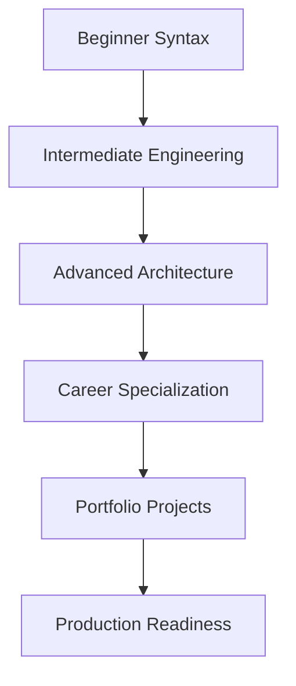

---

## Level 1: Beginner

<a id="introduction-to-python"></a>

# Introduction to Python

> **Level:** Level 1: Beginner | **Topic 01** | **Primary competency:** the role of Python as a readable, general-purpose language for automation, applications, data, and AI.

## Overview

- **What is it?** Introduction to Python is the practice of the role of Python as a readable, general-purpose language for automation, applications, data, and AI.
- **Why is it important?** It helps learners move from memorizing syntax to building dependable solutions that are readable, testable, and useful.
- **Where is it used?** It appears in professional Python projects, automation scripts, technical interviews, production services, analytics work, notebooks, and internal business tools.

## Learning Objectives

- **Skills gained:** explain the concept, write working Python examples, debug common errors, and apply the topic in a small project.
- **Concepts covered:** vocabulary, execution flow, syntax patterns, practical tradeoffs, testing expectations, and maintainability concerns.
- **Expected outcome:** you can use Introduction to Python confidently in real programs and can explain the design choices behind your solution.

## Real World Applications

| Area | Application |
| --- | --- |
| Industry use cases | Applied in professional Python projects where Python code must transform inputs into reliable outputs. |
| Business applications | Reduces manual work, improves reporting accuracy, enables repeatable workflows, and supports faster product delivery. |
| Career relevance | Strengthens portfolio projects, interview answers, code review skills, and readiness for Python developer roles. |

## Core Concepts

### 1. Foundation

- **Definition:** The foundation of Introduction to Python is the mental model that connects the problem, Python syntax, and expected result.
- **Visual explanation:** `Problem -> Introduction to Python concept -> Python expression -> Result`
- **Practical example:**

```python
introduction_to_python_goal = "learn by building"
print(introduction_to_python_goal.title())
```

### 2. Workflow

- **Definition:** A workflow is the repeatable sequence used to apply Introduction to Python safely.
- **Visual explanation:** `Input -> Validate -> Apply Introduction to Python -> Check output`
- **Practical example:**

```python
def apply_introduction_to_python(value):
    cleaned = str(value).strip()
    return f"Introduction to Python: {cleaned}"

print(apply_introduction_to_python(" practice "))
```

### 3. Professional Practice

- **Definition:** Professional use means naming intent clearly, handling edge cases, and making the behavior easy to test.
- **Visual explanation:** `Readable code -> Reviewable change -> Maintainable system`
- **Practical example:**

```python
def is_introduction_to_python_ready(checks):
    return all(checks.values())

print(is_introduction_to_python_ready({"syntax": True, "example": True, "review": True}))
```

## Infographic Summary

| Block | Summary |
| --- | --- |
| 📌 Concept | Introduction to Python turns a Python idea into a repeatable programming capability. |
| ⚡ Purpose | Make code clearer, safer, more reusable, or more powerful. |
| 🔥 Benefits | Better problem solving, faster debugging, stronger architecture, and easier collaboration. |
| 🎯 Use Cases | Scripts, APIs, data workflows, automation, interviews, prototypes, and production systems. |
| 🚀 Best Practices | Start small, name things clearly, test behavior, document assumptions, and refactor once patterns emerge. |
| ❌ Common Mistakes | Copying examples without understanding flow, ignoring errors, overengineering early, and skipping validation. |

## Syntax Guide

### Basic Syntax

```python
introduction_to_python_topic = "Introduction to Python"
print(introduction_to_python_topic)
```

### Standard Structure

```python
def prepare_introduction_to_python(raw_value):
    value = str(raw_value).strip()
    if not value:
        raise ValueError("value is required")
    return value

result = prepare_introduction_to_python("example")
print(result)
```

### Code Pattern

```python
# 1. Receive input
# 2. Validate assumptions
# 3. Apply the Introduction to Python technique
# 4. Return or display the result
```

## Examples

### Beginner Example

```python
topic = "Introduction to Python"
print(f"Today I am practicing {topic}.")
```

### Intermediate Example

```python
def summarize_skill(topic, level="intermediate"):
    return {
        "topic": topic,
        "level": level,
        "practice_items": ["read", "run", "modify", "explain"],
        "ready_for_project": True,
    }

print(summarize_skill("Introduction to Python"))
```

### Advanced Example

```python
from dataclasses import dataclass
from typing import Callable


@dataclass(frozen=True)
class LearningCheckpoint:
    topic: str
    validator: Callable[[str], bool]

    def evaluate(self, artifact: str) -> bool:
        return self.validator(artifact)


checkpoint = LearningCheckpoint(
    topic="Introduction to Python",
    validator=lambda artifact: "example" in artifact.lower(),
)
print(checkpoint.evaluate("Example project completed"))
```

## Workflow Diagram

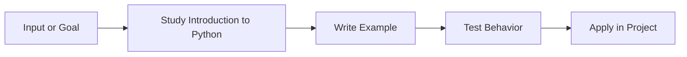

---

<a id="installing-python"></a>

# Installing Python

> **Level:** Level 1: Beginner | **Topic 02** | **Primary competency:** installers, interpreters, PATH configuration, and version verification.

## Overview

- **What is it?** Installing Python is the practice of installers, interpreters, PATH configuration, and version verification.
- **Why is it important?** It helps learners move from memorizing syntax to building dependable solutions that are readable, testable, and useful.
- **Where is it used?** It appears in professional Python projects, automation scripts, technical interviews, production services, analytics work, notebooks, and internal business tools.

## Learning Objectives

- **Skills gained:** explain the concept, write working Python examples, debug common errors, and apply the topic in a small project.
- **Concepts covered:** vocabulary, execution flow, syntax patterns, practical tradeoffs, testing expectations, and maintainability concerns.
- **Expected outcome:** you can use Installing Python confidently in real programs and can explain the design choices behind your solution.

## Real World Applications

| Area | Application |
| --- | --- |
| Industry use cases | Applied in professional Python projects where Python code must transform inputs into reliable outputs. |
| Business applications | Reduces manual work, improves reporting accuracy, enables repeatable workflows, and supports faster product delivery. |
| Career relevance | Strengthens portfolio projects, interview answers, code review skills, and readiness for Python developer roles. |

## Core Concepts

### 1. Foundation

- **Definition:** The foundation of Installing Python is the mental model that connects the problem, Python syntax, and expected result.
- **Visual explanation:** `Problem -> Installing Python concept -> Python expression -> Result`
- **Practical example:**

```python
installing_python_goal = "learn by building"
print(installing_python_goal.title())
```

### 2. Workflow

- **Definition:** A workflow is the repeatable sequence used to apply Installing Python safely.
- **Visual explanation:** `Input -> Validate -> Apply Installing Python -> Check output`
- **Practical example:**

```python
def apply_installing_python(value):
    cleaned = str(value).strip()
    return f"Installing Python: {cleaned}"

print(apply_installing_python(" practice "))
```

### 3. Professional Practice

- **Definition:** Professional use means naming intent clearly, handling edge cases, and making the behavior easy to test.
- **Visual explanation:** `Readable code -> Reviewable change -> Maintainable system`
- **Practical example:**

```python
def is_installing_python_ready(checks):
    return all(checks.values())

print(is_installing_python_ready({"syntax": True, "example": True, "review": True}))
```

## Infographic Summary

| Block | Summary |
| --- | --- |
| 📌 Concept | Installing Python turns a Python idea into a repeatable programming capability. |
| ⚡ Purpose | Make code clearer, safer, more reusable, or more powerful. |
| 🔥 Benefits | Better problem solving, faster debugging, stronger architecture, and easier collaboration. |
| 🎯 Use Cases | Scripts, APIs, data workflows, automation, interviews, prototypes, and production systems. |
| 🚀 Best Practices | Start small, name things clearly, test behavior, document assumptions, and refactor once patterns emerge. |
| ❌ Common Mistakes | Copying examples without understanding flow, ignoring errors, overengineering early, and skipping validation. |

## Syntax Guide

### Basic Syntax

```python
installing_python_topic = "Installing Python"
print(installing_python_topic)
```

### Standard Structure

```python
def prepare_installing_python(raw_value):
    value = str(raw_value).strip()
    if not value:
        raise ValueError("value is required")
    return value

result = prepare_installing_python("example")
print(result)
```

### Code Pattern

```python
# 1. Receive input
# 2. Validate assumptions
# 3. Apply the Installing Python technique
# 4. Return or display the result
```

## Examples

### Beginner Example

```python
topic = "Installing Python"
print(f"Today I am practicing {topic}.")
```

### Intermediate Example

```python
def summarize_skill(topic, level="intermediate"):
    return {
        "topic": topic,
        "level": level,
        "practice_items": ["read", "run", "modify", "explain"],
        "ready_for_project": True,
    }

print(summarize_skill("Installing Python"))
```

### Advanced Example

```python
from dataclasses import dataclass
from typing import Callable


@dataclass(frozen=True)
class LearningCheckpoint:
    topic: str
    validator: Callable[[str], bool]

    def evaluate(self, artifact: str) -> bool:
        return self.validator(artifact)


checkpoint = LearningCheckpoint(
    topic="Installing Python",
    validator=lambda artifact: "example" in artifact.lower(),
)
print(checkpoint.evaluate("Example project completed"))
```

## Workflow Diagram

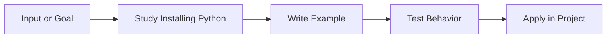

---

<a id="ide-setup"></a>

# IDE Setup

> **Level:** Level 1: Beginner | **Topic 03** | **Primary competency:** editor configuration, extensions, terminals, debugging panels, and productivity workflows.

## Overview

- **What is it?** IDE Setup is the practice of editor configuration, extensions, terminals, debugging panels, and productivity workflows.
- **Why is it important?** It helps learners move from memorizing syntax to building dependable solutions that are readable, testable, and useful.
- **Where is it used?** It appears in professional Python projects, automation scripts, technical interviews, production services, analytics work, notebooks, and internal business tools.

## Learning Objectives

- **Skills gained:** explain the concept, write working Python examples, debug common errors, and apply the topic in a small project.
- **Concepts covered:** vocabulary, execution flow, syntax patterns, practical tradeoffs, testing expectations, and maintainability concerns.
- **Expected outcome:** you can use IDE Setup confidently in real programs and can explain the design choices behind your solution.

## Real World Applications

| Area | Application |
| --- | --- |
| Industry use cases | Applied in professional Python projects where Python code must transform inputs into reliable outputs. |
| Business applications | Reduces manual work, improves reporting accuracy, enables repeatable workflows, and supports faster product delivery. |
| Career relevance | Strengthens portfolio projects, interview answers, code review skills, and readiness for Python developer roles. |

## Core Concepts

### 1. Foundation

- **Definition:** The foundation of IDE Setup is the mental model that connects the problem, Python syntax, and expected result.
- **Visual explanation:** `Problem -> IDE Setup concept -> Python expression -> Result`
- **Practical example:**

```python
ide_setup_goal = "learn by building"
print(ide_setup_goal.title())
```

### 2. Workflow

- **Definition:** A workflow is the repeatable sequence used to apply IDE Setup safely.
- **Visual explanation:** `Input -> Validate -> Apply IDE Setup -> Check output`
- **Practical example:**

```python
def apply_ide_setup(value):
    cleaned = str(value).strip()
    return f"IDE Setup: {cleaned}"

print(apply_ide_setup(" practice "))
```

### 3. Professional Practice

- **Definition:** Professional use means naming intent clearly, handling edge cases, and making the behavior easy to test.
- **Visual explanation:** `Readable code -> Reviewable change -> Maintainable system`
- **Practical example:**

```python
def is_ide_setup_ready(checks):
    return all(checks.values())

print(is_ide_setup_ready({"syntax": True, "example": True, "review": True}))
```

## Infographic Summary

| Block | Summary |
| --- | --- |
| 📌 Concept | IDE Setup turns a Python idea into a repeatable programming capability. |
| ⚡ Purpose | Make code clearer, safer, more reusable, or more powerful. |
| 🔥 Benefits | Better problem solving, faster debugging, stronger architecture, and easier collaboration. |
| 🎯 Use Cases | Scripts, APIs, data workflows, automation, interviews, prototypes, and production systems. |
| 🚀 Best Practices | Start small, name things clearly, test behavior, document assumptions, and refactor once patterns emerge. |
| ❌ Common Mistakes | Copying examples without understanding flow, ignoring errors, overengineering early, and skipping validation. |

## Syntax Guide

### Basic Syntax

```python
ide_setup_topic = "IDE Setup"
print(ide_setup_topic)
```

### Standard Structure

```python
def prepare_ide_setup(raw_value):
    value = str(raw_value).strip()
    if not value:
        raise ValueError("value is required")
    return value

result = prepare_ide_setup("example")
print(result)
```

### Code Pattern

```python
# 1. Receive input
# 2. Validate assumptions
# 3. Apply the IDE Setup technique
# 4. Return or display the result
```

## Examples

### Beginner Example

```python
topic = "IDE Setup"
print(f"Today I am practicing {topic}.")
```

### Intermediate Example

```python
def summarize_skill(topic, level="intermediate"):
    return {
        "topic": topic,
        "level": level,
        "practice_items": ["read", "run", "modify", "explain"],
        "ready_for_project": True,
    }

print(summarize_skill("IDE Setup"))
```

### Advanced Example

```python
from dataclasses import dataclass
from typing import Callable


@dataclass(frozen=True)
class LearningCheckpoint:
    topic: str
    validator: Callable[[str], bool]

    def evaluate(self, artifact: str) -> bool:
        return self.validator(artifact)


checkpoint = LearningCheckpoint(
    topic="IDE Setup",
    validator=lambda artifact: "example" in artifact.lower(),
)
print(checkpoint.evaluate("Example project completed"))
```

## Workflow Diagram

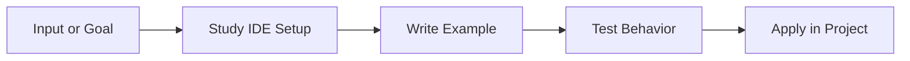

---

<a id="python-syntax"></a>

# Python Syntax

> **Level:** Level 1: Beginner | **Topic 04** | **Primary competency:** indentation, statements, expressions, comments, and readable program layout.

## Overview

- **What is it?** Python Syntax is the practice of indentation, statements, expressions, comments, and readable program layout.
- **Why is it important?** It helps learners move from memorizing syntax to building dependable solutions that are readable, testable, and useful.
- **Where is it used?** It appears in professional Python projects, automation scripts, technical interviews, production services, analytics work, notebooks, and internal business tools.

## Learning Objectives

- **Skills gained:** explain the concept, write working Python examples, debug common errors, and apply the topic in a small project.
- **Concepts covered:** vocabulary, execution flow, syntax patterns, practical tradeoffs, testing expectations, and maintainability concerns.
- **Expected outcome:** you can use Python Syntax confidently in real programs and can explain the design choices behind your solution.

## Real World Applications

| Area | Application |
| --- | --- |
| Industry use cases | Applied in professional Python projects where Python code must transform inputs into reliable outputs. |
| Business applications | Reduces manual work, improves reporting accuracy, enables repeatable workflows, and supports faster product delivery. |
| Career relevance | Strengthens portfolio projects, interview answers, code review skills, and readiness for Python developer roles. |

## Core Concepts

### 1. Foundation

- **Definition:** The foundation of Python Syntax is the mental model that connects the problem, Python syntax, and expected result.
- **Visual explanation:** `Problem -> Python Syntax concept -> Python expression -> Result`
- **Practical example:**

```python
python_syntax_goal = "learn by building"
print(python_syntax_goal.title())
```

### 2. Workflow

- **Definition:** A workflow is the repeatable sequence used to apply Python Syntax safely.
- **Visual explanation:** `Input -> Validate -> Apply Python Syntax -> Check output`
- **Practical example:**

```python
def apply_python_syntax(value):
    cleaned = str(value).strip()
    return f"Python Syntax: {cleaned}"

print(apply_python_syntax(" practice "))
```

### 3. Professional Practice

- **Definition:** Professional use means naming intent clearly, handling edge cases, and making the behavior easy to test.
- **Visual explanation:** `Readable code -> Reviewable change -> Maintainable system`
- **Practical example:**

```python
def is_python_syntax_ready(checks):
    return all(checks.values())

print(is_python_syntax_ready({"syntax": True, "example": True, "review": True}))
```

## Infographic Summary

| Block | Summary |
| --- | --- |
| 📌 Concept | Python Syntax turns a Python idea into a repeatable programming capability. |
| ⚡ Purpose | Make code clearer, safer, more reusable, or more powerful. |
| 🔥 Benefits | Better problem solving, faster debugging, stronger architecture, and easier collaboration. |
| 🎯 Use Cases | Scripts, APIs, data workflows, automation, interviews, prototypes, and production systems. |
| 🚀 Best Practices | Start small, name things clearly, test behavior, document assumptions, and refactor once patterns emerge. |
| ❌ Common Mistakes | Copying examples without understanding flow, ignoring errors, overengineering early, and skipping validation. |

## Syntax Guide

### Basic Syntax

```python
python_syntax_topic = "Python Syntax"
print(python_syntax_topic)
```

### Standard Structure

```python
def prepare_python_syntax(raw_value):
    value = str(raw_value).strip()
    if not value:
        raise ValueError("value is required")
    return value

result = prepare_python_syntax("example")
print(result)
```

### Code Pattern

```python
# 1. Receive input
# 2. Validate assumptions
# 3. Apply the Python Syntax technique
# 4. Return or display the result
```

## Examples

### Beginner Example

```python
topic = "Python Syntax"
print(f"Today I am practicing {topic}.")
```

### Intermediate Example

```python
def summarize_skill(topic, level="intermediate"):
    return {
        "topic": topic,
        "level": level,
        "practice_items": ["read", "run", "modify", "explain"],
        "ready_for_project": True,
    }

print(summarize_skill("Python Syntax"))
```

### Advanced Example

```python
from dataclasses import dataclass
from typing import Callable


@dataclass(frozen=True)
class LearningCheckpoint:
    topic: str
    validator: Callable[[str], bool]

    def evaluate(self, artifact: str) -> bool:
        return self.validator(artifact)


checkpoint = LearningCheckpoint(
    topic="Python Syntax",
    validator=lambda artifact: "example" in artifact.lower(),
)
print(checkpoint.evaluate("Example project completed"))
```

## Workflow Diagram

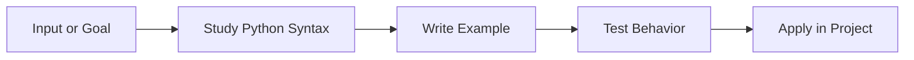

---

<a id="variables"></a>

# Variables

> **Level:** Level 1: Beginner | **Topic 05** | **Primary competency:** naming values clearly and binding names to Python objects.

## Overview

- **What is it?** Variables is the practice of naming values clearly and binding names to Python objects.
- **Why is it important?** It helps learners move from memorizing syntax to building dependable solutions that are readable, testable, and useful.
- **Where is it used?** It appears in professional Python projects, automation scripts, technical interviews, production services, analytics work, notebooks, and internal business tools.

## Learning Objectives

- **Skills gained:** explain the concept, write working Python examples, debug common errors, and apply the topic in a small project.
- **Concepts covered:** vocabulary, execution flow, syntax patterns, practical tradeoffs, testing expectations, and maintainability concerns.
- **Expected outcome:** you can use Variables confidently in real programs and can explain the design choices behind your solution.

## Real World Applications

| Area | Application |
| --- | --- |
| Industry use cases | Applied in professional Python projects where Python code must transform inputs into reliable outputs. |
| Business applications | Reduces manual work, improves reporting accuracy, enables repeatable workflows, and supports faster product delivery. |
| Career relevance | Strengthens portfolio projects, interview answers, code review skills, and readiness for Python developer roles. |

## Core Concepts

### 1. Foundation

- **Definition:** The foundation of Variables is the mental model that connects the problem, Python syntax, and expected result.
- **Visual explanation:** `Problem -> Variables concept -> Python expression -> Result`
- **Practical example:**

```python
variables_goal = "learn by building"
print(variables_goal.title())
```

### 2. Workflow

- **Definition:** A workflow is the repeatable sequence used to apply Variables safely.
- **Visual explanation:** `Input -> Validate -> Apply Variables -> Check output`
- **Practical example:**

```python
def apply_variables(value):
    cleaned = str(value).strip()
    return f"Variables: {cleaned}"

print(apply_variables(" practice "))
```

### 3. Professional Practice

- **Definition:** Professional use means naming intent clearly, handling edge cases, and making the behavior easy to test.
- **Visual explanation:** `Readable code -> Reviewable change -> Maintainable system`
- **Practical example:**

```python
def is_variables_ready(checks):
    return all(checks.values())

print(is_variables_ready({"syntax": True, "example": True, "review": True}))
```

## Infographic Summary

| Block | Summary |
| --- | --- |
| 📌 Concept | Variables turns a Python idea into a repeatable programming capability. |
| ⚡ Purpose | Make code clearer, safer, more reusable, or more powerful. |
| 🔥 Benefits | Better problem solving, faster debugging, stronger architecture, and easier collaboration. |
| 🎯 Use Cases | Scripts, APIs, data workflows, automation, interviews, prototypes, and production systems. |
| 🚀 Best Practices | Start small, name things clearly, test behavior, document assumptions, and refactor once patterns emerge. |
| ❌ Common Mistakes | Copying examples without understanding flow, ignoring errors, overengineering early, and skipping validation. |

## Syntax Guide

### Basic Syntax

```python
variables_topic = "Variables"
print(variables_topic)
```

### Standard Structure

```python
def prepare_variables(raw_value):
    value = str(raw_value).strip()
    if not value:
        raise ValueError("value is required")
    return value

result = prepare_variables("example")
print(result)
```

### Code Pattern

```python
# 1. Receive input
# 2. Validate assumptions
# 3. Apply the Variables technique
# 4. Return or display the result
```

## Examples

### Beginner Example

```python
topic = "Variables"
print(f"Today I am practicing {topic}.")
```

### Intermediate Example

```python
def summarize_skill(topic, level="intermediate"):
    return {
        "topic": topic,
        "level": level,
        "practice_items": ["read", "run", "modify", "explain"],
        "ready_for_project": True,
    }

print(summarize_skill("Variables"))
```

### Advanced Example

```python
from dataclasses import dataclass
from typing import Callable


@dataclass(frozen=True)
class LearningCheckpoint:
    topic: str
    validator: Callable[[str], bool]

    def evaluate(self, artifact: str) -> bool:
        return self.validator(artifact)


checkpoint = LearningCheckpoint(
    topic="Variables",
    validator=lambda artifact: "example" in artifact.lower(),
)
print(checkpoint.evaluate("Example project completed"))
```

## Workflow Diagram

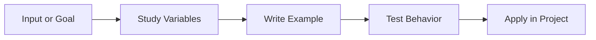

---

<a id="data-types"></a>

# Data Types

> **Level:** Level 1: Beginner | **Topic 06** | **Primary competency:** choosing the right built-in type for text, numbers, booleans, collections, and missing values.

## Overview

- **What is it?** Data Types is the practice of choosing the right built-in type for text, numbers, booleans, collections, and missing values.
- **Why is it important?** It helps learners move from memorizing syntax to building dependable solutions that are readable, testable, and useful.
- **Where is it used?** It appears in professional Python projects, automation scripts, technical interviews, production services, analytics work, notebooks, and internal business tools.

## Learning Objectives

- **Skills gained:** explain the concept, write working Python examples, debug common errors, and apply the topic in a small project.
- **Concepts covered:** vocabulary, execution flow, syntax patterns, practical tradeoffs, testing expectations, and maintainability concerns.
- **Expected outcome:** you can use Data Types confidently in real programs and can explain the design choices behind your solution.

## Real World Applications

| Area | Application |
| --- | --- |
| Industry use cases | Applied in professional Python projects where Python code must transform inputs into reliable outputs. |
| Business applications | Reduces manual work, improves reporting accuracy, enables repeatable workflows, and supports faster product delivery. |
| Career relevance | Strengthens portfolio projects, interview answers, code review skills, and readiness for Python developer roles. |

## Core Concepts

### 1. Foundation

- **Definition:** The foundation of Data Types is the mental model that connects the problem, Python syntax, and expected result.
- **Visual explanation:** `Problem -> Data Types concept -> Python expression -> Result`
- **Practical example:**

```python
data_types_goal = "learn by building"
print(data_types_goal.title())
```

### 2. Workflow

- **Definition:** A workflow is the repeatable sequence used to apply Data Types safely.
- **Visual explanation:** `Input -> Validate -> Apply Data Types -> Check output`
- **Practical example:**

```python
def apply_data_types(value):
    cleaned = str(value).strip()
    return f"Data Types: {cleaned}"

print(apply_data_types(" practice "))
```

### 3. Professional Practice

- **Definition:** Professional use means naming intent clearly, handling edge cases, and making the behavior easy to test.
- **Visual explanation:** `Readable code -> Reviewable change -> Maintainable system`
- **Practical example:**

```python
def is_data_types_ready(checks):
    return all(checks.values())

print(is_data_types_ready({"syntax": True, "example": True, "review": True}))
```

## Infographic Summary

| Block | Summary |
| --- | --- |
| 📌 Concept | Data Types turns a Python idea into a repeatable programming capability. |
| ⚡ Purpose | Make code clearer, safer, more reusable, or more powerful. |
| 🔥 Benefits | Better problem solving, faster debugging, stronger architecture, and easier collaboration. |
| 🎯 Use Cases | Scripts, APIs, data workflows, automation, interviews, prototypes, and production systems. |
| 🚀 Best Practices | Start small, name things clearly, test behavior, document assumptions, and refactor once patterns emerge. |
| ❌ Common Mistakes | Copying examples without understanding flow, ignoring errors, overengineering early, and skipping validation. |

## Syntax Guide

### Basic Syntax

```python
data_types_topic = "Data Types"
print(data_types_topic)
```

### Standard Structure

```python
def prepare_data_types(raw_value):
    value = str(raw_value).strip()
    if not value:
        raise ValueError("value is required")
    return value

result = prepare_data_types("example")
print(result)
```

### Code Pattern

```python
# 1. Receive input
# 2. Validate assumptions
# 3. Apply the Data Types technique
# 4. Return or display the result
```

## Examples

### Beginner Example

```python
topic = "Data Types"
print(f"Today I am practicing {topic}.")
```

### Intermediate Example

```python
def summarize_skill(topic, level="intermediate"):
    return {
        "topic": topic,
        "level": level,
        "practice_items": ["read", "run", "modify", "explain"],
        "ready_for_project": True,
    }

print(summarize_skill("Data Types"))
```

### Advanced Example

```python
from dataclasses import dataclass
from typing import Callable


@dataclass(frozen=True)
class LearningCheckpoint:
    topic: str
    validator: Callable[[str], bool]

    def evaluate(self, artifact: str) -> bool:
        return self.validator(artifact)


checkpoint = LearningCheckpoint(
    topic="Data Types",
    validator=lambda artifact: "example" in artifact.lower(),
)
print(checkpoint.evaluate("Example project completed"))
```

## Workflow Diagram

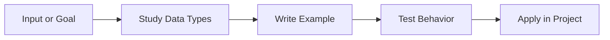

---

<a id="type-casting"></a>

# Type Casting

> **Level:** Level 1: Beginner | **Topic 07** | **Primary competency:** converting values safely between compatible types.

## Overview

- **What is it?** Type Casting is the practice of converting values safely between compatible types.
- **Why is it important?** It helps learners move from memorizing syntax to building dependable solutions that are readable, testable, and useful.
- **Where is it used?** It appears in professional Python projects, automation scripts, technical interviews, production services, analytics work, notebooks, and internal business tools.

## Learning Objectives

- **Skills gained:** explain the concept, write working Python examples, debug common errors, and apply the topic in a small project.
- **Concepts covered:** vocabulary, execution flow, syntax patterns, practical tradeoffs, testing expectations, and maintainability concerns.
- **Expected outcome:** you can use Type Casting confidently in real programs and can explain the design choices behind your solution.

## Real World Applications

| Area | Application |
| --- | --- |
| Industry use cases | Applied in professional Python projects where Python code must transform inputs into reliable outputs. |
| Business applications | Reduces manual work, improves reporting accuracy, enables repeatable workflows, and supports faster product delivery. |
| Career relevance | Strengthens portfolio projects, interview answers, code review skills, and readiness for Python developer roles. |

## Core Concepts

### 1. Foundation

- **Definition:** The foundation of Type Casting is the mental model that connects the problem, Python syntax, and expected result.
- **Visual explanation:** `Problem -> Type Casting concept -> Python expression -> Result`
- **Practical example:**

```python
type_casting_goal = "learn by building"
print(type_casting_goal.title())
```

### 2. Workflow

- **Definition:** A workflow is the repeatable sequence used to apply Type Casting safely.
- **Visual explanation:** `Input -> Validate -> Apply Type Casting -> Check output`
- **Practical example:**

```python
def apply_type_casting(value):
    cleaned = str(value).strip()
    return f"Type Casting: {cleaned}"

print(apply_type_casting(" practice "))
```

### 3. Professional Practice

- **Definition:** Professional use means naming intent clearly, handling edge cases, and making the behavior easy to test.
- **Visual explanation:** `Readable code -> Reviewable change -> Maintainable system`
- **Practical example:**

```python
def is_type_casting_ready(checks):
    return all(checks.values())

print(is_type_casting_ready({"syntax": True, "example": True, "review": True}))
```

## Infographic Summary

| Block | Summary |
| --- | --- |
| 📌 Concept | Type Casting turns a Python idea into a repeatable programming capability. |
| ⚡ Purpose | Make code clearer, safer, more reusable, or more powerful. |
| 🔥 Benefits | Better problem solving, faster debugging, stronger architecture, and easier collaboration. |
| 🎯 Use Cases | Scripts, APIs, data workflows, automation, interviews, prototypes, and production systems. |
| 🚀 Best Practices | Start small, name things clearly, test behavior, document assumptions, and refactor once patterns emerge. |
| ❌ Common Mistakes | Copying examples without understanding flow, ignoring errors, overengineering early, and skipping validation. |

## Syntax Guide

### Basic Syntax

```python
type_casting_topic = "Type Casting"
print(type_casting_topic)
```

### Standard Structure

```python
def prepare_type_casting(raw_value):
    value = str(raw_value).strip()
    if not value:
        raise ValueError("value is required")
    return value

result = prepare_type_casting("example")
print(result)
```

### Code Pattern

```python
# 1. Receive input
# 2. Validate assumptions
# 3. Apply the Type Casting technique
# 4. Return or display the result
```

## Examples

### Beginner Example

```python
topic = "Type Casting"
print(f"Today I am practicing {topic}.")
```

### Intermediate Example

```python
def summarize_skill(topic, level="intermediate"):
    return {
        "topic": topic,
        "level": level,
        "practice_items": ["read", "run", "modify", "explain"],
        "ready_for_project": True,
    }

print(summarize_skill("Type Casting"))
```

### Advanced Example

```python
from dataclasses import dataclass
from typing import Callable


@dataclass(frozen=True)
class LearningCheckpoint:
    topic: str
    validator: Callable[[str], bool]

    def evaluate(self, artifact: str) -> bool:
        return self.validator(artifact)


checkpoint = LearningCheckpoint(
    topic="Type Casting",
    validator=lambda artifact: "example" in artifact.lower(),
)
print(checkpoint.evaluate("Example project completed"))
```

## Workflow Diagram

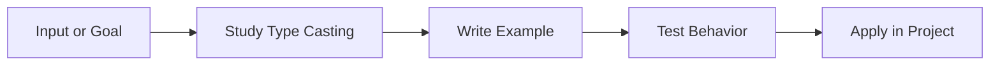

---

<a id="input-and-output"></a>

# Input and Output

> **Level:** Level 1: Beginner | **Topic 08** | **Primary competency:** receiving user data and presenting results through terminal, files, and streams.

## Overview

- **What is it?** Input and Output is the practice of receiving user data and presenting results through terminal, files, and streams.
- **Why is it important?** It helps learners move from memorizing syntax to building dependable solutions that are readable, testable, and useful.
- **Where is it used?** It appears in professional Python projects, automation scripts, technical interviews, production services, analytics work, notebooks, and internal business tools.

## Learning Objectives

- **Skills gained:** explain the concept, write working Python examples, debug common errors, and apply the topic in a small project.
- **Concepts covered:** vocabulary, execution flow, syntax patterns, practical tradeoffs, testing expectations, and maintainability concerns.
- **Expected outcome:** you can use Input and Output confidently in real programs and can explain the design choices behind your solution.

## Real World Applications

| Area | Application |
| --- | --- |
| Industry use cases | Applied in professional Python projects where Python code must transform inputs into reliable outputs. |
| Business applications | Reduces manual work, improves reporting accuracy, enables repeatable workflows, and supports faster product delivery. |
| Career relevance | Strengthens portfolio projects, interview answers, code review skills, and readiness for Python developer roles. |

## Core Concepts

### 1. Foundation

- **Definition:** The foundation of Input and Output is the mental model that connects the problem, Python syntax, and expected result.
- **Visual explanation:** `Problem -> Input and Output concept -> Python expression -> Result`
- **Practical example:**

```python
input_and_output_goal = "learn by building"
print(input_and_output_goal.title())
```

### 2. Workflow

- **Definition:** A workflow is the repeatable sequence used to apply Input and Output safely.
- **Visual explanation:** `Input -> Validate -> Apply Input and Output -> Check output`
- **Practical example:**

```python
def apply_input_and_output(value):
    cleaned = str(value).strip()
    return f"Input and Output: {cleaned}"

print(apply_input_and_output(" practice "))
```

### 3. Professional Practice

- **Definition:** Professional use means naming intent clearly, handling edge cases, and making the behavior easy to test.
- **Visual explanation:** `Readable code -> Reviewable change -> Maintainable system`
- **Practical example:**

```python
def is_input_and_output_ready(checks):
    return all(checks.values())

print(is_input_and_output_ready({"syntax": True, "example": True, "review": True}))
```

## Infographic Summary

| Block | Summary |
| --- | --- |
| 📌 Concept | Input and Output turns a Python idea into a repeatable programming capability. |
| ⚡ Purpose | Make code clearer, safer, more reusable, or more powerful. |
| 🔥 Benefits | Better problem solving, faster debugging, stronger architecture, and easier collaboration. |
| 🎯 Use Cases | Scripts, APIs, data workflows, automation, interviews, prototypes, and production systems. |
| 🚀 Best Practices | Start small, name things clearly, test behavior, document assumptions, and refactor once patterns emerge. |
| ❌ Common Mistakes | Copying examples without understanding flow, ignoring errors, overengineering early, and skipping validation. |

## Syntax Guide

### Basic Syntax

```python
input_and_output_topic = "Input and Output"
print(input_and_output_topic)
```

### Standard Structure

```python
def prepare_input_and_output(raw_value):
    value = str(raw_value).strip()
    if not value:
        raise ValueError("value is required")
    return value

result = prepare_input_and_output("example")
print(result)
```

### Code Pattern

```python
# 1. Receive input
# 2. Validate assumptions
# 3. Apply the Input and Output technique
# 4. Return or display the result
```

## Examples

### Beginner Example

```python
topic = "Input and Output"
print(f"Today I am practicing {topic}.")
```

### Intermediate Example

```python
def summarize_skill(topic, level="intermediate"):
    return {
        "topic": topic,
        "level": level,
        "practice_items": ["read", "run", "modify", "explain"],
        "ready_for_project": True,
    }

print(summarize_skill("Input and Output"))
```

### Advanced Example

```python
from dataclasses import dataclass
from typing import Callable


@dataclass(frozen=True)
class LearningCheckpoint:
    topic: str
    validator: Callable[[str], bool]

    def evaluate(self, artifact: str) -> bool:
        return self.validator(artifact)


checkpoint = LearningCheckpoint(
    topic="Input and Output",
    validator=lambda artifact: "example" in artifact.lower(),
)
print(checkpoint.evaluate("Example project completed"))
```

## Workflow Diagram

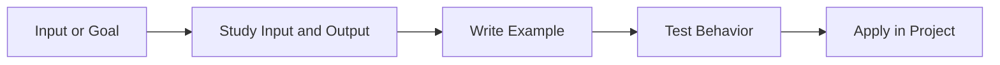

---

<a id="operators"></a>

# Operators

> **Level:** Level 1: Beginner | **Topic 09** | **Primary competency:** combining values with arithmetic, comparison, logical, membership, identity, and assignment operators.

## Overview

- **What is it?** Operators is the practice of combining values with arithmetic, comparison, logical, membership, identity, and assignment operators.
- **Why is it important?** It helps learners move from memorizing syntax to building dependable solutions that are readable, testable, and useful.
- **Where is it used?** It appears in professional Python projects, automation scripts, technical interviews, production services, analytics work, notebooks, and internal business tools.

## Learning Objectives

- **Skills gained:** explain the concept, write working Python examples, debug common errors, and apply the topic in a small project.
- **Concepts covered:** vocabulary, execution flow, syntax patterns, practical tradeoffs, testing expectations, and maintainability concerns.
- **Expected outcome:** you can use Operators confidently in real programs and can explain the design choices behind your solution.

## Real World Applications

| Area | Application |
| --- | --- |
| Industry use cases | Applied in professional Python projects where Python code must transform inputs into reliable outputs. |
| Business applications | Reduces manual work, improves reporting accuracy, enables repeatable workflows, and supports faster product delivery. |
| Career relevance | Strengthens portfolio projects, interview answers, code review skills, and readiness for Python developer roles. |

## Core Concepts

### 1. Foundation

- **Definition:** The foundation of Operators is the mental model that connects the problem, Python syntax, and expected result.
- **Visual explanation:** `Problem -> Operators concept -> Python expression -> Result`
- **Practical example:**

```python
operators_goal = "learn by building"
print(operators_goal.title())
```

### 2. Workflow

- **Definition:** A workflow is the repeatable sequence used to apply Operators safely.
- **Visual explanation:** `Input -> Validate -> Apply Operators -> Check output`
- **Practical example:**

```python
def apply_operators(value):
    cleaned = str(value).strip()
    return f"Operators: {cleaned}"

print(apply_operators(" practice "))
```

### 3. Professional Practice

- **Definition:** Professional use means naming intent clearly, handling edge cases, and making the behavior easy to test.
- **Visual explanation:** `Readable code -> Reviewable change -> Maintainable system`
- **Practical example:**

```python
def is_operators_ready(checks):
    return all(checks.values())

print(is_operators_ready({"syntax": True, "example": True, "review": True}))
```

## Infographic Summary

| Block | Summary |
| --- | --- |
| 📌 Concept | Operators turns a Python idea into a repeatable programming capability. |
| ⚡ Purpose | Make code clearer, safer, more reusable, or more powerful. |
| 🔥 Benefits | Better problem solving, faster debugging, stronger architecture, and easier collaboration. |
| 🎯 Use Cases | Scripts, APIs, data workflows, automation, interviews, prototypes, and production systems. |
| 🚀 Best Practices | Start small, name things clearly, test behavior, document assumptions, and refactor once patterns emerge. |
| ❌ Common Mistakes | Copying examples without understanding flow, ignoring errors, overengineering early, and skipping validation. |

## Syntax Guide

### Basic Syntax

```python
operators_topic = "Operators"
print(operators_topic)
```

### Standard Structure

```python
def prepare_operators(raw_value):
    value = str(raw_value).strip()
    if not value:
        raise ValueError("value is required")
    return value

result = prepare_operators("example")
print(result)
```

### Code Pattern

```python
# 1. Receive input
# 2. Validate assumptions
# 3. Apply the Operators technique
# 4. Return or display the result
```

## Examples

### Beginner Example

```python
topic = "Operators"
print(f"Today I am practicing {topic}.")
```

### Intermediate Example

```python
def summarize_skill(topic, level="intermediate"):
    return {
        "topic": topic,
        "level": level,
        "practice_items": ["read", "run", "modify", "explain"],
        "ready_for_project": True,
    }

print(summarize_skill("Operators"))
```

### Advanced Example

```python
from dataclasses import dataclass
from typing import Callable


@dataclass(frozen=True)
class LearningCheckpoint:
    topic: str
    validator: Callable[[str], bool]

    def evaluate(self, artifact: str) -> bool:
        return self.validator(artifact)


checkpoint = LearningCheckpoint(
    topic="Operators",
    validator=lambda artifact: "example" in artifact.lower(),
)
print(checkpoint.evaluate("Example project completed"))
```

## Workflow Diagram

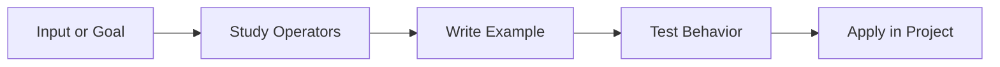

---

<a id="conditional-statements"></a>

# Conditional Statements

> **Level:** Level 1: Beginner | **Topic 10** | **Primary competency:** branching program behavior with boolean decisions.

## Overview

- **What is it?** Conditional Statements is the practice of branching program behavior with boolean decisions.
- **Why is it important?** It helps learners move from memorizing syntax to building dependable solutions that are readable, testable, and useful.
- **Where is it used?** It appears in professional Python projects, automation scripts, technical interviews, production services, analytics work, notebooks, and internal business tools.

## Learning Objectives

- **Skills gained:** explain the concept, write working Python examples, debug common errors, and apply the topic in a small project.
- **Concepts covered:** vocabulary, execution flow, syntax patterns, practical tradeoffs, testing expectations, and maintainability concerns.
- **Expected outcome:** you can use Conditional Statements confidently in real programs and can explain the design choices behind your solution.

## Real World Applications

| Area | Application |
| --- | --- |
| Industry use cases | Applied in professional Python projects where Python code must transform inputs into reliable outputs. |
| Business applications | Reduces manual work, improves reporting accuracy, enables repeatable workflows, and supports faster product delivery. |
| Career relevance | Strengthens portfolio projects, interview answers, code review skills, and readiness for Python developer roles. |

## Core Concepts

### 1. Foundation

- **Definition:** The foundation of Conditional Statements is the mental model that connects the problem, Python syntax, and expected result.
- **Visual explanation:** `Problem -> Conditional Statements concept -> Python expression -> Result`
- **Practical example:**

```python
conditional_statements_goal = "learn by building"
print(conditional_statements_goal.title())
```

### 2. Workflow

- **Definition:** A workflow is the repeatable sequence used to apply Conditional Statements safely.
- **Visual explanation:** `Input -> Validate -> Apply Conditional Statements -> Check output`
- **Practical example:**

```python
def apply_conditional_statements(value):
    cleaned = str(value).strip()
    return f"Conditional Statements: {cleaned}"

print(apply_conditional_statements(" practice "))
```

### 3. Professional Practice

- **Definition:** Professional use means naming intent clearly, handling edge cases, and making the behavior easy to test.
- **Visual explanation:** `Readable code -> Reviewable change -> Maintainable system`
- **Practical example:**

```python
def is_conditional_statements_ready(checks):
    return all(checks.values())

print(is_conditional_statements_ready({"syntax": True, "example": True, "review": True}))
```

## Infographic Summary

| Block | Summary |
| --- | --- |
| 📌 Concept | Conditional Statements turns a Python idea into a repeatable programming capability. |
| ⚡ Purpose | Make code clearer, safer, more reusable, or more powerful. |
| 🔥 Benefits | Better problem solving, faster debugging, stronger architecture, and easier collaboration. |
| 🎯 Use Cases | Scripts, APIs, data workflows, automation, interviews, prototypes, and production systems. |
| 🚀 Best Practices | Start small, name things clearly, test behavior, document assumptions, and refactor once patterns emerge. |
| ❌ Common Mistakes | Copying examples without understanding flow, ignoring errors, overengineering early, and skipping validation. |

## Syntax Guide

### Basic Syntax

```python
conditional_statements_topic = "Conditional Statements"
print(conditional_statements_topic)
```

### Standard Structure

```python
def prepare_conditional_statements(raw_value):
    value = str(raw_value).strip()
    if not value:
        raise ValueError("value is required")
    return value

result = prepare_conditional_statements("example")
print(result)
```

### Code Pattern

```python
# 1. Receive input
# 2. Validate assumptions
# 3. Apply the Conditional Statements technique
# 4. Return or display the result
```

## Examples

### Beginner Example

```python
topic = "Conditional Statements"
print(f"Today I am practicing {topic}.")
```

### Intermediate Example

```python
def summarize_skill(topic, level="intermediate"):
    return {
        "topic": topic,
        "level": level,
        "practice_items": ["read", "run", "modify", "explain"],
        "ready_for_project": True,
    }

print(summarize_skill("Conditional Statements"))
```

### Advanced Example

```python
from dataclasses import dataclass
from typing import Callable


@dataclass(frozen=True)
class LearningCheckpoint:
    topic: str
    validator: Callable[[str], bool]

    def evaluate(self, artifact: str) -> bool:
        return self.validator(artifact)


checkpoint = LearningCheckpoint(
    topic="Conditional Statements",
    validator=lambda artifact: "example" in artifact.lower(),
)
print(checkpoint.evaluate("Example project completed"))
```

## Workflow Diagram

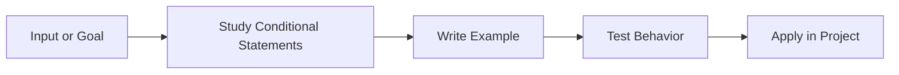

---

<a id="loops"></a>

# Loops

> **Level:** Level 1: Beginner | **Topic 11** | **Primary competency:** repeating work over ranges, collections, and conditions.

## Overview

- **What is it?** Loops is the practice of repeating work over ranges, collections, and conditions.
- **Why is it important?** It helps learners move from memorizing syntax to building dependable solutions that are readable, testable, and useful.
- **Where is it used?** It appears in professional Python projects, automation scripts, technical interviews, production services, analytics work, notebooks, and internal business tools.

## Learning Objectives

- **Skills gained:** explain the concept, write working Python examples, debug common errors, and apply the topic in a small project.
- **Concepts covered:** vocabulary, execution flow, syntax patterns, practical tradeoffs, testing expectations, and maintainability concerns.
- **Expected outcome:** you can use Loops confidently in real programs and can explain the design choices behind your solution.

## Real World Applications

| Area | Application |
| --- | --- |
| Industry use cases | Applied in professional Python projects where Python code must transform inputs into reliable outputs. |
| Business applications | Reduces manual work, improves reporting accuracy, enables repeatable workflows, and supports faster product delivery. |
| Career relevance | Strengthens portfolio projects, interview answers, code review skills, and readiness for Python developer roles. |

## Core Concepts

### 1. Foundation

- **Definition:** The foundation of Loops is the mental model that connects the problem, Python syntax, and expected result.
- **Visual explanation:** `Problem -> Loops concept -> Python expression -> Result`
- **Practical example:**

```python
loops_goal = "learn by building"
print(loops_goal.title())
```

### 2. Workflow

- **Definition:** A workflow is the repeatable sequence used to apply Loops safely.
- **Visual explanation:** `Input -> Validate -> Apply Loops -> Check output`
- **Practical example:**

```python
def apply_loops(value):
    cleaned = str(value).strip()
    return f"Loops: {cleaned}"

print(apply_loops(" practice "))
```

### 3. Professional Practice

- **Definition:** Professional use means naming intent clearly, handling edge cases, and making the behavior easy to test.
- **Visual explanation:** `Readable code -> Reviewable change -> Maintainable system`
- **Practical example:**

```python
def is_loops_ready(checks):
    return all(checks.values())

print(is_loops_ready({"syntax": True, "example": True, "review": True}))
```

## Infographic Summary

| Block | Summary |
| --- | --- |
| 📌 Concept | Loops turns a Python idea into a repeatable programming capability. |
| ⚡ Purpose | Make code clearer, safer, more reusable, or more powerful. |
| 🔥 Benefits | Better problem solving, faster debugging, stronger architecture, and easier collaboration. |
| 🎯 Use Cases | Scripts, APIs, data workflows, automation, interviews, prototypes, and production systems. |
| 🚀 Best Practices | Start small, name things clearly, test behavior, document assumptions, and refactor once patterns emerge. |
| ❌ Common Mistakes | Copying examples without understanding flow, ignoring errors, overengineering early, and skipping validation. |

## Syntax Guide

### Basic Syntax

```python
loops_topic = "Loops"
print(loops_topic)
```

### Standard Structure

```python
def prepare_loops(raw_value):
    value = str(raw_value).strip()
    if not value:
        raise ValueError("value is required")
    return value

result = prepare_loops("example")
print(result)
```

### Code Pattern

```python
# 1. Receive input
# 2. Validate assumptions
# 3. Apply the Loops technique
# 4. Return or display the result
```

## Examples

### Beginner Example

```python
topic = "Loops"
print(f"Today I am practicing {topic}.")
```

### Intermediate Example

```python
def summarize_skill(topic, level="intermediate"):
    return {
        "topic": topic,
        "level": level,
        "practice_items": ["read", "run", "modify", "explain"],
        "ready_for_project": True,
    }

print(summarize_skill("Loops"))
```

### Advanced Example

```python
from dataclasses import dataclass
from typing import Callable


@dataclass(frozen=True)
class LearningCheckpoint:
    topic: str
    validator: Callable[[str], bool]

    def evaluate(self, artifact: str) -> bool:
        return self.validator(artifact)


checkpoint = LearningCheckpoint(
    topic="Loops",
    validator=lambda artifact: "example" in artifact.lower(),
)
print(checkpoint.evaluate("Example project completed"))
```

## Workflow Diagram

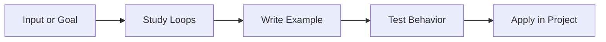

---

<a id="nested-loops"></a>

# Nested Loops

> **Level:** Level 1: Beginner | **Topic 12** | **Primary competency:** coordinating repeated work across two or more dimensions.

## Overview

- **What is it?** Nested Loops is the practice of coordinating repeated work across two or more dimensions.
- **Why is it important?** It helps learners move from memorizing syntax to building dependable solutions that are readable, testable, and useful.
- **Where is it used?** It appears in professional Python projects, automation scripts, technical interviews, production services, analytics work, notebooks, and internal business tools.

## Learning Objectives

- **Skills gained:** explain the concept, write working Python examples, debug common errors, and apply the topic in a small project.
- **Concepts covered:** vocabulary, execution flow, syntax patterns, practical tradeoffs, testing expectations, and maintainability concerns.
- **Expected outcome:** you can use Nested Loops confidently in real programs and can explain the design choices behind your solution.

## Real World Applications

| Area | Application |
| --- | --- |
| Industry use cases | Applied in professional Python projects where Python code must transform inputs into reliable outputs. |
| Business applications | Reduces manual work, improves reporting accuracy, enables repeatable workflows, and supports faster product delivery. |
| Career relevance | Strengthens portfolio projects, interview answers, code review skills, and readiness for Python developer roles. |

## Core Concepts

### 1. Foundation

- **Definition:** The foundation of Nested Loops is the mental model that connects the problem, Python syntax, and expected result.
- **Visual explanation:** `Problem -> Nested Loops concept -> Python expression -> Result`
- **Practical example:**

```python
nested_loops_goal = "learn by building"
print(nested_loops_goal.title())
```

### 2. Workflow

- **Definition:** A workflow is the repeatable sequence used to apply Nested Loops safely.
- **Visual explanation:** `Input -> Validate -> Apply Nested Loops -> Check output`
- **Practical example:**

```python
def apply_nested_loops(value):
    cleaned = str(value).strip()
    return f"Nested Loops: {cleaned}"

print(apply_nested_loops(" practice "))
```

### 3. Professional Practice

- **Definition:** Professional use means naming intent clearly, handling edge cases, and making the behavior easy to test.
- **Visual explanation:** `Readable code -> Reviewable change -> Maintainable system`
- **Practical example:**

```python
def is_nested_loops_ready(checks):
    return all(checks.values())

print(is_nested_loops_ready({"syntax": True, "example": True, "review": True}))
```

## Infographic Summary

| Block | Summary |
| --- | --- |
| 📌 Concept | Nested Loops turns a Python idea into a repeatable programming capability. |
| ⚡ Purpose | Make code clearer, safer, more reusable, or more powerful. |
| 🔥 Benefits | Better problem solving, faster debugging, stronger architecture, and easier collaboration. |
| 🎯 Use Cases | Scripts, APIs, data workflows, automation, interviews, prototypes, and production systems. |
| 🚀 Best Practices | Start small, name things clearly, test behavior, document assumptions, and refactor once patterns emerge. |
| ❌ Common Mistakes | Copying examples without understanding flow, ignoring errors, overengineering early, and skipping validation. |

## Syntax Guide

### Basic Syntax

```python
nested_loops_topic = "Nested Loops"
print(nested_loops_topic)
```

### Standard Structure

```python
def prepare_nested_loops(raw_value):
    value = str(raw_value).strip()
    if not value:
        raise ValueError("value is required")
    return value

result = prepare_nested_loops("example")
print(result)
```

### Code Pattern

```python
# 1. Receive input
# 2. Validate assumptions
# 3. Apply the Nested Loops technique
# 4. Return or display the result
```

## Examples

### Beginner Example

```python
topic = "Nested Loops"
print(f"Today I am practicing {topic}.")
```

### Intermediate Example

```python
def summarize_skill(topic, level="intermediate"):
    return {
        "topic": topic,
        "level": level,
        "practice_items": ["read", "run", "modify", "explain"],
        "ready_for_project": True,
    }

print(summarize_skill("Nested Loops"))
```

### Advanced Example

```python
from dataclasses import dataclass
from typing import Callable


@dataclass(frozen=True)
class LearningCheckpoint:
    topic: str
    validator: Callable[[str], bool]

    def evaluate(self, artifact: str) -> bool:
        return self.validator(artifact)


checkpoint = LearningCheckpoint(
    topic="Nested Loops",
    validator=lambda artifact: "example" in artifact.lower(),
)
print(checkpoint.evaluate("Example project completed"))
```

## Workflow Diagram

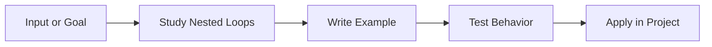

---

<a id="break-continue-pass"></a>

# Break Continue Pass

> **Level:** Level 1: Beginner | **Topic 13** | **Primary competency:** controlling loop flow and placeholder blocks with explicit keywords.

## Overview

- **What is it?** Break Continue Pass is the practice of controlling loop flow and placeholder blocks with explicit keywords.
- **Why is it important?** It helps learners move from memorizing syntax to building dependable solutions that are readable, testable, and useful.
- **Where is it used?** It appears in professional Python projects, automation scripts, technical interviews, production services, analytics work, notebooks, and internal business tools.

## Learning Objectives

- **Skills gained:** explain the concept, write working Python examples, debug common errors, and apply the topic in a small project.
- **Concepts covered:** vocabulary, execution flow, syntax patterns, practical tradeoffs, testing expectations, and maintainability concerns.
- **Expected outcome:** you can use Break Continue Pass confidently in real programs and can explain the design choices behind your solution.

## Real World Applications

| Area | Application |
| --- | --- |
| Industry use cases | Applied in professional Python projects where Python code must transform inputs into reliable outputs. |
| Business applications | Reduces manual work, improves reporting accuracy, enables repeatable workflows, and supports faster product delivery. |
| Career relevance | Strengthens portfolio projects, interview answers, code review skills, and readiness for Python developer roles. |

## Core Concepts

### 1. Foundation

- **Definition:** The foundation of Break Continue Pass is the mental model that connects the problem, Python syntax, and expected result.
- **Visual explanation:** `Problem -> Break Continue Pass concept -> Python expression -> Result`
- **Practical example:**

```python
break_continue_pass_goal = "learn by building"
print(break_continue_pass_goal.title())
```

### 2. Workflow

- **Definition:** A workflow is the repeatable sequence used to apply Break Continue Pass safely.
- **Visual explanation:** `Input -> Validate -> Apply Break Continue Pass -> Check output`
- **Practical example:**

```python
def apply_break_continue_pass(value):
    cleaned = str(value).strip()
    return f"Break Continue Pass: {cleaned}"

print(apply_break_continue_pass(" practice "))
```

### 3. Professional Practice

- **Definition:** Professional use means naming intent clearly, handling edge cases, and making the behavior easy to test.
- **Visual explanation:** `Readable code -> Reviewable change -> Maintainable system`
- **Practical example:**

```python
def is_break_continue_pass_ready(checks):
    return all(checks.values())

print(is_break_continue_pass_ready({"syntax": True, "example": True, "review": True}))
```

## Infographic Summary

| Block | Summary |
| --- | --- |
| 📌 Concept | Break Continue Pass turns a Python idea into a repeatable programming capability. |
| ⚡ Purpose | Make code clearer, safer, more reusable, or more powerful. |
| 🔥 Benefits | Better problem solving, faster debugging, stronger architecture, and easier collaboration. |
| 🎯 Use Cases | Scripts, APIs, data workflows, automation, interviews, prototypes, and production systems. |
| 🚀 Best Practices | Start small, name things clearly, test behavior, document assumptions, and refactor once patterns emerge. |
| ❌ Common Mistakes | Copying examples without understanding flow, ignoring errors, overengineering early, and skipping validation. |

## Syntax Guide

### Basic Syntax

```python
break_continue_pass_topic = "Break Continue Pass"
print(break_continue_pass_topic)
```

### Standard Structure

```python
def prepare_break_continue_pass(raw_value):
    value = str(raw_value).strip()
    if not value:
        raise ValueError("value is required")
    return value

result = prepare_break_continue_pass("example")
print(result)
```

### Code Pattern

```python
# 1. Receive input
# 2. Validate assumptions
# 3. Apply the Break Continue Pass technique
# 4. Return or display the result
```

## Examples

### Beginner Example

```python
topic = "Break Continue Pass"
print(f"Today I am practicing {topic}.")
```

### Intermediate Example

```python
def summarize_skill(topic, level="intermediate"):
    return {
        "topic": topic,
        "level": level,
        "practice_items": ["read", "run", "modify", "explain"],
        "ready_for_project": True,
    }

print(summarize_skill("Break Continue Pass"))
```

### Advanced Example

```python
from dataclasses import dataclass
from typing import Callable


@dataclass(frozen=True)
class LearningCheckpoint:
    topic: str
    validator: Callable[[str], bool]

    def evaluate(self, artifact: str) -> bool:
        return self.validator(artifact)


checkpoint = LearningCheckpoint(
    topic="Break Continue Pass",
    validator=lambda artifact: "example" in artifact.lower(),
)
print(checkpoint.evaluate("Example project completed"))
```

## Workflow Diagram

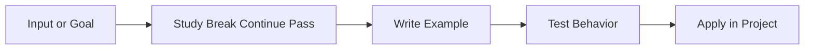

---

<a id="strings"></a>

# Strings

> **Level:** Level 1: Beginner | **Topic 14** | **Primary competency:** representing, formatting, slicing, and validating text.

## Overview

- **What is it?** Strings is the practice of representing, formatting, slicing, and validating text.
- **Why is it important?** It helps learners move from memorizing syntax to building dependable solutions that are readable, testable, and useful.
- **Where is it used?** It appears in professional Python projects, automation scripts, technical interviews, production services, analytics work, notebooks, and internal business tools.

## Learning Objectives

- **Skills gained:** explain the concept, write working Python examples, debug common errors, and apply the topic in a small project.
- **Concepts covered:** vocabulary, execution flow, syntax patterns, practical tradeoffs, testing expectations, and maintainability concerns.
- **Expected outcome:** you can use Strings confidently in real programs and can explain the design choices behind your solution.

## Real World Applications

| Area | Application |
| --- | --- |
| Industry use cases | Applied in professional Python projects where Python code must transform inputs into reliable outputs. |
| Business applications | Reduces manual work, improves reporting accuracy, enables repeatable workflows, and supports faster product delivery. |
| Career relevance | Strengthens portfolio projects, interview answers, code review skills, and readiness for Python developer roles. |

## Core Concepts

### 1. Foundation

- **Definition:** The foundation of Strings is the mental model that connects the problem, Python syntax, and expected result.
- **Visual explanation:** `Problem -> Strings concept -> Python expression -> Result`
- **Practical example:**

```python
strings_goal = "learn by building"
print(strings_goal.title())
```

### 2. Workflow

- **Definition:** A workflow is the repeatable sequence used to apply Strings safely.
- **Visual explanation:** `Input -> Validate -> Apply Strings -> Check output`
- **Practical example:**

```python
def apply_strings(value):
    cleaned = str(value).strip()
    return f"Strings: {cleaned}"

print(apply_strings(" practice "))
```

### 3. Professional Practice

- **Definition:** Professional use means naming intent clearly, handling edge cases, and making the behavior easy to test.
- **Visual explanation:** `Readable code -> Reviewable change -> Maintainable system`
- **Practical example:**

```python
def is_strings_ready(checks):
    return all(checks.values())

print(is_strings_ready({"syntax": True, "example": True, "review": True}))
```

## Infographic Summary

| Block | Summary |
| --- | --- |
| 📌 Concept | Strings turns a Python idea into a repeatable programming capability. |
| ⚡ Purpose | Make code clearer, safer, more reusable, or more powerful. |
| 🔥 Benefits | Better problem solving, faster debugging, stronger architecture, and easier collaboration. |
| 🎯 Use Cases | Scripts, APIs, data workflows, automation, interviews, prototypes, and production systems. |
| 🚀 Best Practices | Start small, name things clearly, test behavior, document assumptions, and refactor once patterns emerge. |
| ❌ Common Mistakes | Copying examples without understanding flow, ignoring errors, overengineering early, and skipping validation. |

## Syntax Guide

### Basic Syntax

```python
strings_topic = "Strings"
print(strings_topic)
```

### Standard Structure

```python
def prepare_strings(raw_value):
    value = str(raw_value).strip()
    if not value:
        raise ValueError("value is required")
    return value

result = prepare_strings("example")
print(result)
```

### Code Pattern

```python
# 1. Receive input
# 2. Validate assumptions
# 3. Apply the Strings technique
# 4. Return or display the result
```

## Examples

### Beginner Example

```python
topic = "Strings"
print(f"Today I am practicing {topic}.")
```

### Intermediate Example

```python
def summarize_skill(topic, level="intermediate"):
    return {
        "topic": topic,
        "level": level,
        "practice_items": ["read", "run", "modify", "explain"],
        "ready_for_project": True,
    }

print(summarize_skill("Strings"))
```

### Advanced Example

```python
from dataclasses import dataclass
from typing import Callable


@dataclass(frozen=True)
class LearningCheckpoint:
    topic: str
    validator: Callable[[str], bool]

    def evaluate(self, artifact: str) -> bool:
        return self.validator(artifact)


checkpoint = LearningCheckpoint(
    topic="Strings",
    validator=lambda artifact: "example" in artifact.lower(),
)
print(checkpoint.evaluate("Example project completed"))
```

## Workflow Diagram

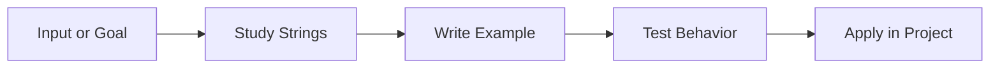

---

<a id="string-methods"></a>

# String Methods

> **Level:** Level 1: Beginner | **Topic 15** | **Primary competency:** using built-in text helpers for search, cleanup, transformation, and validation.

## Overview

- **What is it?** String Methods is the practice of using built-in text helpers for search, cleanup, transformation, and validation.
- **Why is it important?** It helps learners move from memorizing syntax to building dependable solutions that are readable, testable, and useful.
- **Where is it used?** It appears in professional Python projects, automation scripts, technical interviews, production services, analytics work, notebooks, and internal business tools.

## Learning Objectives

- **Skills gained:** explain the concept, write working Python examples, debug common errors, and apply the topic in a small project.
- **Concepts covered:** vocabulary, execution flow, syntax patterns, practical tradeoffs, testing expectations, and maintainability concerns.
- **Expected outcome:** you can use String Methods confidently in real programs and can explain the design choices behind your solution.

## Real World Applications

| Area | Application |
| --- | --- |
| Industry use cases | Applied in professional Python projects where Python code must transform inputs into reliable outputs. |
| Business applications | Reduces manual work, improves reporting accuracy, enables repeatable workflows, and supports faster product delivery. |
| Career relevance | Strengthens portfolio projects, interview answers, code review skills, and readiness for Python developer roles. |

## Core Concepts

### 1. Foundation

- **Definition:** The foundation of String Methods is the mental model that connects the problem, Python syntax, and expected result.
- **Visual explanation:** `Problem -> String Methods concept -> Python expression -> Result`
- **Practical example:**

```python
string_methods_goal = "learn by building"
print(string_methods_goal.title())
```

### 2. Workflow

- **Definition:** A workflow is the repeatable sequence used to apply String Methods safely.
- **Visual explanation:** `Input -> Validate -> Apply String Methods -> Check output`
- **Practical example:**

```python
def apply_string_methods(value):
    cleaned = str(value).strip()
    return f"String Methods: {cleaned}"

print(apply_string_methods(" practice "))
```

### 3. Professional Practice

- **Definition:** Professional use means naming intent clearly, handling edge cases, and making the behavior easy to test.
- **Visual explanation:** `Readable code -> Reviewable change -> Maintainable system`
- **Practical example:**

```python
def is_string_methods_ready(checks):
    return all(checks.values())

print(is_string_methods_ready({"syntax": True, "example": True, "review": True}))
```

## Infographic Summary

| Block | Summary |
| --- | --- |
| 📌 Concept | String Methods turns a Python idea into a repeatable programming capability. |
| ⚡ Purpose | Make code clearer, safer, more reusable, or more powerful. |
| 🔥 Benefits | Better problem solving, faster debugging, stronger architecture, and easier collaboration. |
| 🎯 Use Cases | Scripts, APIs, data workflows, automation, interviews, prototypes, and production systems. |
| 🚀 Best Practices | Start small, name things clearly, test behavior, document assumptions, and refactor once patterns emerge. |
| ❌ Common Mistakes | Copying examples without understanding flow, ignoring errors, overengineering early, and skipping validation. |

## Syntax Guide

### Basic Syntax

```python
string_methods_topic = "String Methods"
print(string_methods_topic)
```

### Standard Structure

```python
def prepare_string_methods(raw_value):
    value = str(raw_value).strip()
    if not value:
        raise ValueError("value is required")
    return value

result = prepare_string_methods("example")
print(result)
```

### Code Pattern

```python
# 1. Receive input
# 2. Validate assumptions
# 3. Apply the String Methods technique
# 4. Return or display the result
```

## Examples

### Beginner Example

```python
topic = "String Methods"
print(f"Today I am practicing {topic}.")
```

### Intermediate Example

```python
def summarize_skill(topic, level="intermediate"):
    return {
        "topic": topic,
        "level": level,
        "practice_items": ["read", "run", "modify", "explain"],
        "ready_for_project": True,
    }

print(summarize_skill("String Methods"))
```

### Advanced Example

```python
from dataclasses import dataclass
from typing import Callable


@dataclass(frozen=True)
class LearningCheckpoint:
    topic: str
    validator: Callable[[str], bool]

    def evaluate(self, artifact: str) -> bool:
        return self.validator(artifact)


checkpoint = LearningCheckpoint(
    topic="String Methods",
    validator=lambda artifact: "example" in artifact.lower(),
)
print(checkpoint.evaluate("Example project completed"))
```

## Workflow Diagram

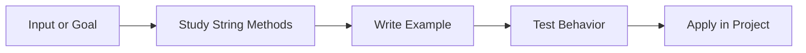

---

<a id="lists"></a>

# Lists

> **Level:** Level 1: Beginner | **Topic 16** | **Primary competency:** storing ordered, mutable sequences of values.

## Overview

- **What is it?** Lists is the practice of storing ordered, mutable sequences of values.
- **Why is it important?** It helps learners move from memorizing syntax to building dependable solutions that are readable, testable, and useful.
- **Where is it used?** It appears in professional Python projects, automation scripts, technical interviews, production services, analytics work, notebooks, and internal business tools.

## Learning Objectives

- **Skills gained:** explain the concept, write working Python examples, debug common errors, and apply the topic in a small project.
- **Concepts covered:** vocabulary, execution flow, syntax patterns, practical tradeoffs, testing expectations, and maintainability concerns.
- **Expected outcome:** you can use Lists confidently in real programs and can explain the design choices behind your solution.

## Real World Applications

| Area | Application |
| --- | --- |
| Industry use cases | Applied in professional Python projects where Python code must transform inputs into reliable outputs. |
| Business applications | Reduces manual work, improves reporting accuracy, enables repeatable workflows, and supports faster product delivery. |
| Career relevance | Strengthens portfolio projects, interview answers, code review skills, and readiness for Python developer roles. |

## Core Concepts

### 1. Foundation

- **Definition:** The foundation of Lists is the mental model that connects the problem, Python syntax, and expected result.
- **Visual explanation:** `Problem -> Lists concept -> Python expression -> Result`
- **Practical example:**

```python
lists_goal = "learn by building"
print(lists_goal.title())
```

### 2. Workflow

- **Definition:** A workflow is the repeatable sequence used to apply Lists safely.
- **Visual explanation:** `Input -> Validate -> Apply Lists -> Check output`
- **Practical example:**

```python
def apply_lists(value):
    cleaned = str(value).strip()
    return f"Lists: {cleaned}"

print(apply_lists(" practice "))
```

### 3. Professional Practice

- **Definition:** Professional use means naming intent clearly, handling edge cases, and making the behavior easy to test.
- **Visual explanation:** `Readable code -> Reviewable change -> Maintainable system`
- **Practical example:**

```python
def is_lists_ready(checks):
    return all(checks.values())

print(is_lists_ready({"syntax": True, "example": True, "review": True}))
```

## Infographic Summary

| Block | Summary |
| --- | --- |
| 📌 Concept | Lists turns a Python idea into a repeatable programming capability. |
| ⚡ Purpose | Make code clearer, safer, more reusable, or more powerful. |
| 🔥 Benefits | Better problem solving, faster debugging, stronger architecture, and easier collaboration. |
| 🎯 Use Cases | Scripts, APIs, data workflows, automation, interviews, prototypes, and production systems. |
| 🚀 Best Practices | Start small, name things clearly, test behavior, document assumptions, and refactor once patterns emerge. |
| ❌ Common Mistakes | Copying examples without understanding flow, ignoring errors, overengineering early, and skipping validation. |

## Syntax Guide

### Basic Syntax

```python
lists_topic = "Lists"
print(lists_topic)
```

### Standard Structure

```python
def prepare_lists(raw_value):
    value = str(raw_value).strip()
    if not value:
        raise ValueError("value is required")
    return value

result = prepare_lists("example")
print(result)
```

### Code Pattern

```python
# 1. Receive input
# 2. Validate assumptions
# 3. Apply the Lists technique
# 4. Return or display the result
```

## Examples

### Beginner Example

```python
topic = "Lists"
print(f"Today I am practicing {topic}.")
```

### Intermediate Example

```python
def summarize_skill(topic, level="intermediate"):
    return {
        "topic": topic,
        "level": level,
        "practice_items": ["read", "run", "modify", "explain"],
        "ready_for_project": True,
    }

print(summarize_skill("Lists"))
```

### Advanced Example

```python
from dataclasses import dataclass
from typing import Callable


@dataclass(frozen=True)
class LearningCheckpoint:
    topic: str
    validator: Callable[[str], bool]

    def evaluate(self, artifact: str) -> bool:
        return self.validator(artifact)


checkpoint = LearningCheckpoint(
    topic="Lists",
    validator=lambda artifact: "example" in artifact.lower(),
)
print(checkpoint.evaluate("Example project completed"))
```

## Workflow Diagram

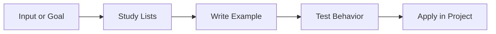

---

<a id="list-methods"></a>

# List Methods

> **Level:** Level 1: Beginner | **Topic 17** | **Primary competency:** adding, removing, sorting, and transforming ordered collections.

## Overview

- **What is it?** List Methods is the practice of adding, removing, sorting, and transforming ordered collections.
- **Why is it important?** It helps learners move from memorizing syntax to building dependable solutions that are readable, testable, and useful.
- **Where is it used?** It appears in professional Python projects, automation scripts, technical interviews, production services, analytics work, notebooks, and internal business tools.

## Learning Objectives

- **Skills gained:** explain the concept, write working Python examples, debug common errors, and apply the topic in a small project.
- **Concepts covered:** vocabulary, execution flow, syntax patterns, practical tradeoffs, testing expectations, and maintainability concerns.
- **Expected outcome:** you can use List Methods confidently in real programs and can explain the design choices behind your solution.

## Real World Applications

| Area | Application |
| --- | --- |
| Industry use cases | Applied in professional Python projects where Python code must transform inputs into reliable outputs. |
| Business applications | Reduces manual work, improves reporting accuracy, enables repeatable workflows, and supports faster product delivery. |
| Career relevance | Strengthens portfolio projects, interview answers, code review skills, and readiness for Python developer roles. |

## Core Concepts

### 1. Foundation

- **Definition:** The foundation of List Methods is the mental model that connects the problem, Python syntax, and expected result.
- **Visual explanation:** `Problem -> List Methods concept -> Python expression -> Result`
- **Practical example:**

```python
list_methods_goal = "learn by building"
print(list_methods_goal.title())
```

### 2. Workflow

- **Definition:** A workflow is the repeatable sequence used to apply List Methods safely.
- **Visual explanation:** `Input -> Validate -> Apply List Methods -> Check output`
- **Practical example:**

```python
def apply_list_methods(value):
    cleaned = str(value).strip()
    return f"List Methods: {cleaned}"

print(apply_list_methods(" practice "))
```

### 3. Professional Practice

- **Definition:** Professional use means naming intent clearly, handling edge cases, and making the behavior easy to test.
- **Visual explanation:** `Readable code -> Reviewable change -> Maintainable system`
- **Practical example:**

```python
def is_list_methods_ready(checks):
    return all(checks.values())

print(is_list_methods_ready({"syntax": True, "example": True, "review": True}))
```

## Infographic Summary

| Block | Summary |
| --- | --- |
| 📌 Concept | List Methods turns a Python idea into a repeatable programming capability. |
| ⚡ Purpose | Make code clearer, safer, more reusable, or more powerful. |
| 🔥 Benefits | Better problem solving, faster debugging, stronger architecture, and easier collaboration. |
| 🎯 Use Cases | Scripts, APIs, data workflows, automation, interviews, prototypes, and production systems. |
| 🚀 Best Practices | Start small, name things clearly, test behavior, document assumptions, and refactor once patterns emerge. |
| ❌ Common Mistakes | Copying examples without understanding flow, ignoring errors, overengineering early, and skipping validation. |

## Syntax Guide

### Basic Syntax

```python
list_methods_topic = "List Methods"
print(list_methods_topic)
```

### Standard Structure

```python
def prepare_list_methods(raw_value):
    value = str(raw_value).strip()
    if not value:
        raise ValueError("value is required")
    return value

result = prepare_list_methods("example")
print(result)
```

### Code Pattern

```python
# 1. Receive input
# 2. Validate assumptions
# 3. Apply the List Methods technique
# 4. Return or display the result
```

## Examples

### Beginner Example

```python
topic = "List Methods"
print(f"Today I am practicing {topic}.")
```

### Intermediate Example

```python
def summarize_skill(topic, level="intermediate"):
    return {
        "topic": topic,
        "level": level,
        "practice_items": ["read", "run", "modify", "explain"],
        "ready_for_project": True,
    }

print(summarize_skill("List Methods"))
```

### Advanced Example

```python
from dataclasses import dataclass
from typing import Callable


@dataclass(frozen=True)
class LearningCheckpoint:
    topic: str
    validator: Callable[[str], bool]

    def evaluate(self, artifact: str) -> bool:
        return self.validator(artifact)


checkpoint = LearningCheckpoint(
    topic="List Methods",
    validator=lambda artifact: "example" in artifact.lower(),
)
print(checkpoint.evaluate("Example project completed"))
```

## Workflow Diagram

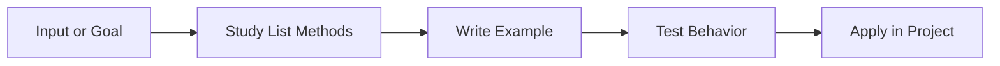

---

<a id="tuples"></a>

# Tuples

> **Level:** Level 1: Beginner | **Topic 18** | **Primary competency:** using ordered, immutable records and lightweight groupings.

## Overview

- **What is it?** Tuples is the practice of using ordered, immutable records and lightweight groupings.
- **Why is it important?** It helps learners move from memorizing syntax to building dependable solutions that are readable, testable, and useful.
- **Where is it used?** It appears in professional Python projects, automation scripts, technical interviews, production services, analytics work, notebooks, and internal business tools.

## Learning Objectives

- **Skills gained:** explain the concept, write working Python examples, debug common errors, and apply the topic in a small project.
- **Concepts covered:** vocabulary, execution flow, syntax patterns, practical tradeoffs, testing expectations, and maintainability concerns.
- **Expected outcome:** you can use Tuples confidently in real programs and can explain the design choices behind your solution.

## Real World Applications

| Area | Application |
| --- | --- |
| Industry use cases | Applied in professional Python projects where Python code must transform inputs into reliable outputs. |
| Business applications | Reduces manual work, improves reporting accuracy, enables repeatable workflows, and supports faster product delivery. |
| Career relevance | Strengthens portfolio projects, interview answers, code review skills, and readiness for Python developer roles. |

## Core Concepts

### 1. Foundation

- **Definition:** The foundation of Tuples is the mental model that connects the problem, Python syntax, and expected result.
- **Visual explanation:** `Problem -> Tuples concept -> Python expression -> Result`
- **Practical example:**

```python
tuples_goal = "learn by building"
print(tuples_goal.title())
```

### 2. Workflow

- **Definition:** A workflow is the repeatable sequence used to apply Tuples safely.
- **Visual explanation:** `Input -> Validate -> Apply Tuples -> Check output`
- **Practical example:**

```python
def apply_tuples(value):
    cleaned = str(value).strip()
    return f"Tuples: {cleaned}"

print(apply_tuples(" practice "))
```

### 3. Professional Practice

- **Definition:** Professional use means naming intent clearly, handling edge cases, and making the behavior easy to test.
- **Visual explanation:** `Readable code -> Reviewable change -> Maintainable system`
- **Practical example:**

```python
def is_tuples_ready(checks):
    return all(checks.values())

print(is_tuples_ready({"syntax": True, "example": True, "review": True}))
```

## Infographic Summary

| Block | Summary |
| --- | --- |
| 📌 Concept | Tuples turns a Python idea into a repeatable programming capability. |
| ⚡ Purpose | Make code clearer, safer, more reusable, or more powerful. |
| 🔥 Benefits | Better problem solving, faster debugging, stronger architecture, and easier collaboration. |
| 🎯 Use Cases | Scripts, APIs, data workflows, automation, interviews, prototypes, and production systems. |
| 🚀 Best Practices | Start small, name things clearly, test behavior, document assumptions, and refactor once patterns emerge. |
| ❌ Common Mistakes | Copying examples without understanding flow, ignoring errors, overengineering early, and skipping validation. |

## Syntax Guide

### Basic Syntax

```python
tuples_topic = "Tuples"
print(tuples_topic)
```

### Standard Structure

```python
def prepare_tuples(raw_value):
    value = str(raw_value).strip()
    if not value:
        raise ValueError("value is required")
    return value

result = prepare_tuples("example")
print(result)
```

### Code Pattern

```python
# 1. Receive input
# 2. Validate assumptions
# 3. Apply the Tuples technique
# 4. Return or display the result
```

## Examples

### Beginner Example

```python
topic = "Tuples"
print(f"Today I am practicing {topic}.")
```

### Intermediate Example

```python
def summarize_skill(topic, level="intermediate"):
    return {
        "topic": topic,
        "level": level,
        "practice_items": ["read", "run", "modify", "explain"],
        "ready_for_project": True,
    }

print(summarize_skill("Tuples"))
```

### Advanced Example

```python
from dataclasses import dataclass
from typing import Callable


@dataclass(frozen=True)
class LearningCheckpoint:
    topic: str
    validator: Callable[[str], bool]

    def evaluate(self, artifact: str) -> bool:
        return self.validator(artifact)


checkpoint = LearningCheckpoint(
    topic="Tuples",
    validator=lambda artifact: "example" in artifact.lower(),
)
print(checkpoint.evaluate("Example project completed"))
```

## Workflow Diagram

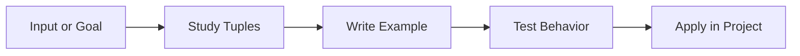

---

<a id="sets"></a>

# Sets

> **Level:** Level 1: Beginner | **Topic 19** | **Primary competency:** working with unique values and mathematical set operations.

## Overview

- **What is it?** Sets is the practice of working with unique values and mathematical set operations.
- **Why is it important?** It helps learners move from memorizing syntax to building dependable solutions that are readable, testable, and useful.
- **Where is it used?** It appears in professional Python projects, automation scripts, technical interviews, production services, analytics work, notebooks, and internal business tools.

## Learning Objectives

- **Skills gained:** explain the concept, write working Python examples, debug common errors, and apply the topic in a small project.
- **Concepts covered:** vocabulary, execution flow, syntax patterns, practical tradeoffs, testing expectations, and maintainability concerns.
- **Expected outcome:** you can use Sets confidently in real programs and can explain the design choices behind your solution.

## Real World Applications

| Area | Application |
| --- | --- |
| Industry use cases | Applied in professional Python projects where Python code must transform inputs into reliable outputs. |
| Business applications | Reduces manual work, improves reporting accuracy, enables repeatable workflows, and supports faster product delivery. |
| Career relevance | Strengthens portfolio projects, interview answers, code review skills, and readiness for Python developer roles. |

## Core Concepts

### 1. Foundation

- **Definition:** The foundation of Sets is the mental model that connects the problem, Python syntax, and expected result.
- **Visual explanation:** `Problem -> Sets concept -> Python expression -> Result`
- **Practical example:**

```python
sets_goal = "learn by building"
print(sets_goal.title())
```

### 2. Workflow

- **Definition:** A workflow is the repeatable sequence used to apply Sets safely.
- **Visual explanation:** `Input -> Validate -> Apply Sets -> Check output`
- **Practical example:**

```python
def apply_sets(value):
    cleaned = str(value).strip()
    return f"Sets: {cleaned}"

print(apply_sets(" practice "))
```

### 3. Professional Practice

- **Definition:** Professional use means naming intent clearly, handling edge cases, and making the behavior easy to test.
- **Visual explanation:** `Readable code -> Reviewable change -> Maintainable system`
- **Practical example:**

```python
def is_sets_ready(checks):
    return all(checks.values())

print(is_sets_ready({"syntax": True, "example": True, "review": True}))
```

## Infographic Summary

| Block | Summary |
| --- | --- |
| 📌 Concept | Sets turns a Python idea into a repeatable programming capability. |
| ⚡ Purpose | Make code clearer, safer, more reusable, or more powerful. |
| 🔥 Benefits | Better problem solving, faster debugging, stronger architecture, and easier collaboration. |
| 🎯 Use Cases | Scripts, APIs, data workflows, automation, interviews, prototypes, and production systems. |
| 🚀 Best Practices | Start small, name things clearly, test behavior, document assumptions, and refactor once patterns emerge. |
| ❌ Common Mistakes | Copying examples without understanding flow, ignoring errors, overengineering early, and skipping validation. |

## Syntax Guide

### Basic Syntax

```python
sets_topic = "Sets"
print(sets_topic)
```

### Standard Structure

```python
def prepare_sets(raw_value):
    value = str(raw_value).strip()
    if not value:
        raise ValueError("value is required")
    return value

result = prepare_sets("example")
print(result)
```

### Code Pattern

```python
# 1. Receive input
# 2. Validate assumptions
# 3. Apply the Sets technique
# 4. Return or display the result
```

## Examples

### Beginner Example

```python
topic = "Sets"
print(f"Today I am practicing {topic}.")
```

### Intermediate Example

```python
def summarize_skill(topic, level="intermediate"):
    return {
        "topic": topic,
        "level": level,
        "practice_items": ["read", "run", "modify", "explain"],
        "ready_for_project": True,
    }

print(summarize_skill("Sets"))
```

### Advanced Example

```python
from dataclasses import dataclass
from typing import Callable


@dataclass(frozen=True)
class LearningCheckpoint:
    topic: str
    validator: Callable[[str], bool]

    def evaluate(self, artifact: str) -> bool:
        return self.validator(artifact)


checkpoint = LearningCheckpoint(
    topic="Sets",
    validator=lambda artifact: "example" in artifact.lower(),
)
print(checkpoint.evaluate("Example project completed"))
```

## Workflow Diagram

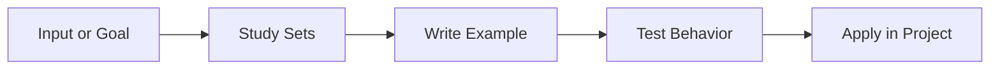

---

<a id="dictionaries"></a>

# Dictionaries

> **Level:** Level 1: Beginner | **Topic 20** | **Primary competency:** modeling key-value data for records, indexes, and structured lookup.

## Overview

- **What is it?** Dictionaries is the practice of modeling key-value data for records, indexes, and structured lookup.
- **Why is it important?** It helps learners move from memorizing syntax to building dependable solutions that are readable, testable, and useful.
- **Where is it used?** It appears in professional Python projects, automation scripts, technical interviews, production services, analytics work, notebooks, and internal business tools.

## Learning Objectives

- **Skills gained:** explain the concept, write working Python examples, debug common errors, and apply the topic in a small project.
- **Concepts covered:** vocabulary, execution flow, syntax patterns, practical tradeoffs, testing expectations, and maintainability concerns.
- **Expected outcome:** you can use Dictionaries confidently in real programs and can explain the design choices behind your solution.

## Real World Applications

| Area | Application |
| --- | --- |
| Industry use cases | Applied in professional Python projects where Python code must transform inputs into reliable outputs. |
| Business applications | Reduces manual work, improves reporting accuracy, enables repeatable workflows, and supports faster product delivery. |
| Career relevance | Strengthens portfolio projects, interview answers, code review skills, and readiness for Python developer roles. |

## Core Concepts

### 1. Foundation

- **Definition:** The foundation of Dictionaries is the mental model that connects the problem, Python syntax, and expected result.
- **Visual explanation:** `Problem -> Dictionaries concept -> Python expression -> Result`
- **Practical example:**

```python
dictionaries_goal = "learn by building"
print(dictionaries_goal.title())
```

### 2. Workflow

- **Definition:** A workflow is the repeatable sequence used to apply Dictionaries safely.
- **Visual explanation:** `Input -> Validate -> Apply Dictionaries -> Check output`
- **Practical example:**

```python
def apply_dictionaries(value):
    cleaned = str(value).strip()
    return f"Dictionaries: {cleaned}"

print(apply_dictionaries(" practice "))
```

### 3. Professional Practice

- **Definition:** Professional use means naming intent clearly, handling edge cases, and making the behavior easy to test.
- **Visual explanation:** `Readable code -> Reviewable change -> Maintainable system`
- **Practical example:**

```python
def is_dictionaries_ready(checks):
    return all(checks.values())

print(is_dictionaries_ready({"syntax": True, "example": True, "review": True}))
```

## Infographic Summary

| Block | Summary |
| --- | --- |
| 📌 Concept | Dictionaries turns a Python idea into a repeatable programming capability. |
| ⚡ Purpose | Make code clearer, safer, more reusable, or more powerful. |
| 🔥 Benefits | Better problem solving, faster debugging, stronger architecture, and easier collaboration. |
| 🎯 Use Cases | Scripts, APIs, data workflows, automation, interviews, prototypes, and production systems. |
| 🚀 Best Practices | Start small, name things clearly, test behavior, document assumptions, and refactor once patterns emerge. |
| ❌ Common Mistakes | Copying examples without understanding flow, ignoring errors, overengineering early, and skipping validation. |

## Syntax Guide

### Basic Syntax

```python
dictionaries_topic = "Dictionaries"
print(dictionaries_topic)
```

### Standard Structure

```python
def prepare_dictionaries(raw_value):
    value = str(raw_value).strip()
    if not value:
        raise ValueError("value is required")
    return value

result = prepare_dictionaries("example")
print(result)
```

### Code Pattern

```python
# 1. Receive input
# 2. Validate assumptions
# 3. Apply the Dictionaries technique
# 4. Return or display the result
```

## Examples

### Beginner Example

```python
topic = "Dictionaries"
print(f"Today I am practicing {topic}.")
```

### Intermediate Example

```python
def summarize_skill(topic, level="intermediate"):
    return {
        "topic": topic,
        "level": level,
        "practice_items": ["read", "run", "modify", "explain"],
        "ready_for_project": True,
    }

print(summarize_skill("Dictionaries"))
```

### Advanced Example

```python
from dataclasses import dataclass
from typing import Callable


@dataclass(frozen=True)
class LearningCheckpoint:
    topic: str
    validator: Callable[[str], bool]

    def evaluate(self, artifact: str) -> bool:
        return self.validator(artifact)


checkpoint = LearningCheckpoint(
    topic="Dictionaries",
    validator=lambda artifact: "example" in artifact.lower(),
)
print(checkpoint.evaluate("Example project completed"))
```

## Workflow Diagram

```mermaid
flowchart LR
    A[Input or Goal] --> B[Study Dictionaries]
    B --> C[Write Example]
    C --> D[Test Behavior]
    D --> E[Apply in Project]
```

---

<a id="functions"></a>

# Functions

> **Level:** Level 1: Beginner | **Topic 21** | **Primary competency:** packaging reusable behavior behind clear names and inputs.

## Overview

- **What is it?** Functions is the practice of packaging reusable behavior behind clear names and inputs.
- **Why is it important?** It helps learners move from memorizing syntax to building dependable solutions that are readable, testable, and useful.
- **Where is it used?** It appears in professional Python projects, automation scripts, technical interviews, production services, analytics work, notebooks, and internal business tools.

## Learning Objectives

- **Skills gained:** explain the concept, write working Python examples, debug common errors, and apply the topic in a small project.
- **Concepts covered:** vocabulary, execution flow, syntax patterns, practical tradeoffs, testing expectations, and maintainability concerns.
- **Expected outcome:** you can use Functions confidently in real programs and can explain the design choices behind your solution.

## Real World Applications

| Area | Application |
| --- | --- |
| Industry use cases | Applied in professional Python projects where Python code must transform inputs into reliable outputs. |
| Business applications | Reduces manual work, improves reporting accuracy, enables repeatable workflows, and supports faster product delivery. |
| Career relevance | Strengthens portfolio projects, interview answers, code review skills, and readiness for Python developer roles. |

## Core Concepts

### 1. Foundation

- **Definition:** The foundation of Functions is the mental model that connects the problem, Python syntax, and expected result.
- **Visual explanation:** `Problem -> Functions concept -> Python expression -> Result`
- **Practical example:**

```python
functions_goal = "learn by building"
print(functions_goal.title())
```

### 2. Workflow

- **Definition:** A workflow is the repeatable sequence used to apply Functions safely.
- **Visual explanation:** `Input -> Validate -> Apply Functions -> Check output`
- **Practical example:**

```python
def apply_functions(value):
    cleaned = str(value).strip()
    return f"Functions: {cleaned}"

print(apply_functions(" practice "))
```

### 3. Professional Practice

- **Definition:** Professional use means naming intent clearly, handling edge cases, and making the behavior easy to test.
- **Visual explanation:** `Readable code -> Reviewable change -> Maintainable system`
- **Practical example:**

```python
def is_functions_ready(checks):
    return all(checks.values())

print(is_functions_ready({"syntax": True, "example": True, "review": True}))
```

## Infographic Summary

| Block | Summary |
| --- | --- |
| 📌 Concept | Functions turns a Python idea into a repeatable programming capability. |
| ⚡ Purpose | Make code clearer, safer, more reusable, or more powerful. |
| 🔥 Benefits | Better problem solving, faster debugging, stronger architecture, and easier collaboration. |
| 🎯 Use Cases | Scripts, APIs, data workflows, automation, interviews, prototypes, and production systems. |
| 🚀 Best Practices | Start small, name things clearly, test behavior, document assumptions, and refactor once patterns emerge. |
| ❌ Common Mistakes | Copying examples without understanding flow, ignoring errors, overengineering early, and skipping validation. |

## Syntax Guide

### Basic Syntax

```python
functions_topic = "Functions"
print(functions_topic)
```

### Standard Structure

```python
def prepare_functions(raw_value):
    value = str(raw_value).strip()
    if not value:
        raise ValueError("value is required")
    return value

result = prepare_functions("example")
print(result)
```

### Code Pattern

```python
# 1. Receive input
# 2. Validate assumptions
# 3. Apply the Functions technique
# 4. Return or display the result
```

## Examples

### Beginner Example

```python
topic = "Functions"
print(f"Today I am practicing {topic}.")
```

### Intermediate Example

```python
def summarize_skill(topic, level="intermediate"):
    return {
        "topic": topic,
        "level": level,
        "practice_items": ["read", "run", "modify", "explain"],
        "ready_for_project": True,
    }

print(summarize_skill("Functions"))
```

### Advanced Example

```python
from dataclasses import dataclass
from typing import Callable


@dataclass(frozen=True)
class LearningCheckpoint:
    topic: str
    validator: Callable[[str], bool]

    def evaluate(self, artifact: str) -> bool:
        return self.validator(artifact)


checkpoint = LearningCheckpoint(
    topic="Functions",
    validator=lambda artifact: "example" in artifact.lower(),
)
print(checkpoint.evaluate("Example project completed"))
```

## Workflow Diagram

```mermaid
flowchart LR
    A[Input or Goal] --> B[Study Functions]
    B --> C[Write Example]
    C --> D[Test Behavior]
    D --> E[Apply in Project]
```

---

<a id="arguments-and-parameters"></a>

# Arguments and Parameters

> **Level:** Level 1: Beginner | **Topic 22** | **Primary competency:** designing function interfaces with positional, keyword, default, variadic, and typed inputs.

## Overview

- **What is it?** Arguments and Parameters is the practice of designing function interfaces with positional, keyword, default, variadic, and typed inputs.
- **Why is it important?** It helps learners move from memorizing syntax to building dependable solutions that are readable, testable, and useful.
- **Where is it used?** It appears in professional Python projects, automation scripts, technical interviews, production services, analytics work, notebooks, and internal business tools.

## Learning Objectives

- **Skills gained:** explain the concept, write working Python examples, debug common errors, and apply the topic in a small project.
- **Concepts covered:** vocabulary, execution flow, syntax patterns, practical tradeoffs, testing expectations, and maintainability concerns.
- **Expected outcome:** you can use Arguments and Parameters confidently in real programs and can explain the design choices behind your solution.

## Real World Applications

| Area | Application |
| --- | --- |
| Industry use cases | Applied in professional Python projects where Python code must transform inputs into reliable outputs. |
| Business applications | Reduces manual work, improves reporting accuracy, enables repeatable workflows, and supports faster product delivery. |
| Career relevance | Strengthens portfolio projects, interview answers, code review skills, and readiness for Python developer roles. |

## Core Concepts

### 1. Foundation

- **Definition:** The foundation of Arguments and Parameters is the mental model that connects the problem, Python syntax, and expected result.
- **Visual explanation:** `Problem -> Arguments and Parameters concept -> Python expression -> Result`
- **Practical example:**

```python
arguments_and_parameters_goal = "learn by building"
print(arguments_and_parameters_goal.title())
```

### 2. Workflow

- **Definition:** A workflow is the repeatable sequence used to apply Arguments and Parameters safely.
- **Visual explanation:** `Input -> Validate -> Apply Arguments and Parameters -> Check output`
- **Practical example:**

```python
def apply_arguments_and_parameters(value):
    cleaned = str(value).strip()
    return f"Arguments and Parameters: {cleaned}"

print(apply_arguments_and_parameters(" practice "))
```

### 3. Professional Practice

- **Definition:** Professional use means naming intent clearly, handling edge cases, and making the behavior easy to test.
- **Visual explanation:** `Readable code -> Reviewable change -> Maintainable system`
- **Practical example:**

```python
def is_arguments_and_parameters_ready(checks):
    return all(checks.values())

print(is_arguments_and_parameters_ready({"syntax": True, "example": True, "review": True}))
```

## Infographic Summary

| Block | Summary |
| --- | --- |
| 📌 Concept | Arguments and Parameters turns a Python idea into a repeatable programming capability. |
| ⚡ Purpose | Make code clearer, safer, more reusable, or more powerful. |
| 🔥 Benefits | Better problem solving, faster debugging, stronger architecture, and easier collaboration. |
| 🎯 Use Cases | Scripts, APIs, data workflows, automation, interviews, prototypes, and production systems. |
| 🚀 Best Practices | Start small, name things clearly, test behavior, document assumptions, and refactor once patterns emerge. |
| ❌ Common Mistakes | Copying examples without understanding flow, ignoring errors, overengineering early, and skipping validation. |

## Syntax Guide

### Basic Syntax

```python
arguments_and_parameters_topic = "Arguments and Parameters"
print(arguments_and_parameters_topic)
```

### Standard Structure

```python
def prepare_arguments_and_parameters(raw_value):
    value = str(raw_value).strip()
    if not value:
        raise ValueError("value is required")
    return value

result = prepare_arguments_and_parameters("example")
print(result)
```

### Code Pattern

```python
# 1. Receive input
# 2. Validate assumptions
# 3. Apply the Arguments and Parameters technique
# 4. Return or display the result
```

## Examples

### Beginner Example

```python
topic = "Arguments and Parameters"
print(f"Today I am practicing {topic}.")
```

### Intermediate Example

```python
def summarize_skill(topic, level="intermediate"):
    return {
        "topic": topic,
        "level": level,
        "practice_items": ["read", "run", "modify", "explain"],
        "ready_for_project": True,
    }

print(summarize_skill("Arguments and Parameters"))
```

### Advanced Example

```python
from dataclasses import dataclass
from typing import Callable


@dataclass(frozen=True)
class LearningCheckpoint:
    topic: str
    validator: Callable[[str], bool]

    def evaluate(self, artifact: str) -> bool:
        return self.validator(artifact)


checkpoint = LearningCheckpoint(
    topic="Arguments and Parameters",
    validator=lambda artifact: "example" in artifact.lower(),
)
print(checkpoint.evaluate("Example project completed"))
```

## Workflow Diagram

```mermaid
flowchart LR
    A[Input or Goal] --> B[Study Arguments and Parameters]
    B --> C[Write Example]
    C --> D[Test Behavior]
    D --> E[Apply in Project]
```

---

<a id="return-statements"></a>

# Return Statements

> **Level:** Level 1: Beginner | **Topic 23** | **Primary competency:** sending results from functions back to callers.

## Overview

- **What is it?** Return Statements is the practice of sending results from functions back to callers.
- **Why is it important?** It helps learners move from memorizing syntax to building dependable solutions that are readable, testable, and useful.
- **Where is it used?** It appears in professional Python projects, automation scripts, technical interviews, production services, analytics work, notebooks, and internal business tools.

## Learning Objectives

- **Skills gained:** explain the concept, write working Python examples, debug common errors, and apply the topic in a small project.
- **Concepts covered:** vocabulary, execution flow, syntax patterns, practical tradeoffs, testing expectations, and maintainability concerns.
- **Expected outcome:** you can use Return Statements confidently in real programs and can explain the design choices behind your solution.

## Real World Applications

| Area | Application |
| --- | --- |
| Industry use cases | Applied in professional Python projects where Python code must transform inputs into reliable outputs. |
| Business applications | Reduces manual work, improves reporting accuracy, enables repeatable workflows, and supports faster product delivery. |
| Career relevance | Strengthens portfolio projects, interview answers, code review skills, and readiness for Python developer roles. |

## Core Concepts

### 1. Foundation

- **Definition:** The foundation of Return Statements is the mental model that connects the problem, Python syntax, and expected result.
- **Visual explanation:** `Problem -> Return Statements concept -> Python expression -> Result`
- **Practical example:**

```python
return_statements_goal = "learn by building"
print(return_statements_goal.title())
```

### 2. Workflow

- **Definition:** A workflow is the repeatable sequence used to apply Return Statements safely.
- **Visual explanation:** `Input -> Validate -> Apply Return Statements -> Check output`
- **Practical example:**

```python
def apply_return_statements(value):
    cleaned = str(value).strip()
    return f"Return Statements: {cleaned}"

print(apply_return_statements(" practice "))
```

### 3. Professional Practice

- **Definition:** Professional use means naming intent clearly, handling edge cases, and making the behavior easy to test.
- **Visual explanation:** `Readable code -> Reviewable change -> Maintainable system`
- **Practical example:**

```python
def is_return_statements_ready(checks):
    return all(checks.values())

print(is_return_statements_ready({"syntax": True, "example": True, "review": True}))
```

## Infographic Summary

| Block | Summary |
| --- | --- |
| 📌 Concept | Return Statements turns a Python idea into a repeatable programming capability. |
| ⚡ Purpose | Make code clearer, safer, more reusable, or more powerful. |
| 🔥 Benefits | Better problem solving, faster debugging, stronger architecture, and easier collaboration. |
| 🎯 Use Cases | Scripts, APIs, data workflows, automation, interviews, prototypes, and production systems. |
| 🚀 Best Practices | Start small, name things clearly, test behavior, document assumptions, and refactor once patterns emerge. |
| ❌ Common Mistakes | Copying examples without understanding flow, ignoring errors, overengineering early, and skipping validation. |

## Syntax Guide

### Basic Syntax

```python
return_statements_topic = "Return Statements"
print(return_statements_topic)
```

### Standard Structure

```python
def prepare_return_statements(raw_value):
    value = str(raw_value).strip()
    if not value:
        raise ValueError("value is required")
    return value

result = prepare_return_statements("example")
print(result)
```

### Code Pattern

```python
# 1. Receive input
# 2. Validate assumptions
# 3. Apply the Return Statements technique
# 4. Return or display the result
```

## Examples

### Beginner Example

```python
topic = "Return Statements"
print(f"Today I am practicing {topic}.")
```

### Intermediate Example

```python
def summarize_skill(topic, level="intermediate"):
    return {
        "topic": topic,
        "level": level,
        "practice_items": ["read", "run", "modify", "explain"],
        "ready_for_project": True,
    }

print(summarize_skill("Return Statements"))
```

### Advanced Example

```python
from dataclasses import dataclass
from typing import Callable


@dataclass(frozen=True)
class LearningCheckpoint:
    topic: str
    validator: Callable[[str], bool]

    def evaluate(self, artifact: str) -> bool:
        return self.validator(artifact)


checkpoint = LearningCheckpoint(
    topic="Return Statements",
    validator=lambda artifact: "example" in artifact.lower(),
)
print(checkpoint.evaluate("Example project completed"))
```

## Workflow Diagram

```mermaid
flowchart LR
    A[Input or Goal] --> B[Study Return Statements]
    B --> C[Write Example]
    C --> D[Test Behavior]
    D --> E[Apply in Project]
```

---

<a id="scope"></a>

# Scope

> **Level:** Level 1: Beginner | **Topic 24** | **Primary competency:** understanding where names live and how Python resolves them.

## Overview

- **What is it?** Scope is the practice of understanding where names live and how Python resolves them.
- **Why is it important?** It helps learners move from memorizing syntax to building dependable solutions that are readable, testable, and useful.
- **Where is it used?** It appears in professional Python projects, automation scripts, technical interviews, production services, analytics work, notebooks, and internal business tools.

## Learning Objectives

- **Skills gained:** explain the concept, write working Python examples, debug common errors, and apply the topic in a small project.
- **Concepts covered:** vocabulary, execution flow, syntax patterns, practical tradeoffs, testing expectations, and maintainability concerns.
- **Expected outcome:** you can use Scope confidently in real programs and can explain the design choices behind your solution.

## Real World Applications

| Area | Application |
| --- | --- |
| Industry use cases | Applied in professional Python projects where Python code must transform inputs into reliable outputs. |
| Business applications | Reduces manual work, improves reporting accuracy, enables repeatable workflows, and supports faster product delivery. |
| Career relevance | Strengthens portfolio projects, interview answers, code review skills, and readiness for Python developer roles. |

## Core Concepts

### 1. Foundation

- **Definition:** The foundation of Scope is the mental model that connects the problem, Python syntax, and expected result.
- **Visual explanation:** `Problem -> Scope concept -> Python expression -> Result`
- **Practical example:**

```python
scope_goal = "learn by building"
print(scope_goal.title())
```

### 2. Workflow

- **Definition:** A workflow is the repeatable sequence used to apply Scope safely.
- **Visual explanation:** `Input -> Validate -> Apply Scope -> Check output`
- **Practical example:**

```python
def apply_scope(value):
    cleaned = str(value).strip()
    return f"Scope: {cleaned}"

print(apply_scope(" practice "))
```

### 3. Professional Practice

- **Definition:** Professional use means naming intent clearly, handling edge cases, and making the behavior easy to test.
- **Visual explanation:** `Readable code -> Reviewable change -> Maintainable system`
- **Practical example:**

```python
def is_scope_ready(checks):
    return all(checks.values())

print(is_scope_ready({"syntax": True, "example": True, "review": True}))
```

## Infographic Summary

| Block | Summary |
| --- | --- |
| 📌 Concept | Scope turns a Python idea into a repeatable programming capability. |
| ⚡ Purpose | Make code clearer, safer, more reusable, or more powerful. |
| 🔥 Benefits | Better problem solving, faster debugging, stronger architecture, and easier collaboration. |
| 🎯 Use Cases | Scripts, APIs, data workflows, automation, interviews, prototypes, and production systems. |
| 🚀 Best Practices | Start small, name things clearly, test behavior, document assumptions, and refactor once patterns emerge. |
| ❌ Common Mistakes | Copying examples without understanding flow, ignoring errors, overengineering early, and skipping validation. |

## Syntax Guide

### Basic Syntax

```python
scope_topic = "Scope"
print(scope_topic)
```

### Standard Structure

```python
def prepare_scope(raw_value):
    value = str(raw_value).strip()
    if not value:
        raise ValueError("value is required")
    return value

result = prepare_scope("example")
print(result)
```

### Code Pattern

```python
# 1. Receive input
# 2. Validate assumptions
# 3. Apply the Scope technique
# 4. Return or display the result
```

## Examples

### Beginner Example

```python
topic = "Scope"
print(f"Today I am practicing {topic}.")
```

### Intermediate Example

```python
def summarize_skill(topic, level="intermediate"):
    return {
        "topic": topic,
        "level": level,
        "practice_items": ["read", "run", "modify", "explain"],
        "ready_for_project": True,
    }

print(summarize_skill("Scope"))
```

### Advanced Example

```python
from dataclasses import dataclass
from typing import Callable


@dataclass(frozen=True)
class LearningCheckpoint:
    topic: str
    validator: Callable[[str], bool]

    def evaluate(self, artifact: str) -> bool:
        return self.validator(artifact)


checkpoint = LearningCheckpoint(
    topic="Scope",
    validator=lambda artifact: "example" in artifact.lower(),
)
print(checkpoint.evaluate("Example project completed"))
```

## Workflow Diagram

```mermaid
flowchart LR
    A[Input or Goal] --> B[Study Scope]
    B --> C[Write Example]
    C --> D[Test Behavior]
    D --> E[Apply in Project]
```

---

<a id="lambda-functions"></a>

# Lambda Functions

> **Level:** Level 1: Beginner | **Topic 25** | **Primary competency:** writing small anonymous functions for short transformations.

## Overview

- **What is it?** Lambda Functions is the practice of writing small anonymous functions for short transformations.
- **Why is it important?** It helps learners move from memorizing syntax to building dependable solutions that are readable, testable, and useful.
- **Where is it used?** It appears in professional Python projects, automation scripts, technical interviews, production services, analytics work, notebooks, and internal business tools.

## Learning Objectives

- **Skills gained:** explain the concept, write working Python examples, debug common errors, and apply the topic in a small project.
- **Concepts covered:** vocabulary, execution flow, syntax patterns, practical tradeoffs, testing expectations, and maintainability concerns.
- **Expected outcome:** you can use Lambda Functions confidently in real programs and can explain the design choices behind your solution.

## Real World Applications

| Area | Application |
| --- | --- |
| Industry use cases | Applied in professional Python projects where Python code must transform inputs into reliable outputs. |
| Business applications | Reduces manual work, improves reporting accuracy, enables repeatable workflows, and supports faster product delivery. |
| Career relevance | Strengthens portfolio projects, interview answers, code review skills, and readiness for Python developer roles. |

## Core Concepts

### 1. Foundation

- **Definition:** The foundation of Lambda Functions is the mental model that connects the problem, Python syntax, and expected result.
- **Visual explanation:** `Problem -> Lambda Functions concept -> Python expression -> Result`
- **Practical example:**

```python
lambda_functions_goal = "learn by building"
print(lambda_functions_goal.title())
```

### 2. Workflow

- **Definition:** A workflow is the repeatable sequence used to apply Lambda Functions safely.
- **Visual explanation:** `Input -> Validate -> Apply Lambda Functions -> Check output`
- **Practical example:**

```python
def apply_lambda_functions(value):
    cleaned = str(value).strip()
    return f"Lambda Functions: {cleaned}"

print(apply_lambda_functions(" practice "))
```

### 3. Professional Practice

- **Definition:** Professional use means naming intent clearly, handling edge cases, and making the behavior easy to test.
- **Visual explanation:** `Readable code -> Reviewable change -> Maintainable system`
- **Practical example:**

```python
def is_lambda_functions_ready(checks):
    return all(checks.values())

print(is_lambda_functions_ready({"syntax": True, "example": True, "review": True}))
```

## Infographic Summary

| Block | Summary |
| --- | --- |
| 📌 Concept | Lambda Functions turns a Python idea into a repeatable programming capability. |
| ⚡ Purpose | Make code clearer, safer, more reusable, or more powerful. |
| 🔥 Benefits | Better problem solving, faster debugging, stronger architecture, and easier collaboration. |
| 🎯 Use Cases | Scripts, APIs, data workflows, automation, interviews, prototypes, and production systems. |
| 🚀 Best Practices | Start small, name things clearly, test behavior, document assumptions, and refactor once patterns emerge. |
| ❌ Common Mistakes | Copying examples without understanding flow, ignoring errors, overengineering early, and skipping validation. |

## Syntax Guide

### Basic Syntax

```python
lambda_functions_topic = "Lambda Functions"
print(lambda_functions_topic)
```

### Standard Structure

```python
def prepare_lambda_functions(raw_value):
    value = str(raw_value).strip()
    if not value:
        raise ValueError("value is required")
    return value

result = prepare_lambda_functions("example")
print(result)
```

### Code Pattern

```python
# 1. Receive input
# 2. Validate assumptions
# 3. Apply the Lambda Functions technique
# 4. Return or display the result
```

## Examples

### Beginner Example

```python
topic = "Lambda Functions"
print(f"Today I am practicing {topic}.")
```

### Intermediate Example

```python
def summarize_skill(topic, level="intermediate"):
    return {
        "topic": topic,
        "level": level,
        "practice_items": ["read", "run", "modify", "explain"],
        "ready_for_project": True,
    }

print(summarize_skill("Lambda Functions"))
```

### Advanced Example

```python
from dataclasses import dataclass
from typing import Callable


@dataclass(frozen=True)
class LearningCheckpoint:
    topic: str
    validator: Callable[[str], bool]

    def evaluate(self, artifact: str) -> bool:
        return self.validator(artifact)


checkpoint = LearningCheckpoint(
    topic="Lambda Functions",
    validator=lambda artifact: "example" in artifact.lower(),
)
print(checkpoint.evaluate("Example project completed"))
```

## Workflow Diagram

```mermaid
flowchart LR
    A[Input or Goal] --> B[Study Lambda Functions]
    B --> C[Write Example]
    C --> D[Test Behavior]
    D --> E[Apply in Project]
```

---

<a id="modules"></a>

# Modules

> **Level:** Level 1: Beginner | **Topic 26** | **Primary competency:** organizing code into importable Python files.

## Overview

- **What is it?** Modules is the practice of organizing code into importable Python files.
- **Why is it important?** It helps learners move from memorizing syntax to building dependable solutions that are readable, testable, and useful.
- **Where is it used?** It appears in professional Python projects, automation scripts, technical interviews, production services, analytics work, notebooks, and internal business tools.

## Learning Objectives

- **Skills gained:** explain the concept, write working Python examples, debug common errors, and apply the topic in a small project.
- **Concepts covered:** vocabulary, execution flow, syntax patterns, practical tradeoffs, testing expectations, and maintainability concerns.
- **Expected outcome:** you can use Modules confidently in real programs and can explain the design choices behind your solution.

## Real World Applications

| Area | Application |
| --- | --- |
| Industry use cases | Applied in professional Python projects where Python code must transform inputs into reliable outputs. |
| Business applications | Reduces manual work, improves reporting accuracy, enables repeatable workflows, and supports faster product delivery. |
| Career relevance | Strengthens portfolio projects, interview answers, code review skills, and readiness for Python developer roles. |

## Core Concepts

### 1. Foundation

- **Definition:** The foundation of Modules is the mental model that connects the problem, Python syntax, and expected result.
- **Visual explanation:** `Problem -> Modules concept -> Python expression -> Result`
- **Practical example:**

```python
modules_goal = "learn by building"
print(modules_goal.title())
```

### 2. Workflow

- **Definition:** A workflow is the repeatable sequence used to apply Modules safely.
- **Visual explanation:** `Input -> Validate -> Apply Modules -> Check output`
- **Practical example:**

```python
def apply_modules(value):
    cleaned = str(value).strip()
    return f"Modules: {cleaned}"

print(apply_modules(" practice "))
```

### 3. Professional Practice

- **Definition:** Professional use means naming intent clearly, handling edge cases, and making the behavior easy to test.
- **Visual explanation:** `Readable code -> Reviewable change -> Maintainable system`
- **Practical example:**

```python
def is_modules_ready(checks):
    return all(checks.values())

print(is_modules_ready({"syntax": True, "example": True, "review": True}))
```

## Infographic Summary

| Block | Summary |
| --- | --- |
| 📌 Concept | Modules turns a Python idea into a repeatable programming capability. |
| ⚡ Purpose | Make code clearer, safer, more reusable, or more powerful. |
| 🔥 Benefits | Better problem solving, faster debugging, stronger architecture, and easier collaboration. |
| 🎯 Use Cases | Scripts, APIs, data workflows, automation, interviews, prototypes, and production systems. |
| 🚀 Best Practices | Start small, name things clearly, test behavior, document assumptions, and refactor once patterns emerge. |
| ❌ Common Mistakes | Copying examples without understanding flow, ignoring errors, overengineering early, and skipping validation. |

## Syntax Guide

### Basic Syntax

```python
modules_topic = "Modules"
print(modules_topic)
```

### Standard Structure

```python
def prepare_modules(raw_value):
    value = str(raw_value).strip()
    if not value:
        raise ValueError("value is required")
    return value

result = prepare_modules("example")
print(result)
```

### Code Pattern

```python
# 1. Receive input
# 2. Validate assumptions
# 3. Apply the Modules technique
# 4. Return or display the result
```

## Examples

### Beginner Example

```python
topic = "Modules"
print(f"Today I am practicing {topic}.")
```

### Intermediate Example

```python
def summarize_skill(topic, level="intermediate"):
    return {
        "topic": topic,
        "level": level,
        "practice_items": ["read", "run", "modify", "explain"],
        "ready_for_project": True,
    }

print(summarize_skill("Modules"))
```

### Advanced Example

```python
from dataclasses import dataclass
from typing import Callable


@dataclass(frozen=True)
class LearningCheckpoint:
    topic: str
    validator: Callable[[str], bool]

    def evaluate(self, artifact: str) -> bool:
        return self.validator(artifact)


checkpoint = LearningCheckpoint(
    topic="Modules",
    validator=lambda artifact: "example" in artifact.lower(),
)
print(checkpoint.evaluate("Example project completed"))
```

## Workflow Diagram

```mermaid
flowchart LR
    A[Input or Goal] --> B[Study Modules]
    B --> C[Write Example]
    C --> D[Test Behavior]
    D --> E[Apply in Project]
```

---

<a id="packages"></a>

# Packages

> **Level:** Level 1: Beginner | **Topic 27** | **Primary competency:** organizing modules into reusable directories with stable import paths.

## Overview

- **What is it?** Packages is the practice of organizing modules into reusable directories with stable import paths.
- **Why is it important?** It helps learners move from memorizing syntax to building dependable solutions that are readable, testable, and useful.
- **Where is it used?** It appears in professional Python projects, automation scripts, technical interviews, production services, analytics work, notebooks, and internal business tools.

## Learning Objectives

- **Skills gained:** explain the concept, write working Python examples, debug common errors, and apply the topic in a small project.
- **Concepts covered:** vocabulary, execution flow, syntax patterns, practical tradeoffs, testing expectations, and maintainability concerns.
- **Expected outcome:** you can use Packages confidently in real programs and can explain the design choices behind your solution.

## Real World Applications

| Area | Application |
| --- | --- |
| Industry use cases | Applied in professional Python projects where Python code must transform inputs into reliable outputs. |
| Business applications | Reduces manual work, improves reporting accuracy, enables repeatable workflows, and supports faster product delivery. |
| Career relevance | Strengthens portfolio projects, interview answers, code review skills, and readiness for Python developer roles. |

## Core Concepts

### 1. Foundation

- **Definition:** The foundation of Packages is the mental model that connects the problem, Python syntax, and expected result.
- **Visual explanation:** `Problem -> Packages concept -> Python expression -> Result`
- **Practical example:**

```python
packages_goal = "learn by building"
print(packages_goal.title())
```

### 2. Workflow

- **Definition:** A workflow is the repeatable sequence used to apply Packages safely.
- **Visual explanation:** `Input -> Validate -> Apply Packages -> Check output`
- **Practical example:**

```python
def apply_packages(value):
    cleaned = str(value).strip()
    return f"Packages: {cleaned}"

print(apply_packages(" practice "))
```

### 3. Professional Practice

- **Definition:** Professional use means naming intent clearly, handling edge cases, and making the behavior easy to test.
- **Visual explanation:** `Readable code -> Reviewable change -> Maintainable system`
- **Practical example:**

```python
def is_packages_ready(checks):
    return all(checks.values())

print(is_packages_ready({"syntax": True, "example": True, "review": True}))
```

## Infographic Summary

| Block | Summary |
| --- | --- |
| 📌 Concept | Packages turns a Python idea into a repeatable programming capability. |
| ⚡ Purpose | Make code clearer, safer, more reusable, or more powerful. |
| 🔥 Benefits | Better problem solving, faster debugging, stronger architecture, and easier collaboration. |
| 🎯 Use Cases | Scripts, APIs, data workflows, automation, interviews, prototypes, and production systems. |
| 🚀 Best Practices | Start small, name things clearly, test behavior, document assumptions, and refactor once patterns emerge. |
| ❌ Common Mistakes | Copying examples without understanding flow, ignoring errors, overengineering early, and skipping validation. |

## Syntax Guide

### Basic Syntax

```python
packages_topic = "Packages"
print(packages_topic)
```

### Standard Structure

```python
def prepare_packages(raw_value):
    value = str(raw_value).strip()
    if not value:
        raise ValueError("value is required")
    return value

result = prepare_packages("example")
print(result)
```

### Code Pattern

```python
# 1. Receive input
# 2. Validate assumptions
# 3. Apply the Packages technique
# 4. Return or display the result
```

## Examples

### Beginner Example

```python
topic = "Packages"
print(f"Today I am practicing {topic}.")
```

### Intermediate Example

```python
def summarize_skill(topic, level="intermediate"):
    return {
        "topic": topic,
        "level": level,
        "practice_items": ["read", "run", "modify", "explain"],
        "ready_for_project": True,
    }

print(summarize_skill("Packages"))
```

### Advanced Example

```python
from dataclasses import dataclass
from typing import Callable


@dataclass(frozen=True)
class LearningCheckpoint:
    topic: str
    validator: Callable[[str], bool]

    def evaluate(self, artifact: str) -> bool:
        return self.validator(artifact)


checkpoint = LearningCheckpoint(
    topic="Packages",
    validator=lambda artifact: "example" in artifact.lower(),
)
print(checkpoint.evaluate("Example project completed"))
```

## Workflow Diagram

```mermaid
flowchart LR
    A[Input or Goal] --> B[Study Packages]
    B --> C[Write Example]
    C --> D[Test Behavior]
    D --> E[Apply in Project]
```

---

<a id="date-and-time"></a>

# Date and Time

> **Level:** Level 1: Beginner | **Topic 28** | **Primary competency:** working with dates, times, durations, time zones, and timestamps.

## Overview

- **What is it?** Date and Time is the practice of working with dates, times, durations, time zones, and timestamps.
- **Why is it important?** It helps learners move from memorizing syntax to building dependable solutions that are readable, testable, and useful.
- **Where is it used?** It appears in professional Python projects, automation scripts, technical interviews, production services, analytics work, notebooks, and internal business tools.

## Learning Objectives

- **Skills gained:** explain the concept, write working Python examples, debug common errors, and apply the topic in a small project.
- **Concepts covered:** vocabulary, execution flow, syntax patterns, practical tradeoffs, testing expectations, and maintainability concerns.
- **Expected outcome:** you can use Date and Time confidently in real programs and can explain the design choices behind your solution.

## Real World Applications

| Area | Application |
| --- | --- |
| Industry use cases | Applied in professional Python projects where Python code must transform inputs into reliable outputs. |
| Business applications | Reduces manual work, improves reporting accuracy, enables repeatable workflows, and supports faster product delivery. |
| Career relevance | Strengthens portfolio projects, interview answers, code review skills, and readiness for Python developer roles. |

## Core Concepts

### 1. Foundation

- **Definition:** The foundation of Date and Time is the mental model that connects the problem, Python syntax, and expected result.
- **Visual explanation:** `Problem -> Date and Time concept -> Python expression -> Result`
- **Practical example:**

```python
date_and_time_goal = "learn by building"
print(date_and_time_goal.title())
```

### 2. Workflow

- **Definition:** A workflow is the repeatable sequence used to apply Date and Time safely.
- **Visual explanation:** `Input -> Validate -> Apply Date and Time -> Check output`
- **Practical example:**

```python
def apply_date_and_time(value):
    cleaned = str(value).strip()
    return f"Date and Time: {cleaned}"

print(apply_date_and_time(" practice "))
```

### 3. Professional Practice

- **Definition:** Professional use means naming intent clearly, handling edge cases, and making the behavior easy to test.
- **Visual explanation:** `Readable code -> Reviewable change -> Maintainable system`
- **Practical example:**

```python
def is_date_and_time_ready(checks):
    return all(checks.values())

print(is_date_and_time_ready({"syntax": True, "example": True, "review": True}))
```

## Infographic Summary

| Block | Summary |
| --- | --- |
| 📌 Concept | Date and Time turns a Python idea into a repeatable programming capability. |
| ⚡ Purpose | Make code clearer, safer, more reusable, or more powerful. |
| 🔥 Benefits | Better problem solving, faster debugging, stronger architecture, and easier collaboration. |
| 🎯 Use Cases | Scripts, APIs, data workflows, automation, interviews, prototypes, and production systems. |
| 🚀 Best Practices | Start small, name things clearly, test behavior, document assumptions, and refactor once patterns emerge. |
| ❌ Common Mistakes | Copying examples without understanding flow, ignoring errors, overengineering early, and skipping validation. |

## Syntax Guide

### Basic Syntax

```python
date_and_time_topic = "Date and Time"
print(date_and_time_topic)
```

### Standard Structure

```python
def prepare_date_and_time(raw_value):
    value = str(raw_value).strip()
    if not value:
        raise ValueError("value is required")
    return value

result = prepare_date_and_time("example")
print(result)
```

### Code Pattern

```python
# 1. Receive input
# 2. Validate assumptions
# 3. Apply the Date and Time technique
# 4. Return or display the result
```

## Examples

### Beginner Example

```python
topic = "Date and Time"
print(f"Today I am practicing {topic}.")
```

### Intermediate Example

```python
def summarize_skill(topic, level="intermediate"):
    return {
        "topic": topic,
        "level": level,
        "practice_items": ["read", "run", "modify", "explain"],
        "ready_for_project": True,
    }

print(summarize_skill("Date and Time"))
```

### Advanced Example

```python
from dataclasses import dataclass
from typing import Callable


@dataclass(frozen=True)
class LearningCheckpoint:
    topic: str
    validator: Callable[[str], bool]

    def evaluate(self, artifact: str) -> bool:
        return self.validator(artifact)


checkpoint = LearningCheckpoint(
    topic="Date and Time",
    validator=lambda artifact: "example" in artifact.lower(),
)
print(checkpoint.evaluate("Example project completed"))
```

## Workflow Diagram

```mermaid
flowchart LR
    A[Input or Goal] --> B[Study Date and Time]
    B --> C[Write Example]
    C --> D[Test Behavior]
    D --> E[Apply in Project]
```

---

<a id="math-module"></a>

# Math Module

> **Level:** Level 1: Beginner | **Topic 29** | **Primary competency:** using reliable numeric functions and constants from the standard library.

## Overview

- **What is it?** Math Module is the practice of using reliable numeric functions and constants from the standard library.
- **Why is it important?** It helps learners move from memorizing syntax to building dependable solutions that are readable, testable, and useful.
- **Where is it used?** It appears in professional Python projects, automation scripts, technical interviews, production services, analytics work, notebooks, and internal business tools.

## Learning Objectives

- **Skills gained:** explain the concept, write working Python examples, debug common errors, and apply the topic in a small project.
- **Concepts covered:** vocabulary, execution flow, syntax patterns, practical tradeoffs, testing expectations, and maintainability concerns.
- **Expected outcome:** you can use Math Module confidently in real programs and can explain the design choices behind your solution.

## Real World Applications

| Area | Application |
| --- | --- |
| Industry use cases | Applied in professional Python projects where Python code must transform inputs into reliable outputs. |
| Business applications | Reduces manual work, improves reporting accuracy, enables repeatable workflows, and supports faster product delivery. |
| Career relevance | Strengthens portfolio projects, interview answers, code review skills, and readiness for Python developer roles. |

## Core Concepts

### 1. Foundation

- **Definition:** The foundation of Math Module is the mental model that connects the problem, Python syntax, and expected result.
- **Visual explanation:** `Problem -> Math Module concept -> Python expression -> Result`
- **Practical example:**

```python
math_module_goal = "learn by building"
print(math_module_goal.title())
```

### 2. Workflow

- **Definition:** A workflow is the repeatable sequence used to apply Math Module safely.
- **Visual explanation:** `Input -> Validate -> Apply Math Module -> Check output`
- **Practical example:**

```python
def apply_math_module(value):
    cleaned = str(value).strip()
    return f"Math Module: {cleaned}"

print(apply_math_module(" practice "))
```

### 3. Professional Practice

- **Definition:** Professional use means naming intent clearly, handling edge cases, and making the behavior easy to test.
- **Visual explanation:** `Readable code -> Reviewable change -> Maintainable system`
- **Practical example:**

```python
def is_math_module_ready(checks):
    return all(checks.values())

print(is_math_module_ready({"syntax": True, "example": True, "review": True}))
```

## Infographic Summary

| Block | Summary |
| --- | --- |
| 📌 Concept | Math Module turns a Python idea into a repeatable programming capability. |
| ⚡ Purpose | Make code clearer, safer, more reusable, or more powerful. |
| 🔥 Benefits | Better problem solving, faster debugging, stronger architecture, and easier collaboration. |
| 🎯 Use Cases | Scripts, APIs, data workflows, automation, interviews, prototypes, and production systems. |
| 🚀 Best Practices | Start small, name things clearly, test behavior, document assumptions, and refactor once patterns emerge. |
| ❌ Common Mistakes | Copying examples without understanding flow, ignoring errors, overengineering early, and skipping validation. |

## Syntax Guide

### Basic Syntax

```python
math_module_topic = "Math Module"
print(math_module_topic)
```

### Standard Structure

```python
def prepare_math_module(raw_value):
    value = str(raw_value).strip()
    if not value:
        raise ValueError("value is required")
    return value

result = prepare_math_module("example")
print(result)
```

### Code Pattern

```python
# 1. Receive input
# 2. Validate assumptions
# 3. Apply the Math Module technique
# 4. Return or display the result
```

## Examples

### Beginner Example

```python
topic = "Math Module"
print(f"Today I am practicing {topic}.")
```

### Intermediate Example

```python
def summarize_skill(topic, level="intermediate"):
    return {
        "topic": topic,
        "level": level,
        "practice_items": ["read", "run", "modify", "explain"],
        "ready_for_project": True,
    }

print(summarize_skill("Math Module"))
```

### Advanced Example

```python
from dataclasses import dataclass
from typing import Callable


@dataclass(frozen=True)
class LearningCheckpoint:
    topic: str
    validator: Callable[[str], bool]

    def evaluate(self, artifact: str) -> bool:
        return self.validator(artifact)


checkpoint = LearningCheckpoint(
    topic="Math Module",
    validator=lambda artifact: "example" in artifact.lower(),
)
print(checkpoint.evaluate("Example project completed"))
```

## Workflow Diagram

```mermaid
flowchart LR
    A[Input or Goal] --> B[Study Math Module]
    B --> C[Write Example]
    C --> D[Test Behavior]
    D --> E[Apply in Project]
```

---

<a id="random-module"></a>

# Random Module

> **Level:** Level 1: Beginner | **Topic 30** | **Primary competency:** generating pseudo-random values for simulations, sampling, and test data.

## Overview

- **What is it?** Random Module is the practice of generating pseudo-random values for simulations, sampling, and test data.
- **Why is it important?** It helps learners move from memorizing syntax to building dependable solutions that are readable, testable, and useful.
- **Where is it used?** It appears in professional Python projects, automation scripts, technical interviews, production services, analytics work, notebooks, and internal business tools.

## Learning Objectives

- **Skills gained:** explain the concept, write working Python examples, debug common errors, and apply the topic in a small project.
- **Concepts covered:** vocabulary, execution flow, syntax patterns, practical tradeoffs, testing expectations, and maintainability concerns.
- **Expected outcome:** you can use Random Module confidently in real programs and can explain the design choices behind your solution.

## Real World Applications

| Area | Application |
| --- | --- |
| Industry use cases | Applied in professional Python projects where Python code must transform inputs into reliable outputs. |
| Business applications | Reduces manual work, improves reporting accuracy, enables repeatable workflows, and supports faster product delivery. |
| Career relevance | Strengthens portfolio projects, interview answers, code review skills, and readiness for Python developer roles. |

## Core Concepts

### 1. Foundation

- **Definition:** The foundation of Random Module is the mental model that connects the problem, Python syntax, and expected result.
- **Visual explanation:** `Problem -> Random Module concept -> Python expression -> Result`
- **Practical example:**

```python
random_module_goal = "learn by building"
print(random_module_goal.title())
```

### 2. Workflow

- **Definition:** A workflow is the repeatable sequence used to apply Random Module safely.
- **Visual explanation:** `Input -> Validate -> Apply Random Module -> Check output`
- **Practical example:**

```python
def apply_random_module(value):
    cleaned = str(value).strip()
    return f"Random Module: {cleaned}"

print(apply_random_module(" practice "))
```

### 3. Professional Practice

- **Definition:** Professional use means naming intent clearly, handling edge cases, and making the behavior easy to test.
- **Visual explanation:** `Readable code -> Reviewable change -> Maintainable system`
- **Practical example:**

```python
def is_random_module_ready(checks):
    return all(checks.values())

print(is_random_module_ready({"syntax": True, "example": True, "review": True}))
```

## Infographic Summary

| Block | Summary |
| --- | --- |
| 📌 Concept | Random Module turns a Python idea into a repeatable programming capability. |
| ⚡ Purpose | Make code clearer, safer, more reusable, or more powerful. |
| 🔥 Benefits | Better problem solving, faster debugging, stronger architecture, and easier collaboration. |
| 🎯 Use Cases | Scripts, APIs, data workflows, automation, interviews, prototypes, and production systems. |
| 🚀 Best Practices | Start small, name things clearly, test behavior, document assumptions, and refactor once patterns emerge. |
| ❌ Common Mistakes | Copying examples without understanding flow, ignoring errors, overengineering early, and skipping validation. |

## Syntax Guide

### Basic Syntax

```python
random_module_topic = "Random Module"
print(random_module_topic)
```

### Standard Structure

```python
def prepare_random_module(raw_value):
    value = str(raw_value).strip()
    if not value:
        raise ValueError("value is required")
    return value

result = prepare_random_module("example")
print(result)
```

### Code Pattern

```python
# 1. Receive input
# 2. Validate assumptions
# 3. Apply the Random Module technique
# 4. Return or display the result
```

## Examples

### Beginner Example

```python
topic = "Random Module"
print(f"Today I am practicing {topic}.")
```

### Intermediate Example

```python
def summarize_skill(topic, level="intermediate"):
    return {
        "topic": topic,
        "level": level,
        "practice_items": ["read", "run", "modify", "explain"],
        "ready_for_project": True,
    }

print(summarize_skill("Random Module"))
```

### Advanced Example

```python
from dataclasses import dataclass
from typing import Callable


@dataclass(frozen=True)
class LearningCheckpoint:
    topic: str
    validator: Callable[[str], bool]

    def evaluate(self, artifact: str) -> bool:
        return self.validator(artifact)


checkpoint = LearningCheckpoint(
    topic="Random Module",
    validator=lambda artifact: "example" in artifact.lower(),
)
print(checkpoint.evaluate("Example project completed"))
```

## Workflow Diagram

```mermaid
flowchart LR
    A[Input or Goal] --> B[Study Random Module]
    B --> C[Write Example]
    C --> D[Test Behavior]
    D --> E[Apply in Project]
```

---

<a id="file-handling"></a>

# File Handling

> **Level:** Level 1: Beginner | **Topic 31** | **Primary competency:** reading, writing, appending, and safely closing files.

## Overview

- **What is it?** File Handling is the practice of reading, writing, appending, and safely closing files.
- **Why is it important?** It helps learners move from memorizing syntax to building dependable solutions that are readable, testable, and useful.
- **Where is it used?** It appears in professional Python projects, automation scripts, technical interviews, production services, analytics work, notebooks, and internal business tools.

## Learning Objectives

- **Skills gained:** explain the concept, write working Python examples, debug common errors, and apply the topic in a small project.
- **Concepts covered:** vocabulary, execution flow, syntax patterns, practical tradeoffs, testing expectations, and maintainability concerns.
- **Expected outcome:** you can use File Handling confidently in real programs and can explain the design choices behind your solution.

## Real World Applications

| Area | Application |
| --- | --- |
| Industry use cases | Applied in professional Python projects where Python code must transform inputs into reliable outputs. |
| Business applications | Reduces manual work, improves reporting accuracy, enables repeatable workflows, and supports faster product delivery. |
| Career relevance | Strengthens portfolio projects, interview answers, code review skills, and readiness for Python developer roles. |

## Core Concepts

### 1. Foundation

- **Definition:** The foundation of File Handling is the mental model that connects the problem, Python syntax, and expected result.
- **Visual explanation:** `Problem -> File Handling concept -> Python expression -> Result`
- **Practical example:**

```python
file_handling_goal = "learn by building"
print(file_handling_goal.title())
```

### 2. Workflow

- **Definition:** A workflow is the repeatable sequence used to apply File Handling safely.
- **Visual explanation:** `Input -> Validate -> Apply File Handling -> Check output`
- **Practical example:**

```python
def apply_file_handling(value):
    cleaned = str(value).strip()
    return f"File Handling: {cleaned}"

print(apply_file_handling(" practice "))
```

### 3. Professional Practice

- **Definition:** Professional use means naming intent clearly, handling edge cases, and making the behavior easy to test.
- **Visual explanation:** `Readable code -> Reviewable change -> Maintainable system`
- **Practical example:**

```python
def is_file_handling_ready(checks):
    return all(checks.values())

print(is_file_handling_ready({"syntax": True, "example": True, "review": True}))
```

## Infographic Summary

| Block | Summary |
| --- | --- |
| 📌 Concept | File Handling turns a Python idea into a repeatable programming capability. |
| ⚡ Purpose | Make code clearer, safer, more reusable, or more powerful. |
| 🔥 Benefits | Better problem solving, faster debugging, stronger architecture, and easier collaboration. |
| 🎯 Use Cases | Scripts, APIs, data workflows, automation, interviews, prototypes, and production systems. |
| 🚀 Best Practices | Start small, name things clearly, test behavior, document assumptions, and refactor once patterns emerge. |
| ❌ Common Mistakes | Copying examples without understanding flow, ignoring errors, overengineering early, and skipping validation. |

## Syntax Guide

### Basic Syntax

```python
file_handling_topic = "File Handling"
print(file_handling_topic)
```

### Standard Structure

```python
def prepare_file_handling(raw_value):
    value = str(raw_value).strip()
    if not value:
        raise ValueError("value is required")
    return value

result = prepare_file_handling("example")
print(result)
```

### Code Pattern

```python
# 1. Receive input
# 2. Validate assumptions
# 3. Apply the File Handling technique
# 4. Return or display the result
```

## Examples

### Beginner Example

```python
topic = "File Handling"
print(f"Today I am practicing {topic}.")
```

### Intermediate Example

```python
def summarize_skill(topic, level="intermediate"):
    return {
        "topic": topic,
        "level": level,
        "practice_items": ["read", "run", "modify", "explain"],
        "ready_for_project": True,
    }

print(summarize_skill("File Handling"))
```

### Advanced Example

```python
from dataclasses import dataclass
from typing import Callable


@dataclass(frozen=True)
class LearningCheckpoint:
    topic: str
    validator: Callable[[str], bool]

    def evaluate(self, artifact: str) -> bool:
        return self.validator(artifact)


checkpoint = LearningCheckpoint(
    topic="File Handling",
    validator=lambda artifact: "example" in artifact.lower(),
)
print(checkpoint.evaluate("Example project completed"))
```

## Workflow Diagram

```mermaid
flowchart LR
    A[Input or Goal] --> B[Study File Handling]
    B --> C[Write Example]
    C --> D[Test Behavior]
    D --> E[Apply in Project]
```

---

<a id="exception-handling"></a>

# Exception Handling

> **Level:** Level 1: Beginner | **Topic 32** | **Primary competency:** recovering from expected failures without hiding defects.

## Overview

- **What is it?** Exception Handling is the practice of recovering from expected failures without hiding defects.
- **Why is it important?** It helps learners move from memorizing syntax to building dependable solutions that are readable, testable, and useful.
- **Where is it used?** It appears in professional Python projects, automation scripts, technical interviews, production services, analytics work, notebooks, and internal business tools.

## Learning Objectives

- **Skills gained:** explain the concept, write working Python examples, debug common errors, and apply the topic in a small project.
- **Concepts covered:** vocabulary, execution flow, syntax patterns, practical tradeoffs, testing expectations, and maintainability concerns.
- **Expected outcome:** you can use Exception Handling confidently in real programs and can explain the design choices behind your solution.

## Real World Applications

| Area | Application |
| --- | --- |
| Industry use cases | Applied in professional Python projects where Python code must transform inputs into reliable outputs. |
| Business applications | Reduces manual work, improves reporting accuracy, enables repeatable workflows, and supports faster product delivery. |
| Career relevance | Strengthens portfolio projects, interview answers, code review skills, and readiness for Python developer roles. |

## Core Concepts

### 1. Foundation

- **Definition:** The foundation of Exception Handling is the mental model that connects the problem, Python syntax, and expected result.
- **Visual explanation:** `Problem -> Exception Handling concept -> Python expression -> Result`
- **Practical example:**

```python
exception_handling_goal = "learn by building"
print(exception_handling_goal.title())
```

### 2. Workflow

- **Definition:** A workflow is the repeatable sequence used to apply Exception Handling safely.
- **Visual explanation:** `Input -> Validate -> Apply Exception Handling -> Check output`
- **Practical example:**

```python
def apply_exception_handling(value):
    cleaned = str(value).strip()
    return f"Exception Handling: {cleaned}"

print(apply_exception_handling(" practice "))
```

### 3. Professional Practice

- **Definition:** Professional use means naming intent clearly, handling edge cases, and making the behavior easy to test.
- **Visual explanation:** `Readable code -> Reviewable change -> Maintainable system`
- **Practical example:**

```python
def is_exception_handling_ready(checks):
    return all(checks.values())

print(is_exception_handling_ready({"syntax": True, "example": True, "review": True}))
```

## Infographic Summary

| Block | Summary |
| --- | --- |
| 📌 Concept | Exception Handling turns a Python idea into a repeatable programming capability. |
| ⚡ Purpose | Make code clearer, safer, more reusable, or more powerful. |
| 🔥 Benefits | Better problem solving, faster debugging, stronger architecture, and easier collaboration. |
| 🎯 Use Cases | Scripts, APIs, data workflows, automation, interviews, prototypes, and production systems. |
| 🚀 Best Practices | Start small, name things clearly, test behavior, document assumptions, and refactor once patterns emerge. |
| ❌ Common Mistakes | Copying examples without understanding flow, ignoring errors, overengineering early, and skipping validation. |

## Syntax Guide

### Basic Syntax

```python
exception_handling_topic = "Exception Handling"
print(exception_handling_topic)
```

### Standard Structure

```python
def prepare_exception_handling(raw_value):
    value = str(raw_value).strip()
    if not value:
        raise ValueError("value is required")
    return value

result = prepare_exception_handling("example")
print(result)
```

### Code Pattern

```python
# 1. Receive input
# 2. Validate assumptions
# 3. Apply the Exception Handling technique
# 4. Return or display the result
```

## Examples

### Beginner Example

```python
topic = "Exception Handling"
print(f"Today I am practicing {topic}.")
```

### Intermediate Example

```python
def summarize_skill(topic, level="intermediate"):
    return {
        "topic": topic,
        "level": level,
        "practice_items": ["read", "run", "modify", "explain"],
        "ready_for_project": True,
    }

print(summarize_skill("Exception Handling"))
```

### Advanced Example

```python
from dataclasses import dataclass
from typing import Callable


@dataclass(frozen=True)
class LearningCheckpoint:
    topic: str
    validator: Callable[[str], bool]

    def evaluate(self, artifact: str) -> bool:
        return self.validator(artifact)


checkpoint = LearningCheckpoint(
    topic="Exception Handling",
    validator=lambda artifact: "example" in artifact.lower(),
)
print(checkpoint.evaluate("Example project completed"))
```

## Workflow Diagram

```mermaid
flowchart LR
    A[Input or Goal] --> B[Study Exception Handling]
    B --> C[Write Example]
    C --> D[Test Behavior]
    D --> E[Apply in Project]
```

---

<a id="debugging-basics"></a>

# Debugging Basics

> **Level:** Level 1: Beginner | **Topic 33** | **Primary competency:** observing runtime behavior with tracebacks, breakpoints, prints, and small experiments.

## Overview

- **What is it?** Debugging Basics is the practice of observing runtime behavior with tracebacks, breakpoints, prints, and small experiments.
- **Why is it important?** It helps learners move from memorizing syntax to building dependable solutions that are readable, testable, and useful.
- **Where is it used?** It appears in quality engineering, automation scripts, technical interviews, production services, analytics work, notebooks, and internal business tools.

## Learning Objectives

- **Skills gained:** explain the concept, write working Python examples, debug common errors, and apply the topic in a small project.
- **Concepts covered:** vocabulary, execution flow, syntax patterns, practical tradeoffs, testing expectations, and maintainability concerns.
- **Expected outcome:** you can use Debugging Basics confidently in real programs and can explain the design choices behind your solution.

## Real World Applications

| Area | Application |
| --- | --- |
| Industry use cases | Applied in quality engineering where Python code must transform inputs into reliable outputs. |
| Business applications | Reduces manual work, improves reporting accuracy, enables repeatable workflows, and supports faster product delivery. |
| Career relevance | Strengthens portfolio projects, interview answers, code review skills, and readiness for Python developer roles. |

## Core Concepts

### 1. Foundation

- **Definition:** The foundation of Debugging Basics is the mental model that connects the problem, Python syntax, and expected result.
- **Visual explanation:** `Problem -> Debugging Basics concept -> Python expression -> Result`
- **Practical example:**

```python
debugging_basics_goal = "learn by building"
print(debugging_basics_goal.title())
```

### 2. Workflow

- **Definition:** A workflow is the repeatable sequence used to apply Debugging Basics safely.
- **Visual explanation:** `Input -> Validate -> Apply Debugging Basics -> Check output`
- **Practical example:**

```python
def apply_debugging_basics(value):
    cleaned = str(value).strip()
    return f"Debugging Basics: {cleaned}"

print(apply_debugging_basics(" practice "))
```

### 3. Professional Practice

- **Definition:** Professional use means naming intent clearly, handling edge cases, and making the behavior easy to test.
- **Visual explanation:** `Readable code -> Reviewable change -> Maintainable system`
- **Practical example:**

```python
def is_debugging_basics_ready(checks):
    return all(checks.values())

print(is_debugging_basics_ready({"syntax": True, "example": True, "review": True}))
```

## Infographic Summary

| Block | Summary |
| --- | --- |
| 📌 Concept | Debugging Basics turns a Python idea into a repeatable programming capability. |
| ⚡ Purpose | Make code clearer, safer, more reusable, or more powerful. |
| 🔥 Benefits | Better problem solving, faster debugging, stronger architecture, and easier collaboration. |
| 🎯 Use Cases | Scripts, APIs, data workflows, automation, interviews, prototypes, and production systems. |
| 🚀 Best Practices | Start small, name things clearly, test behavior, document assumptions, and refactor once patterns emerge. |
| ❌ Common Mistakes | Copying examples without understanding flow, ignoring errors, overengineering early, and skipping validation. |

## Syntax Guide

### Basic Syntax

```python
debugging_basics_topic = "Debugging Basics"
print(debugging_basics_topic)
```

### Standard Structure

```python
def prepare_debugging_basics(raw_value):
    value = str(raw_value).strip()
    if not value:
        raise ValueError("value is required")
    return value

result = prepare_debugging_basics("example")
print(result)
```

### Code Pattern

```python
# 1. Receive input
# 2. Validate assumptions
# 3. Apply the Debugging Basics technique
# 4. Return or display the result
```

## Examples

### Beginner Example

```python
topic = "Debugging Basics"
print(f"Today I am practicing {topic}.")
```

### Intermediate Example

```python
def summarize_skill(topic, level="intermediate"):
    return {
        "topic": topic,
        "level": level,
        "practice_items": ["read", "run", "modify", "explain"],
        "ready_for_project": True,
    }

print(summarize_skill("Debugging Basics"))
```

### Advanced Example

```python
from dataclasses import dataclass
from typing import Callable


@dataclass(frozen=True)
class LearningCheckpoint:
    topic: str
    validator: Callable[[str], bool]

    def evaluate(self, artifact: str) -> bool:
        return self.validator(artifact)


checkpoint = LearningCheckpoint(
    topic="Debugging Basics",
    validator=lambda artifact: "example" in artifact.lower(),
)
print(checkpoint.evaluate("Example project completed"))
```

## Workflow Diagram

```mermaid
flowchart LR
    A[Input or Goal] --> B[Study Debugging Basics]
    B --> C[Write Example]
    C --> D[Test Behavior]
    D --> E[Apply in Project]
```

---

<a id="virtual-environments"></a>

# Virtual Environments

> **Level:** Level 1: Beginner | **Topic 34** | **Primary competency:** isolating project dependencies and interpreter settings.

## Overview

- **What is it?** Virtual Environments is the practice of isolating project dependencies and interpreter settings.
- **Why is it important?** It helps learners move from memorizing syntax to building dependable solutions that are readable, testable, and useful.
- **Where is it used?** It appears in professional Python projects, automation scripts, technical interviews, production services, analytics work, notebooks, and internal business tools.

## Learning Objectives

- **Skills gained:** explain the concept, write working Python examples, debug common errors, and apply the topic in a small project.
- **Concepts covered:** vocabulary, execution flow, syntax patterns, practical tradeoffs, testing expectations, and maintainability concerns.
- **Expected outcome:** you can use Virtual Environments confidently in real programs and can explain the design choices behind your solution.

## Real World Applications

| Area | Application |
| --- | --- |
| Industry use cases | Applied in professional Python projects where Python code must transform inputs into reliable outputs. |
| Business applications | Reduces manual work, improves reporting accuracy, enables repeatable workflows, and supports faster product delivery. |
| Career relevance | Strengthens portfolio projects, interview answers, code review skills, and readiness for Python developer roles. |

## Core Concepts

### 1. Foundation

- **Definition:** The foundation of Virtual Environments is the mental model that connects the problem, Python syntax, and expected result.
- **Visual explanation:** `Problem -> Virtual Environments concept -> Python expression -> Result`
- **Practical example:**

```python
virtual_environments_goal = "learn by building"
print(virtual_environments_goal.title())
```

### 2. Workflow

- **Definition:** A workflow is the repeatable sequence used to apply Virtual Environments safely.
- **Visual explanation:** `Input -> Validate -> Apply Virtual Environments -> Check output`
- **Practical example:**

```python
def apply_virtual_environments(value):
    cleaned = str(value).strip()
    return f"Virtual Environments: {cleaned}"

print(apply_virtual_environments(" practice "))
```

### 3. Professional Practice

- **Definition:** Professional use means naming intent clearly, handling edge cases, and making the behavior easy to test.
- **Visual explanation:** `Readable code -> Reviewable change -> Maintainable system`
- **Practical example:**

```python
def is_virtual_environments_ready(checks):
    return all(checks.values())

print(is_virtual_environments_ready({"syntax": True, "example": True, "review": True}))
```

## Infographic Summary

| Block | Summary |
| --- | --- |
| 📌 Concept | Virtual Environments turns a Python idea into a repeatable programming capability. |
| ⚡ Purpose | Make code clearer, safer, more reusable, or more powerful. |
| 🔥 Benefits | Better problem solving, faster debugging, stronger architecture, and easier collaboration. |
| 🎯 Use Cases | Scripts, APIs, data workflows, automation, interviews, prototypes, and production systems. |
| 🚀 Best Practices | Start small, name things clearly, test behavior, document assumptions, and refactor once patterns emerge. |
| ❌ Common Mistakes | Copying examples without understanding flow, ignoring errors, overengineering early, and skipping validation. |

## Syntax Guide

### Basic Syntax

```python
virtual_environments_topic = "Virtual Environments"
print(virtual_environments_topic)
```

### Standard Structure

```python
def prepare_virtual_environments(raw_value):
    value = str(raw_value).strip()
    if not value:
        raise ValueError("value is required")
    return value

result = prepare_virtual_environments("example")
print(result)
```

### Code Pattern

```python
# 1. Receive input
# 2. Validate assumptions
# 3. Apply the Virtual Environments technique
# 4. Return or display the result
```

## Examples

### Beginner Example

```python
topic = "Virtual Environments"
print(f"Today I am practicing {topic}.")
```

### Intermediate Example

```python
def summarize_skill(topic, level="intermediate"):
    return {
        "topic": topic,
        "level": level,
        "practice_items": ["read", "run", "modify", "explain"],
        "ready_for_project": True,
    }

print(summarize_skill("Virtual Environments"))
```

### Advanced Example

```python
from dataclasses import dataclass
from typing import Callable


@dataclass(frozen=True)
class LearningCheckpoint:
    topic: str
    validator: Callable[[str], bool]

    def evaluate(self, artifact: str) -> bool:
        return self.validator(artifact)


checkpoint = LearningCheckpoint(
    topic="Virtual Environments",
    validator=lambda artifact: "example" in artifact.lower(),
)
print(checkpoint.evaluate("Example project completed"))
```

## Workflow Diagram

```mermaid
flowchart LR
    A[Input or Goal] --> B[Study Virtual Environments]
    B --> C[Write Example]
    C --> D[Test Behavior]
    D --> E[Apply in Project]
```

---

<a id="basic-project-structure"></a>

# Basic Project Structure

> **Level:** Level 1: Beginner | **Topic 35** | **Primary competency:** arranging files so scripts, modules, tests, docs, and assets are easy to maintain.

## Overview

- **What is it?** Basic Project Structure is the practice of arranging files so scripts, modules, tests, docs, and assets are easy to maintain.
- **Why is it important?** It helps learners move from memorizing syntax to building dependable solutions that are readable, testable, and useful.
- **Where is it used?** It appears in professional Python projects, automation scripts, technical interviews, production services, analytics work, notebooks, and internal business tools.

## Learning Objectives

- **Skills gained:** explain the concept, write working Python examples, debug common errors, and apply the topic in a small project.
- **Concepts covered:** vocabulary, execution flow, syntax patterns, practical tradeoffs, testing expectations, and maintainability concerns.
- **Expected outcome:** you can use Basic Project Structure confidently in real programs and can explain the design choices behind your solution.

## Real World Applications

| Area | Application |
| --- | --- |
| Industry use cases | Applied in professional Python projects where Python code must transform inputs into reliable outputs. |
| Business applications | Reduces manual work, improves reporting accuracy, enables repeatable workflows, and supports faster product delivery. |
| Career relevance | Strengthens portfolio projects, interview answers, code review skills, and readiness for Python developer roles. |

## Core Concepts

### 1. Foundation

- **Definition:** The foundation of Basic Project Structure is the mental model that connects the problem, Python syntax, and expected result.
- **Visual explanation:** `Problem -> Basic Project Structure concept -> Python expression -> Result`
- **Practical example:**

```python
basic_project_structure_goal = "learn by building"
print(basic_project_structure_goal.title())
```

### 2. Workflow

- **Definition:** A workflow is the repeatable sequence used to apply Basic Project Structure safely.
- **Visual explanation:** `Input -> Validate -> Apply Basic Project Structure -> Check output`
- **Practical example:**

```python
def apply_basic_project_structure(value):
    cleaned = str(value).strip()
    return f"Basic Project Structure: {cleaned}"

print(apply_basic_project_structure(" practice "))
```

### 3. Professional Practice

- **Definition:** Professional use means naming intent clearly, handling edge cases, and making the behavior easy to test.
- **Visual explanation:** `Readable code -> Reviewable change -> Maintainable system`
- **Practical example:**

```python
def is_basic_project_structure_ready(checks):
    return all(checks.values())

print(is_basic_project_structure_ready({"syntax": True, "example": True, "review": True}))
```

## Infographic Summary

| Block | Summary |
| --- | --- |
| 📌 Concept | Basic Project Structure turns a Python idea into a repeatable programming capability. |
| ⚡ Purpose | Make code clearer, safer, more reusable, or more powerful. |
| 🔥 Benefits | Better problem solving, faster debugging, stronger architecture, and easier collaboration. |
| 🎯 Use Cases | Scripts, APIs, data workflows, automation, interviews, prototypes, and production systems. |
| 🚀 Best Practices | Start small, name things clearly, test behavior, document assumptions, and refactor once patterns emerge. |
| ❌ Common Mistakes | Copying examples without understanding flow, ignoring errors, overengineering early, and skipping validation. |

## Syntax Guide

### Basic Syntax

```python
basic_project_structure_topic = "Basic Project Structure"
print(basic_project_structure_topic)
```

### Standard Structure

```python
def prepare_basic_project_structure(raw_value):
    value = str(raw_value).strip()
    if not value:
        raise ValueError("value is required")
    return value

result = prepare_basic_project_structure("example")
print(result)
```

### Code Pattern

```python
# 1. Receive input
# 2. Validate assumptions
# 3. Apply the Basic Project Structure technique
# 4. Return or display the result
```

## Examples

### Beginner Example

```python
topic = "Basic Project Structure"
print(f"Today I am practicing {topic}.")
```

### Intermediate Example

```python
def summarize_skill(topic, level="intermediate"):
    return {
        "topic": topic,
        "level": level,
        "practice_items": ["read", "run", "modify", "explain"],
        "ready_for_project": True,
    }

print(summarize_skill("Basic Project Structure"))
```

### Advanced Example

```python
from dataclasses import dataclass
from typing import Callable


@dataclass(frozen=True)
class LearningCheckpoint:
    topic: str
    validator: Callable[[str], bool]

    def evaluate(self, artifact: str) -> bool:
        return self.validator(artifact)


checkpoint = LearningCheckpoint(
    topic="Basic Project Structure",
    validator=lambda artifact: "example" in artifact.lower(),
)
print(checkpoint.evaluate("Example project completed"))
```

## Workflow Diagram

```mermaid
flowchart LR
    A[Input or Goal] --> B[Study Basic Project Structure]
    B --> C[Write Example]
    C --> D[Test Behavior]
    D --> E[Apply in Project]
```

---

## Level 2: Intermediate

<a id="object-oriented-programming"></a>

# Object Oriented Programming

> **Level:** Level 2: Intermediate | **Topic 01** | **Primary competency:** modeling systems as collaborating objects with state and behavior.

## Overview

- **What is it?** Object Oriented Programming is the practice of modeling systems as collaborating objects with state and behavior.
- **Why is it important?** It helps learners move from memorizing syntax to building dependable solutions that are readable, testable, and useful.
- **Where is it used?** It appears in professional Python projects, automation scripts, technical interviews, production services, analytics work, notebooks, and internal business tools.

## Learning Objectives

- **Skills gained:** explain the concept, write working Python examples, debug common errors, and apply the topic in a small project.
- **Concepts covered:** vocabulary, execution flow, syntax patterns, practical tradeoffs, testing expectations, and maintainability concerns.
- **Expected outcome:** you can use Object Oriented Programming confidently in real programs and can explain the design choices behind your solution.

## Real World Applications

| Area | Application |
| --- | --- |
| Industry use cases | Applied in professional Python projects where Python code must transform inputs into reliable outputs. |
| Business applications | Reduces manual work, improves reporting accuracy, enables repeatable workflows, and supports faster product delivery. |
| Career relevance | Strengthens portfolio projects, interview answers, code review skills, and readiness for Python developer roles. |

## Core Concepts

### 1. Foundation

- **Definition:** The foundation of Object Oriented Programming is the mental model that connects the problem, Python syntax, and expected result.
- **Visual explanation:** `Problem -> Object Oriented Programming concept -> Python expression -> Result`
- **Practical example:**

```python
object_oriented_programming_goal = "learn by building"
print(object_oriented_programming_goal.title())
```

### 2. Workflow

- **Definition:** A workflow is the repeatable sequence used to apply Object Oriented Programming safely.
- **Visual explanation:** `Input -> Validate -> Apply Object Oriented Programming -> Check output`
- **Practical example:**

```python
def apply_object_oriented_programming(value):
    cleaned = str(value).strip()
    return f"Object Oriented Programming: {cleaned}"

print(apply_object_oriented_programming(" practice "))
```

### 3. Professional Practice

- **Definition:** Professional use means naming intent clearly, handling edge cases, and making the behavior easy to test.
- **Visual explanation:** `Readable code -> Reviewable change -> Maintainable system`
- **Practical example:**

```python
def is_object_oriented_programming_ready(checks):
    return all(checks.values())

print(is_object_oriented_programming_ready({"syntax": True, "example": True, "review": True}))
```

## Infographic Summary

| Block | Summary |
| --- | --- |
| 📌 Concept | Object Oriented Programming turns a Python idea into a repeatable programming capability. |
| ⚡ Purpose | Make code clearer, safer, more reusable, or more powerful. |
| 🔥 Benefits | Better problem solving, faster debugging, stronger architecture, and easier collaboration. |
| 🎯 Use Cases | Scripts, APIs, data workflows, automation, interviews, prototypes, and production systems. |
| 🚀 Best Practices | Start small, name things clearly, test behavior, document assumptions, and refactor once patterns emerge. |
| ❌ Common Mistakes | Copying examples without understanding flow, ignoring errors, overengineering early, and skipping validation. |

## Syntax Guide

### Basic Syntax

```python
object_oriented_programming_topic = "Object Oriented Programming"
print(object_oriented_programming_topic)
```

### Standard Structure

```python
def prepare_object_oriented_programming(raw_value):
    value = str(raw_value).strip()
    if not value:
        raise ValueError("value is required")
    return value

result = prepare_object_oriented_programming("example")
print(result)
```

### Code Pattern

```python
# 1. Receive input
# 2. Validate assumptions
# 3. Apply the Object Oriented Programming technique
# 4. Return or display the result
```

## Examples

### Beginner Example

```python
topic = "Object Oriented Programming"
print(f"Today I am practicing {topic}.")
```

### Intermediate Example

```python
def summarize_skill(topic, level="intermediate"):
    return {
        "topic": topic,
        "level": level,
        "practice_items": ["read", "run", "modify", "explain"],
        "ready_for_project": True,
    }

print(summarize_skill("Object Oriented Programming"))
```

### Advanced Example

```python
from dataclasses import dataclass
from typing import Callable


@dataclass(frozen=True)
class LearningCheckpoint:
    topic: str
    validator: Callable[[str], bool]

    def evaluate(self, artifact: str) -> bool:
        return self.validator(artifact)


checkpoint = LearningCheckpoint(
    topic="Object Oriented Programming",
    validator=lambda artifact: "example" in artifact.lower(),
)
print(checkpoint.evaluate("Example project completed"))
```

## Workflow Diagram

```mermaid
flowchart LR
    A[Input or Goal] --> B[Study Object Oriented Programming]
    B --> C[Write Example]
    C --> D[Test Behavior]
    D --> E[Apply in Project]
```

---

<a id="classes"></a>

# Classes

> **Level:** Level 2: Intermediate | **Topic 02** | **Primary competency:** defining reusable blueprints for objects.

## Overview

- **What is it?** Classes is the practice of defining reusable blueprints for objects.
- **Why is it important?** It helps learners move from memorizing syntax to building dependable solutions that are readable, testable, and useful.
- **Where is it used?** It appears in professional Python projects, automation scripts, technical interviews, production services, analytics work, notebooks, and internal business tools.

## Learning Objectives

- **Skills gained:** explain the concept, write working Python examples, debug common errors, and apply the topic in a small project.
- **Concepts covered:** vocabulary, execution flow, syntax patterns, practical tradeoffs, testing expectations, and maintainability concerns.
- **Expected outcome:** you can use Classes confidently in real programs and can explain the design choices behind your solution.

## Real World Applications

| Area | Application |
| --- | --- |
| Industry use cases | Applied in professional Python projects where Python code must transform inputs into reliable outputs. |
| Business applications | Reduces manual work, improves reporting accuracy, enables repeatable workflows, and supports faster product delivery. |
| Career relevance | Strengthens portfolio projects, interview answers, code review skills, and readiness for Python developer roles. |

## Core Concepts

### 1. Foundation

- **Definition:** The foundation of Classes is the mental model that connects the problem, Python syntax, and expected result.
- **Visual explanation:** `Problem -> Classes concept -> Python expression -> Result`
- **Practical example:**

```python
classes_goal = "learn by building"
print(classes_goal.title())
```

### 2. Workflow

- **Definition:** A workflow is the repeatable sequence used to apply Classes safely.
- **Visual explanation:** `Input -> Validate -> Apply Classes -> Check output`
- **Practical example:**

```python
def apply_classes(value):
    cleaned = str(value).strip()
    return f"Classes: {cleaned}"

print(apply_classes(" practice "))
```

### 3. Professional Practice

- **Definition:** Professional use means naming intent clearly, handling edge cases, and making the behavior easy to test.
- **Visual explanation:** `Readable code -> Reviewable change -> Maintainable system`
- **Practical example:**

```python
def is_classes_ready(checks):
    return all(checks.values())

print(is_classes_ready({"syntax": True, "example": True, "review": True}))
```

## Infographic Summary

| Block | Summary |
| --- | --- |
| 📌 Concept | Classes turns a Python idea into a repeatable programming capability. |
| ⚡ Purpose | Make code clearer, safer, more reusable, or more powerful. |
| 🔥 Benefits | Better problem solving, faster debugging, stronger architecture, and easier collaboration. |
| 🎯 Use Cases | Scripts, APIs, data workflows, automation, interviews, prototypes, and production systems. |
| 🚀 Best Practices | Start small, name things clearly, test behavior, document assumptions, and refactor once patterns emerge. |
| ❌ Common Mistakes | Copying examples without understanding flow, ignoring errors, overengineering early, and skipping validation. |

## Syntax Guide

### Basic Syntax

```python
classes_topic = "Classes"
print(classes_topic)
```

### Standard Structure

```python
def prepare_classes(raw_value):
    value = str(raw_value).strip()
    if not value:
        raise ValueError("value is required")
    return value

result = prepare_classes("example")
print(result)
```

### Code Pattern

```python
# 1. Receive input
# 2. Validate assumptions
# 3. Apply the Classes technique
# 4. Return or display the result
```

## Examples

### Beginner Example

```python
topic = "Classes"
print(f"Today I am practicing {topic}.")
```

### Intermediate Example

```python
def summarize_skill(topic, level="intermediate"):
    return {
        "topic": topic,
        "level": level,
        "practice_items": ["read", "run", "modify", "explain"],
        "ready_for_project": True,
    }

print(summarize_skill("Classes"))
```

### Advanced Example

```python
from dataclasses import dataclass
from typing import Callable


@dataclass(frozen=True)
class LearningCheckpoint:
    topic: str
    validator: Callable[[str], bool]

    def evaluate(self, artifact: str) -> bool:
        return self.validator(artifact)


checkpoint = LearningCheckpoint(
    topic="Classes",
    validator=lambda artifact: "example" in artifact.lower(),
)
print(checkpoint.evaluate("Example project completed"))
```

## Workflow Diagram

```mermaid
flowchart LR
    A[Input or Goal] --> B[Study Classes]
    B --> C[Write Example]
    C --> D[Test Behavior]
    D --> E[Apply in Project]
```

---

<a id="objects"></a>

# Objects

> **Level:** Level 2: Intermediate | **Topic 03** | **Primary competency:** creating runtime instances that hold data and expose behavior.

## Overview

- **What is it?** Objects is the practice of creating runtime instances that hold data and expose behavior.
- **Why is it important?** It helps learners move from memorizing syntax to building dependable solutions that are readable, testable, and useful.
- **Where is it used?** It appears in professional Python projects, automation scripts, technical interviews, production services, analytics work, notebooks, and internal business tools.

## Learning Objectives

- **Skills gained:** explain the concept, write working Python examples, debug common errors, and apply the topic in a small project.
- **Concepts covered:** vocabulary, execution flow, syntax patterns, practical tradeoffs, testing expectations, and maintainability concerns.
- **Expected outcome:** you can use Objects confidently in real programs and can explain the design choices behind your solution.

## Real World Applications

| Area | Application |
| --- | --- |
| Industry use cases | Applied in professional Python projects where Python code must transform inputs into reliable outputs. |
| Business applications | Reduces manual work, improves reporting accuracy, enables repeatable workflows, and supports faster product delivery. |
| Career relevance | Strengthens portfolio projects, interview answers, code review skills, and readiness for Python developer roles. |

## Core Concepts

### 1. Foundation

- **Definition:** The foundation of Objects is the mental model that connects the problem, Python syntax, and expected result.
- **Visual explanation:** `Problem -> Objects concept -> Python expression -> Result`
- **Practical example:**

```python
objects_goal = "learn by building"
print(objects_goal.title())
```

### 2. Workflow

- **Definition:** A workflow is the repeatable sequence used to apply Objects safely.
- **Visual explanation:** `Input -> Validate -> Apply Objects -> Check output`
- **Practical example:**

```python
def apply_objects(value):
    cleaned = str(value).strip()
    return f"Objects: {cleaned}"

print(apply_objects(" practice "))
```

### 3. Professional Practice

- **Definition:** Professional use means naming intent clearly, handling edge cases, and making the behavior easy to test.
- **Visual explanation:** `Readable code -> Reviewable change -> Maintainable system`
- **Practical example:**

```python
def is_objects_ready(checks):
    return all(checks.values())

print(is_objects_ready({"syntax": True, "example": True, "review": True}))
```

## Infographic Summary

| Block | Summary |
| --- | --- |
| 📌 Concept | Objects turns a Python idea into a repeatable programming capability. |
| ⚡ Purpose | Make code clearer, safer, more reusable, or more powerful. |
| 🔥 Benefits | Better problem solving, faster debugging, stronger architecture, and easier collaboration. |
| 🎯 Use Cases | Scripts, APIs, data workflows, automation, interviews, prototypes, and production systems. |
| 🚀 Best Practices | Start small, name things clearly, test behavior, document assumptions, and refactor once patterns emerge. |
| ❌ Common Mistakes | Copying examples without understanding flow, ignoring errors, overengineering early, and skipping validation. |

## Syntax Guide

### Basic Syntax

```python
objects_topic = "Objects"
print(objects_topic)
```

### Standard Structure

```python
def prepare_objects(raw_value):
    value = str(raw_value).strip()
    if not value:
        raise ValueError("value is required")
    return value

result = prepare_objects("example")
print(result)
```

### Code Pattern

```python
# 1. Receive input
# 2. Validate assumptions
# 3. Apply the Objects technique
# 4. Return or display the result
```

## Examples

### Beginner Example

```python
topic = "Objects"
print(f"Today I am practicing {topic}.")
```

### Intermediate Example

```python
def summarize_skill(topic, level="intermediate"):
    return {
        "topic": topic,
        "level": level,
        "practice_items": ["read", "run", "modify", "explain"],
        "ready_for_project": True,
    }

print(summarize_skill("Objects"))
```

### Advanced Example

```python
from dataclasses import dataclass
from typing import Callable


@dataclass(frozen=True)
class LearningCheckpoint:
    topic: str
    validator: Callable[[str], bool]

    def evaluate(self, artifact: str) -> bool:
        return self.validator(artifact)


checkpoint = LearningCheckpoint(
    topic="Objects",
    validator=lambda artifact: "example" in artifact.lower(),
)
print(checkpoint.evaluate("Example project completed"))
```

## Workflow Diagram

```mermaid
flowchart LR
    A[Input or Goal] --> B[Study Objects]
    B --> C[Write Example]
    C --> D[Test Behavior]
    D --> E[Apply in Project]
```

---

<a id="constructors"></a>

# Constructors

> **Level:** Level 2: Intermediate | **Topic 04** | **Primary competency:** initializing object state consistently at creation time.

## Overview

- **What is it?** Constructors is the practice of initializing object state consistently at creation time.
- **Why is it important?** It helps learners move from memorizing syntax to building dependable solutions that are readable, testable, and useful.
- **Where is it used?** It appears in professional Python projects, automation scripts, technical interviews, production services, analytics work, notebooks, and internal business tools.

## Learning Objectives

- **Skills gained:** explain the concept, write working Python examples, debug common errors, and apply the topic in a small project.
- **Concepts covered:** vocabulary, execution flow, syntax patterns, practical tradeoffs, testing expectations, and maintainability concerns.
- **Expected outcome:** you can use Constructors confidently in real programs and can explain the design choices behind your solution.

## Real World Applications

| Area | Application |
| --- | --- |
| Industry use cases | Applied in professional Python projects where Python code must transform inputs into reliable outputs. |
| Business applications | Reduces manual work, improves reporting accuracy, enables repeatable workflows, and supports faster product delivery. |
| Career relevance | Strengthens portfolio projects, interview answers, code review skills, and readiness for Python developer roles. |

## Core Concepts

### 1. Foundation

- **Definition:** The foundation of Constructors is the mental model that connects the problem, Python syntax, and expected result.
- **Visual explanation:** `Problem -> Constructors concept -> Python expression -> Result`
- **Practical example:**

```python
constructors_goal = "learn by building"
print(constructors_goal.title())
```

### 2. Workflow

- **Definition:** A workflow is the repeatable sequence used to apply Constructors safely.
- **Visual explanation:** `Input -> Validate -> Apply Constructors -> Check output`
- **Practical example:**

```python
def apply_constructors(value):
    cleaned = str(value).strip()
    return f"Constructors: {cleaned}"

print(apply_constructors(" practice "))
```

### 3. Professional Practice

- **Definition:** Professional use means naming intent clearly, handling edge cases, and making the behavior easy to test.
- **Visual explanation:** `Readable code -> Reviewable change -> Maintainable system`
- **Practical example:**

```python
def is_constructors_ready(checks):
    return all(checks.values())

print(is_constructors_ready({"syntax": True, "example": True, "review": True}))
```

## Infographic Summary

| Block | Summary |
| --- | --- |
| 📌 Concept | Constructors turns a Python idea into a repeatable programming capability. |
| ⚡ Purpose | Make code clearer, safer, more reusable, or more powerful. |
| 🔥 Benefits | Better problem solving, faster debugging, stronger architecture, and easier collaboration. |
| 🎯 Use Cases | Scripts, APIs, data workflows, automation, interviews, prototypes, and production systems. |
| 🚀 Best Practices | Start small, name things clearly, test behavior, document assumptions, and refactor once patterns emerge. |
| ❌ Common Mistakes | Copying examples without understanding flow, ignoring errors, overengineering early, and skipping validation. |

## Syntax Guide

### Basic Syntax

```python
constructors_topic = "Constructors"
print(constructors_topic)
```

### Standard Structure

```python
def prepare_constructors(raw_value):
    value = str(raw_value).strip()
    if not value:
        raise ValueError("value is required")
    return value

result = prepare_constructors("example")
print(result)
```

### Code Pattern

```python
# 1. Receive input
# 2. Validate assumptions
# 3. Apply the Constructors technique
# 4. Return or display the result
```

## Examples

### Beginner Example

```python
topic = "Constructors"
print(f"Today I am practicing {topic}.")
```

### Intermediate Example

```python
def summarize_skill(topic, level="intermediate"):
    return {
        "topic": topic,
        "level": level,
        "practice_items": ["read", "run", "modify", "explain"],
        "ready_for_project": True,
    }

print(summarize_skill("Constructors"))
```

### Advanced Example

```python
from dataclasses import dataclass
from typing import Callable


@dataclass(frozen=True)
class LearningCheckpoint:
    topic: str
    validator: Callable[[str], bool]

    def evaluate(self, artifact: str) -> bool:
        return self.validator(artifact)


checkpoint = LearningCheckpoint(
    topic="Constructors",
    validator=lambda artifact: "example" in artifact.lower(),
)
print(checkpoint.evaluate("Example project completed"))
```

## Workflow Diagram

```mermaid
flowchart LR
    A[Input or Goal] --> B[Study Constructors]
    B --> C[Write Example]
    C --> D[Test Behavior]
    D --> E[Apply in Project]
```

---

<a id="encapsulation"></a>

# Encapsulation

> **Level:** Level 2: Intermediate | **Topic 05** | **Primary competency:** protecting invariants by keeping state and behavior together.

## Overview

- **What is it?** Encapsulation is the practice of protecting invariants by keeping state and behavior together.
- **Why is it important?** It helps learners move from memorizing syntax to building dependable solutions that are readable, testable, and useful.
- **Where is it used?** It appears in professional Python projects, automation scripts, technical interviews, production services, analytics work, notebooks, and internal business tools.

## Learning Objectives

- **Skills gained:** explain the concept, write working Python examples, debug common errors, and apply the topic in a small project.
- **Concepts covered:** vocabulary, execution flow, syntax patterns, practical tradeoffs, testing expectations, and maintainability concerns.
- **Expected outcome:** you can use Encapsulation confidently in real programs and can explain the design choices behind your solution.

## Real World Applications

| Area | Application |
| --- | --- |
| Industry use cases | Applied in professional Python projects where Python code must transform inputs into reliable outputs. |
| Business applications | Reduces manual work, improves reporting accuracy, enables repeatable workflows, and supports faster product delivery. |
| Career relevance | Strengthens portfolio projects, interview answers, code review skills, and readiness for Python developer roles. |

## Core Concepts

### 1. Foundation

- **Definition:** The foundation of Encapsulation is the mental model that connects the problem, Python syntax, and expected result.
- **Visual explanation:** `Problem -> Encapsulation concept -> Python expression -> Result`
- **Practical example:**

```python
encapsulation_goal = "learn by building"
print(encapsulation_goal.title())
```

### 2. Workflow

- **Definition:** A workflow is the repeatable sequence used to apply Encapsulation safely.
- **Visual explanation:** `Input -> Validate -> Apply Encapsulation -> Check output`
- **Practical example:**

```python
def apply_encapsulation(value):
    cleaned = str(value).strip()
    return f"Encapsulation: {cleaned}"

print(apply_encapsulation(" practice "))
```

### 3. Professional Practice

- **Definition:** Professional use means naming intent clearly, handling edge cases, and making the behavior easy to test.
- **Visual explanation:** `Readable code -> Reviewable change -> Maintainable system`
- **Practical example:**

```python
def is_encapsulation_ready(checks):
    return all(checks.values())

print(is_encapsulation_ready({"syntax": True, "example": True, "review": True}))
```

## Infographic Summary

| Block | Summary |
| --- | --- |
| 📌 Concept | Encapsulation turns a Python idea into a repeatable programming capability. |
| ⚡ Purpose | Make code clearer, safer, more reusable, or more powerful. |
| 🔥 Benefits | Better problem solving, faster debugging, stronger architecture, and easier collaboration. |
| 🎯 Use Cases | Scripts, APIs, data workflows, automation, interviews, prototypes, and production systems. |
| 🚀 Best Practices | Start small, name things clearly, test behavior, document assumptions, and refactor once patterns emerge. |
| ❌ Common Mistakes | Copying examples without understanding flow, ignoring errors, overengineering early, and skipping validation. |

## Syntax Guide

### Basic Syntax

```python
encapsulation_topic = "Encapsulation"
print(encapsulation_topic)
```

### Standard Structure

```python
def prepare_encapsulation(raw_value):
    value = str(raw_value).strip()
    if not value:
        raise ValueError("value is required")
    return value

result = prepare_encapsulation("example")
print(result)
```

### Code Pattern

```python
# 1. Receive input
# 2. Validate assumptions
# 3. Apply the Encapsulation technique
# 4. Return or display the result
```

## Examples

### Beginner Example

```python
topic = "Encapsulation"
print(f"Today I am practicing {topic}.")
```

### Intermediate Example

```python
def summarize_skill(topic, level="intermediate"):
    return {
        "topic": topic,
        "level": level,
        "practice_items": ["read", "run", "modify", "explain"],
        "ready_for_project": True,
    }

print(summarize_skill("Encapsulation"))
```

### Advanced Example

```python
from dataclasses import dataclass
from typing import Callable


@dataclass(frozen=True)
class LearningCheckpoint:
    topic: str
    validator: Callable[[str], bool]

    def evaluate(self, artifact: str) -> bool:
        return self.validator(artifact)


checkpoint = LearningCheckpoint(
    topic="Encapsulation",
    validator=lambda artifact: "example" in artifact.lower(),
)
print(checkpoint.evaluate("Example project completed"))
```

## Workflow Diagram

```mermaid
flowchart LR
    A[Input or Goal] --> B[Study Encapsulation]
    B --> C[Write Example]
    C --> D[Test Behavior]
    D --> E[Apply in Project]
```

---

<a id="inheritance"></a>

# Inheritance

> **Level:** Level 2: Intermediate | **Topic 06** | **Primary competency:** sharing and specializing behavior across related classes.

## Overview

- **What is it?** Inheritance is the practice of sharing and specializing behavior across related classes.
- **Why is it important?** It helps learners move from memorizing syntax to building dependable solutions that are readable, testable, and useful.
- **Where is it used?** It appears in professional Python projects, automation scripts, technical interviews, production services, analytics work, notebooks, and internal business tools.

## Learning Objectives

- **Skills gained:** explain the concept, write working Python examples, debug common errors, and apply the topic in a small project.
- **Concepts covered:** vocabulary, execution flow, syntax patterns, practical tradeoffs, testing expectations, and maintainability concerns.
- **Expected outcome:** you can use Inheritance confidently in real programs and can explain the design choices behind your solution.

## Real World Applications

| Area | Application |
| --- | --- |
| Industry use cases | Applied in professional Python projects where Python code must transform inputs into reliable outputs. |
| Business applications | Reduces manual work, improves reporting accuracy, enables repeatable workflows, and supports faster product delivery. |
| Career relevance | Strengthens portfolio projects, interview answers, code review skills, and readiness for Python developer roles. |

## Core Concepts

### 1. Foundation

- **Definition:** The foundation of Inheritance is the mental model that connects the problem, Python syntax, and expected result.
- **Visual explanation:** `Problem -> Inheritance concept -> Python expression -> Result`
- **Practical example:**

```python
inheritance_goal = "learn by building"
print(inheritance_goal.title())
```

### 2. Workflow

- **Definition:** A workflow is the repeatable sequence used to apply Inheritance safely.
- **Visual explanation:** `Input -> Validate -> Apply Inheritance -> Check output`
- **Practical example:**

```python
def apply_inheritance(value):
    cleaned = str(value).strip()
    return f"Inheritance: {cleaned}"

print(apply_inheritance(" practice "))
```

### 3. Professional Practice

- **Definition:** Professional use means naming intent clearly, handling edge cases, and making the behavior easy to test.
- **Visual explanation:** `Readable code -> Reviewable change -> Maintainable system`
- **Practical example:**

```python
def is_inheritance_ready(checks):
    return all(checks.values())

print(is_inheritance_ready({"syntax": True, "example": True, "review": True}))
```

## Infographic Summary

| Block | Summary |
| --- | --- |
| 📌 Concept | Inheritance turns a Python idea into a repeatable programming capability. |
| ⚡ Purpose | Make code clearer, safer, more reusable, or more powerful. |
| 🔥 Benefits | Better problem solving, faster debugging, stronger architecture, and easier collaboration. |
| 🎯 Use Cases | Scripts, APIs, data workflows, automation, interviews, prototypes, and production systems. |
| 🚀 Best Practices | Start small, name things clearly, test behavior, document assumptions, and refactor once patterns emerge. |
| ❌ Common Mistakes | Copying examples without understanding flow, ignoring errors, overengineering early, and skipping validation. |

## Syntax Guide

### Basic Syntax

```python
inheritance_topic = "Inheritance"
print(inheritance_topic)
```

### Standard Structure

```python
def prepare_inheritance(raw_value):
    value = str(raw_value).strip()
    if not value:
        raise ValueError("value is required")
    return value

result = prepare_inheritance("example")
print(result)
```

### Code Pattern

```python
# 1. Receive input
# 2. Validate assumptions
# 3. Apply the Inheritance technique
# 4. Return or display the result
```

## Examples

### Beginner Example

```python
topic = "Inheritance"
print(f"Today I am practicing {topic}.")
```

### Intermediate Example

```python
def summarize_skill(topic, level="intermediate"):
    return {
        "topic": topic,
        "level": level,
        "practice_items": ["read", "run", "modify", "explain"],
        "ready_for_project": True,
    }

print(summarize_skill("Inheritance"))
```

### Advanced Example

```python
from dataclasses import dataclass
from typing import Callable


@dataclass(frozen=True)
class LearningCheckpoint:
    topic: str
    validator: Callable[[str], bool]

    def evaluate(self, artifact: str) -> bool:
        return self.validator(artifact)


checkpoint = LearningCheckpoint(
    topic="Inheritance",
    validator=lambda artifact: "example" in artifact.lower(),
)
print(checkpoint.evaluate("Example project completed"))
```

## Workflow Diagram

```mermaid
flowchart LR
    A[Input or Goal] --> B[Study Inheritance]
    B --> C[Write Example]
    C --> D[Test Behavior]
    D --> E[Apply in Project]
```

---

<a id="polymorphism"></a>

# Polymorphism

> **Level:** Level 2: Intermediate | **Topic 07** | **Primary competency:** calling common interfaces across different concrete types.

## Overview

- **What is it?** Polymorphism is the practice of calling common interfaces across different concrete types.
- **Why is it important?** It helps learners move from memorizing syntax to building dependable solutions that are readable, testable, and useful.
- **Where is it used?** It appears in professional Python projects, automation scripts, technical interviews, production services, analytics work, notebooks, and internal business tools.

## Learning Objectives

- **Skills gained:** explain the concept, write working Python examples, debug common errors, and apply the topic in a small project.
- **Concepts covered:** vocabulary, execution flow, syntax patterns, practical tradeoffs, testing expectations, and maintainability concerns.
- **Expected outcome:** you can use Polymorphism confidently in real programs and can explain the design choices behind your solution.

## Real World Applications

| Area | Application |
| --- | --- |
| Industry use cases | Applied in professional Python projects where Python code must transform inputs into reliable outputs. |
| Business applications | Reduces manual work, improves reporting accuracy, enables repeatable workflows, and supports faster product delivery. |
| Career relevance | Strengthens portfolio projects, interview answers, code review skills, and readiness for Python developer roles. |

## Core Concepts

### 1. Foundation

- **Definition:** The foundation of Polymorphism is the mental model that connects the problem, Python syntax, and expected result.
- **Visual explanation:** `Problem -> Polymorphism concept -> Python expression -> Result`
- **Practical example:**

```python
polymorphism_goal = "learn by building"
print(polymorphism_goal.title())
```

### 2. Workflow

- **Definition:** A workflow is the repeatable sequence used to apply Polymorphism safely.
- **Visual explanation:** `Input -> Validate -> Apply Polymorphism -> Check output`
- **Practical example:**

```python
def apply_polymorphism(value):
    cleaned = str(value).strip()
    return f"Polymorphism: {cleaned}"

print(apply_polymorphism(" practice "))
```

### 3. Professional Practice

- **Definition:** Professional use means naming intent clearly, handling edge cases, and making the behavior easy to test.
- **Visual explanation:** `Readable code -> Reviewable change -> Maintainable system`
- **Practical example:**

```python
def is_polymorphism_ready(checks):
    return all(checks.values())

print(is_polymorphism_ready({"syntax": True, "example": True, "review": True}))
```

## Infographic Summary

| Block | Summary |
| --- | --- |
| 📌 Concept | Polymorphism turns a Python idea into a repeatable programming capability. |
| ⚡ Purpose | Make code clearer, safer, more reusable, or more powerful. |
| 🔥 Benefits | Better problem solving, faster debugging, stronger architecture, and easier collaboration. |
| 🎯 Use Cases | Scripts, APIs, data workflows, automation, interviews, prototypes, and production systems. |
| 🚀 Best Practices | Start small, name things clearly, test behavior, document assumptions, and refactor once patterns emerge. |
| ❌ Common Mistakes | Copying examples without understanding flow, ignoring errors, overengineering early, and skipping validation. |

## Syntax Guide

### Basic Syntax

```python
polymorphism_topic = "Polymorphism"
print(polymorphism_topic)
```

### Standard Structure

```python
def prepare_polymorphism(raw_value):
    value = str(raw_value).strip()
    if not value:
        raise ValueError("value is required")
    return value

result = prepare_polymorphism("example")
print(result)
```

### Code Pattern

```python
# 1. Receive input
# 2. Validate assumptions
# 3. Apply the Polymorphism technique
# 4. Return or display the result
```

## Examples

### Beginner Example

```python
topic = "Polymorphism"
print(f"Today I am practicing {topic}.")
```

### Intermediate Example

```python
def summarize_skill(topic, level="intermediate"):
    return {
        "topic": topic,
        "level": level,
        "practice_items": ["read", "run", "modify", "explain"],
        "ready_for_project": True,
    }

print(summarize_skill("Polymorphism"))
```

### Advanced Example

```python
from dataclasses import dataclass
from typing import Callable


@dataclass(frozen=True)
class LearningCheckpoint:
    topic: str
    validator: Callable[[str], bool]

    def evaluate(self, artifact: str) -> bool:
        return self.validator(artifact)


checkpoint = LearningCheckpoint(
    topic="Polymorphism",
    validator=lambda artifact: "example" in artifact.lower(),
)
print(checkpoint.evaluate("Example project completed"))
```

## Workflow Diagram

```mermaid
flowchart LR
    A[Input or Goal] --> B[Study Polymorphism]
    B --> C[Write Example]
    C --> D[Test Behavior]
    D --> E[Apply in Project]
```

---

<a id="abstraction"></a>

# Abstraction

> **Level:** Level 2: Intermediate | **Topic 08** | **Primary competency:** hiding implementation details behind focused interfaces.

## Overview

- **What is it?** Abstraction is the practice of hiding implementation details behind focused interfaces.
- **Why is it important?** It helps learners move from memorizing syntax to building dependable solutions that are readable, testable, and useful.
- **Where is it used?** It appears in professional Python projects, automation scripts, technical interviews, production services, analytics work, notebooks, and internal business tools.

## Learning Objectives

- **Skills gained:** explain the concept, write working Python examples, debug common errors, and apply the topic in a small project.
- **Concepts covered:** vocabulary, execution flow, syntax patterns, practical tradeoffs, testing expectations, and maintainability concerns.
- **Expected outcome:** you can use Abstraction confidently in real programs and can explain the design choices behind your solution.

## Real World Applications

| Area | Application |
| --- | --- |
| Industry use cases | Applied in professional Python projects where Python code must transform inputs into reliable outputs. |
| Business applications | Reduces manual work, improves reporting accuracy, enables repeatable workflows, and supports faster product delivery. |
| Career relevance | Strengthens portfolio projects, interview answers, code review skills, and readiness for Python developer roles. |

## Core Concepts

### 1. Foundation

- **Definition:** The foundation of Abstraction is the mental model that connects the problem, Python syntax, and expected result.
- **Visual explanation:** `Problem -> Abstraction concept -> Python expression -> Result`
- **Practical example:**

```python
abstraction_goal = "learn by building"
print(abstraction_goal.title())
```

### 2. Workflow

- **Definition:** A workflow is the repeatable sequence used to apply Abstraction safely.
- **Visual explanation:** `Input -> Validate -> Apply Abstraction -> Check output`
- **Practical example:**

```python
def apply_abstraction(value):
    cleaned = str(value).strip()
    return f"Abstraction: {cleaned}"

print(apply_abstraction(" practice "))
```

### 3. Professional Practice

- **Definition:** Professional use means naming intent clearly, handling edge cases, and making the behavior easy to test.
- **Visual explanation:** `Readable code -> Reviewable change -> Maintainable system`
- **Practical example:**

```python
def is_abstraction_ready(checks):
    return all(checks.values())

print(is_abstraction_ready({"syntax": True, "example": True, "review": True}))
```

## Infographic Summary

| Block | Summary |
| --- | --- |
| 📌 Concept | Abstraction turns a Python idea into a repeatable programming capability. |
| ⚡ Purpose | Make code clearer, safer, more reusable, or more powerful. |
| 🔥 Benefits | Better problem solving, faster debugging, stronger architecture, and easier collaboration. |
| 🎯 Use Cases | Scripts, APIs, data workflows, automation, interviews, prototypes, and production systems. |
| 🚀 Best Practices | Start small, name things clearly, test behavior, document assumptions, and refactor once patterns emerge. |
| ❌ Common Mistakes | Copying examples without understanding flow, ignoring errors, overengineering early, and skipping validation. |

## Syntax Guide

### Basic Syntax

```python
abstraction_topic = "Abstraction"
print(abstraction_topic)
```

### Standard Structure

```python
def prepare_abstraction(raw_value):
    value = str(raw_value).strip()
    if not value:
        raise ValueError("value is required")
    return value

result = prepare_abstraction("example")
print(result)
```

### Code Pattern

```python
# 1. Receive input
# 2. Validate assumptions
# 3. Apply the Abstraction technique
# 4. Return or display the result
```

## Examples

### Beginner Example

```python
topic = "Abstraction"
print(f"Today I am practicing {topic}.")
```

### Intermediate Example

```python
def summarize_skill(topic, level="intermediate"):
    return {
        "topic": topic,
        "level": level,
        "practice_items": ["read", "run", "modify", "explain"],
        "ready_for_project": True,
    }

print(summarize_skill("Abstraction"))
```

### Advanced Example

```python
from dataclasses import dataclass
from typing import Callable


@dataclass(frozen=True)
class LearningCheckpoint:
    topic: str
    validator: Callable[[str], bool]

    def evaluate(self, artifact: str) -> bool:
        return self.validator(artifact)


checkpoint = LearningCheckpoint(
    topic="Abstraction",
    validator=lambda artifact: "example" in artifact.lower(),
)
print(checkpoint.evaluate("Example project completed"))
```

## Workflow Diagram

```mermaid
flowchart LR
    A[Input or Goal] --> B[Study Abstraction]
    B --> C[Write Example]
    C --> D[Test Behavior]
    D --> E[Apply in Project]
```

---

<a id="magic-methods"></a>

# Magic Methods

> **Level:** Level 2: Intermediate | **Topic 09** | **Primary competency:** customizing Python protocol behavior with special dunder methods.

## Overview

- **What is it?** Magic Methods is the practice of customizing Python protocol behavior with special dunder methods.
- **Why is it important?** It helps learners move from memorizing syntax to building dependable solutions that are readable, testable, and useful.
- **Where is it used?** It appears in professional Python projects, automation scripts, technical interviews, production services, analytics work, notebooks, and internal business tools.

## Learning Objectives

- **Skills gained:** explain the concept, write working Python examples, debug common errors, and apply the topic in a small project.
- **Concepts covered:** vocabulary, execution flow, syntax patterns, practical tradeoffs, testing expectations, and maintainability concerns.
- **Expected outcome:** you can use Magic Methods confidently in real programs and can explain the design choices behind your solution.

## Real World Applications

| Area | Application |
| --- | --- |
| Industry use cases | Applied in professional Python projects where Python code must transform inputs into reliable outputs. |
| Business applications | Reduces manual work, improves reporting accuracy, enables repeatable workflows, and supports faster product delivery. |
| Career relevance | Strengthens portfolio projects, interview answers, code review skills, and readiness for Python developer roles. |

## Core Concepts

### 1. Foundation

- **Definition:** The foundation of Magic Methods is the mental model that connects the problem, Python syntax, and expected result.
- **Visual explanation:** `Problem -> Magic Methods concept -> Python expression -> Result`
- **Practical example:**

```python
magic_methods_goal = "learn by building"
print(magic_methods_goal.title())
```

### 2. Workflow

- **Definition:** A workflow is the repeatable sequence used to apply Magic Methods safely.
- **Visual explanation:** `Input -> Validate -> Apply Magic Methods -> Check output`
- **Practical example:**

```python
def apply_magic_methods(value):
    cleaned = str(value).strip()
    return f"Magic Methods: {cleaned}"

print(apply_magic_methods(" practice "))
```

### 3. Professional Practice

- **Definition:** Professional use means naming intent clearly, handling edge cases, and making the behavior easy to test.
- **Visual explanation:** `Readable code -> Reviewable change -> Maintainable system`
- **Practical example:**

```python
def is_magic_methods_ready(checks):
    return all(checks.values())

print(is_magic_methods_ready({"syntax": True, "example": True, "review": True}))
```

## Infographic Summary

| Block | Summary |
| --- | --- |
| 📌 Concept | Magic Methods turns a Python idea into a repeatable programming capability. |
| ⚡ Purpose | Make code clearer, safer, more reusable, or more powerful. |
| 🔥 Benefits | Better problem solving, faster debugging, stronger architecture, and easier collaboration. |
| 🎯 Use Cases | Scripts, APIs, data workflows, automation, interviews, prototypes, and production systems. |
| 🚀 Best Practices | Start small, name things clearly, test behavior, document assumptions, and refactor once patterns emerge. |
| ❌ Common Mistakes | Copying examples without understanding flow, ignoring errors, overengineering early, and skipping validation. |

## Syntax Guide

### Basic Syntax

```python
magic_methods_topic = "Magic Methods"
print(magic_methods_topic)
```

### Standard Structure

```python
def prepare_magic_methods(raw_value):
    value = str(raw_value).strip()
    if not value:
        raise ValueError("value is required")
    return value

result = prepare_magic_methods("example")
print(result)
```

### Code Pattern

```python
# 1. Receive input
# 2. Validate assumptions
# 3. Apply the Magic Methods technique
# 4. Return or display the result
```

## Examples

### Beginner Example

```python
topic = "Magic Methods"
print(f"Today I am practicing {topic}.")
```

### Intermediate Example

```python
def summarize_skill(topic, level="intermediate"):
    return {
        "topic": topic,
        "level": level,
        "practice_items": ["read", "run", "modify", "explain"],
        "ready_for_project": True,
    }

print(summarize_skill("Magic Methods"))
```

### Advanced Example

```python
from dataclasses import dataclass
from typing import Callable


@dataclass(frozen=True)
class LearningCheckpoint:
    topic: str
    validator: Callable[[str], bool]

    def evaluate(self, artifact: str) -> bool:
        return self.validator(artifact)


checkpoint = LearningCheckpoint(
    topic="Magic Methods",
    validator=lambda artifact: "example" in artifact.lower(),
)
print(checkpoint.evaluate("Example project completed"))
```

## Workflow Diagram

```mermaid
flowchart LR
    A[Input or Goal] --> B[Study Magic Methods]
    B --> C[Write Example]
    C --> D[Test Behavior]
    D --> E[Apply in Project]
```

---

<a id="iterators"></a>

# Iterators

> **Level:** Level 2: Intermediate | **Topic 10** | **Primary competency:** streaming values one at a time with the iterator protocol.

## Overview

- **What is it?** Iterators is the practice of streaming values one at a time with the iterator protocol.
- **Why is it important?** It helps learners move from memorizing syntax to building dependable solutions that are readable, testable, and useful.
- **Where is it used?** It appears in professional Python projects, automation scripts, technical interviews, production services, analytics work, notebooks, and internal business tools.

## Learning Objectives

- **Skills gained:** explain the concept, write working Python examples, debug common errors, and apply the topic in a small project.
- **Concepts covered:** vocabulary, execution flow, syntax patterns, practical tradeoffs, testing expectations, and maintainability concerns.
- **Expected outcome:** you can use Iterators confidently in real programs and can explain the design choices behind your solution.

## Real World Applications

| Area | Application |
| --- | --- |
| Industry use cases | Applied in professional Python projects where Python code must transform inputs into reliable outputs. |
| Business applications | Reduces manual work, improves reporting accuracy, enables repeatable workflows, and supports faster product delivery. |
| Career relevance | Strengthens portfolio projects, interview answers, code review skills, and readiness for Python developer roles. |

## Core Concepts

### 1. Foundation

- **Definition:** The foundation of Iterators is the mental model that connects the problem, Python syntax, and expected result.
- **Visual explanation:** `Problem -> Iterators concept -> Python expression -> Result`
- **Practical example:**

```python
iterators_goal = "learn by building"
print(iterators_goal.title())
```

### 2. Workflow

- **Definition:** A workflow is the repeatable sequence used to apply Iterators safely.
- **Visual explanation:** `Input -> Validate -> Apply Iterators -> Check output`
- **Practical example:**

```python
def apply_iterators(value):
    cleaned = str(value).strip()
    return f"Iterators: {cleaned}"

print(apply_iterators(" practice "))
```

### 3. Professional Practice

- **Definition:** Professional use means naming intent clearly, handling edge cases, and making the behavior easy to test.
- **Visual explanation:** `Readable code -> Reviewable change -> Maintainable system`
- **Practical example:**

```python
def is_iterators_ready(checks):
    return all(checks.values())

print(is_iterators_ready({"syntax": True, "example": True, "review": True}))
```

## Infographic Summary

| Block | Summary |
| --- | --- |
| 📌 Concept | Iterators turns a Python idea into a repeatable programming capability. |
| ⚡ Purpose | Make code clearer, safer, more reusable, or more powerful. |
| 🔥 Benefits | Better problem solving, faster debugging, stronger architecture, and easier collaboration. |
| 🎯 Use Cases | Scripts, APIs, data workflows, automation, interviews, prototypes, and production systems. |
| 🚀 Best Practices | Start small, name things clearly, test behavior, document assumptions, and refactor once patterns emerge. |
| ❌ Common Mistakes | Copying examples without understanding flow, ignoring errors, overengineering early, and skipping validation. |

## Syntax Guide

### Basic Syntax

```python
iterators_topic = "Iterators"
print(iterators_topic)
```

### Standard Structure

```python
def prepare_iterators(raw_value):
    value = str(raw_value).strip()
    if not value:
        raise ValueError("value is required")
    return value

result = prepare_iterators("example")
print(result)
```

### Code Pattern

```python
# 1. Receive input
# 2. Validate assumptions
# 3. Apply the Iterators technique
# 4. Return or display the result
```

## Examples

### Beginner Example

```python
topic = "Iterators"
print(f"Today I am practicing {topic}.")
```

### Intermediate Example

```python
def summarize_skill(topic, level="intermediate"):
    return {
        "topic": topic,
        "level": level,
        "practice_items": ["read", "run", "modify", "explain"],
        "ready_for_project": True,
    }

print(summarize_skill("Iterators"))
```

### Advanced Example

```python
from dataclasses import dataclass
from typing import Callable


@dataclass(frozen=True)
class LearningCheckpoint:
    topic: str
    validator: Callable[[str], bool]

    def evaluate(self, artifact: str) -> bool:
        return self.validator(artifact)


checkpoint = LearningCheckpoint(
    topic="Iterators",
    validator=lambda artifact: "example" in artifact.lower(),
)
print(checkpoint.evaluate("Example project completed"))
```

## Workflow Diagram

```mermaid
flowchart LR
    A[Input or Goal] --> B[Study Iterators]
    B --> C[Write Example]
    C --> D[Test Behavior]
    D --> E[Apply in Project]
```

---

<a id="generators"></a>

# Generators

> **Level:** Level 2: Intermediate | **Topic 11** | **Primary competency:** creating lazy sequences with functions that yield values.

## Overview

- **What is it?** Generators is the practice of creating lazy sequences with functions that yield values.
- **Why is it important?** It helps learners move from memorizing syntax to building dependable solutions that are readable, testable, and useful.
- **Where is it used?** It appears in professional Python projects, automation scripts, technical interviews, production services, analytics work, notebooks, and internal business tools.

## Learning Objectives

- **Skills gained:** explain the concept, write working Python examples, debug common errors, and apply the topic in a small project.
- **Concepts covered:** vocabulary, execution flow, syntax patterns, practical tradeoffs, testing expectations, and maintainability concerns.
- **Expected outcome:** you can use Generators confidently in real programs and can explain the design choices behind your solution.

## Real World Applications

| Area | Application |
| --- | --- |
| Industry use cases | Applied in professional Python projects where Python code must transform inputs into reliable outputs. |
| Business applications | Reduces manual work, improves reporting accuracy, enables repeatable workflows, and supports faster product delivery. |
| Career relevance | Strengthens portfolio projects, interview answers, code review skills, and readiness for Python developer roles. |

## Core Concepts

### 1. Foundation

- **Definition:** The foundation of Generators is the mental model that connects the problem, Python syntax, and expected result.
- **Visual explanation:** `Problem -> Generators concept -> Python expression -> Result`
- **Practical example:**

```python
generators_goal = "learn by building"
print(generators_goal.title())
```

### 2. Workflow

- **Definition:** A workflow is the repeatable sequence used to apply Generators safely.
- **Visual explanation:** `Input -> Validate -> Apply Generators -> Check output`
- **Practical example:**

```python
def apply_generators(value):
    cleaned = str(value).strip()
    return f"Generators: {cleaned}"

print(apply_generators(" practice "))
```

### 3. Professional Practice

- **Definition:** Professional use means naming intent clearly, handling edge cases, and making the behavior easy to test.
- **Visual explanation:** `Readable code -> Reviewable change -> Maintainable system`
- **Practical example:**

```python
def is_generators_ready(checks):
    return all(checks.values())

print(is_generators_ready({"syntax": True, "example": True, "review": True}))
```

## Infographic Summary

| Block | Summary |
| --- | --- |
| 📌 Concept | Generators turns a Python idea into a repeatable programming capability. |
| ⚡ Purpose | Make code clearer, safer, more reusable, or more powerful. |
| 🔥 Benefits | Better problem solving, faster debugging, stronger architecture, and easier collaboration. |
| 🎯 Use Cases | Scripts, APIs, data workflows, automation, interviews, prototypes, and production systems. |
| 🚀 Best Practices | Start small, name things clearly, test behavior, document assumptions, and refactor once patterns emerge. |
| ❌ Common Mistakes | Copying examples without understanding flow, ignoring errors, overengineering early, and skipping validation. |

## Syntax Guide

### Basic Syntax

```python
generators_topic = "Generators"
print(generators_topic)
```

### Standard Structure

```python
def prepare_generators(raw_value):
    value = str(raw_value).strip()
    if not value:
        raise ValueError("value is required")
    return value

result = prepare_generators("example")
print(result)
```

### Code Pattern

```python
# 1. Receive input
# 2. Validate assumptions
# 3. Apply the Generators technique
# 4. Return or display the result
```

## Examples

### Beginner Example

```python
topic = "Generators"
print(f"Today I am practicing {topic}.")
```

### Intermediate Example

```python
def summarize_skill(topic, level="intermediate"):
    return {
        "topic": topic,
        "level": level,
        "practice_items": ["read", "run", "modify", "explain"],
        "ready_for_project": True,
    }

print(summarize_skill("Generators"))
```

### Advanced Example

```python
from dataclasses import dataclass
from typing import Callable


@dataclass(frozen=True)
class LearningCheckpoint:
    topic: str
    validator: Callable[[str], bool]

    def evaluate(self, artifact: str) -> bool:
        return self.validator(artifact)


checkpoint = LearningCheckpoint(
    topic="Generators",
    validator=lambda artifact: "example" in artifact.lower(),
)
print(checkpoint.evaluate("Example project completed"))
```

## Workflow Diagram

```mermaid
flowchart LR
    A[Input or Goal] --> B[Study Generators]
    B --> C[Write Example]
    C --> D[Test Behavior]
    D --> E[Apply in Project]
```

---

<a id="decorators"></a>

# Decorators

> **Level:** Level 2: Intermediate | **Topic 12** | **Primary competency:** wrapping functions or classes to add reusable behavior.

## Overview

- **What is it?** Decorators is the practice of wrapping functions or classes to add reusable behavior.
- **Why is it important?** It helps learners move from memorizing syntax to building dependable solutions that are readable, testable, and useful.
- **Where is it used?** It appears in professional Python projects, automation scripts, technical interviews, production services, analytics work, notebooks, and internal business tools.

## Learning Objectives

- **Skills gained:** explain the concept, write working Python examples, debug common errors, and apply the topic in a small project.
- **Concepts covered:** vocabulary, execution flow, syntax patterns, practical tradeoffs, testing expectations, and maintainability concerns.
- **Expected outcome:** you can use Decorators confidently in real programs and can explain the design choices behind your solution.

## Real World Applications

| Area | Application |
| --- | --- |
| Industry use cases | Applied in professional Python projects where Python code must transform inputs into reliable outputs. |
| Business applications | Reduces manual work, improves reporting accuracy, enables repeatable workflows, and supports faster product delivery. |
| Career relevance | Strengthens portfolio projects, interview answers, code review skills, and readiness for Python developer roles. |

## Core Concepts

### 1. Foundation

- **Definition:** The foundation of Decorators is the mental model that connects the problem, Python syntax, and expected result.
- **Visual explanation:** `Problem -> Decorators concept -> Python expression -> Result`
- **Practical example:**

```python
decorators_goal = "learn by building"
print(decorators_goal.title())
```

### 2. Workflow

- **Definition:** A workflow is the repeatable sequence used to apply Decorators safely.
- **Visual explanation:** `Input -> Validate -> Apply Decorators -> Check output`
- **Practical example:**

```python
def apply_decorators(value):
    cleaned = str(value).strip()
    return f"Decorators: {cleaned}"

print(apply_decorators(" practice "))
```

### 3. Professional Practice

- **Definition:** Professional use means naming intent clearly, handling edge cases, and making the behavior easy to test.
- **Visual explanation:** `Readable code -> Reviewable change -> Maintainable system`
- **Practical example:**

```python
def is_decorators_ready(checks):
    return all(checks.values())

print(is_decorators_ready({"syntax": True, "example": True, "review": True}))
```

## Infographic Summary

| Block | Summary |
| --- | --- |
| 📌 Concept | Decorators turns a Python idea into a repeatable programming capability. |
| ⚡ Purpose | Make code clearer, safer, more reusable, or more powerful. |
| 🔥 Benefits | Better problem solving, faster debugging, stronger architecture, and easier collaboration. |
| 🎯 Use Cases | Scripts, APIs, data workflows, automation, interviews, prototypes, and production systems. |
| 🚀 Best Practices | Start small, name things clearly, test behavior, document assumptions, and refactor once patterns emerge. |
| ❌ Common Mistakes | Copying examples without understanding flow, ignoring errors, overengineering early, and skipping validation. |

## Syntax Guide

### Basic Syntax

```python
decorators_topic = "Decorators"
print(decorators_topic)
```

### Standard Structure

```python
def prepare_decorators(raw_value):
    value = str(raw_value).strip()
    if not value:
        raise ValueError("value is required")
    return value

result = prepare_decorators("example")
print(result)
```

### Code Pattern

```python
# 1. Receive input
# 2. Validate assumptions
# 3. Apply the Decorators technique
# 4. Return or display the result
```

## Examples

### Beginner Example

```python
topic = "Decorators"
print(f"Today I am practicing {topic}.")
```

### Intermediate Example

```python
def summarize_skill(topic, level="intermediate"):
    return {
        "topic": topic,
        "level": level,
        "practice_items": ["read", "run", "modify", "explain"],
        "ready_for_project": True,
    }

print(summarize_skill("Decorators"))
```

### Advanced Example

```python
from dataclasses import dataclass
from typing import Callable


@dataclass(frozen=True)
class LearningCheckpoint:
    topic: str
    validator: Callable[[str], bool]

    def evaluate(self, artifact: str) -> bool:
        return self.validator(artifact)


checkpoint = LearningCheckpoint(
    topic="Decorators",
    validator=lambda artifact: "example" in artifact.lower(),
)
print(checkpoint.evaluate("Example project completed"))
```

## Workflow Diagram

```mermaid
flowchart LR
    A[Input or Goal] --> B[Study Decorators]
    B --> C[Write Example]
    C --> D[Test Behavior]
    D --> E[Apply in Project]
```

---

<a id="context-managers"></a>

# Context Managers

> **Level:** Level 2: Intermediate | **Topic 13** | **Primary competency:** managing setup and cleanup reliably with with-blocks.

## Overview

- **What is it?** Context Managers is the practice of managing setup and cleanup reliably with with-blocks.
- **Why is it important?** It helps learners move from memorizing syntax to building dependable solutions that are readable, testable, and useful.
- **Where is it used?** It appears in professional Python projects, automation scripts, technical interviews, production services, analytics work, notebooks, and internal business tools.

## Learning Objectives

- **Skills gained:** explain the concept, write working Python examples, debug common errors, and apply the topic in a small project.
- **Concepts covered:** vocabulary, execution flow, syntax patterns, practical tradeoffs, testing expectations, and maintainability concerns.
- **Expected outcome:** you can use Context Managers confidently in real programs and can explain the design choices behind your solution.

## Real World Applications

| Area | Application |
| --- | --- |
| Industry use cases | Applied in professional Python projects where Python code must transform inputs into reliable outputs. |
| Business applications | Reduces manual work, improves reporting accuracy, enables repeatable workflows, and supports faster product delivery. |
| Career relevance | Strengthens portfolio projects, interview answers, code review skills, and readiness for Python developer roles. |

## Core Concepts

### 1. Foundation

- **Definition:** The foundation of Context Managers is the mental model that connects the problem, Python syntax, and expected result.
- **Visual explanation:** `Problem -> Context Managers concept -> Python expression -> Result`
- **Practical example:**

```python
context_managers_goal = "learn by building"
print(context_managers_goal.title())
```

### 2. Workflow

- **Definition:** A workflow is the repeatable sequence used to apply Context Managers safely.
- **Visual explanation:** `Input -> Validate -> Apply Context Managers -> Check output`
- **Practical example:**

```python
def apply_context_managers(value):
    cleaned = str(value).strip()
    return f"Context Managers: {cleaned}"

print(apply_context_managers(" practice "))
```

### 3. Professional Practice

- **Definition:** Professional use means naming intent clearly, handling edge cases, and making the behavior easy to test.
- **Visual explanation:** `Readable code -> Reviewable change -> Maintainable system`
- **Practical example:**

```python
def is_context_managers_ready(checks):
    return all(checks.values())

print(is_context_managers_ready({"syntax": True, "example": True, "review": True}))
```

## Infographic Summary

| Block | Summary |
| --- | --- |
| 📌 Concept | Context Managers turns a Python idea into a repeatable programming capability. |
| ⚡ Purpose | Make code clearer, safer, more reusable, or more powerful. |
| 🔥 Benefits | Better problem solving, faster debugging, stronger architecture, and easier collaboration. |
| 🎯 Use Cases | Scripts, APIs, data workflows, automation, interviews, prototypes, and production systems. |
| 🚀 Best Practices | Start small, name things clearly, test behavior, document assumptions, and refactor once patterns emerge. |
| ❌ Common Mistakes | Copying examples without understanding flow, ignoring errors, overengineering early, and skipping validation. |

## Syntax Guide

### Basic Syntax

```python
context_managers_topic = "Context Managers"
print(context_managers_topic)
```

### Standard Structure

```python
def prepare_context_managers(raw_value):
    value = str(raw_value).strip()
    if not value:
        raise ValueError("value is required")
    return value

result = prepare_context_managers("example")
print(result)
```

### Code Pattern

```python
# 1. Receive input
# 2. Validate assumptions
# 3. Apply the Context Managers technique
# 4. Return or display the result
```

## Examples

### Beginner Example

```python
topic = "Context Managers"
print(f"Today I am practicing {topic}.")
```

### Intermediate Example

```python
def summarize_skill(topic, level="intermediate"):
    return {
        "topic": topic,
        "level": level,
        "practice_items": ["read", "run", "modify", "explain"],
        "ready_for_project": True,
    }

print(summarize_skill("Context Managers"))
```

### Advanced Example

```python
from dataclasses import dataclass
from typing import Callable


@dataclass(frozen=True)
class LearningCheckpoint:
    topic: str
    validator: Callable[[str], bool]

    def evaluate(self, artifact: str) -> bool:
        return self.validator(artifact)


checkpoint = LearningCheckpoint(
    topic="Context Managers",
    validator=lambda artifact: "example" in artifact.lower(),
)
print(checkpoint.evaluate("Example project completed"))
```

## Workflow Diagram

```mermaid
flowchart LR
    A[Input or Goal] --> B[Study Context Managers]
    B --> C[Write Example]
    C --> D[Test Behavior]
    D --> E[Apply in Project]
```

---

<a id="regular-expressions"></a>

# Regular Expressions

> **Level:** Level 2: Intermediate | **Topic 14** | **Primary competency:** matching and extracting patterns from text.

## Overview

- **What is it?** Regular Expressions is the practice of matching and extracting patterns from text.
- **Why is it important?** It helps learners move from memorizing syntax to building dependable solutions that are readable, testable, and useful.
- **Where is it used?** It appears in professional Python projects, automation scripts, technical interviews, production services, analytics work, notebooks, and internal business tools.

## Learning Objectives

- **Skills gained:** explain the concept, write working Python examples, debug common errors, and apply the topic in a small project.
- **Concepts covered:** vocabulary, execution flow, syntax patterns, practical tradeoffs, testing expectations, and maintainability concerns.
- **Expected outcome:** you can use Regular Expressions confidently in real programs and can explain the design choices behind your solution.

## Real World Applications

| Area | Application |
| --- | --- |
| Industry use cases | Applied in professional Python projects where Python code must transform inputs into reliable outputs. |
| Business applications | Reduces manual work, improves reporting accuracy, enables repeatable workflows, and supports faster product delivery. |
| Career relevance | Strengthens portfolio projects, interview answers, code review skills, and readiness for Python developer roles. |

## Core Concepts

### 1. Foundation

- **Definition:** The foundation of Regular Expressions is the mental model that connects the problem, Python syntax, and expected result.
- **Visual explanation:** `Problem -> Regular Expressions concept -> Python expression -> Result`
- **Practical example:**

```python
regular_expressions_goal = "learn by building"
print(regular_expressions_goal.title())
```

### 2. Workflow

- **Definition:** A workflow is the repeatable sequence used to apply Regular Expressions safely.
- **Visual explanation:** `Input -> Validate -> Apply Regular Expressions -> Check output`
- **Practical example:**

```python
def apply_regular_expressions(value):
    cleaned = str(value).strip()
    return f"Regular Expressions: {cleaned}"

print(apply_regular_expressions(" practice "))
```

### 3. Professional Practice

- **Definition:** Professional use means naming intent clearly, handling edge cases, and making the behavior easy to test.
- **Visual explanation:** `Readable code -> Reviewable change -> Maintainable system`
- **Practical example:**

```python
def is_regular_expressions_ready(checks):
    return all(checks.values())

print(is_regular_expressions_ready({"syntax": True, "example": True, "review": True}))
```

## Infographic Summary

| Block | Summary |
| --- | --- |
| 📌 Concept | Regular Expressions turns a Python idea into a repeatable programming capability. |
| ⚡ Purpose | Make code clearer, safer, more reusable, or more powerful. |
| 🔥 Benefits | Better problem solving, faster debugging, stronger architecture, and easier collaboration. |
| 🎯 Use Cases | Scripts, APIs, data workflows, automation, interviews, prototypes, and production systems. |
| 🚀 Best Practices | Start small, name things clearly, test behavior, document assumptions, and refactor once patterns emerge. |
| ❌ Common Mistakes | Copying examples without understanding flow, ignoring errors, overengineering early, and skipping validation. |

## Syntax Guide

### Basic Syntax

```python
regular_expressions_topic = "Regular Expressions"
print(regular_expressions_topic)
```

### Standard Structure

```python
def prepare_regular_expressions(raw_value):
    value = str(raw_value).strip()
    if not value:
        raise ValueError("value is required")
    return value

result = prepare_regular_expressions("example")
print(result)
```

### Code Pattern

```python
# 1. Receive input
# 2. Validate assumptions
# 3. Apply the Regular Expressions technique
# 4. Return or display the result
```

## Examples

### Beginner Example

```python
topic = "Regular Expressions"
print(f"Today I am practicing {topic}.")
```

### Intermediate Example

```python
def summarize_skill(topic, level="intermediate"):
    return {
        "topic": topic,
        "level": level,
        "practice_items": ["read", "run", "modify", "explain"],
        "ready_for_project": True,
    }

print(summarize_skill("Regular Expressions"))
```

### Advanced Example

```python
from dataclasses import dataclass
from typing import Callable


@dataclass(frozen=True)
class LearningCheckpoint:
    topic: str
    validator: Callable[[str], bool]

    def evaluate(self, artifact: str) -> bool:
        return self.validator(artifact)


checkpoint = LearningCheckpoint(
    topic="Regular Expressions",
    validator=lambda artifact: "example" in artifact.lower(),
)
print(checkpoint.evaluate("Example project completed"))
```

## Workflow Diagram

```mermaid
flowchart LR
    A[Input or Goal] --> B[Study Regular Expressions]
    B --> C[Write Example]
    C --> D[Test Behavior]
    D --> E[Apply in Project]
```

---

<a id="json-processing"></a>

# JSON Processing

> **Level:** Level 2: Intermediate | **Topic 15** | **Primary competency:** serializing and parsing structured web-friendly data.

## Overview

- **What is it?** JSON Processing is the practice of serializing and parsing structured web-friendly data.
- **Why is it important?** It helps learners move from memorizing syntax to building dependable solutions that are readable, testable, and useful.
- **Where is it used?** It appears in professional Python projects, automation scripts, technical interviews, production services, analytics work, notebooks, and internal business tools.

## Learning Objectives

- **Skills gained:** explain the concept, write working Python examples, debug common errors, and apply the topic in a small project.
- **Concepts covered:** vocabulary, execution flow, syntax patterns, practical tradeoffs, testing expectations, and maintainability concerns.
- **Expected outcome:** you can use JSON Processing confidently in real programs and can explain the design choices behind your solution.

## Real World Applications

| Area | Application |
| --- | --- |
| Industry use cases | Applied in professional Python projects where Python code must transform inputs into reliable outputs. |
| Business applications | Reduces manual work, improves reporting accuracy, enables repeatable workflows, and supports faster product delivery. |
| Career relevance | Strengthens portfolio projects, interview answers, code review skills, and readiness for Python developer roles. |

## Core Concepts

### 1. Foundation

- **Definition:** The foundation of JSON Processing is the mental model that connects the problem, Python syntax, and expected result.
- **Visual explanation:** `Problem -> JSON Processing concept -> Python expression -> Result`
- **Practical example:**

```python
json_processing_goal = "learn by building"
print(json_processing_goal.title())
```

### 2. Workflow

- **Definition:** A workflow is the repeatable sequence used to apply JSON Processing safely.
- **Visual explanation:** `Input -> Validate -> Apply JSON Processing -> Check output`
- **Practical example:**

```python
def apply_json_processing(value):
    cleaned = str(value).strip()
    return f"JSON Processing: {cleaned}"

print(apply_json_processing(" practice "))
```

### 3. Professional Practice

- **Definition:** Professional use means naming intent clearly, handling edge cases, and making the behavior easy to test.
- **Visual explanation:** `Readable code -> Reviewable change -> Maintainable system`
- **Practical example:**

```python
def is_json_processing_ready(checks):
    return all(checks.values())

print(is_json_processing_ready({"syntax": True, "example": True, "review": True}))
```

## Infographic Summary

| Block | Summary |
| --- | --- |
| 📌 Concept | JSON Processing turns a Python idea into a repeatable programming capability. |
| ⚡ Purpose | Make code clearer, safer, more reusable, or more powerful. |
| 🔥 Benefits | Better problem solving, faster debugging, stronger architecture, and easier collaboration. |
| 🎯 Use Cases | Scripts, APIs, data workflows, automation, interviews, prototypes, and production systems. |
| 🚀 Best Practices | Start small, name things clearly, test behavior, document assumptions, and refactor once patterns emerge. |
| ❌ Common Mistakes | Copying examples without understanding flow, ignoring errors, overengineering early, and skipping validation. |

## Syntax Guide

### Basic Syntax

```python
json_processing_topic = "JSON Processing"
print(json_processing_topic)
```

### Standard Structure

```python
def prepare_json_processing(raw_value):
    value = str(raw_value).strip()
    if not value:
        raise ValueError("value is required")
    return value

result = prepare_json_processing("example")
print(result)
```

### Code Pattern

```python
# 1. Receive input
# 2. Validate assumptions
# 3. Apply the JSON Processing technique
# 4. Return or display the result
```

## Examples

### Beginner Example

```python
topic = "JSON Processing"
print(f"Today I am practicing {topic}.")
```

### Intermediate Example

```python
def summarize_skill(topic, level="intermediate"):
    return {
        "topic": topic,
        "level": level,
        "practice_items": ["read", "run", "modify", "explain"],
        "ready_for_project": True,
    }

print(summarize_skill("JSON Processing"))
```

### Advanced Example

```python
from dataclasses import dataclass
from typing import Callable


@dataclass(frozen=True)
class LearningCheckpoint:
    topic: str
    validator: Callable[[str], bool]

    def evaluate(self, artifact: str) -> bool:
        return self.validator(artifact)


checkpoint = LearningCheckpoint(
    topic="JSON Processing",
    validator=lambda artifact: "example" in artifact.lower(),
)
print(checkpoint.evaluate("Example project completed"))
```

## Workflow Diagram

```mermaid
flowchart LR
    A[Input or Goal] --> B[Study JSON Processing]
    B --> C[Write Example]
    C --> D[Test Behavior]
    D --> E[Apply in Project]
```

---

<a id="csv-processing"></a>

# CSV Processing

> **Level:** Level 2: Intermediate | **Topic 16** | **Primary competency:** working with tabular text data from spreadsheets, exports, and reports.

## Overview

- **What is it?** CSV Processing is the practice of working with tabular text data from spreadsheets, exports, and reports.
- **Why is it important?** It helps learners move from memorizing syntax to building dependable solutions that are readable, testable, and useful.
- **Where is it used?** It appears in professional Python projects, automation scripts, technical interviews, production services, analytics work, notebooks, and internal business tools.

## Learning Objectives

- **Skills gained:** explain the concept, write working Python examples, debug common errors, and apply the topic in a small project.
- **Concepts covered:** vocabulary, execution flow, syntax patterns, practical tradeoffs, testing expectations, and maintainability concerns.
- **Expected outcome:** you can use CSV Processing confidently in real programs and can explain the design choices behind your solution.

## Real World Applications

| Area | Application |
| --- | --- |
| Industry use cases | Applied in professional Python projects where Python code must transform inputs into reliable outputs. |
| Business applications | Reduces manual work, improves reporting accuracy, enables repeatable workflows, and supports faster product delivery. |
| Career relevance | Strengthens portfolio projects, interview answers, code review skills, and readiness for Python developer roles. |

## Core Concepts

### 1. Foundation

- **Definition:** The foundation of CSV Processing is the mental model that connects the problem, Python syntax, and expected result.
- **Visual explanation:** `Problem -> CSV Processing concept -> Python expression -> Result`
- **Practical example:**

```python
csv_processing_goal = "learn by building"
print(csv_processing_goal.title())
```

### 2. Workflow

- **Definition:** A workflow is the repeatable sequence used to apply CSV Processing safely.
- **Visual explanation:** `Input -> Validate -> Apply CSV Processing -> Check output`
- **Practical example:**

```python
def apply_csv_processing(value):
    cleaned = str(value).strip()
    return f"CSV Processing: {cleaned}"

print(apply_csv_processing(" practice "))
```

### 3. Professional Practice

- **Definition:** Professional use means naming intent clearly, handling edge cases, and making the behavior easy to test.
- **Visual explanation:** `Readable code -> Reviewable change -> Maintainable system`
- **Practical example:**

```python
def is_csv_processing_ready(checks):
    return all(checks.values())

print(is_csv_processing_ready({"syntax": True, "example": True, "review": True}))
```

## Infographic Summary

| Block | Summary |
| --- | --- |
| 📌 Concept | CSV Processing turns a Python idea into a repeatable programming capability. |
| ⚡ Purpose | Make code clearer, safer, more reusable, or more powerful. |
| 🔥 Benefits | Better problem solving, faster debugging, stronger architecture, and easier collaboration. |
| 🎯 Use Cases | Scripts, APIs, data workflows, automation, interviews, prototypes, and production systems. |
| 🚀 Best Practices | Start small, name things clearly, test behavior, document assumptions, and refactor once patterns emerge. |
| ❌ Common Mistakes | Copying examples without understanding flow, ignoring errors, overengineering early, and skipping validation. |

## Syntax Guide

### Basic Syntax

```python
csv_processing_topic = "CSV Processing"
print(csv_processing_topic)
```

### Standard Structure

```python
def prepare_csv_processing(raw_value):
    value = str(raw_value).strip()
    if not value:
        raise ValueError("value is required")
    return value

result = prepare_csv_processing("example")
print(result)
```

### Code Pattern

```python
# 1. Receive input
# 2. Validate assumptions
# 3. Apply the CSV Processing technique
# 4. Return or display the result
```

## Examples

### Beginner Example

```python
topic = "CSV Processing"
print(f"Today I am practicing {topic}.")
```

### Intermediate Example

```python
def summarize_skill(topic, level="intermediate"):
    return {
        "topic": topic,
        "level": level,
        "practice_items": ["read", "run", "modify", "explain"],
        "ready_for_project": True,
    }

print(summarize_skill("CSV Processing"))
```

### Advanced Example

```python
from dataclasses import dataclass
from typing import Callable


@dataclass(frozen=True)
class LearningCheckpoint:
    topic: str
    validator: Callable[[str], bool]

    def evaluate(self, artifact: str) -> bool:
        return self.validator(artifact)


checkpoint = LearningCheckpoint(
    topic="CSV Processing",
    validator=lambda artifact: "example" in artifact.lower(),
)
print(checkpoint.evaluate("Example project completed"))
```

## Workflow Diagram

```mermaid
flowchart LR
    A[Input or Goal] --> B[Study CSV Processing]
    B --> C[Write Example]
    C --> D[Test Behavior]
    D --> E[Apply in Project]
```

---

<a id="xml-processing"></a>

# XML Processing

> **Level:** Level 2: Intermediate | **Topic 17** | **Primary competency:** reading and writing hierarchical markup data.

## Overview

- **What is it?** XML Processing is the practice of reading and writing hierarchical markup data.
- **Why is it important?** It helps learners move from memorizing syntax to building dependable solutions that are readable, testable, and useful.
- **Where is it used?** It appears in professional Python projects, automation scripts, technical interviews, production services, analytics work, notebooks, and internal business tools.

## Learning Objectives

- **Skills gained:** explain the concept, write working Python examples, debug common errors, and apply the topic in a small project.
- **Concepts covered:** vocabulary, execution flow, syntax patterns, practical tradeoffs, testing expectations, and maintainability concerns.
- **Expected outcome:** you can use XML Processing confidently in real programs and can explain the design choices behind your solution.

## Real World Applications

| Area | Application |
| --- | --- |
| Industry use cases | Applied in professional Python projects where Python code must transform inputs into reliable outputs. |
| Business applications | Reduces manual work, improves reporting accuracy, enables repeatable workflows, and supports faster product delivery. |
| Career relevance | Strengthens portfolio projects, interview answers, code review skills, and readiness for Python developer roles. |

## Core Concepts

### 1. Foundation

- **Definition:** The foundation of XML Processing is the mental model that connects the problem, Python syntax, and expected result.
- **Visual explanation:** `Problem -> XML Processing concept -> Python expression -> Result`
- **Practical example:**

```python
xml_processing_goal = "learn by building"
print(xml_processing_goal.title())
```

### 2. Workflow

- **Definition:** A workflow is the repeatable sequence used to apply XML Processing safely.
- **Visual explanation:** `Input -> Validate -> Apply XML Processing -> Check output`
- **Practical example:**

```python
def apply_xml_processing(value):
    cleaned = str(value).strip()
    return f"XML Processing: {cleaned}"

print(apply_xml_processing(" practice "))
```

### 3. Professional Practice

- **Definition:** Professional use means naming intent clearly, handling edge cases, and making the behavior easy to test.
- **Visual explanation:** `Readable code -> Reviewable change -> Maintainable system`
- **Practical example:**

```python
def is_xml_processing_ready(checks):
    return all(checks.values())

print(is_xml_processing_ready({"syntax": True, "example": True, "review": True}))
```

## Infographic Summary

| Block | Summary |
| --- | --- |
| 📌 Concept | XML Processing turns a Python idea into a repeatable programming capability. |
| ⚡ Purpose | Make code clearer, safer, more reusable, or more powerful. |
| 🔥 Benefits | Better problem solving, faster debugging, stronger architecture, and easier collaboration. |
| 🎯 Use Cases | Scripts, APIs, data workflows, automation, interviews, prototypes, and production systems. |
| 🚀 Best Practices | Start small, name things clearly, test behavior, document assumptions, and refactor once patterns emerge. |
| ❌ Common Mistakes | Copying examples without understanding flow, ignoring errors, overengineering early, and skipping validation. |

## Syntax Guide

### Basic Syntax

```python
xml_processing_topic = "XML Processing"
print(xml_processing_topic)
```

### Standard Structure

```python
def prepare_xml_processing(raw_value):
    value = str(raw_value).strip()
    if not value:
        raise ValueError("value is required")
    return value

result = prepare_xml_processing("example")
print(result)
```

### Code Pattern

```python
# 1. Receive input
# 2. Validate assumptions
# 3. Apply the XML Processing technique
# 4. Return or display the result
```

## Examples

### Beginner Example

```python
topic = "XML Processing"
print(f"Today I am practicing {topic}.")
```

### Intermediate Example

```python
def summarize_skill(topic, level="intermediate"):
    return {
        "topic": topic,
        "level": level,
        "practice_items": ["read", "run", "modify", "explain"],
        "ready_for_project": True,
    }

print(summarize_skill("XML Processing"))
```

### Advanced Example

```python
from dataclasses import dataclass
from typing import Callable


@dataclass(frozen=True)
class LearningCheckpoint:
    topic: str
    validator: Callable[[str], bool]

    def evaluate(self, artifact: str) -> bool:
        return self.validator(artifact)


checkpoint = LearningCheckpoint(
    topic="XML Processing",
    validator=lambda artifact: "example" in artifact.lower(),
)
print(checkpoint.evaluate("Example project completed"))
```

## Workflow Diagram

```mermaid
flowchart LR
    A[Input or Goal] --> B[Study XML Processing]
    B --> C[Write Example]
    C --> D[Test Behavior]
    D --> E[Apply in Project]
```

---

<a id="logging"></a>

# Logging

> **Level:** Level 2: Intermediate | **Topic 18** | **Primary competency:** recording structured runtime events for debugging and operations.

## Overview

- **What is it?** Logging is the practice of recording structured runtime events for debugging and operations.
- **Why is it important?** It helps learners move from memorizing syntax to building dependable solutions that are readable, testable, and useful.
- **Where is it used?** It appears in quality engineering, automation scripts, technical interviews, production services, analytics work, notebooks, and internal business tools.

## Learning Objectives

- **Skills gained:** explain the concept, write working Python examples, debug common errors, and apply the topic in a small project.
- **Concepts covered:** vocabulary, execution flow, syntax patterns, practical tradeoffs, testing expectations, and maintainability concerns.
- **Expected outcome:** you can use Logging confidently in real programs and can explain the design choices behind your solution.

## Real World Applications

| Area | Application |
| --- | --- |
| Industry use cases | Applied in quality engineering where Python code must transform inputs into reliable outputs. |
| Business applications | Reduces manual work, improves reporting accuracy, enables repeatable workflows, and supports faster product delivery. |
| Career relevance | Strengthens portfolio projects, interview answers, code review skills, and readiness for Python developer roles. |

## Core Concepts

### 1. Foundation

- **Definition:** The foundation of Logging is the mental model that connects the problem, Python syntax, and expected result.
- **Visual explanation:** `Problem -> Logging concept -> Python expression -> Result`
- **Practical example:**

```python
logging_goal = "learn by building"
print(logging_goal.title())
```

### 2. Workflow

- **Definition:** A workflow is the repeatable sequence used to apply Logging safely.
- **Visual explanation:** `Input -> Validate -> Apply Logging -> Check output`
- **Practical example:**

```python
def apply_logging(value):
    cleaned = str(value).strip()
    return f"Logging: {cleaned}"

print(apply_logging(" practice "))
```

### 3. Professional Practice

- **Definition:** Professional use means naming intent clearly, handling edge cases, and making the behavior easy to test.
- **Visual explanation:** `Readable code -> Reviewable change -> Maintainable system`
- **Practical example:**

```python
def is_logging_ready(checks):
    return all(checks.values())

print(is_logging_ready({"syntax": True, "example": True, "review": True}))
```

## Infographic Summary

| Block | Summary |
| --- | --- |
| 📌 Concept | Logging turns a Python idea into a repeatable programming capability. |
| ⚡ Purpose | Make code clearer, safer, more reusable, or more powerful. |
| 🔥 Benefits | Better problem solving, faster debugging, stronger architecture, and easier collaboration. |
| 🎯 Use Cases | Scripts, APIs, data workflows, automation, interviews, prototypes, and production systems. |
| 🚀 Best Practices | Start small, name things clearly, test behavior, document assumptions, and refactor once patterns emerge. |
| ❌ Common Mistakes | Copying examples without understanding flow, ignoring errors, overengineering early, and skipping validation. |

## Syntax Guide

### Basic Syntax

```python
logging_topic = "Logging"
print(logging_topic)
```

### Standard Structure

```python
def prepare_logging(raw_value):
    value = str(raw_value).strip()
    if not value:
        raise ValueError("value is required")
    return value

result = prepare_logging("example")
print(result)
```

### Code Pattern

```python
# 1. Receive input
# 2. Validate assumptions
# 3. Apply the Logging technique
# 4. Return or display the result
```

## Examples

### Beginner Example

```python
topic = "Logging"
print(f"Today I am practicing {topic}.")
```

### Intermediate Example

```python
def summarize_skill(topic, level="intermediate"):
    return {
        "topic": topic,
        "level": level,
        "practice_items": ["read", "run", "modify", "explain"],
        "ready_for_project": True,
    }

print(summarize_skill("Logging"))
```

### Advanced Example

```python
from dataclasses import dataclass
from typing import Callable


@dataclass(frozen=True)
class LearningCheckpoint:
    topic: str
    validator: Callable[[str], bool]

    def evaluate(self, artifact: str) -> bool:
        return self.validator(artifact)


checkpoint = LearningCheckpoint(
    topic="Logging",
    validator=lambda artifact: "example" in artifact.lower(),
)
print(checkpoint.evaluate("Example project completed"))
```

## Workflow Diagram

```mermaid
flowchart LR
    A[Input or Goal] --> B[Study Logging]
    B --> C[Write Example]
    C --> D[Test Behavior]
    D --> E[Apply in Project]
```

---

<a id="configuration-management"></a>

# Configuration Management

> **Level:** Level 2: Intermediate | **Topic 19** | **Primary competency:** separating environment-specific settings from application logic.

## Overview

- **What is it?** Configuration Management is the practice of separating environment-specific settings from application logic.
- **Why is it important?** It helps learners move from memorizing syntax to building dependable solutions that are readable, testable, and useful.
- **Where is it used?** It appears in professional Python projects, automation scripts, technical interviews, production services, analytics work, notebooks, and internal business tools.

## Learning Objectives

- **Skills gained:** explain the concept, write working Python examples, debug common errors, and apply the topic in a small project.
- **Concepts covered:** vocabulary, execution flow, syntax patterns, practical tradeoffs, testing expectations, and maintainability concerns.
- **Expected outcome:** you can use Configuration Management confidently in real programs and can explain the design choices behind your solution.

## Real World Applications

| Area | Application |
| --- | --- |
| Industry use cases | Applied in professional Python projects where Python code must transform inputs into reliable outputs. |
| Business applications | Reduces manual work, improves reporting accuracy, enables repeatable workflows, and supports faster product delivery. |
| Career relevance | Strengthens portfolio projects, interview answers, code review skills, and readiness for Python developer roles. |

## Core Concepts

### 1. Foundation

- **Definition:** The foundation of Configuration Management is the mental model that connects the problem, Python syntax, and expected result.
- **Visual explanation:** `Problem -> Configuration Management concept -> Python expression -> Result`
- **Practical example:**

```python
configuration_management_goal = "learn by building"
print(configuration_management_goal.title())
```

### 2. Workflow

- **Definition:** A workflow is the repeatable sequence used to apply Configuration Management safely.
- **Visual explanation:** `Input -> Validate -> Apply Configuration Management -> Check output`
- **Practical example:**

```python
def apply_configuration_management(value):
    cleaned = str(value).strip()
    return f"Configuration Management: {cleaned}"

print(apply_configuration_management(" practice "))
```

### 3. Professional Practice

- **Definition:** Professional use means naming intent clearly, handling edge cases, and making the behavior easy to test.
- **Visual explanation:** `Readable code -> Reviewable change -> Maintainable system`
- **Practical example:**

```python
def is_configuration_management_ready(checks):
    return all(checks.values())

print(is_configuration_management_ready({"syntax": True, "example": True, "review": True}))
```

## Infographic Summary

| Block | Summary |
| --- | --- |
| 📌 Concept | Configuration Management turns a Python idea into a repeatable programming capability. |
| ⚡ Purpose | Make code clearer, safer, more reusable, or more powerful. |
| 🔥 Benefits | Better problem solving, faster debugging, stronger architecture, and easier collaboration. |
| 🎯 Use Cases | Scripts, APIs, data workflows, automation, interviews, prototypes, and production systems. |
| 🚀 Best Practices | Start small, name things clearly, test behavior, document assumptions, and refactor once patterns emerge. |
| ❌ Common Mistakes | Copying examples without understanding flow, ignoring errors, overengineering early, and skipping validation. |

## Syntax Guide

### Basic Syntax

```python
configuration_management_topic = "Configuration Management"
print(configuration_management_topic)
```

### Standard Structure

```python
def prepare_configuration_management(raw_value):
    value = str(raw_value).strip()
    if not value:
        raise ValueError("value is required")
    return value

result = prepare_configuration_management("example")
print(result)
```

### Code Pattern

```python
# 1. Receive input
# 2. Validate assumptions
# 3. Apply the Configuration Management technique
# 4. Return or display the result
```

## Examples

### Beginner Example

```python
topic = "Configuration Management"
print(f"Today I am practicing {topic}.")
```

### Intermediate Example

```python
def summarize_skill(topic, level="intermediate"):
    return {
        "topic": topic,
        "level": level,
        "practice_items": ["read", "run", "modify", "explain"],
        "ready_for_project": True,
    }

print(summarize_skill("Configuration Management"))
```

### Advanced Example

```python
from dataclasses import dataclass
from typing import Callable


@dataclass(frozen=True)
class LearningCheckpoint:
    topic: str
    validator: Callable[[str], bool]

    def evaluate(self, artifact: str) -> bool:
        return self.validator(artifact)


checkpoint = LearningCheckpoint(
    topic="Configuration Management",
    validator=lambda artifact: "example" in artifact.lower(),
)
print(checkpoint.evaluate("Example project completed"))
```

## Workflow Diagram

```mermaid
flowchart LR
    A[Input or Goal] --> B[Study Configuration Management]
    B --> C[Write Example]
    C --> D[Test Behavior]
    D --> E[Apply in Project]
```

---

<a id="multithreading"></a>

# Multithreading

> **Level:** Level 2: Intermediate | **Topic 20** | **Primary competency:** overlapping I/O-bound work with multiple threads.

## Overview

- **What is it?** Multithreading is the practice of overlapping I/O-bound work with multiple threads.
- **Why is it important?** It helps learners move from memorizing syntax to building dependable solutions that are readable, testable, and useful.
- **Where is it used?** It appears in concurrent and distributed systems, automation scripts, technical interviews, production services, analytics work, notebooks, and internal business tools.

## Learning Objectives

- **Skills gained:** explain the concept, write working Python examples, debug common errors, and apply the topic in a small project.
- **Concepts covered:** vocabulary, execution flow, syntax patterns, practical tradeoffs, testing expectations, and maintainability concerns.
- **Expected outcome:** you can use Multithreading confidently in real programs and can explain the design choices behind your solution.

## Real World Applications

| Area | Application |
| --- | --- |
| Industry use cases | Applied in concurrent and distributed systems where Python code must transform inputs into reliable outputs. |
| Business applications | Reduces manual work, improves reporting accuracy, enables repeatable workflows, and supports faster product delivery. |
| Career relevance | Strengthens portfolio projects, interview answers, code review skills, and readiness for Python developer roles. |

## Core Concepts

### 1. Foundation

- **Definition:** The foundation of Multithreading is the mental model that connects the problem, Python syntax, and expected result.
- **Visual explanation:** `Problem -> Multithreading concept -> Python expression -> Result`
- **Practical example:**

```python
multithreading_goal = "learn by building"
print(multithreading_goal.title())
```

### 2. Workflow

- **Definition:** A workflow is the repeatable sequence used to apply Multithreading safely.
- **Visual explanation:** `Input -> Validate -> Apply Multithreading -> Check output`
- **Practical example:**

```python
def apply_multithreading(value):
    cleaned = str(value).strip()
    return f"Multithreading: {cleaned}"

print(apply_multithreading(" practice "))
```

### 3. Professional Practice

- **Definition:** Professional use means naming intent clearly, handling edge cases, and making the behavior easy to test.
- **Visual explanation:** `Readable code -> Reviewable change -> Maintainable system`
- **Practical example:**

```python
def is_multithreading_ready(checks):
    return all(checks.values())

print(is_multithreading_ready({"syntax": True, "example": True, "review": True}))
```

## Infographic Summary

| Block | Summary |
| --- | --- |
| 📌 Concept | Multithreading turns a Python idea into a repeatable programming capability. |
| ⚡ Purpose | Make code clearer, safer, more reusable, or more powerful. |
| 🔥 Benefits | Better problem solving, faster debugging, stronger architecture, and easier collaboration. |
| 🎯 Use Cases | Scripts, APIs, data workflows, automation, interviews, prototypes, and production systems. |
| 🚀 Best Practices | Start small, name things clearly, test behavior, document assumptions, and refactor once patterns emerge. |
| ❌ Common Mistakes | Copying examples without understanding flow, ignoring errors, overengineering early, and skipping validation. |

## Syntax Guide

### Basic Syntax

```python
multithreading_topic = "Multithreading"
print(multithreading_topic)
```

### Standard Structure

```python
def prepare_multithreading(raw_value):
    value = str(raw_value).strip()
    if not value:
        raise ValueError("value is required")
    return value

result = prepare_multithreading("example")
print(result)
```

### Code Pattern

```python
# 1. Receive input
# 2. Validate assumptions
# 3. Apply the Multithreading technique
# 4. Return or display the result
```

## Examples

### Beginner Example

```python
topic = "Multithreading"
print(f"Today I am practicing {topic}.")
```

### Intermediate Example

```python
def summarize_skill(topic, level="intermediate"):
    return {
        "topic": topic,
        "level": level,
        "practice_items": ["read", "run", "modify", "explain"],
        "ready_for_project": True,
    }

print(summarize_skill("Multithreading"))
```

### Advanced Example

```python
from dataclasses import dataclass
from typing import Callable


@dataclass(frozen=True)
class LearningCheckpoint:
    topic: str
    validator: Callable[[str], bool]

    def evaluate(self, artifact: str) -> bool:
        return self.validator(artifact)


checkpoint = LearningCheckpoint(
    topic="Multithreading",
    validator=lambda artifact: "example" in artifact.lower(),
)
print(checkpoint.evaluate("Example project completed"))
```

## Workflow Diagram

```mermaid
flowchart LR
    A[Input or Goal] --> B[Study Multithreading]
    B --> C[Write Example]
    C --> D[Test Behavior]
    D --> E[Apply in Project]
```

---

<a id="multiprocessing"></a>

# Multiprocessing

> **Level:** Level 2: Intermediate | **Topic 21** | **Primary competency:** using multiple processes for CPU-bound work and isolation.

## Overview

- **What is it?** Multiprocessing is the practice of using multiple processes for CPU-bound work and isolation.
- **Why is it important?** It helps learners move from memorizing syntax to building dependable solutions that are readable, testable, and useful.
- **Where is it used?** It appears in concurrent and distributed systems, automation scripts, technical interviews, production services, analytics work, notebooks, and internal business tools.

## Learning Objectives

- **Skills gained:** explain the concept, write working Python examples, debug common errors, and apply the topic in a small project.
- **Concepts covered:** vocabulary, execution flow, syntax patterns, practical tradeoffs, testing expectations, and maintainability concerns.
- **Expected outcome:** you can use Multiprocessing confidently in real programs and can explain the design choices behind your solution.

## Real World Applications

| Area | Application |
| --- | --- |
| Industry use cases | Applied in concurrent and distributed systems where Python code must transform inputs into reliable outputs. |
| Business applications | Reduces manual work, improves reporting accuracy, enables repeatable workflows, and supports faster product delivery. |
| Career relevance | Strengthens portfolio projects, interview answers, code review skills, and readiness for Python developer roles. |

## Core Concepts

### 1. Foundation

- **Definition:** The foundation of Multiprocessing is the mental model that connects the problem, Python syntax, and expected result.
- **Visual explanation:** `Problem -> Multiprocessing concept -> Python expression -> Result`
- **Practical example:**

```python
multiprocessing_goal = "learn by building"
print(multiprocessing_goal.title())
```

### 2. Workflow

- **Definition:** A workflow is the repeatable sequence used to apply Multiprocessing safely.
- **Visual explanation:** `Input -> Validate -> Apply Multiprocessing -> Check output`
- **Practical example:**

```python
def apply_multiprocessing(value):
    cleaned = str(value).strip()
    return f"Multiprocessing: {cleaned}"

print(apply_multiprocessing(" practice "))
```

### 3. Professional Practice

- **Definition:** Professional use means naming intent clearly, handling edge cases, and making the behavior easy to test.
- **Visual explanation:** `Readable code -> Reviewable change -> Maintainable system`
- **Practical example:**

```python
def is_multiprocessing_ready(checks):
    return all(checks.values())

print(is_multiprocessing_ready({"syntax": True, "example": True, "review": True}))
```

## Infographic Summary

| Block | Summary |
| --- | --- |
| 📌 Concept | Multiprocessing turns a Python idea into a repeatable programming capability. |
| ⚡ Purpose | Make code clearer, safer, more reusable, or more powerful. |
| 🔥 Benefits | Better problem solving, faster debugging, stronger architecture, and easier collaboration. |
| 🎯 Use Cases | Scripts, APIs, data workflows, automation, interviews, prototypes, and production systems. |
| 🚀 Best Practices | Start small, name things clearly, test behavior, document assumptions, and refactor once patterns emerge. |
| ❌ Common Mistakes | Copying examples without understanding flow, ignoring errors, overengineering early, and skipping validation. |

## Syntax Guide

### Basic Syntax

```python
multiprocessing_topic = "Multiprocessing"
print(multiprocessing_topic)
```

### Standard Structure

```python
def prepare_multiprocessing(raw_value):
    value = str(raw_value).strip()
    if not value:
        raise ValueError("value is required")
    return value

result = prepare_multiprocessing("example")
print(result)
```

### Code Pattern

```python
# 1. Receive input
# 2. Validate assumptions
# 3. Apply the Multiprocessing technique
# 4. Return or display the result
```

## Examples

### Beginner Example

```python
topic = "Multiprocessing"
print(f"Today I am practicing {topic}.")
```

### Intermediate Example

```python
def summarize_skill(topic, level="intermediate"):
    return {
        "topic": topic,
        "level": level,
        "practice_items": ["read", "run", "modify", "explain"],
        "ready_for_project": True,
    }

print(summarize_skill("Multiprocessing"))
```

### Advanced Example

```python
from dataclasses import dataclass
from typing import Callable


@dataclass(frozen=True)
class LearningCheckpoint:
    topic: str
    validator: Callable[[str], bool]

    def evaluate(self, artifact: str) -> bool:
        return self.validator(artifact)


checkpoint = LearningCheckpoint(
    topic="Multiprocessing",
    validator=lambda artifact: "example" in artifact.lower(),
)
print(checkpoint.evaluate("Example project completed"))
```

## Workflow Diagram

```mermaid
flowchart LR
    A[Input or Goal] --> B[Study Multiprocessing]
    B --> C[Write Example]
    C --> D[Test Behavior]
    D --> E[Apply in Project]
```

---

<a id="async-programming"></a>

# Async Programming

> **Level:** Level 2: Intermediate | **Topic 22** | **Primary competency:** coordinating many concurrent I/O operations with async and await.

## Overview

- **What is it?** Async Programming is the practice of coordinating many concurrent I/O operations with async and await.
- **Why is it important?** It helps learners move from memorizing syntax to building dependable solutions that are readable, testable, and useful.
- **Where is it used?** It appears in concurrent and distributed systems, automation scripts, technical interviews, production services, analytics work, notebooks, and internal business tools.

## Learning Objectives

- **Skills gained:** explain the concept, write working Python examples, debug common errors, and apply the topic in a small project.
- **Concepts covered:** vocabulary, execution flow, syntax patterns, practical tradeoffs, testing expectations, and maintainability concerns.
- **Expected outcome:** you can use Async Programming confidently in real programs and can explain the design choices behind your solution.

## Real World Applications

| Area | Application |
| --- | --- |
| Industry use cases | Applied in concurrent and distributed systems where Python code must transform inputs into reliable outputs. |
| Business applications | Reduces manual work, improves reporting accuracy, enables repeatable workflows, and supports faster product delivery. |
| Career relevance | Strengthens portfolio projects, interview answers, code review skills, and readiness for Python developer roles. |

## Core Concepts

### 1. Foundation

- **Definition:** The foundation of Async Programming is the mental model that connects the problem, Python syntax, and expected result.
- **Visual explanation:** `Problem -> Async Programming concept -> Python expression -> Result`
- **Practical example:**

```python
async_programming_goal = "learn by building"
print(async_programming_goal.title())
```

### 2. Workflow

- **Definition:** A workflow is the repeatable sequence used to apply Async Programming safely.
- **Visual explanation:** `Input -> Validate -> Apply Async Programming -> Check output`
- **Practical example:**

```python
def apply_async_programming(value):
    cleaned = str(value).strip()
    return f"Async Programming: {cleaned}"

print(apply_async_programming(" practice "))
```

### 3. Professional Practice

- **Definition:** Professional use means naming intent clearly, handling edge cases, and making the behavior easy to test.
- **Visual explanation:** `Readable code -> Reviewable change -> Maintainable system`
- **Practical example:**

```python
def is_async_programming_ready(checks):
    return all(checks.values())

print(is_async_programming_ready({"syntax": True, "example": True, "review": True}))
```

## Infographic Summary

| Block | Summary |
| --- | --- |
| 📌 Concept | Async Programming turns a Python idea into a repeatable programming capability. |
| ⚡ Purpose | Make code clearer, safer, more reusable, or more powerful. |
| 🔥 Benefits | Better problem solving, faster debugging, stronger architecture, and easier collaboration. |
| 🎯 Use Cases | Scripts, APIs, data workflows, automation, interviews, prototypes, and production systems. |
| 🚀 Best Practices | Start small, name things clearly, test behavior, document assumptions, and refactor once patterns emerge. |
| ❌ Common Mistakes | Copying examples without understanding flow, ignoring errors, overengineering early, and skipping validation. |

## Syntax Guide

### Basic Syntax

```python
async_programming_topic = "Async Programming"
print(async_programming_topic)
```

### Standard Structure

```python
def prepare_async_programming(raw_value):
    value = str(raw_value).strip()
    if not value:
        raise ValueError("value is required")
    return value

result = prepare_async_programming("example")
print(result)
```

### Code Pattern

```python
# 1. Receive input
# 2. Validate assumptions
# 3. Apply the Async Programming technique
# 4. Return or display the result
```

## Examples

### Beginner Example

```python
topic = "Async Programming"
print(f"Today I am practicing {topic}.")
```

### Intermediate Example

```python
def summarize_skill(topic, level="intermediate"):
    return {
        "topic": topic,
        "level": level,
        "practice_items": ["read", "run", "modify", "explain"],
        "ready_for_project": True,
    }

print(summarize_skill("Async Programming"))
```

### Advanced Example

```python
from dataclasses import dataclass
from typing import Callable


@dataclass(frozen=True)
class LearningCheckpoint:
    topic: str
    validator: Callable[[str], bool]

    def evaluate(self, artifact: str) -> bool:
        return self.validator(artifact)


checkpoint = LearningCheckpoint(
    topic="Async Programming",
    validator=lambda artifact: "example" in artifact.lower(),
)
print(checkpoint.evaluate("Example project completed"))
```

## Workflow Diagram

```mermaid
flowchart LR
    A[Input or Goal] --> B[Study Async Programming]
    B --> C[Write Example]
    C --> D[Test Behavior]
    D --> E[Apply in Project]
```

---

<a id="api-development"></a>

# API Development

> **Level:** Level 2: Intermediate | **Topic 23** | **Primary competency:** building HTTP interfaces that expose application capabilities.

## Overview

- **What is it?** API Development is the practice of building HTTP interfaces that expose application capabilities.
- **Why is it important?** It helps learners move from memorizing syntax to building dependable solutions that are readable, testable, and useful.
- **Where is it used?** It appears in backend services, automation scripts, technical interviews, production services, analytics work, notebooks, and internal business tools.

## Learning Objectives

- **Skills gained:** explain the concept, write working Python examples, debug common errors, and apply the topic in a small project.
- **Concepts covered:** vocabulary, execution flow, syntax patterns, practical tradeoffs, testing expectations, and maintainability concerns.
- **Expected outcome:** you can use API Development confidently in real programs and can explain the design choices behind your solution.

## Real World Applications

| Area | Application |
| --- | --- |
| Industry use cases | Applied in backend services where Python code must transform inputs into reliable outputs. |
| Business applications | Reduces manual work, improves reporting accuracy, enables repeatable workflows, and supports faster product delivery. |
| Career relevance | Strengthens portfolio projects, interview answers, code review skills, and readiness for Python developer roles. |

## Core Concepts

### 1. Foundation

- **Definition:** The foundation of API Development is the mental model that connects the problem, Python syntax, and expected result.
- **Visual explanation:** `Problem -> API Development concept -> Python expression -> Result`
- **Practical example:**

```python
api_development_goal = "learn by building"
print(api_development_goal.title())
```

### 2. Workflow

- **Definition:** A workflow is the repeatable sequence used to apply API Development safely.
- **Visual explanation:** `Input -> Validate -> Apply API Development -> Check output`
- **Practical example:**

```python
def apply_api_development(value):
    cleaned = str(value).strip()
    return f"API Development: {cleaned}"

print(apply_api_development(" practice "))
```

### 3. Professional Practice

- **Definition:** Professional use means naming intent clearly, handling edge cases, and making the behavior easy to test.
- **Visual explanation:** `Readable code -> Reviewable change -> Maintainable system`
- **Practical example:**

```python
def is_api_development_ready(checks):
    return all(checks.values())

print(is_api_development_ready({"syntax": True, "example": True, "review": True}))
```

## Infographic Summary

| Block | Summary |
| --- | --- |
| 📌 Concept | API Development turns a Python idea into a repeatable programming capability. |
| ⚡ Purpose | Make code clearer, safer, more reusable, or more powerful. |
| 🔥 Benefits | Better problem solving, faster debugging, stronger architecture, and easier collaboration. |
| 🎯 Use Cases | Scripts, APIs, data workflows, automation, interviews, prototypes, and production systems. |
| 🚀 Best Practices | Start small, name things clearly, test behavior, document assumptions, and refactor once patterns emerge. |
| ❌ Common Mistakes | Copying examples without understanding flow, ignoring errors, overengineering early, and skipping validation. |

## Syntax Guide

### Basic Syntax

```python
api_development_topic = "API Development"
print(api_development_topic)
```

### Standard Structure

```python
def prepare_api_development(raw_value):
    value = str(raw_value).strip()
    if not value:
        raise ValueError("value is required")
    return value

result = prepare_api_development("example")
print(result)
```

### Code Pattern

```python
# 1. Receive input
# 2. Validate assumptions
# 3. Apply the API Development technique
# 4. Return or display the result
```

## Examples

### Beginner Example

```python
topic = "API Development"
print(f"Today I am practicing {topic}.")
```

### Intermediate Example

```python
def summarize_skill(topic, level="intermediate"):
    return {
        "topic": topic,
        "level": level,
        "practice_items": ["read", "run", "modify", "explain"],
        "ready_for_project": True,
    }

print(summarize_skill("API Development"))
```

### Advanced Example

```python
from dataclasses import dataclass
from typing import Callable


@dataclass(frozen=True)
class LearningCheckpoint:
    topic: str
    validator: Callable[[str], bool]

    def evaluate(self, artifact: str) -> bool:
        return self.validator(artifact)


checkpoint = LearningCheckpoint(
    topic="API Development",
    validator=lambda artifact: "example" in artifact.lower(),
)
print(checkpoint.evaluate("Example project completed"))
```

## Workflow Diagram

```mermaid
flowchart LR
    A[Input or Goal] --> B[Study API Development]
    B --> C[Write Example]
    C --> D[Test Behavior]
    D --> E[Apply in Project]
```

---

<a id="api-consumption"></a>

# API Consumption

> **Level:** Level 2: Intermediate | **Topic 24** | **Primary competency:** calling external services and handling remote responses safely.

## Overview

- **What is it?** API Consumption is the practice of calling external services and handling remote responses safely.
- **Why is it important?** It helps learners move from memorizing syntax to building dependable solutions that are readable, testable, and useful.
- **Where is it used?** It appears in backend services, automation scripts, technical interviews, production services, analytics work, notebooks, and internal business tools.

## Learning Objectives

- **Skills gained:** explain the concept, write working Python examples, debug common errors, and apply the topic in a small project.
- **Concepts covered:** vocabulary, execution flow, syntax patterns, practical tradeoffs, testing expectations, and maintainability concerns.
- **Expected outcome:** you can use API Consumption confidently in real programs and can explain the design choices behind your solution.

## Real World Applications

| Area | Application |
| --- | --- |
| Industry use cases | Applied in backend services where Python code must transform inputs into reliable outputs. |
| Business applications | Reduces manual work, improves reporting accuracy, enables repeatable workflows, and supports faster product delivery. |
| Career relevance | Strengthens portfolio projects, interview answers, code review skills, and readiness for Python developer roles. |

## Core Concepts

### 1. Foundation

- **Definition:** The foundation of API Consumption is the mental model that connects the problem, Python syntax, and expected result.
- **Visual explanation:** `Problem -> API Consumption concept -> Python expression -> Result`
- **Practical example:**

```python
api_consumption_goal = "learn by building"
print(api_consumption_goal.title())
```

### 2. Workflow

- **Definition:** A workflow is the repeatable sequence used to apply API Consumption safely.
- **Visual explanation:** `Input -> Validate -> Apply API Consumption -> Check output`
- **Practical example:**

```python
def apply_api_consumption(value):
    cleaned = str(value).strip()
    return f"API Consumption: {cleaned}"

print(apply_api_consumption(" practice "))
```

### 3. Professional Practice

- **Definition:** Professional use means naming intent clearly, handling edge cases, and making the behavior easy to test.
- **Visual explanation:** `Readable code -> Reviewable change -> Maintainable system`
- **Practical example:**

```python
def is_api_consumption_ready(checks):
    return all(checks.values())

print(is_api_consumption_ready({"syntax": True, "example": True, "review": True}))
```

## Infographic Summary

| Block | Summary |
| --- | --- |
| 📌 Concept | API Consumption turns a Python idea into a repeatable programming capability. |
| ⚡ Purpose | Make code clearer, safer, more reusable, or more powerful. |
| 🔥 Benefits | Better problem solving, faster debugging, stronger architecture, and easier collaboration. |
| 🎯 Use Cases | Scripts, APIs, data workflows, automation, interviews, prototypes, and production systems. |
| 🚀 Best Practices | Start small, name things clearly, test behavior, document assumptions, and refactor once patterns emerge. |
| ❌ Common Mistakes | Copying examples without understanding flow, ignoring errors, overengineering early, and skipping validation. |

## Syntax Guide

### Basic Syntax

```python
api_consumption_topic = "API Consumption"
print(api_consumption_topic)
```

### Standard Structure

```python
def prepare_api_consumption(raw_value):
    value = str(raw_value).strip()
    if not value:
        raise ValueError("value is required")
    return value

result = prepare_api_consumption("example")
print(result)
```

### Code Pattern

```python
# 1. Receive input
# 2. Validate assumptions
# 3. Apply the API Consumption technique
# 4. Return or display the result
```

## Examples

### Beginner Example

```python
topic = "API Consumption"
print(f"Today I am practicing {topic}.")
```

### Intermediate Example

```python
def summarize_skill(topic, level="intermediate"):
    return {
        "topic": topic,
        "level": level,
        "practice_items": ["read", "run", "modify", "explain"],
        "ready_for_project": True,
    }

print(summarize_skill("API Consumption"))
```

### Advanced Example

```python
from dataclasses import dataclass
from typing import Callable


@dataclass(frozen=True)
class LearningCheckpoint:
    topic: str
    validator: Callable[[str], bool]

    def evaluate(self, artifact: str) -> bool:
        return self.validator(artifact)


checkpoint = LearningCheckpoint(
    topic="API Consumption",
    validator=lambda artifact: "example" in artifact.lower(),
)
print(checkpoint.evaluate("Example project completed"))
```

## Workflow Diagram

```mermaid
flowchart LR
    A[Input or Goal] --> B[Study API Consumption]
    B --> C[Write Example]
    C --> D[Test Behavior]
    D --> E[Apply in Project]
```

---

<a id="requests-library"></a>

# Requests Library

> **Level:** Level 2: Intermediate | **Topic 25** | **Primary competency:** using the common third-party HTTP client for Python integrations.

## Overview

- **What is it?** Requests Library is the practice of using the common third-party HTTP client for Python integrations.
- **Why is it important?** It helps learners move from memorizing syntax to building dependable solutions that are readable, testable, and useful.
- **Where is it used?** It appears in professional Python projects, automation scripts, technical interviews, production services, analytics work, notebooks, and internal business tools.

## Learning Objectives

- **Skills gained:** explain the concept, write working Python examples, debug common errors, and apply the topic in a small project.
- **Concepts covered:** vocabulary, execution flow, syntax patterns, practical tradeoffs, testing expectations, and maintainability concerns.
- **Expected outcome:** you can use Requests Library confidently in real programs and can explain the design choices behind your solution.

## Real World Applications

| Area | Application |
| --- | --- |
| Industry use cases | Applied in professional Python projects where Python code must transform inputs into reliable outputs. |
| Business applications | Reduces manual work, improves reporting accuracy, enables repeatable workflows, and supports faster product delivery. |
| Career relevance | Strengthens portfolio projects, interview answers, code review skills, and readiness for Python developer roles. |

## Core Concepts

### 1. Foundation

- **Definition:** The foundation of Requests Library is the mental model that connects the problem, Python syntax, and expected result.
- **Visual explanation:** `Problem -> Requests Library concept -> Python expression -> Result`
- **Practical example:**

```python
requests_library_goal = "learn by building"
print(requests_library_goal.title())
```

### 2. Workflow

- **Definition:** A workflow is the repeatable sequence used to apply Requests Library safely.
- **Visual explanation:** `Input -> Validate -> Apply Requests Library -> Check output`
- **Practical example:**

```python
def apply_requests_library(value):
    cleaned = str(value).strip()
    return f"Requests Library: {cleaned}"

print(apply_requests_library(" practice "))
```

### 3. Professional Practice

- **Definition:** Professional use means naming intent clearly, handling edge cases, and making the behavior easy to test.
- **Visual explanation:** `Readable code -> Reviewable change -> Maintainable system`
- **Practical example:**

```python
def is_requests_library_ready(checks):
    return all(checks.values())

print(is_requests_library_ready({"syntax": True, "example": True, "review": True}))
```

## Infographic Summary

| Block | Summary |
| --- | --- |
| 📌 Concept | Requests Library turns a Python idea into a repeatable programming capability. |
| ⚡ Purpose | Make code clearer, safer, more reusable, or more powerful. |
| 🔥 Benefits | Better problem solving, faster debugging, stronger architecture, and easier collaboration. |
| 🎯 Use Cases | Scripts, APIs, data workflows, automation, interviews, prototypes, and production systems. |
| 🚀 Best Practices | Start small, name things clearly, test behavior, document assumptions, and refactor once patterns emerge. |
| ❌ Common Mistakes | Copying examples without understanding flow, ignoring errors, overengineering early, and skipping validation. |

## Syntax Guide

### Basic Syntax

```python
requests_library_topic = "Requests Library"
print(requests_library_topic)
```

### Standard Structure

```python
def prepare_requests_library(raw_value):
    value = str(raw_value).strip()
    if not value:
        raise ValueError("value is required")
    return value

result = prepare_requests_library("example")
print(result)
```

### Code Pattern

```python
# 1. Receive input
# 2. Validate assumptions
# 3. Apply the Requests Library technique
# 4. Return or display the result
```

## Examples

### Beginner Example

```python
topic = "Requests Library"
print(f"Today I am practicing {topic}.")
```

### Intermediate Example

```python
def summarize_skill(topic, level="intermediate"):
    return {
        "topic": topic,
        "level": level,
        "practice_items": ["read", "run", "modify", "explain"],
        "ready_for_project": True,
    }

print(summarize_skill("Requests Library"))
```

### Advanced Example

```python
from dataclasses import dataclass
from typing import Callable


@dataclass(frozen=True)
class LearningCheckpoint:
    topic: str
    validator: Callable[[str], bool]

    def evaluate(self, artifact: str) -> bool:
        return self.validator(artifact)


checkpoint = LearningCheckpoint(
    topic="Requests Library",
    validator=lambda artifact: "example" in artifact.lower(),
)
print(checkpoint.evaluate("Example project completed"))
```

## Workflow Diagram

```mermaid
flowchart LR
    A[Input or Goal] --> B[Study Requests Library]
    B --> C[Write Example]
    C --> D[Test Behavior]
    D --> E[Apply in Project]
```

---

<a id="database-fundamentals"></a>

# Database Fundamentals

> **Level:** Level 2: Intermediate | **Topic 26** | **Primary competency:** storing, querying, indexing, and modeling persistent data.

## Overview

- **What is it?** Database Fundamentals is the practice of storing, querying, indexing, and modeling persistent data.
- **Why is it important?** It helps learners move from memorizing syntax to building dependable solutions that are readable, testable, and useful.
- **Where is it used?** It appears in persistent data systems, automation scripts, technical interviews, production services, analytics work, notebooks, and internal business tools.

## Learning Objectives

- **Skills gained:** explain the concept, write working Python examples, debug common errors, and apply the topic in a small project.
- **Concepts covered:** vocabulary, execution flow, syntax patterns, practical tradeoffs, testing expectations, and maintainability concerns.
- **Expected outcome:** you can use Database Fundamentals confidently in real programs and can explain the design choices behind your solution.

## Real World Applications

| Area | Application |
| --- | --- |
| Industry use cases | Applied in persistent data systems where Python code must transform inputs into reliable outputs. |
| Business applications | Reduces manual work, improves reporting accuracy, enables repeatable workflows, and supports faster product delivery. |
| Career relevance | Strengthens portfolio projects, interview answers, code review skills, and readiness for Python developer roles. |

## Core Concepts

### 1. Foundation

- **Definition:** The foundation of Database Fundamentals is the mental model that connects the problem, Python syntax, and expected result.
- **Visual explanation:** `Problem -> Database Fundamentals concept -> Python expression -> Result`
- **Practical example:**

```python
database_fundamentals_goal = "learn by building"
print(database_fundamentals_goal.title())
```

### 2. Workflow

- **Definition:** A workflow is the repeatable sequence used to apply Database Fundamentals safely.
- **Visual explanation:** `Input -> Validate -> Apply Database Fundamentals -> Check output`
- **Practical example:**

```python
def apply_database_fundamentals(value):
    cleaned = str(value).strip()
    return f"Database Fundamentals: {cleaned}"

print(apply_database_fundamentals(" practice "))
```

### 3. Professional Practice

- **Definition:** Professional use means naming intent clearly, handling edge cases, and making the behavior easy to test.
- **Visual explanation:** `Readable code -> Reviewable change -> Maintainable system`
- **Practical example:**

```python
def is_database_fundamentals_ready(checks):
    return all(checks.values())

print(is_database_fundamentals_ready({"syntax": True, "example": True, "review": True}))
```

## Infographic Summary

| Block | Summary |
| --- | --- |
| 📌 Concept | Database Fundamentals turns a Python idea into a repeatable programming capability. |
| ⚡ Purpose | Make code clearer, safer, more reusable, or more powerful. |
| 🔥 Benefits | Better problem solving, faster debugging, stronger architecture, and easier collaboration. |
| 🎯 Use Cases | Scripts, APIs, data workflows, automation, interviews, prototypes, and production systems. |
| 🚀 Best Practices | Start small, name things clearly, test behavior, document assumptions, and refactor once patterns emerge. |
| ❌ Common Mistakes | Copying examples without understanding flow, ignoring errors, overengineering early, and skipping validation. |

## Syntax Guide

### Basic Syntax

```python
database_fundamentals_topic = "Database Fundamentals"
print(database_fundamentals_topic)
```

### Standard Structure

```python
def prepare_database_fundamentals(raw_value):
    value = str(raw_value).strip()
    if not value:
        raise ValueError("value is required")
    return value

result = prepare_database_fundamentals("example")
print(result)
```

### Code Pattern

```python
# 1. Receive input
# 2. Validate assumptions
# 3. Apply the Database Fundamentals technique
# 4. Return or display the result
```

## Examples

### Beginner Example

```python
topic = "Database Fundamentals"
print(f"Today I am practicing {topic}.")
```

### Intermediate Example

```python
def summarize_skill(topic, level="intermediate"):
    return {
        "topic": topic,
        "level": level,
        "practice_items": ["read", "run", "modify", "explain"],
        "ready_for_project": True,
    }

print(summarize_skill("Database Fundamentals"))
```

### Advanced Example

```python
from dataclasses import dataclass
from typing import Callable


@dataclass(frozen=True)
class LearningCheckpoint:
    topic: str
    validator: Callable[[str], bool]

    def evaluate(self, artifact: str) -> bool:
        return self.validator(artifact)


checkpoint = LearningCheckpoint(
    topic="Database Fundamentals",
    validator=lambda artifact: "example" in artifact.lower(),
)
print(checkpoint.evaluate("Example project completed"))
```

## Workflow Diagram

```mermaid
flowchart LR
    A[Input or Goal] --> B[Study Database Fundamentals]
    B --> C[Write Example]
    C --> D[Test Behavior]
    D --> E[Apply in Project]
```

---

<a id="sqlite"></a>

# SQLite

> **Level:** Level 2: Intermediate | **Topic 27** | **Primary competency:** using an embedded SQL database for local apps, tests, and prototypes.

## Overview

- **What is it?** SQLite is the practice of using an embedded SQL database for local apps, tests, and prototypes.
- **Why is it important?** It helps learners move from memorizing syntax to building dependable solutions that are readable, testable, and useful.
- **Where is it used?** It appears in persistent data systems, automation scripts, technical interviews, production services, analytics work, notebooks, and internal business tools.

## Learning Objectives

- **Skills gained:** explain the concept, write working Python examples, debug common errors, and apply the topic in a small project.
- **Concepts covered:** vocabulary, execution flow, syntax patterns, practical tradeoffs, testing expectations, and maintainability concerns.
- **Expected outcome:** you can use SQLite confidently in real programs and can explain the design choices behind your solution.

## Real World Applications

| Area | Application |
| --- | --- |
| Industry use cases | Applied in persistent data systems where Python code must transform inputs into reliable outputs. |
| Business applications | Reduces manual work, improves reporting accuracy, enables repeatable workflows, and supports faster product delivery. |
| Career relevance | Strengthens portfolio projects, interview answers, code review skills, and readiness for Python developer roles. |

## Core Concepts

### 1. Foundation

- **Definition:** The foundation of SQLite is the mental model that connects the problem, Python syntax, and expected result.
- **Visual explanation:** `Problem -> SQLite concept -> Python expression -> Result`
- **Practical example:**

```python
sqlite_goal = "learn by building"
print(sqlite_goal.title())
```

### 2. Workflow

- **Definition:** A workflow is the repeatable sequence used to apply SQLite safely.
- **Visual explanation:** `Input -> Validate -> Apply SQLite -> Check output`
- **Practical example:**

```python
def apply_sqlite(value):
    cleaned = str(value).strip()
    return f"SQLite: {cleaned}"

print(apply_sqlite(" practice "))
```

### 3. Professional Practice

- **Definition:** Professional use means naming intent clearly, handling edge cases, and making the behavior easy to test.
- **Visual explanation:** `Readable code -> Reviewable change -> Maintainable system`
- **Practical example:**

```python
def is_sqlite_ready(checks):
    return all(checks.values())

print(is_sqlite_ready({"syntax": True, "example": True, "review": True}))
```

## Infographic Summary

| Block | Summary |
| --- | --- |
| 📌 Concept | SQLite turns a Python idea into a repeatable programming capability. |
| ⚡ Purpose | Make code clearer, safer, more reusable, or more powerful. |
| 🔥 Benefits | Better problem solving, faster debugging, stronger architecture, and easier collaboration. |
| 🎯 Use Cases | Scripts, APIs, data workflows, automation, interviews, prototypes, and production systems. |
| 🚀 Best Practices | Start small, name things clearly, test behavior, document assumptions, and refactor once patterns emerge. |
| ❌ Common Mistakes | Copying examples without understanding flow, ignoring errors, overengineering early, and skipping validation. |

## Syntax Guide

### Basic Syntax

```python
sqlite_topic = "SQLite"
print(sqlite_topic)
```

### Standard Structure

```python
def prepare_sqlite(raw_value):
    value = str(raw_value).strip()
    if not value:
        raise ValueError("value is required")
    return value

result = prepare_sqlite("example")
print(result)
```

### Code Pattern

```python
# 1. Receive input
# 2. Validate assumptions
# 3. Apply the SQLite technique
# 4. Return or display the result
```

## Examples

### Beginner Example

```python
topic = "SQLite"
print(f"Today I am practicing {topic}.")
```

### Intermediate Example

```python
def summarize_skill(topic, level="intermediate"):
    return {
        "topic": topic,
        "level": level,
        "practice_items": ["read", "run", "modify", "explain"],
        "ready_for_project": True,
    }

print(summarize_skill("SQLite"))
```

### Advanced Example

```python
from dataclasses import dataclass
from typing import Callable


@dataclass(frozen=True)
class LearningCheckpoint:
    topic: str
    validator: Callable[[str], bool]

    def evaluate(self, artifact: str) -> bool:
        return self.validator(artifact)


checkpoint = LearningCheckpoint(
    topic="SQLite",
    validator=lambda artifact: "example" in artifact.lower(),
)
print(checkpoint.evaluate("Example project completed"))
```

## Workflow Diagram

```mermaid
flowchart LR
    A[Input or Goal] --> B[Study SQLite]
    B --> C[Write Example]
    C --> D[Test Behavior]
    D --> E[Apply in Project]
```

---

<a id="mysql-integration"></a>

# MySQL Integration

> **Level:** Level 2: Intermediate | **Topic 28** | **Primary competency:** connecting Python services to MySQL-compatible relational databases.

## Overview

- **What is it?** MySQL Integration is the practice of connecting Python services to MySQL-compatible relational databases.
- **Why is it important?** It helps learners move from memorizing syntax to building dependable solutions that are readable, testable, and useful.
- **Where is it used?** It appears in persistent data systems, automation scripts, technical interviews, production services, analytics work, notebooks, and internal business tools.

## Learning Objectives

- **Skills gained:** explain the concept, write working Python examples, debug common errors, and apply the topic in a small project.
- **Concepts covered:** vocabulary, execution flow, syntax patterns, practical tradeoffs, testing expectations, and maintainability concerns.
- **Expected outcome:** you can use MySQL Integration confidently in real programs and can explain the design choices behind your solution.

## Real World Applications

| Area | Application |
| --- | --- |
| Industry use cases | Applied in persistent data systems where Python code must transform inputs into reliable outputs. |
| Business applications | Reduces manual work, improves reporting accuracy, enables repeatable workflows, and supports faster product delivery. |
| Career relevance | Strengthens portfolio projects, interview answers, code review skills, and readiness for Python developer roles. |

## Core Concepts

### 1. Foundation

- **Definition:** The foundation of MySQL Integration is the mental model that connects the problem, Python syntax, and expected result.
- **Visual explanation:** `Problem -> MySQL Integration concept -> Python expression -> Result`
- **Practical example:**

```python
mysql_integration_goal = "learn by building"
print(mysql_integration_goal.title())
```

### 2. Workflow

- **Definition:** A workflow is the repeatable sequence used to apply MySQL Integration safely.
- **Visual explanation:** `Input -> Validate -> Apply MySQL Integration -> Check output`
- **Practical example:**

```python
def apply_mysql_integration(value):
    cleaned = str(value).strip()
    return f"MySQL Integration: {cleaned}"

print(apply_mysql_integration(" practice "))
```

### 3. Professional Practice

- **Definition:** Professional use means naming intent clearly, handling edge cases, and making the behavior easy to test.
- **Visual explanation:** `Readable code -> Reviewable change -> Maintainable system`
- **Practical example:**

```python
def is_mysql_integration_ready(checks):
    return all(checks.values())

print(is_mysql_integration_ready({"syntax": True, "example": True, "review": True}))
```

## Infographic Summary

| Block | Summary |
| --- | --- |
| 📌 Concept | MySQL Integration turns a Python idea into a repeatable programming capability. |
| ⚡ Purpose | Make code clearer, safer, more reusable, or more powerful. |
| 🔥 Benefits | Better problem solving, faster debugging, stronger architecture, and easier collaboration. |
| 🎯 Use Cases | Scripts, APIs, data workflows, automation, interviews, prototypes, and production systems. |
| 🚀 Best Practices | Start small, name things clearly, test behavior, document assumptions, and refactor once patterns emerge. |
| ❌ Common Mistakes | Copying examples without understanding flow, ignoring errors, overengineering early, and skipping validation. |

## Syntax Guide

### Basic Syntax

```python
mysql_integration_topic = "MySQL Integration"
print(mysql_integration_topic)
```

### Standard Structure

```python
def prepare_mysql_integration(raw_value):
    value = str(raw_value).strip()
    if not value:
        raise ValueError("value is required")
    return value

result = prepare_mysql_integration("example")
print(result)
```

### Code Pattern

```python
# 1. Receive input
# 2. Validate assumptions
# 3. Apply the MySQL Integration technique
# 4. Return or display the result
```

## Examples

### Beginner Example

```python
topic = "MySQL Integration"
print(f"Today I am practicing {topic}.")
```

### Intermediate Example

```python
def summarize_skill(topic, level="intermediate"):
    return {
        "topic": topic,
        "level": level,
        "practice_items": ["read", "run", "modify", "explain"],
        "ready_for_project": True,
    }

print(summarize_skill("MySQL Integration"))
```

### Advanced Example

```python
from dataclasses import dataclass
from typing import Callable


@dataclass(frozen=True)
class LearningCheckpoint:
    topic: str
    validator: Callable[[str], bool]

    def evaluate(self, artifact: str) -> bool:
        return self.validator(artifact)


checkpoint = LearningCheckpoint(
    topic="MySQL Integration",
    validator=lambda artifact: "example" in artifact.lower(),
)
print(checkpoint.evaluate("Example project completed"))
```

## Workflow Diagram

```mermaid
flowchart LR
    A[Input or Goal] --> B[Study MySQL Integration]
    B --> C[Write Example]
    C --> D[Test Behavior]
    D --> E[Apply in Project]
```

---

<a id="postgresql-integration"></a>

# PostgreSQL Integration

> **Level:** Level 2: Intermediate | **Topic 29** | **Primary competency:** connecting Python services to PostgreSQL and its advanced relational features.

## Overview

- **What is it?** PostgreSQL Integration is the practice of connecting Python services to PostgreSQL and its advanced relational features.
- **Why is it important?** It helps learners move from memorizing syntax to building dependable solutions that are readable, testable, and useful.
- **Where is it used?** It appears in persistent data systems, automation scripts, technical interviews, production services, analytics work, notebooks, and internal business tools.

## Learning Objectives

- **Skills gained:** explain the concept, write working Python examples, debug common errors, and apply the topic in a small project.
- **Concepts covered:** vocabulary, execution flow, syntax patterns, practical tradeoffs, testing expectations, and maintainability concerns.
- **Expected outcome:** you can use PostgreSQL Integration confidently in real programs and can explain the design choices behind your solution.

## Real World Applications

| Area | Application |
| --- | --- |
| Industry use cases | Applied in persistent data systems where Python code must transform inputs into reliable outputs. |
| Business applications | Reduces manual work, improves reporting accuracy, enables repeatable workflows, and supports faster product delivery. |
| Career relevance | Strengthens portfolio projects, interview answers, code review skills, and readiness for Python developer roles. |

## Core Concepts

### 1. Foundation

- **Definition:** The foundation of PostgreSQL Integration is the mental model that connects the problem, Python syntax, and expected result.
- **Visual explanation:** `Problem -> PostgreSQL Integration concept -> Python expression -> Result`
- **Practical example:**

```python
postgresql_integration_goal = "learn by building"
print(postgresql_integration_goal.title())
```

### 2. Workflow

- **Definition:** A workflow is the repeatable sequence used to apply PostgreSQL Integration safely.
- **Visual explanation:** `Input -> Validate -> Apply PostgreSQL Integration -> Check output`
- **Practical example:**

```python
def apply_postgresql_integration(value):
    cleaned = str(value).strip()
    return f"PostgreSQL Integration: {cleaned}"

print(apply_postgresql_integration(" practice "))
```

### 3. Professional Practice

- **Definition:** Professional use means naming intent clearly, handling edge cases, and making the behavior easy to test.
- **Visual explanation:** `Readable code -> Reviewable change -> Maintainable system`
- **Practical example:**

```python
def is_postgresql_integration_ready(checks):
    return all(checks.values())

print(is_postgresql_integration_ready({"syntax": True, "example": True, "review": True}))
```

## Infographic Summary

| Block | Summary |
| --- | --- |
| 📌 Concept | PostgreSQL Integration turns a Python idea into a repeatable programming capability. |
| ⚡ Purpose | Make code clearer, safer, more reusable, or more powerful. |
| 🔥 Benefits | Better problem solving, faster debugging, stronger architecture, and easier collaboration. |
| 🎯 Use Cases | Scripts, APIs, data workflows, automation, interviews, prototypes, and production systems. |
| 🚀 Best Practices | Start small, name things clearly, test behavior, document assumptions, and refactor once patterns emerge. |
| ❌ Common Mistakes | Copying examples without understanding flow, ignoring errors, overengineering early, and skipping validation. |

## Syntax Guide

### Basic Syntax

```python
postgresql_integration_topic = "PostgreSQL Integration"
print(postgresql_integration_topic)
```

### Standard Structure

```python
def prepare_postgresql_integration(raw_value):
    value = str(raw_value).strip()
    if not value:
        raise ValueError("value is required")
    return value

result = prepare_postgresql_integration("example")
print(result)
```

### Code Pattern

```python
# 1. Receive input
# 2. Validate assumptions
# 3. Apply the PostgreSQL Integration technique
# 4. Return or display the result
```

## Examples

### Beginner Example

```python
topic = "PostgreSQL Integration"
print(f"Today I am practicing {topic}.")
```

### Intermediate Example

```python
def summarize_skill(topic, level="intermediate"):
    return {
        "topic": topic,
        "level": level,
        "practice_items": ["read", "run", "modify", "explain"],
        "ready_for_project": True,
    }

print(summarize_skill("PostgreSQL Integration"))
```

### Advanced Example

```python
from dataclasses import dataclass
from typing import Callable


@dataclass(frozen=True)
class LearningCheckpoint:
    topic: str
    validator: Callable[[str], bool]

    def evaluate(self, artifact: str) -> bool:
        return self.validator(artifact)


checkpoint = LearningCheckpoint(
    topic="PostgreSQL Integration",
    validator=lambda artifact: "example" in artifact.lower(),
)
print(checkpoint.evaluate("Example project completed"))
```

## Workflow Diagram

```mermaid
flowchart LR
    A[Input or Goal] --> B[Study PostgreSQL Integration]
    B --> C[Write Example]
    C --> D[Test Behavior]
    D --> E[Apply in Project]
```

---

<a id="sqlalchemy-orm"></a>

# SQLAlchemy ORM

> **Level:** Level 2: Intermediate | **Topic 30** | **Primary competency:** mapping Python objects to database tables and queries.

## Overview

- **What is it?** SQLAlchemy ORM is the practice of mapping Python objects to database tables and queries.
- **Why is it important?** It helps learners move from memorizing syntax to building dependable solutions that are readable, testable, and useful.
- **Where is it used?** It appears in persistent data systems, automation scripts, technical interviews, production services, analytics work, notebooks, and internal business tools.

## Learning Objectives

- **Skills gained:** explain the concept, write working Python examples, debug common errors, and apply the topic in a small project.
- **Concepts covered:** vocabulary, execution flow, syntax patterns, practical tradeoffs, testing expectations, and maintainability concerns.
- **Expected outcome:** you can use SQLAlchemy ORM confidently in real programs and can explain the design choices behind your solution.

## Real World Applications

| Area | Application |
| --- | --- |
| Industry use cases | Applied in persistent data systems where Python code must transform inputs into reliable outputs. |
| Business applications | Reduces manual work, improves reporting accuracy, enables repeatable workflows, and supports faster product delivery. |
| Career relevance | Strengthens portfolio projects, interview answers, code review skills, and readiness for Python developer roles. |

## Core Concepts

### 1. Foundation

- **Definition:** The foundation of SQLAlchemy ORM is the mental model that connects the problem, Python syntax, and expected result.
- **Visual explanation:** `Problem -> SQLAlchemy ORM concept -> Python expression -> Result`
- **Practical example:**

```python
sqlalchemy_orm_goal = "learn by building"
print(sqlalchemy_orm_goal.title())
```

### 2. Workflow

- **Definition:** A workflow is the repeatable sequence used to apply SQLAlchemy ORM safely.
- **Visual explanation:** `Input -> Validate -> Apply SQLAlchemy ORM -> Check output`
- **Practical example:**

```python
def apply_sqlalchemy_orm(value):
    cleaned = str(value).strip()
    return f"SQLAlchemy ORM: {cleaned}"

print(apply_sqlalchemy_orm(" practice "))
```

### 3. Professional Practice

- **Definition:** Professional use means naming intent clearly, handling edge cases, and making the behavior easy to test.
- **Visual explanation:** `Readable code -> Reviewable change -> Maintainable system`
- **Practical example:**

```python
def is_sqlalchemy_orm_ready(checks):
    return all(checks.values())

print(is_sqlalchemy_orm_ready({"syntax": True, "example": True, "review": True}))
```

## Infographic Summary

| Block | Summary |
| --- | --- |
| 📌 Concept | SQLAlchemy ORM turns a Python idea into a repeatable programming capability. |
| ⚡ Purpose | Make code clearer, safer, more reusable, or more powerful. |
| 🔥 Benefits | Better problem solving, faster debugging, stronger architecture, and easier collaboration. |
| 🎯 Use Cases | Scripts, APIs, data workflows, automation, interviews, prototypes, and production systems. |
| 🚀 Best Practices | Start small, name things clearly, test behavior, document assumptions, and refactor once patterns emerge. |
| ❌ Common Mistakes | Copying examples without understanding flow, ignoring errors, overengineering early, and skipping validation. |

## Syntax Guide

### Basic Syntax

```python
sqlalchemy_orm_topic = "SQLAlchemy ORM"
print(sqlalchemy_orm_topic)
```

### Standard Structure

```python
def prepare_sqlalchemy_orm(raw_value):
    value = str(raw_value).strip()
    if not value:
        raise ValueError("value is required")
    return value

result = prepare_sqlalchemy_orm("example")
print(result)
```

### Code Pattern

```python
# 1. Receive input
# 2. Validate assumptions
# 3. Apply the SQLAlchemy ORM technique
# 4. Return or display the result
```

## Examples

### Beginner Example

```python
topic = "SQLAlchemy ORM"
print(f"Today I am practicing {topic}.")
```

### Intermediate Example

```python
def summarize_skill(topic, level="intermediate"):
    return {
        "topic": topic,
        "level": level,
        "practice_items": ["read", "run", "modify", "explain"],
        "ready_for_project": True,
    }

print(summarize_skill("SQLAlchemy ORM"))
```

### Advanced Example

```python
from dataclasses import dataclass
from typing import Callable


@dataclass(frozen=True)
class LearningCheckpoint:
    topic: str
    validator: Callable[[str], bool]

    def evaluate(self, artifact: str) -> bool:
        return self.validator(artifact)


checkpoint = LearningCheckpoint(
    topic="SQLAlchemy ORM",
    validator=lambda artifact: "example" in artifact.lower(),
)
print(checkpoint.evaluate("Example project completed"))
```

## Workflow Diagram

```mermaid
flowchart LR
    A[Input or Goal] --> B[Study SQLAlchemy ORM]
    B --> C[Write Example]
    C --> D[Test Behavior]
    D --> E[Apply in Project]
```

---

<a id="unit-testing"></a>

# Unit Testing

> **Level:** Level 2: Intermediate | **Topic 31** | **Primary competency:** validating small units of behavior with fast automated checks.

## Overview

- **What is it?** Unit Testing is the practice of validating small units of behavior with fast automated checks.
- **Why is it important?** It helps learners move from memorizing syntax to building dependable solutions that are readable, testable, and useful.
- **Where is it used?** It appears in quality engineering, automation scripts, technical interviews, production services, analytics work, notebooks, and internal business tools.

## Learning Objectives

- **Skills gained:** explain the concept, write working Python examples, debug common errors, and apply the topic in a small project.
- **Concepts covered:** vocabulary, execution flow, syntax patterns, practical tradeoffs, testing expectations, and maintainability concerns.
- **Expected outcome:** you can use Unit Testing confidently in real programs and can explain the design choices behind your solution.

## Real World Applications

| Area | Application |
| --- | --- |
| Industry use cases | Applied in quality engineering where Python code must transform inputs into reliable outputs. |
| Business applications | Reduces manual work, improves reporting accuracy, enables repeatable workflows, and supports faster product delivery. |
| Career relevance | Strengthens portfolio projects, interview answers, code review skills, and readiness for Python developer roles. |

## Core Concepts

### 1. Foundation

- **Definition:** The foundation of Unit Testing is the mental model that connects the problem, Python syntax, and expected result.
- **Visual explanation:** `Problem -> Unit Testing concept -> Python expression -> Result`
- **Practical example:**

```python
unit_testing_goal = "learn by building"
print(unit_testing_goal.title())
```

### 2. Workflow

- **Definition:** A workflow is the repeatable sequence used to apply Unit Testing safely.
- **Visual explanation:** `Input -> Validate -> Apply Unit Testing -> Check output`
- **Practical example:**

```python
def apply_unit_testing(value):
    cleaned = str(value).strip()
    return f"Unit Testing: {cleaned}"

print(apply_unit_testing(" practice "))
```

### 3. Professional Practice

- **Definition:** Professional use means naming intent clearly, handling edge cases, and making the behavior easy to test.
- **Visual explanation:** `Readable code -> Reviewable change -> Maintainable system`
- **Practical example:**

```python
def is_unit_testing_ready(checks):
    return all(checks.values())

print(is_unit_testing_ready({"syntax": True, "example": True, "review": True}))
```

## Infographic Summary

| Block | Summary |
| --- | --- |
| 📌 Concept | Unit Testing turns a Python idea into a repeatable programming capability. |
| ⚡ Purpose | Make code clearer, safer, more reusable, or more powerful. |
| 🔥 Benefits | Better problem solving, faster debugging, stronger architecture, and easier collaboration. |
| 🎯 Use Cases | Scripts, APIs, data workflows, automation, interviews, prototypes, and production systems. |
| 🚀 Best Practices | Start small, name things clearly, test behavior, document assumptions, and refactor once patterns emerge. |
| ❌ Common Mistakes | Copying examples without understanding flow, ignoring errors, overengineering early, and skipping validation. |

## Syntax Guide

### Basic Syntax

```python
unit_testing_topic = "Unit Testing"
print(unit_testing_topic)
```

### Standard Structure

```python
def prepare_unit_testing(raw_value):
    value = str(raw_value).strip()
    if not value:
        raise ValueError("value is required")
    return value

result = prepare_unit_testing("example")
print(result)
```

### Code Pattern

```python
# 1. Receive input
# 2. Validate assumptions
# 3. Apply the Unit Testing technique
# 4. Return or display the result
```

## Examples

### Beginner Example

```python
topic = "Unit Testing"
print(f"Today I am practicing {topic}.")
```

### Intermediate Example

```python
def summarize_skill(topic, level="intermediate"):
    return {
        "topic": topic,
        "level": level,
        "practice_items": ["read", "run", "modify", "explain"],
        "ready_for_project": True,
    }

print(summarize_skill("Unit Testing"))
```

### Advanced Example

```python
from dataclasses import dataclass
from typing import Callable


@dataclass(frozen=True)
class LearningCheckpoint:
    topic: str
    validator: Callable[[str], bool]

    def evaluate(self, artifact: str) -> bool:
        return self.validator(artifact)


checkpoint = LearningCheckpoint(
    topic="Unit Testing",
    validator=lambda artifact: "example" in artifact.lower(),
)
print(checkpoint.evaluate("Example project completed"))
```

## Workflow Diagram

```mermaid
flowchart LR
    A[Input or Goal] --> B[Study Unit Testing]
    B --> C[Write Example]
    C --> D[Test Behavior]
    D --> E[Apply in Project]
```

---

<a id="pytest"></a>

# Pytest

> **Level:** Level 2: Intermediate | **Topic 32** | **Primary competency:** writing expressive Python tests with fixtures, parametrization, and plugins.

## Overview

- **What is it?** Pytest is the practice of writing expressive Python tests with fixtures, parametrization, and plugins.
- **Why is it important?** It helps learners move from memorizing syntax to building dependable solutions that are readable, testable, and useful.
- **Where is it used?** It appears in quality engineering, automation scripts, technical interviews, production services, analytics work, notebooks, and internal business tools.

## Learning Objectives

- **Skills gained:** explain the concept, write working Python examples, debug common errors, and apply the topic in a small project.
- **Concepts covered:** vocabulary, execution flow, syntax patterns, practical tradeoffs, testing expectations, and maintainability concerns.
- **Expected outcome:** you can use Pytest confidently in real programs and can explain the design choices behind your solution.

## Real World Applications

| Area | Application |
| --- | --- |
| Industry use cases | Applied in quality engineering where Python code must transform inputs into reliable outputs. |
| Business applications | Reduces manual work, improves reporting accuracy, enables repeatable workflows, and supports faster product delivery. |
| Career relevance | Strengthens portfolio projects, interview answers, code review skills, and readiness for Python developer roles. |

## Core Concepts

### 1. Foundation

- **Definition:** The foundation of Pytest is the mental model that connects the problem, Python syntax, and expected result.
- **Visual explanation:** `Problem -> Pytest concept -> Python expression -> Result`
- **Practical example:**

```python
pytest_goal = "learn by building"
print(pytest_goal.title())
```

### 2. Workflow

- **Definition:** A workflow is the repeatable sequence used to apply Pytest safely.
- **Visual explanation:** `Input -> Validate -> Apply Pytest -> Check output`
- **Practical example:**

```python
def apply_pytest(value):
    cleaned = str(value).strip()
    return f"Pytest: {cleaned}"

print(apply_pytest(" practice "))
```

### 3. Professional Practice

- **Definition:** Professional use means naming intent clearly, handling edge cases, and making the behavior easy to test.
- **Visual explanation:** `Readable code -> Reviewable change -> Maintainable system`
- **Practical example:**

```python
def is_pytest_ready(checks):
    return all(checks.values())

print(is_pytest_ready({"syntax": True, "example": True, "review": True}))
```

## Infographic Summary

| Block | Summary |
| --- | --- |
| 📌 Concept | Pytest turns a Python idea into a repeatable programming capability. |
| ⚡ Purpose | Make code clearer, safer, more reusable, or more powerful. |
| 🔥 Benefits | Better problem solving, faster debugging, stronger architecture, and easier collaboration. |
| 🎯 Use Cases | Scripts, APIs, data workflows, automation, interviews, prototypes, and production systems. |
| 🚀 Best Practices | Start small, name things clearly, test behavior, document assumptions, and refactor once patterns emerge. |
| ❌ Common Mistakes | Copying examples without understanding flow, ignoring errors, overengineering early, and skipping validation. |

## Syntax Guide

### Basic Syntax

```python
pytest_topic = "Pytest"
print(pytest_topic)
```

### Standard Structure

```python
def prepare_pytest(raw_value):
    value = str(raw_value).strip()
    if not value:
        raise ValueError("value is required")
    return value

result = prepare_pytest("example")
print(result)
```

### Code Pattern

```python
# 1. Receive input
# 2. Validate assumptions
# 3. Apply the Pytest technique
# 4. Return or display the result
```

## Examples

### Beginner Example

```python
topic = "Pytest"
print(f"Today I am practicing {topic}.")
```

### Intermediate Example

```python
def summarize_skill(topic, level="intermediate"):
    return {
        "topic": topic,
        "level": level,
        "practice_items": ["read", "run", "modify", "explain"],
        "ready_for_project": True,
    }

print(summarize_skill("Pytest"))
```

### Advanced Example

```python
from dataclasses import dataclass
from typing import Callable


@dataclass(frozen=True)
class LearningCheckpoint:
    topic: str
    validator: Callable[[str], bool]

    def evaluate(self, artifact: str) -> bool:
        return self.validator(artifact)


checkpoint = LearningCheckpoint(
    topic="Pytest",
    validator=lambda artifact: "example" in artifact.lower(),
)
print(checkpoint.evaluate("Example project completed"))
```

## Workflow Diagram

```mermaid
flowchart LR
    A[Input or Goal] --> B[Study Pytest]
    B --> C[Write Example]
    C --> D[Test Behavior]
    D --> E[Apply in Project]
```

---

<a id="mocking"></a>

# Mocking

> **Level:** Level 2: Intermediate | **Topic 33** | **Primary competency:** isolating code under test by replacing external collaborators.

## Overview

- **What is it?** Mocking is the practice of isolating code under test by replacing external collaborators.
- **Why is it important?** It helps learners move from memorizing syntax to building dependable solutions that are readable, testable, and useful.
- **Where is it used?** It appears in quality engineering, automation scripts, technical interviews, production services, analytics work, notebooks, and internal business tools.

## Learning Objectives

- **Skills gained:** explain the concept, write working Python examples, debug common errors, and apply the topic in a small project.
- **Concepts covered:** vocabulary, execution flow, syntax patterns, practical tradeoffs, testing expectations, and maintainability concerns.
- **Expected outcome:** you can use Mocking confidently in real programs and can explain the design choices behind your solution.

## Real World Applications

| Area | Application |
| --- | --- |
| Industry use cases | Applied in quality engineering where Python code must transform inputs into reliable outputs. |
| Business applications | Reduces manual work, improves reporting accuracy, enables repeatable workflows, and supports faster product delivery. |
| Career relevance | Strengthens portfolio projects, interview answers, code review skills, and readiness for Python developer roles. |

## Core Concepts

### 1. Foundation

- **Definition:** The foundation of Mocking is the mental model that connects the problem, Python syntax, and expected result.
- **Visual explanation:** `Problem -> Mocking concept -> Python expression -> Result`
- **Practical example:**

```python
mocking_goal = "learn by building"
print(mocking_goal.title())
```

### 2. Workflow

- **Definition:** A workflow is the repeatable sequence used to apply Mocking safely.
- **Visual explanation:** `Input -> Validate -> Apply Mocking -> Check output`
- **Practical example:**

```python
def apply_mocking(value):
    cleaned = str(value).strip()
    return f"Mocking: {cleaned}"

print(apply_mocking(" practice "))
```

### 3. Professional Practice

- **Definition:** Professional use means naming intent clearly, handling edge cases, and making the behavior easy to test.
- **Visual explanation:** `Readable code -> Reviewable change -> Maintainable system`
- **Practical example:**

```python
def is_mocking_ready(checks):
    return all(checks.values())

print(is_mocking_ready({"syntax": True, "example": True, "review": True}))
```

## Infographic Summary

| Block | Summary |
| --- | --- |
| 📌 Concept | Mocking turns a Python idea into a repeatable programming capability. |
| ⚡ Purpose | Make code clearer, safer, more reusable, or more powerful. |
| 🔥 Benefits | Better problem solving, faster debugging, stronger architecture, and easier collaboration. |
| 🎯 Use Cases | Scripts, APIs, data workflows, automation, interviews, prototypes, and production systems. |
| 🚀 Best Practices | Start small, name things clearly, test behavior, document assumptions, and refactor once patterns emerge. |
| ❌ Common Mistakes | Copying examples without understanding flow, ignoring errors, overengineering early, and skipping validation. |

## Syntax Guide

### Basic Syntax

```python
mocking_topic = "Mocking"
print(mocking_topic)
```

### Standard Structure

```python
def prepare_mocking(raw_value):
    value = str(raw_value).strip()
    if not value:
        raise ValueError("value is required")
    return value

result = prepare_mocking("example")
print(result)
```

### Code Pattern

```python
# 1. Receive input
# 2. Validate assumptions
# 3. Apply the Mocking technique
# 4. Return or display the result
```

## Examples

### Beginner Example

```python
topic = "Mocking"
print(f"Today I am practicing {topic}.")
```

### Intermediate Example

```python
def summarize_skill(topic, level="intermediate"):
    return {
        "topic": topic,
        "level": level,
        "practice_items": ["read", "run", "modify", "explain"],
        "ready_for_project": True,
    }

print(summarize_skill("Mocking"))
```

### Advanced Example

```python
from dataclasses import dataclass
from typing import Callable


@dataclass(frozen=True)
class LearningCheckpoint:
    topic: str
    validator: Callable[[str], bool]

    def evaluate(self, artifact: str) -> bool:
        return self.validator(artifact)


checkpoint = LearningCheckpoint(
    topic="Mocking",
    validator=lambda artifact: "example" in artifact.lower(),
)
print(checkpoint.evaluate("Example project completed"))
```

## Workflow Diagram

```mermaid
flowchart LR
    A[Input or Goal] --> B[Study Mocking]
    B --> C[Write Example]
    C --> D[Test Behavior]
    D --> E[Apply in Project]
```

---

<a id="packaging-python-projects"></a>

# Packaging Python Projects

> **Level:** Level 2: Intermediate | **Topic 34** | **Primary competency:** distributing reusable Python code with metadata and build tools.

## Overview

- **What is it?** Packaging Python Projects is the practice of distributing reusable Python code with metadata and build tools.
- **Why is it important?** It helps learners move from memorizing syntax to building dependable solutions that are readable, testable, and useful.
- **Where is it used?** It appears in professional Python projects, automation scripts, technical interviews, production services, analytics work, notebooks, and internal business tools.

## Learning Objectives

- **Skills gained:** explain the concept, write working Python examples, debug common errors, and apply the topic in a small project.
- **Concepts covered:** vocabulary, execution flow, syntax patterns, practical tradeoffs, testing expectations, and maintainability concerns.
- **Expected outcome:** you can use Packaging Python Projects confidently in real programs and can explain the design choices behind your solution.

## Real World Applications

| Area | Application |
| --- | --- |
| Industry use cases | Applied in professional Python projects where Python code must transform inputs into reliable outputs. |
| Business applications | Reduces manual work, improves reporting accuracy, enables repeatable workflows, and supports faster product delivery. |
| Career relevance | Strengthens portfolio projects, interview answers, code review skills, and readiness for Python developer roles. |

## Core Concepts

### 1. Foundation

- **Definition:** The foundation of Packaging Python Projects is the mental model that connects the problem, Python syntax, and expected result.
- **Visual explanation:** `Problem -> Packaging Python Projects concept -> Python expression -> Result`
- **Practical example:**

```python
packaging_python_projects_goal = "learn by building"
print(packaging_python_projects_goal.title())
```

### 2. Workflow

- **Definition:** A workflow is the repeatable sequence used to apply Packaging Python Projects safely.
- **Visual explanation:** `Input -> Validate -> Apply Packaging Python Projects -> Check output`
- **Practical example:**

```python
def apply_packaging_python_projects(value):
    cleaned = str(value).strip()
    return f"Packaging Python Projects: {cleaned}"

print(apply_packaging_python_projects(" practice "))
```

### 3. Professional Practice

- **Definition:** Professional use means naming intent clearly, handling edge cases, and making the behavior easy to test.
- **Visual explanation:** `Readable code -> Reviewable change -> Maintainable system`
- **Practical example:**

```python
def is_packaging_python_projects_ready(checks):
    return all(checks.values())

print(is_packaging_python_projects_ready({"syntax": True, "example": True, "review": True}))
```

## Infographic Summary

| Block | Summary |
| --- | --- |
| 📌 Concept | Packaging Python Projects turns a Python idea into a repeatable programming capability. |
| ⚡ Purpose | Make code clearer, safer, more reusable, or more powerful. |
| 🔥 Benefits | Better problem solving, faster debugging, stronger architecture, and easier collaboration. |
| 🎯 Use Cases | Scripts, APIs, data workflows, automation, interviews, prototypes, and production systems. |
| 🚀 Best Practices | Start small, name things clearly, test behavior, document assumptions, and refactor once patterns emerge. |
| ❌ Common Mistakes | Copying examples without understanding flow, ignoring errors, overengineering early, and skipping validation. |

## Syntax Guide

### Basic Syntax

```python
packaging_python_projects_topic = "Packaging Python Projects"
print(packaging_python_projects_topic)
```

### Standard Structure

```python
def prepare_packaging_python_projects(raw_value):
    value = str(raw_value).strip()
    if not value:
        raise ValueError("value is required")
    return value

result = prepare_packaging_python_projects("example")
print(result)
```

### Code Pattern

```python
# 1. Receive input
# 2. Validate assumptions
# 3. Apply the Packaging Python Projects technique
# 4. Return or display the result
```

## Examples

### Beginner Example

```python
topic = "Packaging Python Projects"
print(f"Today I am practicing {topic}.")
```

### Intermediate Example

```python
def summarize_skill(topic, level="intermediate"):
    return {
        "topic": topic,
        "level": level,
        "practice_items": ["read", "run", "modify", "explain"],
        "ready_for_project": True,
    }

print(summarize_skill("Packaging Python Projects"))
```

### Advanced Example

```python
from dataclasses import dataclass
from typing import Callable


@dataclass(frozen=True)
class LearningCheckpoint:
    topic: str
    validator: Callable[[str], bool]

    def evaluate(self, artifact: str) -> bool:
        return self.validator(artifact)


checkpoint = LearningCheckpoint(
    topic="Packaging Python Projects",
    validator=lambda artifact: "example" in artifact.lower(),
)
print(checkpoint.evaluate("Example project completed"))
```

## Workflow Diagram

```mermaid
flowchart LR
    A[Input or Goal] --> B[Study Packaging Python Projects]
    B --> C[Write Example]
    C --> D[Test Behavior]
    D --> E[Apply in Project]
```

---

<a id="cli-applications"></a>

# CLI Applications

> **Level:** Level 2: Intermediate | **Topic 35** | **Primary competency:** building command-line tools with clear inputs, outputs, and exit codes.

## Overview

- **What is it?** CLI Applications is the practice of building command-line tools with clear inputs, outputs, and exit codes.
- **Why is it important?** It helps learners move from memorizing syntax to building dependable solutions that are readable, testable, and useful.
- **Where is it used?** It appears in professional Python projects, automation scripts, technical interviews, production services, analytics work, notebooks, and internal business tools.

## Learning Objectives

- **Skills gained:** explain the concept, write working Python examples, debug common errors, and apply the topic in a small project.
- **Concepts covered:** vocabulary, execution flow, syntax patterns, practical tradeoffs, testing expectations, and maintainability concerns.
- **Expected outcome:** you can use CLI Applications confidently in real programs and can explain the design choices behind your solution.

## Real World Applications

| Area | Application |
| --- | --- |
| Industry use cases | Applied in professional Python projects where Python code must transform inputs into reliable outputs. |
| Business applications | Reduces manual work, improves reporting accuracy, enables repeatable workflows, and supports faster product delivery. |
| Career relevance | Strengthens portfolio projects, interview answers, code review skills, and readiness for Python developer roles. |

## Core Concepts

### 1. Foundation

- **Definition:** The foundation of CLI Applications is the mental model that connects the problem, Python syntax, and expected result.
- **Visual explanation:** `Problem -> CLI Applications concept -> Python expression -> Result`
- **Practical example:**

```python
cli_applications_goal = "learn by building"
print(cli_applications_goal.title())
```

### 2. Workflow

- **Definition:** A workflow is the repeatable sequence used to apply CLI Applications safely.
- **Visual explanation:** `Input -> Validate -> Apply CLI Applications -> Check output`
- **Practical example:**

```python
def apply_cli_applications(value):
    cleaned = str(value).strip()
    return f"CLI Applications: {cleaned}"

print(apply_cli_applications(" practice "))
```

### 3. Professional Practice

- **Definition:** Professional use means naming intent clearly, handling edge cases, and making the behavior easy to test.
- **Visual explanation:** `Readable code -> Reviewable change -> Maintainable system`
- **Practical example:**

```python
def is_cli_applications_ready(checks):
    return all(checks.values())

print(is_cli_applications_ready({"syntax": True, "example": True, "review": True}))
```

## Infographic Summary

| Block | Summary |
| --- | --- |
| 📌 Concept | CLI Applications turns a Python idea into a repeatable programming capability. |
| ⚡ Purpose | Make code clearer, safer, more reusable, or more powerful. |
| 🔥 Benefits | Better problem solving, faster debugging, stronger architecture, and easier collaboration. |
| 🎯 Use Cases | Scripts, APIs, data workflows, automation, interviews, prototypes, and production systems. |
| 🚀 Best Practices | Start small, name things clearly, test behavior, document assumptions, and refactor once patterns emerge. |
| ❌ Common Mistakes | Copying examples without understanding flow, ignoring errors, overengineering early, and skipping validation. |

## Syntax Guide

### Basic Syntax

```python
cli_applications_topic = "CLI Applications"
print(cli_applications_topic)
```

### Standard Structure

```python
def prepare_cli_applications(raw_value):
    value = str(raw_value).strip()
    if not value:
        raise ValueError("value is required")
    return value

result = prepare_cli_applications("example")
print(result)
```

### Code Pattern

```python
# 1. Receive input
# 2. Validate assumptions
# 3. Apply the CLI Applications technique
# 4. Return or display the result
```

## Examples

### Beginner Example

```python
topic = "CLI Applications"
print(f"Today I am practicing {topic}.")
```

### Intermediate Example

```python
def summarize_skill(topic, level="intermediate"):
    return {
        "topic": topic,
        "level": level,
        "practice_items": ["read", "run", "modify", "explain"],
        "ready_for_project": True,
    }

print(summarize_skill("CLI Applications"))
```

### Advanced Example

```python
from dataclasses import dataclass
from typing import Callable


@dataclass(frozen=True)
class LearningCheckpoint:
    topic: str
    validator: Callable[[str], bool]

    def evaluate(self, artifact: str) -> bool:
        return self.validator(artifact)


checkpoint = LearningCheckpoint(
    topic="CLI Applications",
    validator=lambda artifact: "example" in artifact.lower(),
)
print(checkpoint.evaluate("Example project completed"))
```

## Workflow Diagram

```mermaid
flowchart LR
    A[Input or Goal] --> B[Study CLI Applications]
    B --> C[Write Example]
    C --> D[Test Behavior]
    D --> E[Apply in Project]
```

---

## Level 3: Advanced

<a id="data-structures-internals"></a>

# Data Structures Internals

> **Level:** Level 3: Advanced | **Topic 01** | **Primary competency:** understanding how lists, dictionaries, sets, tuples, and queues behave under the hood.

## Overview

- **What is it?** Data Structures Internals is the practice of understanding how lists, dictionaries, sets, tuples, and queues behave under the hood.
- **Why is it important?** It helps learners move from memorizing syntax to building dependable solutions that are readable, testable, and useful.
- **Where is it used?** It appears in professional Python projects, automation scripts, technical interviews, production services, analytics work, notebooks, and internal business tools.

## Learning Objectives

- **Skills gained:** explain the concept, write working Python examples, debug common errors, and apply the topic in a small project.
- **Concepts covered:** vocabulary, execution flow, syntax patterns, practical tradeoffs, testing expectations, and maintainability concerns.
- **Expected outcome:** you can use Data Structures Internals confidently in real programs and can explain the design choices behind your solution.

## Real World Applications

| Area | Application |
| --- | --- |
| Industry use cases | Applied in professional Python projects where Python code must transform inputs into reliable outputs. |
| Business applications | Reduces manual work, improves reporting accuracy, enables repeatable workflows, and supports faster product delivery. |
| Career relevance | Strengthens portfolio projects, interview answers, code review skills, and readiness for Python developer roles. |

## Core Concepts

### 1. Foundation

- **Definition:** The foundation of Data Structures Internals is the mental model that connects the problem, Python syntax, and expected result.
- **Visual explanation:** `Problem -> Data Structures Internals concept -> Python expression -> Result`
- **Practical example:**

```python
data_structures_internals_goal = "learn by building"
print(data_structures_internals_goal.title())
```

### 2. Workflow

- **Definition:** A workflow is the repeatable sequence used to apply Data Structures Internals safely.
- **Visual explanation:** `Input -> Validate -> Apply Data Structures Internals -> Check output`
- **Practical example:**

```python
def apply_data_structures_internals(value):
    cleaned = str(value).strip()
    return f"Data Structures Internals: {cleaned}"

print(apply_data_structures_internals(" practice "))
```

### 3. Professional Practice

- **Definition:** Professional use means naming intent clearly, handling edge cases, and making the behavior easy to test.
- **Visual explanation:** `Readable code -> Reviewable change -> Maintainable system`
- **Practical example:**

```python
def is_data_structures_internals_ready(checks):
    return all(checks.values())

print(is_data_structures_internals_ready({"syntax": True, "example": True, "review": True}))
```

## Infographic Summary

| Block | Summary |
| --- | --- |
| 📌 Concept | Data Structures Internals turns a Python idea into a repeatable programming capability. |
| ⚡ Purpose | Make code clearer, safer, more reusable, or more powerful. |
| 🔥 Benefits | Better problem solving, faster debugging, stronger architecture, and easier collaboration. |
| 🎯 Use Cases | Scripts, APIs, data workflows, automation, interviews, prototypes, and production systems. |
| 🚀 Best Practices | Start small, name things clearly, test behavior, document assumptions, and refactor once patterns emerge. |
| ❌ Common Mistakes | Copying examples without understanding flow, ignoring errors, overengineering early, and skipping validation. |

## Syntax Guide

### Basic Syntax

```python
data_structures_internals_topic = "Data Structures Internals"
print(data_structures_internals_topic)
```

### Standard Structure

```python
def prepare_data_structures_internals(raw_value):
    value = str(raw_value).strip()
    if not value:
        raise ValueError("value is required")
    return value

result = prepare_data_structures_internals("example")
print(result)
```

### Code Pattern

```python
# 1. Receive input
# 2. Validate assumptions
# 3. Apply the Data Structures Internals technique
# 4. Return or display the result
```

## Examples

### Beginner Example

```python
topic = "Data Structures Internals"
print(f"Today I am practicing {topic}.")
```

### Intermediate Example

```python
def summarize_skill(topic, level="intermediate"):
    return {
        "topic": topic,
        "level": level,
        "practice_items": ["read", "run", "modify", "explain"],
        "ready_for_project": True,
    }

print(summarize_skill("Data Structures Internals"))
```

### Advanced Example

```python
from dataclasses import dataclass
from typing import Callable


@dataclass(frozen=True)
class LearningCheckpoint:
    topic: str
    validator: Callable[[str], bool]

    def evaluate(self, artifact: str) -> bool:
        return self.validator(artifact)


checkpoint = LearningCheckpoint(
    topic="Data Structures Internals",
    validator=lambda artifact: "example" in artifact.lower(),
)
print(checkpoint.evaluate("Example project completed"))
```

## Workflow Diagram

```mermaid
flowchart LR
    A[Input or Goal] --> B[Study Data Structures Internals]
    B --> C[Write Example]
    C --> D[Test Behavior]
    D --> E[Apply in Project]
```

---

<a id="algorithms-in-python"></a>

# Algorithms in Python

> **Level:** Level 3: Advanced | **Topic 02** | **Primary competency:** solving problems with correct, efficient, and readable procedures.

## Overview

- **What is it?** Algorithms in Python is the practice of solving problems with correct, efficient, and readable procedures.
- **Why is it important?** It helps learners move from memorizing syntax to building dependable solutions that are readable, testable, and useful.
- **Where is it used?** It appears in professional Python projects, automation scripts, technical interviews, production services, analytics work, notebooks, and internal business tools.

## Learning Objectives

- **Skills gained:** explain the concept, write working Python examples, debug common errors, and apply the topic in a small project.
- **Concepts covered:** vocabulary, execution flow, syntax patterns, practical tradeoffs, testing expectations, and maintainability concerns.
- **Expected outcome:** you can use Algorithms in Python confidently in real programs and can explain the design choices behind your solution.

## Real World Applications

| Area | Application |
| --- | --- |
| Industry use cases | Applied in professional Python projects where Python code must transform inputs into reliable outputs. |
| Business applications | Reduces manual work, improves reporting accuracy, enables repeatable workflows, and supports faster product delivery. |
| Career relevance | Strengthens portfolio projects, interview answers, code review skills, and readiness for Python developer roles. |

## Core Concepts

### 1. Foundation

- **Definition:** The foundation of Algorithms in Python is the mental model that connects the problem, Python syntax, and expected result.
- **Visual explanation:** `Problem -> Algorithms in Python concept -> Python expression -> Result`
- **Practical example:**

```python
algorithms_in_python_goal = "learn by building"
print(algorithms_in_python_goal.title())
```

### 2. Workflow

- **Definition:** A workflow is the repeatable sequence used to apply Algorithms in Python safely.
- **Visual explanation:** `Input -> Validate -> Apply Algorithms in Python -> Check output`
- **Practical example:**

```python
def apply_algorithms_in_python(value):
    cleaned = str(value).strip()
    return f"Algorithms in Python: {cleaned}"

print(apply_algorithms_in_python(" practice "))
```

### 3. Professional Practice

- **Definition:** Professional use means naming intent clearly, handling edge cases, and making the behavior easy to test.
- **Visual explanation:** `Readable code -> Reviewable change -> Maintainable system`
- **Practical example:**

```python
def is_algorithms_in_python_ready(checks):
    return all(checks.values())

print(is_algorithms_in_python_ready({"syntax": True, "example": True, "review": True}))
```

## Infographic Summary

| Block | Summary |
| --- | --- |
| 📌 Concept | Algorithms in Python turns a Python idea into a repeatable programming capability. |
| ⚡ Purpose | Make code clearer, safer, more reusable, or more powerful. |
| 🔥 Benefits | Better problem solving, faster debugging, stronger architecture, and easier collaboration. |
| 🎯 Use Cases | Scripts, APIs, data workflows, automation, interviews, prototypes, and production systems. |
| 🚀 Best Practices | Start small, name things clearly, test behavior, document assumptions, and refactor once patterns emerge. |
| ❌ Common Mistakes | Copying examples without understanding flow, ignoring errors, overengineering early, and skipping validation. |

## Syntax Guide

### Basic Syntax

```python
algorithms_in_python_topic = "Algorithms in Python"
print(algorithms_in_python_topic)
```

### Standard Structure

```python
def prepare_algorithms_in_python(raw_value):
    value = str(raw_value).strip()
    if not value:
        raise ValueError("value is required")
    return value

result = prepare_algorithms_in_python("example")
print(result)
```

### Code Pattern

```python
# 1. Receive input
# 2. Validate assumptions
# 3. Apply the Algorithms in Python technique
# 4. Return or display the result
```

## Examples

### Beginner Example

```python
topic = "Algorithms in Python"
print(f"Today I am practicing {topic}.")
```

### Intermediate Example

```python
def summarize_skill(topic, level="intermediate"):
    return {
        "topic": topic,
        "level": level,
        "practice_items": ["read", "run", "modify", "explain"],
        "ready_for_project": True,
    }

print(summarize_skill("Algorithms in Python"))
```

### Advanced Example

```python
from dataclasses import dataclass
from typing import Callable


@dataclass(frozen=True)
class LearningCheckpoint:
    topic: str
    validator: Callable[[str], bool]

    def evaluate(self, artifact: str) -> bool:
        return self.validator(artifact)


checkpoint = LearningCheckpoint(
    topic="Algorithms in Python",
    validator=lambda artifact: "example" in artifact.lower(),
)
print(checkpoint.evaluate("Example project completed"))
```

## Workflow Diagram

```mermaid
flowchart LR
    A[Input or Goal] --> B[Study Algorithms in Python]
    B --> C[Write Example]
    C --> D[Test Behavior]
    D --> E[Apply in Project]
```

---

<a id="design-patterns"></a>

# Design Patterns

> **Level:** Level 3: Advanced | **Topic 03** | **Primary competency:** applying proven object and system design solutions in Pythonic ways.

## Overview

- **What is it?** Design Patterns is the practice of applying proven object and system design solutions in Pythonic ways.
- **Why is it important?** It helps learners move from memorizing syntax to building dependable solutions that are readable, testable, and useful.
- **Where is it used?** It appears in professional Python projects, automation scripts, technical interviews, production services, analytics work, notebooks, and internal business tools.

## Learning Objectives

- **Skills gained:** explain the concept, write working Python examples, debug common errors, and apply the topic in a small project.
- **Concepts covered:** vocabulary, execution flow, syntax patterns, practical tradeoffs, testing expectations, and maintainability concerns.
- **Expected outcome:** you can use Design Patterns confidently in real programs and can explain the design choices behind your solution.

## Real World Applications

| Area | Application |
| --- | --- |
| Industry use cases | Applied in professional Python projects where Python code must transform inputs into reliable outputs. |
| Business applications | Reduces manual work, improves reporting accuracy, enables repeatable workflows, and supports faster product delivery. |
| Career relevance | Strengthens portfolio projects, interview answers, code review skills, and readiness for Python developer roles. |

## Core Concepts

### 1. Foundation

- **Definition:** The foundation of Design Patterns is the mental model that connects the problem, Python syntax, and expected result.
- **Visual explanation:** `Problem -> Design Patterns concept -> Python expression -> Result`
- **Practical example:**

```python
design_patterns_goal = "learn by building"
print(design_patterns_goal.title())
```

### 2. Workflow

- **Definition:** A workflow is the repeatable sequence used to apply Design Patterns safely.
- **Visual explanation:** `Input -> Validate -> Apply Design Patterns -> Check output`
- **Practical example:**

```python
def apply_design_patterns(value):
    cleaned = str(value).strip()
    return f"Design Patterns: {cleaned}"

print(apply_design_patterns(" practice "))
```

### 3. Professional Practice

- **Definition:** Professional use means naming intent clearly, handling edge cases, and making the behavior easy to test.
- **Visual explanation:** `Readable code -> Reviewable change -> Maintainable system`
- **Practical example:**

```python
def is_design_patterns_ready(checks):
    return all(checks.values())

print(is_design_patterns_ready({"syntax": True, "example": True, "review": True}))
```

## Infographic Summary

| Block | Summary |
| --- | --- |
| 📌 Concept | Design Patterns turns a Python idea into a repeatable programming capability. |
| ⚡ Purpose | Make code clearer, safer, more reusable, or more powerful. |
| 🔥 Benefits | Better problem solving, faster debugging, stronger architecture, and easier collaboration. |
| 🎯 Use Cases | Scripts, APIs, data workflows, automation, interviews, prototypes, and production systems. |
| 🚀 Best Practices | Start small, name things clearly, test behavior, document assumptions, and refactor once patterns emerge. |
| ❌ Common Mistakes | Copying examples without understanding flow, ignoring errors, overengineering early, and skipping validation. |

## Syntax Guide

### Basic Syntax

```python
design_patterns_topic = "Design Patterns"
print(design_patterns_topic)
```

### Standard Structure

```python
def prepare_design_patterns(raw_value):
    value = str(raw_value).strip()
    if not value:
        raise ValueError("value is required")
    return value

result = prepare_design_patterns("example")
print(result)
```

### Code Pattern

```python
# 1. Receive input
# 2. Validate assumptions
# 3. Apply the Design Patterns technique
# 4. Return or display the result
```

## Examples

### Beginner Example

```python
topic = "Design Patterns"
print(f"Today I am practicing {topic}.")
```

### Intermediate Example

```python
def summarize_skill(topic, level="intermediate"):
    return {
        "topic": topic,
        "level": level,
        "practice_items": ["read", "run", "modify", "explain"],
        "ready_for_project": True,
    }

print(summarize_skill("Design Patterns"))
```

### Advanced Example

```python
from dataclasses import dataclass
from typing import Callable


@dataclass(frozen=True)
class LearningCheckpoint:
    topic: str
    validator: Callable[[str], bool]

    def evaluate(self, artifact: str) -> bool:
        return self.validator(artifact)


checkpoint = LearningCheckpoint(
    topic="Design Patterns",
    validator=lambda artifact: "example" in artifact.lower(),
)
print(checkpoint.evaluate("Example project completed"))
```

## Workflow Diagram

```mermaid
flowchart LR
    A[Input or Goal] --> B[Study Design Patterns]
    B --> C[Write Example]
    C --> D[Test Behavior]
    D --> E[Apply in Project]
```

---

<a id="solid-principles"></a>

# SOLID Principles

> **Level:** Level 3: Advanced | **Topic 04** | **Primary competency:** using maintainability principles to shape object-oriented designs.

## Overview

- **What is it?** SOLID Principles is the practice of using maintainability principles to shape object-oriented designs.
- **Why is it important?** It helps learners move from memorizing syntax to building dependable solutions that are readable, testable, and useful.
- **Where is it used?** It appears in professional Python projects, automation scripts, technical interviews, production services, analytics work, notebooks, and internal business tools.

## Learning Objectives

- **Skills gained:** explain the concept, write working Python examples, debug common errors, and apply the topic in a small project.
- **Concepts covered:** vocabulary, execution flow, syntax patterns, practical tradeoffs, testing expectations, and maintainability concerns.
- **Expected outcome:** you can use SOLID Principles confidently in real programs and can explain the design choices behind your solution.

## Real World Applications

| Area | Application |
| --- | --- |
| Industry use cases | Applied in professional Python projects where Python code must transform inputs into reliable outputs. |
| Business applications | Reduces manual work, improves reporting accuracy, enables repeatable workflows, and supports faster product delivery. |
| Career relevance | Strengthens portfolio projects, interview answers, code review skills, and readiness for Python developer roles. |

## Core Concepts

### 1. Foundation

- **Definition:** The foundation of SOLID Principles is the mental model that connects the problem, Python syntax, and expected result.
- **Visual explanation:** `Problem -> SOLID Principles concept -> Python expression -> Result`
- **Practical example:**

```python
solid_principles_goal = "learn by building"
print(solid_principles_goal.title())
```

### 2. Workflow

- **Definition:** A workflow is the repeatable sequence used to apply SOLID Principles safely.
- **Visual explanation:** `Input -> Validate -> Apply SOLID Principles -> Check output`
- **Practical example:**

```python
def apply_solid_principles(value):
    cleaned = str(value).strip()
    return f"SOLID Principles: {cleaned}"

print(apply_solid_principles(" practice "))
```

### 3. Professional Practice

- **Definition:** Professional use means naming intent clearly, handling edge cases, and making the behavior easy to test.
- **Visual explanation:** `Readable code -> Reviewable change -> Maintainable system`
- **Practical example:**

```python
def is_solid_principles_ready(checks):
    return all(checks.values())

print(is_solid_principles_ready({"syntax": True, "example": True, "review": True}))
```

## Infographic Summary

| Block | Summary |
| --- | --- |
| 📌 Concept | SOLID Principles turns a Python idea into a repeatable programming capability. |
| ⚡ Purpose | Make code clearer, safer, more reusable, or more powerful. |
| 🔥 Benefits | Better problem solving, faster debugging, stronger architecture, and easier collaboration. |
| 🎯 Use Cases | Scripts, APIs, data workflows, automation, interviews, prototypes, and production systems. |
| 🚀 Best Practices | Start small, name things clearly, test behavior, document assumptions, and refactor once patterns emerge. |
| ❌ Common Mistakes | Copying examples without understanding flow, ignoring errors, overengineering early, and skipping validation. |

## Syntax Guide

### Basic Syntax

```python
solid_principles_topic = "SOLID Principles"
print(solid_principles_topic)
```

### Standard Structure

```python
def prepare_solid_principles(raw_value):
    value = str(raw_value).strip()
    if not value:
        raise ValueError("value is required")
    return value

result = prepare_solid_principles("example")
print(result)
```

### Code Pattern

```python
# 1. Receive input
# 2. Validate assumptions
# 3. Apply the SOLID Principles technique
# 4. Return or display the result
```

## Examples

### Beginner Example

```python
topic = "SOLID Principles"
print(f"Today I am practicing {topic}.")
```

### Intermediate Example

```python
def summarize_skill(topic, level="intermediate"):
    return {
        "topic": topic,
        "level": level,
        "practice_items": ["read", "run", "modify", "explain"],
        "ready_for_project": True,
    }

print(summarize_skill("SOLID Principles"))
```

### Advanced Example

```python
from dataclasses import dataclass
from typing import Callable


@dataclass(frozen=True)
class LearningCheckpoint:
    topic: str
    validator: Callable[[str], bool]

    def evaluate(self, artifact: str) -> bool:
        return self.validator(artifact)


checkpoint = LearningCheckpoint(
    topic="SOLID Principles",
    validator=lambda artifact: "example" in artifact.lower(),
)
print(checkpoint.evaluate("Example project completed"))
```

## Workflow Diagram

```mermaid
flowchart LR
    A[Input or Goal] --> B[Study SOLID Principles]
    B --> C[Write Example]
    C --> D[Test Behavior]
    D --> E[Apply in Project]
```

---

<a id="memory-management"></a>

# Memory Management

> **Level:** Level 3: Advanced | **Topic 05** | **Primary competency:** understanding references, allocation, object lifetimes, and memory pressure.

## Overview

- **What is it?** Memory Management is the practice of understanding references, allocation, object lifetimes, and memory pressure.
- **Why is it important?** It helps learners move from memorizing syntax to building dependable solutions that are readable, testable, and useful.
- **Where is it used?** It appears in professional Python projects, automation scripts, technical interviews, production services, analytics work, notebooks, and internal business tools.

## Learning Objectives

- **Skills gained:** explain the concept, write working Python examples, debug common errors, and apply the topic in a small project.
- **Concepts covered:** vocabulary, execution flow, syntax patterns, practical tradeoffs, testing expectations, and maintainability concerns.
- **Expected outcome:** you can use Memory Management confidently in real programs and can explain the design choices behind your solution.

## Real World Applications

| Area | Application |
| --- | --- |
| Industry use cases | Applied in professional Python projects where Python code must transform inputs into reliable outputs. |
| Business applications | Reduces manual work, improves reporting accuracy, enables repeatable workflows, and supports faster product delivery. |
| Career relevance | Strengthens portfolio projects, interview answers, code review skills, and readiness for Python developer roles. |

## Core Concepts

### 1. Foundation

- **Definition:** The foundation of Memory Management is the mental model that connects the problem, Python syntax, and expected result.
- **Visual explanation:** `Problem -> Memory Management concept -> Python expression -> Result`
- **Practical example:**

```python
memory_management_goal = "learn by building"
print(memory_management_goal.title())
```

### 2. Workflow

- **Definition:** A workflow is the repeatable sequence used to apply Memory Management safely.
- **Visual explanation:** `Input -> Validate -> Apply Memory Management -> Check output`
- **Practical example:**

```python
def apply_memory_management(value):
    cleaned = str(value).strip()
    return f"Memory Management: {cleaned}"

print(apply_memory_management(" practice "))
```

### 3. Professional Practice

- **Definition:** Professional use means naming intent clearly, handling edge cases, and making the behavior easy to test.
- **Visual explanation:** `Readable code -> Reviewable change -> Maintainable system`
- **Practical example:**

```python
def is_memory_management_ready(checks):
    return all(checks.values())

print(is_memory_management_ready({"syntax": True, "example": True, "review": True}))
```

## Infographic Summary

| Block | Summary |
| --- | --- |
| 📌 Concept | Memory Management turns a Python idea into a repeatable programming capability. |
| ⚡ Purpose | Make code clearer, safer, more reusable, or more powerful. |
| 🔥 Benefits | Better problem solving, faster debugging, stronger architecture, and easier collaboration. |
| 🎯 Use Cases | Scripts, APIs, data workflows, automation, interviews, prototypes, and production systems. |
| 🚀 Best Practices | Start small, name things clearly, test behavior, document assumptions, and refactor once patterns emerge. |
| ❌ Common Mistakes | Copying examples without understanding flow, ignoring errors, overengineering early, and skipping validation. |

## Syntax Guide

### Basic Syntax

```python
memory_management_topic = "Memory Management"
print(memory_management_topic)
```

### Standard Structure

```python
def prepare_memory_management(raw_value):
    value = str(raw_value).strip()
    if not value:
        raise ValueError("value is required")
    return value

result = prepare_memory_management("example")
print(result)
```

### Code Pattern

```python
# 1. Receive input
# 2. Validate assumptions
# 3. Apply the Memory Management technique
# 4. Return or display the result
```

## Examples

### Beginner Example

```python
topic = "Memory Management"
print(f"Today I am practicing {topic}.")
```

### Intermediate Example

```python
def summarize_skill(topic, level="intermediate"):
    return {
        "topic": topic,
        "level": level,
        "practice_items": ["read", "run", "modify", "explain"],
        "ready_for_project": True,
    }

print(summarize_skill("Memory Management"))
```

### Advanced Example

```python
from dataclasses import dataclass
from typing import Callable


@dataclass(frozen=True)
class LearningCheckpoint:
    topic: str
    validator: Callable[[str], bool]

    def evaluate(self, artifact: str) -> bool:
        return self.validator(artifact)


checkpoint = LearningCheckpoint(
    topic="Memory Management",
    validator=lambda artifact: "example" in artifact.lower(),
)
print(checkpoint.evaluate("Example project completed"))
```

## Workflow Diagram

```mermaid
flowchart LR
    A[Input or Goal] --> B[Study Memory Management]
    B --> C[Write Example]
    C --> D[Test Behavior]
    D --> E[Apply in Project]
```

---

<a id="garbage-collection"></a>

# Garbage Collection

> **Level:** Level 3: Advanced | **Topic 06** | **Primary competency:** knowing how Python reclaims unreachable objects and handles cycles.

## Overview

- **What is it?** Garbage Collection is the practice of knowing how Python reclaims unreachable objects and handles cycles.
- **Why is it important?** It helps learners move from memorizing syntax to building dependable solutions that are readable, testable, and useful.
- **Where is it used?** It appears in professional Python projects, automation scripts, technical interviews, production services, analytics work, notebooks, and internal business tools.

## Learning Objectives

- **Skills gained:** explain the concept, write working Python examples, debug common errors, and apply the topic in a small project.
- **Concepts covered:** vocabulary, execution flow, syntax patterns, practical tradeoffs, testing expectations, and maintainability concerns.
- **Expected outcome:** you can use Garbage Collection confidently in real programs and can explain the design choices behind your solution.

## Real World Applications

| Area | Application |
| --- | --- |
| Industry use cases | Applied in professional Python projects where Python code must transform inputs into reliable outputs. |
| Business applications | Reduces manual work, improves reporting accuracy, enables repeatable workflows, and supports faster product delivery. |
| Career relevance | Strengthens portfolio projects, interview answers, code review skills, and readiness for Python developer roles. |

## Core Concepts

### 1. Foundation

- **Definition:** The foundation of Garbage Collection is the mental model that connects the problem, Python syntax, and expected result.
- **Visual explanation:** `Problem -> Garbage Collection concept -> Python expression -> Result`
- **Practical example:**

```python
garbage_collection_goal = "learn by building"
print(garbage_collection_goal.title())
```

### 2. Workflow

- **Definition:** A workflow is the repeatable sequence used to apply Garbage Collection safely.
- **Visual explanation:** `Input -> Validate -> Apply Garbage Collection -> Check output`
- **Practical example:**

```python
def apply_garbage_collection(value):
    cleaned = str(value).strip()
    return f"Garbage Collection: {cleaned}"

print(apply_garbage_collection(" practice "))
```

### 3. Professional Practice

- **Definition:** Professional use means naming intent clearly, handling edge cases, and making the behavior easy to test.
- **Visual explanation:** `Readable code -> Reviewable change -> Maintainable system`
- **Practical example:**

```python
def is_garbage_collection_ready(checks):
    return all(checks.values())

print(is_garbage_collection_ready({"syntax": True, "example": True, "review": True}))
```

## Infographic Summary

| Block | Summary |
| --- | --- |
| 📌 Concept | Garbage Collection turns a Python idea into a repeatable programming capability. |
| ⚡ Purpose | Make code clearer, safer, more reusable, or more powerful. |
| 🔥 Benefits | Better problem solving, faster debugging, stronger architecture, and easier collaboration. |
| 🎯 Use Cases | Scripts, APIs, data workflows, automation, interviews, prototypes, and production systems. |
| 🚀 Best Practices | Start small, name things clearly, test behavior, document assumptions, and refactor once patterns emerge. |
| ❌ Common Mistakes | Copying examples without understanding flow, ignoring errors, overengineering early, and skipping validation. |

## Syntax Guide

### Basic Syntax

```python
garbage_collection_topic = "Garbage Collection"
print(garbage_collection_topic)
```

### Standard Structure

```python
def prepare_garbage_collection(raw_value):
    value = str(raw_value).strip()
    if not value:
        raise ValueError("value is required")
    return value

result = prepare_garbage_collection("example")
print(result)
```

### Code Pattern

```python
# 1. Receive input
# 2. Validate assumptions
# 3. Apply the Garbage Collection technique
# 4. Return or display the result
```

## Examples

### Beginner Example

```python
topic = "Garbage Collection"
print(f"Today I am practicing {topic}.")
```

### Intermediate Example

```python
def summarize_skill(topic, level="intermediate"):
    return {
        "topic": topic,
        "level": level,
        "practice_items": ["read", "run", "modify", "explain"],
        "ready_for_project": True,
    }

print(summarize_skill("Garbage Collection"))
```

### Advanced Example

```python
from dataclasses import dataclass
from typing import Callable


@dataclass(frozen=True)
class LearningCheckpoint:
    topic: str
    validator: Callable[[str], bool]

    def evaluate(self, artifact: str) -> bool:
        return self.validator(artifact)


checkpoint = LearningCheckpoint(
    topic="Garbage Collection",
    validator=lambda artifact: "example" in artifact.lower(),
)
print(checkpoint.evaluate("Example project completed"))
```

## Workflow Diagram

```mermaid
flowchart LR
    A[Input or Goal] --> B[Study Garbage Collection]
    B --> C[Write Example]
    C --> D[Test Behavior]
    D --> E[Apply in Project]
```

---

<a id="python-internals"></a>

# Python Internals

> **Level:** Level 3: Advanced | **Topic 07** | **Primary competency:** studying bytecode, namespaces, import mechanics, and implementation details.

## Overview

- **What is it?** Python Internals is the practice of studying bytecode, namespaces, import mechanics, and implementation details.
- **Why is it important?** It helps learners move from memorizing syntax to building dependable solutions that are readable, testable, and useful.
- **Where is it used?** It appears in professional Python projects, automation scripts, technical interviews, production services, analytics work, notebooks, and internal business tools.

## Learning Objectives

- **Skills gained:** explain the concept, write working Python examples, debug common errors, and apply the topic in a small project.
- **Concepts covered:** vocabulary, execution flow, syntax patterns, practical tradeoffs, testing expectations, and maintainability concerns.
- **Expected outcome:** you can use Python Internals confidently in real programs and can explain the design choices behind your solution.

## Real World Applications

| Area | Application |
| --- | --- |
| Industry use cases | Applied in professional Python projects where Python code must transform inputs into reliable outputs. |
| Business applications | Reduces manual work, improves reporting accuracy, enables repeatable workflows, and supports faster product delivery. |
| Career relevance | Strengthens portfolio projects, interview answers, code review skills, and readiness for Python developer roles. |

## Core Concepts

### 1. Foundation

- **Definition:** The foundation of Python Internals is the mental model that connects the problem, Python syntax, and expected result.
- **Visual explanation:** `Problem -> Python Internals concept -> Python expression -> Result`
- **Practical example:**

```python
python_internals_goal = "learn by building"
print(python_internals_goal.title())
```

### 2. Workflow

- **Definition:** A workflow is the repeatable sequence used to apply Python Internals safely.
- **Visual explanation:** `Input -> Validate -> Apply Python Internals -> Check output`
- **Practical example:**

```python
def apply_python_internals(value):
    cleaned = str(value).strip()
    return f"Python Internals: {cleaned}"

print(apply_python_internals(" practice "))
```

### 3. Professional Practice

- **Definition:** Professional use means naming intent clearly, handling edge cases, and making the behavior easy to test.
- **Visual explanation:** `Readable code -> Reviewable change -> Maintainable system`
- **Practical example:**

```python
def is_python_internals_ready(checks):
    return all(checks.values())

print(is_python_internals_ready({"syntax": True, "example": True, "review": True}))
```

## Infographic Summary

| Block | Summary |
| --- | --- |
| 📌 Concept | Python Internals turns a Python idea into a repeatable programming capability. |
| ⚡ Purpose | Make code clearer, safer, more reusable, or more powerful. |
| 🔥 Benefits | Better problem solving, faster debugging, stronger architecture, and easier collaboration. |
| 🎯 Use Cases | Scripts, APIs, data workflows, automation, interviews, prototypes, and production systems. |
| 🚀 Best Practices | Start small, name things clearly, test behavior, document assumptions, and refactor once patterns emerge. |
| ❌ Common Mistakes | Copying examples without understanding flow, ignoring errors, overengineering early, and skipping validation. |

## Syntax Guide

### Basic Syntax

```python
python_internals_topic = "Python Internals"
print(python_internals_topic)
```

### Standard Structure

```python
def prepare_python_internals(raw_value):
    value = str(raw_value).strip()
    if not value:
        raise ValueError("value is required")
    return value

result = prepare_python_internals("example")
print(result)
```

### Code Pattern

```python
# 1. Receive input
# 2. Validate assumptions
# 3. Apply the Python Internals technique
# 4. Return or display the result
```

## Examples

### Beginner Example

```python
topic = "Python Internals"
print(f"Today I am practicing {topic}.")
```

### Intermediate Example

```python
def summarize_skill(topic, level="intermediate"):
    return {
        "topic": topic,
        "level": level,
        "practice_items": ["read", "run", "modify", "explain"],
        "ready_for_project": True,
    }

print(summarize_skill("Python Internals"))
```

### Advanced Example

```python
from dataclasses import dataclass
from typing import Callable


@dataclass(frozen=True)
class LearningCheckpoint:
    topic: str
    validator: Callable[[str], bool]

    def evaluate(self, artifact: str) -> bool:
        return self.validator(artifact)


checkpoint = LearningCheckpoint(
    topic="Python Internals",
    validator=lambda artifact: "example" in artifact.lower(),
)
print(checkpoint.evaluate("Example project completed"))
```

## Workflow Diagram

```mermaid
flowchart LR
    A[Input or Goal] --> B[Study Python Internals]
    B --> C[Write Example]
    C --> D[Test Behavior]
    D --> E[Apply in Project]
```

---

<a id="metaclasses"></a>

# Metaclasses

> **Level:** Level 3: Advanced | **Topic 08** | **Primary competency:** customizing class creation for frameworks and advanced APIs.

## Overview

- **What is it?** Metaclasses is the practice of customizing class creation for frameworks and advanced APIs.
- **Why is it important?** It helps learners move from memorizing syntax to building dependable solutions that are readable, testable, and useful.
- **Where is it used?** It appears in professional Python projects, automation scripts, technical interviews, production services, analytics work, notebooks, and internal business tools.

## Learning Objectives

- **Skills gained:** explain the concept, write working Python examples, debug common errors, and apply the topic in a small project.
- **Concepts covered:** vocabulary, execution flow, syntax patterns, practical tradeoffs, testing expectations, and maintainability concerns.
- **Expected outcome:** you can use Metaclasses confidently in real programs and can explain the design choices behind your solution.

## Real World Applications

| Area | Application |
| --- | --- |
| Industry use cases | Applied in professional Python projects where Python code must transform inputs into reliable outputs. |
| Business applications | Reduces manual work, improves reporting accuracy, enables repeatable workflows, and supports faster product delivery. |
| Career relevance | Strengthens portfolio projects, interview answers, code review skills, and readiness for Python developer roles. |

## Core Concepts

### 1. Foundation

- **Definition:** The foundation of Metaclasses is the mental model that connects the problem, Python syntax, and expected result.
- **Visual explanation:** `Problem -> Metaclasses concept -> Python expression -> Result`
- **Practical example:**

```python
metaclasses_goal = "learn by building"
print(metaclasses_goal.title())
```

### 2. Workflow

- **Definition:** A workflow is the repeatable sequence used to apply Metaclasses safely.
- **Visual explanation:** `Input -> Validate -> Apply Metaclasses -> Check output`
- **Practical example:**

```python
def apply_metaclasses(value):
    cleaned = str(value).strip()
    return f"Metaclasses: {cleaned}"

print(apply_metaclasses(" practice "))
```

### 3. Professional Practice

- **Definition:** Professional use means naming intent clearly, handling edge cases, and making the behavior easy to test.
- **Visual explanation:** `Readable code -> Reviewable change -> Maintainable system`
- **Practical example:**

```python
def is_metaclasses_ready(checks):
    return all(checks.values())

print(is_metaclasses_ready({"syntax": True, "example": True, "review": True}))
```

## Infographic Summary

| Block | Summary |
| --- | --- |
| 📌 Concept | Metaclasses turns a Python idea into a repeatable programming capability. |
| ⚡ Purpose | Make code clearer, safer, more reusable, or more powerful. |
| 🔥 Benefits | Better problem solving, faster debugging, stronger architecture, and easier collaboration. |
| 🎯 Use Cases | Scripts, APIs, data workflows, automation, interviews, prototypes, and production systems. |
| 🚀 Best Practices | Start small, name things clearly, test behavior, document assumptions, and refactor once patterns emerge. |
| ❌ Common Mistakes | Copying examples without understanding flow, ignoring errors, overengineering early, and skipping validation. |

## Syntax Guide

### Basic Syntax

```python
metaclasses_topic = "Metaclasses"
print(metaclasses_topic)
```

### Standard Structure

```python
def prepare_metaclasses(raw_value):
    value = str(raw_value).strip()
    if not value:
        raise ValueError("value is required")
    return value

result = prepare_metaclasses("example")
print(result)
```

### Code Pattern

```python
# 1. Receive input
# 2. Validate assumptions
# 3. Apply the Metaclasses technique
# 4. Return or display the result
```

## Examples

### Beginner Example

```python
topic = "Metaclasses"
print(f"Today I am practicing {topic}.")
```

### Intermediate Example

```python
def summarize_skill(topic, level="intermediate"):
    return {
        "topic": topic,
        "level": level,
        "practice_items": ["read", "run", "modify", "explain"],
        "ready_for_project": True,
    }

print(summarize_skill("Metaclasses"))
```

### Advanced Example

```python
from dataclasses import dataclass
from typing import Callable


@dataclass(frozen=True)
class LearningCheckpoint:
    topic: str
    validator: Callable[[str], bool]

    def evaluate(self, artifact: str) -> bool:
        return self.validator(artifact)


checkpoint = LearningCheckpoint(
    topic="Metaclasses",
    validator=lambda artifact: "example" in artifact.lower(),
)
print(checkpoint.evaluate("Example project completed"))
```

## Workflow Diagram

```mermaid
flowchart LR
    A[Input or Goal] --> B[Study Metaclasses]
    B --> C[Write Example]
    C --> D[Test Behavior]
    D --> E[Apply in Project]
```

---

<a id="descriptors"></a>

# Descriptors

> **Level:** Level 3: Advanced | **Topic 09** | **Primary competency:** controlling attribute access through descriptor protocol methods.

## Overview

- **What is it?** Descriptors is the practice of controlling attribute access through descriptor protocol methods.
- **Why is it important?** It helps learners move from memorizing syntax to building dependable solutions that are readable, testable, and useful.
- **Where is it used?** It appears in professional Python projects, automation scripts, technical interviews, production services, analytics work, notebooks, and internal business tools.

## Learning Objectives

- **Skills gained:** explain the concept, write working Python examples, debug common errors, and apply the topic in a small project.
- **Concepts covered:** vocabulary, execution flow, syntax patterns, practical tradeoffs, testing expectations, and maintainability concerns.
- **Expected outcome:** you can use Descriptors confidently in real programs and can explain the design choices behind your solution.

## Real World Applications

| Area | Application |
| --- | --- |
| Industry use cases | Applied in professional Python projects where Python code must transform inputs into reliable outputs. |
| Business applications | Reduces manual work, improves reporting accuracy, enables repeatable workflows, and supports faster product delivery. |
| Career relevance | Strengthens portfolio projects, interview answers, code review skills, and readiness for Python developer roles. |

## Core Concepts

### 1. Foundation

- **Definition:** The foundation of Descriptors is the mental model that connects the problem, Python syntax, and expected result.
- **Visual explanation:** `Problem -> Descriptors concept -> Python expression -> Result`
- **Practical example:**

```python
descriptors_goal = "learn by building"
print(descriptors_goal.title())
```

### 2. Workflow

- **Definition:** A workflow is the repeatable sequence used to apply Descriptors safely.
- **Visual explanation:** `Input -> Validate -> Apply Descriptors -> Check output`
- **Practical example:**

```python
def apply_descriptors(value):
    cleaned = str(value).strip()
    return f"Descriptors: {cleaned}"

print(apply_descriptors(" practice "))
```

### 3. Professional Practice

- **Definition:** Professional use means naming intent clearly, handling edge cases, and making the behavior easy to test.
- **Visual explanation:** `Readable code -> Reviewable change -> Maintainable system`
- **Practical example:**

```python
def is_descriptors_ready(checks):
    return all(checks.values())

print(is_descriptors_ready({"syntax": True, "example": True, "review": True}))
```

## Infographic Summary

| Block | Summary |
| --- | --- |
| 📌 Concept | Descriptors turns a Python idea into a repeatable programming capability. |
| ⚡ Purpose | Make code clearer, safer, more reusable, or more powerful. |
| 🔥 Benefits | Better problem solving, faster debugging, stronger architecture, and easier collaboration. |
| 🎯 Use Cases | Scripts, APIs, data workflows, automation, interviews, prototypes, and production systems. |
| 🚀 Best Practices | Start small, name things clearly, test behavior, document assumptions, and refactor once patterns emerge. |
| ❌ Common Mistakes | Copying examples without understanding flow, ignoring errors, overengineering early, and skipping validation. |

## Syntax Guide

### Basic Syntax

```python
descriptors_topic = "Descriptors"
print(descriptors_topic)
```

### Standard Structure

```python
def prepare_descriptors(raw_value):
    value = str(raw_value).strip()
    if not value:
        raise ValueError("value is required")
    return value

result = prepare_descriptors("example")
print(result)
```

### Code Pattern

```python
# 1. Receive input
# 2. Validate assumptions
# 3. Apply the Descriptors technique
# 4. Return or display the result
```

## Examples

### Beginner Example

```python
topic = "Descriptors"
print(f"Today I am practicing {topic}.")
```

### Intermediate Example

```python
def summarize_skill(topic, level="intermediate"):
    return {
        "topic": topic,
        "level": level,
        "practice_items": ["read", "run", "modify", "explain"],
        "ready_for_project": True,
    }

print(summarize_skill("Descriptors"))
```

### Advanced Example

```python
from dataclasses import dataclass
from typing import Callable


@dataclass(frozen=True)
class LearningCheckpoint:
    topic: str
    validator: Callable[[str], bool]

    def evaluate(self, artifact: str) -> bool:
        return self.validator(artifact)


checkpoint = LearningCheckpoint(
    topic="Descriptors",
    validator=lambda artifact: "example" in artifact.lower(),
)
print(checkpoint.evaluate("Example project completed"))
```

## Workflow Diagram

```mermaid
flowchart LR
    A[Input or Goal] --> B[Study Descriptors]
    B --> C[Write Example]
    C --> D[Test Behavior]
    D --> E[Apply in Project]
```

---

<a id="concurrency"></a>

# Concurrency

> **Level:** Level 3: Advanced | **Topic 10** | **Primary competency:** designing systems that manage overlapping tasks safely.

## Overview

- **What is it?** Concurrency is the practice of designing systems that manage overlapping tasks safely.
- **Why is it important?** It helps learners move from memorizing syntax to building dependable solutions that are readable, testable, and useful.
- **Where is it used?** It appears in concurrent and distributed systems, automation scripts, technical interviews, production services, analytics work, notebooks, and internal business tools.

## Learning Objectives

- **Skills gained:** explain the concept, write working Python examples, debug common errors, and apply the topic in a small project.
- **Concepts covered:** vocabulary, execution flow, syntax patterns, practical tradeoffs, testing expectations, and maintainability concerns.
- **Expected outcome:** you can use Concurrency confidently in real programs and can explain the design choices behind your solution.

## Real World Applications

| Area | Application |
| --- | --- |
| Industry use cases | Applied in concurrent and distributed systems where Python code must transform inputs into reliable outputs. |
| Business applications | Reduces manual work, improves reporting accuracy, enables repeatable workflows, and supports faster product delivery. |
| Career relevance | Strengthens portfolio projects, interview answers, code review skills, and readiness for Python developer roles. |

## Core Concepts

### 1. Foundation

- **Definition:** The foundation of Concurrency is the mental model that connects the problem, Python syntax, and expected result.
- **Visual explanation:** `Problem -> Concurrency concept -> Python expression -> Result`
- **Practical example:**

```python
concurrency_goal = "learn by building"
print(concurrency_goal.title())
```

### 2. Workflow

- **Definition:** A workflow is the repeatable sequence used to apply Concurrency safely.
- **Visual explanation:** `Input -> Validate -> Apply Concurrency -> Check output`
- **Practical example:**

```python
def apply_concurrency(value):
    cleaned = str(value).strip()
    return f"Concurrency: {cleaned}"

print(apply_concurrency(" practice "))
```

### 3. Professional Practice

- **Definition:** Professional use means naming intent clearly, handling edge cases, and making the behavior easy to test.
- **Visual explanation:** `Readable code -> Reviewable change -> Maintainable system`
- **Practical example:**

```python
def is_concurrency_ready(checks):
    return all(checks.values())

print(is_concurrency_ready({"syntax": True, "example": True, "review": True}))
```

## Infographic Summary

| Block | Summary |
| --- | --- |
| 📌 Concept | Concurrency turns a Python idea into a repeatable programming capability. |
| ⚡ Purpose | Make code clearer, safer, more reusable, or more powerful. |
| 🔥 Benefits | Better problem solving, faster debugging, stronger architecture, and easier collaboration. |
| 🎯 Use Cases | Scripts, APIs, data workflows, automation, interviews, prototypes, and production systems. |
| 🚀 Best Practices | Start small, name things clearly, test behavior, document assumptions, and refactor once patterns emerge. |
| ❌ Common Mistakes | Copying examples without understanding flow, ignoring errors, overengineering early, and skipping validation. |

## Syntax Guide

### Basic Syntax

```python
concurrency_topic = "Concurrency"
print(concurrency_topic)
```

### Standard Structure

```python
def prepare_concurrency(raw_value):
    value = str(raw_value).strip()
    if not value:
        raise ValueError("value is required")
    return value

result = prepare_concurrency("example")
print(result)
```

### Code Pattern

```python
# 1. Receive input
# 2. Validate assumptions
# 3. Apply the Concurrency technique
# 4. Return or display the result
```

## Examples

### Beginner Example

```python
topic = "Concurrency"
print(f"Today I am practicing {topic}.")
```

### Intermediate Example

```python
def summarize_skill(topic, level="intermediate"):
    return {
        "topic": topic,
        "level": level,
        "practice_items": ["read", "run", "modify", "explain"],
        "ready_for_project": True,
    }

print(summarize_skill("Concurrency"))
```

### Advanced Example

```python
from dataclasses import dataclass
from typing import Callable


@dataclass(frozen=True)
class LearningCheckpoint:
    topic: str
    validator: Callable[[str], bool]

    def evaluate(self, artifact: str) -> bool:
        return self.validator(artifact)


checkpoint = LearningCheckpoint(
    topic="Concurrency",
    validator=lambda artifact: "example" in artifact.lower(),
)
print(checkpoint.evaluate("Example project completed"))
```

## Workflow Diagram

```mermaid
flowchart LR
    A[Input or Goal] --> B[Study Concurrency]
    B --> C[Write Example]
    C --> D[Test Behavior]
    D --> E[Apply in Project]
```

---

<a id="parallel-computing"></a>

# Parallel Computing

> **Level:** Level 3: Advanced | **Topic 11** | **Primary competency:** executing work simultaneously across CPU cores or distributed workers.

## Overview

- **What is it?** Parallel Computing is the practice of executing work simultaneously across CPU cores or distributed workers.
- **Why is it important?** It helps learners move from memorizing syntax to building dependable solutions that are readable, testable, and useful.
- **Where is it used?** It appears in concurrent and distributed systems, automation scripts, technical interviews, production services, analytics work, notebooks, and internal business tools.

## Learning Objectives

- **Skills gained:** explain the concept, write working Python examples, debug common errors, and apply the topic in a small project.
- **Concepts covered:** vocabulary, execution flow, syntax patterns, practical tradeoffs, testing expectations, and maintainability concerns.
- **Expected outcome:** you can use Parallel Computing confidently in real programs and can explain the design choices behind your solution.

## Real World Applications

| Area | Application |
| --- | --- |
| Industry use cases | Applied in concurrent and distributed systems where Python code must transform inputs into reliable outputs. |
| Business applications | Reduces manual work, improves reporting accuracy, enables repeatable workflows, and supports faster product delivery. |
| Career relevance | Strengthens portfolio projects, interview answers, code review skills, and readiness for Python developer roles. |

## Core Concepts

### 1. Foundation

- **Definition:** The foundation of Parallel Computing is the mental model that connects the problem, Python syntax, and expected result.
- **Visual explanation:** `Problem -> Parallel Computing concept -> Python expression -> Result`
- **Practical example:**

```python
parallel_computing_goal = "learn by building"
print(parallel_computing_goal.title())
```

### 2. Workflow

- **Definition:** A workflow is the repeatable sequence used to apply Parallel Computing safely.
- **Visual explanation:** `Input -> Validate -> Apply Parallel Computing -> Check output`
- **Practical example:**

```python
def apply_parallel_computing(value):
    cleaned = str(value).strip()
    return f"Parallel Computing: {cleaned}"

print(apply_parallel_computing(" practice "))
```

### 3. Professional Practice

- **Definition:** Professional use means naming intent clearly, handling edge cases, and making the behavior easy to test.
- **Visual explanation:** `Readable code -> Reviewable change -> Maintainable system`
- **Practical example:**

```python
def is_parallel_computing_ready(checks):
    return all(checks.values())

print(is_parallel_computing_ready({"syntax": True, "example": True, "review": True}))
```

## Infographic Summary

| Block | Summary |
| --- | --- |
| 📌 Concept | Parallel Computing turns a Python idea into a repeatable programming capability. |
| ⚡ Purpose | Make code clearer, safer, more reusable, or more powerful. |
| 🔥 Benefits | Better problem solving, faster debugging, stronger architecture, and easier collaboration. |
| 🎯 Use Cases | Scripts, APIs, data workflows, automation, interviews, prototypes, and production systems. |
| 🚀 Best Practices | Start small, name things clearly, test behavior, document assumptions, and refactor once patterns emerge. |
| ❌ Common Mistakes | Copying examples without understanding flow, ignoring errors, overengineering early, and skipping validation. |

## Syntax Guide

### Basic Syntax

```python
parallel_computing_topic = "Parallel Computing"
print(parallel_computing_topic)
```

### Standard Structure

```python
def prepare_parallel_computing(raw_value):
    value = str(raw_value).strip()
    if not value:
        raise ValueError("value is required")
    return value

result = prepare_parallel_computing("example")
print(result)
```

### Code Pattern

```python
# 1. Receive input
# 2. Validate assumptions
# 3. Apply the Parallel Computing technique
# 4. Return or display the result
```

## Examples

### Beginner Example

```python
topic = "Parallel Computing"
print(f"Today I am practicing {topic}.")
```

### Intermediate Example

```python
def summarize_skill(topic, level="intermediate"):
    return {
        "topic": topic,
        "level": level,
        "practice_items": ["read", "run", "modify", "explain"],
        "ready_for_project": True,
    }

print(summarize_skill("Parallel Computing"))
```

### Advanced Example

```python
from dataclasses import dataclass
from typing import Callable


@dataclass(frozen=True)
class LearningCheckpoint:
    topic: str
    validator: Callable[[str], bool]

    def evaluate(self, artifact: str) -> bool:
        return self.validator(artifact)


checkpoint = LearningCheckpoint(
    topic="Parallel Computing",
    validator=lambda artifact: "example" in artifact.lower(),
)
print(checkpoint.evaluate("Example project completed"))
```

## Workflow Diagram

```mermaid
flowchart LR
    A[Input or Goal] --> B[Study Parallel Computing]
    B --> C[Write Example]
    C --> D[Test Behavior]
    D --> E[Apply in Project]
```

---

<a id="distributed-systems"></a>

# Distributed Systems

> **Level:** Level 3: Advanced | **Topic 12** | **Primary competency:** coordinating services across networks with reliability tradeoffs.

## Overview

- **What is it?** Distributed Systems is the practice of coordinating services across networks with reliability tradeoffs.
- **Why is it important?** It helps learners move from memorizing syntax to building dependable solutions that are readable, testable, and useful.
- **Where is it used?** It appears in concurrent and distributed systems, automation scripts, technical interviews, production services, analytics work, notebooks, and internal business tools.

## Learning Objectives

- **Skills gained:** explain the concept, write working Python examples, debug common errors, and apply the topic in a small project.
- **Concepts covered:** vocabulary, execution flow, syntax patterns, practical tradeoffs, testing expectations, and maintainability concerns.
- **Expected outcome:** you can use Distributed Systems confidently in real programs and can explain the design choices behind your solution.

## Real World Applications

| Area | Application |
| --- | --- |
| Industry use cases | Applied in concurrent and distributed systems where Python code must transform inputs into reliable outputs. |
| Business applications | Reduces manual work, improves reporting accuracy, enables repeatable workflows, and supports faster product delivery. |
| Career relevance | Strengthens portfolio projects, interview answers, code review skills, and readiness for Python developer roles. |

## Core Concepts

### 1. Foundation

- **Definition:** The foundation of Distributed Systems is the mental model that connects the problem, Python syntax, and expected result.
- **Visual explanation:** `Problem -> Distributed Systems concept -> Python expression -> Result`
- **Practical example:**

```python
distributed_systems_goal = "learn by building"
print(distributed_systems_goal.title())
```

### 2. Workflow

- **Definition:** A workflow is the repeatable sequence used to apply Distributed Systems safely.
- **Visual explanation:** `Input -> Validate -> Apply Distributed Systems -> Check output`
- **Practical example:**

```python
def apply_distributed_systems(value):
    cleaned = str(value).strip()
    return f"Distributed Systems: {cleaned}"

print(apply_distributed_systems(" practice "))
```

### 3. Professional Practice

- **Definition:** Professional use means naming intent clearly, handling edge cases, and making the behavior easy to test.
- **Visual explanation:** `Readable code -> Reviewable change -> Maintainable system`
- **Practical example:**

```python
def is_distributed_systems_ready(checks):
    return all(checks.values())

print(is_distributed_systems_ready({"syntax": True, "example": True, "review": True}))
```

## Infographic Summary

| Block | Summary |
| --- | --- |
| 📌 Concept | Distributed Systems turns a Python idea into a repeatable programming capability. |
| ⚡ Purpose | Make code clearer, safer, more reusable, or more powerful. |
| 🔥 Benefits | Better problem solving, faster debugging, stronger architecture, and easier collaboration. |
| 🎯 Use Cases | Scripts, APIs, data workflows, automation, interviews, prototypes, and production systems. |
| 🚀 Best Practices | Start small, name things clearly, test behavior, document assumptions, and refactor once patterns emerge. |
| ❌ Common Mistakes | Copying examples without understanding flow, ignoring errors, overengineering early, and skipping validation. |

## Syntax Guide

### Basic Syntax

```python
distributed_systems_topic = "Distributed Systems"
print(distributed_systems_topic)
```

### Standard Structure

```python
def prepare_distributed_systems(raw_value):
    value = str(raw_value).strip()
    if not value:
        raise ValueError("value is required")
    return value

result = prepare_distributed_systems("example")
print(result)
```

### Code Pattern

```python
# 1. Receive input
# 2. Validate assumptions
# 3. Apply the Distributed Systems technique
# 4. Return or display the result
```

## Examples

### Beginner Example

```python
topic = "Distributed Systems"
print(f"Today I am practicing {topic}.")
```

### Intermediate Example

```python
def summarize_skill(topic, level="intermediate"):
    return {
        "topic": topic,
        "level": level,
        "practice_items": ["read", "run", "modify", "explain"],
        "ready_for_project": True,
    }

print(summarize_skill("Distributed Systems"))
```

### Advanced Example

```python
from dataclasses import dataclass
from typing import Callable


@dataclass(frozen=True)
class LearningCheckpoint:
    topic: str
    validator: Callable[[str], bool]

    def evaluate(self, artifact: str) -> bool:
        return self.validator(artifact)


checkpoint = LearningCheckpoint(
    topic="Distributed Systems",
    validator=lambda artifact: "example" in artifact.lower(),
)
print(checkpoint.evaluate("Example project completed"))
```

## Workflow Diagram

```mermaid
flowchart LR
    A[Input or Goal] --> B[Study Distributed Systems]
    B --> C[Write Example]
    C --> D[Test Behavior]
    D --> E[Apply in Project]
```

---

<a id="network-programming"></a>

# Network Programming

> **Level:** Level 3: Advanced | **Topic 13** | **Primary competency:** building clients and servers that communicate over protocols.

## Overview

- **What is it?** Network Programming is the practice of building clients and servers that communicate over protocols.
- **Why is it important?** It helps learners move from memorizing syntax to building dependable solutions that are readable, testable, and useful.
- **Where is it used?** It appears in networked and security-sensitive automation, automation scripts, technical interviews, production services, analytics work, notebooks, and internal business tools.

## Learning Objectives

- **Skills gained:** explain the concept, write working Python examples, debug common errors, and apply the topic in a small project.
- **Concepts covered:** vocabulary, execution flow, syntax patterns, practical tradeoffs, testing expectations, and maintainability concerns.
- **Expected outcome:** you can use Network Programming confidently in real programs and can explain the design choices behind your solution.

## Real World Applications

| Area | Application |
| --- | --- |
| Industry use cases | Applied in networked and security-sensitive automation where Python code must transform inputs into reliable outputs. |
| Business applications | Reduces manual work, improves reporting accuracy, enables repeatable workflows, and supports faster product delivery. |
| Career relevance | Strengthens portfolio projects, interview answers, code review skills, and readiness for Python developer roles. |

## Core Concepts

### 1. Foundation

- **Definition:** The foundation of Network Programming is the mental model that connects the problem, Python syntax, and expected result.
- **Visual explanation:** `Problem -> Network Programming concept -> Python expression -> Result`
- **Practical example:**

```python
network_programming_goal = "learn by building"
print(network_programming_goal.title())
```

### 2. Workflow

- **Definition:** A workflow is the repeatable sequence used to apply Network Programming safely.
- **Visual explanation:** `Input -> Validate -> Apply Network Programming -> Check output`
- **Practical example:**

```python
def apply_network_programming(value):
    cleaned = str(value).strip()
    return f"Network Programming: {cleaned}"

print(apply_network_programming(" practice "))
```

### 3. Professional Practice

- **Definition:** Professional use means naming intent clearly, handling edge cases, and making the behavior easy to test.
- **Visual explanation:** `Readable code -> Reviewable change -> Maintainable system`
- **Practical example:**

```python
def is_network_programming_ready(checks):
    return all(checks.values())

print(is_network_programming_ready({"syntax": True, "example": True, "review": True}))
```

## Infographic Summary

| Block | Summary |
| --- | --- |
| 📌 Concept | Network Programming turns a Python idea into a repeatable programming capability. |
| ⚡ Purpose | Make code clearer, safer, more reusable, or more powerful. |
| 🔥 Benefits | Better problem solving, faster debugging, stronger architecture, and easier collaboration. |
| 🎯 Use Cases | Scripts, APIs, data workflows, automation, interviews, prototypes, and production systems. |
| 🚀 Best Practices | Start small, name things clearly, test behavior, document assumptions, and refactor once patterns emerge. |
| ❌ Common Mistakes | Copying examples without understanding flow, ignoring errors, overengineering early, and skipping validation. |

## Syntax Guide

### Basic Syntax

```python
network_programming_topic = "Network Programming"
print(network_programming_topic)
```

### Standard Structure

```python
def prepare_network_programming(raw_value):
    value = str(raw_value).strip()
    if not value:
        raise ValueError("value is required")
    return value

result = prepare_network_programming("example")
print(result)
```

### Code Pattern

```python
# 1. Receive input
# 2. Validate assumptions
# 3. Apply the Network Programming technique
# 4. Return or display the result
```

## Examples

### Beginner Example

```python
topic = "Network Programming"
print(f"Today I am practicing {topic}.")
```

### Intermediate Example

```python
def summarize_skill(topic, level="intermediate"):
    return {
        "topic": topic,
        "level": level,
        "practice_items": ["read", "run", "modify", "explain"],
        "ready_for_project": True,
    }

print(summarize_skill("Network Programming"))
```

### Advanced Example

```python
from dataclasses import dataclass
from typing import Callable


@dataclass(frozen=True)
class LearningCheckpoint:
    topic: str
    validator: Callable[[str], bool]

    def evaluate(self, artifact: str) -> bool:
        return self.validator(artifact)


checkpoint = LearningCheckpoint(
    topic="Network Programming",
    validator=lambda artifact: "example" in artifact.lower(),
)
print(checkpoint.evaluate("Example project completed"))
```

## Workflow Diagram

```mermaid
flowchart LR
    A[Input or Goal] --> B[Study Network Programming]
    B --> C[Write Example]
    C --> D[Test Behavior]
    D --> E[Apply in Project]
```

---

<a id="socket-programming"></a>

# Socket Programming

> **Level:** Level 3: Advanced | **Topic 14** | **Primary competency:** using low-level network sockets for custom TCP and UDP communication.

## Overview

- **What is it?** Socket Programming is the practice of using low-level network sockets for custom TCP and UDP communication.
- **Why is it important?** It helps learners move from memorizing syntax to building dependable solutions that are readable, testable, and useful.
- **Where is it used?** It appears in networked and security-sensitive automation, automation scripts, technical interviews, production services, analytics work, notebooks, and internal business tools.

## Learning Objectives

- **Skills gained:** explain the concept, write working Python examples, debug common errors, and apply the topic in a small project.
- **Concepts covered:** vocabulary, execution flow, syntax patterns, practical tradeoffs, testing expectations, and maintainability concerns.
- **Expected outcome:** you can use Socket Programming confidently in real programs and can explain the design choices behind your solution.

## Real World Applications

| Area | Application |
| --- | --- |
| Industry use cases | Applied in networked and security-sensitive automation where Python code must transform inputs into reliable outputs. |
| Business applications | Reduces manual work, improves reporting accuracy, enables repeatable workflows, and supports faster product delivery. |
| Career relevance | Strengthens portfolio projects, interview answers, code review skills, and readiness for Python developer roles. |

## Core Concepts

### 1. Foundation

- **Definition:** The foundation of Socket Programming is the mental model that connects the problem, Python syntax, and expected result.
- **Visual explanation:** `Problem -> Socket Programming concept -> Python expression -> Result`
- **Practical example:**

```python
socket_programming_goal = "learn by building"
print(socket_programming_goal.title())
```

### 2. Workflow

- **Definition:** A workflow is the repeatable sequence used to apply Socket Programming safely.
- **Visual explanation:** `Input -> Validate -> Apply Socket Programming -> Check output`
- **Practical example:**

```python
def apply_socket_programming(value):
    cleaned = str(value).strip()
    return f"Socket Programming: {cleaned}"

print(apply_socket_programming(" practice "))
```

### 3. Professional Practice

- **Definition:** Professional use means naming intent clearly, handling edge cases, and making the behavior easy to test.
- **Visual explanation:** `Readable code -> Reviewable change -> Maintainable system`
- **Practical example:**

```python
def is_socket_programming_ready(checks):
    return all(checks.values())

print(is_socket_programming_ready({"syntax": True, "example": True, "review": True}))
```

## Infographic Summary

| Block | Summary |
| --- | --- |
| 📌 Concept | Socket Programming turns a Python idea into a repeatable programming capability. |
| ⚡ Purpose | Make code clearer, safer, more reusable, or more powerful. |
| 🔥 Benefits | Better problem solving, faster debugging, stronger architecture, and easier collaboration. |
| 🎯 Use Cases | Scripts, APIs, data workflows, automation, interviews, prototypes, and production systems. |
| 🚀 Best Practices | Start small, name things clearly, test behavior, document assumptions, and refactor once patterns emerge. |
| ❌ Common Mistakes | Copying examples without understanding flow, ignoring errors, overengineering early, and skipping validation. |

## Syntax Guide

### Basic Syntax

```python
socket_programming_topic = "Socket Programming"
print(socket_programming_topic)
```

### Standard Structure

```python
def prepare_socket_programming(raw_value):
    value = str(raw_value).strip()
    if not value:
        raise ValueError("value is required")
    return value

result = prepare_socket_programming("example")
print(result)
```

### Code Pattern

```python
# 1. Receive input
# 2. Validate assumptions
# 3. Apply the Socket Programming technique
# 4. Return or display the result
```

## Examples

### Beginner Example

```python
topic = "Socket Programming"
print(f"Today I am practicing {topic}.")
```

### Intermediate Example

```python
def summarize_skill(topic, level="intermediate"):
    return {
        "topic": topic,
        "level": level,
        "practice_items": ["read", "run", "modify", "explain"],
        "ready_for_project": True,
    }

print(summarize_skill("Socket Programming"))
```

### Advanced Example

```python
from dataclasses import dataclass
from typing import Callable


@dataclass(frozen=True)
class LearningCheckpoint:
    topic: str
    validator: Callable[[str], bool]

    def evaluate(self, artifact: str) -> bool:
        return self.validator(artifact)


checkpoint = LearningCheckpoint(
    topic="Socket Programming",
    validator=lambda artifact: "example" in artifact.lower(),
)
print(checkpoint.evaluate("Example project completed"))
```

## Workflow Diagram

```mermaid
flowchart LR
    A[Input or Goal] --> B[Study Socket Programming]
    B --> C[Write Example]
    C --> D[Test Behavior]
    D --> E[Apply in Project]
```

---

<a id="cybersecurity-automation"></a>

# Cybersecurity Automation

> **Level:** Level 3: Advanced | **Topic 15** | **Primary competency:** automating defensive security checks, analysis, and response workflows.

## Overview

- **What is it?** Cybersecurity Automation is the practice of automating defensive security checks, analysis, and response workflows.
- **Why is it important?** It helps learners move from memorizing syntax to building dependable solutions that are readable, testable, and useful.
- **Where is it used?** It appears in networked and security-sensitive automation, automation scripts, technical interviews, production services, analytics work, notebooks, and internal business tools.

## Learning Objectives

- **Skills gained:** explain the concept, write working Python examples, debug common errors, and apply the topic in a small project.
- **Concepts covered:** vocabulary, execution flow, syntax patterns, practical tradeoffs, testing expectations, and maintainability concerns.
- **Expected outcome:** you can use Cybersecurity Automation confidently in real programs and can explain the design choices behind your solution.

## Real World Applications

| Area | Application |
| --- | --- |
| Industry use cases | Applied in networked and security-sensitive automation where Python code must transform inputs into reliable outputs. |
| Business applications | Reduces manual work, improves reporting accuracy, enables repeatable workflows, and supports faster product delivery. |
| Career relevance | Strengthens portfolio projects, interview answers, code review skills, and readiness for Python developer roles. |

## Core Concepts

### 1. Foundation

- **Definition:** The foundation of Cybersecurity Automation is the mental model that connects the problem, Python syntax, and expected result.
- **Visual explanation:** `Problem -> Cybersecurity Automation concept -> Python expression -> Result`
- **Practical example:**

```python
cybersecurity_automation_goal = "learn by building"
print(cybersecurity_automation_goal.title())
```

### 2. Workflow

- **Definition:** A workflow is the repeatable sequence used to apply Cybersecurity Automation safely.
- **Visual explanation:** `Input -> Validate -> Apply Cybersecurity Automation -> Check output`
- **Practical example:**

```python
def apply_cybersecurity_automation(value):
    cleaned = str(value).strip()
    return f"Cybersecurity Automation: {cleaned}"

print(apply_cybersecurity_automation(" practice "))
```

### 3. Professional Practice

- **Definition:** Professional use means naming intent clearly, handling edge cases, and making the behavior easy to test.
- **Visual explanation:** `Readable code -> Reviewable change -> Maintainable system`
- **Practical example:**

```python
def is_cybersecurity_automation_ready(checks):
    return all(checks.values())

print(is_cybersecurity_automation_ready({"syntax": True, "example": True, "review": True}))
```

## Infographic Summary

| Block | Summary |
| --- | --- |
| 📌 Concept | Cybersecurity Automation turns a Python idea into a repeatable programming capability. |
| ⚡ Purpose | Make code clearer, safer, more reusable, or more powerful. |
| 🔥 Benefits | Better problem solving, faster debugging, stronger architecture, and easier collaboration. |
| 🎯 Use Cases | Scripts, APIs, data workflows, automation, interviews, prototypes, and production systems. |
| 🚀 Best Practices | Start small, name things clearly, test behavior, document assumptions, and refactor once patterns emerge. |
| ❌ Common Mistakes | Copying examples without understanding flow, ignoring errors, overengineering early, and skipping validation. |

## Syntax Guide

### Basic Syntax

```python
cybersecurity_automation_topic = "Cybersecurity Automation"
print(cybersecurity_automation_topic)
```

### Standard Structure

```python
def prepare_cybersecurity_automation(raw_value):
    value = str(raw_value).strip()
    if not value:
        raise ValueError("value is required")
    return value

result = prepare_cybersecurity_automation("example")
print(result)
```

### Code Pattern

```python
# 1. Receive input
# 2. Validate assumptions
# 3. Apply the Cybersecurity Automation technique
# 4. Return or display the result
```

## Examples

### Beginner Example

```python
topic = "Cybersecurity Automation"
print(f"Today I am practicing {topic}.")
```

### Intermediate Example

```python
def summarize_skill(topic, level="intermediate"):
    return {
        "topic": topic,
        "level": level,
        "practice_items": ["read", "run", "modify", "explain"],
        "ready_for_project": True,
    }

print(summarize_skill("Cybersecurity Automation"))
```

### Advanced Example

```python
from dataclasses import dataclass
from typing import Callable


@dataclass(frozen=True)
class LearningCheckpoint:
    topic: str
    validator: Callable[[str], bool]

    def evaluate(self, artifact: str) -> bool:
        return self.validator(artifact)


checkpoint = LearningCheckpoint(
    topic="Cybersecurity Automation",
    validator=lambda artifact: "example" in artifact.lower(),
)
print(checkpoint.evaluate("Example project completed"))
```

## Workflow Diagram

```mermaid
flowchart LR
    A[Input or Goal] --> B[Study Cybersecurity Automation]
    B --> C[Write Example]
    C --> D[Test Behavior]
    D --> E[Apply in Project]
```

---

<a id="web-scraping"></a>

# Web Scraping

> **Level:** Level 3: Advanced | **Topic 16** | **Primary competency:** extracting data from websites responsibly and resiliently.

## Overview

- **What is it?** Web Scraping is the practice of extracting data from websites responsibly and resiliently.
- **Why is it important?** It helps learners move from memorizing syntax to building dependable solutions that are readable, testable, and useful.
- **Where is it used?** It appears in backend services, automation scripts, technical interviews, production services, analytics work, notebooks, and internal business tools.

## Learning Objectives

- **Skills gained:** explain the concept, write working Python examples, debug common errors, and apply the topic in a small project.
- **Concepts covered:** vocabulary, execution flow, syntax patterns, practical tradeoffs, testing expectations, and maintainability concerns.
- **Expected outcome:** you can use Web Scraping confidently in real programs and can explain the design choices behind your solution.

## Real World Applications

| Area | Application |
| --- | --- |
| Industry use cases | Applied in backend services where Python code must transform inputs into reliable outputs. |
| Business applications | Reduces manual work, improves reporting accuracy, enables repeatable workflows, and supports faster product delivery. |
| Career relevance | Strengthens portfolio projects, interview answers, code review skills, and readiness for Python developer roles. |

## Core Concepts

### 1. Foundation

- **Definition:** The foundation of Web Scraping is the mental model that connects the problem, Python syntax, and expected result.
- **Visual explanation:** `Problem -> Web Scraping concept -> Python expression -> Result`
- **Practical example:**

```python
web_scraping_goal = "learn by building"
print(web_scraping_goal.title())
```

### 2. Workflow

- **Definition:** A workflow is the repeatable sequence used to apply Web Scraping safely.
- **Visual explanation:** `Input -> Validate -> Apply Web Scraping -> Check output`
- **Practical example:**

```python
def apply_web_scraping(value):
    cleaned = str(value).strip()
    return f"Web Scraping: {cleaned}"

print(apply_web_scraping(" practice "))
```

### 3. Professional Practice

- **Definition:** Professional use means naming intent clearly, handling edge cases, and making the behavior easy to test.
- **Visual explanation:** `Readable code -> Reviewable change -> Maintainable system`
- **Practical example:**

```python
def is_web_scraping_ready(checks):
    return all(checks.values())

print(is_web_scraping_ready({"syntax": True, "example": True, "review": True}))
```

## Infographic Summary

| Block | Summary |
| --- | --- |
| 📌 Concept | Web Scraping turns a Python idea into a repeatable programming capability. |
| ⚡ Purpose | Make code clearer, safer, more reusable, or more powerful. |
| 🔥 Benefits | Better problem solving, faster debugging, stronger architecture, and easier collaboration. |
| 🎯 Use Cases | Scripts, APIs, data workflows, automation, interviews, prototypes, and production systems. |
| 🚀 Best Practices | Start small, name things clearly, test behavior, document assumptions, and refactor once patterns emerge. |
| ❌ Common Mistakes | Copying examples without understanding flow, ignoring errors, overengineering early, and skipping validation. |

## Syntax Guide

### Basic Syntax

```python
web_scraping_topic = "Web Scraping"
print(web_scraping_topic)
```

### Standard Structure

```python
def prepare_web_scraping(raw_value):
    value = str(raw_value).strip()
    if not value:
        raise ValueError("value is required")
    return value

result = prepare_web_scraping("example")
print(result)
```

### Code Pattern

```python
# 1. Receive input
# 2. Validate assumptions
# 3. Apply the Web Scraping technique
# 4. Return or display the result
```

## Examples

### Beginner Example

```python
topic = "Web Scraping"
print(f"Today I am practicing {topic}.")
```

### Intermediate Example

```python
def summarize_skill(topic, level="intermediate"):
    return {
        "topic": topic,
        "level": level,
        "practice_items": ["read", "run", "modify", "explain"],
        "ready_for_project": True,
    }

print(summarize_skill("Web Scraping"))
```

### Advanced Example

```python
from dataclasses import dataclass
from typing import Callable


@dataclass(frozen=True)
class LearningCheckpoint:
    topic: str
    validator: Callable[[str], bool]

    def evaluate(self, artifact: str) -> bool:
        return self.validator(artifact)


checkpoint = LearningCheckpoint(
    topic="Web Scraping",
    validator=lambda artifact: "example" in artifact.lower(),
)
print(checkpoint.evaluate("Example project completed"))
```

## Workflow Diagram

```mermaid
flowchart LR
    A[Input or Goal] --> B[Study Web Scraping]
    B --> C[Write Example]
    C --> D[Test Behavior]
    D --> E[Apply in Project]
```

---

<a id="automation-frameworks"></a>

# Automation Frameworks

> **Level:** Level 3: Advanced | **Topic 17** | **Primary competency:** creating reusable automation flows for browsers, systems, tests, and operations.

## Overview

- **What is it?** Automation Frameworks is the practice of creating reusable automation flows for browsers, systems, tests, and operations.
- **Why is it important?** It helps learners move from memorizing syntax to building dependable solutions that are readable, testable, and useful.
- **Where is it used?** It appears in professional Python projects, automation scripts, technical interviews, production services, analytics work, notebooks, and internal business tools.

## Learning Objectives

- **Skills gained:** explain the concept, write working Python examples, debug common errors, and apply the topic in a small project.
- **Concepts covered:** vocabulary, execution flow, syntax patterns, practical tradeoffs, testing expectations, and maintainability concerns.
- **Expected outcome:** you can use Automation Frameworks confidently in real programs and can explain the design choices behind your solution.

## Real World Applications

| Area | Application |
| --- | --- |
| Industry use cases | Applied in professional Python projects where Python code must transform inputs into reliable outputs. |
| Business applications | Reduces manual work, improves reporting accuracy, enables repeatable workflows, and supports faster product delivery. |
| Career relevance | Strengthens portfolio projects, interview answers, code review skills, and readiness for Python developer roles. |

## Core Concepts

### 1. Foundation

- **Definition:** The foundation of Automation Frameworks is the mental model that connects the problem, Python syntax, and expected result.
- **Visual explanation:** `Problem -> Automation Frameworks concept -> Python expression -> Result`
- **Practical example:**

```python
automation_frameworks_goal = "learn by building"
print(automation_frameworks_goal.title())
```

### 2. Workflow

- **Definition:** A workflow is the repeatable sequence used to apply Automation Frameworks safely.
- **Visual explanation:** `Input -> Validate -> Apply Automation Frameworks -> Check output`
- **Practical example:**

```python
def apply_automation_frameworks(value):
    cleaned = str(value).strip()
    return f"Automation Frameworks: {cleaned}"

print(apply_automation_frameworks(" practice "))
```

### 3. Professional Practice

- **Definition:** Professional use means naming intent clearly, handling edge cases, and making the behavior easy to test.
- **Visual explanation:** `Readable code -> Reviewable change -> Maintainable system`
- **Practical example:**

```python
def is_automation_frameworks_ready(checks):
    return all(checks.values())

print(is_automation_frameworks_ready({"syntax": True, "example": True, "review": True}))
```

## Infographic Summary

| Block | Summary |
| --- | --- |
| 📌 Concept | Automation Frameworks turns a Python idea into a repeatable programming capability. |
| ⚡ Purpose | Make code clearer, safer, more reusable, or more powerful. |
| 🔥 Benefits | Better problem solving, faster debugging, stronger architecture, and easier collaboration. |
| 🎯 Use Cases | Scripts, APIs, data workflows, automation, interviews, prototypes, and production systems. |
| 🚀 Best Practices | Start small, name things clearly, test behavior, document assumptions, and refactor once patterns emerge. |
| ❌ Common Mistakes | Copying examples without understanding flow, ignoring errors, overengineering early, and skipping validation. |

## Syntax Guide

### Basic Syntax

```python
automation_frameworks_topic = "Automation Frameworks"
print(automation_frameworks_topic)
```

### Standard Structure

```python
def prepare_automation_frameworks(raw_value):
    value = str(raw_value).strip()
    if not value:
        raise ValueError("value is required")
    return value

result = prepare_automation_frameworks("example")
print(result)
```

### Code Pattern

```python
# 1. Receive input
# 2. Validate assumptions
# 3. Apply the Automation Frameworks technique
# 4. Return or display the result
```

## Examples

### Beginner Example

```python
topic = "Automation Frameworks"
print(f"Today I am practicing {topic}.")
```

### Intermediate Example

```python
def summarize_skill(topic, level="intermediate"):
    return {
        "topic": topic,
        "level": level,
        "practice_items": ["read", "run", "modify", "explain"],
        "ready_for_project": True,
    }

print(summarize_skill("Automation Frameworks"))
```

### Advanced Example

```python
from dataclasses import dataclass
from typing import Callable


@dataclass(frozen=True)
class LearningCheckpoint:
    topic: str
    validator: Callable[[str], bool]

    def evaluate(self, artifact: str) -> bool:
        return self.validator(artifact)


checkpoint = LearningCheckpoint(
    topic="Automation Frameworks",
    validator=lambda artifact: "example" in artifact.lower(),
)
print(checkpoint.evaluate("Example project completed"))
```

## Workflow Diagram

```mermaid
flowchart LR
    A[Input or Goal] --> B[Study Automation Frameworks]
    B --> C[Write Example]
    C --> D[Test Behavior]
    D --> E[Apply in Project]
```

---

<a id="etl-development"></a>

# ETL Development

> **Level:** Level 3: Advanced | **Topic 18** | **Primary competency:** extracting, transforming, validating, and loading data between systems.

## Overview

- **What is it?** ETL Development is the practice of extracting, transforming, validating, and loading data between systems.
- **Why is it important?** It helps learners move from memorizing syntax to building dependable solutions that are readable, testable, and useful.
- **Where is it used?** It appears in data and AI workflows, automation scripts, technical interviews, production services, analytics work, notebooks, and internal business tools.

## Learning Objectives

- **Skills gained:** explain the concept, write working Python examples, debug common errors, and apply the topic in a small project.
- **Concepts covered:** vocabulary, execution flow, syntax patterns, practical tradeoffs, testing expectations, and maintainability concerns.
- **Expected outcome:** you can use ETL Development confidently in real programs and can explain the design choices behind your solution.

## Real World Applications

| Area | Application |
| --- | --- |
| Industry use cases | Applied in data and AI workflows where Python code must transform inputs into reliable outputs. |
| Business applications | Reduces manual work, improves reporting accuracy, enables repeatable workflows, and supports faster product delivery. |
| Career relevance | Strengthens portfolio projects, interview answers, code review skills, and readiness for Python developer roles. |

## Core Concepts

### 1. Foundation

- **Definition:** The foundation of ETL Development is the mental model that connects the problem, Python syntax, and expected result.
- **Visual explanation:** `Problem -> ETL Development concept -> Python expression -> Result`
- **Practical example:**

```python
etl_development_goal = "learn by building"
print(etl_development_goal.title())
```

### 2. Workflow

- **Definition:** A workflow is the repeatable sequence used to apply ETL Development safely.
- **Visual explanation:** `Input -> Validate -> Apply ETL Development -> Check output`
- **Practical example:**

```python
def apply_etl_development(value):
    cleaned = str(value).strip()
    return f"ETL Development: {cleaned}"

print(apply_etl_development(" practice "))
```

### 3. Professional Practice

- **Definition:** Professional use means naming intent clearly, handling edge cases, and making the behavior easy to test.
- **Visual explanation:** `Readable code -> Reviewable change -> Maintainable system`
- **Practical example:**

```python
def is_etl_development_ready(checks):
    return all(checks.values())

print(is_etl_development_ready({"syntax": True, "example": True, "review": True}))
```

## Infographic Summary

| Block | Summary |
| --- | --- |
| 📌 Concept | ETL Development turns a Python idea into a repeatable programming capability. |
| ⚡ Purpose | Make code clearer, safer, more reusable, or more powerful. |
| 🔥 Benefits | Better problem solving, faster debugging, stronger architecture, and easier collaboration. |
| 🎯 Use Cases | Scripts, APIs, data workflows, automation, interviews, prototypes, and production systems. |
| 🚀 Best Practices | Start small, name things clearly, test behavior, document assumptions, and refactor once patterns emerge. |
| ❌ Common Mistakes | Copying examples without understanding flow, ignoring errors, overengineering early, and skipping validation. |

## Syntax Guide

### Basic Syntax

```python
etl_development_topic = "ETL Development"
print(etl_development_topic)
```

### Standard Structure

```python
def prepare_etl_development(raw_value):
    value = str(raw_value).strip()
    if not value:
        raise ValueError("value is required")
    return value

result = prepare_etl_development("example")
print(result)
```

### Code Pattern

```python
# 1. Receive input
# 2. Validate assumptions
# 3. Apply the ETL Development technique
# 4. Return or display the result
```

## Examples

### Beginner Example

```python
topic = "ETL Development"
print(f"Today I am practicing {topic}.")
```

### Intermediate Example

```python
def summarize_skill(topic, level="intermediate"):
    return {
        "topic": topic,
        "level": level,
        "practice_items": ["read", "run", "modify", "explain"],
        "ready_for_project": True,
    }

print(summarize_skill("ETL Development"))
```

### Advanced Example

```python
from dataclasses import dataclass
from typing import Callable


@dataclass(frozen=True)
class LearningCheckpoint:
    topic: str
    validator: Callable[[str], bool]

    def evaluate(self, artifact: str) -> bool:
        return self.validator(artifact)


checkpoint = LearningCheckpoint(
    topic="ETL Development",
    validator=lambda artifact: "example" in artifact.lower(),
)
print(checkpoint.evaluate("Example project completed"))
```

## Workflow Diagram

```mermaid
flowchart LR
    A[Input or Goal] --> B[Study ETL Development]
    B --> C[Write Example]
    C --> D[Test Behavior]
    D --> E[Apply in Project]
```

---

<a id="data-engineering"></a>

# Data Engineering

> **Level:** Level 3: Advanced | **Topic 19** | **Primary competency:** building dependable pipelines, storage models, and data products.

## Overview

- **What is it?** Data Engineering is the practice of building dependable pipelines, storage models, and data products.
- **Why is it important?** It helps learners move from memorizing syntax to building dependable solutions that are readable, testable, and useful.
- **Where is it used?** It appears in data and AI workflows, automation scripts, technical interviews, production services, analytics work, notebooks, and internal business tools.

## Learning Objectives

- **Skills gained:** explain the concept, write working Python examples, debug common errors, and apply the topic in a small project.
- **Concepts covered:** vocabulary, execution flow, syntax patterns, practical tradeoffs, testing expectations, and maintainability concerns.
- **Expected outcome:** you can use Data Engineering confidently in real programs and can explain the design choices behind your solution.

## Real World Applications

| Area | Application |
| --- | --- |
| Industry use cases | Applied in data and AI workflows where Python code must transform inputs into reliable outputs. |
| Business applications | Reduces manual work, improves reporting accuracy, enables repeatable workflows, and supports faster product delivery. |
| Career relevance | Strengthens portfolio projects, interview answers, code review skills, and readiness for Python developer roles. |

## Core Concepts

### 1. Foundation

- **Definition:** The foundation of Data Engineering is the mental model that connects the problem, Python syntax, and expected result.
- **Visual explanation:** `Problem -> Data Engineering concept -> Python expression -> Result`
- **Practical example:**

```python
data_engineering_goal = "learn by building"
print(data_engineering_goal.title())
```

### 2. Workflow

- **Definition:** A workflow is the repeatable sequence used to apply Data Engineering safely.
- **Visual explanation:** `Input -> Validate -> Apply Data Engineering -> Check output`
- **Practical example:**

```python
def apply_data_engineering(value):
    cleaned = str(value).strip()
    return f"Data Engineering: {cleaned}"

print(apply_data_engineering(" practice "))
```

### 3. Professional Practice

- **Definition:** Professional use means naming intent clearly, handling edge cases, and making the behavior easy to test.
- **Visual explanation:** `Readable code -> Reviewable change -> Maintainable system`
- **Practical example:**

```python
def is_data_engineering_ready(checks):
    return all(checks.values())

print(is_data_engineering_ready({"syntax": True, "example": True, "review": True}))
```

## Infographic Summary

| Block | Summary |
| --- | --- |
| 📌 Concept | Data Engineering turns a Python idea into a repeatable programming capability. |
| ⚡ Purpose | Make code clearer, safer, more reusable, or more powerful. |
| 🔥 Benefits | Better problem solving, faster debugging, stronger architecture, and easier collaboration. |
| 🎯 Use Cases | Scripts, APIs, data workflows, automation, interviews, prototypes, and production systems. |
| 🚀 Best Practices | Start small, name things clearly, test behavior, document assumptions, and refactor once patterns emerge. |
| ❌ Common Mistakes | Copying examples without understanding flow, ignoring errors, overengineering early, and skipping validation. |

## Syntax Guide

### Basic Syntax

```python
data_engineering_topic = "Data Engineering"
print(data_engineering_topic)
```

### Standard Structure

```python
def prepare_data_engineering(raw_value):
    value = str(raw_value).strip()
    if not value:
        raise ValueError("value is required")
    return value

result = prepare_data_engineering("example")
print(result)
```

### Code Pattern

```python
# 1. Receive input
# 2. Validate assumptions
# 3. Apply the Data Engineering technique
# 4. Return or display the result
```

## Examples

### Beginner Example

```python
topic = "Data Engineering"
print(f"Today I am practicing {topic}.")
```

### Intermediate Example

```python
def summarize_skill(topic, level="intermediate"):
    return {
        "topic": topic,
        "level": level,
        "practice_items": ["read", "run", "modify", "explain"],
        "ready_for_project": True,
    }

print(summarize_skill("Data Engineering"))
```

### Advanced Example

```python
from dataclasses import dataclass
from typing import Callable


@dataclass(frozen=True)
class LearningCheckpoint:
    topic: str
    validator: Callable[[str], bool]

    def evaluate(self, artifact: str) -> bool:
        return self.validator(artifact)


checkpoint = LearningCheckpoint(
    topic="Data Engineering",
    validator=lambda artifact: "example" in artifact.lower(),
)
print(checkpoint.evaluate("Example project completed"))
```

## Workflow Diagram

```mermaid
flowchart LR
    A[Input or Goal] --> B[Study Data Engineering]
    B --> C[Write Example]
    C --> D[Test Behavior]
    D --> E[Apply in Project]
```

---

<a id="pandas"></a>

# Pandas

> **Level:** Level 3: Advanced | **Topic 20** | **Primary competency:** analyzing tabular data with DataFrame operations.

## Overview

- **What is it?** Pandas is the practice of analyzing tabular data with DataFrame operations.
- **Why is it important?** It helps learners move from memorizing syntax to building dependable solutions that are readable, testable, and useful.
- **Where is it used?** It appears in data and AI workflows, automation scripts, technical interviews, production services, analytics work, notebooks, and internal business tools.

## Learning Objectives

- **Skills gained:** explain the concept, write working Python examples, debug common errors, and apply the topic in a small project.
- **Concepts covered:** vocabulary, execution flow, syntax patterns, practical tradeoffs, testing expectations, and maintainability concerns.
- **Expected outcome:** you can use Pandas confidently in real programs and can explain the design choices behind your solution.

## Real World Applications

| Area | Application |
| --- | --- |
| Industry use cases | Applied in data and AI workflows where Python code must transform inputs into reliable outputs. |
| Business applications | Reduces manual work, improves reporting accuracy, enables repeatable workflows, and supports faster product delivery. |
| Career relevance | Strengthens portfolio projects, interview answers, code review skills, and readiness for Python developer roles. |

## Core Concepts

### 1. Foundation

- **Definition:** The foundation of Pandas is the mental model that connects the problem, Python syntax, and expected result.
- **Visual explanation:** `Problem -> Pandas concept -> Python expression -> Result`
- **Practical example:**

```python
pandas_goal = "learn by building"
print(pandas_goal.title())
```

### 2. Workflow

- **Definition:** A workflow is the repeatable sequence used to apply Pandas safely.
- **Visual explanation:** `Input -> Validate -> Apply Pandas -> Check output`
- **Practical example:**

```python
def apply_pandas(value):
    cleaned = str(value).strip()
    return f"Pandas: {cleaned}"

print(apply_pandas(" practice "))
```

### 3. Professional Practice

- **Definition:** Professional use means naming intent clearly, handling edge cases, and making the behavior easy to test.
- **Visual explanation:** `Readable code -> Reviewable change -> Maintainable system`
- **Practical example:**

```python
def is_pandas_ready(checks):
    return all(checks.values())

print(is_pandas_ready({"syntax": True, "example": True, "review": True}))
```

## Infographic Summary

| Block | Summary |
| --- | --- |
| 📌 Concept | Pandas turns a Python idea into a repeatable programming capability. |
| ⚡ Purpose | Make code clearer, safer, more reusable, or more powerful. |
| 🔥 Benefits | Better problem solving, faster debugging, stronger architecture, and easier collaboration. |
| 🎯 Use Cases | Scripts, APIs, data workflows, automation, interviews, prototypes, and production systems. |
| 🚀 Best Practices | Start small, name things clearly, test behavior, document assumptions, and refactor once patterns emerge. |
| ❌ Common Mistakes | Copying examples without understanding flow, ignoring errors, overengineering early, and skipping validation. |

## Syntax Guide

### Basic Syntax

```python
pandas_topic = "Pandas"
print(pandas_topic)
```

### Standard Structure

```python
def prepare_pandas(raw_value):
    value = str(raw_value).strip()
    if not value:
        raise ValueError("value is required")
    return value

result = prepare_pandas("example")
print(result)
```

### Code Pattern

```python
# 1. Receive input
# 2. Validate assumptions
# 3. Apply the Pandas technique
# 4. Return or display the result
```

## Examples

### Beginner Example

```python
topic = "Pandas"
print(f"Today I am practicing {topic}.")
```

### Intermediate Example

```python
def summarize_skill(topic, level="intermediate"):
    return {
        "topic": topic,
        "level": level,
        "practice_items": ["read", "run", "modify", "explain"],
        "ready_for_project": True,
    }

print(summarize_skill("Pandas"))
```

### Advanced Example

```python
from dataclasses import dataclass
from typing import Callable


@dataclass(frozen=True)
class LearningCheckpoint:
    topic: str
    validator: Callable[[str], bool]

    def evaluate(self, artifact: str) -> bool:
        return self.validator(artifact)


checkpoint = LearningCheckpoint(
    topic="Pandas",
    validator=lambda artifact: "example" in artifact.lower(),
)
print(checkpoint.evaluate("Example project completed"))
```

## Workflow Diagram

```mermaid
flowchart LR
    A[Input or Goal] --> B[Study Pandas]
    B --> C[Write Example]
    C --> D[Test Behavior]
    D --> E[Apply in Project]
```

---

<a id="numpy"></a>

# NumPy

> **Level:** Level 3: Advanced | **Topic 21** | **Primary competency:** performing fast numerical work with arrays and vectorized operations.

## Overview

- **What is it?** NumPy is the practice of performing fast numerical work with arrays and vectorized operations.
- **Why is it important?** It helps learners move from memorizing syntax to building dependable solutions that are readable, testable, and useful.
- **Where is it used?** It appears in data and AI workflows, automation scripts, technical interviews, production services, analytics work, notebooks, and internal business tools.

## Learning Objectives

- **Skills gained:** explain the concept, write working Python examples, debug common errors, and apply the topic in a small project.
- **Concepts covered:** vocabulary, execution flow, syntax patterns, practical tradeoffs, testing expectations, and maintainability concerns.
- **Expected outcome:** you can use NumPy confidently in real programs and can explain the design choices behind your solution.

## Real World Applications

| Area | Application |
| --- | --- |
| Industry use cases | Applied in data and AI workflows where Python code must transform inputs into reliable outputs. |
| Business applications | Reduces manual work, improves reporting accuracy, enables repeatable workflows, and supports faster product delivery. |
| Career relevance | Strengthens portfolio projects, interview answers, code review skills, and readiness for Python developer roles. |

## Core Concepts

### 1. Foundation

- **Definition:** The foundation of NumPy is the mental model that connects the problem, Python syntax, and expected result.
- **Visual explanation:** `Problem -> NumPy concept -> Python expression -> Result`
- **Practical example:**

```python
numpy_goal = "learn by building"
print(numpy_goal.title())
```

### 2. Workflow

- **Definition:** A workflow is the repeatable sequence used to apply NumPy safely.
- **Visual explanation:** `Input -> Validate -> Apply NumPy -> Check output`
- **Practical example:**

```python
def apply_numpy(value):
    cleaned = str(value).strip()
    return f"NumPy: {cleaned}"

print(apply_numpy(" practice "))
```

### 3. Professional Practice

- **Definition:** Professional use means naming intent clearly, handling edge cases, and making the behavior easy to test.
- **Visual explanation:** `Readable code -> Reviewable change -> Maintainable system`
- **Practical example:**

```python
def is_numpy_ready(checks):
    return all(checks.values())

print(is_numpy_ready({"syntax": True, "example": True, "review": True}))
```

## Infographic Summary

| Block | Summary |
| --- | --- |
| 📌 Concept | NumPy turns a Python idea into a repeatable programming capability. |
| ⚡ Purpose | Make code clearer, safer, more reusable, or more powerful. |
| 🔥 Benefits | Better problem solving, faster debugging, stronger architecture, and easier collaboration. |
| 🎯 Use Cases | Scripts, APIs, data workflows, automation, interviews, prototypes, and production systems. |
| 🚀 Best Practices | Start small, name things clearly, test behavior, document assumptions, and refactor once patterns emerge. |
| ❌ Common Mistakes | Copying examples without understanding flow, ignoring errors, overengineering early, and skipping validation. |

## Syntax Guide

### Basic Syntax

```python
numpy_topic = "NumPy"
print(numpy_topic)
```

### Standard Structure

```python
def prepare_numpy(raw_value):
    value = str(raw_value).strip()
    if not value:
        raise ValueError("value is required")
    return value

result = prepare_numpy("example")
print(result)
```

### Code Pattern

```python
# 1. Receive input
# 2. Validate assumptions
# 3. Apply the NumPy technique
# 4. Return or display the result
```

## Examples

### Beginner Example

```python
topic = "NumPy"
print(f"Today I am practicing {topic}.")
```

### Intermediate Example

```python
def summarize_skill(topic, level="intermediate"):
    return {
        "topic": topic,
        "level": level,
        "practice_items": ["read", "run", "modify", "explain"],
        "ready_for_project": True,
    }

print(summarize_skill("NumPy"))
```

### Advanced Example

```python
from dataclasses import dataclass
from typing import Callable


@dataclass(frozen=True)
class LearningCheckpoint:
    topic: str
    validator: Callable[[str], bool]

    def evaluate(self, artifact: str) -> bool:
        return self.validator(artifact)


checkpoint = LearningCheckpoint(
    topic="NumPy",
    validator=lambda artifact: "example" in artifact.lower(),
)
print(checkpoint.evaluate("Example project completed"))
```

## Workflow Diagram

```mermaid
flowchart LR
    A[Input or Goal] --> B[Study NumPy]
    B --> C[Write Example]
    C --> D[Test Behavior]
    D --> E[Apply in Project]
```

---

<a id="pyspark"></a>

# PySpark

> **Level:** Level 3: Advanced | **Topic 22** | **Primary competency:** processing large datasets with distributed Spark jobs from Python.

## Overview

- **What is it?** PySpark is the practice of processing large datasets with distributed Spark jobs from Python.
- **Why is it important?** It helps learners move from memorizing syntax to building dependable solutions that are readable, testable, and useful.
- **Where is it used?** It appears in data and AI workflows, automation scripts, technical interviews, production services, analytics work, notebooks, and internal business tools.

## Learning Objectives

- **Skills gained:** explain the concept, write working Python examples, debug common errors, and apply the topic in a small project.
- **Concepts covered:** vocabulary, execution flow, syntax patterns, practical tradeoffs, testing expectations, and maintainability concerns.
- **Expected outcome:** you can use PySpark confidently in real programs and can explain the design choices behind your solution.

## Real World Applications

| Area | Application |
| --- | --- |
| Industry use cases | Applied in data and AI workflows where Python code must transform inputs into reliable outputs. |
| Business applications | Reduces manual work, improves reporting accuracy, enables repeatable workflows, and supports faster product delivery. |
| Career relevance | Strengthens portfolio projects, interview answers, code review skills, and readiness for Python developer roles. |

## Core Concepts

### 1. Foundation

- **Definition:** The foundation of PySpark is the mental model that connects the problem, Python syntax, and expected result.
- **Visual explanation:** `Problem -> PySpark concept -> Python expression -> Result`
- **Practical example:**

```python
pyspark_goal = "learn by building"
print(pyspark_goal.title())
```

### 2. Workflow

- **Definition:** A workflow is the repeatable sequence used to apply PySpark safely.
- **Visual explanation:** `Input -> Validate -> Apply PySpark -> Check output`
- **Practical example:**

```python
def apply_pyspark(value):
    cleaned = str(value).strip()
    return f"PySpark: {cleaned}"

print(apply_pyspark(" practice "))
```

### 3. Professional Practice

- **Definition:** Professional use means naming intent clearly, handling edge cases, and making the behavior easy to test.
- **Visual explanation:** `Readable code -> Reviewable change -> Maintainable system`
- **Practical example:**

```python
def is_pyspark_ready(checks):
    return all(checks.values())

print(is_pyspark_ready({"syntax": True, "example": True, "review": True}))
```

## Infographic Summary

| Block | Summary |
| --- | --- |
| 📌 Concept | PySpark turns a Python idea into a repeatable programming capability. |
| ⚡ Purpose | Make code clearer, safer, more reusable, or more powerful. |
| 🔥 Benefits | Better problem solving, faster debugging, stronger architecture, and easier collaboration. |
| 🎯 Use Cases | Scripts, APIs, data workflows, automation, interviews, prototypes, and production systems. |
| 🚀 Best Practices | Start small, name things clearly, test behavior, document assumptions, and refactor once patterns emerge. |
| ❌ Common Mistakes | Copying examples without understanding flow, ignoring errors, overengineering early, and skipping validation. |

## Syntax Guide

### Basic Syntax

```python
pyspark_topic = "PySpark"
print(pyspark_topic)
```

### Standard Structure

```python
def prepare_pyspark(raw_value):
    value = str(raw_value).strip()
    if not value:
        raise ValueError("value is required")
    return value

result = prepare_pyspark("example")
print(result)
```

### Code Pattern

```python
# 1. Receive input
# 2. Validate assumptions
# 3. Apply the PySpark technique
# 4. Return or display the result
```

## Examples

### Beginner Example

```python
topic = "PySpark"
print(f"Today I am practicing {topic}.")
```

### Intermediate Example

```python
def summarize_skill(topic, level="intermediate"):
    return {
        "topic": topic,
        "level": level,
        "practice_items": ["read", "run", "modify", "explain"],
        "ready_for_project": True,
    }

print(summarize_skill("PySpark"))
```

### Advanced Example

```python
from dataclasses import dataclass
from typing import Callable


@dataclass(frozen=True)
class LearningCheckpoint:
    topic: str
    validator: Callable[[str], bool]

    def evaluate(self, artifact: str) -> bool:
        return self.validator(artifact)


checkpoint = LearningCheckpoint(
    topic="PySpark",
    validator=lambda artifact: "example" in artifact.lower(),
)
print(checkpoint.evaluate("Example project completed"))
```

## Workflow Diagram

```mermaid
flowchart LR
    A[Input or Goal] --> B[Study PySpark]
    B --> C[Write Example]
    C --> D[Test Behavior]
    D --> E[Apply in Project]
```

---

<a id="machine-learning"></a>

# Machine Learning

> **Level:** Level 3: Advanced | **Topic 23** | **Primary competency:** training models that learn patterns from data.

## Overview

- **What is it?** Machine Learning is the practice of training models that learn patterns from data.
- **Why is it important?** It helps learners move from memorizing syntax to building dependable solutions that are readable, testable, and useful.
- **Where is it used?** It appears in data and AI workflows, automation scripts, technical interviews, production services, analytics work, notebooks, and internal business tools.

## Learning Objectives

- **Skills gained:** explain the concept, write working Python examples, debug common errors, and apply the topic in a small project.
- **Concepts covered:** vocabulary, execution flow, syntax patterns, practical tradeoffs, testing expectations, and maintainability concerns.
- **Expected outcome:** you can use Machine Learning confidently in real programs and can explain the design choices behind your solution.

## Real World Applications

| Area | Application |
| --- | --- |
| Industry use cases | Applied in data and AI workflows where Python code must transform inputs into reliable outputs. |
| Business applications | Reduces manual work, improves reporting accuracy, enables repeatable workflows, and supports faster product delivery. |
| Career relevance | Strengthens portfolio projects, interview answers, code review skills, and readiness for Python developer roles. |

## Core Concepts

### 1. Foundation

- **Definition:** The foundation of Machine Learning is the mental model that connects the problem, Python syntax, and expected result.
- **Visual explanation:** `Problem -> Machine Learning concept -> Python expression -> Result`
- **Practical example:**

```python
machine_learning_goal = "learn by building"
print(machine_learning_goal.title())
```

### 2. Workflow

- **Definition:** A workflow is the repeatable sequence used to apply Machine Learning safely.
- **Visual explanation:** `Input -> Validate -> Apply Machine Learning -> Check output`
- **Practical example:**

```python
def apply_machine_learning(value):
    cleaned = str(value).strip()
    return f"Machine Learning: {cleaned}"

print(apply_machine_learning(" practice "))
```

### 3. Professional Practice

- **Definition:** Professional use means naming intent clearly, handling edge cases, and making the behavior easy to test.
- **Visual explanation:** `Readable code -> Reviewable change -> Maintainable system`
- **Practical example:**

```python
def is_machine_learning_ready(checks):
    return all(checks.values())

print(is_machine_learning_ready({"syntax": True, "example": True, "review": True}))
```

## Infographic Summary

| Block | Summary |
| --- | --- |
| 📌 Concept | Machine Learning turns a Python idea into a repeatable programming capability. |
| ⚡ Purpose | Make code clearer, safer, more reusable, or more powerful. |
| 🔥 Benefits | Better problem solving, faster debugging, stronger architecture, and easier collaboration. |
| 🎯 Use Cases | Scripts, APIs, data workflows, automation, interviews, prototypes, and production systems. |
| 🚀 Best Practices | Start small, name things clearly, test behavior, document assumptions, and refactor once patterns emerge. |
| ❌ Common Mistakes | Copying examples without understanding flow, ignoring errors, overengineering early, and skipping validation. |

## Syntax Guide

### Basic Syntax

```python
machine_learning_topic = "Machine Learning"
print(machine_learning_topic)
```

### Standard Structure

```python
def prepare_machine_learning(raw_value):
    value = str(raw_value).strip()
    if not value:
        raise ValueError("value is required")
    return value

result = prepare_machine_learning("example")
print(result)
```

### Code Pattern

```python
# 1. Receive input
# 2. Validate assumptions
# 3. Apply the Machine Learning technique
# 4. Return or display the result
```

## Examples

### Beginner Example

```python
topic = "Machine Learning"
print(f"Today I am practicing {topic}.")
```

### Intermediate Example

```python
def summarize_skill(topic, level="intermediate"):
    return {
        "topic": topic,
        "level": level,
        "practice_items": ["read", "run", "modify", "explain"],
        "ready_for_project": True,
    }

print(summarize_skill("Machine Learning"))
```

### Advanced Example

```python
from dataclasses import dataclass
from typing import Callable


@dataclass(frozen=True)
class LearningCheckpoint:
    topic: str
    validator: Callable[[str], bool]

    def evaluate(self, artifact: str) -> bool:
        return self.validator(artifact)


checkpoint = LearningCheckpoint(
    topic="Machine Learning",
    validator=lambda artifact: "example" in artifact.lower(),
)
print(checkpoint.evaluate("Example project completed"))
```

## Workflow Diagram

```mermaid
flowchart LR
    A[Input or Goal] --> B[Study Machine Learning]
    B --> C[Write Example]
    C --> D[Test Behavior]
    D --> E[Apply in Project]
```

---

<a id="deep-learning"></a>

# Deep Learning

> **Level:** Level 3: Advanced | **Topic 24** | **Primary competency:** building neural network systems for complex pattern recognition.

## Overview

- **What is it?** Deep Learning is the practice of building neural network systems for complex pattern recognition.
- **Why is it important?** It helps learners move from memorizing syntax to building dependable solutions that are readable, testable, and useful.
- **Where is it used?** It appears in data and AI workflows, automation scripts, technical interviews, production services, analytics work, notebooks, and internal business tools.

## Learning Objectives

- **Skills gained:** explain the concept, write working Python examples, debug common errors, and apply the topic in a small project.
- **Concepts covered:** vocabulary, execution flow, syntax patterns, practical tradeoffs, testing expectations, and maintainability concerns.
- **Expected outcome:** you can use Deep Learning confidently in real programs and can explain the design choices behind your solution.

## Real World Applications

| Area | Application |
| --- | --- |
| Industry use cases | Applied in data and AI workflows where Python code must transform inputs into reliable outputs. |
| Business applications | Reduces manual work, improves reporting accuracy, enables repeatable workflows, and supports faster product delivery. |
| Career relevance | Strengthens portfolio projects, interview answers, code review skills, and readiness for Python developer roles. |

## Core Concepts

### 1. Foundation

- **Definition:** The foundation of Deep Learning is the mental model that connects the problem, Python syntax, and expected result.
- **Visual explanation:** `Problem -> Deep Learning concept -> Python expression -> Result`
- **Practical example:**

```python
deep_learning_goal = "learn by building"
print(deep_learning_goal.title())
```

### 2. Workflow

- **Definition:** A workflow is the repeatable sequence used to apply Deep Learning safely.
- **Visual explanation:** `Input -> Validate -> Apply Deep Learning -> Check output`
- **Practical example:**

```python
def apply_deep_learning(value):
    cleaned = str(value).strip()
    return f"Deep Learning: {cleaned}"

print(apply_deep_learning(" practice "))
```

### 3. Professional Practice

- **Definition:** Professional use means naming intent clearly, handling edge cases, and making the behavior easy to test.
- **Visual explanation:** `Readable code -> Reviewable change -> Maintainable system`
- **Practical example:**

```python
def is_deep_learning_ready(checks):
    return all(checks.values())

print(is_deep_learning_ready({"syntax": True, "example": True, "review": True}))
```

## Infographic Summary

| Block | Summary |
| --- | --- |
| 📌 Concept | Deep Learning turns a Python idea into a repeatable programming capability. |
| ⚡ Purpose | Make code clearer, safer, more reusable, or more powerful. |
| 🔥 Benefits | Better problem solving, faster debugging, stronger architecture, and easier collaboration. |
| 🎯 Use Cases | Scripts, APIs, data workflows, automation, interviews, prototypes, and production systems. |
| 🚀 Best Practices | Start small, name things clearly, test behavior, document assumptions, and refactor once patterns emerge. |
| ❌ Common Mistakes | Copying examples without understanding flow, ignoring errors, overengineering early, and skipping validation. |

## Syntax Guide

### Basic Syntax

```python
deep_learning_topic = "Deep Learning"
print(deep_learning_topic)
```

### Standard Structure

```python
def prepare_deep_learning(raw_value):
    value = str(raw_value).strip()
    if not value:
        raise ValueError("value is required")
    return value

result = prepare_deep_learning("example")
print(result)
```

### Code Pattern

```python
# 1. Receive input
# 2. Validate assumptions
# 3. Apply the Deep Learning technique
# 4. Return or display the result
```

## Examples

### Beginner Example

```python
topic = "Deep Learning"
print(f"Today I am practicing {topic}.")
```

### Intermediate Example

```python
def summarize_skill(topic, level="intermediate"):
    return {
        "topic": topic,
        "level": level,
        "practice_items": ["read", "run", "modify", "explain"],
        "ready_for_project": True,
    }

print(summarize_skill("Deep Learning"))
```

### Advanced Example

```python
from dataclasses import dataclass
from typing import Callable


@dataclass(frozen=True)
class LearningCheckpoint:
    topic: str
    validator: Callable[[str], bool]

    def evaluate(self, artifact: str) -> bool:
        return self.validator(artifact)


checkpoint = LearningCheckpoint(
    topic="Deep Learning",
    validator=lambda artifact: "example" in artifact.lower(),
)
print(checkpoint.evaluate("Example project completed"))
```

## Workflow Diagram

```mermaid
flowchart LR
    A[Input or Goal] --> B[Study Deep Learning]
    B --> C[Write Example]
    C --> D[Test Behavior]
    D --> E[Apply in Project]
```

---

<a id="nlp"></a>

# NLP

> **Level:** Level 3: Advanced | **Topic 25** | **Primary competency:** processing, understanding, and generating human language with software.

## Overview

- **What is it?** NLP is the practice of processing, understanding, and generating human language with software.
- **Why is it important?** It helps learners move from memorizing syntax to building dependable solutions that are readable, testable, and useful.
- **Where is it used?** It appears in data and AI workflows, automation scripts, technical interviews, production services, analytics work, notebooks, and internal business tools.

## Learning Objectives

- **Skills gained:** explain the concept, write working Python examples, debug common errors, and apply the topic in a small project.
- **Concepts covered:** vocabulary, execution flow, syntax patterns, practical tradeoffs, testing expectations, and maintainability concerns.
- **Expected outcome:** you can use NLP confidently in real programs and can explain the design choices behind your solution.

## Real World Applications

| Area | Application |
| --- | --- |
| Industry use cases | Applied in data and AI workflows where Python code must transform inputs into reliable outputs. |
| Business applications | Reduces manual work, improves reporting accuracy, enables repeatable workflows, and supports faster product delivery. |
| Career relevance | Strengthens portfolio projects, interview answers, code review skills, and readiness for Python developer roles. |

## Core Concepts

### 1. Foundation

- **Definition:** The foundation of NLP is the mental model that connects the problem, Python syntax, and expected result.
- **Visual explanation:** `Problem -> NLP concept -> Python expression -> Result`
- **Practical example:**

```python
nlp_goal = "learn by building"
print(nlp_goal.title())
```

### 2. Workflow

- **Definition:** A workflow is the repeatable sequence used to apply NLP safely.
- **Visual explanation:** `Input -> Validate -> Apply NLP -> Check output`
- **Practical example:**

```python
def apply_nlp(value):
    cleaned = str(value).strip()
    return f"NLP: {cleaned}"

print(apply_nlp(" practice "))
```

### 3. Professional Practice

- **Definition:** Professional use means naming intent clearly, handling edge cases, and making the behavior easy to test.
- **Visual explanation:** `Readable code -> Reviewable change -> Maintainable system`
- **Practical example:**

```python
def is_nlp_ready(checks):
    return all(checks.values())

print(is_nlp_ready({"syntax": True, "example": True, "review": True}))
```

## Infographic Summary

| Block | Summary |
| --- | --- |
| 📌 Concept | NLP turns a Python idea into a repeatable programming capability. |
| ⚡ Purpose | Make code clearer, safer, more reusable, or more powerful. |
| 🔥 Benefits | Better problem solving, faster debugging, stronger architecture, and easier collaboration. |
| 🎯 Use Cases | Scripts, APIs, data workflows, automation, interviews, prototypes, and production systems. |
| 🚀 Best Practices | Start small, name things clearly, test behavior, document assumptions, and refactor once patterns emerge. |
| ❌ Common Mistakes | Copying examples without understanding flow, ignoring errors, overengineering early, and skipping validation. |

## Syntax Guide

### Basic Syntax

```python
nlp_topic = "NLP"
print(nlp_topic)
```

### Standard Structure

```python
def prepare_nlp(raw_value):
    value = str(raw_value).strip()
    if not value:
        raise ValueError("value is required")
    return value

result = prepare_nlp("example")
print(result)
```

### Code Pattern

```python
# 1. Receive input
# 2. Validate assumptions
# 3. Apply the NLP technique
# 4. Return or display the result
```

## Examples

### Beginner Example

```python
topic = "NLP"
print(f"Today I am practicing {topic}.")
```

### Intermediate Example

```python
def summarize_skill(topic, level="intermediate"):
    return {
        "topic": topic,
        "level": level,
        "practice_items": ["read", "run", "modify", "explain"],
        "ready_for_project": True,
    }

print(summarize_skill("NLP"))
```

### Advanced Example

```python
from dataclasses import dataclass
from typing import Callable


@dataclass(frozen=True)
class LearningCheckpoint:
    topic: str
    validator: Callable[[str], bool]

    def evaluate(self, artifact: str) -> bool:
        return self.validator(artifact)


checkpoint = LearningCheckpoint(
    topic="NLP",
    validator=lambda artifact: "example" in artifact.lower(),
)
print(checkpoint.evaluate("Example project completed"))
```

## Workflow Diagram

```mermaid
flowchart LR
    A[Input or Goal] --> B[Study NLP]
    B --> C[Write Example]
    C --> D[Test Behavior]
    D --> E[Apply in Project]
```

---

<a id="computer-vision"></a>

# Computer Vision

> **Level:** Level 3: Advanced | **Topic 26** | **Primary competency:** analyzing images and video with algorithms and models.

## Overview

- **What is it?** Computer Vision is the practice of analyzing images and video with algorithms and models.
- **Why is it important?** It helps learners move from memorizing syntax to building dependable solutions that are readable, testable, and useful.
- **Where is it used?** It appears in data and AI workflows, automation scripts, technical interviews, production services, analytics work, notebooks, and internal business tools.

## Learning Objectives

- **Skills gained:** explain the concept, write working Python examples, debug common errors, and apply the topic in a small project.
- **Concepts covered:** vocabulary, execution flow, syntax patterns, practical tradeoffs, testing expectations, and maintainability concerns.
- **Expected outcome:** you can use Computer Vision confidently in real programs and can explain the design choices behind your solution.

## Real World Applications

| Area | Application |
| --- | --- |
| Industry use cases | Applied in data and AI workflows where Python code must transform inputs into reliable outputs. |
| Business applications | Reduces manual work, improves reporting accuracy, enables repeatable workflows, and supports faster product delivery. |
| Career relevance | Strengthens portfolio projects, interview answers, code review skills, and readiness for Python developer roles. |

## Core Concepts

### 1. Foundation

- **Definition:** The foundation of Computer Vision is the mental model that connects the problem, Python syntax, and expected result.
- **Visual explanation:** `Problem -> Computer Vision concept -> Python expression -> Result`
- **Practical example:**

```python
computer_vision_goal = "learn by building"
print(computer_vision_goal.title())
```

### 2. Workflow

- **Definition:** A workflow is the repeatable sequence used to apply Computer Vision safely.
- **Visual explanation:** `Input -> Validate -> Apply Computer Vision -> Check output`
- **Practical example:**

```python
def apply_computer_vision(value):
    cleaned = str(value).strip()
    return f"Computer Vision: {cleaned}"

print(apply_computer_vision(" practice "))
```

### 3. Professional Practice

- **Definition:** Professional use means naming intent clearly, handling edge cases, and making the behavior easy to test.
- **Visual explanation:** `Readable code -> Reviewable change -> Maintainable system`
- **Practical example:**

```python
def is_computer_vision_ready(checks):
    return all(checks.values())

print(is_computer_vision_ready({"syntax": True, "example": True, "review": True}))
```

## Infographic Summary

| Block | Summary |
| --- | --- |
| 📌 Concept | Computer Vision turns a Python idea into a repeatable programming capability. |
| ⚡ Purpose | Make code clearer, safer, more reusable, or more powerful. |
| 🔥 Benefits | Better problem solving, faster debugging, stronger architecture, and easier collaboration. |
| 🎯 Use Cases | Scripts, APIs, data workflows, automation, interviews, prototypes, and production systems. |
| 🚀 Best Practices | Start small, name things clearly, test behavior, document assumptions, and refactor once patterns emerge. |
| ❌ Common Mistakes | Copying examples without understanding flow, ignoring errors, overengineering early, and skipping validation. |

## Syntax Guide

### Basic Syntax

```python
computer_vision_topic = "Computer Vision"
print(computer_vision_topic)
```

### Standard Structure

```python
def prepare_computer_vision(raw_value):
    value = str(raw_value).strip()
    if not value:
        raise ValueError("value is required")
    return value

result = prepare_computer_vision("example")
print(result)
```

### Code Pattern

```python
# 1. Receive input
# 2. Validate assumptions
# 3. Apply the Computer Vision technique
# 4. Return or display the result
```

## Examples

### Beginner Example

```python
topic = "Computer Vision"
print(f"Today I am practicing {topic}.")
```

### Intermediate Example

```python
def summarize_skill(topic, level="intermediate"):
    return {
        "topic": topic,
        "level": level,
        "practice_items": ["read", "run", "modify", "explain"],
        "ready_for_project": True,
    }

print(summarize_skill("Computer Vision"))
```

### Advanced Example

```python
from dataclasses import dataclass
from typing import Callable


@dataclass(frozen=True)
class LearningCheckpoint:
    topic: str
    validator: Callable[[str], bool]

    def evaluate(self, artifact: str) -> bool:
        return self.validator(artifact)


checkpoint = LearningCheckpoint(
    topic="Computer Vision",
    validator=lambda artifact: "example" in artifact.lower(),
)
print(checkpoint.evaluate("Example project completed"))
```

## Workflow Diagram

```mermaid
flowchart LR
    A[Input or Goal] --> B[Study Computer Vision]
    B --> C[Write Example]
    C --> D[Test Behavior]
    D --> E[Apply in Project]
```

---

<a id="fastapi"></a>

# FastAPI

> **Level:** Level 3: Advanced | **Topic 27** | **Primary competency:** building high-performance typed APIs with automatic OpenAPI documentation.

## Overview

- **What is it?** FastAPI is the practice of building high-performance typed APIs with automatic OpenAPI documentation.
- **Why is it important?** It helps learners move from memorizing syntax to building dependable solutions that are readable, testable, and useful.
- **Where is it used?** It appears in backend services, automation scripts, technical interviews, production services, analytics work, notebooks, and internal business tools.

## Learning Objectives

- **Skills gained:** explain the concept, write working Python examples, debug common errors, and apply the topic in a small project.
- **Concepts covered:** vocabulary, execution flow, syntax patterns, practical tradeoffs, testing expectations, and maintainability concerns.
- **Expected outcome:** you can use FastAPI confidently in real programs and can explain the design choices behind your solution.

## Real World Applications

| Area | Application |
| --- | --- |
| Industry use cases | Applied in backend services where Python code must transform inputs into reliable outputs. |
| Business applications | Reduces manual work, improves reporting accuracy, enables repeatable workflows, and supports faster product delivery. |
| Career relevance | Strengthens portfolio projects, interview answers, code review skills, and readiness for Python developer roles. |

## Core Concepts

### 1. Foundation

- **Definition:** The foundation of FastAPI is the mental model that connects the problem, Python syntax, and expected result.
- **Visual explanation:** `Problem -> FastAPI concept -> Python expression -> Result`
- **Practical example:**

```python
fastapi_goal = "learn by building"
print(fastapi_goal.title())
```

### 2. Workflow

- **Definition:** A workflow is the repeatable sequence used to apply FastAPI safely.
- **Visual explanation:** `Input -> Validate -> Apply FastAPI -> Check output`
- **Practical example:**

```python
def apply_fastapi(value):
    cleaned = str(value).strip()
    return f"FastAPI: {cleaned}"

print(apply_fastapi(" practice "))
```

### 3. Professional Practice

- **Definition:** Professional use means naming intent clearly, handling edge cases, and making the behavior easy to test.
- **Visual explanation:** `Readable code -> Reviewable change -> Maintainable system`
- **Practical example:**

```python
def is_fastapi_ready(checks):
    return all(checks.values())

print(is_fastapi_ready({"syntax": True, "example": True, "review": True}))
```

## Infographic Summary

| Block | Summary |
| --- | --- |
| 📌 Concept | FastAPI turns a Python idea into a repeatable programming capability. |
| ⚡ Purpose | Make code clearer, safer, more reusable, or more powerful. |
| 🔥 Benefits | Better problem solving, faster debugging, stronger architecture, and easier collaboration. |
| 🎯 Use Cases | Scripts, APIs, data workflows, automation, interviews, prototypes, and production systems. |
| 🚀 Best Practices | Start small, name things clearly, test behavior, document assumptions, and refactor once patterns emerge. |
| ❌ Common Mistakes | Copying examples without understanding flow, ignoring errors, overengineering early, and skipping validation. |

## Syntax Guide

### Basic Syntax

```python
fastapi_topic = "FastAPI"
print(fastapi_topic)
```

### Standard Structure

```python
def prepare_fastapi(raw_value):
    value = str(raw_value).strip()
    if not value:
        raise ValueError("value is required")
    return value

result = prepare_fastapi("example")
print(result)
```

### Code Pattern

```python
# 1. Receive input
# 2. Validate assumptions
# 3. Apply the FastAPI technique
# 4. Return or display the result
```

## Examples

### Beginner Example

```python
topic = "FastAPI"
print(f"Today I am practicing {topic}.")
```

### Intermediate Example

```python
def summarize_skill(topic, level="intermediate"):
    return {
        "topic": topic,
        "level": level,
        "practice_items": ["read", "run", "modify", "explain"],
        "ready_for_project": True,
    }

print(summarize_skill("FastAPI"))
```

### Advanced Example

```python
from dataclasses import dataclass
from typing import Callable


@dataclass(frozen=True)
class LearningCheckpoint:
    topic: str
    validator: Callable[[str], bool]

    def evaluate(self, artifact: str) -> bool:
        return self.validator(artifact)


checkpoint = LearningCheckpoint(
    topic="FastAPI",
    validator=lambda artifact: "example" in artifact.lower(),
)
print(checkpoint.evaluate("Example project completed"))
```

## Workflow Diagram

```mermaid
flowchart LR
    A[Input or Goal] --> B[Study FastAPI]
    B --> C[Write Example]
    C --> D[Test Behavior]
    D --> E[Apply in Project]
```

---

<a id="django"></a>

# Django

> **Level:** Level 3: Advanced | **Topic 28** | **Primary competency:** building full-featured web applications with batteries-included conventions.

## Overview

- **What is it?** Django is the practice of building full-featured web applications with batteries-included conventions.
- **Why is it important?** It helps learners move from memorizing syntax to building dependable solutions that are readable, testable, and useful.
- **Where is it used?** It appears in backend services, automation scripts, technical interviews, production services, analytics work, notebooks, and internal business tools.

## Learning Objectives

- **Skills gained:** explain the concept, write working Python examples, debug common errors, and apply the topic in a small project.
- **Concepts covered:** vocabulary, execution flow, syntax patterns, practical tradeoffs, testing expectations, and maintainability concerns.
- **Expected outcome:** you can use Django confidently in real programs and can explain the design choices behind your solution.

## Real World Applications

| Area | Application |
| --- | --- |
| Industry use cases | Applied in backend services where Python code must transform inputs into reliable outputs. |
| Business applications | Reduces manual work, improves reporting accuracy, enables repeatable workflows, and supports faster product delivery. |
| Career relevance | Strengthens portfolio projects, interview answers, code review skills, and readiness for Python developer roles. |

## Core Concepts

### 1. Foundation

- **Definition:** The foundation of Django is the mental model that connects the problem, Python syntax, and expected result.
- **Visual explanation:** `Problem -> Django concept -> Python expression -> Result`
- **Practical example:**

```python
django_goal = "learn by building"
print(django_goal.title())
```

### 2. Workflow

- **Definition:** A workflow is the repeatable sequence used to apply Django safely.
- **Visual explanation:** `Input -> Validate -> Apply Django -> Check output`
- **Practical example:**

```python
def apply_django(value):
    cleaned = str(value).strip()
    return f"Django: {cleaned}"

print(apply_django(" practice "))
```

### 3. Professional Practice

- **Definition:** Professional use means naming intent clearly, handling edge cases, and making the behavior easy to test.
- **Visual explanation:** `Readable code -> Reviewable change -> Maintainable system`
- **Practical example:**

```python
def is_django_ready(checks):
    return all(checks.values())

print(is_django_ready({"syntax": True, "example": True, "review": True}))
```

## Infographic Summary

| Block | Summary |
| --- | --- |
| 📌 Concept | Django turns a Python idea into a repeatable programming capability. |
| ⚡ Purpose | Make code clearer, safer, more reusable, or more powerful. |
| 🔥 Benefits | Better problem solving, faster debugging, stronger architecture, and easier collaboration. |
| 🎯 Use Cases | Scripts, APIs, data workflows, automation, interviews, prototypes, and production systems. |
| 🚀 Best Practices | Start small, name things clearly, test behavior, document assumptions, and refactor once patterns emerge. |
| ❌ Common Mistakes | Copying examples without understanding flow, ignoring errors, overengineering early, and skipping validation. |

## Syntax Guide

### Basic Syntax

```python
django_topic = "Django"
print(django_topic)
```

### Standard Structure

```python
def prepare_django(raw_value):
    value = str(raw_value).strip()
    if not value:
        raise ValueError("value is required")
    return value

result = prepare_django("example")
print(result)
```

### Code Pattern

```python
# 1. Receive input
# 2. Validate assumptions
# 3. Apply the Django technique
# 4. Return or display the result
```

## Examples

### Beginner Example

```python
topic = "Django"
print(f"Today I am practicing {topic}.")
```

### Intermediate Example

```python
def summarize_skill(topic, level="intermediate"):
    return {
        "topic": topic,
        "level": level,
        "practice_items": ["read", "run", "modify", "explain"],
        "ready_for_project": True,
    }

print(summarize_skill("Django"))
```

### Advanced Example

```python
from dataclasses import dataclass
from typing import Callable


@dataclass(frozen=True)
class LearningCheckpoint:
    topic: str
    validator: Callable[[str], bool]

    def evaluate(self, artifact: str) -> bool:
        return self.validator(artifact)


checkpoint = LearningCheckpoint(
    topic="Django",
    validator=lambda artifact: "example" in artifact.lower(),
)
print(checkpoint.evaluate("Example project completed"))
```

## Workflow Diagram

```mermaid
flowchart LR
    A[Input or Goal] --> B[Study Django]
    B --> C[Write Example]
    C --> D[Test Behavior]
    D --> E[Apply in Project]
```

---

<a id="flask"></a>

# Flask

> **Level:** Level 3: Advanced | **Topic 29** | **Primary competency:** building lightweight web services with explicit, flexible structure.

## Overview

- **What is it?** Flask is the practice of building lightweight web services with explicit, flexible structure.
- **Why is it important?** It helps learners move from memorizing syntax to building dependable solutions that are readable, testable, and useful.
- **Where is it used?** It appears in backend services, automation scripts, technical interviews, production services, analytics work, notebooks, and internal business tools.

## Learning Objectives

- **Skills gained:** explain the concept, write working Python examples, debug common errors, and apply the topic in a small project.
- **Concepts covered:** vocabulary, execution flow, syntax patterns, practical tradeoffs, testing expectations, and maintainability concerns.
- **Expected outcome:** you can use Flask confidently in real programs and can explain the design choices behind your solution.

## Real World Applications

| Area | Application |
| --- | --- |
| Industry use cases | Applied in backend services where Python code must transform inputs into reliable outputs. |
| Business applications | Reduces manual work, improves reporting accuracy, enables repeatable workflows, and supports faster product delivery. |
| Career relevance | Strengthens portfolio projects, interview answers, code review skills, and readiness for Python developer roles. |

## Core Concepts

### 1. Foundation

- **Definition:** The foundation of Flask is the mental model that connects the problem, Python syntax, and expected result.
- **Visual explanation:** `Problem -> Flask concept -> Python expression -> Result`
- **Practical example:**

```python
flask_goal = "learn by building"
print(flask_goal.title())
```

### 2. Workflow

- **Definition:** A workflow is the repeatable sequence used to apply Flask safely.
- **Visual explanation:** `Input -> Validate -> Apply Flask -> Check output`
- **Practical example:**

```python
def apply_flask(value):
    cleaned = str(value).strip()
    return f"Flask: {cleaned}"

print(apply_flask(" practice "))
```

### 3. Professional Practice

- **Definition:** Professional use means naming intent clearly, handling edge cases, and making the behavior easy to test.
- **Visual explanation:** `Readable code -> Reviewable change -> Maintainable system`
- **Practical example:**

```python
def is_flask_ready(checks):
    return all(checks.values())

print(is_flask_ready({"syntax": True, "example": True, "review": True}))
```

## Infographic Summary

| Block | Summary |
| --- | --- |
| 📌 Concept | Flask turns a Python idea into a repeatable programming capability. |
| ⚡ Purpose | Make code clearer, safer, more reusable, or more powerful. |
| 🔥 Benefits | Better problem solving, faster debugging, stronger architecture, and easier collaboration. |
| 🎯 Use Cases | Scripts, APIs, data workflows, automation, interviews, prototypes, and production systems. |
| 🚀 Best Practices | Start small, name things clearly, test behavior, document assumptions, and refactor once patterns emerge. |
| ❌ Common Mistakes | Copying examples without understanding flow, ignoring errors, overengineering early, and skipping validation. |

## Syntax Guide

### Basic Syntax

```python
flask_topic = "Flask"
print(flask_topic)
```

### Standard Structure

```python
def prepare_flask(raw_value):
    value = str(raw_value).strip()
    if not value:
        raise ValueError("value is required")
    return value

result = prepare_flask("example")
print(result)
```

### Code Pattern

```python
# 1. Receive input
# 2. Validate assumptions
# 3. Apply the Flask technique
# 4. Return or display the result
```

## Examples

### Beginner Example

```python
topic = "Flask"
print(f"Today I am practicing {topic}.")
```

### Intermediate Example

```python
def summarize_skill(topic, level="intermediate"):
    return {
        "topic": topic,
        "level": level,
        "practice_items": ["read", "run", "modify", "explain"],
        "ready_for_project": True,
    }

print(summarize_skill("Flask"))
```

### Advanced Example

```python
from dataclasses import dataclass
from typing import Callable


@dataclass(frozen=True)
class LearningCheckpoint:
    topic: str
    validator: Callable[[str], bool]

    def evaluate(self, artifact: str) -> bool:
        return self.validator(artifact)


checkpoint = LearningCheckpoint(
    topic="Flask",
    validator=lambda artifact: "example" in artifact.lower(),
)
print(checkpoint.evaluate("Example project completed"))
```

## Workflow Diagram

```mermaid
flowchart LR
    A[Input or Goal] --> B[Study Flask]
    B --> C[Write Example]
    C --> D[Test Behavior]
    D --> E[Apply in Project]
```

---

<a id="microservices"></a>

# Microservices

> **Level:** Level 3: Advanced | **Topic 30** | **Primary competency:** decomposing applications into independently deployable services.

## Overview

- **What is it?** Microservices is the practice of decomposing applications into independently deployable services.
- **Why is it important?** It helps learners move from memorizing syntax to building dependable solutions that are readable, testable, and useful.
- **Where is it used?** It appears in backend services, automation scripts, technical interviews, production services, analytics work, notebooks, and internal business tools.

## Learning Objectives

- **Skills gained:** explain the concept, write working Python examples, debug common errors, and apply the topic in a small project.
- **Concepts covered:** vocabulary, execution flow, syntax patterns, practical tradeoffs, testing expectations, and maintainability concerns.
- **Expected outcome:** you can use Microservices confidently in real programs and can explain the design choices behind your solution.

## Real World Applications

| Area | Application |
| --- | --- |
| Industry use cases | Applied in backend services where Python code must transform inputs into reliable outputs. |
| Business applications | Reduces manual work, improves reporting accuracy, enables repeatable workflows, and supports faster product delivery. |
| Career relevance | Strengthens portfolio projects, interview answers, code review skills, and readiness for Python developer roles. |

## Core Concepts

### 1. Foundation

- **Definition:** The foundation of Microservices is the mental model that connects the problem, Python syntax, and expected result.
- **Visual explanation:** `Problem -> Microservices concept -> Python expression -> Result`
- **Practical example:**

```python
microservices_goal = "learn by building"
print(microservices_goal.title())
```

### 2. Workflow

- **Definition:** A workflow is the repeatable sequence used to apply Microservices safely.
- **Visual explanation:** `Input -> Validate -> Apply Microservices -> Check output`
- **Practical example:**

```python
def apply_microservices(value):
    cleaned = str(value).strip()
    return f"Microservices: {cleaned}"

print(apply_microservices(" practice "))
```

### 3. Professional Practice

- **Definition:** Professional use means naming intent clearly, handling edge cases, and making the behavior easy to test.
- **Visual explanation:** `Readable code -> Reviewable change -> Maintainable system`
- **Practical example:**

```python
def is_microservices_ready(checks):
    return all(checks.values())

print(is_microservices_ready({"syntax": True, "example": True, "review": True}))
```

## Infographic Summary

| Block | Summary |
| --- | --- |
| 📌 Concept | Microservices turns a Python idea into a repeatable programming capability. |
| ⚡ Purpose | Make code clearer, safer, more reusable, or more powerful. |
| 🔥 Benefits | Better problem solving, faster debugging, stronger architecture, and easier collaboration. |
| 🎯 Use Cases | Scripts, APIs, data workflows, automation, interviews, prototypes, and production systems. |
| 🚀 Best Practices | Start small, name things clearly, test behavior, document assumptions, and refactor once patterns emerge. |
| ❌ Common Mistakes | Copying examples without understanding flow, ignoring errors, overengineering early, and skipping validation. |

## Syntax Guide

### Basic Syntax

```python
microservices_topic = "Microservices"
print(microservices_topic)
```

### Standard Structure

```python
def prepare_microservices(raw_value):
    value = str(raw_value).strip()
    if not value:
        raise ValueError("value is required")
    return value

result = prepare_microservices("example")
print(result)
```

### Code Pattern

```python
# 1. Receive input
# 2. Validate assumptions
# 3. Apply the Microservices technique
# 4. Return or display the result
```

## Examples

### Beginner Example

```python
topic = "Microservices"
print(f"Today I am practicing {topic}.")
```

### Intermediate Example

```python
def summarize_skill(topic, level="intermediate"):
    return {
        "topic": topic,
        "level": level,
        "practice_items": ["read", "run", "modify", "explain"],
        "ready_for_project": True,
    }

print(summarize_skill("Microservices"))
```

### Advanced Example

```python
from dataclasses import dataclass
from typing import Callable


@dataclass(frozen=True)
class LearningCheckpoint:
    topic: str
    validator: Callable[[str], bool]

    def evaluate(self, artifact: str) -> bool:
        return self.validator(artifact)


checkpoint = LearningCheckpoint(
    topic="Microservices",
    validator=lambda artifact: "example" in artifact.lower(),
)
print(checkpoint.evaluate("Example project completed"))
```

## Workflow Diagram

```mermaid
flowchart LR
    A[Input or Goal] --> B[Study Microservices]
    B --> C[Write Example]
    C --> D[Test Behavior]
    D --> E[Apply in Project]
```

---

<a id="docker-with-python"></a>

# Docker with Python

> **Level:** Level 3: Advanced | **Topic 31** | **Primary competency:** packaging Python applications into reproducible containers.

## Overview

- **What is it?** Docker with Python is the practice of packaging Python applications into reproducible containers.
- **Why is it important?** It helps learners move from memorizing syntax to building dependable solutions that are readable, testable, and useful.
- **Where is it used?** It appears in cloud and DevOps platforms, automation scripts, technical interviews, production services, analytics work, notebooks, and internal business tools.

## Learning Objectives

- **Skills gained:** explain the concept, write working Python examples, debug common errors, and apply the topic in a small project.
- **Concepts covered:** vocabulary, execution flow, syntax patterns, practical tradeoffs, testing expectations, and maintainability concerns.
- **Expected outcome:** you can use Docker with Python confidently in real programs and can explain the design choices behind your solution.

## Real World Applications

| Area | Application |
| --- | --- |
| Industry use cases | Applied in cloud and DevOps platforms where Python code must transform inputs into reliable outputs. |
| Business applications | Reduces manual work, improves reporting accuracy, enables repeatable workflows, and supports faster product delivery. |
| Career relevance | Strengthens portfolio projects, interview answers, code review skills, and readiness for Python developer roles. |

## Core Concepts

### 1. Foundation

- **Definition:** The foundation of Docker with Python is the mental model that connects the problem, Python syntax, and expected result.
- **Visual explanation:** `Problem -> Docker with Python concept -> Python expression -> Result`
- **Practical example:**

```python
docker_with_python_goal = "learn by building"
print(docker_with_python_goal.title())
```

### 2. Workflow

- **Definition:** A workflow is the repeatable sequence used to apply Docker with Python safely.
- **Visual explanation:** `Input -> Validate -> Apply Docker with Python -> Check output`
- **Practical example:**

```python
def apply_docker_with_python(value):
    cleaned = str(value).strip()
    return f"Docker with Python: {cleaned}"

print(apply_docker_with_python(" practice "))
```

### 3. Professional Practice

- **Definition:** Professional use means naming intent clearly, handling edge cases, and making the behavior easy to test.
- **Visual explanation:** `Readable code -> Reviewable change -> Maintainable system`
- **Practical example:**

```python
def is_docker_with_python_ready(checks):
    return all(checks.values())

print(is_docker_with_python_ready({"syntax": True, "example": True, "review": True}))
```

## Infographic Summary

| Block | Summary |
| --- | --- |
| 📌 Concept | Docker with Python turns a Python idea into a repeatable programming capability. |
| ⚡ Purpose | Make code clearer, safer, more reusable, or more powerful. |
| 🔥 Benefits | Better problem solving, faster debugging, stronger architecture, and easier collaboration. |
| 🎯 Use Cases | Scripts, APIs, data workflows, automation, interviews, prototypes, and production systems. |
| 🚀 Best Practices | Start small, name things clearly, test behavior, document assumptions, and refactor once patterns emerge. |
| ❌ Common Mistakes | Copying examples without understanding flow, ignoring errors, overengineering early, and skipping validation. |

## Syntax Guide

### Basic Syntax

```python
docker_with_python_topic = "Docker with Python"
print(docker_with_python_topic)
```

### Standard Structure

```python
def prepare_docker_with_python(raw_value):
    value = str(raw_value).strip()
    if not value:
        raise ValueError("value is required")
    return value

result = prepare_docker_with_python("example")
print(result)
```

### Code Pattern

```python
# 1. Receive input
# 2. Validate assumptions
# 3. Apply the Docker with Python technique
# 4. Return or display the result
```

## Examples

### Beginner Example

```python
topic = "Docker with Python"
print(f"Today I am practicing {topic}.")
```

### Intermediate Example

```python
def summarize_skill(topic, level="intermediate"):
    return {
        "topic": topic,
        "level": level,
        "practice_items": ["read", "run", "modify", "explain"],
        "ready_for_project": True,
    }

print(summarize_skill("Docker with Python"))
```

### Advanced Example

```python
from dataclasses import dataclass
from typing import Callable


@dataclass(frozen=True)
class LearningCheckpoint:
    topic: str
    validator: Callable[[str], bool]

    def evaluate(self, artifact: str) -> bool:
        return self.validator(artifact)


checkpoint = LearningCheckpoint(
    topic="Docker with Python",
    validator=lambda artifact: "example" in artifact.lower(),
)
print(checkpoint.evaluate("Example project completed"))
```

## Workflow Diagram

```mermaid
flowchart LR
    A[Input or Goal] --> B[Study Docker with Python]
    B --> C[Write Example]
    C --> D[Test Behavior]
    D --> E[Apply in Project]
```

---

<a id="kubernetes-integration"></a>

# Kubernetes Integration

> **Level:** Level 3: Advanced | **Topic 32** | **Primary competency:** running and operating Python workloads on Kubernetes clusters.

## Overview

- **What is it?** Kubernetes Integration is the practice of running and operating Python workloads on Kubernetes clusters.
- **Why is it important?** It helps learners move from memorizing syntax to building dependable solutions that are readable, testable, and useful.
- **Where is it used?** It appears in cloud and DevOps platforms, automation scripts, technical interviews, production services, analytics work, notebooks, and internal business tools.

## Learning Objectives

- **Skills gained:** explain the concept, write working Python examples, debug common errors, and apply the topic in a small project.
- **Concepts covered:** vocabulary, execution flow, syntax patterns, practical tradeoffs, testing expectations, and maintainability concerns.
- **Expected outcome:** you can use Kubernetes Integration confidently in real programs and can explain the design choices behind your solution.

## Real World Applications

| Area | Application |
| --- | --- |
| Industry use cases | Applied in cloud and DevOps platforms where Python code must transform inputs into reliable outputs. |
| Business applications | Reduces manual work, improves reporting accuracy, enables repeatable workflows, and supports faster product delivery. |
| Career relevance | Strengthens portfolio projects, interview answers, code review skills, and readiness for Python developer roles. |

## Core Concepts

### 1. Foundation

- **Definition:** The foundation of Kubernetes Integration is the mental model that connects the problem, Python syntax, and expected result.
- **Visual explanation:** `Problem -> Kubernetes Integration concept -> Python expression -> Result`
- **Practical example:**

```python
kubernetes_integration_goal = "learn by building"
print(kubernetes_integration_goal.title())
```

### 2. Workflow

- **Definition:** A workflow is the repeatable sequence used to apply Kubernetes Integration safely.
- **Visual explanation:** `Input -> Validate -> Apply Kubernetes Integration -> Check output`
- **Practical example:**

```python
def apply_kubernetes_integration(value):
    cleaned = str(value).strip()
    return f"Kubernetes Integration: {cleaned}"

print(apply_kubernetes_integration(" practice "))
```

### 3. Professional Practice

- **Definition:** Professional use means naming intent clearly, handling edge cases, and making the behavior easy to test.
- **Visual explanation:** `Readable code -> Reviewable change -> Maintainable system`
- **Practical example:**

```python
def is_kubernetes_integration_ready(checks):
    return all(checks.values())

print(is_kubernetes_integration_ready({"syntax": True, "example": True, "review": True}))
```

## Infographic Summary

| Block | Summary |
| --- | --- |
| 📌 Concept | Kubernetes Integration turns a Python idea into a repeatable programming capability. |
| ⚡ Purpose | Make code clearer, safer, more reusable, or more powerful. |
| 🔥 Benefits | Better problem solving, faster debugging, stronger architecture, and easier collaboration. |
| 🎯 Use Cases | Scripts, APIs, data workflows, automation, interviews, prototypes, and production systems. |
| 🚀 Best Practices | Start small, name things clearly, test behavior, document assumptions, and refactor once patterns emerge. |
| ❌ Common Mistakes | Copying examples without understanding flow, ignoring errors, overengineering early, and skipping validation. |

## Syntax Guide

### Basic Syntax

```python
kubernetes_integration_topic = "Kubernetes Integration"
print(kubernetes_integration_topic)
```

### Standard Structure

```python
def prepare_kubernetes_integration(raw_value):
    value = str(raw_value).strip()
    if not value:
        raise ValueError("value is required")
    return value

result = prepare_kubernetes_integration("example")
print(result)
```

### Code Pattern

```python
# 1. Receive input
# 2. Validate assumptions
# 3. Apply the Kubernetes Integration technique
# 4. Return or display the result
```

## Examples

### Beginner Example

```python
topic = "Kubernetes Integration"
print(f"Today I am practicing {topic}.")
```

### Intermediate Example

```python
def summarize_skill(topic, level="intermediate"):
    return {
        "topic": topic,
        "level": level,
        "practice_items": ["read", "run", "modify", "explain"],
        "ready_for_project": True,
    }

print(summarize_skill("Kubernetes Integration"))
```

### Advanced Example

```python
from dataclasses import dataclass
from typing import Callable


@dataclass(frozen=True)
class LearningCheckpoint:
    topic: str
    validator: Callable[[str], bool]

    def evaluate(self, artifact: str) -> bool:
        return self.validator(artifact)


checkpoint = LearningCheckpoint(
    topic="Kubernetes Integration",
    validator=lambda artifact: "example" in artifact.lower(),
)
print(checkpoint.evaluate("Example project completed"))
```

## Workflow Diagram

```mermaid
flowchart LR
    A[Input or Goal] --> B[Study Kubernetes Integration]
    B --> C[Write Example]
    C --> D[Test Behavior]
    D --> E[Apply in Project]
```

---

<a id="cloud-development"></a>

# Cloud Development

> **Level:** Level 3: Advanced | **Topic 33** | **Primary competency:** building Python applications that use managed cloud services.

## Overview

- **What is it?** Cloud Development is the practice of building Python applications that use managed cloud services.
- **Why is it important?** It helps learners move from memorizing syntax to building dependable solutions that are readable, testable, and useful.
- **Where is it used?** It appears in cloud and DevOps platforms, automation scripts, technical interviews, production services, analytics work, notebooks, and internal business tools.

## Learning Objectives

- **Skills gained:** explain the concept, write working Python examples, debug common errors, and apply the topic in a small project.
- **Concepts covered:** vocabulary, execution flow, syntax patterns, practical tradeoffs, testing expectations, and maintainability concerns.
- **Expected outcome:** you can use Cloud Development confidently in real programs and can explain the design choices behind your solution.

## Real World Applications

| Area | Application |
| --- | --- |
| Industry use cases | Applied in cloud and DevOps platforms where Python code must transform inputs into reliable outputs. |
| Business applications | Reduces manual work, improves reporting accuracy, enables repeatable workflows, and supports faster product delivery. |
| Career relevance | Strengthens portfolio projects, interview answers, code review skills, and readiness for Python developer roles. |

## Core Concepts

### 1. Foundation

- **Definition:** The foundation of Cloud Development is the mental model that connects the problem, Python syntax, and expected result.
- **Visual explanation:** `Problem -> Cloud Development concept -> Python expression -> Result`
- **Practical example:**

```python
cloud_development_goal = "learn by building"
print(cloud_development_goal.title())
```

### 2. Workflow

- **Definition:** A workflow is the repeatable sequence used to apply Cloud Development safely.
- **Visual explanation:** `Input -> Validate -> Apply Cloud Development -> Check output`
- **Practical example:**

```python
def apply_cloud_development(value):
    cleaned = str(value).strip()
    return f"Cloud Development: {cleaned}"

print(apply_cloud_development(" practice "))
```

### 3. Professional Practice

- **Definition:** Professional use means naming intent clearly, handling edge cases, and making the behavior easy to test.
- **Visual explanation:** `Readable code -> Reviewable change -> Maintainable system`
- **Practical example:**

```python
def is_cloud_development_ready(checks):
    return all(checks.values())

print(is_cloud_development_ready({"syntax": True, "example": True, "review": True}))
```

## Infographic Summary

| Block | Summary |
| --- | --- |
| 📌 Concept | Cloud Development turns a Python idea into a repeatable programming capability. |
| ⚡ Purpose | Make code clearer, safer, more reusable, or more powerful. |
| 🔥 Benefits | Better problem solving, faster debugging, stronger architecture, and easier collaboration. |
| 🎯 Use Cases | Scripts, APIs, data workflows, automation, interviews, prototypes, and production systems. |
| 🚀 Best Practices | Start small, name things clearly, test behavior, document assumptions, and refactor once patterns emerge. |
| ❌ Common Mistakes | Copying examples without understanding flow, ignoring errors, overengineering early, and skipping validation. |

## Syntax Guide

### Basic Syntax

```python
cloud_development_topic = "Cloud Development"
print(cloud_development_topic)
```

### Standard Structure

```python
def prepare_cloud_development(raw_value):
    value = str(raw_value).strip()
    if not value:
        raise ValueError("value is required")
    return value

result = prepare_cloud_development("example")
print(result)
```

### Code Pattern

```python
# 1. Receive input
# 2. Validate assumptions
# 3. Apply the Cloud Development technique
# 4. Return or display the result
```

## Examples

### Beginner Example

```python
topic = "Cloud Development"
print(f"Today I am practicing {topic}.")
```

### Intermediate Example

```python
def summarize_skill(topic, level="intermediate"):
    return {
        "topic": topic,
        "level": level,
        "practice_items": ["read", "run", "modify", "explain"],
        "ready_for_project": True,
    }

print(summarize_skill("Cloud Development"))
```

### Advanced Example

```python
from dataclasses import dataclass
from typing import Callable


@dataclass(frozen=True)
class LearningCheckpoint:
    topic: str
    validator: Callable[[str], bool]

    def evaluate(self, artifact: str) -> bool:
        return self.validator(artifact)


checkpoint = LearningCheckpoint(
    topic="Cloud Development",
    validator=lambda artifact: "example" in artifact.lower(),
)
print(checkpoint.evaluate("Example project completed"))
```

## Workflow Diagram

```mermaid
flowchart LR
    A[Input or Goal] --> B[Study Cloud Development]
    B --> C[Write Example]
    C --> D[Test Behavior]
    D --> E[Apply in Project]
```

---

<a id="aws-with-python"></a>

# AWS with Python

> **Level:** Level 3: Advanced | **Topic 34** | **Primary competency:** automating and integrating AWS services with Python SDKs and serverless patterns.

## Overview

- **What is it?** AWS with Python is the practice of automating and integrating AWS services with Python SDKs and serverless patterns.
- **Why is it important?** It helps learners move from memorizing syntax to building dependable solutions that are readable, testable, and useful.
- **Where is it used?** It appears in cloud and DevOps platforms, automation scripts, technical interviews, production services, analytics work, notebooks, and internal business tools.

## Learning Objectives

- **Skills gained:** explain the concept, write working Python examples, debug common errors, and apply the topic in a small project.
- **Concepts covered:** vocabulary, execution flow, syntax patterns, practical tradeoffs, testing expectations, and maintainability concerns.
- **Expected outcome:** you can use AWS with Python confidently in real programs and can explain the design choices behind your solution.

## Real World Applications

| Area | Application |
| --- | --- |
| Industry use cases | Applied in cloud and DevOps platforms where Python code must transform inputs into reliable outputs. |
| Business applications | Reduces manual work, improves reporting accuracy, enables repeatable workflows, and supports faster product delivery. |
| Career relevance | Strengthens portfolio projects, interview answers, code review skills, and readiness for Python developer roles. |

## Core Concepts

### 1. Foundation

- **Definition:** The foundation of AWS with Python is the mental model that connects the problem, Python syntax, and expected result.
- **Visual explanation:** `Problem -> AWS with Python concept -> Python expression -> Result`
- **Practical example:**

```python
aws_with_python_goal = "learn by building"
print(aws_with_python_goal.title())
```

### 2. Workflow

- **Definition:** A workflow is the repeatable sequence used to apply AWS with Python safely.
- **Visual explanation:** `Input -> Validate -> Apply AWS with Python -> Check output`
- **Practical example:**

```python
def apply_aws_with_python(value):
    cleaned = str(value).strip()
    return f"AWS with Python: {cleaned}"

print(apply_aws_with_python(" practice "))
```

### 3. Professional Practice

- **Definition:** Professional use means naming intent clearly, handling edge cases, and making the behavior easy to test.
- **Visual explanation:** `Readable code -> Reviewable change -> Maintainable system`
- **Practical example:**

```python
def is_aws_with_python_ready(checks):
    return all(checks.values())

print(is_aws_with_python_ready({"syntax": True, "example": True, "review": True}))
```

## Infographic Summary

| Block | Summary |
| --- | --- |
| 📌 Concept | AWS with Python turns a Python idea into a repeatable programming capability. |
| ⚡ Purpose | Make code clearer, safer, more reusable, or more powerful. |
| 🔥 Benefits | Better problem solving, faster debugging, stronger architecture, and easier collaboration. |
| 🎯 Use Cases | Scripts, APIs, data workflows, automation, interviews, prototypes, and production systems. |
| 🚀 Best Practices | Start small, name things clearly, test behavior, document assumptions, and refactor once patterns emerge. |
| ❌ Common Mistakes | Copying examples without understanding flow, ignoring errors, overengineering early, and skipping validation. |

## Syntax Guide

### Basic Syntax

```python
aws_with_python_topic = "AWS with Python"
print(aws_with_python_topic)
```

### Standard Structure

```python
def prepare_aws_with_python(raw_value):
    value = str(raw_value).strip()
    if not value:
        raise ValueError("value is required")
    return value

result = prepare_aws_with_python("example")
print(result)
```

### Code Pattern

```python
# 1. Receive input
# 2. Validate assumptions
# 3. Apply the AWS with Python technique
# 4. Return or display the result
```

## Examples

### Beginner Example

```python
topic = "AWS with Python"
print(f"Today I am practicing {topic}.")
```

### Intermediate Example

```python
def summarize_skill(topic, level="intermediate"):
    return {
        "topic": topic,
        "level": level,
        "practice_items": ["read", "run", "modify", "explain"],
        "ready_for_project": True,
    }

print(summarize_skill("AWS with Python"))
```

### Advanced Example

```python
from dataclasses import dataclass
from typing import Callable


@dataclass(frozen=True)
class LearningCheckpoint:
    topic: str
    validator: Callable[[str], bool]

    def evaluate(self, artifact: str) -> bool:
        return self.validator(artifact)


checkpoint = LearningCheckpoint(
    topic="AWS with Python",
    validator=lambda artifact: "example" in artifact.lower(),
)
print(checkpoint.evaluate("Example project completed"))
```

## Workflow Diagram

```mermaid
flowchart LR
    A[Input or Goal] --> B[Study AWS with Python]
    B --> C[Write Example]
    C --> D[Test Behavior]
    D --> E[Apply in Project]
```

---

<a id="azure-with-python"></a>

# Azure with Python

> **Level:** Level 3: Advanced | **Topic 35** | **Primary competency:** building Python solutions on Azure services and identity platforms.

## Overview

- **What is it?** Azure with Python is the practice of building Python solutions on Azure services and identity platforms.
- **Why is it important?** It helps learners move from memorizing syntax to building dependable solutions that are readable, testable, and useful.
- **Where is it used?** It appears in cloud and DevOps platforms, automation scripts, technical interviews, production services, analytics work, notebooks, and internal business tools.

## Learning Objectives

- **Skills gained:** explain the concept, write working Python examples, debug common errors, and apply the topic in a small project.
- **Concepts covered:** vocabulary, execution flow, syntax patterns, practical tradeoffs, testing expectations, and maintainability concerns.
- **Expected outcome:** you can use Azure with Python confidently in real programs and can explain the design choices behind your solution.

## Real World Applications

| Area | Application |
| --- | --- |
| Industry use cases | Applied in cloud and DevOps platforms where Python code must transform inputs into reliable outputs. |
| Business applications | Reduces manual work, improves reporting accuracy, enables repeatable workflows, and supports faster product delivery. |
| Career relevance | Strengthens portfolio projects, interview answers, code review skills, and readiness for Python developer roles. |

## Core Concepts

### 1. Foundation

- **Definition:** The foundation of Azure with Python is the mental model that connects the problem, Python syntax, and expected result.
- **Visual explanation:** `Problem -> Azure with Python concept -> Python expression -> Result`
- **Practical example:**

```python
azure_with_python_goal = "learn by building"
print(azure_with_python_goal.title())
```

### 2. Workflow

- **Definition:** A workflow is the repeatable sequence used to apply Azure with Python safely.
- **Visual explanation:** `Input -> Validate -> Apply Azure with Python -> Check output`
- **Practical example:**

```python
def apply_azure_with_python(value):
    cleaned = str(value).strip()
    return f"Azure with Python: {cleaned}"

print(apply_azure_with_python(" practice "))
```

### 3. Professional Practice

- **Definition:** Professional use means naming intent clearly, handling edge cases, and making the behavior easy to test.
- **Visual explanation:** `Readable code -> Reviewable change -> Maintainable system`
- **Practical example:**

```python
def is_azure_with_python_ready(checks):
    return all(checks.values())

print(is_azure_with_python_ready({"syntax": True, "example": True, "review": True}))
```

## Infographic Summary

| Block | Summary |
| --- | --- |
| 📌 Concept | Azure with Python turns a Python idea into a repeatable programming capability. |
| ⚡ Purpose | Make code clearer, safer, more reusable, or more powerful. |
| 🔥 Benefits | Better problem solving, faster debugging, stronger architecture, and easier collaboration. |
| 🎯 Use Cases | Scripts, APIs, data workflows, automation, interviews, prototypes, and production systems. |
| 🚀 Best Practices | Start small, name things clearly, test behavior, document assumptions, and refactor once patterns emerge. |
| ❌ Common Mistakes | Copying examples without understanding flow, ignoring errors, overengineering early, and skipping validation. |

## Syntax Guide

### Basic Syntax

```python
azure_with_python_topic = "Azure with Python"
print(azure_with_python_topic)
```

### Standard Structure

```python
def prepare_azure_with_python(raw_value):
    value = str(raw_value).strip()
    if not value:
        raise ValueError("value is required")
    return value

result = prepare_azure_with_python("example")
print(result)
```

### Code Pattern

```python
# 1. Receive input
# 2. Validate assumptions
# 3. Apply the Azure with Python technique
# 4. Return or display the result
```

## Examples

### Beginner Example

```python
topic = "Azure with Python"
print(f"Today I am practicing {topic}.")
```

### Intermediate Example

```python
def summarize_skill(topic, level="intermediate"):
    return {
        "topic": topic,
        "level": level,
        "practice_items": ["read", "run", "modify", "explain"],
        "ready_for_project": True,
    }

print(summarize_skill("Azure with Python"))
```

### Advanced Example

```python
from dataclasses import dataclass
from typing import Callable


@dataclass(frozen=True)
class LearningCheckpoint:
    topic: str
    validator: Callable[[str], bool]

    def evaluate(self, artifact: str) -> bool:
        return self.validator(artifact)


checkpoint = LearningCheckpoint(
    topic="Azure with Python",
    validator=lambda artifact: "example" in artifact.lower(),
)
print(checkpoint.evaluate("Example project completed"))
```

## Workflow Diagram

```mermaid
flowchart LR
    A[Input or Goal] --> B[Study Azure with Python]
    B --> C[Write Example]
    C --> D[Test Behavior]
    D --> E[Apply in Project]
```

---

<a id="gcp-with-python"></a>

# GCP with Python

> **Level:** Level 3: Advanced | **Topic 36** | **Primary competency:** building Python workloads on Google Cloud data, compute, and AI services.

## Overview

- **What is it?** GCP with Python is the practice of building Python workloads on Google Cloud data, compute, and AI services.
- **Why is it important?** It helps learners move from memorizing syntax to building dependable solutions that are readable, testable, and useful.
- **Where is it used?** It appears in cloud and DevOps platforms, automation scripts, technical interviews, production services, analytics work, notebooks, and internal business tools.

## Learning Objectives

- **Skills gained:** explain the concept, write working Python examples, debug common errors, and apply the topic in a small project.
- **Concepts covered:** vocabulary, execution flow, syntax patterns, practical tradeoffs, testing expectations, and maintainability concerns.
- **Expected outcome:** you can use GCP with Python confidently in real programs and can explain the design choices behind your solution.

## Real World Applications

| Area | Application |
| --- | --- |
| Industry use cases | Applied in cloud and DevOps platforms where Python code must transform inputs into reliable outputs. |
| Business applications | Reduces manual work, improves reporting accuracy, enables repeatable workflows, and supports faster product delivery. |
| Career relevance | Strengthens portfolio projects, interview answers, code review skills, and readiness for Python developer roles. |

## Core Concepts

### 1. Foundation

- **Definition:** The foundation of GCP with Python is the mental model that connects the problem, Python syntax, and expected result.
- **Visual explanation:** `Problem -> GCP with Python concept -> Python expression -> Result`
- **Practical example:**

```python
gcp_with_python_goal = "learn by building"
print(gcp_with_python_goal.title())
```

### 2. Workflow

- **Definition:** A workflow is the repeatable sequence used to apply GCP with Python safely.
- **Visual explanation:** `Input -> Validate -> Apply GCP with Python -> Check output`
- **Practical example:**

```python
def apply_gcp_with_python(value):
    cleaned = str(value).strip()
    return f"GCP with Python: {cleaned}"

print(apply_gcp_with_python(" practice "))
```

### 3. Professional Practice

- **Definition:** Professional use means naming intent clearly, handling edge cases, and making the behavior easy to test.
- **Visual explanation:** `Readable code -> Reviewable change -> Maintainable system`
- **Practical example:**

```python
def is_gcp_with_python_ready(checks):
    return all(checks.values())

print(is_gcp_with_python_ready({"syntax": True, "example": True, "review": True}))
```

## Infographic Summary

| Block | Summary |
| --- | --- |
| 📌 Concept | GCP with Python turns a Python idea into a repeatable programming capability. |
| ⚡ Purpose | Make code clearer, safer, more reusable, or more powerful. |
| 🔥 Benefits | Better problem solving, faster debugging, stronger architecture, and easier collaboration. |
| 🎯 Use Cases | Scripts, APIs, data workflows, automation, interviews, prototypes, and production systems. |
| 🚀 Best Practices | Start small, name things clearly, test behavior, document assumptions, and refactor once patterns emerge. |
| ❌ Common Mistakes | Copying examples without understanding flow, ignoring errors, overengineering early, and skipping validation. |

## Syntax Guide

### Basic Syntax

```python
gcp_with_python_topic = "GCP with Python"
print(gcp_with_python_topic)
```

### Standard Structure

```python
def prepare_gcp_with_python(raw_value):
    value = str(raw_value).strip()
    if not value:
        raise ValueError("value is required")
    return value

result = prepare_gcp_with_python("example")
print(result)
```

### Code Pattern

```python
# 1. Receive input
# 2. Validate assumptions
# 3. Apply the GCP with Python technique
# 4. Return or display the result
```

## Examples

### Beginner Example

```python
topic = "GCP with Python"
print(f"Today I am practicing {topic}.")
```

### Intermediate Example

```python
def summarize_skill(topic, level="intermediate"):
    return {
        "topic": topic,
        "level": level,
        "practice_items": ["read", "run", "modify", "explain"],
        "ready_for_project": True,
    }

print(summarize_skill("GCP with Python"))
```

### Advanced Example

```python
from dataclasses import dataclass
from typing import Callable


@dataclass(frozen=True)
class LearningCheckpoint:
    topic: str
    validator: Callable[[str], bool]

    def evaluate(self, artifact: str) -> bool:
        return self.validator(artifact)


checkpoint = LearningCheckpoint(
    topic="GCP with Python",
    validator=lambda artifact: "example" in artifact.lower(),
)
print(checkpoint.evaluate("Example project completed"))
```

## Workflow Diagram

```mermaid
flowchart LR
    A[Input or Goal] --> B[Study GCP with Python]
    B --> C[Write Example]
    C --> D[Test Behavior]
    D --> E[Apply in Project]
```

---

<a id="devops-automation"></a>

# DevOps Automation

> **Level:** Level 3: Advanced | **Topic 37** | **Primary competency:** automating infrastructure, releases, monitoring, and operational tasks with Python.

## Overview

- **What is it?** DevOps Automation is the practice of automating infrastructure, releases, monitoring, and operational tasks with Python.
- **Why is it important?** It helps learners move from memorizing syntax to building dependable solutions that are readable, testable, and useful.
- **Where is it used?** It appears in cloud and DevOps platforms, automation scripts, technical interviews, production services, analytics work, notebooks, and internal business tools.

## Learning Objectives

- **Skills gained:** explain the concept, write working Python examples, debug common errors, and apply the topic in a small project.
- **Concepts covered:** vocabulary, execution flow, syntax patterns, practical tradeoffs, testing expectations, and maintainability concerns.
- **Expected outcome:** you can use DevOps Automation confidently in real programs and can explain the design choices behind your solution.

## Real World Applications

| Area | Application |
| --- | --- |
| Industry use cases | Applied in cloud and DevOps platforms where Python code must transform inputs into reliable outputs. |
| Business applications | Reduces manual work, improves reporting accuracy, enables repeatable workflows, and supports faster product delivery. |
| Career relevance | Strengthens portfolio projects, interview answers, code review skills, and readiness for Python developer roles. |

## Core Concepts

### 1. Foundation

- **Definition:** The foundation of DevOps Automation is the mental model that connects the problem, Python syntax, and expected result.
- **Visual explanation:** `Problem -> DevOps Automation concept -> Python expression -> Result`
- **Practical example:**

```python
devops_automation_goal = "learn by building"
print(devops_automation_goal.title())
```

### 2. Workflow

- **Definition:** A workflow is the repeatable sequence used to apply DevOps Automation safely.
- **Visual explanation:** `Input -> Validate -> Apply DevOps Automation -> Check output`
- **Practical example:**

```python
def apply_devops_automation(value):
    cleaned = str(value).strip()
    return f"DevOps Automation: {cleaned}"

print(apply_devops_automation(" practice "))
```

### 3. Professional Practice

- **Definition:** Professional use means naming intent clearly, handling edge cases, and making the behavior easy to test.
- **Visual explanation:** `Readable code -> Reviewable change -> Maintainable system`
- **Practical example:**

```python
def is_devops_automation_ready(checks):
    return all(checks.values())

print(is_devops_automation_ready({"syntax": True, "example": True, "review": True}))
```

## Infographic Summary

| Block | Summary |
| --- | --- |
| 📌 Concept | DevOps Automation turns a Python idea into a repeatable programming capability. |
| ⚡ Purpose | Make code clearer, safer, more reusable, or more powerful. |
| 🔥 Benefits | Better problem solving, faster debugging, stronger architecture, and easier collaboration. |
| 🎯 Use Cases | Scripts, APIs, data workflows, automation, interviews, prototypes, and production systems. |
| 🚀 Best Practices | Start small, name things clearly, test behavior, document assumptions, and refactor once patterns emerge. |
| ❌ Common Mistakes | Copying examples without understanding flow, ignoring errors, overengineering early, and skipping validation. |

## Syntax Guide

### Basic Syntax

```python
devops_automation_topic = "DevOps Automation"
print(devops_automation_topic)
```

### Standard Structure

```python
def prepare_devops_automation(raw_value):
    value = str(raw_value).strip()
    if not value:
        raise ValueError("value is required")
    return value

result = prepare_devops_automation("example")
print(result)
```

### Code Pattern

```python
# 1. Receive input
# 2. Validate assumptions
# 3. Apply the DevOps Automation technique
# 4. Return or display the result
```

## Examples

### Beginner Example

```python
topic = "DevOps Automation"
print(f"Today I am practicing {topic}.")
```

### Intermediate Example

```python
def summarize_skill(topic, level="intermediate"):
    return {
        "topic": topic,
        "level": level,
        "practice_items": ["read", "run", "modify", "explain"],
        "ready_for_project": True,
    }

print(summarize_skill("DevOps Automation"))
```

### Advanced Example

```python
from dataclasses import dataclass
from typing import Callable


@dataclass(frozen=True)
class LearningCheckpoint:
    topic: str
    validator: Callable[[str], bool]

    def evaluate(self, artifact: str) -> bool:
        return self.validator(artifact)


checkpoint = LearningCheckpoint(
    topic="DevOps Automation",
    validator=lambda artifact: "example" in artifact.lower(),
)
print(checkpoint.evaluate("Example project completed"))
```

## Workflow Diagram

```mermaid
flowchart LR
    A[Input or Goal] --> B[Study DevOps Automation]
    B --> C[Write Example]
    C --> D[Test Behavior]
    D --> E[Apply in Project]
```

---

<a id="ci-cd-pipelines"></a>

# CI/CD Pipelines

> **Level:** Level 3: Advanced | **Topic 38** | **Primary competency:** testing, packaging, and deploying Python applications automatically.

## Overview

- **What is it?** CI/CD Pipelines is the practice of testing, packaging, and deploying Python applications automatically.
- **Why is it important?** It helps learners move from memorizing syntax to building dependable solutions that are readable, testable, and useful.
- **Where is it used?** It appears in cloud and DevOps platforms, automation scripts, technical interviews, production services, analytics work, notebooks, and internal business tools.

## Learning Objectives

- **Skills gained:** explain the concept, write working Python examples, debug common errors, and apply the topic in a small project.
- **Concepts covered:** vocabulary, execution flow, syntax patterns, practical tradeoffs, testing expectations, and maintainability concerns.
- **Expected outcome:** you can use CI/CD Pipelines confidently in real programs and can explain the design choices behind your solution.

## Real World Applications

| Area | Application |
| --- | --- |
| Industry use cases | Applied in cloud and DevOps platforms where Python code must transform inputs into reliable outputs. |
| Business applications | Reduces manual work, improves reporting accuracy, enables repeatable workflows, and supports faster product delivery. |
| Career relevance | Strengthens portfolio projects, interview answers, code review skills, and readiness for Python developer roles. |

## Core Concepts

### 1. Foundation

- **Definition:** The foundation of CI/CD Pipelines is the mental model that connects the problem, Python syntax, and expected result.
- **Visual explanation:** `Problem -> CI/CD Pipelines concept -> Python expression -> Result`
- **Practical example:**

```python
ci_cd_pipelines_goal = "learn by building"
print(ci_cd_pipelines_goal.title())
```

### 2. Workflow

- **Definition:** A workflow is the repeatable sequence used to apply CI/CD Pipelines safely.
- **Visual explanation:** `Input -> Validate -> Apply CI/CD Pipelines -> Check output`
- **Practical example:**

```python
def apply_ci_cd_pipelines(value):
    cleaned = str(value).strip()
    return f"CI/CD Pipelines: {cleaned}"

print(apply_ci_cd_pipelines(" practice "))
```

### 3. Professional Practice

- **Definition:** Professional use means naming intent clearly, handling edge cases, and making the behavior easy to test.
- **Visual explanation:** `Readable code -> Reviewable change -> Maintainable system`
- **Practical example:**

```python
def is_ci_cd_pipelines_ready(checks):
    return all(checks.values())

print(is_ci_cd_pipelines_ready({"syntax": True, "example": True, "review": True}))
```

## Infographic Summary

| Block | Summary |
| --- | --- |
| 📌 Concept | CI/CD Pipelines turns a Python idea into a repeatable programming capability. |
| ⚡ Purpose | Make code clearer, safer, more reusable, or more powerful. |
| 🔥 Benefits | Better problem solving, faster debugging, stronger architecture, and easier collaboration. |
| 🎯 Use Cases | Scripts, APIs, data workflows, automation, interviews, prototypes, and production systems. |
| 🚀 Best Practices | Start small, name things clearly, test behavior, document assumptions, and refactor once patterns emerge. |
| ❌ Common Mistakes | Copying examples without understanding flow, ignoring errors, overengineering early, and skipping validation. |

## Syntax Guide

### Basic Syntax

```python
ci_cd_pipelines_topic = "CI/CD Pipelines"
print(ci_cd_pipelines_topic)
```

### Standard Structure

```python
def prepare_ci_cd_pipelines(raw_value):
    value = str(raw_value).strip()
    if not value:
        raise ValueError("value is required")
    return value

result = prepare_ci_cd_pipelines("example")
print(result)
```

### Code Pattern

```python
# 1. Receive input
# 2. Validate assumptions
# 3. Apply the CI/CD Pipelines technique
# 4. Return or display the result
```

## Examples

### Beginner Example

```python
topic = "CI/CD Pipelines"
print(f"Today I am practicing {topic}.")
```

### Intermediate Example

```python
def summarize_skill(topic, level="intermediate"):
    return {
        "topic": topic,
        "level": level,
        "practice_items": ["read", "run", "modify", "explain"],
        "ready_for_project": True,
    }

print(summarize_skill("CI/CD Pipelines"))
```

### Advanced Example

```python
from dataclasses import dataclass
from typing import Callable


@dataclass(frozen=True)
class LearningCheckpoint:
    topic: str
    validator: Callable[[str], bool]

    def evaluate(self, artifact: str) -> bool:
        return self.validator(artifact)


checkpoint = LearningCheckpoint(
    topic="CI/CD Pipelines",
    validator=lambda artifact: "example" in artifact.lower(),
)
print(checkpoint.evaluate("Example project completed"))
```

## Workflow Diagram

```mermaid
flowchart LR
    A[Input or Goal] --> B[Study CI/CD Pipelines]
    B --> C[Write Example]
    C --> D[Test Behavior]
    D --> E[Apply in Project]
```

---

<a id="performance-optimization"></a>

# Performance Optimization

> **Level:** Level 3: Advanced | **Topic 39** | **Primary competency:** measuring and improving speed, memory use, and scalability.

## Overview

- **What is it?** Performance Optimization is the practice of measuring and improving speed, memory use, and scalability.
- **Why is it important?** It helps learners move from memorizing syntax to building dependable solutions that are readable, testable, and useful.
- **Where is it used?** It appears in professional Python projects, automation scripts, technical interviews, production services, analytics work, notebooks, and internal business tools.

## Learning Objectives

- **Skills gained:** explain the concept, write working Python examples, debug common errors, and apply the topic in a small project.
- **Concepts covered:** vocabulary, execution flow, syntax patterns, practical tradeoffs, testing expectations, and maintainability concerns.
- **Expected outcome:** you can use Performance Optimization confidently in real programs and can explain the design choices behind your solution.

## Real World Applications

| Area | Application |
| --- | --- |
| Industry use cases | Applied in professional Python projects where Python code must transform inputs into reliable outputs. |
| Business applications | Reduces manual work, improves reporting accuracy, enables repeatable workflows, and supports faster product delivery. |
| Career relevance | Strengthens portfolio projects, interview answers, code review skills, and readiness for Python developer roles. |

## Core Concepts

### 1. Foundation

- **Definition:** The foundation of Performance Optimization is the mental model that connects the problem, Python syntax, and expected result.
- **Visual explanation:** `Problem -> Performance Optimization concept -> Python expression -> Result`
- **Practical example:**

```python
performance_optimization_goal = "learn by building"
print(performance_optimization_goal.title())
```

### 2. Workflow

- **Definition:** A workflow is the repeatable sequence used to apply Performance Optimization safely.
- **Visual explanation:** `Input -> Validate -> Apply Performance Optimization -> Check output`
- **Practical example:**

```python
def apply_performance_optimization(value):
    cleaned = str(value).strip()
    return f"Performance Optimization: {cleaned}"

print(apply_performance_optimization(" practice "))
```

### 3. Professional Practice

- **Definition:** Professional use means naming intent clearly, handling edge cases, and making the behavior easy to test.
- **Visual explanation:** `Readable code -> Reviewable change -> Maintainable system`
- **Practical example:**

```python
def is_performance_optimization_ready(checks):
    return all(checks.values())

print(is_performance_optimization_ready({"syntax": True, "example": True, "review": True}))
```

## Infographic Summary

| Block | Summary |
| --- | --- |
| 📌 Concept | Performance Optimization turns a Python idea into a repeatable programming capability. |
| ⚡ Purpose | Make code clearer, safer, more reusable, or more powerful. |
| 🔥 Benefits | Better problem solving, faster debugging, stronger architecture, and easier collaboration. |
| 🎯 Use Cases | Scripts, APIs, data workflows, automation, interviews, prototypes, and production systems. |
| 🚀 Best Practices | Start small, name things clearly, test behavior, document assumptions, and refactor once patterns emerge. |
| ❌ Common Mistakes | Copying examples without understanding flow, ignoring errors, overengineering early, and skipping validation. |

## Syntax Guide

### Basic Syntax

```python
performance_optimization_topic = "Performance Optimization"
print(performance_optimization_topic)
```

### Standard Structure

```python
def prepare_performance_optimization(raw_value):
    value = str(raw_value).strip()
    if not value:
        raise ValueError("value is required")
    return value

result = prepare_performance_optimization("example")
print(result)
```

### Code Pattern

```python
# 1. Receive input
# 2. Validate assumptions
# 3. Apply the Performance Optimization technique
# 4. Return or display the result
```

## Examples

### Beginner Example

```python
topic = "Performance Optimization"
print(f"Today I am practicing {topic}.")
```

### Intermediate Example

```python
def summarize_skill(topic, level="intermediate"):
    return {
        "topic": topic,
        "level": level,
        "practice_items": ["read", "run", "modify", "explain"],
        "ready_for_project": True,
    }

print(summarize_skill("Performance Optimization"))
```

### Advanced Example

```python
from dataclasses import dataclass
from typing import Callable


@dataclass(frozen=True)
class LearningCheckpoint:
    topic: str
    validator: Callable[[str], bool]

    def evaluate(self, artifact: str) -> bool:
        return self.validator(artifact)


checkpoint = LearningCheckpoint(
    topic="Performance Optimization",
    validator=lambda artifact: "example" in artifact.lower(),
)
print(checkpoint.evaluate("Example project completed"))
```

## Workflow Diagram

```mermaid
flowchart LR
    A[Input or Goal] --> B[Study Performance Optimization]
    B --> C[Write Example]
    C --> D[Test Behavior]
    D --> E[Apply in Project]
```

---

<a id="system-design-with-python"></a>

# System Design with Python

> **Level:** Level 3: Advanced | **Topic 40** | **Primary competency:** designing reliable Python-backed systems from requirements to deployment.

## Overview

- **What is it?** System Design with Python is the practice of designing reliable Python-backed systems from requirements to deployment.
- **Why is it important?** It helps learners move from memorizing syntax to building dependable solutions that are readable, testable, and useful.
- **Where is it used?** It appears in professional Python projects, automation scripts, technical interviews, production services, analytics work, notebooks, and internal business tools.

## Learning Objectives

- **Skills gained:** explain the concept, write working Python examples, debug common errors, and apply the topic in a small project.
- **Concepts covered:** vocabulary, execution flow, syntax patterns, practical tradeoffs, testing expectations, and maintainability concerns.
- **Expected outcome:** you can use System Design with Python confidently in real programs and can explain the design choices behind your solution.

## Real World Applications

| Area | Application |
| --- | --- |
| Industry use cases | Applied in professional Python projects where Python code must transform inputs into reliable outputs. |
| Business applications | Reduces manual work, improves reporting accuracy, enables repeatable workflows, and supports faster product delivery. |
| Career relevance | Strengthens portfolio projects, interview answers, code review skills, and readiness for Python developer roles. |

## Core Concepts

### 1. Foundation

- **Definition:** The foundation of System Design with Python is the mental model that connects the problem, Python syntax, and expected result.
- **Visual explanation:** `Problem -> System Design with Python concept -> Python expression -> Result`
- **Practical example:**

```python
system_design_with_python_goal = "learn by building"
print(system_design_with_python_goal.title())
```

### 2. Workflow

- **Definition:** A workflow is the repeatable sequence used to apply System Design with Python safely.
- **Visual explanation:** `Input -> Validate -> Apply System Design with Python -> Check output`
- **Practical example:**

```python
def apply_system_design_with_python(value):
    cleaned = str(value).strip()
    return f"System Design with Python: {cleaned}"

print(apply_system_design_with_python(" practice "))
```

### 3. Professional Practice

- **Definition:** Professional use means naming intent clearly, handling edge cases, and making the behavior easy to test.
- **Visual explanation:** `Readable code -> Reviewable change -> Maintainable system`
- **Practical example:**

```python
def is_system_design_with_python_ready(checks):
    return all(checks.values())

print(is_system_design_with_python_ready({"syntax": True, "example": True, "review": True}))
```

## Infographic Summary

| Block | Summary |
| --- | --- |
| 📌 Concept | System Design with Python turns a Python idea into a repeatable programming capability. |
| ⚡ Purpose | Make code clearer, safer, more reusable, or more powerful. |
| 🔥 Benefits | Better problem solving, faster debugging, stronger architecture, and easier collaboration. |
| 🎯 Use Cases | Scripts, APIs, data workflows, automation, interviews, prototypes, and production systems. |
| 🚀 Best Practices | Start small, name things clearly, test behavior, document assumptions, and refactor once patterns emerge. |
| ❌ Common Mistakes | Copying examples without understanding flow, ignoring errors, overengineering early, and skipping validation. |

## Syntax Guide

### Basic Syntax

```python
system_design_with_python_topic = "System Design with Python"
print(system_design_with_python_topic)
```

### Standard Structure

```python
def prepare_system_design_with_python(raw_value):
    value = str(raw_value).strip()
    if not value:
        raise ValueError("value is required")
    return value

result = prepare_system_design_with_python("example")
print(result)
```

### Code Pattern

```python
# 1. Receive input
# 2. Validate assumptions
# 3. Apply the System Design with Python technique
# 4. Return or display the result
```

## Examples

### Beginner Example

```python
topic = "System Design with Python"
print(f"Today I am practicing {topic}.")
```

### Intermediate Example

```python
def summarize_skill(topic, level="intermediate"):
    return {
        "topic": topic,
        "level": level,
        "practice_items": ["read", "run", "modify", "explain"],
        "ready_for_project": True,
    }

print(summarize_skill("System Design with Python"))
```

### Advanced Example

```python
from dataclasses import dataclass
from typing import Callable


@dataclass(frozen=True)
class LearningCheckpoint:
    topic: str
    validator: Callable[[str], bool]

    def evaluate(self, artifact: str) -> bool:
        return self.validator(artifact)


checkpoint = LearningCheckpoint(
    topic="System Design with Python",
    validator=lambda artifact: "example" in artifact.lower(),
)
print(checkpoint.evaluate("Example project completed"))
```

## Workflow Diagram

```mermaid
flowchart LR
    A[Input or Goal] --> B[Study System Design with Python]
    B --> C[Write Example]
    C --> D[Test Behavior]
    D --> E[Apply in Project]
```

---

# Final Section

## Complete Python Roadmap

| Stage | Focus | Build Evidence |
| --- | --- | --- |
| 1. Foundations | Syntax, variables, data types, operators, I/O, strings, collections | Calculator, text formatter, file reader |
| 2. Control and Reuse | Conditionals, loops, functions, modules, packages | CLI utility with reusable modules |
| 3. Professional Workflow | Virtual environments, project structure, debugging, exceptions, logging | Packaged script with logs and error handling |
| 4. Software Design | OOP, decorators, context managers, iterators, generators | Object-oriented mini application |
| 5. Data and Integration | JSON, CSV, XML, APIs, databases, ORM | API-backed data pipeline |
| 6. Testing and Delivery | Unit testing, pytest, mocking, packaging, CI/CD | Tested package deployed through automation |
| 7. Advanced Systems | Concurrency, internals, memory, performance, distributed systems | Scalable service or pipeline |
| 8. Specialization | Backend, data, AI, DevOps, cloud, security | Role-specific portfolio capstone |

```mermaid
flowchart LR
    A[Python Basics] --> B[Reusable Programs]
    B --> C[Professional Engineering]
    C --> D[Production Systems]
    D --> E[Specialization]
```

## Python Career Paths

| Career Path | Core Python Strengths | Signature Portfolio Project |
| --- | --- | --- |
| Python Developer | Syntax, OOP, testing, packaging, APIs, databases | Tested package plus CLI/API app |
| Backend Engineer | FastAPI/Django/Flask, databases, caching, auth, observability | Production-style REST API with CI/CD |
| Data Engineer | ETL, SQL, Pandas, PySpark, orchestration, cloud storage | Batch and streaming data pipeline |
| AI Engineer | NumPy, Pandas, ML, deep learning, NLP, computer vision, model serving | Model-backed API with monitoring notes |
| DevOps Engineer | Automation, Docker, Kubernetes, cloud SDKs, CI/CD | Infrastructure automation toolkit |
| Cybersecurity Engineer | Scripting, networking, parsing, automation, secure coding | Defensive scanner or log-analysis automation |

## Python Developer Roadmap

| Step | Learn | Practice Artifact |
| --- | --- | --- |
| 1 | Syntax Fluency | well-documented scripts |
| 2 | OOP and Design | object-oriented application |
| 3 | Testing and Packaging | published-style package with tests |
| 4 | APIs and Databases | service with persistence |
| 5 | Portfolio Applications | capstone project README and demo |

```mermaid
flowchart LR
    A[Syntax Fluency]
    B[OOP and Design]
    C[Testing and Packaging]
    D[APIs and Databases]
    E[Portfolio Applications]
    A --> B
    B --> C
    C --> D
    D --> E
```

## Backend Engineer Roadmap

| Step | Learn | Practice Artifact |
| --- | --- | --- |
| 1 | HTTP Fundamentals | request/response notes and mini server |
| 2 | FastAPI or Django | REST API with documentation |
| 3 | SQL and ORM | database-backed service |
| 4 | Auth Logging Testing | secure tested endpoints with logs |
| 5 | Containers and CI/CD | containerized deployment workflow |

```mermaid
flowchart LR
    A[HTTP Fundamentals]
    B[FastAPI or Django]
    C[SQL and ORM]
    D[Auth Logging Testing]
    E[Containers and CI/CD]
    A --> B
    B --> C
    C --> D
    D --> E
```

## Data Engineer Roadmap

| Step | Learn | Practice Artifact |
| --- | --- | --- |
| 1 | Python Foundations | reusable ingestion scripts |
| 2 | SQL and Files | CSV/JSON/SQL loading exercises |
| 3 | Pandas and ETL | validated transformation pipeline |
| 4 | PySpark and Warehouses | distributed data job |
| 5 | Cloud Pipelines | cloud-ready data architecture notes |

```mermaid
flowchart LR
    A[Python Foundations]
    B[SQL and Files]
    C[Pandas and ETL]
    D[PySpark and Warehouses]
    E[Cloud Pipelines]
    A --> B
    B --> C
    C --> D
    D --> E
```

## AI Engineer Roadmap

| Step | Learn | Practice Artifact |
| --- | --- | --- |
| 1 | Math and NumPy | numerical notebooks |
| 2 | Pandas and ML | trained baseline model |
| 3 | Deep Learning | neural network experiment |
| 4 | NLP or Vision | specialized model project |
| 5 | Model Serving | prediction API with monitoring plan |

```mermaid
flowchart LR
    A[Math and NumPy]
    B[Pandas and ML]
    C[Deep Learning]
    D[NLP or Vision]
    E[Model Serving]
    A --> B
    B --> C
    C --> D
    D --> E
```

## DevOps Engineer Roadmap

| Step | Learn | Practice Artifact |
| --- | --- | --- |
| 1 | Python Automation | operations scripts |
| 2 | Linux and CLI | terminal-first automation toolkit |
| 3 | Docker | containerized Python app |
| 4 | Kubernetes and Cloud | deployment manifests and SDK scripts |
| 5 | CI/CD and Observability | automated release and health checks |

```mermaid
flowchart LR
    A[Python Automation]
    B[Linux and CLI]
    C[Docker]
    D[Kubernetes and Cloud]
    E[CI/CD and Observability]
    A --> B
    B --> C
    C --> D
    D --> E
```

## Cybersecurity Engineer Roadmap

| Step | Learn | Practice Artifact |
| --- | --- | --- |
| 1 | Python Scripting | security utility scripts |
| 2 | Networking and Sockets | protocol client or scanner |
| 3 | Parsing and Regex | log parser and report generator |
| 4 | Security Automation | defensive automation workflow |
| 5 | Reporting and Response | incident-style findings report |

```mermaid
flowchart LR
    A[Python Scripting]
    B[Networking and Sockets]
    C[Parsing and Regex]
    D[Security Automation]
    E[Reporting and Response]
    A --> B
    B --> C
    C --> D
    D --> E
```

## Capstone Portfolio Ideas

| Level | Project | Demonstrates |
| --- | --- | --- |
| Beginner | Personal finance tracker | variables, input/output, conditionals, loops, files |
| Intermediate | Tested API client and CLI | functions, packages, APIs, testing, logging, configuration |
| Advanced Backend | Containerized FastAPI service | web APIs, databases, Docker, CI/CD, system design |
| Advanced Data | Cloud-ready ETL pipeline | Pandas, SQL, PySpark concepts, validation, orchestration |
| Advanced AI | Model-serving application | ML workflow, API deployment, monitoring mindset |
| Advanced Security | Defensive log-analysis automation | regex, parsing, networking, reporting, secure automation |

## Documentation Portal Checklist

- Every topic is independently readable as a README section.
- Headings are stable for GitHub anchors and cross-linking.
- Tables support quick scanning in Notion, Obsidian, and NotebookLM.
- Mermaid diagrams provide visual workflows for documentation portals that support diagrams.
- Code examples are compact enough for lesson notes and adaptable enough for exercises.

---

**End of Python Learning Roadmap.**
