# PYTHON LEARNING ROADMAP

> A complete README-format Python knowledge base for GitHub, NotebookLM, Obsidian, Notion, and documentation portals.

## Knowledge Base Promise

- Covers **110 requested Python topics** across beginner, intermediate, and advanced levels.
- Uses a repeatable learning structure: overview, objectives, real-world value, concepts, infographic summary, syntax, examples, and Mermaid workflow diagrams.
- Balances instructor clarity with practical engineering habits: small examples, explicit trade-offs, testing mindset, and production awareness.
- Can be read as one long README or split into the recommended NotebookLM folder structure near the end.

## How to Use This README

| Learner Type | Best Path | Evidence of Progress |
| --- | --- | --- |
| New programmer | Read Level 1 in order and run every beginner example. | Working scripts, vocabulary notes, and small automation tasks. |
| Junior developer | Review Level 1 quickly, then build Level 2 projects. | Tested functions, CLI tools, API clients, and database exercises. |
| Professional engineer | Use Level 3 as an architecture and specialization map. | Production-style services, data pipelines, cloud deployments, and design explanations. |
| Instructor or mentor | Assign one topic section at a time with examples and diagrams. | Student explanations, code reviews, quizzes, and mini-project demos. |

## Table of Contents

### Level 1: Beginner

1. [Introduction to Python](#introduction-to-python)
2. [Installing Python](#installing-python)
3. [IDE Setup](#ide-setup)
4. [Python Syntax](#python-syntax)
5. [Variables](#variables)
6. [Data Types](#data-types)
7. [Type Casting](#type-casting)
8. [Input and Output](#input-and-output)
9. [Operators](#operators)
10. [Conditional Statements](#conditional-statements)
11. [Loops](#loops)
12. [Nested Loops](#nested-loops)
13. [Break Continue Pass](#break-continue-pass)
14. [Strings](#strings)
15. [String Methods](#string-methods)
16. [Lists](#lists)
17. [List Methods](#list-methods)
18. [Tuples](#tuples)
19. [Sets](#sets)
20. [Dictionaries](#dictionaries)
21. [Functions](#functions)
22. [Arguments and Parameters](#arguments-and-parameters)
23. [Return Statements](#return-statements)
24. [Scope](#scope)
25. [Lambda Functions](#lambda-functions)
26. [Modules](#modules)
27. [Packages](#packages)
28. [Date and Time](#date-and-time)
29. [Math Module](#math-module)
30. [Random Module](#random-module)
31. [File Handling](#file-handling)
32. [Exception Handling](#exception-handling)
33. [Debugging Basics](#debugging-basics)
34. [Virtual Environments](#virtual-environments)
35. [Basic Project Structure](#basic-project-structure)

### Level 2: Intermediate

1. [Object Oriented Programming](#object-oriented-programming)
2. [Classes](#classes)
3. [Objects](#objects)
4. [Constructors](#constructors)
5. [Encapsulation](#encapsulation)
6. [Inheritance](#inheritance)
7. [Polymorphism](#polymorphism)
8. [Abstraction](#abstraction)
9. [Magic Methods](#magic-methods)
10. [Iterators](#iterators)
11. [Generators](#generators)
12. [Decorators](#decorators)
13. [Context Managers](#context-managers)
14. [Regular Expressions](#regular-expressions)
15. [JSON Processing](#json-processing)
16. [CSV Processing](#csv-processing)
17. [XML Processing](#xml-processing)
18. [Logging](#logging)
19. [Configuration Management](#configuration-management)
20. [Multithreading](#multithreading)
21. [Multiprocessing](#multiprocessing)
22. [Async Programming](#async-programming)
23. [API Development](#api-development)
24. [API Consumption](#api-consumption)
25. [Requests Library](#requests-library)
26. [Database Fundamentals](#database-fundamentals)
27. [SQLite](#sqlite)
28. [MySQL Integration](#mysql-integration)
29. [PostgreSQL Integration](#postgresql-integration)
30. [SQLAlchemy ORM](#sqlalchemy-orm)
31. [Unit Testing](#unit-testing)
32. [Pytest](#pytest)
33. [Mocking](#mocking)
34. [Packaging Python Projects](#packaging-python-projects)
35. [CLI Applications](#cli-applications)

### Level 3: Advanced

1. [Data Structures Internals](#data-structures-internals)
2. [Algorithms in Python](#algorithms-in-python)
3. [Design Patterns](#design-patterns)
4. [SOLID Principles](#solid-principles)
5. [Memory Management](#memory-management)
6. [Garbage Collection](#garbage-collection)
7. [Python Internals](#python-internals)
8. [Metaclasses](#metaclasses)
9. [Descriptors](#descriptors)
10. [Concurrency](#concurrency)
11. [Parallel Computing](#parallel-computing)
12. [Distributed Systems](#distributed-systems)
13. [Network Programming](#network-programming)
14. [Socket Programming](#socket-programming)
15. [Cybersecurity Automation](#cybersecurity-automation)
16. [Web Scraping](#web-scraping)
17. [Automation Frameworks](#automation-frameworks)
18. [ETL Development](#etl-development)
19. [Data Engineering](#data-engineering)
20. [Pandas](#pandas)
21. [NumPy](#numpy)
22. [PySpark](#pyspark)
23. [Machine Learning](#machine-learning)
24. [Deep Learning](#deep-learning)
25. [NLP](#nlp)
26. [Computer Vision](#computer-vision)
27. [FastAPI](#fastapi)
28. [Django](#django)
29. [Flask](#flask)
30. [Microservices](#microservices)
31. [Docker with Python](#docker-with-python)
32. [Kubernetes Integration](#kubernetes-integration)
33. [Cloud Development](#cloud-development)
34. [AWS with Python](#aws-with-python)
35. [Azure with Python](#azure-with-python)
36. [GCP with Python](#gcp-with-python)
37. [DevOps Automation](#devops-automation)
38. [CI/CD Pipelines](#ci-cd-pipelines)
39. [Performance Optimization](#performance-optimization)
40. [System Design with Python](#system-design-with-python)

---

## Level 1: Beginner

| Focus | Outcome | Topic Count |
| --- | --- | --- |
| Level 1 Beginner mastery | Build progressively stronger Python skills through structured topic sections. | 35 |

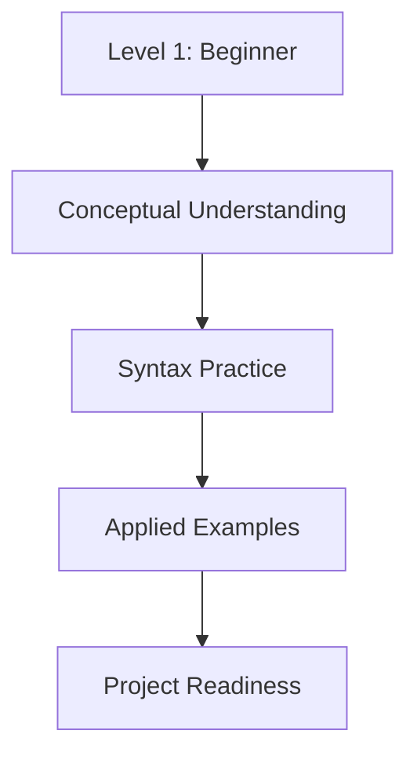

# Introduction to Python

> **Level:** Level 1: Beginner | **Domain:** developer environment and execution workflow

## Overview
- **What is it?** Introduction to Python is the Python discipline focused on developer environment and execution workflow.
- **Why is it important?** It turns isolated syntax knowledge into reliable capability for developer environment and execution workflow.
- **Where is it used?** local machines, classrooms, notebooks, CI runners, servers, and cloud workspaces.

## Learning Objectives
- Explain the purpose and vocabulary of **Introduction to Python**.
- Apply the core Python patterns used in developer environment and execution workflow.
- Recognize trade-offs, failure modes, and safe defaults.
- **Expected outcome:** create a small, reviewable Python example that demonstrates introduction to python in context.

## Real World Applications
- **Industry use cases:** Local machines, classrooms, notebooks, ci runners, servers, and cloud workspaces.
- **Business applications:** reduce manual work, improve reliability, and make developer environment and execution workflow easier to maintain.
- **Career relevance:** strengthens portfolio projects, interview explanations, team collaboration, and production readiness.

## Core Concepts

| Concept | Definition | Visual Explanation | Practical Example |
| --- | --- | --- | --- |
| **Interpreter** | The Python executable that reads source code and runs it. | `source.py -> python -> output` | `print("Python is ready")` |
| **Script** | A file containing repeatable Python instructions. | `task.py -> run -> result` | `Path("report.txt").write_text("done")` |
| **Feedback Loop** | The cycle of write, run, inspect, and improve. | `edit -> execute -> observe -> refine` | `python --version` |

## Infographic Summary

| Block | Learning Block |
| --- | --- |
| 📌 Concept | **Introduction to Python** belongs to the developer environment and execution workflow layer of Python mastery. |
| ⚡ Purpose | Make Python programs clearer, safer, and more useful for developer environment and execution workflow. |
| 🔥 Benefits | Better readability, fewer bugs, stronger automation, and easier team handoff. |
| 🎯 Use Cases | Practice projects, production scripts, backend systems, analytics workflows, and introduction to python exercises. |
| 🚀 Best Practices | Start small, name things clearly, handle errors intentionally, test behavior, and document assumptions. |
| ❌ Common Mistakes | Memorizing syntax without context, skipping edge cases, overengineering early, and ignoring runtime feedback. |

## Syntax Guide

### Basic Syntax

```python
print("Hello, Python")
```

### Standard Structure

```python
def main():
    print("Run this file with python script.py")


if __name__ == "__main__":
    main()
```

### Code Pattern

```text
write code -> save file -> run interpreter -> inspect output
```

## Examples

### Beginner Example

```python
topic = "Introduction to Python"
print(f"Now learning: {topic}")
```

### Intermediate Example

```python
def build_introduction_to_python_checklist():
    return [
        "explain the concept",
        "write a small example",
        "identify a common mistake",
    ]

for step in build_introduction_to_python_checklist():
    print(step)
```

### Advanced Example

```python
from dataclasses import dataclass


@dataclass(frozen=True)
class LearningTopic:
    name: str
    level: str
    evidence: tuple[str, ...]

    def is_ready_for_project(self) -> bool:
        return len(self.evidence) >= 3


topic = LearningTopic("Introduction to Python", "setup", ("notes", "code", "review"))
print(topic.is_ready_for_project())
```

## Workflow Diagram

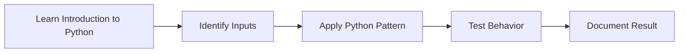

---

# Installing Python

> **Level:** Level 1: Beginner | **Domain:** developer environment and execution workflow

## Overview
- **What is it?** Installing Python is the Python discipline focused on developer environment and execution workflow.
- **Why is it important?** It turns isolated syntax knowledge into reliable capability for developer environment and execution workflow.
- **Where is it used?** local machines, classrooms, notebooks, CI runners, servers, and cloud workspaces.

## Learning Objectives
- Explain the purpose and vocabulary of **Installing Python**.
- Apply the core Python patterns used in developer environment and execution workflow.
- Recognize trade-offs, failure modes, and safe defaults.
- **Expected outcome:** create a small, reviewable Python example that demonstrates installing python in context.

## Real World Applications
- **Industry use cases:** Local machines, classrooms, notebooks, ci runners, servers, and cloud workspaces.
- **Business applications:** reduce manual work, improve reliability, and make developer environment and execution workflow easier to maintain.
- **Career relevance:** strengthens portfolio projects, interview explanations, team collaboration, and production readiness.

## Core Concepts

| Concept | Definition | Visual Explanation | Practical Example |
| --- | --- | --- | --- |
| **Interpreter** | The Python executable that reads source code and runs it. | `source.py -> python -> output` | `print("Python is ready")` |
| **Script** | A file containing repeatable Python instructions. | `task.py -> run -> result` | `Path("report.txt").write_text("done")` |
| **Feedback Loop** | The cycle of write, run, inspect, and improve. | `edit -> execute -> observe -> refine` | `python --version` |

## Infographic Summary

| Block | Learning Block |
| --- | --- |
| 📌 Concept | **Installing Python** belongs to the developer environment and execution workflow layer of Python mastery. |
| ⚡ Purpose | Make Python programs clearer, safer, and more useful for developer environment and execution workflow. |
| 🔥 Benefits | Better readability, fewer bugs, stronger automation, and easier team handoff. |
| 🎯 Use Cases | Practice projects, production scripts, backend systems, analytics workflows, and installing python exercises. |
| 🚀 Best Practices | Start small, name things clearly, handle errors intentionally, test behavior, and document assumptions. |
| ❌ Common Mistakes | Memorizing syntax without context, skipping edge cases, overengineering early, and ignoring runtime feedback. |

## Syntax Guide

### Basic Syntax

```python
print("Hello, Python")
```

### Standard Structure

```python
def main():
    print("Run this file with python script.py")


if __name__ == "__main__":
    main()
```

### Code Pattern

```text
write code -> save file -> run interpreter -> inspect output
```

## Examples

### Beginner Example

```python
topic = "Installing Python"
print(f"Now learning: {topic}")
```

### Intermediate Example

```python
def build_installing_python_checklist():
    return [
        "explain the concept",
        "write a small example",
        "identify a common mistake",
    ]

for step in build_installing_python_checklist():
    print(step)
```

### Advanced Example

```python
from dataclasses import dataclass


@dataclass(frozen=True)
class LearningTopic:
    name: str
    level: str
    evidence: tuple[str, ...]

    def is_ready_for_project(self) -> bool:
        return len(self.evidence) >= 3


topic = LearningTopic("Installing Python", "setup", ("notes", "code", "review"))
print(topic.is_ready_for_project())
```

## Workflow Diagram

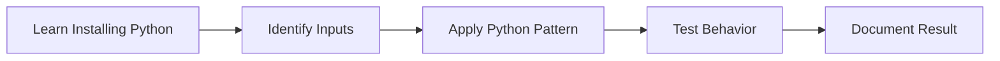

---

# IDE Setup

> **Level:** Level 1: Beginner | **Domain:** developer environment and execution workflow

## Overview
- **What is it?** IDE Setup is the Python discipline focused on developer environment and execution workflow.
- **Why is it important?** It turns isolated syntax knowledge into reliable capability for developer environment and execution workflow.
- **Where is it used?** local machines, classrooms, notebooks, CI runners, servers, and cloud workspaces.

## Learning Objectives
- Explain the purpose and vocabulary of **IDE Setup**.
- Apply the core Python patterns used in developer environment and execution workflow.
- Recognize trade-offs, failure modes, and safe defaults.
- **Expected outcome:** create a small, reviewable Python example that demonstrates ide setup in context.

## Real World Applications
- **Industry use cases:** Local machines, classrooms, notebooks, ci runners, servers, and cloud workspaces.
- **Business applications:** reduce manual work, improve reliability, and make developer environment and execution workflow easier to maintain.
- **Career relevance:** strengthens portfolio projects, interview explanations, team collaboration, and production readiness.

## Core Concepts

| Concept | Definition | Visual Explanation | Practical Example |
| --- | --- | --- | --- |
| **Interpreter** | The Python executable that reads source code and runs it. | `source.py -> python -> output` | `print("Python is ready")` |
| **Script** | A file containing repeatable Python instructions. | `task.py -> run -> result` | `Path("report.txt").write_text("done")` |
| **Feedback Loop** | The cycle of write, run, inspect, and improve. | `edit -> execute -> observe -> refine` | `python --version` |

## Infographic Summary

| Block | Learning Block |
| --- | --- |
| 📌 Concept | **IDE Setup** belongs to the developer environment and execution workflow layer of Python mastery. |
| ⚡ Purpose | Make Python programs clearer, safer, and more useful for developer environment and execution workflow. |
| 🔥 Benefits | Better readability, fewer bugs, stronger automation, and easier team handoff. |
| 🎯 Use Cases | Practice projects, production scripts, backend systems, analytics workflows, and ide setup exercises. |
| 🚀 Best Practices | Start small, name things clearly, handle errors intentionally, test behavior, and document assumptions. |
| ❌ Common Mistakes | Memorizing syntax without context, skipping edge cases, overengineering early, and ignoring runtime feedback. |

## Syntax Guide

### Basic Syntax

```python
print("Hello, Python")
```

### Standard Structure

```python
def main():
    print("Run this file with python script.py")


if __name__ == "__main__":
    main()
```

### Code Pattern

```text
write code -> save file -> run interpreter -> inspect output
```

## Examples

### Beginner Example

```python
topic = "IDE Setup"
print(f"Now learning: {topic}")
```

### Intermediate Example

```python
def build_ide_setup_checklist():
    return [
        "explain the concept",
        "write a small example",
        "identify a common mistake",
    ]

for step in build_ide_setup_checklist():
    print(step)
```

### Advanced Example

```python
from dataclasses import dataclass


@dataclass(frozen=True)
class LearningTopic:
    name: str
    level: str
    evidence: tuple[str, ...]

    def is_ready_for_project(self) -> bool:
        return len(self.evidence) >= 3


topic = LearningTopic("IDE Setup", "setup", ("notes", "code", "review"))
print(topic.is_ready_for_project())
```

## Workflow Diagram

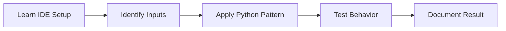

---

# Python Syntax

> **Level:** Level 1: Beginner | **Domain:** developer environment and execution workflow

## Overview
- **What is it?** Python Syntax is the Python discipline focused on developer environment and execution workflow.
- **Why is it important?** It turns isolated syntax knowledge into reliable capability for developer environment and execution workflow.
- **Where is it used?** local machines, classrooms, notebooks, CI runners, servers, and cloud workspaces.

## Learning Objectives
- Explain the purpose and vocabulary of **Python Syntax**.
- Apply the core Python patterns used in developer environment and execution workflow.
- Recognize trade-offs, failure modes, and safe defaults.
- **Expected outcome:** create a small, reviewable Python example that demonstrates python syntax in context.

## Real World Applications
- **Industry use cases:** Local machines, classrooms, notebooks, ci runners, servers, and cloud workspaces.
- **Business applications:** reduce manual work, improve reliability, and make developer environment and execution workflow easier to maintain.
- **Career relevance:** strengthens portfolio projects, interview explanations, team collaboration, and production readiness.

## Core Concepts

| Concept | Definition | Visual Explanation | Practical Example |
| --- | --- | --- | --- |
| **Interpreter** | The Python executable that reads source code and runs it. | `source.py -> python -> output` | `print("Python is ready")` |
| **Script** | A file containing repeatable Python instructions. | `task.py -> run -> result` | `Path("report.txt").write_text("done")` |
| **Feedback Loop** | The cycle of write, run, inspect, and improve. | `edit -> execute -> observe -> refine` | `python --version` |

## Infographic Summary

| Block | Learning Block |
| --- | --- |
| 📌 Concept | **Python Syntax** belongs to the developer environment and execution workflow layer of Python mastery. |
| ⚡ Purpose | Make Python programs clearer, safer, and more useful for developer environment and execution workflow. |
| 🔥 Benefits | Better readability, fewer bugs, stronger automation, and easier team handoff. |
| 🎯 Use Cases | Practice projects, production scripts, backend systems, analytics workflows, and python syntax exercises. |
| 🚀 Best Practices | Start small, name things clearly, handle errors intentionally, test behavior, and document assumptions. |
| ❌ Common Mistakes | Memorizing syntax without context, skipping edge cases, overengineering early, and ignoring runtime feedback. |

## Syntax Guide

### Basic Syntax

```python
print("Hello, Python")
```

### Standard Structure

```python
def main():
    print("Run this file with python script.py")


if __name__ == "__main__":
    main()
```

### Code Pattern

```text
write code -> save file -> run interpreter -> inspect output
```

## Examples

### Beginner Example

```python
topic = "Python Syntax"
print(f"Now learning: {topic}")
```

### Intermediate Example

```python
def build_python_syntax_checklist():
    return [
        "explain the concept",
        "write a small example",
        "identify a common mistake",
    ]

for step in build_python_syntax_checklist():
    print(step)
```

### Advanced Example

```python
from dataclasses import dataclass


@dataclass(frozen=True)
class LearningTopic:
    name: str
    level: str
    evidence: tuple[str, ...]

    def is_ready_for_project(self) -> bool:
        return len(self.evidence) >= 3


topic = LearningTopic("Python Syntax", "setup", ("notes", "code", "review"))
print(topic.is_ready_for_project())
```

## Workflow Diagram

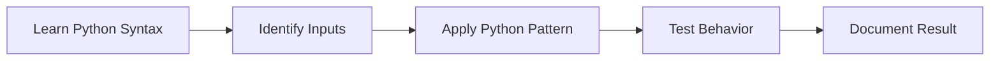

---

# Variables

> **Level:** Level 1: Beginner | **Domain:** values, expressions, and data representation

## Overview
- **What is it?** Variables is the Python discipline focused on values, expressions, and data representation.
- **Why is it important?** It turns isolated syntax knowledge into reliable capability for values, expressions, and data representation.
- **Where is it used?** business rules, forms, reports, analytics, automation scripts, and service configuration.

## Learning Objectives
- Explain the purpose and vocabulary of **Variables**.
- Apply the core Python patterns used in values, expressions, and data representation.
- Recognize trade-offs, failure modes, and safe defaults.
- **Expected outcome:** create a small, reviewable Python example that demonstrates variables in context.

## Real World Applications
- **Industry use cases:** Business rules, forms, reports, analytics, automation scripts, and service configuration.
- **Business applications:** reduce manual work, improve reliability, and make values, expressions, and data representation easier to maintain.
- **Career relevance:** strengthens portfolio projects, interview explanations, team collaboration, and production readiness.

## Core Concepts

| Concept | Definition | Visual Explanation | Practical Example |
| --- | --- | --- | --- |
| **Value** | A piece of information stored and processed by Python. | `name -> object` | `customer = "Ada"` |
| **Type** | A category that defines allowed operations for a value. | `42:int \| 3.14:float \| True:bool` | `isinstance(42, int)` |
| **Expression** | A combination of values and operators that produces a result. | `inputs + operator -> result` | `total = price * quantity` |

## Infographic Summary

| Block | Learning Block |
| --- | --- |
| 📌 Concept | **Variables** belongs to the values, expressions, and data representation layer of Python mastery. |
| ⚡ Purpose | Make Python programs clearer, safer, and more useful for values, expressions, and data representation. |
| 🔥 Benefits | Better readability, fewer bugs, stronger automation, and easier team handoff. |
| 🎯 Use Cases | Practice projects, production scripts, backend systems, analytics workflows, and variables exercises. |
| 🚀 Best Practices | Start small, name things clearly, handle errors intentionally, test behavior, and document assumptions. |
| ❌ Common Mistakes | Memorizing syntax without context, skipping edge cases, overengineering early, and ignoring runtime feedback. |

## Syntax Guide

### Basic Syntax

```python
name = "Ada"
age = int("36")
is_active = True
```

### Standard Structure

```python
input_value = "42"
number = int(input_value)
result = number * 2
print(result)
```

### Code Pattern

```text
capture value -> convert type if needed -> apply operator -> store result
```

## Examples

### Beginner Example

```python
price = 19.99
quantity = 3
print(price * quantity)
```

### Intermediate Example

```python
def invoice_total(items, tax_rate):
    subtotal = sum(price * qty for price, qty in items)
    return round(subtotal * (1 + tax_rate), 2)

print(invoice_total([(10.0, 2), (4.5, 3)], 0.08))
```

### Advanced Example

```python
from dataclasses import dataclass


@dataclass(frozen=True)
class LearningTopic:
    name: str
    level: str
    evidence: tuple[str, ...]

    def is_ready_for_project(self) -> bool:
        return len(self.evidence) >= 3


topic = LearningTopic("Variables", "data model", ("notes", "code", "review"))
print(topic.is_ready_for_project())
```

## Workflow Diagram

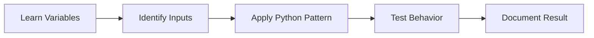

---

# Data Types

> **Level:** Level 1: Beginner | **Domain:** values, expressions, and data representation

## Overview
- **What is it?** Data Types is the Python discipline focused on values, expressions, and data representation.
- **Why is it important?** It turns isolated syntax knowledge into reliable capability for values, expressions, and data representation.
- **Where is it used?** business rules, forms, reports, analytics, automation scripts, and service configuration.

## Learning Objectives
- Explain the purpose and vocabulary of **Data Types**.
- Apply the core Python patterns used in values, expressions, and data representation.
- Recognize trade-offs, failure modes, and safe defaults.
- **Expected outcome:** create a small, reviewable Python example that demonstrates data types in context.

## Real World Applications
- **Industry use cases:** Business rules, forms, reports, analytics, automation scripts, and service configuration.
- **Business applications:** reduce manual work, improve reliability, and make values, expressions, and data representation easier to maintain.
- **Career relevance:** strengthens portfolio projects, interview explanations, team collaboration, and production readiness.

## Core Concepts

| Concept | Definition | Visual Explanation | Practical Example |
| --- | --- | --- | --- |
| **Value** | A piece of information stored and processed by Python. | `name -> object` | `customer = "Ada"` |
| **Type** | A category that defines allowed operations for a value. | `42:int \| 3.14:float \| True:bool` | `isinstance(42, int)` |
| **Expression** | A combination of values and operators that produces a result. | `inputs + operator -> result` | `total = price * quantity` |

## Infographic Summary

| Block | Learning Block |
| --- | --- |
| 📌 Concept | **Data Types** belongs to the values, expressions, and data representation layer of Python mastery. |
| ⚡ Purpose | Make Python programs clearer, safer, and more useful for values, expressions, and data representation. |
| 🔥 Benefits | Better readability, fewer bugs, stronger automation, and easier team handoff. |
| 🎯 Use Cases | Practice projects, production scripts, backend systems, analytics workflows, and data types exercises. |
| 🚀 Best Practices | Start small, name things clearly, handle errors intentionally, test behavior, and document assumptions. |
| ❌ Common Mistakes | Memorizing syntax without context, skipping edge cases, overengineering early, and ignoring runtime feedback. |

## Syntax Guide

### Basic Syntax

```python
name = "Ada"
age = int("36")
is_active = True
```

### Standard Structure

```python
input_value = "42"
number = int(input_value)
result = number * 2
print(result)
```

### Code Pattern

```text
capture value -> convert type if needed -> apply operator -> store result
```

## Examples

### Beginner Example

```python
price = 19.99
quantity = 3
print(price * quantity)
```

### Intermediate Example

```python
def invoice_total(items, tax_rate):
    subtotal = sum(price * qty for price, qty in items)
    return round(subtotal * (1 + tax_rate), 2)

print(invoice_total([(10.0, 2), (4.5, 3)], 0.08))
```

### Advanced Example

```python
from dataclasses import dataclass


@dataclass(frozen=True)
class LearningTopic:
    name: str
    level: str
    evidence: tuple[str, ...]

    def is_ready_for_project(self) -> bool:
        return len(self.evidence) >= 3


topic = LearningTopic("Data Types", "data model", ("notes", "code", "review"))
print(topic.is_ready_for_project())
```

## Workflow Diagram

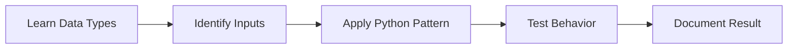

---

# Type Casting

> **Level:** Level 1: Beginner | **Domain:** values, expressions, and data representation

## Overview
- **What is it?** Type Casting is the Python discipline focused on values, expressions, and data representation.
- **Why is it important?** It turns isolated syntax knowledge into reliable capability for values, expressions, and data representation.
- **Where is it used?** business rules, forms, reports, analytics, automation scripts, and service configuration.

## Learning Objectives
- Explain the purpose and vocabulary of **Type Casting**.
- Apply the core Python patterns used in values, expressions, and data representation.
- Recognize trade-offs, failure modes, and safe defaults.
- **Expected outcome:** create a small, reviewable Python example that demonstrates type casting in context.

## Real World Applications
- **Industry use cases:** Business rules, forms, reports, analytics, automation scripts, and service configuration.
- **Business applications:** reduce manual work, improve reliability, and make values, expressions, and data representation easier to maintain.
- **Career relevance:** strengthens portfolio projects, interview explanations, team collaboration, and production readiness.

## Core Concepts

| Concept | Definition | Visual Explanation | Practical Example |
| --- | --- | --- | --- |
| **Value** | A piece of information stored and processed by Python. | `name -> object` | `customer = "Ada"` |
| **Type** | A category that defines allowed operations for a value. | `42:int \| 3.14:float \| True:bool` | `isinstance(42, int)` |
| **Expression** | A combination of values and operators that produces a result. | `inputs + operator -> result` | `total = price * quantity` |

## Infographic Summary

| Block | Learning Block |
| --- | --- |
| 📌 Concept | **Type Casting** belongs to the values, expressions, and data representation layer of Python mastery. |
| ⚡ Purpose | Make Python programs clearer, safer, and more useful for values, expressions, and data representation. |
| 🔥 Benefits | Better readability, fewer bugs, stronger automation, and easier team handoff. |
| 🎯 Use Cases | Practice projects, production scripts, backend systems, analytics workflows, and type casting exercises. |
| 🚀 Best Practices | Start small, name things clearly, handle errors intentionally, test behavior, and document assumptions. |
| ❌ Common Mistakes | Memorizing syntax without context, skipping edge cases, overengineering early, and ignoring runtime feedback. |

## Syntax Guide

### Basic Syntax

```python
name = "Ada"
age = int("36")
is_active = True
```

### Standard Structure

```python
input_value = "42"
number = int(input_value)
result = number * 2
print(result)
```

### Code Pattern

```text
capture value -> convert type if needed -> apply operator -> store result
```

## Examples

### Beginner Example

```python
price = 19.99
quantity = 3
print(price * quantity)
```

### Intermediate Example

```python
def invoice_total(items, tax_rate):
    subtotal = sum(price * qty for price, qty in items)
    return round(subtotal * (1 + tax_rate), 2)

print(invoice_total([(10.0, 2), (4.5, 3)], 0.08))
```

### Advanced Example

```python
from dataclasses import dataclass


@dataclass(frozen=True)
class LearningTopic:
    name: str
    level: str
    evidence: tuple[str, ...]

    def is_ready_for_project(self) -> bool:
        return len(self.evidence) >= 3


topic = LearningTopic("Type Casting", "data model", ("notes", "code", "review"))
print(topic.is_ready_for_project())
```

## Workflow Diagram

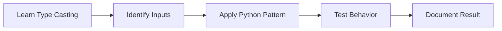

---

# Input and Output

> **Level:** Level 1: Beginner | **Domain:** values, expressions, and data representation

## Overview
- **What is it?** Input and Output is the Python discipline focused on values, expressions, and data representation.
- **Why is it important?** It turns isolated syntax knowledge into reliable capability for values, expressions, and data representation.
- **Where is it used?** business rules, forms, reports, analytics, automation scripts, and service configuration.

## Learning Objectives
- Explain the purpose and vocabulary of **Input and Output**.
- Apply the core Python patterns used in values, expressions, and data representation.
- Recognize trade-offs, failure modes, and safe defaults.
- **Expected outcome:** create a small, reviewable Python example that demonstrates input and output in context.

## Real World Applications
- **Industry use cases:** Business rules, forms, reports, analytics, automation scripts, and service configuration.
- **Business applications:** reduce manual work, improve reliability, and make values, expressions, and data representation easier to maintain.
- **Career relevance:** strengthens portfolio projects, interview explanations, team collaboration, and production readiness.

## Core Concepts

| Concept | Definition | Visual Explanation | Practical Example |
| --- | --- | --- | --- |
| **Value** | A piece of information stored and processed by Python. | `name -> object` | `customer = "Ada"` |
| **Type** | A category that defines allowed operations for a value. | `42:int \| 3.14:float \| True:bool` | `isinstance(42, int)` |
| **Expression** | A combination of values and operators that produces a result. | `inputs + operator -> result` | `total = price * quantity` |

## Infographic Summary

| Block | Learning Block |
| --- | --- |
| 📌 Concept | **Input and Output** belongs to the values, expressions, and data representation layer of Python mastery. |
| ⚡ Purpose | Make Python programs clearer, safer, and more useful for values, expressions, and data representation. |
| 🔥 Benefits | Better readability, fewer bugs, stronger automation, and easier team handoff. |
| 🎯 Use Cases | Practice projects, production scripts, backend systems, analytics workflows, and input and output exercises. |
| 🚀 Best Practices | Start small, name things clearly, handle errors intentionally, test behavior, and document assumptions. |
| ❌ Common Mistakes | Memorizing syntax without context, skipping edge cases, overengineering early, and ignoring runtime feedback. |

## Syntax Guide

### Basic Syntax

```python
name = "Ada"
age = int("36")
is_active = True
```

### Standard Structure

```python
input_value = "42"
number = int(input_value)
result = number * 2
print(result)
```

### Code Pattern

```text
capture value -> convert type if needed -> apply operator -> store result
```

## Examples

### Beginner Example

```python
price = 19.99
quantity = 3
print(price * quantity)
```

### Intermediate Example

```python
def invoice_total(items, tax_rate):
    subtotal = sum(price * qty for price, qty in items)
    return round(subtotal * (1 + tax_rate), 2)

print(invoice_total([(10.0, 2), (4.5, 3)], 0.08))
```

### Advanced Example

```python
from dataclasses import dataclass


@dataclass(frozen=True)
class LearningTopic:
    name: str
    level: str
    evidence: tuple[str, ...]

    def is_ready_for_project(self) -> bool:
        return len(self.evidence) >= 3


topic = LearningTopic("Input and Output", "data model", ("notes", "code", "review"))
print(topic.is_ready_for_project())
```

## Workflow Diagram

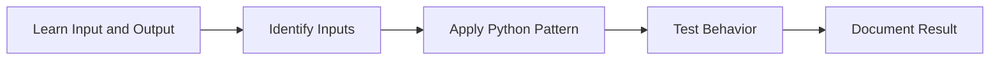

---

# Operators

> **Level:** Level 1: Beginner | **Domain:** values, expressions, and data representation

## Overview
- **What is it?** Operators is the Python discipline focused on values, expressions, and data representation.
- **Why is it important?** It turns isolated syntax knowledge into reliable capability for values, expressions, and data representation.
- **Where is it used?** business rules, forms, reports, analytics, automation scripts, and service configuration.

## Learning Objectives
- Explain the purpose and vocabulary of **Operators**.
- Apply the core Python patterns used in values, expressions, and data representation.
- Recognize trade-offs, failure modes, and safe defaults.
- **Expected outcome:** create a small, reviewable Python example that demonstrates operators in context.

## Real World Applications
- **Industry use cases:** Business rules, forms, reports, analytics, automation scripts, and service configuration.
- **Business applications:** reduce manual work, improve reliability, and make values, expressions, and data representation easier to maintain.
- **Career relevance:** strengthens portfolio projects, interview explanations, team collaboration, and production readiness.

## Core Concepts

| Concept | Definition | Visual Explanation | Practical Example |
| --- | --- | --- | --- |
| **Value** | A piece of information stored and processed by Python. | `name -> object` | `customer = "Ada"` |
| **Type** | A category that defines allowed operations for a value. | `42:int \| 3.14:float \| True:bool` | `isinstance(42, int)` |
| **Expression** | A combination of values and operators that produces a result. | `inputs + operator -> result` | `total = price * quantity` |

## Infographic Summary

| Block | Learning Block |
| --- | --- |
| 📌 Concept | **Operators** belongs to the values, expressions, and data representation layer of Python mastery. |
| ⚡ Purpose | Make Python programs clearer, safer, and more useful for values, expressions, and data representation. |
| 🔥 Benefits | Better readability, fewer bugs, stronger automation, and easier team handoff. |
| 🎯 Use Cases | Practice projects, production scripts, backend systems, analytics workflows, and operators exercises. |
| 🚀 Best Practices | Start small, name things clearly, handle errors intentionally, test behavior, and document assumptions. |
| ❌ Common Mistakes | Memorizing syntax without context, skipping edge cases, overengineering early, and ignoring runtime feedback. |

## Syntax Guide

### Basic Syntax

```python
name = "Ada"
age = int("36")
is_active = True
```

### Standard Structure

```python
input_value = "42"
number = int(input_value)
result = number * 2
print(result)
```

### Code Pattern

```text
capture value -> convert type if needed -> apply operator -> store result
```

## Examples

### Beginner Example

```python
price = 19.99
quantity = 3
print(price * quantity)
```

### Intermediate Example

```python
def invoice_total(items, tax_rate):
    subtotal = sum(price * qty for price, qty in items)
    return round(subtotal * (1 + tax_rate), 2)

print(invoice_total([(10.0, 2), (4.5, 3)], 0.08))
```

### Advanced Example

```python
from dataclasses import dataclass


@dataclass(frozen=True)
class LearningTopic:
    name: str
    level: str
    evidence: tuple[str, ...]

    def is_ready_for_project(self) -> bool:
        return len(self.evidence) >= 3


topic = LearningTopic("Operators", "data model", ("notes", "code", "review"))
print(topic.is_ready_for_project())
```

## Workflow Diagram

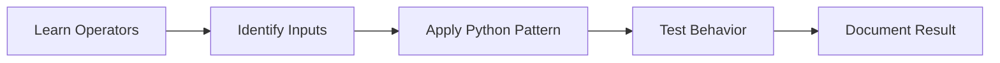

---

# Conditional Statements

> **Level:** Level 1: Beginner | **Domain:** decision-making and repetition

## Overview
- **What is it?** Conditional Statements is the Python discipline focused on decision-making and repetition.
- **Why is it important?** It turns isolated syntax knowledge into reliable capability for decision-making and repetition.
- **Where is it used?** validation, games, ETL jobs, user workflows, robotics, simulations, and data processing.

## Learning Objectives
- Explain the purpose and vocabulary of **Conditional Statements**.
- Apply the core Python patterns used in decision-making and repetition.
- Recognize trade-offs, failure modes, and safe defaults.
- **Expected outcome:** create a small, reviewable Python example that demonstrates conditional statements in context.

## Real World Applications
- **Industry use cases:** Validation, games, etl jobs, user workflows, robotics, simulations, and data processing.
- **Business applications:** reduce manual work, improve reliability, and make decision-making and repetition easier to maintain.
- **Career relevance:** strengthens portfolio projects, interview explanations, team collaboration, and production readiness.

## Core Concepts

| Concept | Definition | Visual Explanation | Practical Example |
| --- | --- | --- | --- |
| **Branch** | A path chosen when a condition is true or false. | `condition ? path A : path B` | `status = "pass" if score >= 70 else "retry"` |
| **Iteration** | Repeating work over data or until a condition changes. | `collection -> repeated body` | `for item in items: process(item)` |
| **Loop Control** | Keywords that alter normal loop execution. | `continue \| break \| pass` | `if item is None: continue` |

## Infographic Summary

| Block | Learning Block |
| --- | --- |
| 📌 Concept | **Conditional Statements** belongs to the decision-making and repetition layer of Python mastery. |
| ⚡ Purpose | Make Python programs clearer, safer, and more useful for decision-making and repetition. |
| 🔥 Benefits | Better readability, fewer bugs, stronger automation, and easier team handoff. |
| 🎯 Use Cases | Practice projects, production scripts, backend systems, analytics workflows, and conditional statements exercises. |
| 🚀 Best Practices | Start small, name things clearly, handle errors intentionally, test behavior, and document assumptions. |
| ❌ Common Mistakes | Memorizing syntax without context, skipping edge cases, overengineering early, and ignoring runtime feedback. |

## Syntax Guide

### Basic Syntax

```python
if score >= 70:
    print("pass")
else:
    print("practice again")
```

### Standard Structure

```python
for item in items:
    if item is None:
        continue
    process(item)
```

### Code Pattern

```text
condition -> branch or loop -> optional break/continue -> result
```

## Examples

### Beginner Example

```python
score = 82
if score >= 70:
    print('pass')
else:
    print('retry')
```

### Intermediate Example

```python
orders = [120, 0, 45, 300]
for amount in orders:
    if amount == 0:
        continue
    if amount > 250:
        print('manual review')
        break
    print('approved')
```

### Advanced Example

```python
from dataclasses import dataclass


@dataclass(frozen=True)
class LearningTopic:
    name: str
    level: str
    evidence: tuple[str, ...]

    def is_ready_for_project(self) -> bool:
        return len(self.evidence) >= 3


topic = LearningTopic("Conditional Statements", "control flow", ("notes", "code", "review"))
print(topic.is_ready_for_project())
```

## Workflow Diagram

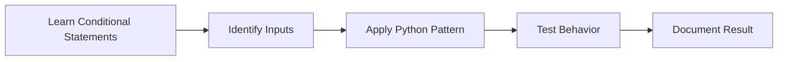

---

# Loops

> **Level:** Level 1: Beginner | **Domain:** decision-making and repetition

## Overview
- **What is it?** Loops is the Python discipline focused on decision-making and repetition.
- **Why is it important?** It turns isolated syntax knowledge into reliable capability for decision-making and repetition.
- **Where is it used?** validation, games, ETL jobs, user workflows, robotics, simulations, and data processing.

## Learning Objectives
- Explain the purpose and vocabulary of **Loops**.
- Apply the core Python patterns used in decision-making and repetition.
- Recognize trade-offs, failure modes, and safe defaults.
- **Expected outcome:** create a small, reviewable Python example that demonstrates loops in context.

## Real World Applications
- **Industry use cases:** Validation, games, etl jobs, user workflows, robotics, simulations, and data processing.
- **Business applications:** reduce manual work, improve reliability, and make decision-making and repetition easier to maintain.
- **Career relevance:** strengthens portfolio projects, interview explanations, team collaboration, and production readiness.

## Core Concepts

| Concept | Definition | Visual Explanation | Practical Example |
| --- | --- | --- | --- |
| **Branch** | A path chosen when a condition is true or false. | `condition ? path A : path B` | `status = "pass" if score >= 70 else "retry"` |
| **Iteration** | Repeating work over data or until a condition changes. | `collection -> repeated body` | `for item in items: process(item)` |
| **Loop Control** | Keywords that alter normal loop execution. | `continue \| break \| pass` | `if item is None: continue` |

## Infographic Summary

| Block | Learning Block |
| --- | --- |
| 📌 Concept | **Loops** belongs to the decision-making and repetition layer of Python mastery. |
| ⚡ Purpose | Make Python programs clearer, safer, and more useful for decision-making and repetition. |
| 🔥 Benefits | Better readability, fewer bugs, stronger automation, and easier team handoff. |
| 🎯 Use Cases | Practice projects, production scripts, backend systems, analytics workflows, and loops exercises. |
| 🚀 Best Practices | Start small, name things clearly, handle errors intentionally, test behavior, and document assumptions. |
| ❌ Common Mistakes | Memorizing syntax without context, skipping edge cases, overengineering early, and ignoring runtime feedback. |

## Syntax Guide

### Basic Syntax

```python
if score >= 70:
    print("pass")
else:
    print("practice again")
```

### Standard Structure

```python
for item in items:
    if item is None:
        continue
    process(item)
```

### Code Pattern

```text
condition -> branch or loop -> optional break/continue -> result
```

## Examples

### Beginner Example

```python
score = 82
if score >= 70:
    print('pass')
else:
    print('retry')
```

### Intermediate Example

```python
orders = [120, 0, 45, 300]
for amount in orders:
    if amount == 0:
        continue
    if amount > 250:
        print('manual review')
        break
    print('approved')
```

### Advanced Example

```python
from dataclasses import dataclass


@dataclass(frozen=True)
class LearningTopic:
    name: str
    level: str
    evidence: tuple[str, ...]

    def is_ready_for_project(self) -> bool:
        return len(self.evidence) >= 3


topic = LearningTopic("Loops", "control flow", ("notes", "code", "review"))
print(topic.is_ready_for_project())
```

## Workflow Diagram

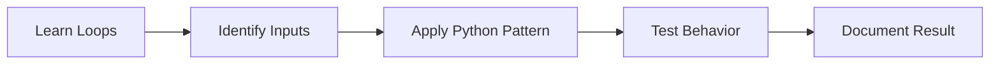

---

# Nested Loops

> **Level:** Level 1: Beginner | **Domain:** decision-making and repetition

## Overview
- **What is it?** Nested Loops is the Python discipline focused on decision-making and repetition.
- **Why is it important?** It turns isolated syntax knowledge into reliable capability for decision-making and repetition.
- **Where is it used?** validation, games, ETL jobs, user workflows, robotics, simulations, and data processing.

## Learning Objectives
- Explain the purpose and vocabulary of **Nested Loops**.
- Apply the core Python patterns used in decision-making and repetition.
- Recognize trade-offs, failure modes, and safe defaults.
- **Expected outcome:** create a small, reviewable Python example that demonstrates nested loops in context.

## Real World Applications
- **Industry use cases:** Validation, games, etl jobs, user workflows, robotics, simulations, and data processing.
- **Business applications:** reduce manual work, improve reliability, and make decision-making and repetition easier to maintain.
- **Career relevance:** strengthens portfolio projects, interview explanations, team collaboration, and production readiness.

## Core Concepts

| Concept | Definition | Visual Explanation | Practical Example |
| --- | --- | --- | --- |
| **Branch** | A path chosen when a condition is true or false. | `condition ? path A : path B` | `status = "pass" if score >= 70 else "retry"` |
| **Iteration** | Repeating work over data or until a condition changes. | `collection -> repeated body` | `for item in items: process(item)` |
| **Loop Control** | Keywords that alter normal loop execution. | `continue \| break \| pass` | `if item is None: continue` |

## Infographic Summary

| Block | Learning Block |
| --- | --- |
| 📌 Concept | **Nested Loops** belongs to the decision-making and repetition layer of Python mastery. |
| ⚡ Purpose | Make Python programs clearer, safer, and more useful for decision-making and repetition. |
| 🔥 Benefits | Better readability, fewer bugs, stronger automation, and easier team handoff. |
| 🎯 Use Cases | Practice projects, production scripts, backend systems, analytics workflows, and nested loops exercises. |
| 🚀 Best Practices | Start small, name things clearly, handle errors intentionally, test behavior, and document assumptions. |
| ❌ Common Mistakes | Memorizing syntax without context, skipping edge cases, overengineering early, and ignoring runtime feedback. |

## Syntax Guide

### Basic Syntax

```python
if score >= 70:
    print("pass")
else:
    print("practice again")
```

### Standard Structure

```python
for item in items:
    if item is None:
        continue
    process(item)
```

### Code Pattern

```text
condition -> branch or loop -> optional break/continue -> result
```

## Examples

### Beginner Example

```python
score = 82
if score >= 70:
    print('pass')
else:
    print('retry')
```

### Intermediate Example

```python
orders = [120, 0, 45, 300]
for amount in orders:
    if amount == 0:
        continue
    if amount > 250:
        print('manual review')
        break
    print('approved')
```

### Advanced Example

```python
from dataclasses import dataclass


@dataclass(frozen=True)
class LearningTopic:
    name: str
    level: str
    evidence: tuple[str, ...]

    def is_ready_for_project(self) -> bool:
        return len(self.evidence) >= 3


topic = LearningTopic("Nested Loops", "control flow", ("notes", "code", "review"))
print(topic.is_ready_for_project())
```

## Workflow Diagram

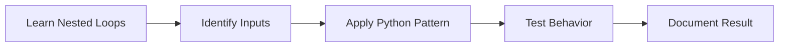

---

# Break Continue Pass

> **Level:** Level 1: Beginner | **Domain:** decision-making and repetition

## Overview
- **What is it?** Break Continue Pass is the Python discipline focused on decision-making and repetition.
- **Why is it important?** It turns isolated syntax knowledge into reliable capability for decision-making and repetition.
- **Where is it used?** validation, games, ETL jobs, user workflows, robotics, simulations, and data processing.

## Learning Objectives
- Explain the purpose and vocabulary of **Break Continue Pass**.
- Apply the core Python patterns used in decision-making and repetition.
- Recognize trade-offs, failure modes, and safe defaults.
- **Expected outcome:** create a small, reviewable Python example that demonstrates break continue pass in context.

## Real World Applications
- **Industry use cases:** Validation, games, etl jobs, user workflows, robotics, simulations, and data processing.
- **Business applications:** reduce manual work, improve reliability, and make decision-making and repetition easier to maintain.
- **Career relevance:** strengthens portfolio projects, interview explanations, team collaboration, and production readiness.

## Core Concepts

| Concept | Definition | Visual Explanation | Practical Example |
| --- | --- | --- | --- |
| **Branch** | A path chosen when a condition is true or false. | `condition ? path A : path B` | `status = "pass" if score >= 70 else "retry"` |
| **Iteration** | Repeating work over data or until a condition changes. | `collection -> repeated body` | `for item in items: process(item)` |
| **Loop Control** | Keywords that alter normal loop execution. | `continue \| break \| pass` | `if item is None: continue` |

## Infographic Summary

| Block | Learning Block |
| --- | --- |
| 📌 Concept | **Break Continue Pass** belongs to the decision-making and repetition layer of Python mastery. |
| ⚡ Purpose | Make Python programs clearer, safer, and more useful for decision-making and repetition. |
| 🔥 Benefits | Better readability, fewer bugs, stronger automation, and easier team handoff. |
| 🎯 Use Cases | Practice projects, production scripts, backend systems, analytics workflows, and break continue pass exercises. |
| 🚀 Best Practices | Start small, name things clearly, handle errors intentionally, test behavior, and document assumptions. |
| ❌ Common Mistakes | Memorizing syntax without context, skipping edge cases, overengineering early, and ignoring runtime feedback. |

## Syntax Guide

### Basic Syntax

```python
if score >= 70:
    print("pass")
else:
    print("practice again")
```

### Standard Structure

```python
for item in items:
    if item is None:
        continue
    process(item)
```

### Code Pattern

```text
condition -> branch or loop -> optional break/continue -> result
```

## Examples

### Beginner Example

```python
score = 82
if score >= 70:
    print('pass')
else:
    print('retry')
```

### Intermediate Example

```python
orders = [120, 0, 45, 300]
for amount in orders:
    if amount == 0:
        continue
    if amount > 250:
        print('manual review')
        break
    print('approved')
```

### Advanced Example

```python
from dataclasses import dataclass


@dataclass(frozen=True)
class LearningTopic:
    name: str
    level: str
    evidence: tuple[str, ...]

    def is_ready_for_project(self) -> bool:
        return len(self.evidence) >= 3


topic = LearningTopic("Break Continue Pass", "control flow", ("notes", "code", "review"))
print(topic.is_ready_for_project())
```

## Workflow Diagram

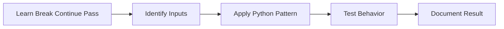

---

# Strings

> **Level:** Level 1: Beginner | **Domain:** containers and sequence processing

## Overview
- **What is it?** Strings is the Python discipline focused on containers and sequence processing.
- **Why is it important?** It turns isolated syntax knowledge into reliable capability for containers and sequence processing.
- **Where is it used?** records, API payloads, dashboards, configuration, search, recommendations, and reporting.

## Learning Objectives
- Explain the purpose and vocabulary of **Strings**.
- Apply the core Python patterns used in containers and sequence processing.
- Recognize trade-offs, failure modes, and safe defaults.
- **Expected outcome:** create a small, reviewable Python example that demonstrates strings in context.

## Real World Applications
- **Industry use cases:** Records, api payloads, dashboards, configuration, search, recommendations, and reporting.
- **Business applications:** reduce manual work, improve reliability, and make containers and sequence processing easier to maintain.
- **Career relevance:** strengthens portfolio projects, interview explanations, team collaboration, and production readiness.

## Core Concepts

| Concept | Definition | Visual Explanation | Practical Example |
| --- | --- | --- | --- |
| **Sequence** | An ordered container accessed by position. | `index -> element` | `names[0]` |
| **Mapping** | A key-value structure for labeled data. | `key -> value` | `profile["email"]` |
| **Mutability** | Whether a container can change after creation. | `list changes \| tuple stays fixed` | `items.append('new')` |

## Infographic Summary

| Block | Learning Block |
| --- | --- |
| 📌 Concept | **Strings** belongs to the containers and sequence processing layer of Python mastery. |
| ⚡ Purpose | Make Python programs clearer, safer, and more useful for containers and sequence processing. |
| 🔥 Benefits | Better readability, fewer bugs, stronger automation, and easier team handoff. |
| 🎯 Use Cases | Practice projects, production scripts, backend systems, analytics workflows, and strings exercises. |
| 🚀 Best Practices | Start small, name things clearly, handle errors intentionally, test behavior, and document assumptions. |
| ❌ Common Mistakes | Memorizing syntax without context, skipping edge cases, overengineering early, and ignoring runtime feedback. |

## Syntax Guide

### Basic Syntax

```python
skills = ["syntax", "functions", "testing"]
profile = {"name": "Ada", "level": "beginner"}
```

### Standard Structure

```python
for skill in skills:
    print(skill.upper())

level = profile.get("level", "unknown")
```

### Code Pattern

```text
choose container -> add/read/update values -> iterate or transform
```

## Examples

### Beginner Example

```python
skills = ['strings', 'lists', 'dictionaries']
print(skills[0])
```

### Intermediate Example

```python
inventory = {'laptop': 4, 'monitor': 0, 'keyboard': 12}
available = {item: qty for item, qty in inventory.items() if qty > 0}
print(available)
```

### Advanced Example

```python
from dataclasses import dataclass


@dataclass(frozen=True)
class LearningTopic:
    name: str
    level: str
    evidence: tuple[str, ...]

    def is_ready_for_project(self) -> bool:
        return len(self.evidence) >= 3


topic = LearningTopic("Strings", "collections", ("notes", "code", "review"))
print(topic.is_ready_for_project())
```

## Workflow Diagram

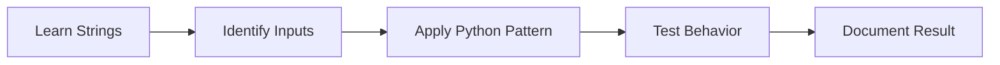

---

# String Methods

> **Level:** Level 1: Beginner | **Domain:** containers and sequence processing

## Overview
- **What is it?** String Methods is the Python discipline focused on containers and sequence processing.
- **Why is it important?** It turns isolated syntax knowledge into reliable capability for containers and sequence processing.
- **Where is it used?** records, API payloads, dashboards, configuration, search, recommendations, and reporting.

## Learning Objectives
- Explain the purpose and vocabulary of **String Methods**.
- Apply the core Python patterns used in containers and sequence processing.
- Recognize trade-offs, failure modes, and safe defaults.
- **Expected outcome:** create a small, reviewable Python example that demonstrates string methods in context.

## Real World Applications
- **Industry use cases:** Records, api payloads, dashboards, configuration, search, recommendations, and reporting.
- **Business applications:** reduce manual work, improve reliability, and make containers and sequence processing easier to maintain.
- **Career relevance:** strengthens portfolio projects, interview explanations, team collaboration, and production readiness.

## Core Concepts

| Concept | Definition | Visual Explanation | Practical Example |
| --- | --- | --- | --- |
| **Sequence** | An ordered container accessed by position. | `index -> element` | `names[0]` |
| **Mapping** | A key-value structure for labeled data. | `key -> value` | `profile["email"]` |
| **Mutability** | Whether a container can change after creation. | `list changes \| tuple stays fixed` | `items.append('new')` |

## Infographic Summary

| Block | Learning Block |
| --- | --- |
| 📌 Concept | **String Methods** belongs to the containers and sequence processing layer of Python mastery. |
| ⚡ Purpose | Make Python programs clearer, safer, and more useful for containers and sequence processing. |
| 🔥 Benefits | Better readability, fewer bugs, stronger automation, and easier team handoff. |
| 🎯 Use Cases | Practice projects, production scripts, backend systems, analytics workflows, and string methods exercises. |
| 🚀 Best Practices | Start small, name things clearly, handle errors intentionally, test behavior, and document assumptions. |
| ❌ Common Mistakes | Memorizing syntax without context, skipping edge cases, overengineering early, and ignoring runtime feedback. |

## Syntax Guide

### Basic Syntax

```python
skills = ["syntax", "functions", "testing"]
profile = {"name": "Ada", "level": "beginner"}
```

### Standard Structure

```python
for skill in skills:
    print(skill.upper())

level = profile.get("level", "unknown")
```

### Code Pattern

```text
choose container -> add/read/update values -> iterate or transform
```

## Examples

### Beginner Example

```python
skills = ['strings', 'lists', 'dictionaries']
print(skills[0])
```

### Intermediate Example

```python
inventory = {'laptop': 4, 'monitor': 0, 'keyboard': 12}
available = {item: qty for item, qty in inventory.items() if qty > 0}
print(available)
```

### Advanced Example

```python
from dataclasses import dataclass


@dataclass(frozen=True)
class LearningTopic:
    name: str
    level: str
    evidence: tuple[str, ...]

    def is_ready_for_project(self) -> bool:
        return len(self.evidence) >= 3


topic = LearningTopic("String Methods", "collections", ("notes", "code", "review"))
print(topic.is_ready_for_project())
```

## Workflow Diagram

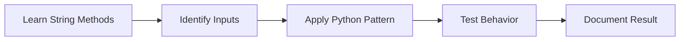

---

# Lists

> **Level:** Level 1: Beginner | **Domain:** containers and sequence processing

## Overview
- **What is it?** Lists is the Python discipline focused on containers and sequence processing.
- **Why is it important?** It turns isolated syntax knowledge into reliable capability for containers and sequence processing.
- **Where is it used?** records, API payloads, dashboards, configuration, search, recommendations, and reporting.

## Learning Objectives
- Explain the purpose and vocabulary of **Lists**.
- Apply the core Python patterns used in containers and sequence processing.
- Recognize trade-offs, failure modes, and safe defaults.
- **Expected outcome:** create a small, reviewable Python example that demonstrates lists in context.

## Real World Applications
- **Industry use cases:** Records, api payloads, dashboards, configuration, search, recommendations, and reporting.
- **Business applications:** reduce manual work, improve reliability, and make containers and sequence processing easier to maintain.
- **Career relevance:** strengthens portfolio projects, interview explanations, team collaboration, and production readiness.

## Core Concepts

| Concept | Definition | Visual Explanation | Practical Example |
| --- | --- | --- | --- |
| **Sequence** | An ordered container accessed by position. | `index -> element` | `names[0]` |
| **Mapping** | A key-value structure for labeled data. | `key -> value` | `profile["email"]` |
| **Mutability** | Whether a container can change after creation. | `list changes \| tuple stays fixed` | `items.append('new')` |

## Infographic Summary

| Block | Learning Block |
| --- | --- |
| 📌 Concept | **Lists** belongs to the containers and sequence processing layer of Python mastery. |
| ⚡ Purpose | Make Python programs clearer, safer, and more useful for containers and sequence processing. |
| 🔥 Benefits | Better readability, fewer bugs, stronger automation, and easier team handoff. |
| 🎯 Use Cases | Practice projects, production scripts, backend systems, analytics workflows, and lists exercises. |
| 🚀 Best Practices | Start small, name things clearly, handle errors intentionally, test behavior, and document assumptions. |
| ❌ Common Mistakes | Memorizing syntax without context, skipping edge cases, overengineering early, and ignoring runtime feedback. |

## Syntax Guide

### Basic Syntax

```python
skills = ["syntax", "functions", "testing"]
profile = {"name": "Ada", "level": "beginner"}
```

### Standard Structure

```python
for skill in skills:
    print(skill.upper())

level = profile.get("level", "unknown")
```

### Code Pattern

```text
choose container -> add/read/update values -> iterate or transform
```

## Examples

### Beginner Example

```python
skills = ['strings', 'lists', 'dictionaries']
print(skills[0])
```

### Intermediate Example

```python
inventory = {'laptop': 4, 'monitor': 0, 'keyboard': 12}
available = {item: qty for item, qty in inventory.items() if qty > 0}
print(available)
```

### Advanced Example

```python
from dataclasses import dataclass


@dataclass(frozen=True)
class LearningTopic:
    name: str
    level: str
    evidence: tuple[str, ...]

    def is_ready_for_project(self) -> bool:
        return len(self.evidence) >= 3


topic = LearningTopic("Lists", "collections", ("notes", "code", "review"))
print(topic.is_ready_for_project())
```

## Workflow Diagram

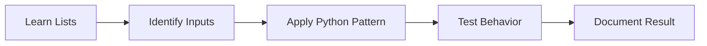

---

# List Methods

> **Level:** Level 1: Beginner | **Domain:** containers and sequence processing

## Overview
- **What is it?** List Methods is the Python discipline focused on containers and sequence processing.
- **Why is it important?** It turns isolated syntax knowledge into reliable capability for containers and sequence processing.
- **Where is it used?** records, API payloads, dashboards, configuration, search, recommendations, and reporting.

## Learning Objectives
- Explain the purpose and vocabulary of **List Methods**.
- Apply the core Python patterns used in containers and sequence processing.
- Recognize trade-offs, failure modes, and safe defaults.
- **Expected outcome:** create a small, reviewable Python example that demonstrates list methods in context.

## Real World Applications
- **Industry use cases:** Records, api payloads, dashboards, configuration, search, recommendations, and reporting.
- **Business applications:** reduce manual work, improve reliability, and make containers and sequence processing easier to maintain.
- **Career relevance:** strengthens portfolio projects, interview explanations, team collaboration, and production readiness.

## Core Concepts

| Concept | Definition | Visual Explanation | Practical Example |
| --- | --- | --- | --- |
| **Sequence** | An ordered container accessed by position. | `index -> element` | `names[0]` |
| **Mapping** | A key-value structure for labeled data. | `key -> value` | `profile["email"]` |
| **Mutability** | Whether a container can change after creation. | `list changes \| tuple stays fixed` | `items.append('new')` |

## Infographic Summary

| Block | Learning Block |
| --- | --- |
| 📌 Concept | **List Methods** belongs to the containers and sequence processing layer of Python mastery. |
| ⚡ Purpose | Make Python programs clearer, safer, and more useful for containers and sequence processing. |
| 🔥 Benefits | Better readability, fewer bugs, stronger automation, and easier team handoff. |
| 🎯 Use Cases | Practice projects, production scripts, backend systems, analytics workflows, and list methods exercises. |
| 🚀 Best Practices | Start small, name things clearly, handle errors intentionally, test behavior, and document assumptions. |
| ❌ Common Mistakes | Memorizing syntax without context, skipping edge cases, overengineering early, and ignoring runtime feedback. |

## Syntax Guide

### Basic Syntax

```python
skills = ["syntax", "functions", "testing"]
profile = {"name": "Ada", "level": "beginner"}
```

### Standard Structure

```python
for skill in skills:
    print(skill.upper())

level = profile.get("level", "unknown")
```

### Code Pattern

```text
choose container -> add/read/update values -> iterate or transform
```

## Examples

### Beginner Example

```python
skills = ['strings', 'lists', 'dictionaries']
print(skills[0])
```

### Intermediate Example

```python
inventory = {'laptop': 4, 'monitor': 0, 'keyboard': 12}
available = {item: qty for item, qty in inventory.items() if qty > 0}
print(available)
```

### Advanced Example

```python
from dataclasses import dataclass


@dataclass(frozen=True)
class LearningTopic:
    name: str
    level: str
    evidence: tuple[str, ...]

    def is_ready_for_project(self) -> bool:
        return len(self.evidence) >= 3


topic = LearningTopic("List Methods", "collections", ("notes", "code", "review"))
print(topic.is_ready_for_project())
```

## Workflow Diagram

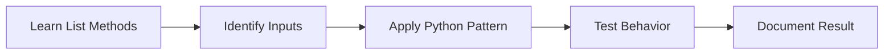

---

# Tuples

> **Level:** Level 1: Beginner | **Domain:** containers and sequence processing

## Overview
- **What is it?** Tuples is the Python discipline focused on containers and sequence processing.
- **Why is it important?** It turns isolated syntax knowledge into reliable capability for containers and sequence processing.
- **Where is it used?** records, API payloads, dashboards, configuration, search, recommendations, and reporting.

## Learning Objectives
- Explain the purpose and vocabulary of **Tuples**.
- Apply the core Python patterns used in containers and sequence processing.
- Recognize trade-offs, failure modes, and safe defaults.
- **Expected outcome:** create a small, reviewable Python example that demonstrates tuples in context.

## Real World Applications
- **Industry use cases:** Records, api payloads, dashboards, configuration, search, recommendations, and reporting.
- **Business applications:** reduce manual work, improve reliability, and make containers and sequence processing easier to maintain.
- **Career relevance:** strengthens portfolio projects, interview explanations, team collaboration, and production readiness.

## Core Concepts

| Concept | Definition | Visual Explanation | Practical Example |
| --- | --- | --- | --- |
| **Sequence** | An ordered container accessed by position. | `index -> element` | `names[0]` |
| **Mapping** | A key-value structure for labeled data. | `key -> value` | `profile["email"]` |
| **Mutability** | Whether a container can change after creation. | `list changes \| tuple stays fixed` | `items.append('new')` |

## Infographic Summary

| Block | Learning Block |
| --- | --- |
| 📌 Concept | **Tuples** belongs to the containers and sequence processing layer of Python mastery. |
| ⚡ Purpose | Make Python programs clearer, safer, and more useful for containers and sequence processing. |
| 🔥 Benefits | Better readability, fewer bugs, stronger automation, and easier team handoff. |
| 🎯 Use Cases | Practice projects, production scripts, backend systems, analytics workflows, and tuples exercises. |
| 🚀 Best Practices | Start small, name things clearly, handle errors intentionally, test behavior, and document assumptions. |
| ❌ Common Mistakes | Memorizing syntax without context, skipping edge cases, overengineering early, and ignoring runtime feedback. |

## Syntax Guide

### Basic Syntax

```python
skills = ["syntax", "functions", "testing"]
profile = {"name": "Ada", "level": "beginner"}
```

### Standard Structure

```python
for skill in skills:
    print(skill.upper())

level = profile.get("level", "unknown")
```

### Code Pattern

```text
choose container -> add/read/update values -> iterate or transform
```

## Examples

### Beginner Example

```python
skills = ['strings', 'lists', 'dictionaries']
print(skills[0])
```

### Intermediate Example

```python
inventory = {'laptop': 4, 'monitor': 0, 'keyboard': 12}
available = {item: qty for item, qty in inventory.items() if qty > 0}
print(available)
```

### Advanced Example

```python
from dataclasses import dataclass


@dataclass(frozen=True)
class LearningTopic:
    name: str
    level: str
    evidence: tuple[str, ...]

    def is_ready_for_project(self) -> bool:
        return len(self.evidence) >= 3


topic = LearningTopic("Tuples", "collections", ("notes", "code", "review"))
print(topic.is_ready_for_project())
```

## Workflow Diagram

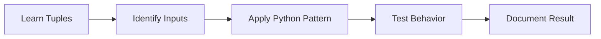

---

# Sets

> **Level:** Level 1: Beginner | **Domain:** containers and sequence processing

## Overview
- **What is it?** Sets is the Python discipline focused on containers and sequence processing.
- **Why is it important?** It turns isolated syntax knowledge into reliable capability for containers and sequence processing.
- **Where is it used?** records, API payloads, dashboards, configuration, search, recommendations, and reporting.

## Learning Objectives
- Explain the purpose and vocabulary of **Sets**.
- Apply the core Python patterns used in containers and sequence processing.
- Recognize trade-offs, failure modes, and safe defaults.
- **Expected outcome:** create a small, reviewable Python example that demonstrates sets in context.

## Real World Applications
- **Industry use cases:** Records, api payloads, dashboards, configuration, search, recommendations, and reporting.
- **Business applications:** reduce manual work, improve reliability, and make containers and sequence processing easier to maintain.
- **Career relevance:** strengthens portfolio projects, interview explanations, team collaboration, and production readiness.

## Core Concepts

| Concept | Definition | Visual Explanation | Practical Example |
| --- | --- | --- | --- |
| **Sequence** | An ordered container accessed by position. | `index -> element` | `names[0]` |
| **Mapping** | A key-value structure for labeled data. | `key -> value` | `profile["email"]` |
| **Mutability** | Whether a container can change after creation. | `list changes \| tuple stays fixed` | `items.append('new')` |

## Infographic Summary

| Block | Learning Block |
| --- | --- |
| 📌 Concept | **Sets** belongs to the containers and sequence processing layer of Python mastery. |
| ⚡ Purpose | Make Python programs clearer, safer, and more useful for containers and sequence processing. |
| 🔥 Benefits | Better readability, fewer bugs, stronger automation, and easier team handoff. |
| 🎯 Use Cases | Practice projects, production scripts, backend systems, analytics workflows, and sets exercises. |
| 🚀 Best Practices | Start small, name things clearly, handle errors intentionally, test behavior, and document assumptions. |
| ❌ Common Mistakes | Memorizing syntax without context, skipping edge cases, overengineering early, and ignoring runtime feedback. |

## Syntax Guide

### Basic Syntax

```python
skills = ["syntax", "functions", "testing"]
profile = {"name": "Ada", "level": "beginner"}
```

### Standard Structure

```python
for skill in skills:
    print(skill.upper())

level = profile.get("level", "unknown")
```

### Code Pattern

```text
choose container -> add/read/update values -> iterate or transform
```

## Examples

### Beginner Example

```python
skills = ['strings', 'lists', 'dictionaries']
print(skills[0])
```

### Intermediate Example

```python
inventory = {'laptop': 4, 'monitor': 0, 'keyboard': 12}
available = {item: qty for item, qty in inventory.items() if qty > 0}
print(available)
```

### Advanced Example

```python
from dataclasses import dataclass


@dataclass(frozen=True)
class LearningTopic:
    name: str
    level: str
    evidence: tuple[str, ...]

    def is_ready_for_project(self) -> bool:
        return len(self.evidence) >= 3


topic = LearningTopic("Sets", "collections", ("notes", "code", "review"))
print(topic.is_ready_for_project())
```

## Workflow Diagram

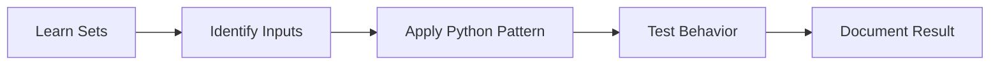

---

# Dictionaries

> **Level:** Level 1: Beginner | **Domain:** containers and sequence processing

## Overview
- **What is it?** Dictionaries is the Python discipline focused on containers and sequence processing.
- **Why is it important?** It turns isolated syntax knowledge into reliable capability for containers and sequence processing.
- **Where is it used?** records, API payloads, dashboards, configuration, search, recommendations, and reporting.

## Learning Objectives
- Explain the purpose and vocabulary of **Dictionaries**.
- Apply the core Python patterns used in containers and sequence processing.
- Recognize trade-offs, failure modes, and safe defaults.
- **Expected outcome:** create a small, reviewable Python example that demonstrates dictionaries in context.

## Real World Applications
- **Industry use cases:** Records, api payloads, dashboards, configuration, search, recommendations, and reporting.
- **Business applications:** reduce manual work, improve reliability, and make containers and sequence processing easier to maintain.
- **Career relevance:** strengthens portfolio projects, interview explanations, team collaboration, and production readiness.

## Core Concepts

| Concept | Definition | Visual Explanation | Practical Example |
| --- | --- | --- | --- |
| **Sequence** | An ordered container accessed by position. | `index -> element` | `names[0]` |
| **Mapping** | A key-value structure for labeled data. | `key -> value` | `profile["email"]` |
| **Mutability** | Whether a container can change after creation. | `list changes \| tuple stays fixed` | `items.append('new')` |

## Infographic Summary

| Block | Learning Block |
| --- | --- |
| 📌 Concept | **Dictionaries** belongs to the containers and sequence processing layer of Python mastery. |
| ⚡ Purpose | Make Python programs clearer, safer, and more useful for containers and sequence processing. |
| 🔥 Benefits | Better readability, fewer bugs, stronger automation, and easier team handoff. |
| 🎯 Use Cases | Practice projects, production scripts, backend systems, analytics workflows, and dictionaries exercises. |
| 🚀 Best Practices | Start small, name things clearly, handle errors intentionally, test behavior, and document assumptions. |
| ❌ Common Mistakes | Memorizing syntax without context, skipping edge cases, overengineering early, and ignoring runtime feedback. |

## Syntax Guide

### Basic Syntax

```python
skills = ["syntax", "functions", "testing"]
profile = {"name": "Ada", "level": "beginner"}
```

### Standard Structure

```python
for skill in skills:
    print(skill.upper())

level = profile.get("level", "unknown")
```

### Code Pattern

```text
choose container -> add/read/update values -> iterate or transform
```

## Examples

### Beginner Example

```python
skills = ['strings', 'lists', 'dictionaries']
print(skills[0])
```

### Intermediate Example

```python
inventory = {'laptop': 4, 'monitor': 0, 'keyboard': 12}
available = {item: qty for item, qty in inventory.items() if qty > 0}
print(available)
```

### Advanced Example

```python
from dataclasses import dataclass


@dataclass(frozen=True)
class LearningTopic:
    name: str
    level: str
    evidence: tuple[str, ...]

    def is_ready_for_project(self) -> bool:
        return len(self.evidence) >= 3


topic = LearningTopic("Dictionaries", "collections", ("notes", "code", "review"))
print(topic.is_ready_for_project())
```

## Workflow Diagram

```mermaid
flowchart LR
    A[Learn Dictionaries] --> B[Identify Inputs]
    B --> C[Apply Python Pattern]
    C --> D[Test Behavior]
    D --> E[Document Result]
```

---

# Functions

> **Level:** Level 1: Beginner | **Domain:** reusable behavior and program organization

## Overview
- **What is it?** Functions is the Python discipline focused on reusable behavior and program organization.
- **Why is it important?** It turns isolated syntax knowledge into reliable capability for reusable behavior and program organization.
- **Where is it used?** libraries, scripts, APIs, notebooks, automation jobs, and reusable business logic.

## Learning Objectives
- Explain the purpose and vocabulary of **Functions**.
- Apply the core Python patterns used in reusable behavior and program organization.
- Recognize trade-offs, failure modes, and safe defaults.
- **Expected outcome:** create a small, reviewable Python example that demonstrates functions in context.

## Real World Applications
- **Industry use cases:** Libraries, scripts, apis, notebooks, automation jobs, and reusable business logic.
- **Business applications:** reduce manual work, improve reliability, and make reusable behavior and program organization easier to maintain.
- **Career relevance:** strengthens portfolio projects, interview explanations, team collaboration, and production readiness.

## Core Concepts

| Concept | Definition | Visual Explanation | Practical Example |
| --- | --- | --- | --- |
| **Parameter** | A named input accepted by a function. | `caller value -> parameter` | `def greet(name): ...` |
| **Return Value** | The result sent back to the caller. | `function -> result` | `return total` |
| **Scope** | The region where a name is available. | `local name \| global name` | `count = len(items)` |

## Infographic Summary

| Block | Learning Block |
| --- | --- |
| 📌 Concept | **Functions** belongs to the reusable behavior and program organization layer of Python mastery. |
| ⚡ Purpose | Make Python programs clearer, safer, and more useful for reusable behavior and program organization. |
| 🔥 Benefits | Better readability, fewer bugs, stronger automation, and easier team handoff. |
| 🎯 Use Cases | Practice projects, production scripts, backend systems, analytics workflows, and functions exercises. |
| 🚀 Best Practices | Start small, name things clearly, handle errors intentionally, test behavior, and document assumptions. |
| ❌ Common Mistakes | Memorizing syntax without context, skipping edge cases, overengineering early, and ignoring runtime feedback. |

## Syntax Guide

### Basic Syntax

```python
def calculate_total(price, quantity):
    return price * quantity
```

### Standard Structure

```python
def summarize(name, *skills, active=True, **metadata):
    return {"name": name, "skills": skills, "active": active, **metadata}
```

### Code Pattern

```text
define inputs -> isolate behavior -> return output -> reuse from callers
```

## Examples

### Beginner Example

```python
def greet(name):
    return f'Hello, {name}!'

print(greet('Ada'))
```

### Intermediate Example

```python
def average(*scores):
    if not scores:
        return 0
    return sum(scores) / len(scores)

print(average(80, 90, 100))
```

### Advanced Example

```python
from dataclasses import dataclass


@dataclass(frozen=True)
class LearningTopic:
    name: str
    level: str
    evidence: tuple[str, ...]

    def is_ready_for_project(self) -> bool:
        return len(self.evidence) >= 3


topic = LearningTopic("Functions", "functions", ("notes", "code", "review"))
print(topic.is_ready_for_project())
```

## Workflow Diagram

```mermaid
flowchart LR
    A[Learn Functions] --> B[Identify Inputs]
    B --> C[Apply Python Pattern]
    C --> D[Test Behavior]
    D --> E[Document Result]
```

---

# Arguments and Parameters

> **Level:** Level 1: Beginner | **Domain:** reusable behavior and program organization

## Overview
- **What is it?** Arguments and Parameters is the Python discipline focused on reusable behavior and program organization.
- **Why is it important?** It turns isolated syntax knowledge into reliable capability for reusable behavior and program organization.
- **Where is it used?** libraries, scripts, APIs, notebooks, automation jobs, and reusable business logic.

## Learning Objectives
- Explain the purpose and vocabulary of **Arguments and Parameters**.
- Apply the core Python patterns used in reusable behavior and program organization.
- Recognize trade-offs, failure modes, and safe defaults.
- **Expected outcome:** create a small, reviewable Python example that demonstrates arguments and parameters in context.

## Real World Applications
- **Industry use cases:** Libraries, scripts, apis, notebooks, automation jobs, and reusable business logic.
- **Business applications:** reduce manual work, improve reliability, and make reusable behavior and program organization easier to maintain.
- **Career relevance:** strengthens portfolio projects, interview explanations, team collaboration, and production readiness.

## Core Concepts

| Concept | Definition | Visual Explanation | Practical Example |
| --- | --- | --- | --- |
| **Parameter** | A named input accepted by a function. | `caller value -> parameter` | `def greet(name): ...` |
| **Return Value** | The result sent back to the caller. | `function -> result` | `return total` |
| **Scope** | The region where a name is available. | `local name \| global name` | `count = len(items)` |

## Infographic Summary

| Block | Learning Block |
| --- | --- |
| 📌 Concept | **Arguments and Parameters** belongs to the reusable behavior and program organization layer of Python mastery. |
| ⚡ Purpose | Make Python programs clearer, safer, and more useful for reusable behavior and program organization. |
| 🔥 Benefits | Better readability, fewer bugs, stronger automation, and easier team handoff. |
| 🎯 Use Cases | Practice projects, production scripts, backend systems, analytics workflows, and arguments and parameters exercises. |
| 🚀 Best Practices | Start small, name things clearly, handle errors intentionally, test behavior, and document assumptions. |
| ❌ Common Mistakes | Memorizing syntax without context, skipping edge cases, overengineering early, and ignoring runtime feedback. |

## Syntax Guide

### Basic Syntax

```python
def calculate_total(price, quantity):
    return price * quantity
```

### Standard Structure

```python
def summarize(name, *skills, active=True, **metadata):
    return {"name": name, "skills": skills, "active": active, **metadata}
```

### Code Pattern

```text
define inputs -> isolate behavior -> return output -> reuse from callers
```

## Examples

### Beginner Example

```python
def greet(name):
    return f'Hello, {name}!'

print(greet('Ada'))
```

### Intermediate Example

```python
def average(*scores):
    if not scores:
        return 0
    return sum(scores) / len(scores)

print(average(80, 90, 100))
```

### Advanced Example

```python
from dataclasses import dataclass


@dataclass(frozen=True)
class LearningTopic:
    name: str
    level: str
    evidence: tuple[str, ...]

    def is_ready_for_project(self) -> bool:
        return len(self.evidence) >= 3


topic = LearningTopic("Arguments and Parameters", "functions", ("notes", "code", "review"))
print(topic.is_ready_for_project())
```

## Workflow Diagram

```mermaid
flowchart LR
    A[Learn Arguments and Parameters] --> B[Identify Inputs]
    B --> C[Apply Python Pattern]
    C --> D[Test Behavior]
    D --> E[Document Result]
```

---

# Return Statements

> **Level:** Level 1: Beginner | **Domain:** reusable behavior and program organization

## Overview
- **What is it?** Return Statements is the Python discipline focused on reusable behavior and program organization.
- **Why is it important?** It turns isolated syntax knowledge into reliable capability for reusable behavior and program organization.
- **Where is it used?** libraries, scripts, APIs, notebooks, automation jobs, and reusable business logic.

## Learning Objectives
- Explain the purpose and vocabulary of **Return Statements**.
- Apply the core Python patterns used in reusable behavior and program organization.
- Recognize trade-offs, failure modes, and safe defaults.
- **Expected outcome:** create a small, reviewable Python example that demonstrates return statements in context.

## Real World Applications
- **Industry use cases:** Libraries, scripts, apis, notebooks, automation jobs, and reusable business logic.
- **Business applications:** reduce manual work, improve reliability, and make reusable behavior and program organization easier to maintain.
- **Career relevance:** strengthens portfolio projects, interview explanations, team collaboration, and production readiness.

## Core Concepts

| Concept | Definition | Visual Explanation | Practical Example |
| --- | --- | --- | --- |
| **Parameter** | A named input accepted by a function. | `caller value -> parameter` | `def greet(name): ...` |
| **Return Value** | The result sent back to the caller. | `function -> result` | `return total` |
| **Scope** | The region where a name is available. | `local name \| global name` | `count = len(items)` |

## Infographic Summary

| Block | Learning Block |
| --- | --- |
| 📌 Concept | **Return Statements** belongs to the reusable behavior and program organization layer of Python mastery. |
| ⚡ Purpose | Make Python programs clearer, safer, and more useful for reusable behavior and program organization. |
| 🔥 Benefits | Better readability, fewer bugs, stronger automation, and easier team handoff. |
| 🎯 Use Cases | Practice projects, production scripts, backend systems, analytics workflows, and return statements exercises. |
| 🚀 Best Practices | Start small, name things clearly, handle errors intentionally, test behavior, and document assumptions. |
| ❌ Common Mistakes | Memorizing syntax without context, skipping edge cases, overengineering early, and ignoring runtime feedback. |

## Syntax Guide

### Basic Syntax

```python
def calculate_total(price, quantity):
    return price * quantity
```

### Standard Structure

```python
def summarize(name, *skills, active=True, **metadata):
    return {"name": name, "skills": skills, "active": active, **metadata}
```

### Code Pattern

```text
define inputs -> isolate behavior -> return output -> reuse from callers
```

## Examples

### Beginner Example

```python
def greet(name):
    return f'Hello, {name}!'

print(greet('Ada'))
```

### Intermediate Example

```python
def average(*scores):
    if not scores:
        return 0
    return sum(scores) / len(scores)

print(average(80, 90, 100))
```

### Advanced Example

```python
from dataclasses import dataclass


@dataclass(frozen=True)
class LearningTopic:
    name: str
    level: str
    evidence: tuple[str, ...]

    def is_ready_for_project(self) -> bool:
        return len(self.evidence) >= 3


topic = LearningTopic("Return Statements", "functions", ("notes", "code", "review"))
print(topic.is_ready_for_project())
```

## Workflow Diagram

```mermaid
flowchart LR
    A[Learn Return Statements] --> B[Identify Inputs]
    B --> C[Apply Python Pattern]
    C --> D[Test Behavior]
    D --> E[Document Result]
```

---

# Scope

> **Level:** Level 1: Beginner | **Domain:** reusable behavior and program organization

## Overview
- **What is it?** Scope is the Python discipline focused on reusable behavior and program organization.
- **Why is it important?** It turns isolated syntax knowledge into reliable capability for reusable behavior and program organization.
- **Where is it used?** libraries, scripts, APIs, notebooks, automation jobs, and reusable business logic.

## Learning Objectives
- Explain the purpose and vocabulary of **Scope**.
- Apply the core Python patterns used in reusable behavior and program organization.
- Recognize trade-offs, failure modes, and safe defaults.
- **Expected outcome:** create a small, reviewable Python example that demonstrates scope in context.

## Real World Applications
- **Industry use cases:** Libraries, scripts, apis, notebooks, automation jobs, and reusable business logic.
- **Business applications:** reduce manual work, improve reliability, and make reusable behavior and program organization easier to maintain.
- **Career relevance:** strengthens portfolio projects, interview explanations, team collaboration, and production readiness.

## Core Concepts

| Concept | Definition | Visual Explanation | Practical Example |
| --- | --- | --- | --- |
| **Parameter** | A named input accepted by a function. | `caller value -> parameter` | `def greet(name): ...` |
| **Return Value** | The result sent back to the caller. | `function -> result` | `return total` |
| **Scope** | The region where a name is available. | `local name \| global name` | `count = len(items)` |

## Infographic Summary

| Block | Learning Block |
| --- | --- |
| 📌 Concept | **Scope** belongs to the reusable behavior and program organization layer of Python mastery. |
| ⚡ Purpose | Make Python programs clearer, safer, and more useful for reusable behavior and program organization. |
| 🔥 Benefits | Better readability, fewer bugs, stronger automation, and easier team handoff. |
| 🎯 Use Cases | Practice projects, production scripts, backend systems, analytics workflows, and scope exercises. |
| 🚀 Best Practices | Start small, name things clearly, handle errors intentionally, test behavior, and document assumptions. |
| ❌ Common Mistakes | Memorizing syntax without context, skipping edge cases, overengineering early, and ignoring runtime feedback. |

## Syntax Guide

### Basic Syntax

```python
def calculate_total(price, quantity):
    return price * quantity
```

### Standard Structure

```python
def summarize(name, *skills, active=True, **metadata):
    return {"name": name, "skills": skills, "active": active, **metadata}
```

### Code Pattern

```text
define inputs -> isolate behavior -> return output -> reuse from callers
```

## Examples

### Beginner Example

```python
def greet(name):
    return f'Hello, {name}!'

print(greet('Ada'))
```

### Intermediate Example

```python
def average(*scores):
    if not scores:
        return 0
    return sum(scores) / len(scores)

print(average(80, 90, 100))
```

### Advanced Example

```python
from dataclasses import dataclass


@dataclass(frozen=True)
class LearningTopic:
    name: str
    level: str
    evidence: tuple[str, ...]

    def is_ready_for_project(self) -> bool:
        return len(self.evidence) >= 3


topic = LearningTopic("Scope", "functions", ("notes", "code", "review"))
print(topic.is_ready_for_project())
```

## Workflow Diagram

```mermaid
flowchart LR
    A[Learn Scope] --> B[Identify Inputs]
    B --> C[Apply Python Pattern]
    C --> D[Test Behavior]
    D --> E[Document Result]
```

---

# Lambda Functions

> **Level:** Level 1: Beginner | **Domain:** reusable behavior and program organization

## Overview
- **What is it?** Lambda Functions is the Python discipline focused on reusable behavior and program organization.
- **Why is it important?** It turns isolated syntax knowledge into reliable capability for reusable behavior and program organization.
- **Where is it used?** libraries, scripts, APIs, notebooks, automation jobs, and reusable business logic.

## Learning Objectives
- Explain the purpose and vocabulary of **Lambda Functions**.
- Apply the core Python patterns used in reusable behavior and program organization.
- Recognize trade-offs, failure modes, and safe defaults.
- **Expected outcome:** create a small, reviewable Python example that demonstrates lambda functions in context.

## Real World Applications
- **Industry use cases:** Libraries, scripts, apis, notebooks, automation jobs, and reusable business logic.
- **Business applications:** reduce manual work, improve reliability, and make reusable behavior and program organization easier to maintain.
- **Career relevance:** strengthens portfolio projects, interview explanations, team collaboration, and production readiness.

## Core Concepts

| Concept | Definition | Visual Explanation | Practical Example |
| --- | --- | --- | --- |
| **Parameter** | A named input accepted by a function. | `caller value -> parameter` | `def greet(name): ...` |
| **Return Value** | The result sent back to the caller. | `function -> result` | `return total` |
| **Scope** | The region where a name is available. | `local name \| global name` | `count = len(items)` |

## Infographic Summary

| Block | Learning Block |
| --- | --- |
| 📌 Concept | **Lambda Functions** belongs to the reusable behavior and program organization layer of Python mastery. |
| ⚡ Purpose | Make Python programs clearer, safer, and more useful for reusable behavior and program organization. |
| 🔥 Benefits | Better readability, fewer bugs, stronger automation, and easier team handoff. |
| 🎯 Use Cases | Practice projects, production scripts, backend systems, analytics workflows, and lambda functions exercises. |
| 🚀 Best Practices | Start small, name things clearly, handle errors intentionally, test behavior, and document assumptions. |
| ❌ Common Mistakes | Memorizing syntax without context, skipping edge cases, overengineering early, and ignoring runtime feedback. |

## Syntax Guide

### Basic Syntax

```python
def calculate_total(price, quantity):
    return price * quantity
```

### Standard Structure

```python
def summarize(name, *skills, active=True, **metadata):
    return {"name": name, "skills": skills, "active": active, **metadata}
```

### Code Pattern

```text
define inputs -> isolate behavior -> return output -> reuse from callers
```

## Examples

### Beginner Example

```python
def greet(name):
    return f'Hello, {name}!'

print(greet('Ada'))
```

### Intermediate Example

```python
def average(*scores):
    if not scores:
        return 0
    return sum(scores) / len(scores)

print(average(80, 90, 100))
```

### Advanced Example

```python
from dataclasses import dataclass


@dataclass(frozen=True)
class LearningTopic:
    name: str
    level: str
    evidence: tuple[str, ...]

    def is_ready_for_project(self) -> bool:
        return len(self.evidence) >= 3


topic = LearningTopic("Lambda Functions", "functions", ("notes", "code", "review"))
print(topic.is_ready_for_project())
```

## Workflow Diagram

```mermaid
flowchart LR
    A[Learn Lambda Functions] --> B[Identify Inputs]
    B --> C[Apply Python Pattern]
    C --> D[Test Behavior]
    D --> E[Document Result]
```

---

# Modules

> **Level:** Level 1: Beginner | **Domain:** standard library tools and project hygiene

## Overview
- **What is it?** Modules is the Python discipline focused on standard library tools and project hygiene.
- **Why is it important?** It turns isolated syntax knowledge into reliable capability for standard library tools and project hygiene.
- **Where is it used?** file processing, scheduled jobs, reproducible projects, debugging sessions, and production utilities.

## Learning Objectives
- Explain the purpose and vocabulary of **Modules**.
- Apply the core Python patterns used in standard library tools and project hygiene.
- Recognize trade-offs, failure modes, and safe defaults.
- **Expected outcome:** create a small, reviewable Python example that demonstrates modules in context.

## Real World Applications
- **Industry use cases:** File processing, scheduled jobs, reproducible projects, debugging sessions, and production utilities.
- **Business applications:** reduce manual work, improve reliability, and make standard library tools and project hygiene easier to maintain.
- **Career relevance:** strengthens portfolio projects, interview explanations, team collaboration, and production readiness.

## Core Concepts

| Concept | Definition | Visual Explanation | Practical Example |
| --- | --- | --- | --- |
| **Module** | A Python file or library that exposes reusable names. | `import module -> use function` | `import math` |
| **Boundary** | A safe edge around files, errors, environments, or packages. | `program -> external resource` | `with open(path) as file: ...` |
| **Repeatability** | A project setup that works the same way for every contributor. | `venv + requirements + structure` | `python -m venv .venv` |

## Infographic Summary

| Block | Learning Block |
| --- | --- |
| 📌 Concept | **Modules** belongs to the standard library tools and project hygiene layer of Python mastery. |
| ⚡ Purpose | Make Python programs clearer, safer, and more useful for standard library tools and project hygiene. |
| 🔥 Benefits | Better readability, fewer bugs, stronger automation, and easier team handoff. |
| 🎯 Use Cases | Practice projects, production scripts, backend systems, analytics workflows, and modules exercises. |
| 🚀 Best Practices | Start small, name things clearly, handle errors intentionally, test behavior, and document assumptions. |
| ❌ Common Mistakes | Memorizing syntax without context, skipping edge cases, overengineering early, and ignoring runtime feedback. |

## Syntax Guide

### Basic Syntax

```python
from pathlib import Path

print(Path.cwd())
```

### Standard Structure

```python
from pathlib import Path

path = Path("data.txt")
try:
    content = path.read_text()
except FileNotFoundError:
    content = ""
```

### Code Pattern

```text
import tool -> protect resource boundary -> handle failure -> keep project repeatable
```

## Examples

### Beginner Example

```python
from datetime import date

print(date.today())
```

### Intermediate Example

```python
from pathlib import Path

path = Path('notes.txt')
try:
    print(path.read_text())
except FileNotFoundError:
    print('create notes.txt first')
```

### Advanced Example

```python
from dataclasses import dataclass


@dataclass(frozen=True)
class LearningTopic:
    name: str
    level: str
    evidence: tuple[str, ...]

    def is_ready_for_project(self) -> bool:
        return len(self.evidence) >= 3


topic = LearningTopic("Modules", "tooling", ("notes", "code", "review"))
print(topic.is_ready_for_project())
```

## Workflow Diagram

```mermaid
flowchart LR
    A[Learn Modules] --> B[Identify Inputs]
    B --> C[Apply Python Pattern]
    C --> D[Test Behavior]
    D --> E[Document Result]
```

---

# Packages

> **Level:** Level 1: Beginner | **Domain:** standard library tools and project hygiene

## Overview
- **What is it?** Packages is the Python discipline focused on standard library tools and project hygiene.
- **Why is it important?** It turns isolated syntax knowledge into reliable capability for standard library tools and project hygiene.
- **Where is it used?** file processing, scheduled jobs, reproducible projects, debugging sessions, and production utilities.

## Learning Objectives
- Explain the purpose and vocabulary of **Packages**.
- Apply the core Python patterns used in standard library tools and project hygiene.
- Recognize trade-offs, failure modes, and safe defaults.
- **Expected outcome:** create a small, reviewable Python example that demonstrates packages in context.

## Real World Applications
- **Industry use cases:** File processing, scheduled jobs, reproducible projects, debugging sessions, and production utilities.
- **Business applications:** reduce manual work, improve reliability, and make standard library tools and project hygiene easier to maintain.
- **Career relevance:** strengthens portfolio projects, interview explanations, team collaboration, and production readiness.

## Core Concepts

| Concept | Definition | Visual Explanation | Practical Example |
| --- | --- | --- | --- |
| **Module** | A Python file or library that exposes reusable names. | `import module -> use function` | `import math` |
| **Boundary** | A safe edge around files, errors, environments, or packages. | `program -> external resource` | `with open(path) as file: ...` |
| **Repeatability** | A project setup that works the same way for every contributor. | `venv + requirements + structure` | `python -m venv .venv` |

## Infographic Summary

| Block | Learning Block |
| --- | --- |
| 📌 Concept | **Packages** belongs to the standard library tools and project hygiene layer of Python mastery. |
| ⚡ Purpose | Make Python programs clearer, safer, and more useful for standard library tools and project hygiene. |
| 🔥 Benefits | Better readability, fewer bugs, stronger automation, and easier team handoff. |
| 🎯 Use Cases | Practice projects, production scripts, backend systems, analytics workflows, and packages exercises. |
| 🚀 Best Practices | Start small, name things clearly, handle errors intentionally, test behavior, and document assumptions. |
| ❌ Common Mistakes | Memorizing syntax without context, skipping edge cases, overengineering early, and ignoring runtime feedback. |

## Syntax Guide

### Basic Syntax

```python
from pathlib import Path

print(Path.cwd())
```

### Standard Structure

```python
from pathlib import Path

path = Path("data.txt")
try:
    content = path.read_text()
except FileNotFoundError:
    content = ""
```

### Code Pattern

```text
import tool -> protect resource boundary -> handle failure -> keep project repeatable
```

## Examples

### Beginner Example

```python
from datetime import date

print(date.today())
```

### Intermediate Example

```python
from pathlib import Path

path = Path('notes.txt')
try:
    print(path.read_text())
except FileNotFoundError:
    print('create notes.txt first')
```

### Advanced Example

```python
from dataclasses import dataclass


@dataclass(frozen=True)
class LearningTopic:
    name: str
    level: str
    evidence: tuple[str, ...]

    def is_ready_for_project(self) -> bool:
        return len(self.evidence) >= 3


topic = LearningTopic("Packages", "tooling", ("notes", "code", "review"))
print(topic.is_ready_for_project())
```

## Workflow Diagram

```mermaid
flowchart LR
    A[Learn Packages] --> B[Identify Inputs]
    B --> C[Apply Python Pattern]
    C --> D[Test Behavior]
    D --> E[Document Result]
```

---

# Date and Time

> **Level:** Level 1: Beginner | **Domain:** standard library tools and project hygiene

## Overview
- **What is it?** Date and Time is the Python discipline focused on standard library tools and project hygiene.
- **Why is it important?** It turns isolated syntax knowledge into reliable capability for standard library tools and project hygiene.
- **Where is it used?** file processing, scheduled jobs, reproducible projects, debugging sessions, and production utilities.

## Learning Objectives
- Explain the purpose and vocabulary of **Date and Time**.
- Apply the core Python patterns used in standard library tools and project hygiene.
- Recognize trade-offs, failure modes, and safe defaults.
- **Expected outcome:** create a small, reviewable Python example that demonstrates date and time in context.

## Real World Applications
- **Industry use cases:** File processing, scheduled jobs, reproducible projects, debugging sessions, and production utilities.
- **Business applications:** reduce manual work, improve reliability, and make standard library tools and project hygiene easier to maintain.
- **Career relevance:** strengthens portfolio projects, interview explanations, team collaboration, and production readiness.

## Core Concepts

| Concept | Definition | Visual Explanation | Practical Example |
| --- | --- | --- | --- |
| **Module** | A Python file or library that exposes reusable names. | `import module -> use function` | `import math` |
| **Boundary** | A safe edge around files, errors, environments, or packages. | `program -> external resource` | `with open(path) as file: ...` |
| **Repeatability** | A project setup that works the same way for every contributor. | `venv + requirements + structure` | `python -m venv .venv` |

## Infographic Summary

| Block | Learning Block |
| --- | --- |
| 📌 Concept | **Date and Time** belongs to the standard library tools and project hygiene layer of Python mastery. |
| ⚡ Purpose | Make Python programs clearer, safer, and more useful for standard library tools and project hygiene. |
| 🔥 Benefits | Better readability, fewer bugs, stronger automation, and easier team handoff. |
| 🎯 Use Cases | Practice projects, production scripts, backend systems, analytics workflows, and date and time exercises. |
| 🚀 Best Practices | Start small, name things clearly, handle errors intentionally, test behavior, and document assumptions. |
| ❌ Common Mistakes | Memorizing syntax without context, skipping edge cases, overengineering early, and ignoring runtime feedback. |

## Syntax Guide

### Basic Syntax

```python
from pathlib import Path

print(Path.cwd())
```

### Standard Structure

```python
from pathlib import Path

path = Path("data.txt")
try:
    content = path.read_text()
except FileNotFoundError:
    content = ""
```

### Code Pattern

```text
import tool -> protect resource boundary -> handle failure -> keep project repeatable
```

## Examples

### Beginner Example

```python
from datetime import date

print(date.today())
```

### Intermediate Example

```python
from pathlib import Path

path = Path('notes.txt')
try:
    print(path.read_text())
except FileNotFoundError:
    print('create notes.txt first')
```

### Advanced Example

```python
from dataclasses import dataclass


@dataclass(frozen=True)
class LearningTopic:
    name: str
    level: str
    evidence: tuple[str, ...]

    def is_ready_for_project(self) -> bool:
        return len(self.evidence) >= 3


topic = LearningTopic("Date and Time", "tooling", ("notes", "code", "review"))
print(topic.is_ready_for_project())
```

## Workflow Diagram

```mermaid
flowchart LR
    A[Learn Date and Time] --> B[Identify Inputs]
    B --> C[Apply Python Pattern]
    C --> D[Test Behavior]
    D --> E[Document Result]
```

---

# Math Module

> **Level:** Level 1: Beginner | **Domain:** standard library tools and project hygiene

## Overview
- **What is it?** Math Module is the Python discipline focused on standard library tools and project hygiene.
- **Why is it important?** It turns isolated syntax knowledge into reliable capability for standard library tools and project hygiene.
- **Where is it used?** file processing, scheduled jobs, reproducible projects, debugging sessions, and production utilities.

## Learning Objectives
- Explain the purpose and vocabulary of **Math Module**.
- Apply the core Python patterns used in standard library tools and project hygiene.
- Recognize trade-offs, failure modes, and safe defaults.
- **Expected outcome:** create a small, reviewable Python example that demonstrates math module in context.

## Real World Applications
- **Industry use cases:** File processing, scheduled jobs, reproducible projects, debugging sessions, and production utilities.
- **Business applications:** reduce manual work, improve reliability, and make standard library tools and project hygiene easier to maintain.
- **Career relevance:** strengthens portfolio projects, interview explanations, team collaboration, and production readiness.

## Core Concepts

| Concept | Definition | Visual Explanation | Practical Example |
| --- | --- | --- | --- |
| **Module** | A Python file or library that exposes reusable names. | `import module -> use function` | `import math` |
| **Boundary** | A safe edge around files, errors, environments, or packages. | `program -> external resource` | `with open(path) as file: ...` |
| **Repeatability** | A project setup that works the same way for every contributor. | `venv + requirements + structure` | `python -m venv .venv` |

## Infographic Summary

| Block | Learning Block |
| --- | --- |
| 📌 Concept | **Math Module** belongs to the standard library tools and project hygiene layer of Python mastery. |
| ⚡ Purpose | Make Python programs clearer, safer, and more useful for standard library tools and project hygiene. |
| 🔥 Benefits | Better readability, fewer bugs, stronger automation, and easier team handoff. |
| 🎯 Use Cases | Practice projects, production scripts, backend systems, analytics workflows, and math module exercises. |
| 🚀 Best Practices | Start small, name things clearly, handle errors intentionally, test behavior, and document assumptions. |
| ❌ Common Mistakes | Memorizing syntax without context, skipping edge cases, overengineering early, and ignoring runtime feedback. |

## Syntax Guide

### Basic Syntax

```python
from pathlib import Path

print(Path.cwd())
```

### Standard Structure

```python
from pathlib import Path

path = Path("data.txt")
try:
    content = path.read_text()
except FileNotFoundError:
    content = ""
```

### Code Pattern

```text
import tool -> protect resource boundary -> handle failure -> keep project repeatable
```

## Examples

### Beginner Example

```python
from datetime import date

print(date.today())
```

### Intermediate Example

```python
from pathlib import Path

path = Path('notes.txt')
try:
    print(path.read_text())
except FileNotFoundError:
    print('create notes.txt first')
```

### Advanced Example

```python
from dataclasses import dataclass


@dataclass(frozen=True)
class LearningTopic:
    name: str
    level: str
    evidence: tuple[str, ...]

    def is_ready_for_project(self) -> bool:
        return len(self.evidence) >= 3


topic = LearningTopic("Math Module", "tooling", ("notes", "code", "review"))
print(topic.is_ready_for_project())
```

## Workflow Diagram

```mermaid
flowchart LR
    A[Learn Math Module] --> B[Identify Inputs]
    B --> C[Apply Python Pattern]
    C --> D[Test Behavior]
    D --> E[Document Result]
```

---

# Random Module

> **Level:** Level 1: Beginner | **Domain:** standard library tools and project hygiene

## Overview
- **What is it?** Random Module is the Python discipline focused on standard library tools and project hygiene.
- **Why is it important?** It turns isolated syntax knowledge into reliable capability for standard library tools and project hygiene.
- **Where is it used?** file processing, scheduled jobs, reproducible projects, debugging sessions, and production utilities.

## Learning Objectives
- Explain the purpose and vocabulary of **Random Module**.
- Apply the core Python patterns used in standard library tools and project hygiene.
- Recognize trade-offs, failure modes, and safe defaults.
- **Expected outcome:** create a small, reviewable Python example that demonstrates random module in context.

## Real World Applications
- **Industry use cases:** File processing, scheduled jobs, reproducible projects, debugging sessions, and production utilities.
- **Business applications:** reduce manual work, improve reliability, and make standard library tools and project hygiene easier to maintain.
- **Career relevance:** strengthens portfolio projects, interview explanations, team collaboration, and production readiness.

## Core Concepts

| Concept | Definition | Visual Explanation | Practical Example |
| --- | --- | --- | --- |
| **Module** | A Python file or library that exposes reusable names. | `import module -> use function` | `import math` |
| **Boundary** | A safe edge around files, errors, environments, or packages. | `program -> external resource` | `with open(path) as file: ...` |
| **Repeatability** | A project setup that works the same way for every contributor. | `venv + requirements + structure` | `python -m venv .venv` |

## Infographic Summary

| Block | Learning Block |
| --- | --- |
| 📌 Concept | **Random Module** belongs to the standard library tools and project hygiene layer of Python mastery. |
| ⚡ Purpose | Make Python programs clearer, safer, and more useful for standard library tools and project hygiene. |
| 🔥 Benefits | Better readability, fewer bugs, stronger automation, and easier team handoff. |
| 🎯 Use Cases | Practice projects, production scripts, backend systems, analytics workflows, and random module exercises. |
| 🚀 Best Practices | Start small, name things clearly, handle errors intentionally, test behavior, and document assumptions. |
| ❌ Common Mistakes | Memorizing syntax without context, skipping edge cases, overengineering early, and ignoring runtime feedback. |

## Syntax Guide

### Basic Syntax

```python
from pathlib import Path

print(Path.cwd())
```

### Standard Structure

```python
from pathlib import Path

path = Path("data.txt")
try:
    content = path.read_text()
except FileNotFoundError:
    content = ""
```

### Code Pattern

```text
import tool -> protect resource boundary -> handle failure -> keep project repeatable
```

## Examples

### Beginner Example

```python
from datetime import date

print(date.today())
```

### Intermediate Example

```python
from pathlib import Path

path = Path('notes.txt')
try:
    print(path.read_text())
except FileNotFoundError:
    print('create notes.txt first')
```

### Advanced Example

```python
from dataclasses import dataclass


@dataclass(frozen=True)
class LearningTopic:
    name: str
    level: str
    evidence: tuple[str, ...]

    def is_ready_for_project(self) -> bool:
        return len(self.evidence) >= 3


topic = LearningTopic("Random Module", "tooling", ("notes", "code", "review"))
print(topic.is_ready_for_project())
```

## Workflow Diagram

```mermaid
flowchart LR
    A[Learn Random Module] --> B[Identify Inputs]
    B --> C[Apply Python Pattern]
    C --> D[Test Behavior]
    D --> E[Document Result]
```

---

# File Handling

> **Level:** Level 1: Beginner | **Domain:** standard library tools and project hygiene

## Overview
- **What is it?** File Handling is the Python discipline focused on standard library tools and project hygiene.
- **Why is it important?** It turns isolated syntax knowledge into reliable capability for standard library tools and project hygiene.
- **Where is it used?** file processing, scheduled jobs, reproducible projects, debugging sessions, and production utilities.

## Learning Objectives
- Explain the purpose and vocabulary of **File Handling**.
- Apply the core Python patterns used in standard library tools and project hygiene.
- Recognize trade-offs, failure modes, and safe defaults.
- **Expected outcome:** create a small, reviewable Python example that demonstrates file handling in context.

## Real World Applications
- **Industry use cases:** File processing, scheduled jobs, reproducible projects, debugging sessions, and production utilities.
- **Business applications:** reduce manual work, improve reliability, and make standard library tools and project hygiene easier to maintain.
- **Career relevance:** strengthens portfolio projects, interview explanations, team collaboration, and production readiness.

## Core Concepts

| Concept | Definition | Visual Explanation | Practical Example |
| --- | --- | --- | --- |
| **Module** | A Python file or library that exposes reusable names. | `import module -> use function` | `import math` |
| **Boundary** | A safe edge around files, errors, environments, or packages. | `program -> external resource` | `with open(path) as file: ...` |
| **Repeatability** | A project setup that works the same way for every contributor. | `venv + requirements + structure` | `python -m venv .venv` |

## Infographic Summary

| Block | Learning Block |
| --- | --- |
| 📌 Concept | **File Handling** belongs to the standard library tools and project hygiene layer of Python mastery. |
| ⚡ Purpose | Make Python programs clearer, safer, and more useful for standard library tools and project hygiene. |
| 🔥 Benefits | Better readability, fewer bugs, stronger automation, and easier team handoff. |
| 🎯 Use Cases | Practice projects, production scripts, backend systems, analytics workflows, and file handling exercises. |
| 🚀 Best Practices | Start small, name things clearly, handle errors intentionally, test behavior, and document assumptions. |
| ❌ Common Mistakes | Memorizing syntax without context, skipping edge cases, overengineering early, and ignoring runtime feedback. |

## Syntax Guide

### Basic Syntax

```python
from pathlib import Path

print(Path.cwd())
```

### Standard Structure

```python
from pathlib import Path

path = Path("data.txt")
try:
    content = path.read_text()
except FileNotFoundError:
    content = ""
```

### Code Pattern

```text
import tool -> protect resource boundary -> handle failure -> keep project repeatable
```

## Examples

### Beginner Example

```python
from datetime import date

print(date.today())
```

### Intermediate Example

```python
from pathlib import Path

path = Path('notes.txt')
try:
    print(path.read_text())
except FileNotFoundError:
    print('create notes.txt first')
```

### Advanced Example

```python
from dataclasses import dataclass


@dataclass(frozen=True)
class LearningTopic:
    name: str
    level: str
    evidence: tuple[str, ...]

    def is_ready_for_project(self) -> bool:
        return len(self.evidence) >= 3


topic = LearningTopic("File Handling", "tooling", ("notes", "code", "review"))
print(topic.is_ready_for_project())
```

## Workflow Diagram

```mermaid
flowchart LR
    A[Learn File Handling] --> B[Identify Inputs]
    B --> C[Apply Python Pattern]
    C --> D[Test Behavior]
    D --> E[Document Result]
```

---

# Exception Handling

> **Level:** Level 1: Beginner | **Domain:** standard library tools and project hygiene

## Overview
- **What is it?** Exception Handling is the Python discipline focused on standard library tools and project hygiene.
- **Why is it important?** It turns isolated syntax knowledge into reliable capability for standard library tools and project hygiene.
- **Where is it used?** file processing, scheduled jobs, reproducible projects, debugging sessions, and production utilities.

## Learning Objectives
- Explain the purpose and vocabulary of **Exception Handling**.
- Apply the core Python patterns used in standard library tools and project hygiene.
- Recognize trade-offs, failure modes, and safe defaults.
- **Expected outcome:** create a small, reviewable Python example that demonstrates exception handling in context.

## Real World Applications
- **Industry use cases:** File processing, scheduled jobs, reproducible projects, debugging sessions, and production utilities.
- **Business applications:** reduce manual work, improve reliability, and make standard library tools and project hygiene easier to maintain.
- **Career relevance:** strengthens portfolio projects, interview explanations, team collaboration, and production readiness.

## Core Concepts

| Concept | Definition | Visual Explanation | Practical Example |
| --- | --- | --- | --- |
| **Module** | A Python file or library that exposes reusable names. | `import module -> use function` | `import math` |
| **Boundary** | A safe edge around files, errors, environments, or packages. | `program -> external resource` | `with open(path) as file: ...` |
| **Repeatability** | A project setup that works the same way for every contributor. | `venv + requirements + structure` | `python -m venv .venv` |

## Infographic Summary

| Block | Learning Block |
| --- | --- |
| 📌 Concept | **Exception Handling** belongs to the standard library tools and project hygiene layer of Python mastery. |
| ⚡ Purpose | Make Python programs clearer, safer, and more useful for standard library tools and project hygiene. |
| 🔥 Benefits | Better readability, fewer bugs, stronger automation, and easier team handoff. |
| 🎯 Use Cases | Practice projects, production scripts, backend systems, analytics workflows, and exception handling exercises. |
| 🚀 Best Practices | Start small, name things clearly, handle errors intentionally, test behavior, and document assumptions. |
| ❌ Common Mistakes | Memorizing syntax without context, skipping edge cases, overengineering early, and ignoring runtime feedback. |

## Syntax Guide

### Basic Syntax

```python
from pathlib import Path

print(Path.cwd())
```

### Standard Structure

```python
from pathlib import Path

path = Path("data.txt")
try:
    content = path.read_text()
except FileNotFoundError:
    content = ""
```

### Code Pattern

```text
import tool -> protect resource boundary -> handle failure -> keep project repeatable
```

## Examples

### Beginner Example

```python
from datetime import date

print(date.today())
```

### Intermediate Example

```python
from pathlib import Path

path = Path('notes.txt')
try:
    print(path.read_text())
except FileNotFoundError:
    print('create notes.txt first')
```

### Advanced Example

```python
from dataclasses import dataclass


@dataclass(frozen=True)
class LearningTopic:
    name: str
    level: str
    evidence: tuple[str, ...]

    def is_ready_for_project(self) -> bool:
        return len(self.evidence) >= 3


topic = LearningTopic("Exception Handling", "tooling", ("notes", "code", "review"))
print(topic.is_ready_for_project())
```

## Workflow Diagram

```mermaid
flowchart LR
    A[Learn Exception Handling] --> B[Identify Inputs]
    B --> C[Apply Python Pattern]
    C --> D[Test Behavior]
    D --> E[Document Result]
```

---

# Debugging Basics

> **Level:** Level 1: Beginner | **Domain:** standard library tools and project hygiene

## Overview
- **What is it?** Debugging Basics is the Python discipline focused on standard library tools and project hygiene.
- **Why is it important?** It turns isolated syntax knowledge into reliable capability for standard library tools and project hygiene.
- **Where is it used?** file processing, scheduled jobs, reproducible projects, debugging sessions, and production utilities.

## Learning Objectives
- Explain the purpose and vocabulary of **Debugging Basics**.
- Apply the core Python patterns used in standard library tools and project hygiene.
- Recognize trade-offs, failure modes, and safe defaults.
- **Expected outcome:** create a small, reviewable Python example that demonstrates debugging basics in context.

## Real World Applications
- **Industry use cases:** File processing, scheduled jobs, reproducible projects, debugging sessions, and production utilities.
- **Business applications:** reduce manual work, improve reliability, and make standard library tools and project hygiene easier to maintain.
- **Career relevance:** strengthens portfolio projects, interview explanations, team collaboration, and production readiness.

## Core Concepts

| Concept | Definition | Visual Explanation | Practical Example |
| --- | --- | --- | --- |
| **Module** | A Python file or library that exposes reusable names. | `import module -> use function` | `import math` |
| **Boundary** | A safe edge around files, errors, environments, or packages. | `program -> external resource` | `with open(path) as file: ...` |
| **Repeatability** | A project setup that works the same way for every contributor. | `venv + requirements + structure` | `python -m venv .venv` |

## Infographic Summary

| Block | Learning Block |
| --- | --- |
| 📌 Concept | **Debugging Basics** belongs to the standard library tools and project hygiene layer of Python mastery. |
| ⚡ Purpose | Make Python programs clearer, safer, and more useful for standard library tools and project hygiene. |
| 🔥 Benefits | Better readability, fewer bugs, stronger automation, and easier team handoff. |
| 🎯 Use Cases | Practice projects, production scripts, backend systems, analytics workflows, and debugging basics exercises. |
| 🚀 Best Practices | Start small, name things clearly, handle errors intentionally, test behavior, and document assumptions. |
| ❌ Common Mistakes | Memorizing syntax without context, skipping edge cases, overengineering early, and ignoring runtime feedback. |

## Syntax Guide

### Basic Syntax

```python
from pathlib import Path

print(Path.cwd())
```

### Standard Structure

```python
from pathlib import Path

path = Path("data.txt")
try:
    content = path.read_text()
except FileNotFoundError:
    content = ""
```

### Code Pattern

```text
import tool -> protect resource boundary -> handle failure -> keep project repeatable
```

## Examples

### Beginner Example

```python
from datetime import date

print(date.today())
```

### Intermediate Example

```python
from pathlib import Path

path = Path('notes.txt')
try:
    print(path.read_text())
except FileNotFoundError:
    print('create notes.txt first')
```

### Advanced Example

```python
from dataclasses import dataclass


@dataclass(frozen=True)
class LearningTopic:
    name: str
    level: str
    evidence: tuple[str, ...]

    def is_ready_for_project(self) -> bool:
        return len(self.evidence) >= 3


topic = LearningTopic("Debugging Basics", "tooling", ("notes", "code", "review"))
print(topic.is_ready_for_project())
```

## Workflow Diagram

```mermaid
flowchart LR
    A[Learn Debugging Basics] --> B[Identify Inputs]
    B --> C[Apply Python Pattern]
    C --> D[Test Behavior]
    D --> E[Document Result]
```

---

# Virtual Environments

> **Level:** Level 1: Beginner | **Domain:** standard library tools and project hygiene

## Overview
- **What is it?** Virtual Environments is the Python discipline focused on standard library tools and project hygiene.
- **Why is it important?** It turns isolated syntax knowledge into reliable capability for standard library tools and project hygiene.
- **Where is it used?** file processing, scheduled jobs, reproducible projects, debugging sessions, and production utilities.

## Learning Objectives
- Explain the purpose and vocabulary of **Virtual Environments**.
- Apply the core Python patterns used in standard library tools and project hygiene.
- Recognize trade-offs, failure modes, and safe defaults.
- **Expected outcome:** create a small, reviewable Python example that demonstrates virtual environments in context.

## Real World Applications
- **Industry use cases:** File processing, scheduled jobs, reproducible projects, debugging sessions, and production utilities.
- **Business applications:** reduce manual work, improve reliability, and make standard library tools and project hygiene easier to maintain.
- **Career relevance:** strengthens portfolio projects, interview explanations, team collaboration, and production readiness.

## Core Concepts

| Concept | Definition | Visual Explanation | Practical Example |
| --- | --- | --- | --- |
| **Module** | A Python file or library that exposes reusable names. | `import module -> use function` | `import math` |
| **Boundary** | A safe edge around files, errors, environments, or packages. | `program -> external resource` | `with open(path) as file: ...` |
| **Repeatability** | A project setup that works the same way for every contributor. | `venv + requirements + structure` | `python -m venv .venv` |

## Infographic Summary

| Block | Learning Block |
| --- | --- |
| 📌 Concept | **Virtual Environments** belongs to the standard library tools and project hygiene layer of Python mastery. |
| ⚡ Purpose | Make Python programs clearer, safer, and more useful for standard library tools and project hygiene. |
| 🔥 Benefits | Better readability, fewer bugs, stronger automation, and easier team handoff. |
| 🎯 Use Cases | Practice projects, production scripts, backend systems, analytics workflows, and virtual environments exercises. |
| 🚀 Best Practices | Start small, name things clearly, handle errors intentionally, test behavior, and document assumptions. |
| ❌ Common Mistakes | Memorizing syntax without context, skipping edge cases, overengineering early, and ignoring runtime feedback. |

## Syntax Guide

### Basic Syntax

```python
from pathlib import Path

print(Path.cwd())
```

### Standard Structure

```python
from pathlib import Path

path = Path("data.txt")
try:
    content = path.read_text()
except FileNotFoundError:
    content = ""
```

### Code Pattern

```text
import tool -> protect resource boundary -> handle failure -> keep project repeatable
```

## Examples

### Beginner Example

```python
from datetime import date

print(date.today())
```

### Intermediate Example

```python
from pathlib import Path

path = Path('notes.txt')
try:
    print(path.read_text())
except FileNotFoundError:
    print('create notes.txt first')
```

### Advanced Example

```python
from dataclasses import dataclass


@dataclass(frozen=True)
class LearningTopic:
    name: str
    level: str
    evidence: tuple[str, ...]

    def is_ready_for_project(self) -> bool:
        return len(self.evidence) >= 3


topic = LearningTopic("Virtual Environments", "tooling", ("notes", "code", "review"))
print(topic.is_ready_for_project())
```

## Workflow Diagram

```mermaid
flowchart LR
    A[Learn Virtual Environments] --> B[Identify Inputs]
    B --> C[Apply Python Pattern]
    C --> D[Test Behavior]
    D --> E[Document Result]
```

---

# Basic Project Structure

> **Level:** Level 1: Beginner | **Domain:** standard library tools and project hygiene

## Overview
- **What is it?** Basic Project Structure is the Python discipline focused on standard library tools and project hygiene.
- **Why is it important?** It turns isolated syntax knowledge into reliable capability for standard library tools and project hygiene.
- **Where is it used?** file processing, scheduled jobs, reproducible projects, debugging sessions, and production utilities.

## Learning Objectives
- Explain the purpose and vocabulary of **Basic Project Structure**.
- Apply the core Python patterns used in standard library tools and project hygiene.
- Recognize trade-offs, failure modes, and safe defaults.
- **Expected outcome:** create a small, reviewable Python example that demonstrates basic project structure in context.

## Real World Applications
- **Industry use cases:** File processing, scheduled jobs, reproducible projects, debugging sessions, and production utilities.
- **Business applications:** reduce manual work, improve reliability, and make standard library tools and project hygiene easier to maintain.
- **Career relevance:** strengthens portfolio projects, interview explanations, team collaboration, and production readiness.

## Core Concepts

| Concept | Definition | Visual Explanation | Practical Example |
| --- | --- | --- | --- |
| **Module** | A Python file or library that exposes reusable names. | `import module -> use function` | `import math` |
| **Boundary** | A safe edge around files, errors, environments, or packages. | `program -> external resource` | `with open(path) as file: ...` |
| **Repeatability** | A project setup that works the same way for every contributor. | `venv + requirements + structure` | `python -m venv .venv` |

## Infographic Summary

| Block | Learning Block |
| --- | --- |
| 📌 Concept | **Basic Project Structure** belongs to the standard library tools and project hygiene layer of Python mastery. |
| ⚡ Purpose | Make Python programs clearer, safer, and more useful for standard library tools and project hygiene. |
| 🔥 Benefits | Better readability, fewer bugs, stronger automation, and easier team handoff. |
| 🎯 Use Cases | Practice projects, production scripts, backend systems, analytics workflows, and basic project structure exercises. |
| 🚀 Best Practices | Start small, name things clearly, handle errors intentionally, test behavior, and document assumptions. |
| ❌ Common Mistakes | Memorizing syntax without context, skipping edge cases, overengineering early, and ignoring runtime feedback. |

## Syntax Guide

### Basic Syntax

```python
from pathlib import Path

print(Path.cwd())
```

### Standard Structure

```python
from pathlib import Path

path = Path("data.txt")
try:
    content = path.read_text()
except FileNotFoundError:
    content = ""
```

### Code Pattern

```text
import tool -> protect resource boundary -> handle failure -> keep project repeatable
```

## Examples

### Beginner Example

```python
from datetime import date

print(date.today())
```

### Intermediate Example

```python
from pathlib import Path

path = Path('notes.txt')
try:
    print(path.read_text())
except FileNotFoundError:
    print('create notes.txt first')
```

### Advanced Example

```python
from dataclasses import dataclass


@dataclass(frozen=True)
class LearningTopic:
    name: str
    level: str
    evidence: tuple[str, ...]

    def is_ready_for_project(self) -> bool:
        return len(self.evidence) >= 3


topic = LearningTopic("Basic Project Structure", "tooling", ("notes", "code", "review"))
print(topic.is_ready_for_project())
```

## Workflow Diagram

```mermaid
flowchart LR
    A[Learn Basic Project Structure] --> B[Identify Inputs]
    B --> C[Apply Python Pattern]
    C --> D[Test Behavior]
    D --> E[Document Result]
```

---

## Level 2: Intermediate

| Focus | Outcome | Topic Count |
| --- | --- | --- |
| Level 2 Intermediate mastery | Build progressively stronger Python skills through structured topic sections. | 35 |

```mermaid
flowchart TD
    A[Level 2: Intermediate] --> B[Conceptual Understanding]
    B --> C[Syntax Practice]
    C --> D[Applied Examples]
    D --> E[Project Readiness]
```

# Object Oriented Programming

> **Level:** Level 2: Intermediate | **Domain:** object-oriented modeling

## Overview
- **What is it?** Object Oriented Programming is the Python discipline focused on object-oriented modeling.
- **Why is it important?** It turns isolated syntax knowledge into reliable capability for object-oriented modeling.
- **Where is it used?** domain models, GUI systems, service layers, frameworks, plugins, simulations, and enterprise applications.

## Learning Objectives
- Explain the purpose and vocabulary of **Object Oriented Programming**.
- Apply the core Python patterns used in object-oriented modeling.
- Recognize trade-offs, failure modes, and safe defaults.
- **Expected outcome:** create a small, reviewable Python example that demonstrates object oriented programming in context.

## Real World Applications
- **Industry use cases:** Domain models, gui systems, service layers, frameworks, plugins, simulations, and enterprise applications.
- **Business applications:** reduce manual work, improve reliability, and make object-oriented modeling easier to maintain.
- **Career relevance:** strengthens portfolio projects, interview explanations, team collaboration, and production readiness.

## Core Concepts

| Concept | Definition | Visual Explanation | Practical Example |
| --- | --- | --- | --- |
| **Class** | A blueprint that defines data and behavior. | `class -> objects` | `class Invoice: ...` |
| **Object** | A runtime instance with state and methods. | `object.state + object.method()` | `invoice.total()` |
| **Interface** | A behavioral contract used by multiple implementations. | `same call -> different behavior` | `notifier.send(message)` |

## Infographic Summary

| Block | Learning Block |
| --- | --- |
| 📌 Concept | **Object Oriented Programming** belongs to the object-oriented modeling layer of Python mastery. |
| ⚡ Purpose | Make Python programs clearer, safer, and more useful for object-oriented modeling. |
| 🔥 Benefits | Better readability, fewer bugs, stronger automation, and easier team handoff. |
| 🎯 Use Cases | Practice projects, production scripts, backend systems, analytics workflows, and object oriented programming exercises. |
| 🚀 Best Practices | Start small, name things clearly, handle errors intentionally, test behavior, and document assumptions. |
| ❌ Common Mistakes | Memorizing syntax without context, skipping edge cases, overengineering early, and ignoring runtime feedback. |

## Syntax Guide

### Basic Syntax

```python
class User:
    pass

user = User()
```

### Standard Structure

```python
class Account:
    def __init__(self, owner, balance=0):
        self.owner = owner
        self.balance = balance

    def deposit(self, amount):
        self.balance += amount
```

### Code Pattern

```text
model noun -> define state -> add behavior -> collaborate through methods
```

## Examples

### Beginner Example

```python
class Course:
    pass

python = Course()
print(type(python).__name__)
```

### Intermediate Example

```python
class Course:
    def __init__(self, title):
        self.title = title
        self.completed = False

    def mark_complete(self):
        self.completed = True

course = Course('Python')
course.mark_complete()
print(course.completed)
```

### Advanced Example

```python
from dataclasses import dataclass


@dataclass(frozen=True)
class LearningTopic:
    name: str
    level: str
    evidence: tuple[str, ...]

    def is_ready_for_project(self) -> bool:
        return len(self.evidence) >= 3


topic = LearningTopic("Object Oriented Programming", "oop", ("notes", "code", "review"))
print(topic.is_ready_for_project())
```

## Workflow Diagram

```mermaid
flowchart LR
    A[Learn Object Oriented Programming] --> B[Identify Inputs]
    B --> C[Apply Python Pattern]
    C --> D[Test Behavior]
    D --> E[Document Result]
```

---

# Classes

> **Level:** Level 2: Intermediate | **Domain:** object-oriented modeling

## Overview
- **What is it?** Classes is the Python discipline focused on object-oriented modeling.
- **Why is it important?** It turns isolated syntax knowledge into reliable capability for object-oriented modeling.
- **Where is it used?** domain models, GUI systems, service layers, frameworks, plugins, simulations, and enterprise applications.

## Learning Objectives
- Explain the purpose and vocabulary of **Classes**.
- Apply the core Python patterns used in object-oriented modeling.
- Recognize trade-offs, failure modes, and safe defaults.
- **Expected outcome:** create a small, reviewable Python example that demonstrates classes in context.

## Real World Applications
- **Industry use cases:** Domain models, gui systems, service layers, frameworks, plugins, simulations, and enterprise applications.
- **Business applications:** reduce manual work, improve reliability, and make object-oriented modeling easier to maintain.
- **Career relevance:** strengthens portfolio projects, interview explanations, team collaboration, and production readiness.

## Core Concepts

| Concept | Definition | Visual Explanation | Practical Example |
| --- | --- | --- | --- |
| **Class** | A blueprint that defines data and behavior. | `class -> objects` | `class Invoice: ...` |
| **Object** | A runtime instance with state and methods. | `object.state + object.method()` | `invoice.total()` |
| **Interface** | A behavioral contract used by multiple implementations. | `same call -> different behavior` | `notifier.send(message)` |

## Infographic Summary

| Block | Learning Block |
| --- | --- |
| 📌 Concept | **Classes** belongs to the object-oriented modeling layer of Python mastery. |
| ⚡ Purpose | Make Python programs clearer, safer, and more useful for object-oriented modeling. |
| 🔥 Benefits | Better readability, fewer bugs, stronger automation, and easier team handoff. |
| 🎯 Use Cases | Practice projects, production scripts, backend systems, analytics workflows, and classes exercises. |
| 🚀 Best Practices | Start small, name things clearly, handle errors intentionally, test behavior, and document assumptions. |
| ❌ Common Mistakes | Memorizing syntax without context, skipping edge cases, overengineering early, and ignoring runtime feedback. |

## Syntax Guide

### Basic Syntax

```python
class User:
    pass

user = User()
```

### Standard Structure

```python
class Account:
    def __init__(self, owner, balance=0):
        self.owner = owner
        self.balance = balance

    def deposit(self, amount):
        self.balance += amount
```

### Code Pattern

```text
model noun -> define state -> add behavior -> collaborate through methods
```

## Examples

### Beginner Example

```python
class Course:
    pass

python = Course()
print(type(python).__name__)
```

### Intermediate Example

```python
class Course:
    def __init__(self, title):
        self.title = title
        self.completed = False

    def mark_complete(self):
        self.completed = True

course = Course('Python')
course.mark_complete()
print(course.completed)
```

### Advanced Example

```python
from dataclasses import dataclass


@dataclass(frozen=True)
class LearningTopic:
    name: str
    level: str
    evidence: tuple[str, ...]

    def is_ready_for_project(self) -> bool:
        return len(self.evidence) >= 3


topic = LearningTopic("Classes", "oop", ("notes", "code", "review"))
print(topic.is_ready_for_project())
```

## Workflow Diagram

```mermaid
flowchart LR
    A[Learn Classes] --> B[Identify Inputs]
    B --> C[Apply Python Pattern]
    C --> D[Test Behavior]
    D --> E[Document Result]
```

---

# Objects

> **Level:** Level 2: Intermediate | **Domain:** object-oriented modeling

## Overview
- **What is it?** Objects is the Python discipline focused on object-oriented modeling.
- **Why is it important?** It turns isolated syntax knowledge into reliable capability for object-oriented modeling.
- **Where is it used?** domain models, GUI systems, service layers, frameworks, plugins, simulations, and enterprise applications.

## Learning Objectives
- Explain the purpose and vocabulary of **Objects**.
- Apply the core Python patterns used in object-oriented modeling.
- Recognize trade-offs, failure modes, and safe defaults.
- **Expected outcome:** create a small, reviewable Python example that demonstrates objects in context.

## Real World Applications
- **Industry use cases:** Domain models, gui systems, service layers, frameworks, plugins, simulations, and enterprise applications.
- **Business applications:** reduce manual work, improve reliability, and make object-oriented modeling easier to maintain.
- **Career relevance:** strengthens portfolio projects, interview explanations, team collaboration, and production readiness.

## Core Concepts

| Concept | Definition | Visual Explanation | Practical Example |
| --- | --- | --- | --- |
| **Class** | A blueprint that defines data and behavior. | `class -> objects` | `class Invoice: ...` |
| **Object** | A runtime instance with state and methods. | `object.state + object.method()` | `invoice.total()` |
| **Interface** | A behavioral contract used by multiple implementations. | `same call -> different behavior` | `notifier.send(message)` |

## Infographic Summary

| Block | Learning Block |
| --- | --- |
| 📌 Concept | **Objects** belongs to the object-oriented modeling layer of Python mastery. |
| ⚡ Purpose | Make Python programs clearer, safer, and more useful for object-oriented modeling. |
| 🔥 Benefits | Better readability, fewer bugs, stronger automation, and easier team handoff. |
| 🎯 Use Cases | Practice projects, production scripts, backend systems, analytics workflows, and objects exercises. |
| 🚀 Best Practices | Start small, name things clearly, handle errors intentionally, test behavior, and document assumptions. |
| ❌ Common Mistakes | Memorizing syntax without context, skipping edge cases, overengineering early, and ignoring runtime feedback. |

## Syntax Guide

### Basic Syntax

```python
class User:
    pass

user = User()
```

### Standard Structure

```python
class Account:
    def __init__(self, owner, balance=0):
        self.owner = owner
        self.balance = balance

    def deposit(self, amount):
        self.balance += amount
```

### Code Pattern

```text
model noun -> define state -> add behavior -> collaborate through methods
```

## Examples

### Beginner Example

```python
class Course:
    pass

python = Course()
print(type(python).__name__)
```

### Intermediate Example

```python
class Course:
    def __init__(self, title):
        self.title = title
        self.completed = False

    def mark_complete(self):
        self.completed = True

course = Course('Python')
course.mark_complete()
print(course.completed)
```

### Advanced Example

```python
from dataclasses import dataclass


@dataclass(frozen=True)
class LearningTopic:
    name: str
    level: str
    evidence: tuple[str, ...]

    def is_ready_for_project(self) -> bool:
        return len(self.evidence) >= 3


topic = LearningTopic("Objects", "oop", ("notes", "code", "review"))
print(topic.is_ready_for_project())
```

## Workflow Diagram

```mermaid
flowchart LR
    A[Learn Objects] --> B[Identify Inputs]
    B --> C[Apply Python Pattern]
    C --> D[Test Behavior]
    D --> E[Document Result]
```

---

# Constructors

> **Level:** Level 2: Intermediate | **Domain:** object-oriented modeling

## Overview
- **What is it?** Constructors is the Python discipline focused on object-oriented modeling.
- **Why is it important?** It turns isolated syntax knowledge into reliable capability for object-oriented modeling.
- **Where is it used?** domain models, GUI systems, service layers, frameworks, plugins, simulations, and enterprise applications.

## Learning Objectives
- Explain the purpose and vocabulary of **Constructors**.
- Apply the core Python patterns used in object-oriented modeling.
- Recognize trade-offs, failure modes, and safe defaults.
- **Expected outcome:** create a small, reviewable Python example that demonstrates constructors in context.

## Real World Applications
- **Industry use cases:** Domain models, gui systems, service layers, frameworks, plugins, simulations, and enterprise applications.
- **Business applications:** reduce manual work, improve reliability, and make object-oriented modeling easier to maintain.
- **Career relevance:** strengthens portfolio projects, interview explanations, team collaboration, and production readiness.

## Core Concepts

| Concept | Definition | Visual Explanation | Practical Example |
| --- | --- | --- | --- |
| **Class** | A blueprint that defines data and behavior. | `class -> objects` | `class Invoice: ...` |
| **Object** | A runtime instance with state and methods. | `object.state + object.method()` | `invoice.total()` |
| **Interface** | A behavioral contract used by multiple implementations. | `same call -> different behavior` | `notifier.send(message)` |

## Infographic Summary

| Block | Learning Block |
| --- | --- |
| 📌 Concept | **Constructors** belongs to the object-oriented modeling layer of Python mastery. |
| ⚡ Purpose | Make Python programs clearer, safer, and more useful for object-oriented modeling. |
| 🔥 Benefits | Better readability, fewer bugs, stronger automation, and easier team handoff. |
| 🎯 Use Cases | Practice projects, production scripts, backend systems, analytics workflows, and constructors exercises. |
| 🚀 Best Practices | Start small, name things clearly, handle errors intentionally, test behavior, and document assumptions. |
| ❌ Common Mistakes | Memorizing syntax without context, skipping edge cases, overengineering early, and ignoring runtime feedback. |

## Syntax Guide

### Basic Syntax

```python
class User:
    pass

user = User()
```

### Standard Structure

```python
class Account:
    def __init__(self, owner, balance=0):
        self.owner = owner
        self.balance = balance

    def deposit(self, amount):
        self.balance += amount
```

### Code Pattern

```text
model noun -> define state -> add behavior -> collaborate through methods
```

## Examples

### Beginner Example

```python
class Course:
    pass

python = Course()
print(type(python).__name__)
```

### Intermediate Example

```python
class Course:
    def __init__(self, title):
        self.title = title
        self.completed = False

    def mark_complete(self):
        self.completed = True

course = Course('Python')
course.mark_complete()
print(course.completed)
```

### Advanced Example

```python
from dataclasses import dataclass


@dataclass(frozen=True)
class LearningTopic:
    name: str
    level: str
    evidence: tuple[str, ...]

    def is_ready_for_project(self) -> bool:
        return len(self.evidence) >= 3


topic = LearningTopic("Constructors", "oop", ("notes", "code", "review"))
print(topic.is_ready_for_project())
```

## Workflow Diagram

```mermaid
flowchart LR
    A[Learn Constructors] --> B[Identify Inputs]
    B --> C[Apply Python Pattern]
    C --> D[Test Behavior]
    D --> E[Document Result]
```

---

# Encapsulation

> **Level:** Level 2: Intermediate | **Domain:** object-oriented modeling

## Overview
- **What is it?** Encapsulation is the Python discipline focused on object-oriented modeling.
- **Why is it important?** It turns isolated syntax knowledge into reliable capability for object-oriented modeling.
- **Where is it used?** domain models, GUI systems, service layers, frameworks, plugins, simulations, and enterprise applications.

## Learning Objectives
- Explain the purpose and vocabulary of **Encapsulation**.
- Apply the core Python patterns used in object-oriented modeling.
- Recognize trade-offs, failure modes, and safe defaults.
- **Expected outcome:** create a small, reviewable Python example that demonstrates encapsulation in context.

## Real World Applications
- **Industry use cases:** Domain models, gui systems, service layers, frameworks, plugins, simulations, and enterprise applications.
- **Business applications:** reduce manual work, improve reliability, and make object-oriented modeling easier to maintain.
- **Career relevance:** strengthens portfolio projects, interview explanations, team collaboration, and production readiness.

## Core Concepts

| Concept | Definition | Visual Explanation | Practical Example |
| --- | --- | --- | --- |
| **Class** | A blueprint that defines data and behavior. | `class -> objects` | `class Invoice: ...` |
| **Object** | A runtime instance with state and methods. | `object.state + object.method()` | `invoice.total()` |
| **Interface** | A behavioral contract used by multiple implementations. | `same call -> different behavior` | `notifier.send(message)` |

## Infographic Summary

| Block | Learning Block |
| --- | --- |
| 📌 Concept | **Encapsulation** belongs to the object-oriented modeling layer of Python mastery. |
| ⚡ Purpose | Make Python programs clearer, safer, and more useful for object-oriented modeling. |
| 🔥 Benefits | Better readability, fewer bugs, stronger automation, and easier team handoff. |
| 🎯 Use Cases | Practice projects, production scripts, backend systems, analytics workflows, and encapsulation exercises. |
| 🚀 Best Practices | Start small, name things clearly, handle errors intentionally, test behavior, and document assumptions. |
| ❌ Common Mistakes | Memorizing syntax without context, skipping edge cases, overengineering early, and ignoring runtime feedback. |

## Syntax Guide

### Basic Syntax

```python
class User:
    pass

user = User()
```

### Standard Structure

```python
class Account:
    def __init__(self, owner, balance=0):
        self.owner = owner
        self.balance = balance

    def deposit(self, amount):
        self.balance += amount
```

### Code Pattern

```text
model noun -> define state -> add behavior -> collaborate through methods
```

## Examples

### Beginner Example

```python
class Course:
    pass

python = Course()
print(type(python).__name__)
```

### Intermediate Example

```python
class Course:
    def __init__(self, title):
        self.title = title
        self.completed = False

    def mark_complete(self):
        self.completed = True

course = Course('Python')
course.mark_complete()
print(course.completed)
```

### Advanced Example

```python
from dataclasses import dataclass


@dataclass(frozen=True)
class LearningTopic:
    name: str
    level: str
    evidence: tuple[str, ...]

    def is_ready_for_project(self) -> bool:
        return len(self.evidence) >= 3


topic = LearningTopic("Encapsulation", "oop", ("notes", "code", "review"))
print(topic.is_ready_for_project())
```

## Workflow Diagram

```mermaid
flowchart LR
    A[Learn Encapsulation] --> B[Identify Inputs]
    B --> C[Apply Python Pattern]
    C --> D[Test Behavior]
    D --> E[Document Result]
```

---

# Inheritance

> **Level:** Level 2: Intermediate | **Domain:** object-oriented modeling

## Overview
- **What is it?** Inheritance is the Python discipline focused on object-oriented modeling.
- **Why is it important?** It turns isolated syntax knowledge into reliable capability for object-oriented modeling.
- **Where is it used?** domain models, GUI systems, service layers, frameworks, plugins, simulations, and enterprise applications.

## Learning Objectives
- Explain the purpose and vocabulary of **Inheritance**.
- Apply the core Python patterns used in object-oriented modeling.
- Recognize trade-offs, failure modes, and safe defaults.
- **Expected outcome:** create a small, reviewable Python example that demonstrates inheritance in context.

## Real World Applications
- **Industry use cases:** Domain models, gui systems, service layers, frameworks, plugins, simulations, and enterprise applications.
- **Business applications:** reduce manual work, improve reliability, and make object-oriented modeling easier to maintain.
- **Career relevance:** strengthens portfolio projects, interview explanations, team collaboration, and production readiness.

## Core Concepts

| Concept | Definition | Visual Explanation | Practical Example |
| --- | --- | --- | --- |
| **Class** | A blueprint that defines data and behavior. | `class -> objects` | `class Invoice: ...` |
| **Object** | A runtime instance with state and methods. | `object.state + object.method()` | `invoice.total()` |
| **Interface** | A behavioral contract used by multiple implementations. | `same call -> different behavior` | `notifier.send(message)` |

## Infographic Summary

| Block | Learning Block |
| --- | --- |
| 📌 Concept | **Inheritance** belongs to the object-oriented modeling layer of Python mastery. |
| ⚡ Purpose | Make Python programs clearer, safer, and more useful for object-oriented modeling. |
| 🔥 Benefits | Better readability, fewer bugs, stronger automation, and easier team handoff. |
| 🎯 Use Cases | Practice projects, production scripts, backend systems, analytics workflows, and inheritance exercises. |
| 🚀 Best Practices | Start small, name things clearly, handle errors intentionally, test behavior, and document assumptions. |
| ❌ Common Mistakes | Memorizing syntax without context, skipping edge cases, overengineering early, and ignoring runtime feedback. |

## Syntax Guide

### Basic Syntax

```python
class User:
    pass

user = User()
```

### Standard Structure

```python
class Account:
    def __init__(self, owner, balance=0):
        self.owner = owner
        self.balance = balance

    def deposit(self, amount):
        self.balance += amount
```

### Code Pattern

```text
model noun -> define state -> add behavior -> collaborate through methods
```

## Examples

### Beginner Example

```python
class Course:
    pass

python = Course()
print(type(python).__name__)
```

### Intermediate Example

```python
class Course:
    def __init__(self, title):
        self.title = title
        self.completed = False

    def mark_complete(self):
        self.completed = True

course = Course('Python')
course.mark_complete()
print(course.completed)
```

### Advanced Example

```python
from dataclasses import dataclass


@dataclass(frozen=True)
class LearningTopic:
    name: str
    level: str
    evidence: tuple[str, ...]

    def is_ready_for_project(self) -> bool:
        return len(self.evidence) >= 3


topic = LearningTopic("Inheritance", "oop", ("notes", "code", "review"))
print(topic.is_ready_for_project())
```

## Workflow Diagram

```mermaid
flowchart LR
    A[Learn Inheritance] --> B[Identify Inputs]
    B --> C[Apply Python Pattern]
    C --> D[Test Behavior]
    D --> E[Document Result]
```

---

# Polymorphism

> **Level:** Level 2: Intermediate | **Domain:** object-oriented modeling

## Overview
- **What is it?** Polymorphism is the Python discipline focused on object-oriented modeling.
- **Why is it important?** It turns isolated syntax knowledge into reliable capability for object-oriented modeling.
- **Where is it used?** domain models, GUI systems, service layers, frameworks, plugins, simulations, and enterprise applications.

## Learning Objectives
- Explain the purpose and vocabulary of **Polymorphism**.
- Apply the core Python patterns used in object-oriented modeling.
- Recognize trade-offs, failure modes, and safe defaults.
- **Expected outcome:** create a small, reviewable Python example that demonstrates polymorphism in context.

## Real World Applications
- **Industry use cases:** Domain models, gui systems, service layers, frameworks, plugins, simulations, and enterprise applications.
- **Business applications:** reduce manual work, improve reliability, and make object-oriented modeling easier to maintain.
- **Career relevance:** strengthens portfolio projects, interview explanations, team collaboration, and production readiness.

## Core Concepts

| Concept | Definition | Visual Explanation | Practical Example |
| --- | --- | --- | --- |
| **Class** | A blueprint that defines data and behavior. | `class -> objects` | `class Invoice: ...` |
| **Object** | A runtime instance with state and methods. | `object.state + object.method()` | `invoice.total()` |
| **Interface** | A behavioral contract used by multiple implementations. | `same call -> different behavior` | `notifier.send(message)` |

## Infographic Summary

| Block | Learning Block |
| --- | --- |
| 📌 Concept | **Polymorphism** belongs to the object-oriented modeling layer of Python mastery. |
| ⚡ Purpose | Make Python programs clearer, safer, and more useful for object-oriented modeling. |
| 🔥 Benefits | Better readability, fewer bugs, stronger automation, and easier team handoff. |
| 🎯 Use Cases | Practice projects, production scripts, backend systems, analytics workflows, and polymorphism exercises. |
| 🚀 Best Practices | Start small, name things clearly, handle errors intentionally, test behavior, and document assumptions. |
| ❌ Common Mistakes | Memorizing syntax without context, skipping edge cases, overengineering early, and ignoring runtime feedback. |

## Syntax Guide

### Basic Syntax

```python
class User:
    pass

user = User()
```

### Standard Structure

```python
class Account:
    def __init__(self, owner, balance=0):
        self.owner = owner
        self.balance = balance

    def deposit(self, amount):
        self.balance += amount
```

### Code Pattern

```text
model noun -> define state -> add behavior -> collaborate through methods
```

## Examples

### Beginner Example

```python
class Course:
    pass

python = Course()
print(type(python).__name__)
```

### Intermediate Example

```python
class Course:
    def __init__(self, title):
        self.title = title
        self.completed = False

    def mark_complete(self):
        self.completed = True

course = Course('Python')
course.mark_complete()
print(course.completed)
```

### Advanced Example

```python
from dataclasses import dataclass


@dataclass(frozen=True)
class LearningTopic:
    name: str
    level: str
    evidence: tuple[str, ...]

    def is_ready_for_project(self) -> bool:
        return len(self.evidence) >= 3


topic = LearningTopic("Polymorphism", "oop", ("notes", "code", "review"))
print(topic.is_ready_for_project())
```

## Workflow Diagram

```mermaid
flowchart LR
    A[Learn Polymorphism] --> B[Identify Inputs]
    B --> C[Apply Python Pattern]
    C --> D[Test Behavior]
    D --> E[Document Result]
```

---

# Abstraction

> **Level:** Level 2: Intermediate | **Domain:** object-oriented modeling

## Overview
- **What is it?** Abstraction is the Python discipline focused on object-oriented modeling.
- **Why is it important?** It turns isolated syntax knowledge into reliable capability for object-oriented modeling.
- **Where is it used?** domain models, GUI systems, service layers, frameworks, plugins, simulations, and enterprise applications.

## Learning Objectives
- Explain the purpose and vocabulary of **Abstraction**.
- Apply the core Python patterns used in object-oriented modeling.
- Recognize trade-offs, failure modes, and safe defaults.
- **Expected outcome:** create a small, reviewable Python example that demonstrates abstraction in context.

## Real World Applications
- **Industry use cases:** Domain models, gui systems, service layers, frameworks, plugins, simulations, and enterprise applications.
- **Business applications:** reduce manual work, improve reliability, and make object-oriented modeling easier to maintain.
- **Career relevance:** strengthens portfolio projects, interview explanations, team collaboration, and production readiness.

## Core Concepts

| Concept | Definition | Visual Explanation | Practical Example |
| --- | --- | --- | --- |
| **Class** | A blueprint that defines data and behavior. | `class -> objects` | `class Invoice: ...` |
| **Object** | A runtime instance with state and methods. | `object.state + object.method()` | `invoice.total()` |
| **Interface** | A behavioral contract used by multiple implementations. | `same call -> different behavior` | `notifier.send(message)` |

## Infographic Summary

| Block | Learning Block |
| --- | --- |
| 📌 Concept | **Abstraction** belongs to the object-oriented modeling layer of Python mastery. |
| ⚡ Purpose | Make Python programs clearer, safer, and more useful for object-oriented modeling. |
| 🔥 Benefits | Better readability, fewer bugs, stronger automation, and easier team handoff. |
| 🎯 Use Cases | Practice projects, production scripts, backend systems, analytics workflows, and abstraction exercises. |
| 🚀 Best Practices | Start small, name things clearly, handle errors intentionally, test behavior, and document assumptions. |
| ❌ Common Mistakes | Memorizing syntax without context, skipping edge cases, overengineering early, and ignoring runtime feedback. |

## Syntax Guide

### Basic Syntax

```python
class User:
    pass

user = User()
```

### Standard Structure

```python
class Account:
    def __init__(self, owner, balance=0):
        self.owner = owner
        self.balance = balance

    def deposit(self, amount):
        self.balance += amount
```

### Code Pattern

```text
model noun -> define state -> add behavior -> collaborate through methods
```

## Examples

### Beginner Example

```python
class Course:
    pass

python = Course()
print(type(python).__name__)
```

### Intermediate Example

```python
class Course:
    def __init__(self, title):
        self.title = title
        self.completed = False

    def mark_complete(self):
        self.completed = True

course = Course('Python')
course.mark_complete()
print(course.completed)
```

### Advanced Example

```python
from dataclasses import dataclass


@dataclass(frozen=True)
class LearningTopic:
    name: str
    level: str
    evidence: tuple[str, ...]

    def is_ready_for_project(self) -> bool:
        return len(self.evidence) >= 3


topic = LearningTopic("Abstraction", "oop", ("notes", "code", "review"))
print(topic.is_ready_for_project())
```

## Workflow Diagram

```mermaid
flowchart LR
    A[Learn Abstraction] --> B[Identify Inputs]
    B --> C[Apply Python Pattern]
    C --> D[Test Behavior]
    D --> E[Document Result]
```

---

# Magic Methods

> **Level:** Level 2: Intermediate | **Domain:** object-oriented modeling

## Overview
- **What is it?** Magic Methods is the Python discipline focused on object-oriented modeling.
- **Why is it important?** It turns isolated syntax knowledge into reliable capability for object-oriented modeling.
- **Where is it used?** domain models, GUI systems, service layers, frameworks, plugins, simulations, and enterprise applications.

## Learning Objectives
- Explain the purpose and vocabulary of **Magic Methods**.
- Apply the core Python patterns used in object-oriented modeling.
- Recognize trade-offs, failure modes, and safe defaults.
- **Expected outcome:** create a small, reviewable Python example that demonstrates magic methods in context.

## Real World Applications
- **Industry use cases:** Domain models, gui systems, service layers, frameworks, plugins, simulations, and enterprise applications.
- **Business applications:** reduce manual work, improve reliability, and make object-oriented modeling easier to maintain.
- **Career relevance:** strengthens portfolio projects, interview explanations, team collaboration, and production readiness.

## Core Concepts

| Concept | Definition | Visual Explanation | Practical Example |
| --- | --- | --- | --- |
| **Class** | A blueprint that defines data and behavior. | `class -> objects` | `class Invoice: ...` |
| **Object** | A runtime instance with state and methods. | `object.state + object.method()` | `invoice.total()` |
| **Interface** | A behavioral contract used by multiple implementations. | `same call -> different behavior` | `notifier.send(message)` |

## Infographic Summary

| Block | Learning Block |
| --- | --- |
| 📌 Concept | **Magic Methods** belongs to the object-oriented modeling layer of Python mastery. |
| ⚡ Purpose | Make Python programs clearer, safer, and more useful for object-oriented modeling. |
| 🔥 Benefits | Better readability, fewer bugs, stronger automation, and easier team handoff. |
| 🎯 Use Cases | Practice projects, production scripts, backend systems, analytics workflows, and magic methods exercises. |
| 🚀 Best Practices | Start small, name things clearly, handle errors intentionally, test behavior, and document assumptions. |
| ❌ Common Mistakes | Memorizing syntax without context, skipping edge cases, overengineering early, and ignoring runtime feedback. |

## Syntax Guide

### Basic Syntax

```python
class User:
    pass

user = User()
```

### Standard Structure

```python
class Account:
    def __init__(self, owner, balance=0):
        self.owner = owner
        self.balance = balance

    def deposit(self, amount):
        self.balance += amount
```

### Code Pattern

```text
model noun -> define state -> add behavior -> collaborate through methods
```

## Examples

### Beginner Example

```python
class Course:
    pass

python = Course()
print(type(python).__name__)
```

### Intermediate Example

```python
class Course:
    def __init__(self, title):
        self.title = title
        self.completed = False

    def mark_complete(self):
        self.completed = True

course = Course('Python')
course.mark_complete()
print(course.completed)
```

### Advanced Example

```python
from dataclasses import dataclass


@dataclass(frozen=True)
class LearningTopic:
    name: str
    level: str
    evidence: tuple[str, ...]

    def is_ready_for_project(self) -> bool:
        return len(self.evidence) >= 3


topic = LearningTopic("Magic Methods", "oop", ("notes", "code", "review"))
print(topic.is_ready_for_project())
```

## Workflow Diagram

```mermaid
flowchart LR
    A[Learn Magic Methods] --> B[Identify Inputs]
    B --> C[Apply Python Pattern]
    C --> D[Test Behavior]
    D --> E[Document Result]
```

---

# Iterators

> **Level:** Level 2: Intermediate | **Domain:** lazy data traversal

## Overview
- **What is it?** Iterators is the Python discipline focused on lazy data traversal.
- **Why is it important?** It turns isolated syntax knowledge into reliable capability for lazy data traversal.
- **Where is it used?** streaming files, pagination, data pipelines, memory-sensitive processing, and event systems.

## Learning Objectives
- Explain the purpose and vocabulary of **Iterators**.
- Apply the core Python patterns used in lazy data traversal.
- Recognize trade-offs, failure modes, and safe defaults.
- **Expected outcome:** create a small, reviewable Python example that demonstrates iterators in context.

## Real World Applications
- **Industry use cases:** Streaming files, pagination, data pipelines, memory-sensitive processing, and event systems.
- **Business applications:** reduce manual work, improve reliability, and make lazy data traversal easier to maintain.
- **Career relevance:** strengthens portfolio projects, interview explanations, team collaboration, and production readiness.

## Core Concepts

| Concept | Definition | Visual Explanation | Practical Example |
| --- | --- | --- | --- |
| **Iterator** | An object that returns one item at a time. | `next() -> item` | `next(iter([1, 2, 3]))` |
| **Generator** | A function that yields values lazily. | `yield -> pause -> resume` | `yield row` |
| **Laziness** | Deferring work until a value is requested. | `request -> compute next` | `(x*x for x in numbers)` |

## Infographic Summary

| Block | Learning Block |
| --- | --- |
| 📌 Concept | **Iterators** belongs to the lazy data traversal layer of Python mastery. |
| ⚡ Purpose | Make Python programs clearer, safer, and more useful for lazy data traversal. |
| 🔥 Benefits | Better readability, fewer bugs, stronger automation, and easier team handoff. |
| 🎯 Use Cases | Practice projects, production scripts, backend systems, analytics workflows, and iterators exercises. |
| 🚀 Best Practices | Start small, name things clearly, handle errors intentionally, test behavior, and document assumptions. |
| ❌ Common Mistakes | Memorizing syntax without context, skipping edge cases, overengineering early, and ignoring runtime feedback. |

## Syntax Guide

### Basic Syntax

```python
numbers = iter([1, 2, 3])
print(next(numbers))
```

### Standard Structure

```python
def read_batches(rows, size):
    for index in range(0, len(rows), size):
        yield rows[index:index + size]
```

### Code Pattern

```text
source -> iterator/generator -> consume one item at a time
```

## Examples

### Beginner Example

```python
for number in range(3):
    print(number)
```

### Intermediate Example

```python
def chunks(items, size):
    for index in range(0, len(items), size):
        yield items[index:index + size]

print(list(chunks([1, 2, 3, 4], 2)))
```

### Advanced Example

```python
from dataclasses import dataclass


@dataclass(frozen=True)
class LearningTopic:
    name: str
    level: str
    evidence: tuple[str, ...]

    def is_ready_for_project(self) -> bool:
        return len(self.evidence) >= 3


topic = LearningTopic("Iterators", "iteration", ("notes", "code", "review"))
print(topic.is_ready_for_project())
```

## Workflow Diagram

```mermaid
flowchart LR
    A[Learn Iterators] --> B[Identify Inputs]
    B --> C[Apply Python Pattern]
    C --> D[Test Behavior]
    D --> E[Document Result]
```

---

# Generators

> **Level:** Level 2: Intermediate | **Domain:** lazy data traversal

## Overview
- **What is it?** Generators is the Python discipline focused on lazy data traversal.
- **Why is it important?** It turns isolated syntax knowledge into reliable capability for lazy data traversal.
- **Where is it used?** streaming files, pagination, data pipelines, memory-sensitive processing, and event systems.

## Learning Objectives
- Explain the purpose and vocabulary of **Generators**.
- Apply the core Python patterns used in lazy data traversal.
- Recognize trade-offs, failure modes, and safe defaults.
- **Expected outcome:** create a small, reviewable Python example that demonstrates generators in context.

## Real World Applications
- **Industry use cases:** Streaming files, pagination, data pipelines, memory-sensitive processing, and event systems.
- **Business applications:** reduce manual work, improve reliability, and make lazy data traversal easier to maintain.
- **Career relevance:** strengthens portfolio projects, interview explanations, team collaboration, and production readiness.

## Core Concepts

| Concept | Definition | Visual Explanation | Practical Example |
| --- | --- | --- | --- |
| **Iterator** | An object that returns one item at a time. | `next() -> item` | `next(iter([1, 2, 3]))` |
| **Generator** | A function that yields values lazily. | `yield -> pause -> resume` | `yield row` |
| **Laziness** | Deferring work until a value is requested. | `request -> compute next` | `(x*x for x in numbers)` |

## Infographic Summary

| Block | Learning Block |
| --- | --- |
| 📌 Concept | **Generators** belongs to the lazy data traversal layer of Python mastery. |
| ⚡ Purpose | Make Python programs clearer, safer, and more useful for lazy data traversal. |
| 🔥 Benefits | Better readability, fewer bugs, stronger automation, and easier team handoff. |
| 🎯 Use Cases | Practice projects, production scripts, backend systems, analytics workflows, and generators exercises. |
| 🚀 Best Practices | Start small, name things clearly, handle errors intentionally, test behavior, and document assumptions. |
| ❌ Common Mistakes | Memorizing syntax without context, skipping edge cases, overengineering early, and ignoring runtime feedback. |

## Syntax Guide

### Basic Syntax

```python
numbers = iter([1, 2, 3])
print(next(numbers))
```

### Standard Structure

```python
def read_batches(rows, size):
    for index in range(0, len(rows), size):
        yield rows[index:index + size]
```

### Code Pattern

```text
source -> iterator/generator -> consume one item at a time
```

## Examples

### Beginner Example

```python
for number in range(3):
    print(number)
```

### Intermediate Example

```python
def chunks(items, size):
    for index in range(0, len(items), size):
        yield items[index:index + size]

print(list(chunks([1, 2, 3, 4], 2)))
```

### Advanced Example

```python
from dataclasses import dataclass


@dataclass(frozen=True)
class LearningTopic:
    name: str
    level: str
    evidence: tuple[str, ...]

    def is_ready_for_project(self) -> bool:
        return len(self.evidence) >= 3


topic = LearningTopic("Generators", "iteration", ("notes", "code", "review"))
print(topic.is_ready_for_project())
```

## Workflow Diagram

```mermaid
flowchart LR
    A[Learn Generators] --> B[Identify Inputs]
    B --> C[Apply Python Pattern]
    C --> D[Test Behavior]
    D --> E[Document Result]
```

---

# Decorators

> **Level:** Level 2: Intermediate | **Domain:** behavior wrapping and resource lifecycle control

## Overview
- **What is it?** Decorators is the Python discipline focused on behavior wrapping and resource lifecycle control.
- **Why is it important?** It turns isolated syntax knowledge into reliable capability for behavior wrapping and resource lifecycle control.
- **Where is it used?** web routes, authorization, timing, retries, transactions, files, locks, and test fixtures.

## Learning Objectives
- Explain the purpose and vocabulary of **Decorators**.
- Apply the core Python patterns used in behavior wrapping and resource lifecycle control.
- Recognize trade-offs, failure modes, and safe defaults.
- **Expected outcome:** create a small, reviewable Python example that demonstrates decorators in context.

## Real World Applications
- **Industry use cases:** Web routes, authorization, timing, retries, transactions, files, locks, and test fixtures.
- **Business applications:** reduce manual work, improve reliability, and make behavior wrapping and resource lifecycle control easier to maintain.
- **Career relevance:** strengthens portfolio projects, interview explanations, team collaboration, and production readiness.

## Core Concepts

| Concept | Definition | Visual Explanation | Practical Example |
| --- | --- | --- | --- |
| **Wrapper** | Code that runs before, after, or around another callable. | `call -> wrapper -> function` | `@timer` |
| **Context** | A managed setup and cleanup boundary. | `enter -> work -> exit` | `with open(path) as file: ...` |
| **Composition** | Adding behavior without rewriting the original function. | `base behavior + concern` | `cached_fetch = cache(fetch)` |

## Infographic Summary

| Block | Learning Block |
| --- | --- |
| 📌 Concept | **Decorators** belongs to the behavior wrapping and resource lifecycle control layer of Python mastery. |
| ⚡ Purpose | Make Python programs clearer, safer, and more useful for behavior wrapping and resource lifecycle control. |
| 🔥 Benefits | Better readability, fewer bugs, stronger automation, and easier team handoff. |
| 🎯 Use Cases | Practice projects, production scripts, backend systems, analytics workflows, and decorators exercises. |
| 🚀 Best Practices | Start small, name things clearly, handle errors intentionally, test behavior, and document assumptions. |
| ❌ Common Mistakes | Memorizing syntax without context, skipping edge cases, overengineering early, and ignoring runtime feedback. |

## Syntax Guide

### Basic Syntax

```python
with open("notes.txt", "w") as file:
    file.write("managed safely")
```

### Standard Structure

```python
def trace(func):
    def wrapper(*args, **kwargs):
        print(f"calling {func.__name__}")
        return func(*args, **kwargs)
    return wrapper
```

### Code Pattern

```text
wrap behavior or manage resource -> run target work -> cleanup/return
```

## Examples

### Beginner Example

```python
with open('example.txt', 'w') as file:
    file.write('managed resource')
```

### Intermediate Example

```python
def uppercase_result(func):
    def wrapper(*args, **kwargs):
        return func(*args, **kwargs).upper()
    return wrapper

@uppercase_result
def label():
    return 'python'

print(label())
```

### Advanced Example

```python
from dataclasses import dataclass


@dataclass(frozen=True)
class LearningTopic:
    name: str
    level: str
    evidence: tuple[str, ...]

    def is_ready_for_project(self) -> bool:
        return len(self.evidence) >= 3


topic = LearningTopic("Decorators", "decorators context", ("notes", "code", "review"))
print(topic.is_ready_for_project())
```

## Workflow Diagram

```mermaid
flowchart LR
    A[Learn Decorators] --> B[Identify Inputs]
    B --> C[Apply Python Pattern]
    C --> D[Test Behavior]
    D --> E[Document Result]
```

---

# Context Managers

> **Level:** Level 2: Intermediate | **Domain:** behavior wrapping and resource lifecycle control

## Overview
- **What is it?** Context Managers is the Python discipline focused on behavior wrapping and resource lifecycle control.
- **Why is it important?** It turns isolated syntax knowledge into reliable capability for behavior wrapping and resource lifecycle control.
- **Where is it used?** web routes, authorization, timing, retries, transactions, files, locks, and test fixtures.

## Learning Objectives
- Explain the purpose and vocabulary of **Context Managers**.
- Apply the core Python patterns used in behavior wrapping and resource lifecycle control.
- Recognize trade-offs, failure modes, and safe defaults.
- **Expected outcome:** create a small, reviewable Python example that demonstrates context managers in context.

## Real World Applications
- **Industry use cases:** Web routes, authorization, timing, retries, transactions, files, locks, and test fixtures.
- **Business applications:** reduce manual work, improve reliability, and make behavior wrapping and resource lifecycle control easier to maintain.
- **Career relevance:** strengthens portfolio projects, interview explanations, team collaboration, and production readiness.

## Core Concepts

| Concept | Definition | Visual Explanation | Practical Example |
| --- | --- | --- | --- |
| **Wrapper** | Code that runs before, after, or around another callable. | `call -> wrapper -> function` | `@timer` |
| **Context** | A managed setup and cleanup boundary. | `enter -> work -> exit` | `with open(path) as file: ...` |
| **Composition** | Adding behavior without rewriting the original function. | `base behavior + concern` | `cached_fetch = cache(fetch)` |

## Infographic Summary

| Block | Learning Block |
| --- | --- |
| 📌 Concept | **Context Managers** belongs to the behavior wrapping and resource lifecycle control layer of Python mastery. |
| ⚡ Purpose | Make Python programs clearer, safer, and more useful for behavior wrapping and resource lifecycle control. |
| 🔥 Benefits | Better readability, fewer bugs, stronger automation, and easier team handoff. |
| 🎯 Use Cases | Practice projects, production scripts, backend systems, analytics workflows, and context managers exercises. |
| 🚀 Best Practices | Start small, name things clearly, handle errors intentionally, test behavior, and document assumptions. |
| ❌ Common Mistakes | Memorizing syntax without context, skipping edge cases, overengineering early, and ignoring runtime feedback. |

## Syntax Guide

### Basic Syntax

```python
with open("notes.txt", "w") as file:
    file.write("managed safely")
```

### Standard Structure

```python
def trace(func):
    def wrapper(*args, **kwargs):
        print(f"calling {func.__name__}")
        return func(*args, **kwargs)
    return wrapper
```

### Code Pattern

```text
wrap behavior or manage resource -> run target work -> cleanup/return
```

## Examples

### Beginner Example

```python
with open('example.txt', 'w') as file:
    file.write('managed resource')
```

### Intermediate Example

```python
def uppercase_result(func):
    def wrapper(*args, **kwargs):
        return func(*args, **kwargs).upper()
    return wrapper

@uppercase_result
def label():
    return 'python'

print(label())
```

### Advanced Example

```python
from dataclasses import dataclass


@dataclass(frozen=True)
class LearningTopic:
    name: str
    level: str
    evidence: tuple[str, ...]

    def is_ready_for_project(self) -> bool:
        return len(self.evidence) >= 3


topic = LearningTopic("Context Managers", "decorators context", ("notes", "code", "review"))
print(topic.is_ready_for_project())
```

## Workflow Diagram

```mermaid
flowchart LR
    A[Learn Context Managers] --> B[Identify Inputs]
    B --> C[Apply Python Pattern]
    C --> D[Test Behavior]
    D --> E[Document Result]
```

---

# Regular Expressions

> **Level:** Level 2: Intermediate | **Domain:** structured and semi-structured data exchange

## Overview
- **What is it?** Regular Expressions is the Python discipline focused on structured and semi-structured data exchange.
- **Why is it important?** It turns isolated syntax knowledge into reliable capability for structured and semi-structured data exchange.
- **Where is it used?** APIs, data imports, logs, configuration, integrations, reports, and legacy enterprise systems.

## Learning Objectives
- Explain the purpose and vocabulary of **Regular Expressions**.
- Apply the core Python patterns used in structured and semi-structured data exchange.
- Recognize trade-offs, failure modes, and safe defaults.
- **Expected outcome:** create a small, reviewable Python example that demonstrates regular expressions in context.

## Real World Applications
- **Industry use cases:** Apis, data imports, logs, configuration, integrations, reports, and legacy enterprise systems.
- **Business applications:** reduce manual work, improve reliability, and make structured and semi-structured data exchange easier to maintain.
- **Career relevance:** strengthens portfolio projects, interview explanations, team collaboration, and production readiness.

## Core Concepts

| Concept | Definition | Visual Explanation | Practical Example |
| --- | --- | --- | --- |
| **Pattern** | A rule for finding text with expected structure. | `text -> match groups` | `re.findall(r'\\d+', text)` |
| **Serialization** | Converting objects into portable text. | `dict -> JSON/XML/CSV` | `json.dumps(record)` |
| **Schema Awareness** | Knowing the fields and types expected by another system. | `contract -> parser -> validation` | `record["id"]` |

## Infographic Summary

| Block | Learning Block |
| --- | --- |
| 📌 Concept | **Regular Expressions** belongs to the structured and semi-structured data exchange layer of Python mastery. |
| ⚡ Purpose | Make Python programs clearer, safer, and more useful for structured and semi-structured data exchange. |
| 🔥 Benefits | Better readability, fewer bugs, stronger automation, and easier team handoff. |
| 🎯 Use Cases | Practice projects, production scripts, backend systems, analytics workflows, and regular expressions exercises. |
| 🚀 Best Practices | Start small, name things clearly, handle errors intentionally, test behavior, and document assumptions. |
| ❌ Common Mistakes | Memorizing syntax without context, skipping edge cases, overengineering early, and ignoring runtime feedback. |

## Syntax Guide

### Basic Syntax

```python
import json

payload = json.loads('{"name": "Ada"}')
```

### Standard Structure

```python
import re

emails = re.findall(r"[\w.-]+@[\w.-]+", text)
```

### Code Pattern

```text
read text -> parse according to format -> validate fields -> transform output
```

## Examples

### Beginner Example

```python
topic = "Regular Expressions"
print(f"Now learning: {topic}")
```

### Intermediate Example

```python
def build_regular_expressions_checklist():
    return [
        "explain the concept",
        "write a small example",
        "identify a common mistake",
    ]

for step in build_regular_expressions_checklist():
    print(step)
```

### Advanced Example

```python
from dataclasses import dataclass


@dataclass(frozen=True)
class LearningTopic:
    name: str
    level: str
    evidence: tuple[str, ...]

    def is_ready_for_project(self) -> bool:
        return len(self.evidence) >= 3


topic = LearningTopic("Regular Expressions", "structured text", ("notes", "code", "review"))
print(topic.is_ready_for_project())
```

## Workflow Diagram

```mermaid
flowchart LR
    A[Learn Regular Expressions] --> B[Identify Inputs]
    B --> C[Apply Python Pattern]
    C --> D[Test Behavior]
    D --> E[Document Result]
```

---

# JSON Processing

> **Level:** Level 2: Intermediate | **Domain:** structured and semi-structured data exchange

## Overview
- **What is it?** JSON Processing is the Python discipline focused on structured and semi-structured data exchange.
- **Why is it important?** It turns isolated syntax knowledge into reliable capability for structured and semi-structured data exchange.
- **Where is it used?** APIs, data imports, logs, configuration, integrations, reports, and legacy enterprise systems.

## Learning Objectives
- Explain the purpose and vocabulary of **JSON Processing**.
- Apply the core Python patterns used in structured and semi-structured data exchange.
- Recognize trade-offs, failure modes, and safe defaults.
- **Expected outcome:** create a small, reviewable Python example that demonstrates json processing in context.

## Real World Applications
- **Industry use cases:** Apis, data imports, logs, configuration, integrations, reports, and legacy enterprise systems.
- **Business applications:** reduce manual work, improve reliability, and make structured and semi-structured data exchange easier to maintain.
- **Career relevance:** strengthens portfolio projects, interview explanations, team collaboration, and production readiness.

## Core Concepts

| Concept | Definition | Visual Explanation | Practical Example |
| --- | --- | --- | --- |
| **Pattern** | A rule for finding text with expected structure. | `text -> match groups` | `re.findall(r'\\d+', text)` |
| **Serialization** | Converting objects into portable text. | `dict -> JSON/XML/CSV` | `json.dumps(record)` |
| **Schema Awareness** | Knowing the fields and types expected by another system. | `contract -> parser -> validation` | `record["id"]` |

## Infographic Summary

| Block | Learning Block |
| --- | --- |
| 📌 Concept | **JSON Processing** belongs to the structured and semi-structured data exchange layer of Python mastery. |
| ⚡ Purpose | Make Python programs clearer, safer, and more useful for structured and semi-structured data exchange. |
| 🔥 Benefits | Better readability, fewer bugs, stronger automation, and easier team handoff. |
| 🎯 Use Cases | Practice projects, production scripts, backend systems, analytics workflows, and json processing exercises. |
| 🚀 Best Practices | Start small, name things clearly, handle errors intentionally, test behavior, and document assumptions. |
| ❌ Common Mistakes | Memorizing syntax without context, skipping edge cases, overengineering early, and ignoring runtime feedback. |

## Syntax Guide

### Basic Syntax

```python
import json

payload = json.loads('{"name": "Ada"}')
```

### Standard Structure

```python
import re

emails = re.findall(r"[\w.-]+@[\w.-]+", text)
```

### Code Pattern

```text
read text -> parse according to format -> validate fields -> transform output
```

## Examples

### Beginner Example

```python
topic = "JSON Processing"
print(f"Now learning: {topic}")
```

### Intermediate Example

```python
def build_json_processing_checklist():
    return [
        "explain the concept",
        "write a small example",
        "identify a common mistake",
    ]

for step in build_json_processing_checklist():
    print(step)
```

### Advanced Example

```python
from dataclasses import dataclass


@dataclass(frozen=True)
class LearningTopic:
    name: str
    level: str
    evidence: tuple[str, ...]

    def is_ready_for_project(self) -> bool:
        return len(self.evidence) >= 3


topic = LearningTopic("JSON Processing", "structured text", ("notes", "code", "review"))
print(topic.is_ready_for_project())
```

## Workflow Diagram

```mermaid
flowchart LR
    A[Learn JSON Processing] --> B[Identify Inputs]
    B --> C[Apply Python Pattern]
    C --> D[Test Behavior]
    D --> E[Document Result]
```

---

# CSV Processing

> **Level:** Level 2: Intermediate | **Domain:** structured and semi-structured data exchange

## Overview
- **What is it?** CSV Processing is the Python discipline focused on structured and semi-structured data exchange.
- **Why is it important?** It turns isolated syntax knowledge into reliable capability for structured and semi-structured data exchange.
- **Where is it used?** APIs, data imports, logs, configuration, integrations, reports, and legacy enterprise systems.

## Learning Objectives
- Explain the purpose and vocabulary of **CSV Processing**.
- Apply the core Python patterns used in structured and semi-structured data exchange.
- Recognize trade-offs, failure modes, and safe defaults.
- **Expected outcome:** create a small, reviewable Python example that demonstrates csv processing in context.

## Real World Applications
- **Industry use cases:** Apis, data imports, logs, configuration, integrations, reports, and legacy enterprise systems.
- **Business applications:** reduce manual work, improve reliability, and make structured and semi-structured data exchange easier to maintain.
- **Career relevance:** strengthens portfolio projects, interview explanations, team collaboration, and production readiness.

## Core Concepts

| Concept | Definition | Visual Explanation | Practical Example |
| --- | --- | --- | --- |
| **Pattern** | A rule for finding text with expected structure. | `text -> match groups` | `re.findall(r'\\d+', text)` |
| **Serialization** | Converting objects into portable text. | `dict -> JSON/XML/CSV` | `json.dumps(record)` |
| **Schema Awareness** | Knowing the fields and types expected by another system. | `contract -> parser -> validation` | `record["id"]` |

## Infographic Summary

| Block | Learning Block |
| --- | --- |
| 📌 Concept | **CSV Processing** belongs to the structured and semi-structured data exchange layer of Python mastery. |
| ⚡ Purpose | Make Python programs clearer, safer, and more useful for structured and semi-structured data exchange. |
| 🔥 Benefits | Better readability, fewer bugs, stronger automation, and easier team handoff. |
| 🎯 Use Cases | Practice projects, production scripts, backend systems, analytics workflows, and csv processing exercises. |
| 🚀 Best Practices | Start small, name things clearly, handle errors intentionally, test behavior, and document assumptions. |
| ❌ Common Mistakes | Memorizing syntax without context, skipping edge cases, overengineering early, and ignoring runtime feedback. |

## Syntax Guide

### Basic Syntax

```python
import json

payload = json.loads('{"name": "Ada"}')
```

### Standard Structure

```python
import re

emails = re.findall(r"[\w.-]+@[\w.-]+", text)
```

### Code Pattern

```text
read text -> parse according to format -> validate fields -> transform output
```

## Examples

### Beginner Example

```python
topic = "CSV Processing"
print(f"Now learning: {topic}")
```

### Intermediate Example

```python
def build_csv_processing_checklist():
    return [
        "explain the concept",
        "write a small example",
        "identify a common mistake",
    ]

for step in build_csv_processing_checklist():
    print(step)
```

### Advanced Example

```python
from dataclasses import dataclass


@dataclass(frozen=True)
class LearningTopic:
    name: str
    level: str
    evidence: tuple[str, ...]

    def is_ready_for_project(self) -> bool:
        return len(self.evidence) >= 3


topic = LearningTopic("CSV Processing", "structured text", ("notes", "code", "review"))
print(topic.is_ready_for_project())
```

## Workflow Diagram

```mermaid
flowchart LR
    A[Learn CSV Processing] --> B[Identify Inputs]
    B --> C[Apply Python Pattern]
    C --> D[Test Behavior]
    D --> E[Document Result]
```

---

# XML Processing

> **Level:** Level 2: Intermediate | **Domain:** structured and semi-structured data exchange

## Overview
- **What is it?** XML Processing is the Python discipline focused on structured and semi-structured data exchange.
- **Why is it important?** It turns isolated syntax knowledge into reliable capability for structured and semi-structured data exchange.
- **Where is it used?** APIs, data imports, logs, configuration, integrations, reports, and legacy enterprise systems.

## Learning Objectives
- Explain the purpose and vocabulary of **XML Processing**.
- Apply the core Python patterns used in structured and semi-structured data exchange.
- Recognize trade-offs, failure modes, and safe defaults.
- **Expected outcome:** create a small, reviewable Python example that demonstrates xml processing in context.

## Real World Applications
- **Industry use cases:** Apis, data imports, logs, configuration, integrations, reports, and legacy enterprise systems.
- **Business applications:** reduce manual work, improve reliability, and make structured and semi-structured data exchange easier to maintain.
- **Career relevance:** strengthens portfolio projects, interview explanations, team collaboration, and production readiness.

## Core Concepts

| Concept | Definition | Visual Explanation | Practical Example |
| --- | --- | --- | --- |
| **Pattern** | A rule for finding text with expected structure. | `text -> match groups` | `re.findall(r'\\d+', text)` |
| **Serialization** | Converting objects into portable text. | `dict -> JSON/XML/CSV` | `json.dumps(record)` |
| **Schema Awareness** | Knowing the fields and types expected by another system. | `contract -> parser -> validation` | `record["id"]` |

## Infographic Summary

| Block | Learning Block |
| --- | --- |
| 📌 Concept | **XML Processing** belongs to the structured and semi-structured data exchange layer of Python mastery. |
| ⚡ Purpose | Make Python programs clearer, safer, and more useful for structured and semi-structured data exchange. |
| 🔥 Benefits | Better readability, fewer bugs, stronger automation, and easier team handoff. |
| 🎯 Use Cases | Practice projects, production scripts, backend systems, analytics workflows, and xml processing exercises. |
| 🚀 Best Practices | Start small, name things clearly, handle errors intentionally, test behavior, and document assumptions. |
| ❌ Common Mistakes | Memorizing syntax without context, skipping edge cases, overengineering early, and ignoring runtime feedback. |

## Syntax Guide

### Basic Syntax

```python
import json

payload = json.loads('{"name": "Ada"}')
```

### Standard Structure

```python
import re

emails = re.findall(r"[\w.-]+@[\w.-]+", text)
```

### Code Pattern

```text
read text -> parse according to format -> validate fields -> transform output
```

## Examples

### Beginner Example

```python
topic = "XML Processing"
print(f"Now learning: {topic}")
```

### Intermediate Example

```python
def build_xml_processing_checklist():
    return [
        "explain the concept",
        "write a small example",
        "identify a common mistake",
    ]

for step in build_xml_processing_checklist():
    print(step)
```

### Advanced Example

```python
from dataclasses import dataclass


@dataclass(frozen=True)
class LearningTopic:
    name: str
    level: str
    evidence: tuple[str, ...]

    def is_ready_for_project(self) -> bool:
        return len(self.evidence) >= 3


topic = LearningTopic("XML Processing", "structured text", ("notes", "code", "review"))
print(topic.is_ready_for_project())
```

## Workflow Diagram

```mermaid
flowchart LR
    A[Learn XML Processing] --> B[Identify Inputs]
    B --> C[Apply Python Pattern]
    C --> D[Test Behavior]
    D --> E[Document Result]
```

---

# Logging

> **Level:** Level 2: Intermediate | **Domain:** runtime observability and environment-driven behavior

## Overview
- **What is it?** Logging is the Python discipline focused on runtime observability and environment-driven behavior.
- **Why is it important?** It turns isolated syntax knowledge into reliable capability for runtime observability and environment-driven behavior.
- **Where is it used?** production services, CLI tools, scheduled jobs, cloud deployments, and incident response.

## Learning Objectives
- Explain the purpose and vocabulary of **Logging**.
- Apply the core Python patterns used in runtime observability and environment-driven behavior.
- Recognize trade-offs, failure modes, and safe defaults.
- **Expected outcome:** create a small, reviewable Python example that demonstrates logging in context.

## Real World Applications
- **Industry use cases:** Production services, cli tools, scheduled jobs, cloud deployments, and incident response.
- **Business applications:** reduce manual work, improve reliability, and make runtime observability and environment-driven behavior easier to maintain.
- **Career relevance:** strengthens portfolio projects, interview explanations, team collaboration, and production readiness.

## Core Concepts

| Concept | Definition | Visual Explanation | Practical Example |
| --- | --- | --- | --- |
| **Log Event** | A timestamped record of what the program observed or did. | `code path -> log line` | `logger.info("job finished")` |
| **Configuration** | Values supplied outside code to alter behavior safely. | `env/file/flags -> settings` | `os.getenv("APP_ENV")` |
| **Signal** | Actionable runtime evidence for debugging and support. | `metric + log + trace` | `logger.exception("failed")` |

## Infographic Summary

| Block | Learning Block |
| --- | --- |
| 📌 Concept | **Logging** belongs to the runtime observability and environment-driven behavior layer of Python mastery. |
| ⚡ Purpose | Make Python programs clearer, safer, and more useful for runtime observability and environment-driven behavior. |
| 🔥 Benefits | Better readability, fewer bugs, stronger automation, and easier team handoff. |
| 🎯 Use Cases | Practice projects, production scripts, backend systems, analytics workflows, and logging exercises. |
| 🚀 Best Practices | Start small, name things clearly, handle errors intentionally, test behavior, and document assumptions. |
| ❌ Common Mistakes | Memorizing syntax without context, skipping edge cases, overengineering early, and ignoring runtime feedback. |

## Syntax Guide

### Basic Syntax

```python
import logging

logging.info("application started")
```

### Standard Structure

```python
import os

settings = {
    "env": os.getenv("APP_ENV", "development"),
    "debug": os.getenv("DEBUG") == "1",
}
```

### Code Pattern

```text
load config -> run behavior -> emit logs -> diagnose from evidence
```

## Examples

### Beginner Example

```python
topic = "Logging"
print(f"Now learning: {topic}")
```

### Intermediate Example

```python
def build_logging_checklist():
    return [
        "explain the concept",
        "write a small example",
        "identify a common mistake",
    ]

for step in build_logging_checklist():
    print(step)
```

### Advanced Example

```python
from dataclasses import dataclass


@dataclass(frozen=True)
class LearningTopic:
    name: str
    level: str
    evidence: tuple[str, ...]

    def is_ready_for_project(self) -> bool:
        return len(self.evidence) >= 3


topic = LearningTopic("Logging", "operations", ("notes", "code", "review"))
print(topic.is_ready_for_project())
```

## Workflow Diagram

```mermaid
flowchart LR
    A[Learn Logging] --> B[Identify Inputs]
    B --> C[Apply Python Pattern]
    C --> D[Test Behavior]
    D --> E[Document Result]
```

---

# Configuration Management

> **Level:** Level 2: Intermediate | **Domain:** runtime observability and environment-driven behavior

## Overview
- **What is it?** Configuration Management is the Python discipline focused on runtime observability and environment-driven behavior.
- **Why is it important?** It turns isolated syntax knowledge into reliable capability for runtime observability and environment-driven behavior.
- **Where is it used?** production services, CLI tools, scheduled jobs, cloud deployments, and incident response.

## Learning Objectives
- Explain the purpose and vocabulary of **Configuration Management**.
- Apply the core Python patterns used in runtime observability and environment-driven behavior.
- Recognize trade-offs, failure modes, and safe defaults.
- **Expected outcome:** create a small, reviewable Python example that demonstrates configuration management in context.

## Real World Applications
- **Industry use cases:** Production services, cli tools, scheduled jobs, cloud deployments, and incident response.
- **Business applications:** reduce manual work, improve reliability, and make runtime observability and environment-driven behavior easier to maintain.
- **Career relevance:** strengthens portfolio projects, interview explanations, team collaboration, and production readiness.

## Core Concepts

| Concept | Definition | Visual Explanation | Practical Example |
| --- | --- | --- | --- |
| **Log Event** | A timestamped record of what the program observed or did. | `code path -> log line` | `logger.info("job finished")` |
| **Configuration** | Values supplied outside code to alter behavior safely. | `env/file/flags -> settings` | `os.getenv("APP_ENV")` |
| **Signal** | Actionable runtime evidence for debugging and support. | `metric + log + trace` | `logger.exception("failed")` |

## Infographic Summary

| Block | Learning Block |
| --- | --- |
| 📌 Concept | **Configuration Management** belongs to the runtime observability and environment-driven behavior layer of Python mastery. |
| ⚡ Purpose | Make Python programs clearer, safer, and more useful for runtime observability and environment-driven behavior. |
| 🔥 Benefits | Better readability, fewer bugs, stronger automation, and easier team handoff. |
| 🎯 Use Cases | Practice projects, production scripts, backend systems, analytics workflows, and configuration management exercises. |
| 🚀 Best Practices | Start small, name things clearly, handle errors intentionally, test behavior, and document assumptions. |
| ❌ Common Mistakes | Memorizing syntax without context, skipping edge cases, overengineering early, and ignoring runtime feedback. |

## Syntax Guide

### Basic Syntax

```python
import logging

logging.info("application started")
```

### Standard Structure

```python
import os

settings = {
    "env": os.getenv("APP_ENV", "development"),
    "debug": os.getenv("DEBUG") == "1",
}
```

### Code Pattern

```text
load config -> run behavior -> emit logs -> diagnose from evidence
```

## Examples

### Beginner Example

```python
topic = "Configuration Management"
print(f"Now learning: {topic}")
```

### Intermediate Example

```python
def build_configuration_management_checklist():
    return [
        "explain the concept",
        "write a small example",
        "identify a common mistake",
    ]

for step in build_configuration_management_checklist():
    print(step)
```

### Advanced Example

```python
from dataclasses import dataclass


@dataclass(frozen=True)
class LearningTopic:
    name: str
    level: str
    evidence: tuple[str, ...]

    def is_ready_for_project(self) -> bool:
        return len(self.evidence) >= 3


topic = LearningTopic("Configuration Management", "operations", ("notes", "code", "review"))
print(topic.is_ready_for_project())
```

## Workflow Diagram

```mermaid
flowchart LR
    A[Learn Configuration Management] --> B[Identify Inputs]
    B --> C[Apply Python Pattern]
    C --> D[Test Behavior]
    D --> E[Document Result]
```

---

# Multithreading

> **Level:** Level 2: Intermediate | **Domain:** overlapping work

## Overview
- **What is it?** Multithreading is the Python discipline focused on overlapping work.
- **Why is it important?** It turns isolated syntax knowledge into reliable capability for overlapping work.
- **Where is it used?** web servers, crawlers, background jobs, data ingestion, IO-heavy tools, and CPU-heavy processing.

## Learning Objectives
- Explain the purpose and vocabulary of **Multithreading**.
- Apply the core Python patterns used in overlapping work.
- Recognize trade-offs, failure modes, and safe defaults.
- **Expected outcome:** create a small, reviewable Python example that demonstrates multithreading in context.

## Real World Applications
- **Industry use cases:** Web servers, crawlers, background jobs, data ingestion, io-heavy tools, and cpu-heavy processing.
- **Business applications:** reduce manual work, improve reliability, and make overlapping work easier to maintain.
- **Career relevance:** strengthens portfolio projects, interview explanations, team collaboration, and production readiness.

## Core Concepts

| Concept | Definition | Visual Explanation | Practical Example |
| --- | --- | --- | --- |
| **Task** | A unit of work that can run independently. | `task queue -> workers` | `executor.submit(fetch, url)` |
| **Synchronization** | Coordination that prevents unsafe shared-state access. | `lock -> protected section` | `with lock: counter += 1` |
| **Awaitable** | An async operation that yields control while waiting. | `await IO -> resume later` | `await client.get(url)` |

## Infographic Summary

| Block | Learning Block |
| --- | --- |
| 📌 Concept | **Multithreading** belongs to the overlapping work layer of Python mastery. |
| ⚡ Purpose | Make Python programs clearer, safer, and more useful for overlapping work. |
| 🔥 Benefits | Better readability, fewer bugs, stronger automation, and easier team handoff. |
| 🎯 Use Cases | Practice projects, production scripts, backend systems, analytics workflows, and multithreading exercises. |
| 🚀 Best Practices | Start small, name things clearly, handle errors intentionally, test behavior, and document assumptions. |
| ❌ Common Mistakes | Memorizing syntax without context, skipping edge cases, overengineering early, and ignoring runtime feedback. |

## Syntax Guide

### Basic Syntax

```python
from concurrent.futures import ThreadPoolExecutor

with ThreadPoolExecutor() as pool:
    results = list(pool.map(str.upper, ["api", "db"]))
```

### Standard Structure

```python
import asyncio

async def main():
    await asyncio.sleep(0.1)
    return "done"

asyncio.run(main())
```

### Code Pattern

```text
split work -> schedule tasks -> coordinate results -> measure bottlenecks
```

## Examples

### Beginner Example

```python
from concurrent.futures import ThreadPoolExecutor

with ThreadPoolExecutor() as pool:
    print(list(pool.map(len, ['api', 'database'])))
```

### Intermediate Example

```python
import asyncio

async def fetch_name(name):
    await asyncio.sleep(0.01)
    return name.upper()

async def main():
    print(await asyncio.gather(fetch_name('api'), fetch_name('db')))

asyncio.run(main())
```

### Advanced Example

```python
from dataclasses import dataclass


@dataclass(frozen=True)
class LearningTopic:
    name: str
    level: str
    evidence: tuple[str, ...]

    def is_ready_for_project(self) -> bool:
        return len(self.evidence) >= 3


topic = LearningTopic("Multithreading", "concurrency", ("notes", "code", "review"))
print(topic.is_ready_for_project())
```

## Workflow Diagram

```mermaid
flowchart LR
    A[Learn Multithreading] --> B[Identify Inputs]
    B --> C[Apply Python Pattern]
    C --> D[Test Behavior]
    D --> E[Document Result]
```

---

# Multiprocessing

> **Level:** Level 2: Intermediate | **Domain:** overlapping work

## Overview
- **What is it?** Multiprocessing is the Python discipline focused on overlapping work.
- **Why is it important?** It turns isolated syntax knowledge into reliable capability for overlapping work.
- **Where is it used?** web servers, crawlers, background jobs, data ingestion, IO-heavy tools, and CPU-heavy processing.

## Learning Objectives
- Explain the purpose and vocabulary of **Multiprocessing**.
- Apply the core Python patterns used in overlapping work.
- Recognize trade-offs, failure modes, and safe defaults.
- **Expected outcome:** create a small, reviewable Python example that demonstrates multiprocessing in context.

## Real World Applications
- **Industry use cases:** Web servers, crawlers, background jobs, data ingestion, io-heavy tools, and cpu-heavy processing.
- **Business applications:** reduce manual work, improve reliability, and make overlapping work easier to maintain.
- **Career relevance:** strengthens portfolio projects, interview explanations, team collaboration, and production readiness.

## Core Concepts

| Concept | Definition | Visual Explanation | Practical Example |
| --- | --- | --- | --- |
| **Task** | A unit of work that can run independently. | `task queue -> workers` | `executor.submit(fetch, url)` |
| **Synchronization** | Coordination that prevents unsafe shared-state access. | `lock -> protected section` | `with lock: counter += 1` |
| **Awaitable** | An async operation that yields control while waiting. | `await IO -> resume later` | `await client.get(url)` |

## Infographic Summary

| Block | Learning Block |
| --- | --- |
| 📌 Concept | **Multiprocessing** belongs to the overlapping work layer of Python mastery. |
| ⚡ Purpose | Make Python programs clearer, safer, and more useful for overlapping work. |
| 🔥 Benefits | Better readability, fewer bugs, stronger automation, and easier team handoff. |
| 🎯 Use Cases | Practice projects, production scripts, backend systems, analytics workflows, and multiprocessing exercises. |
| 🚀 Best Practices | Start small, name things clearly, handle errors intentionally, test behavior, and document assumptions. |
| ❌ Common Mistakes | Memorizing syntax without context, skipping edge cases, overengineering early, and ignoring runtime feedback. |

## Syntax Guide

### Basic Syntax

```python
from concurrent.futures import ThreadPoolExecutor

with ThreadPoolExecutor() as pool:
    results = list(pool.map(str.upper, ["api", "db"]))
```

### Standard Structure

```python
import asyncio

async def main():
    await asyncio.sleep(0.1)
    return "done"

asyncio.run(main())
```

### Code Pattern

```text
split work -> schedule tasks -> coordinate results -> measure bottlenecks
```

## Examples

### Beginner Example

```python
from concurrent.futures import ThreadPoolExecutor

with ThreadPoolExecutor() as pool:
    print(list(pool.map(len, ['api', 'database'])))
```

### Intermediate Example

```python
import asyncio

async def fetch_name(name):
    await asyncio.sleep(0.01)
    return name.upper()

async def main():
    print(await asyncio.gather(fetch_name('api'), fetch_name('db')))

asyncio.run(main())
```

### Advanced Example

```python
from dataclasses import dataclass


@dataclass(frozen=True)
class LearningTopic:
    name: str
    level: str
    evidence: tuple[str, ...]

    def is_ready_for_project(self) -> bool:
        return len(self.evidence) >= 3


topic = LearningTopic("Multiprocessing", "concurrency", ("notes", "code", "review"))
print(topic.is_ready_for_project())
```

## Workflow Diagram

```mermaid
flowchart LR
    A[Learn Multiprocessing] --> B[Identify Inputs]
    B --> C[Apply Python Pattern]
    C --> D[Test Behavior]
    D --> E[Document Result]
```

---

# Async Programming

> **Level:** Level 2: Intermediate | **Domain:** overlapping work

## Overview
- **What is it?** Async Programming is the Python discipline focused on overlapping work.
- **Why is it important?** It turns isolated syntax knowledge into reliable capability for overlapping work.
- **Where is it used?** web servers, crawlers, background jobs, data ingestion, IO-heavy tools, and CPU-heavy processing.

## Learning Objectives
- Explain the purpose and vocabulary of **Async Programming**.
- Apply the core Python patterns used in overlapping work.
- Recognize trade-offs, failure modes, and safe defaults.
- **Expected outcome:** create a small, reviewable Python example that demonstrates async programming in context.

## Real World Applications
- **Industry use cases:** Web servers, crawlers, background jobs, data ingestion, io-heavy tools, and cpu-heavy processing.
- **Business applications:** reduce manual work, improve reliability, and make overlapping work easier to maintain.
- **Career relevance:** strengthens portfolio projects, interview explanations, team collaboration, and production readiness.

## Core Concepts

| Concept | Definition | Visual Explanation | Practical Example |
| --- | --- | --- | --- |
| **Task** | A unit of work that can run independently. | `task queue -> workers` | `executor.submit(fetch, url)` |
| **Synchronization** | Coordination that prevents unsafe shared-state access. | `lock -> protected section` | `with lock: counter += 1` |
| **Awaitable** | An async operation that yields control while waiting. | `await IO -> resume later` | `await client.get(url)` |

## Infographic Summary

| Block | Learning Block |
| --- | --- |
| 📌 Concept | **Async Programming** belongs to the overlapping work layer of Python mastery. |
| ⚡ Purpose | Make Python programs clearer, safer, and more useful for overlapping work. |
| 🔥 Benefits | Better readability, fewer bugs, stronger automation, and easier team handoff. |
| 🎯 Use Cases | Practice projects, production scripts, backend systems, analytics workflows, and async programming exercises. |
| 🚀 Best Practices | Start small, name things clearly, handle errors intentionally, test behavior, and document assumptions. |
| ❌ Common Mistakes | Memorizing syntax without context, skipping edge cases, overengineering early, and ignoring runtime feedback. |

## Syntax Guide

### Basic Syntax

```python
from concurrent.futures import ThreadPoolExecutor

with ThreadPoolExecutor() as pool:
    results = list(pool.map(str.upper, ["api", "db"]))
```

### Standard Structure

```python
import asyncio

async def main():
    await asyncio.sleep(0.1)
    return "done"

asyncio.run(main())
```

### Code Pattern

```text
split work -> schedule tasks -> coordinate results -> measure bottlenecks
```

## Examples

### Beginner Example

```python
from concurrent.futures import ThreadPoolExecutor

with ThreadPoolExecutor() as pool:
    print(list(pool.map(len, ['api', 'database'])))
```

### Intermediate Example

```python
import asyncio

async def fetch_name(name):
    await asyncio.sleep(0.01)
    return name.upper()

async def main():
    print(await asyncio.gather(fetch_name('api'), fetch_name('db')))

asyncio.run(main())
```

### Advanced Example

```python
from dataclasses import dataclass


@dataclass(frozen=True)
class LearningTopic:
    name: str
    level: str
    evidence: tuple[str, ...]

    def is_ready_for_project(self) -> bool:
        return len(self.evidence) >= 3


topic = LearningTopic("Async Programming", "concurrency", ("notes", "code", "review"))
print(topic.is_ready_for_project())
```

## Workflow Diagram

```mermaid
flowchart LR
    A[Learn Async Programming] --> B[Identify Inputs]
    B --> C[Apply Python Pattern]
    C --> D[Test Behavior]
    D --> E[Document Result]
```

---

# API Development

> **Level:** Level 2: Intermediate | **Domain:** service communication over network boundaries

## Overview
- **What is it?** API Development is the Python discipline focused on service communication over network boundaries.
- **Why is it important?** It turns isolated syntax knowledge into reliable capability for service communication over network boundaries.
- **Where is it used?** backend services, mobile apps, SaaS integrations, data feeds, automation, and microservices.

## Learning Objectives
- Explain the purpose and vocabulary of **API Development**.
- Apply the core Python patterns used in service communication over network boundaries.
- Recognize trade-offs, failure modes, and safe defaults.
- **Expected outcome:** create a small, reviewable Python example that demonstrates api development in context.

## Real World Applications
- **Industry use cases:** Backend services, mobile apps, saas integrations, data feeds, automation, and microservices.
- **Business applications:** reduce manual work, improve reliability, and make service communication over network boundaries easier to maintain.
- **Career relevance:** strengthens portfolio projects, interview explanations, team collaboration, and production readiness.

## Core Concepts

| Concept | Definition | Visual Explanation | Practical Example |
| --- | --- | --- | --- |
| **Endpoint** | A URL and method that expose a capability. | `GET /items -> response` | `@app.get('/items')` |
| **Request** | Input sent by a client to a server. | `client -> request -> service` | `requests.get(url)` |
| **Response** | Structured output returned by a service. | `service -> status + body` | `return {'ok': True}` |

## Infographic Summary

| Block | Learning Block |
| --- | --- |
| 📌 Concept | **API Development** belongs to the service communication over network boundaries layer of Python mastery. |
| ⚡ Purpose | Make Python programs clearer, safer, and more useful for service communication over network boundaries. |
| 🔥 Benefits | Better readability, fewer bugs, stronger automation, and easier team handoff. |
| 🎯 Use Cases | Practice projects, production scripts, backend systems, analytics workflows, and api development exercises. |
| 🚀 Best Practices | Start small, name things clearly, handle errors intentionally, test behavior, and document assumptions. |
| ❌ Common Mistakes | Memorizing syntax without context, skipping edge cases, overengineering early, and ignoring runtime feedback. |

## Syntax Guide

### Basic Syntax

```python
from urllib.request import urlopen

with urlopen("https://example.com") as response:
    status = response.status
```

### Standard Structure

```python
def create_response(data, status=200):
    return {"status": status, "data": data}
```

### Code Pattern

```text
client request -> validate input -> execute business logic -> return response
```

## Examples

### Beginner Example

```python
def response(body, status=200):
    return {'status': status, 'body': body}

print(response({'ok': True}))
```

### Intermediate Example

```python
from urllib.parse import urlencode

params = urlencode({'page': 1, 'limit': 20})
url = f'https://api.example.com/items?{params}'
print(url)
```

### Advanced Example

```python
from dataclasses import dataclass


@dataclass(frozen=True)
class LearningTopic:
    name: str
    level: str
    evidence: tuple[str, ...]

    def is_ready_for_project(self) -> bool:
        return len(self.evidence) >= 3


topic = LearningTopic("API Development", "api", ("notes", "code", "review"))
print(topic.is_ready_for_project())
```

## Workflow Diagram

```mermaid
flowchart LR
    A[Learn API Development] --> B[Identify Inputs]
    B --> C[Apply Python Pattern]
    C --> D[Test Behavior]
    D --> E[Document Result]
```

---

# API Consumption

> **Level:** Level 2: Intermediate | **Domain:** service communication over network boundaries

## Overview
- **What is it?** API Consumption is the Python discipline focused on service communication over network boundaries.
- **Why is it important?** It turns isolated syntax knowledge into reliable capability for service communication over network boundaries.
- **Where is it used?** backend services, mobile apps, SaaS integrations, data feeds, automation, and microservices.

## Learning Objectives
- Explain the purpose and vocabulary of **API Consumption**.
- Apply the core Python patterns used in service communication over network boundaries.
- Recognize trade-offs, failure modes, and safe defaults.
- **Expected outcome:** create a small, reviewable Python example that demonstrates api consumption in context.

## Real World Applications
- **Industry use cases:** Backend services, mobile apps, saas integrations, data feeds, automation, and microservices.
- **Business applications:** reduce manual work, improve reliability, and make service communication over network boundaries easier to maintain.
- **Career relevance:** strengthens portfolio projects, interview explanations, team collaboration, and production readiness.

## Core Concepts

| Concept | Definition | Visual Explanation | Practical Example |
| --- | --- | --- | --- |
| **Endpoint** | A URL and method that expose a capability. | `GET /items -> response` | `@app.get('/items')` |
| **Request** | Input sent by a client to a server. | `client -> request -> service` | `requests.get(url)` |
| **Response** | Structured output returned by a service. | `service -> status + body` | `return {'ok': True}` |

## Infographic Summary

| Block | Learning Block |
| --- | --- |
| 📌 Concept | **API Consumption** belongs to the service communication over network boundaries layer of Python mastery. |
| ⚡ Purpose | Make Python programs clearer, safer, and more useful for service communication over network boundaries. |
| 🔥 Benefits | Better readability, fewer bugs, stronger automation, and easier team handoff. |
| 🎯 Use Cases | Practice projects, production scripts, backend systems, analytics workflows, and api consumption exercises. |
| 🚀 Best Practices | Start small, name things clearly, handle errors intentionally, test behavior, and document assumptions. |
| ❌ Common Mistakes | Memorizing syntax without context, skipping edge cases, overengineering early, and ignoring runtime feedback. |

## Syntax Guide

### Basic Syntax

```python
from urllib.request import urlopen

with urlopen("https://example.com") as response:
    status = response.status
```

### Standard Structure

```python
def create_response(data, status=200):
    return {"status": status, "data": data}
```

### Code Pattern

```text
client request -> validate input -> execute business logic -> return response
```

## Examples

### Beginner Example

```python
def response(body, status=200):
    return {'status': status, 'body': body}

print(response({'ok': True}))
```

### Intermediate Example

```python
from urllib.parse import urlencode

params = urlencode({'page': 1, 'limit': 20})
url = f'https://api.example.com/items?{params}'
print(url)
```

### Advanced Example

```python
from dataclasses import dataclass


@dataclass(frozen=True)
class LearningTopic:
    name: str
    level: str
    evidence: tuple[str, ...]

    def is_ready_for_project(self) -> bool:
        return len(self.evidence) >= 3


topic = LearningTopic("API Consumption", "api", ("notes", "code", "review"))
print(topic.is_ready_for_project())
```

## Workflow Diagram

```mermaid
flowchart LR
    A[Learn API Consumption] --> B[Identify Inputs]
    B --> C[Apply Python Pattern]
    C --> D[Test Behavior]
    D --> E[Document Result]
```

---

# Requests Library

> **Level:** Level 2: Intermediate | **Domain:** service communication over network boundaries

## Overview
- **What is it?** Requests Library is the Python discipline focused on service communication over network boundaries.
- **Why is it important?** It turns isolated syntax knowledge into reliable capability for service communication over network boundaries.
- **Where is it used?** backend services, mobile apps, SaaS integrations, data feeds, automation, and microservices.

## Learning Objectives
- Explain the purpose and vocabulary of **Requests Library**.
- Apply the core Python patterns used in service communication over network boundaries.
- Recognize trade-offs, failure modes, and safe defaults.
- **Expected outcome:** create a small, reviewable Python example that demonstrates requests library in context.

## Real World Applications
- **Industry use cases:** Backend services, mobile apps, saas integrations, data feeds, automation, and microservices.
- **Business applications:** reduce manual work, improve reliability, and make service communication over network boundaries easier to maintain.
- **Career relevance:** strengthens portfolio projects, interview explanations, team collaboration, and production readiness.

## Core Concepts

| Concept | Definition | Visual Explanation | Practical Example |
| --- | --- | --- | --- |
| **Endpoint** | A URL and method that expose a capability. | `GET /items -> response` | `@app.get('/items')` |
| **Request** | Input sent by a client to a server. | `client -> request -> service` | `requests.get(url)` |
| **Response** | Structured output returned by a service. | `service -> status + body` | `return {'ok': True}` |

## Infographic Summary

| Block | Learning Block |
| --- | --- |
| 📌 Concept | **Requests Library** belongs to the service communication over network boundaries layer of Python mastery. |
| ⚡ Purpose | Make Python programs clearer, safer, and more useful for service communication over network boundaries. |
| 🔥 Benefits | Better readability, fewer bugs, stronger automation, and easier team handoff. |
| 🎯 Use Cases | Practice projects, production scripts, backend systems, analytics workflows, and requests library exercises. |
| 🚀 Best Practices | Start small, name things clearly, handle errors intentionally, test behavior, and document assumptions. |
| ❌ Common Mistakes | Memorizing syntax without context, skipping edge cases, overengineering early, and ignoring runtime feedback. |

## Syntax Guide

### Basic Syntax

```python
from urllib.request import urlopen

with urlopen("https://example.com") as response:
    status = response.status
```

### Standard Structure

```python
def create_response(data, status=200):
    return {"status": status, "data": data}
```

### Code Pattern

```text
client request -> validate input -> execute business logic -> return response
```

## Examples

### Beginner Example

```python
def response(body, status=200):
    return {'status': status, 'body': body}

print(response({'ok': True}))
```

### Intermediate Example

```python
from urllib.parse import urlencode

params = urlencode({'page': 1, 'limit': 20})
url = f'https://api.example.com/items?{params}'
print(url)
```

### Advanced Example

```python
from dataclasses import dataclass


@dataclass(frozen=True)
class LearningTopic:
    name: str
    level: str
    evidence: tuple[str, ...]

    def is_ready_for_project(self) -> bool:
        return len(self.evidence) >= 3


topic = LearningTopic("Requests Library", "api", ("notes", "code", "review"))
print(topic.is_ready_for_project())
```

## Workflow Diagram

```mermaid
flowchart LR
    A[Learn Requests Library] --> B[Identify Inputs]
    B --> C[Apply Python Pattern]
    C --> D[Test Behavior]
    D --> E[Document Result]
```

---

# Database Fundamentals

> **Level:** Level 2: Intermediate | **Domain:** persistent data storage and retrieval

## Overview
- **What is it?** Database Fundamentals is the Python discipline focused on persistent data storage and retrieval.
- **Why is it important?** It turns isolated syntax knowledge into reliable capability for persistent data storage and retrieval.
- **Where is it used?** web applications, analytics systems, CRMs, financial software, inventory tools, and reporting platforms.

## Learning Objectives
- Explain the purpose and vocabulary of **Database Fundamentals**.
- Apply the core Python patterns used in persistent data storage and retrieval.
- Recognize trade-offs, failure modes, and safe defaults.
- **Expected outcome:** create a small, reviewable Python example that demonstrates database fundamentals in context.

## Real World Applications
- **Industry use cases:** Web applications, analytics systems, crms, financial software, inventory tools, and reporting platforms.
- **Business applications:** reduce manual work, improve reliability, and make persistent data storage and retrieval easier to maintain.
- **Career relevance:** strengthens portfolio projects, interview explanations, team collaboration, and production readiness.

## Core Concepts

| Concept | Definition | Visual Explanation | Practical Example |
| --- | --- | --- | --- |
| **Table** | A structured collection of rows and columns. | `table -> rows -> fields` | `SELECT * FROM users` |
| **Transaction** | A group of changes committed or rolled back together. | `begin -> changes -> commit` | `connection.commit()` |
| **ORM Model** | A Python class mapped to a database table. | `class <-> table` | `session.add(user)` |

## Infographic Summary

| Block | Learning Block |
| --- | --- |
| 📌 Concept | **Database Fundamentals** belongs to the persistent data storage and retrieval layer of Python mastery. |
| ⚡ Purpose | Make Python programs clearer, safer, and more useful for persistent data storage and retrieval. |
| 🔥 Benefits | Better readability, fewer bugs, stronger automation, and easier team handoff. |
| 🎯 Use Cases | Practice projects, production scripts, backend systems, analytics workflows, and database fundamentals exercises. |
| 🚀 Best Practices | Start small, name things clearly, handle errors intentionally, test behavior, and document assumptions. |
| ❌ Common Mistakes | Memorizing syntax without context, skipping edge cases, overengineering early, and ignoring runtime feedback. |

## Syntax Guide

### Basic Syntax

```python
import sqlite3

connection = sqlite3.connect(":memory:")
```

### Standard Structure

```python
with sqlite3.connect("app.db") as connection:
    connection.execute("CREATE TABLE IF NOT EXISTS users (id INTEGER, name TEXT)")
    connection.commit()
```

### Code Pattern

```text
connect -> execute query/ORM operation -> commit or rollback -> close
```

## Examples

### Beginner Example

```python
import sqlite3

connection = sqlite3.connect(':memory:')
print(connection.execute('SELECT 1').fetchone()[0])
```

### Intermediate Example

```python
import sqlite3

with sqlite3.connect(':memory:') as db:
    db.execute('CREATE TABLE users (name TEXT)')
    db.execute('INSERT INTO users VALUES (?)', ('Ada',))
    print(db.execute('SELECT name FROM users').fetchall())
```

### Advanced Example

```python
from dataclasses import dataclass


@dataclass(frozen=True)
class LearningTopic:
    name: str
    level: str
    evidence: tuple[str, ...]

    def is_ready_for_project(self) -> bool:
        return len(self.evidence) >= 3


topic = LearningTopic("Database Fundamentals", "database", ("notes", "code", "review"))
print(topic.is_ready_for_project())
```

## Workflow Diagram

```mermaid
flowchart LR
    A[Learn Database Fundamentals] --> B[Identify Inputs]
    B --> C[Apply Python Pattern]
    C --> D[Test Behavior]
    D --> E[Document Result]
```

---

# SQLite

> **Level:** Level 2: Intermediate | **Domain:** persistent data storage and retrieval

## Overview
- **What is it?** SQLite is the Python discipline focused on persistent data storage and retrieval.
- **Why is it important?** It turns isolated syntax knowledge into reliable capability for persistent data storage and retrieval.
- **Where is it used?** web applications, analytics systems, CRMs, financial software, inventory tools, and reporting platforms.

## Learning Objectives
- Explain the purpose and vocabulary of **SQLite**.
- Apply the core Python patterns used in persistent data storage and retrieval.
- Recognize trade-offs, failure modes, and safe defaults.
- **Expected outcome:** create a small, reviewable Python example that demonstrates sqlite in context.

## Real World Applications
- **Industry use cases:** Web applications, analytics systems, crms, financial software, inventory tools, and reporting platforms.
- **Business applications:** reduce manual work, improve reliability, and make persistent data storage and retrieval easier to maintain.
- **Career relevance:** strengthens portfolio projects, interview explanations, team collaboration, and production readiness.

## Core Concepts

| Concept | Definition | Visual Explanation | Practical Example |
| --- | --- | --- | --- |
| **Table** | A structured collection of rows and columns. | `table -> rows -> fields` | `SELECT * FROM users` |
| **Transaction** | A group of changes committed or rolled back together. | `begin -> changes -> commit` | `connection.commit()` |
| **ORM Model** | A Python class mapped to a database table. | `class <-> table` | `session.add(user)` |

## Infographic Summary

| Block | Learning Block |
| --- | --- |
| 📌 Concept | **SQLite** belongs to the persistent data storage and retrieval layer of Python mastery. |
| ⚡ Purpose | Make Python programs clearer, safer, and more useful for persistent data storage and retrieval. |
| 🔥 Benefits | Better readability, fewer bugs, stronger automation, and easier team handoff. |
| 🎯 Use Cases | Practice projects, production scripts, backend systems, analytics workflows, and sqlite exercises. |
| 🚀 Best Practices | Start small, name things clearly, handle errors intentionally, test behavior, and document assumptions. |
| ❌ Common Mistakes | Memorizing syntax without context, skipping edge cases, overengineering early, and ignoring runtime feedback. |

## Syntax Guide

### Basic Syntax

```python
import sqlite3

connection = sqlite3.connect(":memory:")
```

### Standard Structure

```python
with sqlite3.connect("app.db") as connection:
    connection.execute("CREATE TABLE IF NOT EXISTS users (id INTEGER, name TEXT)")
    connection.commit()
```

### Code Pattern

```text
connect -> execute query/ORM operation -> commit or rollback -> close
```

## Examples

### Beginner Example

```python
import sqlite3

connection = sqlite3.connect(':memory:')
print(connection.execute('SELECT 1').fetchone()[0])
```

### Intermediate Example

```python
import sqlite3

with sqlite3.connect(':memory:') as db:
    db.execute('CREATE TABLE users (name TEXT)')
    db.execute('INSERT INTO users VALUES (?)', ('Ada',))
    print(db.execute('SELECT name FROM users').fetchall())
```

### Advanced Example

```python
from dataclasses import dataclass


@dataclass(frozen=True)
class LearningTopic:
    name: str
    level: str
    evidence: tuple[str, ...]

    def is_ready_for_project(self) -> bool:
        return len(self.evidence) >= 3


topic = LearningTopic("SQLite", "database", ("notes", "code", "review"))
print(topic.is_ready_for_project())
```

## Workflow Diagram

```mermaid
flowchart LR
    A[Learn SQLite] --> B[Identify Inputs]
    B --> C[Apply Python Pattern]
    C --> D[Test Behavior]
    D --> E[Document Result]
```

---

# MySQL Integration

> **Level:** Level 2: Intermediate | **Domain:** persistent data storage and retrieval

## Overview
- **What is it?** MySQL Integration is the Python discipline focused on persistent data storage and retrieval.
- **Why is it important?** It turns isolated syntax knowledge into reliable capability for persistent data storage and retrieval.
- **Where is it used?** web applications, analytics systems, CRMs, financial software, inventory tools, and reporting platforms.

## Learning Objectives
- Explain the purpose and vocabulary of **MySQL Integration**.
- Apply the core Python patterns used in persistent data storage and retrieval.
- Recognize trade-offs, failure modes, and safe defaults.
- **Expected outcome:** create a small, reviewable Python example that demonstrates mysql integration in context.

## Real World Applications
- **Industry use cases:** Web applications, analytics systems, crms, financial software, inventory tools, and reporting platforms.
- **Business applications:** reduce manual work, improve reliability, and make persistent data storage and retrieval easier to maintain.
- **Career relevance:** strengthens portfolio projects, interview explanations, team collaboration, and production readiness.

## Core Concepts

| Concept | Definition | Visual Explanation | Practical Example |
| --- | --- | --- | --- |
| **Table** | A structured collection of rows and columns. | `table -> rows -> fields` | `SELECT * FROM users` |
| **Transaction** | A group of changes committed or rolled back together. | `begin -> changes -> commit` | `connection.commit()` |
| **ORM Model** | A Python class mapped to a database table. | `class <-> table` | `session.add(user)` |

## Infographic Summary

| Block | Learning Block |
| --- | --- |
| 📌 Concept | **MySQL Integration** belongs to the persistent data storage and retrieval layer of Python mastery. |
| ⚡ Purpose | Make Python programs clearer, safer, and more useful for persistent data storage and retrieval. |
| 🔥 Benefits | Better readability, fewer bugs, stronger automation, and easier team handoff. |
| 🎯 Use Cases | Practice projects, production scripts, backend systems, analytics workflows, and mysql integration exercises. |
| 🚀 Best Practices | Start small, name things clearly, handle errors intentionally, test behavior, and document assumptions. |
| ❌ Common Mistakes | Memorizing syntax without context, skipping edge cases, overengineering early, and ignoring runtime feedback. |

## Syntax Guide

### Basic Syntax

```python
import sqlite3

connection = sqlite3.connect(":memory:")
```

### Standard Structure

```python
with sqlite3.connect("app.db") as connection:
    connection.execute("CREATE TABLE IF NOT EXISTS users (id INTEGER, name TEXT)")
    connection.commit()
```

### Code Pattern

```text
connect -> execute query/ORM operation -> commit or rollback -> close
```

## Examples

### Beginner Example

```python
import sqlite3

connection = sqlite3.connect(':memory:')
print(connection.execute('SELECT 1').fetchone()[0])
```

### Intermediate Example

```python
import sqlite3

with sqlite3.connect(':memory:') as db:
    db.execute('CREATE TABLE users (name TEXT)')
    db.execute('INSERT INTO users VALUES (?)', ('Ada',))
    print(db.execute('SELECT name FROM users').fetchall())
```

### Advanced Example

```python
from dataclasses import dataclass


@dataclass(frozen=True)
class LearningTopic:
    name: str
    level: str
    evidence: tuple[str, ...]

    def is_ready_for_project(self) -> bool:
        return len(self.evidence) >= 3


topic = LearningTopic("MySQL Integration", "database", ("notes", "code", "review"))
print(topic.is_ready_for_project())
```

## Workflow Diagram

```mermaid
flowchart LR
    A[Learn MySQL Integration] --> B[Identify Inputs]
    B --> C[Apply Python Pattern]
    C --> D[Test Behavior]
    D --> E[Document Result]
```

---

# PostgreSQL Integration

> **Level:** Level 2: Intermediate | **Domain:** persistent data storage and retrieval

## Overview
- **What is it?** PostgreSQL Integration is the Python discipline focused on persistent data storage and retrieval.
- **Why is it important?** It turns isolated syntax knowledge into reliable capability for persistent data storage and retrieval.
- **Where is it used?** web applications, analytics systems, CRMs, financial software, inventory tools, and reporting platforms.

## Learning Objectives
- Explain the purpose and vocabulary of **PostgreSQL Integration**.
- Apply the core Python patterns used in persistent data storage and retrieval.
- Recognize trade-offs, failure modes, and safe defaults.
- **Expected outcome:** create a small, reviewable Python example that demonstrates postgresql integration in context.

## Real World Applications
- **Industry use cases:** Web applications, analytics systems, crms, financial software, inventory tools, and reporting platforms.
- **Business applications:** reduce manual work, improve reliability, and make persistent data storage and retrieval easier to maintain.
- **Career relevance:** strengthens portfolio projects, interview explanations, team collaboration, and production readiness.

## Core Concepts

| Concept | Definition | Visual Explanation | Practical Example |
| --- | --- | --- | --- |
| **Table** | A structured collection of rows and columns. | `table -> rows -> fields` | `SELECT * FROM users` |
| **Transaction** | A group of changes committed or rolled back together. | `begin -> changes -> commit` | `connection.commit()` |
| **ORM Model** | A Python class mapped to a database table. | `class <-> table` | `session.add(user)` |

## Infographic Summary

| Block | Learning Block |
| --- | --- |
| 📌 Concept | **PostgreSQL Integration** belongs to the persistent data storage and retrieval layer of Python mastery. |
| ⚡ Purpose | Make Python programs clearer, safer, and more useful for persistent data storage and retrieval. |
| 🔥 Benefits | Better readability, fewer bugs, stronger automation, and easier team handoff. |
| 🎯 Use Cases | Practice projects, production scripts, backend systems, analytics workflows, and postgresql integration exercises. |
| 🚀 Best Practices | Start small, name things clearly, handle errors intentionally, test behavior, and document assumptions. |
| ❌ Common Mistakes | Memorizing syntax without context, skipping edge cases, overengineering early, and ignoring runtime feedback. |

## Syntax Guide

### Basic Syntax

```python
import sqlite3

connection = sqlite3.connect(":memory:")
```

### Standard Structure

```python
with sqlite3.connect("app.db") as connection:
    connection.execute("CREATE TABLE IF NOT EXISTS users (id INTEGER, name TEXT)")
    connection.commit()
```

### Code Pattern

```text
connect -> execute query/ORM operation -> commit or rollback -> close
```

## Examples

### Beginner Example

```python
import sqlite3

connection = sqlite3.connect(':memory:')
print(connection.execute('SELECT 1').fetchone()[0])
```

### Intermediate Example

```python
import sqlite3

with sqlite3.connect(':memory:') as db:
    db.execute('CREATE TABLE users (name TEXT)')
    db.execute('INSERT INTO users VALUES (?)', ('Ada',))
    print(db.execute('SELECT name FROM users').fetchall())
```

### Advanced Example

```python
from dataclasses import dataclass


@dataclass(frozen=True)
class LearningTopic:
    name: str
    level: str
    evidence: tuple[str, ...]

    def is_ready_for_project(self) -> bool:
        return len(self.evidence) >= 3


topic = LearningTopic("PostgreSQL Integration", "database", ("notes", "code", "review"))
print(topic.is_ready_for_project())
```

## Workflow Diagram

```mermaid
flowchart LR
    A[Learn PostgreSQL Integration] --> B[Identify Inputs]
    B --> C[Apply Python Pattern]
    C --> D[Test Behavior]
    D --> E[Document Result]
```

---

# SQLAlchemy ORM

> **Level:** Level 2: Intermediate | **Domain:** persistent data storage and retrieval

## Overview
- **What is it?** SQLAlchemy ORM is the Python discipline focused on persistent data storage and retrieval.
- **Why is it important?** It turns isolated syntax knowledge into reliable capability for persistent data storage and retrieval.
- **Where is it used?** web applications, analytics systems, CRMs, financial software, inventory tools, and reporting platforms.

## Learning Objectives
- Explain the purpose and vocabulary of **SQLAlchemy ORM**.
- Apply the core Python patterns used in persistent data storage and retrieval.
- Recognize trade-offs, failure modes, and safe defaults.
- **Expected outcome:** create a small, reviewable Python example that demonstrates sqlalchemy orm in context.

## Real World Applications
- **Industry use cases:** Web applications, analytics systems, crms, financial software, inventory tools, and reporting platforms.
- **Business applications:** reduce manual work, improve reliability, and make persistent data storage and retrieval easier to maintain.
- **Career relevance:** strengthens portfolio projects, interview explanations, team collaboration, and production readiness.

## Core Concepts

| Concept | Definition | Visual Explanation | Practical Example |
| --- | --- | --- | --- |
| **Table** | A structured collection of rows and columns. | `table -> rows -> fields` | `SELECT * FROM users` |
| **Transaction** | A group of changes committed or rolled back together. | `begin -> changes -> commit` | `connection.commit()` |
| **ORM Model** | A Python class mapped to a database table. | `class <-> table` | `session.add(user)` |

## Infographic Summary

| Block | Learning Block |
| --- | --- |
| 📌 Concept | **SQLAlchemy ORM** belongs to the persistent data storage and retrieval layer of Python mastery. |
| ⚡ Purpose | Make Python programs clearer, safer, and more useful for persistent data storage and retrieval. |
| 🔥 Benefits | Better readability, fewer bugs, stronger automation, and easier team handoff. |
| 🎯 Use Cases | Practice projects, production scripts, backend systems, analytics workflows, and sqlalchemy orm exercises. |
| 🚀 Best Practices | Start small, name things clearly, handle errors intentionally, test behavior, and document assumptions. |
| ❌ Common Mistakes | Memorizing syntax without context, skipping edge cases, overengineering early, and ignoring runtime feedback. |

## Syntax Guide

### Basic Syntax

```python
import sqlite3

connection = sqlite3.connect(":memory:")
```

### Standard Structure

```python
with sqlite3.connect("app.db") as connection:
    connection.execute("CREATE TABLE IF NOT EXISTS users (id INTEGER, name TEXT)")
    connection.commit()
```

### Code Pattern

```text
connect -> execute query/ORM operation -> commit or rollback -> close
```

## Examples

### Beginner Example

```python
import sqlite3

connection = sqlite3.connect(':memory:')
print(connection.execute('SELECT 1').fetchone()[0])
```

### Intermediate Example

```python
import sqlite3

with sqlite3.connect(':memory:') as db:
    db.execute('CREATE TABLE users (name TEXT)')
    db.execute('INSERT INTO users VALUES (?)', ('Ada',))
    print(db.execute('SELECT name FROM users').fetchall())
```

### Advanced Example

```python
from dataclasses import dataclass


@dataclass(frozen=True)
class LearningTopic:
    name: str
    level: str
    evidence: tuple[str, ...]

    def is_ready_for_project(self) -> bool:
        return len(self.evidence) >= 3


topic = LearningTopic("SQLAlchemy ORM", "database", ("notes", "code", "review"))
print(topic.is_ready_for_project())
```

## Workflow Diagram

```mermaid
flowchart LR
    A[Learn SQLAlchemy ORM] --> B[Identify Inputs]
    B --> C[Apply Python Pattern]
    C --> D[Test Behavior]
    D --> E[Document Result]
```

---

# Unit Testing

> **Level:** Level 2: Intermediate | **Domain:** verification and confidence building

## Overview
- **What is it?** Unit Testing is the Python discipline focused on verification and confidence building.
- **Why is it important?** It turns isolated syntax knowledge into reliable capability for verification and confidence building.
- **Where is it used?** libraries, services, CI pipelines, refactors, regulated systems, and team development.

## Learning Objectives
- Explain the purpose and vocabulary of **Unit Testing**.
- Apply the core Python patterns used in verification and confidence building.
- Recognize trade-offs, failure modes, and safe defaults.
- **Expected outcome:** create a small, reviewable Python example that demonstrates unit testing in context.

## Real World Applications
- **Industry use cases:** Libraries, services, ci pipelines, refactors, regulated systems, and team development.
- **Business applications:** reduce manual work, improve reliability, and make verification and confidence building easier to maintain.
- **Career relevance:** strengthens portfolio projects, interview explanations, team collaboration, and production readiness.

## Core Concepts

| Concept | Definition | Visual Explanation | Practical Example |
| --- | --- | --- | --- |
| **Assertion** | A statement that expected behavior is true. | `actual == expected` | `assert total == 42` |
| **Fixture** | Reusable setup for tests. | `setup -> test -> cleanup` | `@pytest.fixture` |
| **Test Double** | A replacement for a dependency during tests. | `mock -> controlled response` | `mock_api.return_value = data` |

## Infographic Summary

| Block | Learning Block |
| --- | --- |
| 📌 Concept | **Unit Testing** belongs to the verification and confidence building layer of Python mastery. |
| ⚡ Purpose | Make Python programs clearer, safer, and more useful for verification and confidence building. |
| 🔥 Benefits | Better readability, fewer bugs, stronger automation, and easier team handoff. |
| 🎯 Use Cases | Practice projects, production scripts, backend systems, analytics workflows, and unit testing exercises. |
| 🚀 Best Practices | Start small, name things clearly, handle errors intentionally, test behavior, and document assumptions. |
| ❌ Common Mistakes | Memorizing syntax without context, skipping edge cases, overengineering early, and ignoring runtime feedback. |

## Syntax Guide

### Basic Syntax

```python
def test_total():
    assert 2 + 2 == 4
```

### Standard Structure

```python
from unittest.mock import Mock

service = Mock(return_value={"ok": True})
assert service()["ok"] is True
```

### Code Pattern

```text
arrange setup -> act on code -> assert outcome -> automate in CI
```

## Examples

### Beginner Example

```python
def add(a, b):
    return a + b

assert add(2, 3) == 5
```

### Intermediate Example

```python
from unittest.mock import Mock

gateway = Mock(return_value={'status': 'ok'})
assert gateway()['status'] == 'ok'
gateway.assert_called_once()
```

### Advanced Example

```python
from dataclasses import dataclass


@dataclass(frozen=True)
class LearningTopic:
    name: str
    level: str
    evidence: tuple[str, ...]

    def is_ready_for_project(self) -> bool:
        return len(self.evidence) >= 3


topic = LearningTopic("Unit Testing", "testing", ("notes", "code", "review"))
print(topic.is_ready_for_project())
```

## Workflow Diagram

```mermaid
flowchart LR
    A[Learn Unit Testing] --> B[Identify Inputs]
    B --> C[Apply Python Pattern]
    C --> D[Test Behavior]
    D --> E[Document Result]
```

---

# Pytest

> **Level:** Level 2: Intermediate | **Domain:** verification and confidence building

## Overview
- **What is it?** Pytest is the Python discipline focused on verification and confidence building.
- **Why is it important?** It turns isolated syntax knowledge into reliable capability for verification and confidence building.
- **Where is it used?** libraries, services, CI pipelines, refactors, regulated systems, and team development.

## Learning Objectives
- Explain the purpose and vocabulary of **Pytest**.
- Apply the core Python patterns used in verification and confidence building.
- Recognize trade-offs, failure modes, and safe defaults.
- **Expected outcome:** create a small, reviewable Python example that demonstrates pytest in context.

## Real World Applications
- **Industry use cases:** Libraries, services, ci pipelines, refactors, regulated systems, and team development.
- **Business applications:** reduce manual work, improve reliability, and make verification and confidence building easier to maintain.
- **Career relevance:** strengthens portfolio projects, interview explanations, team collaboration, and production readiness.

## Core Concepts

| Concept | Definition | Visual Explanation | Practical Example |
| --- | --- | --- | --- |
| **Assertion** | A statement that expected behavior is true. | `actual == expected` | `assert total == 42` |
| **Fixture** | Reusable setup for tests. | `setup -> test -> cleanup` | `@pytest.fixture` |
| **Test Double** | A replacement for a dependency during tests. | `mock -> controlled response` | `mock_api.return_value = data` |

## Infographic Summary

| Block | Learning Block |
| --- | --- |
| 📌 Concept | **Pytest** belongs to the verification and confidence building layer of Python mastery. |
| ⚡ Purpose | Make Python programs clearer, safer, and more useful for verification and confidence building. |
| 🔥 Benefits | Better readability, fewer bugs, stronger automation, and easier team handoff. |
| 🎯 Use Cases | Practice projects, production scripts, backend systems, analytics workflows, and pytest exercises. |
| 🚀 Best Practices | Start small, name things clearly, handle errors intentionally, test behavior, and document assumptions. |
| ❌ Common Mistakes | Memorizing syntax without context, skipping edge cases, overengineering early, and ignoring runtime feedback. |

## Syntax Guide

### Basic Syntax

```python
def test_total():
    assert 2 + 2 == 4
```

### Standard Structure

```python
from unittest.mock import Mock

service = Mock(return_value={"ok": True})
assert service()["ok"] is True
```

### Code Pattern

```text
arrange setup -> act on code -> assert outcome -> automate in CI
```

## Examples

### Beginner Example

```python
def add(a, b):
    return a + b

assert add(2, 3) == 5
```

### Intermediate Example

```python
from unittest.mock import Mock

gateway = Mock(return_value={'status': 'ok'})
assert gateway()['status'] == 'ok'
gateway.assert_called_once()
```

### Advanced Example

```python
from dataclasses import dataclass


@dataclass(frozen=True)
class LearningTopic:
    name: str
    level: str
    evidence: tuple[str, ...]

    def is_ready_for_project(self) -> bool:
        return len(self.evidence) >= 3


topic = LearningTopic("Pytest", "testing", ("notes", "code", "review"))
print(topic.is_ready_for_project())
```

## Workflow Diagram

```mermaid
flowchart LR
    A[Learn Pytest] --> B[Identify Inputs]
    B --> C[Apply Python Pattern]
    C --> D[Test Behavior]
    D --> E[Document Result]
```

---

# Mocking

> **Level:** Level 2: Intermediate | **Domain:** verification and confidence building

## Overview
- **What is it?** Mocking is the Python discipline focused on verification and confidence building.
- **Why is it important?** It turns isolated syntax knowledge into reliable capability for verification and confidence building.
- **Where is it used?** libraries, services, CI pipelines, refactors, regulated systems, and team development.

## Learning Objectives
- Explain the purpose and vocabulary of **Mocking**.
- Apply the core Python patterns used in verification and confidence building.
- Recognize trade-offs, failure modes, and safe defaults.
- **Expected outcome:** create a small, reviewable Python example that demonstrates mocking in context.

## Real World Applications
- **Industry use cases:** Libraries, services, ci pipelines, refactors, regulated systems, and team development.
- **Business applications:** reduce manual work, improve reliability, and make verification and confidence building easier to maintain.
- **Career relevance:** strengthens portfolio projects, interview explanations, team collaboration, and production readiness.

## Core Concepts

| Concept | Definition | Visual Explanation | Practical Example |
| --- | --- | --- | --- |
| **Assertion** | A statement that expected behavior is true. | `actual == expected` | `assert total == 42` |
| **Fixture** | Reusable setup for tests. | `setup -> test -> cleanup` | `@pytest.fixture` |
| **Test Double** | A replacement for a dependency during tests. | `mock -> controlled response` | `mock_api.return_value = data` |

## Infographic Summary

| Block | Learning Block |
| --- | --- |
| 📌 Concept | **Mocking** belongs to the verification and confidence building layer of Python mastery. |
| ⚡ Purpose | Make Python programs clearer, safer, and more useful for verification and confidence building. |
| 🔥 Benefits | Better readability, fewer bugs, stronger automation, and easier team handoff. |
| 🎯 Use Cases | Practice projects, production scripts, backend systems, analytics workflows, and mocking exercises. |
| 🚀 Best Practices | Start small, name things clearly, handle errors intentionally, test behavior, and document assumptions. |
| ❌ Common Mistakes | Memorizing syntax without context, skipping edge cases, overengineering early, and ignoring runtime feedback. |

## Syntax Guide

### Basic Syntax

```python
def test_total():
    assert 2 + 2 == 4
```

### Standard Structure

```python
from unittest.mock import Mock

service = Mock(return_value={"ok": True})
assert service()["ok"] is True
```

### Code Pattern

```text
arrange setup -> act on code -> assert outcome -> automate in CI
```

## Examples

### Beginner Example

```python
def add(a, b):
    return a + b

assert add(2, 3) == 5
```

### Intermediate Example

```python
from unittest.mock import Mock

gateway = Mock(return_value={'status': 'ok'})
assert gateway()['status'] == 'ok'
gateway.assert_called_once()
```

### Advanced Example

```python
from dataclasses import dataclass


@dataclass(frozen=True)
class LearningTopic:
    name: str
    level: str
    evidence: tuple[str, ...]

    def is_ready_for_project(self) -> bool:
        return len(self.evidence) >= 3


topic = LearningTopic("Mocking", "testing", ("notes", "code", "review"))
print(topic.is_ready_for_project())
```

## Workflow Diagram

```mermaid
flowchart LR
    A[Learn Mocking] --> B[Identify Inputs]
    B --> C[Apply Python Pattern]
    C --> D[Test Behavior]
    D --> E[Document Result]
```

---

# Packaging Python Projects

> **Level:** Level 2: Intermediate | **Domain:** distributable tools and command-line interfaces

## Overview
- **What is it?** Packaging Python Projects is the Python discipline focused on distributable tools and command-line interfaces.
- **Why is it important?** It turns isolated syntax knowledge into reliable capability for distributable tools and command-line interfaces.
- **Where is it used?** internal automation, open source packages, developer tools, release pipelines, and operations scripts.

## Learning Objectives
- Explain the purpose and vocabulary of **Packaging Python Projects**.
- Apply the core Python patterns used in distributable tools and command-line interfaces.
- Recognize trade-offs, failure modes, and safe defaults.
- **Expected outcome:** create a small, reviewable Python example that demonstrates packaging python projects in context.

## Real World Applications
- **Industry use cases:** Internal automation, open source packages, developer tools, release pipelines, and operations scripts.
- **Business applications:** reduce manual work, improve reliability, and make distributable tools and command-line interfaces easier to maintain.
- **Career relevance:** strengthens portfolio projects, interview explanations, team collaboration, and production readiness.

## Core Concepts

| Concept | Definition | Visual Explanation | Practical Example |
| --- | --- | --- | --- |
| **Entry Point** | A command that starts a Python function. | `shell command -> main()` | `python -m package` |
| **Metadata** | Package information used by installers and indexes. | `name/version/dependencies` | `pyproject.toml` |
| **Argument Parsing** | Turning command-line text into structured options. | `argv -> namespace` | `argparse.ArgumentParser()` |

## Infographic Summary

| Block | Learning Block |
| --- | --- |
| 📌 Concept | **Packaging Python Projects** belongs to the distributable tools and command-line interfaces layer of Python mastery. |
| ⚡ Purpose | Make Python programs clearer, safer, and more useful for distributable tools and command-line interfaces. |
| 🔥 Benefits | Better readability, fewer bugs, stronger automation, and easier team handoff. |
| 🎯 Use Cases | Practice projects, production scripts, backend systems, analytics workflows, and packaging python projects exercises. |
| 🚀 Best Practices | Start small, name things clearly, handle errors intentionally, test behavior, and document assumptions. |
| ❌ Common Mistakes | Memorizing syntax without context, skipping edge cases, overengineering early, and ignoring runtime feedback. |

## Syntax Guide

### Basic Syntax

```python
def main():
    print("tool started")
```

### Standard Structure

```python
import argparse

parser = argparse.ArgumentParser()
parser.add_argument("--name", default="Python")
args = parser.parse_args()
```

### Code Pattern

```text
package code -> expose command -> parse options -> return exit status
```

## Examples

### Beginner Example

```python
topic = "Packaging Python Projects"
print(f"Now learning: {topic}")
```

### Intermediate Example

```python
def build_packaging_python_projects_checklist():
    return [
        "explain the concept",
        "write a small example",
        "identify a common mistake",
    ]

for step in build_packaging_python_projects_checklist():
    print(step)
```

### Advanced Example

```python
from dataclasses import dataclass


@dataclass(frozen=True)
class LearningTopic:
    name: str
    level: str
    evidence: tuple[str, ...]

    def is_ready_for_project(self) -> bool:
        return len(self.evidence) >= 3


topic = LearningTopic("Packaging Python Projects", "packaging", ("notes", "code", "review"))
print(topic.is_ready_for_project())
```

## Workflow Diagram

```mermaid
flowchart LR
    A[Learn Packaging Python Projects] --> B[Identify Inputs]
    B --> C[Apply Python Pattern]
    C --> D[Test Behavior]
    D --> E[Document Result]
```

---

# CLI Applications

> **Level:** Level 2: Intermediate | **Domain:** distributable tools and command-line interfaces

## Overview
- **What is it?** CLI Applications is the Python discipline focused on distributable tools and command-line interfaces.
- **Why is it important?** It turns isolated syntax knowledge into reliable capability for distributable tools and command-line interfaces.
- **Where is it used?** internal automation, open source packages, developer tools, release pipelines, and operations scripts.

## Learning Objectives
- Explain the purpose and vocabulary of **CLI Applications**.
- Apply the core Python patterns used in distributable tools and command-line interfaces.
- Recognize trade-offs, failure modes, and safe defaults.
- **Expected outcome:** create a small, reviewable Python example that demonstrates cli applications in context.

## Real World Applications
- **Industry use cases:** Internal automation, open source packages, developer tools, release pipelines, and operations scripts.
- **Business applications:** reduce manual work, improve reliability, and make distributable tools and command-line interfaces easier to maintain.
- **Career relevance:** strengthens portfolio projects, interview explanations, team collaboration, and production readiness.

## Core Concepts

| Concept | Definition | Visual Explanation | Practical Example |
| --- | --- | --- | --- |
| **Entry Point** | A command that starts a Python function. | `shell command -> main()` | `python -m package` |
| **Metadata** | Package information used by installers and indexes. | `name/version/dependencies` | `pyproject.toml` |
| **Argument Parsing** | Turning command-line text into structured options. | `argv -> namespace` | `argparse.ArgumentParser()` |

## Infographic Summary

| Block | Learning Block |
| --- | --- |
| 📌 Concept | **CLI Applications** belongs to the distributable tools and command-line interfaces layer of Python mastery. |
| ⚡ Purpose | Make Python programs clearer, safer, and more useful for distributable tools and command-line interfaces. |
| 🔥 Benefits | Better readability, fewer bugs, stronger automation, and easier team handoff. |
| 🎯 Use Cases | Practice projects, production scripts, backend systems, analytics workflows, and cli applications exercises. |
| 🚀 Best Practices | Start small, name things clearly, handle errors intentionally, test behavior, and document assumptions. |
| ❌ Common Mistakes | Memorizing syntax without context, skipping edge cases, overengineering early, and ignoring runtime feedback. |

## Syntax Guide

### Basic Syntax

```python
def main():
    print("tool started")
```

### Standard Structure

```python
import argparse

parser = argparse.ArgumentParser()
parser.add_argument("--name", default="Python")
args = parser.parse_args()
```

### Code Pattern

```text
package code -> expose command -> parse options -> return exit status
```

## Examples

### Beginner Example

```python
topic = "CLI Applications"
print(f"Now learning: {topic}")
```

### Intermediate Example

```python
def build_cli_applications_checklist():
    return [
        "explain the concept",
        "write a small example",
        "identify a common mistake",
    ]

for step in build_cli_applications_checklist():
    print(step)
```

### Advanced Example

```python
from dataclasses import dataclass


@dataclass(frozen=True)
class LearningTopic:
    name: str
    level: str
    evidence: tuple[str, ...]

    def is_ready_for_project(self) -> bool:
        return len(self.evidence) >= 3


topic = LearningTopic("CLI Applications", "packaging", ("notes", "code", "review"))
print(topic.is_ready_for_project())
```

## Workflow Diagram

```mermaid
flowchart LR
    A[Learn CLI Applications] --> B[Identify Inputs]
    B --> C[Apply Python Pattern]
    C --> D[Test Behavior]
    D --> E[Document Result]
```

---

## Level 3: Advanced

| Focus | Outcome | Topic Count |
| --- | --- | --- |
| Level 3 Advanced mastery | Build progressively stronger Python skills through structured topic sections. | 40 |

```mermaid
flowchart TD
    A[Level 3: Advanced] --> B[Conceptual Understanding]
    B --> C[Syntax Practice]
    C --> D[Applied Examples]
    D --> E[Project Readiness]
```

# Data Structures Internals

> **Level:** Level 3: Advanced | **Domain:** runtime mechanics and language customization

## Overview
- **What is it?** Data Structures Internals is the Python discipline focused on runtime mechanics and language customization.
- **Why is it important?** It turns isolated syntax knowledge into reliable capability for runtime mechanics and language customization.
- **Where is it used?** frameworks, performance tuning, debugging tools, ORMs, libraries, and advanced platform engineering.

## Learning Objectives
- Explain the purpose and vocabulary of **Data Structures Internals**.
- Apply the core Python patterns used in runtime mechanics and language customization.
- Recognize trade-offs, failure modes, and safe defaults.
- **Expected outcome:** create a small, reviewable Python example that demonstrates data structures internals in context.

## Real World Applications
- **Industry use cases:** Frameworks, performance tuning, debugging tools, orms, libraries, and advanced platform engineering.
- **Business applications:** reduce manual work, improve reliability, and make runtime mechanics and language customization easier to maintain.
- **Career relevance:** strengthens portfolio projects, interview explanations, team collaboration, and production readiness.

## Core Concepts

| Concept | Definition | Visual Explanation | Practical Example |
| --- | --- | --- | --- |
| **Object Model** | The internal rules governing Python objects. | `name -> object -> type` | `type(value)` |
| **Lifecycle** | How objects are allocated, referenced, and released. | `create -> reference -> collect` | `gc.collect()` |
| **Protocol** | A special method contract recognized by Python. | `__len__ -> len(obj)` | `def __get__(self, obj, owner): ...` |

## Infographic Summary

| Block | Learning Block |
| --- | --- |
| 📌 Concept | **Data Structures Internals** belongs to the runtime mechanics and language customization layer of Python mastery. |
| ⚡ Purpose | Make Python programs clearer, safer, and more useful for runtime mechanics and language customization. |
| 🔥 Benefits | Better readability, fewer bugs, stronger automation, and easier team handoff. |
| 🎯 Use Cases | Practice projects, production scripts, backend systems, analytics workflows, and data structures internals exercises. |
| 🚀 Best Practices | Start small, name things clearly, handle errors intentionally, test behavior, and document assumptions. |
| ❌ Common Mistakes | Memorizing syntax without context, skipping edge cases, overengineering early, and ignoring runtime feedback. |

## Syntax Guide

### Basic Syntax

```python
value = []
print(type(value), id(value))
```

### Standard Structure

```python
import gc

before = gc.get_count()
gc.collect()
after = gc.get_count()
```

### Code Pattern

```text
inspect object -> understand protocol/lifecycle -> customize only when justified
```

## Examples

### Beginner Example

```python
topic = "Data Structures Internals"
print(f"Now learning: {topic}")
```

### Intermediate Example

```python
def build_data_structures_internals_checklist():
    return [
        "explain the concept",
        "write a small example",
        "identify a common mistake",
    ]

for step in build_data_structures_internals_checklist():
    print(step)
```

### Advanced Example

```python
from dataclasses import dataclass


@dataclass(frozen=True)
class LearningTopic:
    name: str
    level: str
    evidence: tuple[str, ...]

    def is_ready_for_project(self) -> bool:
        return len(self.evidence) >= 3


topic = LearningTopic("Data Structures Internals", "internals", ("notes", "code", "review"))
print(topic.is_ready_for_project())
```

## Workflow Diagram

```mermaid
flowchart LR
    A[Learn Data Structures Internals] --> B[Identify Inputs]
    B --> C[Apply Python Pattern]
    C --> D[Test Behavior]
    D --> E[Document Result]
```

---

# Algorithms in Python

> **Level:** Level 3: Advanced | **Domain:** scalable design and problem solving

## Overview
- **What is it?** Algorithms in Python is the Python discipline focused on scalable design and problem solving.
- **Why is it important?** It turns isolated syntax knowledge into reliable capability for scalable design and problem solving.
- **Where is it used?** large services, libraries, system design interviews, enterprise platforms, and long-lived products.

## Learning Objectives
- Explain the purpose and vocabulary of **Algorithms in Python**.
- Apply the core Python patterns used in scalable design and problem solving.
- Recognize trade-offs, failure modes, and safe defaults.
- **Expected outcome:** create a small, reviewable Python example that demonstrates algorithms in python in context.

## Real World Applications
- **Industry use cases:** Large services, libraries, system design interviews, enterprise platforms, and long-lived products.
- **Business applications:** reduce manual work, improve reliability, and make scalable design and problem solving easier to maintain.
- **Career relevance:** strengthens portfolio projects, interview explanations, team collaboration, and production readiness.

## Core Concepts

| Concept | Definition | Visual Explanation | Practical Example |
| --- | --- | --- | --- |
| **Algorithm** | A precise procedure for transforming input into output. | `input -> steps -> output` | `sorted(items, key=len)` |
| **Pattern** | A reusable design solution for a recurring problem. | `context -> proven structure` | `Strategy(), Factory(), Adapter()` |
| **Boundary** | A separation that keeps responsibilities clear. | `interface -> implementation` | `Repository.save(entity)` |

## Infographic Summary

| Block | Learning Block |
| --- | --- |
| 📌 Concept | **Algorithms in Python** belongs to the scalable design and problem solving layer of Python mastery. |
| ⚡ Purpose | Make Python programs clearer, safer, and more useful for scalable design and problem solving. |
| 🔥 Benefits | Better readability, fewer bugs, stronger automation, and easier team handoff. |
| 🎯 Use Cases | Practice projects, production scripts, backend systems, analytics workflows, and algorithms in python exercises. |
| 🚀 Best Practices | Start small, name things clearly, handle errors intentionally, test behavior, and document assumptions. |
| ❌ Common Mistakes | Memorizing syntax without context, skipping edge cases, overengineering early, and ignoring runtime feedback. |

## Syntax Guide

### Basic Syntax

```python
def linear_search(items, target):
    return target in items
```

### Standard Structure

```python
class Strategy:
    def execute(self, value):
        raise NotImplementedError
```

### Code Pattern

```text
define problem -> choose algorithm/pattern -> isolate boundaries -> validate trade-offs
```

## Examples

### Beginner Example

```python
topic = "Algorithms in Python"
print(f"Now learning: {topic}")
```

### Intermediate Example

```python
def build_algorithms_in_python_checklist():
    return [
        "explain the concept",
        "write a small example",
        "identify a common mistake",
    ]

for step in build_algorithms_in_python_checklist():
    print(step)
```

### Advanced Example

```python
from dataclasses import dataclass


@dataclass(frozen=True)
class LearningTopic:
    name: str
    level: str
    evidence: tuple[str, ...]

    def is_ready_for_project(self) -> bool:
        return len(self.evidence) >= 3


topic = LearningTopic("Algorithms in Python", "architecture", ("notes", "code", "review"))
print(topic.is_ready_for_project())
```

## Workflow Diagram

```mermaid
flowchart LR
    A[Learn Algorithms in Python] --> B[Identify Inputs]
    B --> C[Apply Python Pattern]
    C --> D[Test Behavior]
    D --> E[Document Result]
```

---

# Design Patterns

> **Level:** Level 3: Advanced | **Domain:** scalable design and problem solving

## Overview
- **What is it?** Design Patterns is the Python discipline focused on scalable design and problem solving.
- **Why is it important?** It turns isolated syntax knowledge into reliable capability for scalable design and problem solving.
- **Where is it used?** large services, libraries, system design interviews, enterprise platforms, and long-lived products.

## Learning Objectives
- Explain the purpose and vocabulary of **Design Patterns**.
- Apply the core Python patterns used in scalable design and problem solving.
- Recognize trade-offs, failure modes, and safe defaults.
- **Expected outcome:** create a small, reviewable Python example that demonstrates design patterns in context.

## Real World Applications
- **Industry use cases:** Large services, libraries, system design interviews, enterprise platforms, and long-lived products.
- **Business applications:** reduce manual work, improve reliability, and make scalable design and problem solving easier to maintain.
- **Career relevance:** strengthens portfolio projects, interview explanations, team collaboration, and production readiness.

## Core Concepts

| Concept | Definition | Visual Explanation | Practical Example |
| --- | --- | --- | --- |
| **Algorithm** | A precise procedure for transforming input into output. | `input -> steps -> output` | `sorted(items, key=len)` |
| **Pattern** | A reusable design solution for a recurring problem. | `context -> proven structure` | `Strategy(), Factory(), Adapter()` |
| **Boundary** | A separation that keeps responsibilities clear. | `interface -> implementation` | `Repository.save(entity)` |

## Infographic Summary

| Block | Learning Block |
| --- | --- |
| 📌 Concept | **Design Patterns** belongs to the scalable design and problem solving layer of Python mastery. |
| ⚡ Purpose | Make Python programs clearer, safer, and more useful for scalable design and problem solving. |
| 🔥 Benefits | Better readability, fewer bugs, stronger automation, and easier team handoff. |
| 🎯 Use Cases | Practice projects, production scripts, backend systems, analytics workflows, and design patterns exercises. |
| 🚀 Best Practices | Start small, name things clearly, handle errors intentionally, test behavior, and document assumptions. |
| ❌ Common Mistakes | Memorizing syntax without context, skipping edge cases, overengineering early, and ignoring runtime feedback. |

## Syntax Guide

### Basic Syntax

```python
def linear_search(items, target):
    return target in items
```

### Standard Structure

```python
class Strategy:
    def execute(self, value):
        raise NotImplementedError
```

### Code Pattern

```text
define problem -> choose algorithm/pattern -> isolate boundaries -> validate trade-offs
```

## Examples

### Beginner Example

```python
topic = "Design Patterns"
print(f"Now learning: {topic}")
```

### Intermediate Example

```python
def build_design_patterns_checklist():
    return [
        "explain the concept",
        "write a small example",
        "identify a common mistake",
    ]

for step in build_design_patterns_checklist():
    print(step)
```

### Advanced Example

```python
from dataclasses import dataclass


@dataclass(frozen=True)
class LearningTopic:
    name: str
    level: str
    evidence: tuple[str, ...]

    def is_ready_for_project(self) -> bool:
        return len(self.evidence) >= 3


topic = LearningTopic("Design Patterns", "architecture", ("notes", "code", "review"))
print(topic.is_ready_for_project())
```

## Workflow Diagram

```mermaid
flowchart LR
    A[Learn Design Patterns] --> B[Identify Inputs]
    B --> C[Apply Python Pattern]
    C --> D[Test Behavior]
    D --> E[Document Result]
```

---

# SOLID Principles

> **Level:** Level 3: Advanced | **Domain:** scalable design and problem solving

## Overview
- **What is it?** SOLID Principles is the Python discipline focused on scalable design and problem solving.
- **Why is it important?** It turns isolated syntax knowledge into reliable capability for scalable design and problem solving.
- **Where is it used?** large services, libraries, system design interviews, enterprise platforms, and long-lived products.

## Learning Objectives
- Explain the purpose and vocabulary of **SOLID Principles**.
- Apply the core Python patterns used in scalable design and problem solving.
- Recognize trade-offs, failure modes, and safe defaults.
- **Expected outcome:** create a small, reviewable Python example that demonstrates solid principles in context.

## Real World Applications
- **Industry use cases:** Large services, libraries, system design interviews, enterprise platforms, and long-lived products.
- **Business applications:** reduce manual work, improve reliability, and make scalable design and problem solving easier to maintain.
- **Career relevance:** strengthens portfolio projects, interview explanations, team collaboration, and production readiness.

## Core Concepts

| Concept | Definition | Visual Explanation | Practical Example |
| --- | --- | --- | --- |
| **Algorithm** | A precise procedure for transforming input into output. | `input -> steps -> output` | `sorted(items, key=len)` |
| **Pattern** | A reusable design solution for a recurring problem. | `context -> proven structure` | `Strategy(), Factory(), Adapter()` |
| **Boundary** | A separation that keeps responsibilities clear. | `interface -> implementation` | `Repository.save(entity)` |

## Infographic Summary

| Block | Learning Block |
| --- | --- |
| 📌 Concept | **SOLID Principles** belongs to the scalable design and problem solving layer of Python mastery. |
| ⚡ Purpose | Make Python programs clearer, safer, and more useful for scalable design and problem solving. |
| 🔥 Benefits | Better readability, fewer bugs, stronger automation, and easier team handoff. |
| 🎯 Use Cases | Practice projects, production scripts, backend systems, analytics workflows, and solid principles exercises. |
| 🚀 Best Practices | Start small, name things clearly, handle errors intentionally, test behavior, and document assumptions. |
| ❌ Common Mistakes | Memorizing syntax without context, skipping edge cases, overengineering early, and ignoring runtime feedback. |

## Syntax Guide

### Basic Syntax

```python
def linear_search(items, target):
    return target in items
```

### Standard Structure

```python
class Strategy:
    def execute(self, value):
        raise NotImplementedError
```

### Code Pattern

```text
define problem -> choose algorithm/pattern -> isolate boundaries -> validate trade-offs
```

## Examples

### Beginner Example

```python
topic = "SOLID Principles"
print(f"Now learning: {topic}")
```

### Intermediate Example

```python
def build_solid_principles_checklist():
    return [
        "explain the concept",
        "write a small example",
        "identify a common mistake",
    ]

for step in build_solid_principles_checklist():
    print(step)
```

### Advanced Example

```python
from dataclasses import dataclass


@dataclass(frozen=True)
class LearningTopic:
    name: str
    level: str
    evidence: tuple[str, ...]

    def is_ready_for_project(self) -> bool:
        return len(self.evidence) >= 3


topic = LearningTopic("SOLID Principles", "architecture", ("notes", "code", "review"))
print(topic.is_ready_for_project())
```

## Workflow Diagram

```mermaid
flowchart LR
    A[Learn SOLID Principles] --> B[Identify Inputs]
    B --> C[Apply Python Pattern]
    C --> D[Test Behavior]
    D --> E[Document Result]
```

---

# Memory Management

> **Level:** Level 3: Advanced | **Domain:** runtime mechanics and language customization

## Overview
- **What is it?** Memory Management is the Python discipline focused on runtime mechanics and language customization.
- **Why is it important?** It turns isolated syntax knowledge into reliable capability for runtime mechanics and language customization.
- **Where is it used?** frameworks, performance tuning, debugging tools, ORMs, libraries, and advanced platform engineering.

## Learning Objectives
- Explain the purpose and vocabulary of **Memory Management**.
- Apply the core Python patterns used in runtime mechanics and language customization.
- Recognize trade-offs, failure modes, and safe defaults.
- **Expected outcome:** create a small, reviewable Python example that demonstrates memory management in context.

## Real World Applications
- **Industry use cases:** Frameworks, performance tuning, debugging tools, orms, libraries, and advanced platform engineering.
- **Business applications:** reduce manual work, improve reliability, and make runtime mechanics and language customization easier to maintain.
- **Career relevance:** strengthens portfolio projects, interview explanations, team collaboration, and production readiness.

## Core Concepts

| Concept | Definition | Visual Explanation | Practical Example |
| --- | --- | --- | --- |
| **Object Model** | The internal rules governing Python objects. | `name -> object -> type` | `type(value)` |
| **Lifecycle** | How objects are allocated, referenced, and released. | `create -> reference -> collect` | `gc.collect()` |
| **Protocol** | A special method contract recognized by Python. | `__len__ -> len(obj)` | `def __get__(self, obj, owner): ...` |

## Infographic Summary

| Block | Learning Block |
| --- | --- |
| 📌 Concept | **Memory Management** belongs to the runtime mechanics and language customization layer of Python mastery. |
| ⚡ Purpose | Make Python programs clearer, safer, and more useful for runtime mechanics and language customization. |
| 🔥 Benefits | Better readability, fewer bugs, stronger automation, and easier team handoff. |
| 🎯 Use Cases | Practice projects, production scripts, backend systems, analytics workflows, and memory management exercises. |
| 🚀 Best Practices | Start small, name things clearly, handle errors intentionally, test behavior, and document assumptions. |
| ❌ Common Mistakes | Memorizing syntax without context, skipping edge cases, overengineering early, and ignoring runtime feedback. |

## Syntax Guide

### Basic Syntax

```python
value = []
print(type(value), id(value))
```

### Standard Structure

```python
import gc

before = gc.get_count()
gc.collect()
after = gc.get_count()
```

### Code Pattern

```text
inspect object -> understand protocol/lifecycle -> customize only when justified
```

## Examples

### Beginner Example

```python
topic = "Memory Management"
print(f"Now learning: {topic}")
```

### Intermediate Example

```python
def build_memory_management_checklist():
    return [
        "explain the concept",
        "write a small example",
        "identify a common mistake",
    ]

for step in build_memory_management_checklist():
    print(step)
```

### Advanced Example

```python
from dataclasses import dataclass


@dataclass(frozen=True)
class LearningTopic:
    name: str
    level: str
    evidence: tuple[str, ...]

    def is_ready_for_project(self) -> bool:
        return len(self.evidence) >= 3


topic = LearningTopic("Memory Management", "internals", ("notes", "code", "review"))
print(topic.is_ready_for_project())
```

## Workflow Diagram

```mermaid
flowchart LR
    A[Learn Memory Management] --> B[Identify Inputs]
    B --> C[Apply Python Pattern]
    C --> D[Test Behavior]
    D --> E[Document Result]
```

---

# Garbage Collection

> **Level:** Level 3: Advanced | **Domain:** runtime mechanics and language customization

## Overview
- **What is it?** Garbage Collection is the Python discipline focused on runtime mechanics and language customization.
- **Why is it important?** It turns isolated syntax knowledge into reliable capability for runtime mechanics and language customization.
- **Where is it used?** frameworks, performance tuning, debugging tools, ORMs, libraries, and advanced platform engineering.

## Learning Objectives
- Explain the purpose and vocabulary of **Garbage Collection**.
- Apply the core Python patterns used in runtime mechanics and language customization.
- Recognize trade-offs, failure modes, and safe defaults.
- **Expected outcome:** create a small, reviewable Python example that demonstrates garbage collection in context.

## Real World Applications
- **Industry use cases:** Frameworks, performance tuning, debugging tools, orms, libraries, and advanced platform engineering.
- **Business applications:** reduce manual work, improve reliability, and make runtime mechanics and language customization easier to maintain.
- **Career relevance:** strengthens portfolio projects, interview explanations, team collaboration, and production readiness.

## Core Concepts

| Concept | Definition | Visual Explanation | Practical Example |
| --- | --- | --- | --- |
| **Object Model** | The internal rules governing Python objects. | `name -> object -> type` | `type(value)` |
| **Lifecycle** | How objects are allocated, referenced, and released. | `create -> reference -> collect` | `gc.collect()` |
| **Protocol** | A special method contract recognized by Python. | `__len__ -> len(obj)` | `def __get__(self, obj, owner): ...` |

## Infographic Summary

| Block | Learning Block |
| --- | --- |
| 📌 Concept | **Garbage Collection** belongs to the runtime mechanics and language customization layer of Python mastery. |
| ⚡ Purpose | Make Python programs clearer, safer, and more useful for runtime mechanics and language customization. |
| 🔥 Benefits | Better readability, fewer bugs, stronger automation, and easier team handoff. |
| 🎯 Use Cases | Practice projects, production scripts, backend systems, analytics workflows, and garbage collection exercises. |
| 🚀 Best Practices | Start small, name things clearly, handle errors intentionally, test behavior, and document assumptions. |
| ❌ Common Mistakes | Memorizing syntax without context, skipping edge cases, overengineering early, and ignoring runtime feedback. |

## Syntax Guide

### Basic Syntax

```python
value = []
print(type(value), id(value))
```

### Standard Structure

```python
import gc

before = gc.get_count()
gc.collect()
after = gc.get_count()
```

### Code Pattern

```text
inspect object -> understand protocol/lifecycle -> customize only when justified
```

## Examples

### Beginner Example

```python
topic = "Garbage Collection"
print(f"Now learning: {topic}")
```

### Intermediate Example

```python
def build_garbage_collection_checklist():
    return [
        "explain the concept",
        "write a small example",
        "identify a common mistake",
    ]

for step in build_garbage_collection_checklist():
    print(step)
```

### Advanced Example

```python
from dataclasses import dataclass


@dataclass(frozen=True)
class LearningTopic:
    name: str
    level: str
    evidence: tuple[str, ...]

    def is_ready_for_project(self) -> bool:
        return len(self.evidence) >= 3


topic = LearningTopic("Garbage Collection", "internals", ("notes", "code", "review"))
print(topic.is_ready_for_project())
```

## Workflow Diagram

```mermaid
flowchart LR
    A[Learn Garbage Collection] --> B[Identify Inputs]
    B --> C[Apply Python Pattern]
    C --> D[Test Behavior]
    D --> E[Document Result]
```

---

# Python Internals

> **Level:** Level 3: Advanced | **Domain:** runtime mechanics and language customization

## Overview
- **What is it?** Python Internals is the Python discipline focused on runtime mechanics and language customization.
- **Why is it important?** It turns isolated syntax knowledge into reliable capability for runtime mechanics and language customization.
- **Where is it used?** frameworks, performance tuning, debugging tools, ORMs, libraries, and advanced platform engineering.

## Learning Objectives
- Explain the purpose and vocabulary of **Python Internals**.
- Apply the core Python patterns used in runtime mechanics and language customization.
- Recognize trade-offs, failure modes, and safe defaults.
- **Expected outcome:** create a small, reviewable Python example that demonstrates python internals in context.

## Real World Applications
- **Industry use cases:** Frameworks, performance tuning, debugging tools, orms, libraries, and advanced platform engineering.
- **Business applications:** reduce manual work, improve reliability, and make runtime mechanics and language customization easier to maintain.
- **Career relevance:** strengthens portfolio projects, interview explanations, team collaboration, and production readiness.

## Core Concepts

| Concept | Definition | Visual Explanation | Practical Example |
| --- | --- | --- | --- |
| **Object Model** | The internal rules governing Python objects. | `name -> object -> type` | `type(value)` |
| **Lifecycle** | How objects are allocated, referenced, and released. | `create -> reference -> collect` | `gc.collect()` |
| **Protocol** | A special method contract recognized by Python. | `__len__ -> len(obj)` | `def __get__(self, obj, owner): ...` |

## Infographic Summary

| Block | Learning Block |
| --- | --- |
| 📌 Concept | **Python Internals** belongs to the runtime mechanics and language customization layer of Python mastery. |
| ⚡ Purpose | Make Python programs clearer, safer, and more useful for runtime mechanics and language customization. |
| 🔥 Benefits | Better readability, fewer bugs, stronger automation, and easier team handoff. |
| 🎯 Use Cases | Practice projects, production scripts, backend systems, analytics workflows, and python internals exercises. |
| 🚀 Best Practices | Start small, name things clearly, handle errors intentionally, test behavior, and document assumptions. |
| ❌ Common Mistakes | Memorizing syntax without context, skipping edge cases, overengineering early, and ignoring runtime feedback. |

## Syntax Guide

### Basic Syntax

```python
value = []
print(type(value), id(value))
```

### Standard Structure

```python
import gc

before = gc.get_count()
gc.collect()
after = gc.get_count()
```

### Code Pattern

```text
inspect object -> understand protocol/lifecycle -> customize only when justified
```

## Examples

### Beginner Example

```python
topic = "Python Internals"
print(f"Now learning: {topic}")
```

### Intermediate Example

```python
def build_python_internals_checklist():
    return [
        "explain the concept",
        "write a small example",
        "identify a common mistake",
    ]

for step in build_python_internals_checklist():
    print(step)
```

### Advanced Example

```python
from dataclasses import dataclass


@dataclass(frozen=True)
class LearningTopic:
    name: str
    level: str
    evidence: tuple[str, ...]

    def is_ready_for_project(self) -> bool:
        return len(self.evidence) >= 3


topic = LearningTopic("Python Internals", "internals", ("notes", "code", "review"))
print(topic.is_ready_for_project())
```

## Workflow Diagram

```mermaid
flowchart LR
    A[Learn Python Internals] --> B[Identify Inputs]
    B --> C[Apply Python Pattern]
    C --> D[Test Behavior]
    D --> E[Document Result]
```

---

# Metaclasses

> **Level:** Level 3: Advanced | **Domain:** runtime mechanics and language customization

## Overview
- **What is it?** Metaclasses is the Python discipline focused on runtime mechanics and language customization.
- **Why is it important?** It turns isolated syntax knowledge into reliable capability for runtime mechanics and language customization.
- **Where is it used?** frameworks, performance tuning, debugging tools, ORMs, libraries, and advanced platform engineering.

## Learning Objectives
- Explain the purpose and vocabulary of **Metaclasses**.
- Apply the core Python patterns used in runtime mechanics and language customization.
- Recognize trade-offs, failure modes, and safe defaults.
- **Expected outcome:** create a small, reviewable Python example that demonstrates metaclasses in context.

## Real World Applications
- **Industry use cases:** Frameworks, performance tuning, debugging tools, orms, libraries, and advanced platform engineering.
- **Business applications:** reduce manual work, improve reliability, and make runtime mechanics and language customization easier to maintain.
- **Career relevance:** strengthens portfolio projects, interview explanations, team collaboration, and production readiness.

## Core Concepts

| Concept | Definition | Visual Explanation | Practical Example |
| --- | --- | --- | --- |
| **Object Model** | The internal rules governing Python objects. | `name -> object -> type` | `type(value)` |
| **Lifecycle** | How objects are allocated, referenced, and released. | `create -> reference -> collect` | `gc.collect()` |
| **Protocol** | A special method contract recognized by Python. | `__len__ -> len(obj)` | `def __get__(self, obj, owner): ...` |

## Infographic Summary

| Block | Learning Block |
| --- | --- |
| 📌 Concept | **Metaclasses** belongs to the runtime mechanics and language customization layer of Python mastery. |
| ⚡ Purpose | Make Python programs clearer, safer, and more useful for runtime mechanics and language customization. |
| 🔥 Benefits | Better readability, fewer bugs, stronger automation, and easier team handoff. |
| 🎯 Use Cases | Practice projects, production scripts, backend systems, analytics workflows, and metaclasses exercises. |
| 🚀 Best Practices | Start small, name things clearly, handle errors intentionally, test behavior, and document assumptions. |
| ❌ Common Mistakes | Memorizing syntax without context, skipping edge cases, overengineering early, and ignoring runtime feedback. |

## Syntax Guide

### Basic Syntax

```python
value = []
print(type(value), id(value))
```

### Standard Structure

```python
import gc

before = gc.get_count()
gc.collect()
after = gc.get_count()
```

### Code Pattern

```text
inspect object -> understand protocol/lifecycle -> customize only when justified
```

## Examples

### Beginner Example

```python
topic = "Metaclasses"
print(f"Now learning: {topic}")
```

### Intermediate Example

```python
def build_metaclasses_checklist():
    return [
        "explain the concept",
        "write a small example",
        "identify a common mistake",
    ]

for step in build_metaclasses_checklist():
    print(step)
```

### Advanced Example

```python
from dataclasses import dataclass


@dataclass(frozen=True)
class LearningTopic:
    name: str
    level: str
    evidence: tuple[str, ...]

    def is_ready_for_project(self) -> bool:
        return len(self.evidence) >= 3


topic = LearningTopic("Metaclasses", "internals", ("notes", "code", "review"))
print(topic.is_ready_for_project())
```

## Workflow Diagram

```mermaid
flowchart LR
    A[Learn Metaclasses] --> B[Identify Inputs]
    B --> C[Apply Python Pattern]
    C --> D[Test Behavior]
    D --> E[Document Result]
```

---

# Descriptors

> **Level:** Level 3: Advanced | **Domain:** runtime mechanics and language customization

## Overview
- **What is it?** Descriptors is the Python discipline focused on runtime mechanics and language customization.
- **Why is it important?** It turns isolated syntax knowledge into reliable capability for runtime mechanics and language customization.
- **Where is it used?** frameworks, performance tuning, debugging tools, ORMs, libraries, and advanced platform engineering.

## Learning Objectives
- Explain the purpose and vocabulary of **Descriptors**.
- Apply the core Python patterns used in runtime mechanics and language customization.
- Recognize trade-offs, failure modes, and safe defaults.
- **Expected outcome:** create a small, reviewable Python example that demonstrates descriptors in context.

## Real World Applications
- **Industry use cases:** Frameworks, performance tuning, debugging tools, orms, libraries, and advanced platform engineering.
- **Business applications:** reduce manual work, improve reliability, and make runtime mechanics and language customization easier to maintain.
- **Career relevance:** strengthens portfolio projects, interview explanations, team collaboration, and production readiness.

## Core Concepts

| Concept | Definition | Visual Explanation | Practical Example |
| --- | --- | --- | --- |
| **Object Model** | The internal rules governing Python objects. | `name -> object -> type` | `type(value)` |
| **Lifecycle** | How objects are allocated, referenced, and released. | `create -> reference -> collect` | `gc.collect()` |
| **Protocol** | A special method contract recognized by Python. | `__len__ -> len(obj)` | `def __get__(self, obj, owner): ...` |

## Infographic Summary

| Block | Learning Block |
| --- | --- |
| 📌 Concept | **Descriptors** belongs to the runtime mechanics and language customization layer of Python mastery. |
| ⚡ Purpose | Make Python programs clearer, safer, and more useful for runtime mechanics and language customization. |
| 🔥 Benefits | Better readability, fewer bugs, stronger automation, and easier team handoff. |
| 🎯 Use Cases | Practice projects, production scripts, backend systems, analytics workflows, and descriptors exercises. |
| 🚀 Best Practices | Start small, name things clearly, handle errors intentionally, test behavior, and document assumptions. |
| ❌ Common Mistakes | Memorizing syntax without context, skipping edge cases, overengineering early, and ignoring runtime feedback. |

## Syntax Guide

### Basic Syntax

```python
value = []
print(type(value), id(value))
```

### Standard Structure

```python
import gc

before = gc.get_count()
gc.collect()
after = gc.get_count()
```

### Code Pattern

```text
inspect object -> understand protocol/lifecycle -> customize only when justified
```

## Examples

### Beginner Example

```python
topic = "Descriptors"
print(f"Now learning: {topic}")
```

### Intermediate Example

```python
def build_descriptors_checklist():
    return [
        "explain the concept",
        "write a small example",
        "identify a common mistake",
    ]

for step in build_descriptors_checklist():
    print(step)
```

### Advanced Example

```python
from dataclasses import dataclass


@dataclass(frozen=True)
class LearningTopic:
    name: str
    level: str
    evidence: tuple[str, ...]

    def is_ready_for_project(self) -> bool:
        return len(self.evidence) >= 3


topic = LearningTopic("Descriptors", "internals", ("notes", "code", "review"))
print(topic.is_ready_for_project())
```

## Workflow Diagram

```mermaid
flowchart LR
    A[Learn Descriptors] --> B[Identify Inputs]
    B --> C[Apply Python Pattern]
    C --> D[Test Behavior]
    D --> E[Document Result]
```

---

# Concurrency

> **Level:** Level 3: Advanced | **Domain:** high-scale execution and networked systems

## Overview
- **What is it?** Concurrency is the Python discipline focused on high-scale execution and networked systems.
- **Why is it important?** It turns isolated syntax knowledge into reliable capability for high-scale execution and networked systems.
- **Where is it used?** distributed backends, data platforms, event processing, streaming systems, networking tools, and performance-critical services.

## Learning Objectives
- Explain the purpose and vocabulary of **Concurrency**.
- Apply the core Python patterns used in high-scale execution and networked systems.
- Recognize trade-offs, failure modes, and safe defaults.
- **Expected outcome:** create a small, reviewable Python example that demonstrates concurrency in context.

## Real World Applications
- **Industry use cases:** Distributed backends, data platforms, event processing, streaming systems, networking tools, and performance-critical services.
- **Business applications:** reduce manual work, improve reliability, and make high-scale execution and networked systems easier to maintain.
- **Career relevance:** strengthens portfolio projects, interview explanations, team collaboration, and production readiness.

## Core Concepts

| Concept | Definition | Visual Explanation | Practical Example |
| --- | --- | --- | --- |
| **Throughput** | The amount of work completed per unit of time. | `tasks / second` | `pool.map(work, items)` |
| **Coordination** | How processes, services, or nodes agree on work. | `producer -> queue -> consumers` | `message_id` |
| **Bottleneck** | The slowest resource limiting the system. | `CPU \| IO \| network \| lock` | `profile before optimizing` |

## Infographic Summary

| Block | Learning Block |
| --- | --- |
| 📌 Concept | **Concurrency** belongs to the high-scale execution and networked systems layer of Python mastery. |
| ⚡ Purpose | Make Python programs clearer, safer, and more useful for high-scale execution and networked systems. |
| 🔥 Benefits | Better readability, fewer bugs, stronger automation, and easier team handoff. |
| 🎯 Use Cases | Practice projects, production scripts, backend systems, analytics workflows, and concurrency exercises. |
| 🚀 Best Practices | Start small, name things clearly, handle errors intentionally, test behavior, and document assumptions. |
| ❌ Common Mistakes | Memorizing syntax without context, skipping edge cases, overengineering early, and ignoring runtime feedback. |

## Syntax Guide

### Basic Syntax

```python
from concurrent.futures import ThreadPoolExecutor

with ThreadPoolExecutor() as pool:
    results = list(pool.map(str.upper, ["api", "db"]))
```

### Standard Structure

```python
import asyncio

async def main():
    await asyncio.sleep(0.1)
    return "done"

asyncio.run(main())
```

### Code Pattern

```text
split work -> schedule tasks -> coordinate results -> measure bottlenecks
```

## Examples

### Beginner Example

```python
from concurrent.futures import ThreadPoolExecutor

with ThreadPoolExecutor() as pool:
    print(list(pool.map(len, ['api', 'database'])))
```

### Intermediate Example

```python
import asyncio

async def fetch_name(name):
    await asyncio.sleep(0.01)
    return name.upper()

async def main():
    print(await asyncio.gather(fetch_name('api'), fetch_name('db')))

asyncio.run(main())
```

### Advanced Example

```python
from dataclasses import dataclass


@dataclass(frozen=True)
class LearningTopic:
    name: str
    level: str
    evidence: tuple[str, ...]

    def is_ready_for_project(self) -> bool:
        return len(self.evidence) >= 3


topic = LearningTopic("Concurrency", "advanced concurrency", ("notes", "code", "review"))
print(topic.is_ready_for_project())
```

## Workflow Diagram

```mermaid
flowchart LR
    A[Learn Concurrency] --> B[Identify Inputs]
    B --> C[Apply Python Pattern]
    C --> D[Test Behavior]
    D --> E[Document Result]
```

---

# Parallel Computing

> **Level:** Level 3: Advanced | **Domain:** high-scale execution and networked systems

## Overview
- **What is it?** Parallel Computing is the Python discipline focused on high-scale execution and networked systems.
- **Why is it important?** It turns isolated syntax knowledge into reliable capability for high-scale execution and networked systems.
- **Where is it used?** distributed backends, data platforms, event processing, streaming systems, networking tools, and performance-critical services.

## Learning Objectives
- Explain the purpose and vocabulary of **Parallel Computing**.
- Apply the core Python patterns used in high-scale execution and networked systems.
- Recognize trade-offs, failure modes, and safe defaults.
- **Expected outcome:** create a small, reviewable Python example that demonstrates parallel computing in context.

## Real World Applications
- **Industry use cases:** Distributed backends, data platforms, event processing, streaming systems, networking tools, and performance-critical services.
- **Business applications:** reduce manual work, improve reliability, and make high-scale execution and networked systems easier to maintain.
- **Career relevance:** strengthens portfolio projects, interview explanations, team collaboration, and production readiness.

## Core Concepts

| Concept | Definition | Visual Explanation | Practical Example |
| --- | --- | --- | --- |
| **Throughput** | The amount of work completed per unit of time. | `tasks / second` | `pool.map(work, items)` |
| **Coordination** | How processes, services, or nodes agree on work. | `producer -> queue -> consumers` | `message_id` |
| **Bottleneck** | The slowest resource limiting the system. | `CPU \| IO \| network \| lock` | `profile before optimizing` |

## Infographic Summary

| Block | Learning Block |
| --- | --- |
| 📌 Concept | **Parallel Computing** belongs to the high-scale execution and networked systems layer of Python mastery. |
| ⚡ Purpose | Make Python programs clearer, safer, and more useful for high-scale execution and networked systems. |
| 🔥 Benefits | Better readability, fewer bugs, stronger automation, and easier team handoff. |
| 🎯 Use Cases | Practice projects, production scripts, backend systems, analytics workflows, and parallel computing exercises. |
| 🚀 Best Practices | Start small, name things clearly, handle errors intentionally, test behavior, and document assumptions. |
| ❌ Common Mistakes | Memorizing syntax without context, skipping edge cases, overengineering early, and ignoring runtime feedback. |

## Syntax Guide

### Basic Syntax

```python
from concurrent.futures import ThreadPoolExecutor

with ThreadPoolExecutor() as pool:
    results = list(pool.map(str.upper, ["api", "db"]))
```

### Standard Structure

```python
import asyncio

async def main():
    await asyncio.sleep(0.1)
    return "done"

asyncio.run(main())
```

### Code Pattern

```text
split work -> schedule tasks -> coordinate results -> measure bottlenecks
```

## Examples

### Beginner Example

```python
from concurrent.futures import ThreadPoolExecutor

with ThreadPoolExecutor() as pool:
    print(list(pool.map(len, ['api', 'database'])))
```

### Intermediate Example

```python
import asyncio

async def fetch_name(name):
    await asyncio.sleep(0.01)
    return name.upper()

async def main():
    print(await asyncio.gather(fetch_name('api'), fetch_name('db')))

asyncio.run(main())
```

### Advanced Example

```python
from dataclasses import dataclass


@dataclass(frozen=True)
class LearningTopic:
    name: str
    level: str
    evidence: tuple[str, ...]

    def is_ready_for_project(self) -> bool:
        return len(self.evidence) >= 3


topic = LearningTopic("Parallel Computing", "advanced concurrency", ("notes", "code", "review"))
print(topic.is_ready_for_project())
```

## Workflow Diagram

```mermaid
flowchart LR
    A[Learn Parallel Computing] --> B[Identify Inputs]
    B --> C[Apply Python Pattern]
    C --> D[Test Behavior]
    D --> E[Document Result]
```

---

# Distributed Systems

> **Level:** Level 3: Advanced | **Domain:** high-scale execution and networked systems

## Overview
- **What is it?** Distributed Systems is the Python discipline focused on high-scale execution and networked systems.
- **Why is it important?** It turns isolated syntax knowledge into reliable capability for high-scale execution and networked systems.
- **Where is it used?** distributed backends, data platforms, event processing, streaming systems, networking tools, and performance-critical services.

## Learning Objectives
- Explain the purpose and vocabulary of **Distributed Systems**.
- Apply the core Python patterns used in high-scale execution and networked systems.
- Recognize trade-offs, failure modes, and safe defaults.
- **Expected outcome:** create a small, reviewable Python example that demonstrates distributed systems in context.

## Real World Applications
- **Industry use cases:** Distributed backends, data platforms, event processing, streaming systems, networking tools, and performance-critical services.
- **Business applications:** reduce manual work, improve reliability, and make high-scale execution and networked systems easier to maintain.
- **Career relevance:** strengthens portfolio projects, interview explanations, team collaboration, and production readiness.

## Core Concepts

| Concept | Definition | Visual Explanation | Practical Example |
| --- | --- | --- | --- |
| **Throughput** | The amount of work completed per unit of time. | `tasks / second` | `pool.map(work, items)` |
| **Coordination** | How processes, services, or nodes agree on work. | `producer -> queue -> consumers` | `message_id` |
| **Bottleneck** | The slowest resource limiting the system. | `CPU \| IO \| network \| lock` | `profile before optimizing` |

## Infographic Summary

| Block | Learning Block |
| --- | --- |
| 📌 Concept | **Distributed Systems** belongs to the high-scale execution and networked systems layer of Python mastery. |
| ⚡ Purpose | Make Python programs clearer, safer, and more useful for high-scale execution and networked systems. |
| 🔥 Benefits | Better readability, fewer bugs, stronger automation, and easier team handoff. |
| 🎯 Use Cases | Practice projects, production scripts, backend systems, analytics workflows, and distributed systems exercises. |
| 🚀 Best Practices | Start small, name things clearly, handle errors intentionally, test behavior, and document assumptions. |
| ❌ Common Mistakes | Memorizing syntax without context, skipping edge cases, overengineering early, and ignoring runtime feedback. |

## Syntax Guide

### Basic Syntax

```python
from concurrent.futures import ThreadPoolExecutor

with ThreadPoolExecutor() as pool:
    results = list(pool.map(str.upper, ["api", "db"]))
```

### Standard Structure

```python
import asyncio

async def main():
    await asyncio.sleep(0.1)
    return "done"

asyncio.run(main())
```

### Code Pattern

```text
split work -> schedule tasks -> coordinate results -> measure bottlenecks
```

## Examples

### Beginner Example

```python
from concurrent.futures import ThreadPoolExecutor

with ThreadPoolExecutor() as pool:
    print(list(pool.map(len, ['api', 'database'])))
```

### Intermediate Example

```python
import asyncio

async def fetch_name(name):
    await asyncio.sleep(0.01)
    return name.upper()

async def main():
    print(await asyncio.gather(fetch_name('api'), fetch_name('db')))

asyncio.run(main())
```

### Advanced Example

```python
from dataclasses import dataclass


@dataclass(frozen=True)
class LearningTopic:
    name: str
    level: str
    evidence: tuple[str, ...]

    def is_ready_for_project(self) -> bool:
        return len(self.evidence) >= 3


topic = LearningTopic("Distributed Systems", "advanced concurrency", ("notes", "code", "review"))
print(topic.is_ready_for_project())
```

## Workflow Diagram

```mermaid
flowchart LR
    A[Learn Distributed Systems] --> B[Identify Inputs]
    B --> C[Apply Python Pattern]
    C --> D[Test Behavior]
    D --> E[Document Result]
```

---

# Network Programming

> **Level:** Level 3: Advanced | **Domain:** high-scale execution and networked systems

## Overview
- **What is it?** Network Programming is the Python discipline focused on high-scale execution and networked systems.
- **Why is it important?** It turns isolated syntax knowledge into reliable capability for high-scale execution and networked systems.
- **Where is it used?** distributed backends, data platforms, event processing, streaming systems, networking tools, and performance-critical services.

## Learning Objectives
- Explain the purpose and vocabulary of **Network Programming**.
- Apply the core Python patterns used in high-scale execution and networked systems.
- Recognize trade-offs, failure modes, and safe defaults.
- **Expected outcome:** create a small, reviewable Python example that demonstrates network programming in context.

## Real World Applications
- **Industry use cases:** Distributed backends, data platforms, event processing, streaming systems, networking tools, and performance-critical services.
- **Business applications:** reduce manual work, improve reliability, and make high-scale execution and networked systems easier to maintain.
- **Career relevance:** strengthens portfolio projects, interview explanations, team collaboration, and production readiness.

## Core Concepts

| Concept | Definition | Visual Explanation | Practical Example |
| --- | --- | --- | --- |
| **Throughput** | The amount of work completed per unit of time. | `tasks / second` | `pool.map(work, items)` |
| **Coordination** | How processes, services, or nodes agree on work. | `producer -> queue -> consumers` | `message_id` |
| **Bottleneck** | The slowest resource limiting the system. | `CPU \| IO \| network \| lock` | `profile before optimizing` |

## Infographic Summary

| Block | Learning Block |
| --- | --- |
| 📌 Concept | **Network Programming** belongs to the high-scale execution and networked systems layer of Python mastery. |
| ⚡ Purpose | Make Python programs clearer, safer, and more useful for high-scale execution and networked systems. |
| 🔥 Benefits | Better readability, fewer bugs, stronger automation, and easier team handoff. |
| 🎯 Use Cases | Practice projects, production scripts, backend systems, analytics workflows, and network programming exercises. |
| 🚀 Best Practices | Start small, name things clearly, handle errors intentionally, test behavior, and document assumptions. |
| ❌ Common Mistakes | Memorizing syntax without context, skipping edge cases, overengineering early, and ignoring runtime feedback. |

## Syntax Guide

### Basic Syntax

```python
from concurrent.futures import ThreadPoolExecutor

with ThreadPoolExecutor() as pool:
    results = list(pool.map(str.upper, ["api", "db"]))
```

### Standard Structure

```python
import asyncio

async def main():
    await asyncio.sleep(0.1)
    return "done"

asyncio.run(main())
```

### Code Pattern

```text
split work -> schedule tasks -> coordinate results -> measure bottlenecks
```

## Examples

### Beginner Example

```python
from concurrent.futures import ThreadPoolExecutor

with ThreadPoolExecutor() as pool:
    print(list(pool.map(len, ['api', 'database'])))
```

### Intermediate Example

```python
import asyncio

async def fetch_name(name):
    await asyncio.sleep(0.01)
    return name.upper()

async def main():
    print(await asyncio.gather(fetch_name('api'), fetch_name('db')))

asyncio.run(main())
```

### Advanced Example

```python
from dataclasses import dataclass


@dataclass(frozen=True)
class LearningTopic:
    name: str
    level: str
    evidence: tuple[str, ...]

    def is_ready_for_project(self) -> bool:
        return len(self.evidence) >= 3


topic = LearningTopic("Network Programming", "advanced concurrency", ("notes", "code", "review"))
print(topic.is_ready_for_project())
```

## Workflow Diagram

```mermaid
flowchart LR
    A[Learn Network Programming] --> B[Identify Inputs]
    B --> C[Apply Python Pattern]
    C --> D[Test Behavior]
    D --> E[Document Result]
```

---

# Socket Programming

> **Level:** Level 3: Advanced | **Domain:** high-scale execution and networked systems

## Overview
- **What is it?** Socket Programming is the Python discipline focused on high-scale execution and networked systems.
- **Why is it important?** It turns isolated syntax knowledge into reliable capability for high-scale execution and networked systems.
- **Where is it used?** distributed backends, data platforms, event processing, streaming systems, networking tools, and performance-critical services.

## Learning Objectives
- Explain the purpose and vocabulary of **Socket Programming**.
- Apply the core Python patterns used in high-scale execution and networked systems.
- Recognize trade-offs, failure modes, and safe defaults.
- **Expected outcome:** create a small, reviewable Python example that demonstrates socket programming in context.

## Real World Applications
- **Industry use cases:** Distributed backends, data platforms, event processing, streaming systems, networking tools, and performance-critical services.
- **Business applications:** reduce manual work, improve reliability, and make high-scale execution and networked systems easier to maintain.
- **Career relevance:** strengthens portfolio projects, interview explanations, team collaboration, and production readiness.

## Core Concepts

| Concept | Definition | Visual Explanation | Practical Example |
| --- | --- | --- | --- |
| **Throughput** | The amount of work completed per unit of time. | `tasks / second` | `pool.map(work, items)` |
| **Coordination** | How processes, services, or nodes agree on work. | `producer -> queue -> consumers` | `message_id` |
| **Bottleneck** | The slowest resource limiting the system. | `CPU \| IO \| network \| lock` | `profile before optimizing` |

## Infographic Summary

| Block | Learning Block |
| --- | --- |
| 📌 Concept | **Socket Programming** belongs to the high-scale execution and networked systems layer of Python mastery. |
| ⚡ Purpose | Make Python programs clearer, safer, and more useful for high-scale execution and networked systems. |
| 🔥 Benefits | Better readability, fewer bugs, stronger automation, and easier team handoff. |
| 🎯 Use Cases | Practice projects, production scripts, backend systems, analytics workflows, and socket programming exercises. |
| 🚀 Best Practices | Start small, name things clearly, handle errors intentionally, test behavior, and document assumptions. |
| ❌ Common Mistakes | Memorizing syntax without context, skipping edge cases, overengineering early, and ignoring runtime feedback. |

## Syntax Guide

### Basic Syntax

```python
from concurrent.futures import ThreadPoolExecutor

with ThreadPoolExecutor() as pool:
    results = list(pool.map(str.upper, ["api", "db"]))
```

### Standard Structure

```python
import asyncio

async def main():
    await asyncio.sleep(0.1)
    return "done"

asyncio.run(main())
```

### Code Pattern

```text
split work -> schedule tasks -> coordinate results -> measure bottlenecks
```

## Examples

### Beginner Example

```python
from concurrent.futures import ThreadPoolExecutor

with ThreadPoolExecutor() as pool:
    print(list(pool.map(len, ['api', 'database'])))
```

### Intermediate Example

```python
import asyncio

async def fetch_name(name):
    await asyncio.sleep(0.01)
    return name.upper()

async def main():
    print(await asyncio.gather(fetch_name('api'), fetch_name('db')))

asyncio.run(main())
```

### Advanced Example

```python
from dataclasses import dataclass


@dataclass(frozen=True)
class LearningTopic:
    name: str
    level: str
    evidence: tuple[str, ...]

    def is_ready_for_project(self) -> bool:
        return len(self.evidence) >= 3


topic = LearningTopic("Socket Programming", "advanced concurrency", ("notes", "code", "review"))
print(topic.is_ready_for_project())
```

## Workflow Diagram

```mermaid
flowchart LR
    A[Learn Socket Programming] --> B[Identify Inputs]
    B --> C[Apply Python Pattern]
    C --> D[Test Behavior]
    D --> E[Document Result]
```

---

# Cybersecurity Automation

> **Level:** Level 3: Advanced | **Domain:** safe automation, scraping, and delivery workflows

## Overview
- **What is it?** Cybersecurity Automation is the Python discipline focused on safe automation, scraping, and delivery workflows.
- **Why is it important?** It turns isolated syntax knowledge into reliable capability for safe automation, scraping, and delivery workflows.
- **Where is it used?** security operations, compliance checks, release engineering, QA automation, incident response, and data collection.

## Learning Objectives
- Explain the purpose and vocabulary of **Cybersecurity Automation**.
- Apply the core Python patterns used in safe automation, scraping, and delivery workflows.
- Recognize trade-offs, failure modes, and safe defaults.
- **Expected outcome:** create a small, reviewable Python example that demonstrates cybersecurity automation in context.

## Real World Applications
- **Industry use cases:** Security operations, compliance checks, release engineering, qa automation, incident response, and data collection.
- **Business applications:** reduce manual work, improve reliability, and make safe automation, scraping, and delivery workflows easier to maintain.
- **Career relevance:** strengthens portfolio projects, interview explanations, team collaboration, and production readiness.

## Core Concepts

| Concept | Definition | Visual Explanation | Practical Example |
| --- | --- | --- | --- |
| **Policy** | A rule that automation enforces consistently. | `input -> check -> allow/deny` | `if risk > threshold: alert()` |
| **Extractor** | Code that gathers structured facts from external sources. | `page/log/API -> records` | `BeautifulSoup(html)` |
| **Pipeline** | A repeatable chain from trigger to verified outcome. | `commit -> test -> package -> deploy` | `ci.yml` |

## Infographic Summary

| Block | Learning Block |
| --- | --- |
| 📌 Concept | **Cybersecurity Automation** belongs to the safe automation, scraping, and delivery workflows layer of Python mastery. |
| ⚡ Purpose | Make Python programs clearer, safer, and more useful for safe automation, scraping, and delivery workflows. |
| 🔥 Benefits | Better readability, fewer bugs, stronger automation, and easier team handoff. |
| 🎯 Use Cases | Practice projects, production scripts, backend systems, analytics workflows, and cybersecurity automation exercises. |
| 🚀 Best Practices | Start small, name things clearly, handle errors intentionally, test behavior, and document assumptions. |
| ❌ Common Mistakes | Memorizing syntax without context, skipping edge cases, overengineering early, and ignoring runtime feedback. |

## Syntax Guide

### Basic Syntax

```python
import hashlib

digest = hashlib.sha256(b"evidence").hexdigest()
```

### Standard Structure

```python
from html.parser import HTMLParser

class LinkParser(HTMLParser):
    def handle_starttag(self, tag, attrs):
        if tag == "a":
            print(dict(attrs).get("href"))
```

### Code Pattern

```text
collect evidence -> validate safely -> automate repeatable checks -> report clearly
```

## Examples

### Beginner Example

```python
topic = "Cybersecurity Automation"
print(f"Now learning: {topic}")
```

### Intermediate Example

```python
def build_cybersecurity_automation_checklist():
    return [
        "explain the concept",
        "write a small example",
        "identify a common mistake",
    ]

for step in build_cybersecurity_automation_checklist():
    print(step)
```

### Advanced Example

```python
from dataclasses import dataclass


@dataclass(frozen=True)
class LearningTopic:
    name: str
    level: str
    evidence: tuple[str, ...]

    def is_ready_for_project(self) -> bool:
        return len(self.evidence) >= 3


topic = LearningTopic("Cybersecurity Automation", "security automation", ("notes", "code", "review"))
print(topic.is_ready_for_project())
```

## Workflow Diagram

```mermaid
flowchart LR
    A[Learn Cybersecurity Automation] --> B[Identify Inputs]
    B --> C[Apply Python Pattern]
    C --> D[Test Behavior]
    D --> E[Document Result]
```

---

# Web Scraping

> **Level:** Level 3: Advanced | **Domain:** safe automation, scraping, and delivery workflows

## Overview
- **What is it?** Web Scraping is the Python discipline focused on safe automation, scraping, and delivery workflows.
- **Why is it important?** It turns isolated syntax knowledge into reliable capability for safe automation, scraping, and delivery workflows.
- **Where is it used?** security operations, compliance checks, release engineering, QA automation, incident response, and data collection.

## Learning Objectives
- Explain the purpose and vocabulary of **Web Scraping**.
- Apply the core Python patterns used in safe automation, scraping, and delivery workflows.
- Recognize trade-offs, failure modes, and safe defaults.
- **Expected outcome:** create a small, reviewable Python example that demonstrates web scraping in context.

## Real World Applications
- **Industry use cases:** Security operations, compliance checks, release engineering, qa automation, incident response, and data collection.
- **Business applications:** reduce manual work, improve reliability, and make safe automation, scraping, and delivery workflows easier to maintain.
- **Career relevance:** strengthens portfolio projects, interview explanations, team collaboration, and production readiness.

## Core Concepts

| Concept | Definition | Visual Explanation | Practical Example |
| --- | --- | --- | --- |
| **Policy** | A rule that automation enforces consistently. | `input -> check -> allow/deny` | `if risk > threshold: alert()` |
| **Extractor** | Code that gathers structured facts from external sources. | `page/log/API -> records` | `BeautifulSoup(html)` |
| **Pipeline** | A repeatable chain from trigger to verified outcome. | `commit -> test -> package -> deploy` | `ci.yml` |

## Infographic Summary

| Block | Learning Block |
| --- | --- |
| 📌 Concept | **Web Scraping** belongs to the safe automation, scraping, and delivery workflows layer of Python mastery. |
| ⚡ Purpose | Make Python programs clearer, safer, and more useful for safe automation, scraping, and delivery workflows. |
| 🔥 Benefits | Better readability, fewer bugs, stronger automation, and easier team handoff. |
| 🎯 Use Cases | Practice projects, production scripts, backend systems, analytics workflows, and web scraping exercises. |
| 🚀 Best Practices | Start small, name things clearly, handle errors intentionally, test behavior, and document assumptions. |
| ❌ Common Mistakes | Memorizing syntax without context, skipping edge cases, overengineering early, and ignoring runtime feedback. |

## Syntax Guide

### Basic Syntax

```python
import hashlib

digest = hashlib.sha256(b"evidence").hexdigest()
```

### Standard Structure

```python
from html.parser import HTMLParser

class LinkParser(HTMLParser):
    def handle_starttag(self, tag, attrs):
        if tag == "a":
            print(dict(attrs).get("href"))
```

### Code Pattern

```text
collect evidence -> validate safely -> automate repeatable checks -> report clearly
```

## Examples

### Beginner Example

```python
topic = "Web Scraping"
print(f"Now learning: {topic}")
```

### Intermediate Example

```python
def build_web_scraping_checklist():
    return [
        "explain the concept",
        "write a small example",
        "identify a common mistake",
    ]

for step in build_web_scraping_checklist():
    print(step)
```

### Advanced Example

```python
from dataclasses import dataclass


@dataclass(frozen=True)
class LearningTopic:
    name: str
    level: str
    evidence: tuple[str, ...]

    def is_ready_for_project(self) -> bool:
        return len(self.evidence) >= 3


topic = LearningTopic("Web Scraping", "security automation", ("notes", "code", "review"))
print(topic.is_ready_for_project())
```

## Workflow Diagram

```mermaid
flowchart LR
    A[Learn Web Scraping] --> B[Identify Inputs]
    B --> C[Apply Python Pattern]
    C --> D[Test Behavior]
    D --> E[Document Result]
```

---

# Automation Frameworks

> **Level:** Level 3: Advanced | **Domain:** safe automation, scraping, and delivery workflows

## Overview
- **What is it?** Automation Frameworks is the Python discipline focused on safe automation, scraping, and delivery workflows.
- **Why is it important?** It turns isolated syntax knowledge into reliable capability for safe automation, scraping, and delivery workflows.
- **Where is it used?** security operations, compliance checks, release engineering, QA automation, incident response, and data collection.

## Learning Objectives
- Explain the purpose and vocabulary of **Automation Frameworks**.
- Apply the core Python patterns used in safe automation, scraping, and delivery workflows.
- Recognize trade-offs, failure modes, and safe defaults.
- **Expected outcome:** create a small, reviewable Python example that demonstrates automation frameworks in context.

## Real World Applications
- **Industry use cases:** Security operations, compliance checks, release engineering, qa automation, incident response, and data collection.
- **Business applications:** reduce manual work, improve reliability, and make safe automation, scraping, and delivery workflows easier to maintain.
- **Career relevance:** strengthens portfolio projects, interview explanations, team collaboration, and production readiness.

## Core Concepts

| Concept | Definition | Visual Explanation | Practical Example |
| --- | --- | --- | --- |
| **Policy** | A rule that automation enforces consistently. | `input -> check -> allow/deny` | `if risk > threshold: alert()` |
| **Extractor** | Code that gathers structured facts from external sources. | `page/log/API -> records` | `BeautifulSoup(html)` |
| **Pipeline** | A repeatable chain from trigger to verified outcome. | `commit -> test -> package -> deploy` | `ci.yml` |

## Infographic Summary

| Block | Learning Block |
| --- | --- |
| 📌 Concept | **Automation Frameworks** belongs to the safe automation, scraping, and delivery workflows layer of Python mastery. |
| ⚡ Purpose | Make Python programs clearer, safer, and more useful for safe automation, scraping, and delivery workflows. |
| 🔥 Benefits | Better readability, fewer bugs, stronger automation, and easier team handoff. |
| 🎯 Use Cases | Practice projects, production scripts, backend systems, analytics workflows, and automation frameworks exercises. |
| 🚀 Best Practices | Start small, name things clearly, handle errors intentionally, test behavior, and document assumptions. |
| ❌ Common Mistakes | Memorizing syntax without context, skipping edge cases, overengineering early, and ignoring runtime feedback. |

## Syntax Guide

### Basic Syntax

```python
import hashlib

digest = hashlib.sha256(b"evidence").hexdigest()
```

### Standard Structure

```python
from html.parser import HTMLParser

class LinkParser(HTMLParser):
    def handle_starttag(self, tag, attrs):
        if tag == "a":
            print(dict(attrs).get("href"))
```

### Code Pattern

```text
collect evidence -> validate safely -> automate repeatable checks -> report clearly
```

## Examples

### Beginner Example

```python
topic = "Automation Frameworks"
print(f"Now learning: {topic}")
```

### Intermediate Example

```python
def build_automation_frameworks_checklist():
    return [
        "explain the concept",
        "write a small example",
        "identify a common mistake",
    ]

for step in build_automation_frameworks_checklist():
    print(step)
```

### Advanced Example

```python
from dataclasses import dataclass


@dataclass(frozen=True)
class LearningTopic:
    name: str
    level: str
    evidence: tuple[str, ...]

    def is_ready_for_project(self) -> bool:
        return len(self.evidence) >= 3


topic = LearningTopic("Automation Frameworks", "security automation", ("notes", "code", "review"))
print(topic.is_ready_for_project())
```

## Workflow Diagram

```mermaid
flowchart LR
    A[Learn Automation Frameworks] --> B[Identify Inputs]
    B --> C[Apply Python Pattern]
    C --> D[Test Behavior]
    D --> E[Document Result]
```

---

# ETL Development

> **Level:** Level 3: Advanced | **Domain:** analytical data processing

## Overview
- **What is it?** ETL Development is the Python discipline focused on analytical data processing.
- **Why is it important?** It turns isolated syntax knowledge into reliable capability for analytical data processing.
- **Where is it used?** warehouses, lakes, dashboards, ML features, reporting, financial analytics, and operational intelligence.

## Learning Objectives
- Explain the purpose and vocabulary of **ETL Development**.
- Apply the core Python patterns used in analytical data processing.
- Recognize trade-offs, failure modes, and safe defaults.
- **Expected outcome:** create a small, reviewable Python example that demonstrates etl development in context.

## Real World Applications
- **Industry use cases:** Warehouses, lakes, dashboards, ml features, reporting, financial analytics, and operational intelligence.
- **Business applications:** reduce manual work, improve reliability, and make analytical data processing easier to maintain.
- **Career relevance:** strengthens portfolio projects, interview explanations, team collaboration, and production readiness.

## Core Concepts

| Concept | Definition | Visual Explanation | Practical Example |
| --- | --- | --- | --- |
| **Dataset** | A structured collection prepared for analysis or processing. | `rows + columns + schema` | `DataFrame(records)` |
| **Transformation** | A rule that cleans, enriches, or reshapes data. | `raw -> curated` | `df.assign(total=df.qty * df.price)` |
| **Scale** | The ability to process data efficiently as volume grows. | `local -> distributed` | `spark.read.parquet(path)` |

## Infographic Summary

| Block | Learning Block |
| --- | --- |
| 📌 Concept | **ETL Development** belongs to the analytical data processing layer of Python mastery. |
| ⚡ Purpose | Make Python programs clearer, safer, and more useful for analytical data processing. |
| 🔥 Benefits | Better readability, fewer bugs, stronger automation, and easier team handoff. |
| 🎯 Use Cases | Practice projects, production scripts, backend systems, analytics workflows, and etl development exercises. |
| 🚀 Best Practices | Start small, name things clearly, handle errors intentionally, test behavior, and document assumptions. |
| ❌ Common Mistakes | Memorizing syntax without context, skipping edge cases, overengineering early, and ignoring runtime feedback. |

## Syntax Guide

### Basic Syntax

```python
records = [{"qty": 2, "price": 10}]
totals = [row["qty"] * row["price"] for row in records]
```

### Standard Structure

```python
def transform(rows):
    for row in rows:
        yield {**row, "total": row["qty"] * row["price"]}
```

### Code Pattern

```text
extract source -> validate schema -> transform data -> load curated output
```

## Examples

### Beginner Example

```python
rows = [{'qty': 2, 'price': 10}]
print(rows[0]['qty'] * rows[0]['price'])
```

### Intermediate Example

```python
def clean_orders(rows):
    for row in rows:
        if row['qty'] > 0:
            yield {**row, 'total': row['qty'] * row['price']}

print(list(clean_orders([{'qty': 2, 'price': 10}])))
```

### Advanced Example

```python
from dataclasses import dataclass


@dataclass(frozen=True)
class LearningTopic:
    name: str
    level: str
    evidence: tuple[str, ...]

    def is_ready_for_project(self) -> bool:
        return len(self.evidence) >= 3


topic = LearningTopic("ETL Development", "data engineering", ("notes", "code", "review"))
print(topic.is_ready_for_project())
```

## Workflow Diagram

```mermaid
flowchart LR
    A[Learn ETL Development] --> B[Identify Inputs]
    B --> C[Apply Python Pattern]
    C --> D[Test Behavior]
    D --> E[Document Result]
```

---

# Data Engineering

> **Level:** Level 3: Advanced | **Domain:** analytical data processing

## Overview
- **What is it?** Data Engineering is the Python discipline focused on analytical data processing.
- **Why is it important?** It turns isolated syntax knowledge into reliable capability for analytical data processing.
- **Where is it used?** warehouses, lakes, dashboards, ML features, reporting, financial analytics, and operational intelligence.

## Learning Objectives
- Explain the purpose and vocabulary of **Data Engineering**.
- Apply the core Python patterns used in analytical data processing.
- Recognize trade-offs, failure modes, and safe defaults.
- **Expected outcome:** create a small, reviewable Python example that demonstrates data engineering in context.

## Real World Applications
- **Industry use cases:** Warehouses, lakes, dashboards, ml features, reporting, financial analytics, and operational intelligence.
- **Business applications:** reduce manual work, improve reliability, and make analytical data processing easier to maintain.
- **Career relevance:** strengthens portfolio projects, interview explanations, team collaboration, and production readiness.

## Core Concepts

| Concept | Definition | Visual Explanation | Practical Example |
| --- | --- | --- | --- |
| **Dataset** | A structured collection prepared for analysis or processing. | `rows + columns + schema` | `DataFrame(records)` |
| **Transformation** | A rule that cleans, enriches, or reshapes data. | `raw -> curated` | `df.assign(total=df.qty * df.price)` |
| **Scale** | The ability to process data efficiently as volume grows. | `local -> distributed` | `spark.read.parquet(path)` |

## Infographic Summary

| Block | Learning Block |
| --- | --- |
| 📌 Concept | **Data Engineering** belongs to the analytical data processing layer of Python mastery. |
| ⚡ Purpose | Make Python programs clearer, safer, and more useful for analytical data processing. |
| 🔥 Benefits | Better readability, fewer bugs, stronger automation, and easier team handoff. |
| 🎯 Use Cases | Practice projects, production scripts, backend systems, analytics workflows, and data engineering exercises. |
| 🚀 Best Practices | Start small, name things clearly, handle errors intentionally, test behavior, and document assumptions. |
| ❌ Common Mistakes | Memorizing syntax without context, skipping edge cases, overengineering early, and ignoring runtime feedback. |

## Syntax Guide

### Basic Syntax

```python
records = [{"qty": 2, "price": 10}]
totals = [row["qty"] * row["price"] for row in records]
```

### Standard Structure

```python
def transform(rows):
    for row in rows:
        yield {**row, "total": row["qty"] * row["price"]}
```

### Code Pattern

```text
extract source -> validate schema -> transform data -> load curated output
```

## Examples

### Beginner Example

```python
rows = [{'qty': 2, 'price': 10}]
print(rows[0]['qty'] * rows[0]['price'])
```

### Intermediate Example

```python
def clean_orders(rows):
    for row in rows:
        if row['qty'] > 0:
            yield {**row, 'total': row['qty'] * row['price']}

print(list(clean_orders([{'qty': 2, 'price': 10}])))
```

### Advanced Example

```python
from dataclasses import dataclass


@dataclass(frozen=True)
class LearningTopic:
    name: str
    level: str
    evidence: tuple[str, ...]

    def is_ready_for_project(self) -> bool:
        return len(self.evidence) >= 3


topic = LearningTopic("Data Engineering", "data engineering", ("notes", "code", "review"))
print(topic.is_ready_for_project())
```

## Workflow Diagram

```mermaid
flowchart LR
    A[Learn Data Engineering] --> B[Identify Inputs]
    B --> C[Apply Python Pattern]
    C --> D[Test Behavior]
    D --> E[Document Result]
```

---

# Pandas

> **Level:** Level 3: Advanced | **Domain:** analytical data processing

## Overview
- **What is it?** Pandas is the Python discipline focused on analytical data processing.
- **Why is it important?** It turns isolated syntax knowledge into reliable capability for analytical data processing.
- **Where is it used?** warehouses, lakes, dashboards, ML features, reporting, financial analytics, and operational intelligence.

## Learning Objectives
- Explain the purpose and vocabulary of **Pandas**.
- Apply the core Python patterns used in analytical data processing.
- Recognize trade-offs, failure modes, and safe defaults.
- **Expected outcome:** create a small, reviewable Python example that demonstrates pandas in context.

## Real World Applications
- **Industry use cases:** Warehouses, lakes, dashboards, ml features, reporting, financial analytics, and operational intelligence.
- **Business applications:** reduce manual work, improve reliability, and make analytical data processing easier to maintain.
- **Career relevance:** strengthens portfolio projects, interview explanations, team collaboration, and production readiness.

## Core Concepts

| Concept | Definition | Visual Explanation | Practical Example |
| --- | --- | --- | --- |
| **Dataset** | A structured collection prepared for analysis or processing. | `rows + columns + schema` | `DataFrame(records)` |
| **Transformation** | A rule that cleans, enriches, or reshapes data. | `raw -> curated` | `df.assign(total=df.qty * df.price)` |
| **Scale** | The ability to process data efficiently as volume grows. | `local -> distributed` | `spark.read.parquet(path)` |

## Infographic Summary

| Block | Learning Block |
| --- | --- |
| 📌 Concept | **Pandas** belongs to the analytical data processing layer of Python mastery. |
| ⚡ Purpose | Make Python programs clearer, safer, and more useful for analytical data processing. |
| 🔥 Benefits | Better readability, fewer bugs, stronger automation, and easier team handoff. |
| 🎯 Use Cases | Practice projects, production scripts, backend systems, analytics workflows, and pandas exercises. |
| 🚀 Best Practices | Start small, name things clearly, handle errors intentionally, test behavior, and document assumptions. |
| ❌ Common Mistakes | Memorizing syntax without context, skipping edge cases, overengineering early, and ignoring runtime feedback. |

## Syntax Guide

### Basic Syntax

```python
records = [{"qty": 2, "price": 10}]
totals = [row["qty"] * row["price"] for row in records]
```

### Standard Structure

```python
def transform(rows):
    for row in rows:
        yield {**row, "total": row["qty"] * row["price"]}
```

### Code Pattern

```text
extract source -> validate schema -> transform data -> load curated output
```

## Examples

### Beginner Example

```python
rows = [{'qty': 2, 'price': 10}]
print(rows[0]['qty'] * rows[0]['price'])
```

### Intermediate Example

```python
def clean_orders(rows):
    for row in rows:
        if row['qty'] > 0:
            yield {**row, 'total': row['qty'] * row['price']}

print(list(clean_orders([{'qty': 2, 'price': 10}])))
```

### Advanced Example

```python
from dataclasses import dataclass


@dataclass(frozen=True)
class LearningTopic:
    name: str
    level: str
    evidence: tuple[str, ...]

    def is_ready_for_project(self) -> bool:
        return len(self.evidence) >= 3


topic = LearningTopic("Pandas", "data engineering", ("notes", "code", "review"))
print(topic.is_ready_for_project())
```

## Workflow Diagram

```mermaid
flowchart LR
    A[Learn Pandas] --> B[Identify Inputs]
    B --> C[Apply Python Pattern]
    C --> D[Test Behavior]
    D --> E[Document Result]
```

---

# NumPy

> **Level:** Level 3: Advanced | **Domain:** analytical data processing

## Overview
- **What is it?** NumPy is the Python discipline focused on analytical data processing.
- **Why is it important?** It turns isolated syntax knowledge into reliable capability for analytical data processing.
- **Where is it used?** warehouses, lakes, dashboards, ML features, reporting, financial analytics, and operational intelligence.

## Learning Objectives
- Explain the purpose and vocabulary of **NumPy**.
- Apply the core Python patterns used in analytical data processing.
- Recognize trade-offs, failure modes, and safe defaults.
- **Expected outcome:** create a small, reviewable Python example that demonstrates numpy in context.

## Real World Applications
- **Industry use cases:** Warehouses, lakes, dashboards, ml features, reporting, financial analytics, and operational intelligence.
- **Business applications:** reduce manual work, improve reliability, and make analytical data processing easier to maintain.
- **Career relevance:** strengthens portfolio projects, interview explanations, team collaboration, and production readiness.

## Core Concepts

| Concept | Definition | Visual Explanation | Practical Example |
| --- | --- | --- | --- |
| **Dataset** | A structured collection prepared for analysis or processing. | `rows + columns + schema` | `DataFrame(records)` |
| **Transformation** | A rule that cleans, enriches, or reshapes data. | `raw -> curated` | `df.assign(total=df.qty * df.price)` |
| **Scale** | The ability to process data efficiently as volume grows. | `local -> distributed` | `spark.read.parquet(path)` |

## Infographic Summary

| Block | Learning Block |
| --- | --- |
| 📌 Concept | **NumPy** belongs to the analytical data processing layer of Python mastery. |
| ⚡ Purpose | Make Python programs clearer, safer, and more useful for analytical data processing. |
| 🔥 Benefits | Better readability, fewer bugs, stronger automation, and easier team handoff. |
| 🎯 Use Cases | Practice projects, production scripts, backend systems, analytics workflows, and numpy exercises. |
| 🚀 Best Practices | Start small, name things clearly, handle errors intentionally, test behavior, and document assumptions. |
| ❌ Common Mistakes | Memorizing syntax without context, skipping edge cases, overengineering early, and ignoring runtime feedback. |

## Syntax Guide

### Basic Syntax

```python
records = [{"qty": 2, "price": 10}]
totals = [row["qty"] * row["price"] for row in records]
```

### Standard Structure

```python
def transform(rows):
    for row in rows:
        yield {**row, "total": row["qty"] * row["price"]}
```

### Code Pattern

```text
extract source -> validate schema -> transform data -> load curated output
```

## Examples

### Beginner Example

```python
rows = [{'qty': 2, 'price': 10}]
print(rows[0]['qty'] * rows[0]['price'])
```

### Intermediate Example

```python
def clean_orders(rows):
    for row in rows:
        if row['qty'] > 0:
            yield {**row, 'total': row['qty'] * row['price']}

print(list(clean_orders([{'qty': 2, 'price': 10}])))
```

### Advanced Example

```python
from dataclasses import dataclass


@dataclass(frozen=True)
class LearningTopic:
    name: str
    level: str
    evidence: tuple[str, ...]

    def is_ready_for_project(self) -> bool:
        return len(self.evidence) >= 3


topic = LearningTopic("NumPy", "data engineering", ("notes", "code", "review"))
print(topic.is_ready_for_project())
```

## Workflow Diagram

```mermaid
flowchart LR
    A[Learn NumPy] --> B[Identify Inputs]
    B --> C[Apply Python Pattern]
    C --> D[Test Behavior]
    D --> E[Document Result]
```

---

# PySpark

> **Level:** Level 3: Advanced | **Domain:** analytical data processing

## Overview
- **What is it?** PySpark is the Python discipline focused on analytical data processing.
- **Why is it important?** It turns isolated syntax knowledge into reliable capability for analytical data processing.
- **Where is it used?** warehouses, lakes, dashboards, ML features, reporting, financial analytics, and operational intelligence.

## Learning Objectives
- Explain the purpose and vocabulary of **PySpark**.
- Apply the core Python patterns used in analytical data processing.
- Recognize trade-offs, failure modes, and safe defaults.
- **Expected outcome:** create a small, reviewable Python example that demonstrates pyspark in context.

## Real World Applications
- **Industry use cases:** Warehouses, lakes, dashboards, ml features, reporting, financial analytics, and operational intelligence.
- **Business applications:** reduce manual work, improve reliability, and make analytical data processing easier to maintain.
- **Career relevance:** strengthens portfolio projects, interview explanations, team collaboration, and production readiness.

## Core Concepts

| Concept | Definition | Visual Explanation | Practical Example |
| --- | --- | --- | --- |
| **Dataset** | A structured collection prepared for analysis or processing. | `rows + columns + schema` | `DataFrame(records)` |
| **Transformation** | A rule that cleans, enriches, or reshapes data. | `raw -> curated` | `df.assign(total=df.qty * df.price)` |
| **Scale** | The ability to process data efficiently as volume grows. | `local -> distributed` | `spark.read.parquet(path)` |

## Infographic Summary

| Block | Learning Block |
| --- | --- |
| 📌 Concept | **PySpark** belongs to the analytical data processing layer of Python mastery. |
| ⚡ Purpose | Make Python programs clearer, safer, and more useful for analytical data processing. |
| 🔥 Benefits | Better readability, fewer bugs, stronger automation, and easier team handoff. |
| 🎯 Use Cases | Practice projects, production scripts, backend systems, analytics workflows, and pyspark exercises. |
| 🚀 Best Practices | Start small, name things clearly, handle errors intentionally, test behavior, and document assumptions. |
| ❌ Common Mistakes | Memorizing syntax without context, skipping edge cases, overengineering early, and ignoring runtime feedback. |

## Syntax Guide

### Basic Syntax

```python
records = [{"qty": 2, "price": 10}]
totals = [row["qty"] * row["price"] for row in records]
```

### Standard Structure

```python
def transform(rows):
    for row in rows:
        yield {**row, "total": row["qty"] * row["price"]}
```

### Code Pattern

```text
extract source -> validate schema -> transform data -> load curated output
```

## Examples

### Beginner Example

```python
rows = [{'qty': 2, 'price': 10}]
print(rows[0]['qty'] * rows[0]['price'])
```

### Intermediate Example

```python
def clean_orders(rows):
    for row in rows:
        if row['qty'] > 0:
            yield {**row, 'total': row['qty'] * row['price']}

print(list(clean_orders([{'qty': 2, 'price': 10}])))
```

### Advanced Example

```python
from dataclasses import dataclass


@dataclass(frozen=True)
class LearningTopic:
    name: str
    level: str
    evidence: tuple[str, ...]

    def is_ready_for_project(self) -> bool:
        return len(self.evidence) >= 3


topic = LearningTopic("PySpark", "data engineering", ("notes", "code", "review"))
print(topic.is_ready_for_project())
```

## Workflow Diagram

```mermaid
flowchart LR
    A[Learn PySpark] --> B[Identify Inputs]
    B --> C[Apply Python Pattern]
    C --> D[Test Behavior]
    D --> E[Document Result]
```

---

# Machine Learning

> **Level:** Level 3: Advanced | **Domain:** model-driven prediction and perception

## Overview
- **What is it?** Machine Learning is the Python discipline focused on model-driven prediction and perception.
- **Why is it important?** It turns isolated syntax knowledge into reliable capability for model-driven prediction and perception.
- **Where is it used?** recommendations, forecasting, chatbots, document search, image analysis, fraud detection, and decision support.

## Learning Objectives
- Explain the purpose and vocabulary of **Machine Learning**.
- Apply the core Python patterns used in model-driven prediction and perception.
- Recognize trade-offs, failure modes, and safe defaults.
- **Expected outcome:** create a small, reviewable Python example that demonstrates machine learning in context.

## Real World Applications
- **Industry use cases:** Recommendations, forecasting, chatbots, document search, image analysis, fraud detection, and decision support.
- **Business applications:** reduce manual work, improve reliability, and make model-driven prediction and perception easier to maintain.
- **Career relevance:** strengthens portfolio projects, interview explanations, team collaboration, and production readiness.

## Core Concepts

| Concept | Definition | Visual Explanation | Practical Example |
| --- | --- | --- | --- |
| **Feature** | An input signal used by a model. | `raw data -> features` | `tokens = text.split()` |
| **Model** | A learned or programmed function that maps inputs to outputs. | `features -> prediction` | `prediction = model(x)` |
| **Evaluation** | Measuring whether predictions are reliable. | `predictions vs labels -> score` | `accuracy = correct / total` |

## Infographic Summary

| Block | Learning Block |
| --- | --- |
| 📌 Concept | **Machine Learning** belongs to the model-driven prediction and perception layer of Python mastery. |
| ⚡ Purpose | Make Python programs clearer, safer, and more useful for model-driven prediction and perception. |
| 🔥 Benefits | Better readability, fewer bugs, stronger automation, and easier team handoff. |
| 🎯 Use Cases | Practice projects, production scripts, backend systems, analytics workflows, and machine learning exercises. |
| 🚀 Best Practices | Start small, name things clearly, handle errors intentionally, test behavior, and document assumptions. |
| ❌ Common Mistakes | Memorizing syntax without context, skipping edge cases, overengineering early, and ignoring runtime feedback. |

## Syntax Guide

### Basic Syntax

```python
tokens = "Python makes automation easier".lower().split()
```

### Standard Structure

```python
def predict_sentiment(words):
    positive = {"good", "great", "easier"}
    return sum(word in positive for word in words)
```

### Code Pattern

```text
collect data -> engineer features -> train or call model -> evaluate predictions
```

## Examples

### Beginner Example

```python
text = 'Python powers AI systems'
tokens = text.lower().split()
print(tokens)
```

### Intermediate Example

```python
def simple_classifier(words):
    ai_terms = {'model', 'training', 'prediction'}
    return 'ai-related' if ai_terms & set(words) else 'general'

print(simple_classifier({'model', 'accuracy'}))
```

### Advanced Example

```python
from dataclasses import dataclass


@dataclass(frozen=True)
class LearningTopic:
    name: str
    level: str
    evidence: tuple[str, ...]

    def is_ready_for_project(self) -> bool:
        return len(self.evidence) >= 3


topic = LearningTopic("Machine Learning", "ai", ("notes", "code", "review"))
print(topic.is_ready_for_project())
```

## Workflow Diagram

```mermaid
flowchart LR
    A[Learn Machine Learning] --> B[Identify Inputs]
    B --> C[Apply Python Pattern]
    C --> D[Test Behavior]
    D --> E[Document Result]
```

---

# Deep Learning

> **Level:** Level 3: Advanced | **Domain:** model-driven prediction and perception

## Overview
- **What is it?** Deep Learning is the Python discipline focused on model-driven prediction and perception.
- **Why is it important?** It turns isolated syntax knowledge into reliable capability for model-driven prediction and perception.
- **Where is it used?** recommendations, forecasting, chatbots, document search, image analysis, fraud detection, and decision support.

## Learning Objectives
- Explain the purpose and vocabulary of **Deep Learning**.
- Apply the core Python patterns used in model-driven prediction and perception.
- Recognize trade-offs, failure modes, and safe defaults.
- **Expected outcome:** create a small, reviewable Python example that demonstrates deep learning in context.

## Real World Applications
- **Industry use cases:** Recommendations, forecasting, chatbots, document search, image analysis, fraud detection, and decision support.
- **Business applications:** reduce manual work, improve reliability, and make model-driven prediction and perception easier to maintain.
- **Career relevance:** strengthens portfolio projects, interview explanations, team collaboration, and production readiness.

## Core Concepts

| Concept | Definition | Visual Explanation | Practical Example |
| --- | --- | --- | --- |
| **Feature** | An input signal used by a model. | `raw data -> features` | `tokens = text.split()` |
| **Model** | A learned or programmed function that maps inputs to outputs. | `features -> prediction` | `prediction = model(x)` |
| **Evaluation** | Measuring whether predictions are reliable. | `predictions vs labels -> score` | `accuracy = correct / total` |

## Infographic Summary

| Block | Learning Block |
| --- | --- |
| 📌 Concept | **Deep Learning** belongs to the model-driven prediction and perception layer of Python mastery. |
| ⚡ Purpose | Make Python programs clearer, safer, and more useful for model-driven prediction and perception. |
| 🔥 Benefits | Better readability, fewer bugs, stronger automation, and easier team handoff. |
| 🎯 Use Cases | Practice projects, production scripts, backend systems, analytics workflows, and deep learning exercises. |
| 🚀 Best Practices | Start small, name things clearly, handle errors intentionally, test behavior, and document assumptions. |
| ❌ Common Mistakes | Memorizing syntax without context, skipping edge cases, overengineering early, and ignoring runtime feedback. |

## Syntax Guide

### Basic Syntax

```python
tokens = "Python makes automation easier".lower().split()
```

### Standard Structure

```python
def predict_sentiment(words):
    positive = {"good", "great", "easier"}
    return sum(word in positive for word in words)
```

### Code Pattern

```text
collect data -> engineer features -> train or call model -> evaluate predictions
```

## Examples

### Beginner Example

```python
text = 'Python powers AI systems'
tokens = text.lower().split()
print(tokens)
```

### Intermediate Example

```python
def simple_classifier(words):
    ai_terms = {'model', 'training', 'prediction'}
    return 'ai-related' if ai_terms & set(words) else 'general'

print(simple_classifier({'model', 'accuracy'}))
```

### Advanced Example

```python
from dataclasses import dataclass


@dataclass(frozen=True)
class LearningTopic:
    name: str
    level: str
    evidence: tuple[str, ...]

    def is_ready_for_project(self) -> bool:
        return len(self.evidence) >= 3


topic = LearningTopic("Deep Learning", "ai", ("notes", "code", "review"))
print(topic.is_ready_for_project())
```

## Workflow Diagram

```mermaid
flowchart LR
    A[Learn Deep Learning] --> B[Identify Inputs]
    B --> C[Apply Python Pattern]
    C --> D[Test Behavior]
    D --> E[Document Result]
```

---

# NLP

> **Level:** Level 3: Advanced | **Domain:** model-driven prediction and perception

## Overview
- **What is it?** NLP is the Python discipline focused on model-driven prediction and perception.
- **Why is it important?** It turns isolated syntax knowledge into reliable capability for model-driven prediction and perception.
- **Where is it used?** recommendations, forecasting, chatbots, document search, image analysis, fraud detection, and decision support.

## Learning Objectives
- Explain the purpose and vocabulary of **NLP**.
- Apply the core Python patterns used in model-driven prediction and perception.
- Recognize trade-offs, failure modes, and safe defaults.
- **Expected outcome:** create a small, reviewable Python example that demonstrates nlp in context.

## Real World Applications
- **Industry use cases:** Recommendations, forecasting, chatbots, document search, image analysis, fraud detection, and decision support.
- **Business applications:** reduce manual work, improve reliability, and make model-driven prediction and perception easier to maintain.
- **Career relevance:** strengthens portfolio projects, interview explanations, team collaboration, and production readiness.

## Core Concepts

| Concept | Definition | Visual Explanation | Practical Example |
| --- | --- | --- | --- |
| **Feature** | An input signal used by a model. | `raw data -> features` | `tokens = text.split()` |
| **Model** | A learned or programmed function that maps inputs to outputs. | `features -> prediction` | `prediction = model(x)` |
| **Evaluation** | Measuring whether predictions are reliable. | `predictions vs labels -> score` | `accuracy = correct / total` |

## Infographic Summary

| Block | Learning Block |
| --- | --- |
| 📌 Concept | **NLP** belongs to the model-driven prediction and perception layer of Python mastery. |
| ⚡ Purpose | Make Python programs clearer, safer, and more useful for model-driven prediction and perception. |
| 🔥 Benefits | Better readability, fewer bugs, stronger automation, and easier team handoff. |
| 🎯 Use Cases | Practice projects, production scripts, backend systems, analytics workflows, and nlp exercises. |
| 🚀 Best Practices | Start small, name things clearly, handle errors intentionally, test behavior, and document assumptions. |
| ❌ Common Mistakes | Memorizing syntax without context, skipping edge cases, overengineering early, and ignoring runtime feedback. |

## Syntax Guide

### Basic Syntax

```python
tokens = "Python makes automation easier".lower().split()
```

### Standard Structure

```python
def predict_sentiment(words):
    positive = {"good", "great", "easier"}
    return sum(word in positive for word in words)
```

### Code Pattern

```text
collect data -> engineer features -> train or call model -> evaluate predictions
```

## Examples

### Beginner Example

```python
text = 'Python powers AI systems'
tokens = text.lower().split()
print(tokens)
```

### Intermediate Example

```python
def simple_classifier(words):
    ai_terms = {'model', 'training', 'prediction'}
    return 'ai-related' if ai_terms & set(words) else 'general'

print(simple_classifier({'model', 'accuracy'}))
```

### Advanced Example

```python
from dataclasses import dataclass


@dataclass(frozen=True)
class LearningTopic:
    name: str
    level: str
    evidence: tuple[str, ...]

    def is_ready_for_project(self) -> bool:
        return len(self.evidence) >= 3


topic = LearningTopic("NLP", "ai", ("notes", "code", "review"))
print(topic.is_ready_for_project())
```

## Workflow Diagram

```mermaid
flowchart LR
    A[Learn NLP] --> B[Identify Inputs]
    B --> C[Apply Python Pattern]
    C --> D[Test Behavior]
    D --> E[Document Result]
```

---

# Computer Vision

> **Level:** Level 3: Advanced | **Domain:** model-driven prediction and perception

## Overview
- **What is it?** Computer Vision is the Python discipline focused on model-driven prediction and perception.
- **Why is it important?** It turns isolated syntax knowledge into reliable capability for model-driven prediction and perception.
- **Where is it used?** recommendations, forecasting, chatbots, document search, image analysis, fraud detection, and decision support.

## Learning Objectives
- Explain the purpose and vocabulary of **Computer Vision**.
- Apply the core Python patterns used in model-driven prediction and perception.
- Recognize trade-offs, failure modes, and safe defaults.
- **Expected outcome:** create a small, reviewable Python example that demonstrates computer vision in context.

## Real World Applications
- **Industry use cases:** Recommendations, forecasting, chatbots, document search, image analysis, fraud detection, and decision support.
- **Business applications:** reduce manual work, improve reliability, and make model-driven prediction and perception easier to maintain.
- **Career relevance:** strengthens portfolio projects, interview explanations, team collaboration, and production readiness.

## Core Concepts

| Concept | Definition | Visual Explanation | Practical Example |
| --- | --- | --- | --- |
| **Feature** | An input signal used by a model. | `raw data -> features` | `tokens = text.split()` |
| **Model** | A learned or programmed function that maps inputs to outputs. | `features -> prediction` | `prediction = model(x)` |
| **Evaluation** | Measuring whether predictions are reliable. | `predictions vs labels -> score` | `accuracy = correct / total` |

## Infographic Summary

| Block | Learning Block |
| --- | --- |
| 📌 Concept | **Computer Vision** belongs to the model-driven prediction and perception layer of Python mastery. |
| ⚡ Purpose | Make Python programs clearer, safer, and more useful for model-driven prediction and perception. |
| 🔥 Benefits | Better readability, fewer bugs, stronger automation, and easier team handoff. |
| 🎯 Use Cases | Practice projects, production scripts, backend systems, analytics workflows, and computer vision exercises. |
| 🚀 Best Practices | Start small, name things clearly, handle errors intentionally, test behavior, and document assumptions. |
| ❌ Common Mistakes | Memorizing syntax without context, skipping edge cases, overengineering early, and ignoring runtime feedback. |

## Syntax Guide

### Basic Syntax

```python
tokens = "Python makes automation easier".lower().split()
```

### Standard Structure

```python
def predict_sentiment(words):
    positive = {"good", "great", "easier"}
    return sum(word in positive for word in words)
```

### Code Pattern

```text
collect data -> engineer features -> train or call model -> evaluate predictions
```

## Examples

### Beginner Example

```python
text = 'Python powers AI systems'
tokens = text.lower().split()
print(tokens)
```

### Intermediate Example

```python
def simple_classifier(words):
    ai_terms = {'model', 'training', 'prediction'}
    return 'ai-related' if ai_terms & set(words) else 'general'

print(simple_classifier({'model', 'accuracy'}))
```

### Advanced Example

```python
from dataclasses import dataclass


@dataclass(frozen=True)
class LearningTopic:
    name: str
    level: str
    evidence: tuple[str, ...]

    def is_ready_for_project(self) -> bool:
        return len(self.evidence) >= 3


topic = LearningTopic("Computer Vision", "ai", ("notes", "code", "review"))
print(topic.is_ready_for_project())
```

## Workflow Diagram

```mermaid
flowchart LR
    A[Learn Computer Vision] --> B[Identify Inputs]
    B --> C[Apply Python Pattern]
    C --> D[Test Behavior]
    D --> E[Document Result]
```

---

# FastAPI

> **Level:** Level 3: Advanced | **Domain:** web application and service frameworks

## Overview
- **What is it?** FastAPI is the Python discipline focused on web application and service frameworks.
- **Why is it important?** It turns isolated syntax knowledge into reliable capability for web application and service frameworks.
- **Where is it used?** REST APIs, dashboards, admin panels, SaaS platforms, internal portals, and microservices.

## Learning Objectives
- Explain the purpose and vocabulary of **FastAPI**.
- Apply the core Python patterns used in web application and service frameworks.
- Recognize trade-offs, failure modes, and safe defaults.
- **Expected outcome:** create a small, reviewable Python example that demonstrates fastapi in context.

## Real World Applications
- **Industry use cases:** Rest apis, dashboards, admin panels, saas platforms, internal portals, and microservices.
- **Business applications:** reduce manual work, improve reliability, and make web application and service frameworks easier to maintain.
- **Career relevance:** strengthens portfolio projects, interview explanations, team collaboration, and production readiness.

## Core Concepts

| Concept | Definition | Visual Explanation | Practical Example |
| --- | --- | --- | --- |
| **Route** | A URL rule connected to Python behavior. | `URL -> function/class` | `@app.get('/')` |
| **Middleware** | Reusable logic around requests and responses. | `request -> middleware -> handler` | `auth middleware` |
| **Service Boundary** | A deployable unit with clear ownership. | `API contract -> implementation` | `users service` |

## Infographic Summary

| Block | Learning Block |
| --- | --- |
| 📌 Concept | **FastAPI** belongs to the web application and service frameworks layer of Python mastery. |
| ⚡ Purpose | Make Python programs clearer, safer, and more useful for web application and service frameworks. |
| 🔥 Benefits | Better readability, fewer bugs, stronger automation, and easier team handoff. |
| 🎯 Use Cases | Practice projects, production scripts, backend systems, analytics workflows, and fastapi exercises. |
| 🚀 Best Practices | Start small, name things clearly, handle errors intentionally, test behavior, and document assumptions. |
| ❌ Common Mistakes | Memorizing syntax without context, skipping edge cases, overengineering early, and ignoring runtime feedback. |

## Syntax Guide

### Basic Syntax

```python
def health_check():
    return {"status": "ok"}
```

### Standard Structure

```python
def route(path):
    def decorator(func):
        ROUTES[path] = func
        return func
    return decorator

ROUTES = {}
```

### Code Pattern

```text
route request -> validate data -> call service layer -> serialize response
```

## Examples

### Beginner Example

```python
def health_check():
    return {'status': 'ok'}

print(health_check())
```

### Intermediate Example

```python
ROUTES = {}

def route(path):
    def register(handler):
        ROUTES[path] = handler
        return handler
    return register

@route('/health')
def health():
    return {'status': 'ok'}

print(ROUTES['/health']())
```

### Advanced Example

```python
from dataclasses import dataclass


@dataclass(frozen=True)
class LearningTopic:
    name: str
    level: str
    evidence: tuple[str, ...]

    def is_ready_for_project(self) -> bool:
        return len(self.evidence) >= 3


topic = LearningTopic("FastAPI", "web frameworks", ("notes", "code", "review"))
print(topic.is_ready_for_project())
```

## Workflow Diagram

```mermaid
flowchart LR
    A[Learn FastAPI] --> B[Identify Inputs]
    B --> C[Apply Python Pattern]
    C --> D[Test Behavior]
    D --> E[Document Result]
```

---

# Django

> **Level:** Level 3: Advanced | **Domain:** web application and service frameworks

## Overview
- **What is it?** Django is the Python discipline focused on web application and service frameworks.
- **Why is it important?** It turns isolated syntax knowledge into reliable capability for web application and service frameworks.
- **Where is it used?** REST APIs, dashboards, admin panels, SaaS platforms, internal portals, and microservices.

## Learning Objectives
- Explain the purpose and vocabulary of **Django**.
- Apply the core Python patterns used in web application and service frameworks.
- Recognize trade-offs, failure modes, and safe defaults.
- **Expected outcome:** create a small, reviewable Python example that demonstrates django in context.

## Real World Applications
- **Industry use cases:** Rest apis, dashboards, admin panels, saas platforms, internal portals, and microservices.
- **Business applications:** reduce manual work, improve reliability, and make web application and service frameworks easier to maintain.
- **Career relevance:** strengthens portfolio projects, interview explanations, team collaboration, and production readiness.

## Core Concepts

| Concept | Definition | Visual Explanation | Practical Example |
| --- | --- | --- | --- |
| **Route** | A URL rule connected to Python behavior. | `URL -> function/class` | `@app.get('/')` |
| **Middleware** | Reusable logic around requests and responses. | `request -> middleware -> handler` | `auth middleware` |
| **Service Boundary** | A deployable unit with clear ownership. | `API contract -> implementation` | `users service` |

## Infographic Summary

| Block | Learning Block |
| --- | --- |
| 📌 Concept | **Django** belongs to the web application and service frameworks layer of Python mastery. |
| ⚡ Purpose | Make Python programs clearer, safer, and more useful for web application and service frameworks. |
| 🔥 Benefits | Better readability, fewer bugs, stronger automation, and easier team handoff. |
| 🎯 Use Cases | Practice projects, production scripts, backend systems, analytics workflows, and django exercises. |
| 🚀 Best Practices | Start small, name things clearly, handle errors intentionally, test behavior, and document assumptions. |
| ❌ Common Mistakes | Memorizing syntax without context, skipping edge cases, overengineering early, and ignoring runtime feedback. |

## Syntax Guide

### Basic Syntax

```python
def health_check():
    return {"status": "ok"}
```

### Standard Structure

```python
def route(path):
    def decorator(func):
        ROUTES[path] = func
        return func
    return decorator

ROUTES = {}
```

### Code Pattern

```text
route request -> validate data -> call service layer -> serialize response
```

## Examples

### Beginner Example

```python
def health_check():
    return {'status': 'ok'}

print(health_check())
```

### Intermediate Example

```python
ROUTES = {}

def route(path):
    def register(handler):
        ROUTES[path] = handler
        return handler
    return register

@route('/health')
def health():
    return {'status': 'ok'}

print(ROUTES['/health']())
```

### Advanced Example

```python
from dataclasses import dataclass


@dataclass(frozen=True)
class LearningTopic:
    name: str
    level: str
    evidence: tuple[str, ...]

    def is_ready_for_project(self) -> bool:
        return len(self.evidence) >= 3


topic = LearningTopic("Django", "web frameworks", ("notes", "code", "review"))
print(topic.is_ready_for_project())
```

## Workflow Diagram

```mermaid
flowchart LR
    A[Learn Django] --> B[Identify Inputs]
    B --> C[Apply Python Pattern]
    C --> D[Test Behavior]
    D --> E[Document Result]
```

---

# Flask

> **Level:** Level 3: Advanced | **Domain:** web application and service frameworks

## Overview
- **What is it?** Flask is the Python discipline focused on web application and service frameworks.
- **Why is it important?** It turns isolated syntax knowledge into reliable capability for web application and service frameworks.
- **Where is it used?** REST APIs, dashboards, admin panels, SaaS platforms, internal portals, and microservices.

## Learning Objectives
- Explain the purpose and vocabulary of **Flask**.
- Apply the core Python patterns used in web application and service frameworks.
- Recognize trade-offs, failure modes, and safe defaults.
- **Expected outcome:** create a small, reviewable Python example that demonstrates flask in context.

## Real World Applications
- **Industry use cases:** Rest apis, dashboards, admin panels, saas platforms, internal portals, and microservices.
- **Business applications:** reduce manual work, improve reliability, and make web application and service frameworks easier to maintain.
- **Career relevance:** strengthens portfolio projects, interview explanations, team collaboration, and production readiness.

## Core Concepts

| Concept | Definition | Visual Explanation | Practical Example |
| --- | --- | --- | --- |
| **Route** | A URL rule connected to Python behavior. | `URL -> function/class` | `@app.get('/')` |
| **Middleware** | Reusable logic around requests and responses. | `request -> middleware -> handler` | `auth middleware` |
| **Service Boundary** | A deployable unit with clear ownership. | `API contract -> implementation` | `users service` |

## Infographic Summary

| Block | Learning Block |
| --- | --- |
| 📌 Concept | **Flask** belongs to the web application and service frameworks layer of Python mastery. |
| ⚡ Purpose | Make Python programs clearer, safer, and more useful for web application and service frameworks. |
| 🔥 Benefits | Better readability, fewer bugs, stronger automation, and easier team handoff. |
| 🎯 Use Cases | Practice projects, production scripts, backend systems, analytics workflows, and flask exercises. |
| 🚀 Best Practices | Start small, name things clearly, handle errors intentionally, test behavior, and document assumptions. |
| ❌ Common Mistakes | Memorizing syntax without context, skipping edge cases, overengineering early, and ignoring runtime feedback. |

## Syntax Guide

### Basic Syntax

```python
def health_check():
    return {"status": "ok"}
```

### Standard Structure

```python
def route(path):
    def decorator(func):
        ROUTES[path] = func
        return func
    return decorator

ROUTES = {}
```

### Code Pattern

```text
route request -> validate data -> call service layer -> serialize response
```

## Examples

### Beginner Example

```python
def health_check():
    return {'status': 'ok'}

print(health_check())
```

### Intermediate Example

```python
ROUTES = {}

def route(path):
    def register(handler):
        ROUTES[path] = handler
        return handler
    return register

@route('/health')
def health():
    return {'status': 'ok'}

print(ROUTES['/health']())
```

### Advanced Example

```python
from dataclasses import dataclass


@dataclass(frozen=True)
class LearningTopic:
    name: str
    level: str
    evidence: tuple[str, ...]

    def is_ready_for_project(self) -> bool:
        return len(self.evidence) >= 3


topic = LearningTopic("Flask", "web frameworks", ("notes", "code", "review"))
print(topic.is_ready_for_project())
```

## Workflow Diagram

```mermaid
flowchart LR
    A[Learn Flask] --> B[Identify Inputs]
    B --> C[Apply Python Pattern]
    C --> D[Test Behavior]
    D --> E[Document Result]
```

---

# Microservices

> **Level:** Level 3: Advanced | **Domain:** web application and service frameworks

## Overview
- **What is it?** Microservices is the Python discipline focused on web application and service frameworks.
- **Why is it important?** It turns isolated syntax knowledge into reliable capability for web application and service frameworks.
- **Where is it used?** REST APIs, dashboards, admin panels, SaaS platforms, internal portals, and microservices.

## Learning Objectives
- Explain the purpose and vocabulary of **Microservices**.
- Apply the core Python patterns used in web application and service frameworks.
- Recognize trade-offs, failure modes, and safe defaults.
- **Expected outcome:** create a small, reviewable Python example that demonstrates microservices in context.

## Real World Applications
- **Industry use cases:** Rest apis, dashboards, admin panels, saas platforms, internal portals, and microservices.
- **Business applications:** reduce manual work, improve reliability, and make web application and service frameworks easier to maintain.
- **Career relevance:** strengthens portfolio projects, interview explanations, team collaboration, and production readiness.

## Core Concepts

| Concept | Definition | Visual Explanation | Practical Example |
| --- | --- | --- | --- |
| **Route** | A URL rule connected to Python behavior. | `URL -> function/class` | `@app.get('/')` |
| **Middleware** | Reusable logic around requests and responses. | `request -> middleware -> handler` | `auth middleware` |
| **Service Boundary** | A deployable unit with clear ownership. | `API contract -> implementation` | `users service` |

## Infographic Summary

| Block | Learning Block |
| --- | --- |
| 📌 Concept | **Microservices** belongs to the web application and service frameworks layer of Python mastery. |
| ⚡ Purpose | Make Python programs clearer, safer, and more useful for web application and service frameworks. |
| 🔥 Benefits | Better readability, fewer bugs, stronger automation, and easier team handoff. |
| 🎯 Use Cases | Practice projects, production scripts, backend systems, analytics workflows, and microservices exercises. |
| 🚀 Best Practices | Start small, name things clearly, handle errors intentionally, test behavior, and document assumptions. |
| ❌ Common Mistakes | Memorizing syntax without context, skipping edge cases, overengineering early, and ignoring runtime feedback. |

## Syntax Guide

### Basic Syntax

```python
def health_check():
    return {"status": "ok"}
```

### Standard Structure

```python
def route(path):
    def decorator(func):
        ROUTES[path] = func
        return func
    return decorator

ROUTES = {}
```

### Code Pattern

```text
route request -> validate data -> call service layer -> serialize response
```

## Examples

### Beginner Example

```python
def health_check():
    return {'status': 'ok'}

print(health_check())
```

### Intermediate Example

```python
ROUTES = {}

def route(path):
    def register(handler):
        ROUTES[path] = handler
        return handler
    return register

@route('/health')
def health():
    return {'status': 'ok'}

print(ROUTES['/health']())
```

### Advanced Example

```python
from dataclasses import dataclass


@dataclass(frozen=True)
class LearningTopic:
    name: str
    level: str
    evidence: tuple[str, ...]

    def is_ready_for_project(self) -> bool:
        return len(self.evidence) >= 3


topic = LearningTopic("Microservices", "web frameworks", ("notes", "code", "review"))
print(topic.is_ready_for_project())
```

## Workflow Diagram

```mermaid
flowchart LR
    A[Learn Microservices] --> B[Identify Inputs]
    B --> C[Apply Python Pattern]
    C --> D[Test Behavior]
    D --> E[Document Result]
```

---

# Docker with Python

> **Level:** Level 3: Advanced | **Domain:** containerized and cloud-native Python delivery

## Overview
- **What is it?** Docker with Python is the Python discipline focused on containerized and cloud-native Python delivery.
- **Why is it important?** It turns isolated syntax knowledge into reliable capability for containerized and cloud-native Python delivery.
- **Where is it used?** AWS, Azure, GCP, Kubernetes, serverless platforms, data jobs, APIs, and DevOps automation.

## Learning Objectives
- Explain the purpose and vocabulary of **Docker with Python**.
- Apply the core Python patterns used in containerized and cloud-native Python delivery.
- Recognize trade-offs, failure modes, and safe defaults.
- **Expected outcome:** create a small, reviewable Python example that demonstrates docker with python in context.

## Real World Applications
- **Industry use cases:** Aws, azure, gcp, kubernetes, serverless platforms, data jobs, apis, and devops automation.
- **Business applications:** reduce manual work, improve reliability, and make containerized and cloud-native Python delivery easier to maintain.
- **Career relevance:** strengthens portfolio projects, interview explanations, team collaboration, and production readiness.

## Core Concepts

| Concept | Definition | Visual Explanation | Practical Example |
| --- | --- | --- | --- |
| **Artifact** | A packaged version of code ready to run. | `source -> image/package -> deploy` | `docker build .` |
| **Runtime Environment** | The infrastructure and settings where code executes. | `container + env + secrets` | `os.getenv('REGION')` |
| **Managed Service** | A cloud capability consumed through APIs or SDKs. | `Python -> SDK -> cloud resource` | `client.list_buckets()` |

## Infographic Summary

| Block | Learning Block |
| --- | --- |
| 📌 Concept | **Docker with Python** belongs to the containerized and cloud-native Python delivery layer of Python mastery. |
| ⚡ Purpose | Make Python programs clearer, safer, and more useful for containerized and cloud-native Python delivery. |
| 🔥 Benefits | Better readability, fewer bugs, stronger automation, and easier team handoff. |
| 🎯 Use Cases | Practice projects, production scripts, backend systems, analytics workflows, and docker with python exercises. |
| 🚀 Best Practices | Start small, name things clearly, handle errors intentionally, test behavior, and document assumptions. |
| ❌ Common Mistakes | Memorizing syntax without context, skipping edge cases, overengineering early, and ignoring runtime feedback. |

## Syntax Guide

### Basic Syntax

```python
import os

region = os.getenv("CLOUD_REGION", "local")
```

### Standard Structure

```python
def build_container_command(image):
    return ["docker", "run", "--rm", image]
```

### Code Pattern

```text
package artifact -> configure environment -> deploy -> observe and rollback if needed
```

## Examples

### Beginner Example

```python
import os

print(os.getenv('APP_ENV', 'local'))
```

### Intermediate Example

```python
def deployment_manifest(image, replicas=2):
    return {'image': image, 'replicas': replicas, 'port': 8000}

print(deployment_manifest('python-api:latest'))
```

### Advanced Example

```python
from dataclasses import dataclass


@dataclass(frozen=True)
class LearningTopic:
    name: str
    level: str
    evidence: tuple[str, ...]

    def is_ready_for_project(self) -> bool:
        return len(self.evidence) >= 3


topic = LearningTopic("Docker with Python", "cloud", ("notes", "code", "review"))
print(topic.is_ready_for_project())
```

## Workflow Diagram

```mermaid
flowchart LR
    A[Learn Docker with Python] --> B[Identify Inputs]
    B --> C[Apply Python Pattern]
    C --> D[Test Behavior]
    D --> E[Document Result]
```

---

# Kubernetes Integration

> **Level:** Level 3: Advanced | **Domain:** containerized and cloud-native Python delivery

## Overview
- **What is it?** Kubernetes Integration is the Python discipline focused on containerized and cloud-native Python delivery.
- **Why is it important?** It turns isolated syntax knowledge into reliable capability for containerized and cloud-native Python delivery.
- **Where is it used?** AWS, Azure, GCP, Kubernetes, serverless platforms, data jobs, APIs, and DevOps automation.

## Learning Objectives
- Explain the purpose and vocabulary of **Kubernetes Integration**.
- Apply the core Python patterns used in containerized and cloud-native Python delivery.
- Recognize trade-offs, failure modes, and safe defaults.
- **Expected outcome:** create a small, reviewable Python example that demonstrates kubernetes integration in context.

## Real World Applications
- **Industry use cases:** Aws, azure, gcp, kubernetes, serverless platforms, data jobs, apis, and devops automation.
- **Business applications:** reduce manual work, improve reliability, and make containerized and cloud-native Python delivery easier to maintain.
- **Career relevance:** strengthens portfolio projects, interview explanations, team collaboration, and production readiness.

## Core Concepts

| Concept | Definition | Visual Explanation | Practical Example |
| --- | --- | --- | --- |
| **Artifact** | A packaged version of code ready to run. | `source -> image/package -> deploy` | `docker build .` |
| **Runtime Environment** | The infrastructure and settings where code executes. | `container + env + secrets` | `os.getenv('REGION')` |
| **Managed Service** | A cloud capability consumed through APIs or SDKs. | `Python -> SDK -> cloud resource` | `client.list_buckets()` |

## Infographic Summary

| Block | Learning Block |
| --- | --- |
| 📌 Concept | **Kubernetes Integration** belongs to the containerized and cloud-native Python delivery layer of Python mastery. |
| ⚡ Purpose | Make Python programs clearer, safer, and more useful for containerized and cloud-native Python delivery. |
| 🔥 Benefits | Better readability, fewer bugs, stronger automation, and easier team handoff. |
| 🎯 Use Cases | Practice projects, production scripts, backend systems, analytics workflows, and kubernetes integration exercises. |
| 🚀 Best Practices | Start small, name things clearly, handle errors intentionally, test behavior, and document assumptions. |
| ❌ Common Mistakes | Memorizing syntax without context, skipping edge cases, overengineering early, and ignoring runtime feedback. |

## Syntax Guide

### Basic Syntax

```python
import os

region = os.getenv("CLOUD_REGION", "local")
```

### Standard Structure

```python
def build_container_command(image):
    return ["docker", "run", "--rm", image]
```

### Code Pattern

```text
package artifact -> configure environment -> deploy -> observe and rollback if needed
```

## Examples

### Beginner Example

```python
import os

print(os.getenv('APP_ENV', 'local'))
```

### Intermediate Example

```python
def deployment_manifest(image, replicas=2):
    return {'image': image, 'replicas': replicas, 'port': 8000}

print(deployment_manifest('python-api:latest'))
```

### Advanced Example

```python
from dataclasses import dataclass


@dataclass(frozen=True)
class LearningTopic:
    name: str
    level: str
    evidence: tuple[str, ...]

    def is_ready_for_project(self) -> bool:
        return len(self.evidence) >= 3


topic = LearningTopic("Kubernetes Integration", "cloud", ("notes", "code", "review"))
print(topic.is_ready_for_project())
```

## Workflow Diagram

```mermaid
flowchart LR
    A[Learn Kubernetes Integration] --> B[Identify Inputs]
    B --> C[Apply Python Pattern]
    C --> D[Test Behavior]
    D --> E[Document Result]
```

---

# Cloud Development

> **Level:** Level 3: Advanced | **Domain:** containerized and cloud-native Python delivery

## Overview
- **What is it?** Cloud Development is the Python discipline focused on containerized and cloud-native Python delivery.
- **Why is it important?** It turns isolated syntax knowledge into reliable capability for containerized and cloud-native Python delivery.
- **Where is it used?** AWS, Azure, GCP, Kubernetes, serverless platforms, data jobs, APIs, and DevOps automation.

## Learning Objectives
- Explain the purpose and vocabulary of **Cloud Development**.
- Apply the core Python patterns used in containerized and cloud-native Python delivery.
- Recognize trade-offs, failure modes, and safe defaults.
- **Expected outcome:** create a small, reviewable Python example that demonstrates cloud development in context.

## Real World Applications
- **Industry use cases:** Aws, azure, gcp, kubernetes, serverless platforms, data jobs, apis, and devops automation.
- **Business applications:** reduce manual work, improve reliability, and make containerized and cloud-native Python delivery easier to maintain.
- **Career relevance:** strengthens portfolio projects, interview explanations, team collaboration, and production readiness.

## Core Concepts

| Concept | Definition | Visual Explanation | Practical Example |
| --- | --- | --- | --- |
| **Artifact** | A packaged version of code ready to run. | `source -> image/package -> deploy` | `docker build .` |
| **Runtime Environment** | The infrastructure and settings where code executes. | `container + env + secrets` | `os.getenv('REGION')` |
| **Managed Service** | A cloud capability consumed through APIs or SDKs. | `Python -> SDK -> cloud resource` | `client.list_buckets()` |

## Infographic Summary

| Block | Learning Block |
| --- | --- |
| 📌 Concept | **Cloud Development** belongs to the containerized and cloud-native Python delivery layer of Python mastery. |
| ⚡ Purpose | Make Python programs clearer, safer, and more useful for containerized and cloud-native Python delivery. |
| 🔥 Benefits | Better readability, fewer bugs, stronger automation, and easier team handoff. |
| 🎯 Use Cases | Practice projects, production scripts, backend systems, analytics workflows, and cloud development exercises. |
| 🚀 Best Practices | Start small, name things clearly, handle errors intentionally, test behavior, and document assumptions. |
| ❌ Common Mistakes | Memorizing syntax without context, skipping edge cases, overengineering early, and ignoring runtime feedback. |

## Syntax Guide

### Basic Syntax

```python
import os

region = os.getenv("CLOUD_REGION", "local")
```

### Standard Structure

```python
def build_container_command(image):
    return ["docker", "run", "--rm", image]
```

### Code Pattern

```text
package artifact -> configure environment -> deploy -> observe and rollback if needed
```

## Examples

### Beginner Example

```python
import os

print(os.getenv('APP_ENV', 'local'))
```

### Intermediate Example

```python
def deployment_manifest(image, replicas=2):
    return {'image': image, 'replicas': replicas, 'port': 8000}

print(deployment_manifest('python-api:latest'))
```

### Advanced Example

```python
from dataclasses import dataclass


@dataclass(frozen=True)
class LearningTopic:
    name: str
    level: str
    evidence: tuple[str, ...]

    def is_ready_for_project(self) -> bool:
        return len(self.evidence) >= 3


topic = LearningTopic("Cloud Development", "cloud", ("notes", "code", "review"))
print(topic.is_ready_for_project())
```

## Workflow Diagram

```mermaid
flowchart LR
    A[Learn Cloud Development] --> B[Identify Inputs]
    B --> C[Apply Python Pattern]
    C --> D[Test Behavior]
    D --> E[Document Result]
```

---

# AWS with Python

> **Level:** Level 3: Advanced | **Domain:** containerized and cloud-native Python delivery

## Overview
- **What is it?** AWS with Python is the Python discipline focused on containerized and cloud-native Python delivery.
- **Why is it important?** It turns isolated syntax knowledge into reliable capability for containerized and cloud-native Python delivery.
- **Where is it used?** AWS, Azure, GCP, Kubernetes, serverless platforms, data jobs, APIs, and DevOps automation.

## Learning Objectives
- Explain the purpose and vocabulary of **AWS with Python**.
- Apply the core Python patterns used in containerized and cloud-native Python delivery.
- Recognize trade-offs, failure modes, and safe defaults.
- **Expected outcome:** create a small, reviewable Python example that demonstrates aws with python in context.

## Real World Applications
- **Industry use cases:** Aws, azure, gcp, kubernetes, serverless platforms, data jobs, apis, and devops automation.
- **Business applications:** reduce manual work, improve reliability, and make containerized and cloud-native Python delivery easier to maintain.
- **Career relevance:** strengthens portfolio projects, interview explanations, team collaboration, and production readiness.

## Core Concepts

| Concept | Definition | Visual Explanation | Practical Example |
| --- | --- | --- | --- |
| **Artifact** | A packaged version of code ready to run. | `source -> image/package -> deploy` | `docker build .` |
| **Runtime Environment** | The infrastructure and settings where code executes. | `container + env + secrets` | `os.getenv('REGION')` |
| **Managed Service** | A cloud capability consumed through APIs or SDKs. | `Python -> SDK -> cloud resource` | `client.list_buckets()` |

## Infographic Summary

| Block | Learning Block |
| --- | --- |
| 📌 Concept | **AWS with Python** belongs to the containerized and cloud-native Python delivery layer of Python mastery. |
| ⚡ Purpose | Make Python programs clearer, safer, and more useful for containerized and cloud-native Python delivery. |
| 🔥 Benefits | Better readability, fewer bugs, stronger automation, and easier team handoff. |
| 🎯 Use Cases | Practice projects, production scripts, backend systems, analytics workflows, and aws with python exercises. |
| 🚀 Best Practices | Start small, name things clearly, handle errors intentionally, test behavior, and document assumptions. |
| ❌ Common Mistakes | Memorizing syntax without context, skipping edge cases, overengineering early, and ignoring runtime feedback. |

## Syntax Guide

### Basic Syntax

```python
import os

region = os.getenv("CLOUD_REGION", "local")
```

### Standard Structure

```python
def build_container_command(image):
    return ["docker", "run", "--rm", image]
```

### Code Pattern

```text
package artifact -> configure environment -> deploy -> observe and rollback if needed
```

## Examples

### Beginner Example

```python
import os

print(os.getenv('APP_ENV', 'local'))
```

### Intermediate Example

```python
def deployment_manifest(image, replicas=2):
    return {'image': image, 'replicas': replicas, 'port': 8000}

print(deployment_manifest('python-api:latest'))
```

### Advanced Example

```python
from dataclasses import dataclass


@dataclass(frozen=True)
class LearningTopic:
    name: str
    level: str
    evidence: tuple[str, ...]

    def is_ready_for_project(self) -> bool:
        return len(self.evidence) >= 3


topic = LearningTopic("AWS with Python", "cloud", ("notes", "code", "review"))
print(topic.is_ready_for_project())
```

## Workflow Diagram

```mermaid
flowchart LR
    A[Learn AWS with Python] --> B[Identify Inputs]
    B --> C[Apply Python Pattern]
    C --> D[Test Behavior]
    D --> E[Document Result]
```

---

# Azure with Python

> **Level:** Level 3: Advanced | **Domain:** containerized and cloud-native Python delivery

## Overview
- **What is it?** Azure with Python is the Python discipline focused on containerized and cloud-native Python delivery.
- **Why is it important?** It turns isolated syntax knowledge into reliable capability for containerized and cloud-native Python delivery.
- **Where is it used?** AWS, Azure, GCP, Kubernetes, serverless platforms, data jobs, APIs, and DevOps automation.

## Learning Objectives
- Explain the purpose and vocabulary of **Azure with Python**.
- Apply the core Python patterns used in containerized and cloud-native Python delivery.
- Recognize trade-offs, failure modes, and safe defaults.
- **Expected outcome:** create a small, reviewable Python example that demonstrates azure with python in context.

## Real World Applications
- **Industry use cases:** Aws, azure, gcp, kubernetes, serverless platforms, data jobs, apis, and devops automation.
- **Business applications:** reduce manual work, improve reliability, and make containerized and cloud-native Python delivery easier to maintain.
- **Career relevance:** strengthens portfolio projects, interview explanations, team collaboration, and production readiness.

## Core Concepts

| Concept | Definition | Visual Explanation | Practical Example |
| --- | --- | --- | --- |
| **Artifact** | A packaged version of code ready to run. | `source -> image/package -> deploy` | `docker build .` |
| **Runtime Environment** | The infrastructure and settings where code executes. | `container + env + secrets` | `os.getenv('REGION')` |
| **Managed Service** | A cloud capability consumed through APIs or SDKs. | `Python -> SDK -> cloud resource` | `client.list_buckets()` |

## Infographic Summary

| Block | Learning Block |
| --- | --- |
| 📌 Concept | **Azure with Python** belongs to the containerized and cloud-native Python delivery layer of Python mastery. |
| ⚡ Purpose | Make Python programs clearer, safer, and more useful for containerized and cloud-native Python delivery. |
| 🔥 Benefits | Better readability, fewer bugs, stronger automation, and easier team handoff. |
| 🎯 Use Cases | Practice projects, production scripts, backend systems, analytics workflows, and azure with python exercises. |
| 🚀 Best Practices | Start small, name things clearly, handle errors intentionally, test behavior, and document assumptions. |
| ❌ Common Mistakes | Memorizing syntax without context, skipping edge cases, overengineering early, and ignoring runtime feedback. |

## Syntax Guide

### Basic Syntax

```python
import os

region = os.getenv("CLOUD_REGION", "local")
```

### Standard Structure

```python
def build_container_command(image):
    return ["docker", "run", "--rm", image]
```

### Code Pattern

```text
package artifact -> configure environment -> deploy -> observe and rollback if needed
```

## Examples

### Beginner Example

```python
import os

print(os.getenv('APP_ENV', 'local'))
```

### Intermediate Example

```python
def deployment_manifest(image, replicas=2):
    return {'image': image, 'replicas': replicas, 'port': 8000}

print(deployment_manifest('python-api:latest'))
```

### Advanced Example

```python
from dataclasses import dataclass


@dataclass(frozen=True)
class LearningTopic:
    name: str
    level: str
    evidence: tuple[str, ...]

    def is_ready_for_project(self) -> bool:
        return len(self.evidence) >= 3


topic = LearningTopic("Azure with Python", "cloud", ("notes", "code", "review"))
print(topic.is_ready_for_project())
```

## Workflow Diagram

```mermaid
flowchart LR
    A[Learn Azure with Python] --> B[Identify Inputs]
    B --> C[Apply Python Pattern]
    C --> D[Test Behavior]
    D --> E[Document Result]
```

---

# GCP with Python

> **Level:** Level 3: Advanced | **Domain:** containerized and cloud-native Python delivery

## Overview
- **What is it?** GCP with Python is the Python discipline focused on containerized and cloud-native Python delivery.
- **Why is it important?** It turns isolated syntax knowledge into reliable capability for containerized and cloud-native Python delivery.
- **Where is it used?** AWS, Azure, GCP, Kubernetes, serverless platforms, data jobs, APIs, and DevOps automation.

## Learning Objectives
- Explain the purpose and vocabulary of **GCP with Python**.
- Apply the core Python patterns used in containerized and cloud-native Python delivery.
- Recognize trade-offs, failure modes, and safe defaults.
- **Expected outcome:** create a small, reviewable Python example that demonstrates gcp with python in context.

## Real World Applications
- **Industry use cases:** Aws, azure, gcp, kubernetes, serverless platforms, data jobs, apis, and devops automation.
- **Business applications:** reduce manual work, improve reliability, and make containerized and cloud-native Python delivery easier to maintain.
- **Career relevance:** strengthens portfolio projects, interview explanations, team collaboration, and production readiness.

## Core Concepts

| Concept | Definition | Visual Explanation | Practical Example |
| --- | --- | --- | --- |
| **Artifact** | A packaged version of code ready to run. | `source -> image/package -> deploy` | `docker build .` |
| **Runtime Environment** | The infrastructure and settings where code executes. | `container + env + secrets` | `os.getenv('REGION')` |
| **Managed Service** | A cloud capability consumed through APIs or SDKs. | `Python -> SDK -> cloud resource` | `client.list_buckets()` |

## Infographic Summary

| Block | Learning Block |
| --- | --- |
| 📌 Concept | **GCP with Python** belongs to the containerized and cloud-native Python delivery layer of Python mastery. |
| ⚡ Purpose | Make Python programs clearer, safer, and more useful for containerized and cloud-native Python delivery. |
| 🔥 Benefits | Better readability, fewer bugs, stronger automation, and easier team handoff. |
| 🎯 Use Cases | Practice projects, production scripts, backend systems, analytics workflows, and gcp with python exercises. |
| 🚀 Best Practices | Start small, name things clearly, handle errors intentionally, test behavior, and document assumptions. |
| ❌ Common Mistakes | Memorizing syntax without context, skipping edge cases, overengineering early, and ignoring runtime feedback. |

## Syntax Guide

### Basic Syntax

```python
import os

region = os.getenv("CLOUD_REGION", "local")
```

### Standard Structure

```python
def build_container_command(image):
    return ["docker", "run", "--rm", image]
```

### Code Pattern

```text
package artifact -> configure environment -> deploy -> observe and rollback if needed
```

## Examples

### Beginner Example

```python
import os

print(os.getenv('APP_ENV', 'local'))
```

### Intermediate Example

```python
def deployment_manifest(image, replicas=2):
    return {'image': image, 'replicas': replicas, 'port': 8000}

print(deployment_manifest('python-api:latest'))
```

### Advanced Example

```python
from dataclasses import dataclass


@dataclass(frozen=True)
class LearningTopic:
    name: str
    level: str
    evidence: tuple[str, ...]

    def is_ready_for_project(self) -> bool:
        return len(self.evidence) >= 3


topic = LearningTopic("GCP with Python", "cloud", ("notes", "code", "review"))
print(topic.is_ready_for_project())
```

## Workflow Diagram

```mermaid
flowchart LR
    A[Learn GCP with Python] --> B[Identify Inputs]
    B --> C[Apply Python Pattern]
    C --> D[Test Behavior]
    D --> E[Document Result]
```

---

# DevOps Automation

> **Level:** Level 3: Advanced | **Domain:** safe automation, scraping, and delivery workflows

## Overview
- **What is it?** DevOps Automation is the Python discipline focused on safe automation, scraping, and delivery workflows.
- **Why is it important?** It turns isolated syntax knowledge into reliable capability for safe automation, scraping, and delivery workflows.
- **Where is it used?** security operations, compliance checks, release engineering, QA automation, incident response, and data collection.

## Learning Objectives
- Explain the purpose and vocabulary of **DevOps Automation**.
- Apply the core Python patterns used in safe automation, scraping, and delivery workflows.
- Recognize trade-offs, failure modes, and safe defaults.
- **Expected outcome:** create a small, reviewable Python example that demonstrates devops automation in context.

## Real World Applications
- **Industry use cases:** Security operations, compliance checks, release engineering, qa automation, incident response, and data collection.
- **Business applications:** reduce manual work, improve reliability, and make safe automation, scraping, and delivery workflows easier to maintain.
- **Career relevance:** strengthens portfolio projects, interview explanations, team collaboration, and production readiness.

## Core Concepts

| Concept | Definition | Visual Explanation | Practical Example |
| --- | --- | --- | --- |
| **Policy** | A rule that automation enforces consistently. | `input -> check -> allow/deny` | `if risk > threshold: alert()` |
| **Extractor** | Code that gathers structured facts from external sources. | `page/log/API -> records` | `BeautifulSoup(html)` |
| **Pipeline** | A repeatable chain from trigger to verified outcome. | `commit -> test -> package -> deploy` | `ci.yml` |

## Infographic Summary

| Block | Learning Block |
| --- | --- |
| 📌 Concept | **DevOps Automation** belongs to the safe automation, scraping, and delivery workflows layer of Python mastery. |
| ⚡ Purpose | Make Python programs clearer, safer, and more useful for safe automation, scraping, and delivery workflows. |
| 🔥 Benefits | Better readability, fewer bugs, stronger automation, and easier team handoff. |
| 🎯 Use Cases | Practice projects, production scripts, backend systems, analytics workflows, and devops automation exercises. |
| 🚀 Best Practices | Start small, name things clearly, handle errors intentionally, test behavior, and document assumptions. |
| ❌ Common Mistakes | Memorizing syntax without context, skipping edge cases, overengineering early, and ignoring runtime feedback. |

## Syntax Guide

### Basic Syntax

```python
import hashlib

digest = hashlib.sha256(b"evidence").hexdigest()
```

### Standard Structure

```python
from html.parser import HTMLParser

class LinkParser(HTMLParser):
    def handle_starttag(self, tag, attrs):
        if tag == "a":
            print(dict(attrs).get("href"))
```

### Code Pattern

```text
collect evidence -> validate safely -> automate repeatable checks -> report clearly
```

## Examples

### Beginner Example

```python
topic = "DevOps Automation"
print(f"Now learning: {topic}")
```

### Intermediate Example

```python
def build_devops_automation_checklist():
    return [
        "explain the concept",
        "write a small example",
        "identify a common mistake",
    ]

for step in build_devops_automation_checklist():
    print(step)
```

### Advanced Example

```python
from dataclasses import dataclass


@dataclass(frozen=True)
class LearningTopic:
    name: str
    level: str
    evidence: tuple[str, ...]

    def is_ready_for_project(self) -> bool:
        return len(self.evidence) >= 3


topic = LearningTopic("DevOps Automation", "security automation", ("notes", "code", "review"))
print(topic.is_ready_for_project())
```

## Workflow Diagram

```mermaid
flowchart LR
    A[Learn DevOps Automation] --> B[Identify Inputs]
    B --> C[Apply Python Pattern]
    C --> D[Test Behavior]
    D --> E[Document Result]
```

---

# CI/CD Pipelines

> **Level:** Level 3: Advanced | **Domain:** safe automation, scraping, and delivery workflows

## Overview
- **What is it?** CI/CD Pipelines is the Python discipline focused on safe automation, scraping, and delivery workflows.
- **Why is it important?** It turns isolated syntax knowledge into reliable capability for safe automation, scraping, and delivery workflows.
- **Where is it used?** security operations, compliance checks, release engineering, QA automation, incident response, and data collection.

## Learning Objectives
- Explain the purpose and vocabulary of **CI/CD Pipelines**.
- Apply the core Python patterns used in safe automation, scraping, and delivery workflows.
- Recognize trade-offs, failure modes, and safe defaults.
- **Expected outcome:** create a small, reviewable Python example that demonstrates ci/cd pipelines in context.

## Real World Applications
- **Industry use cases:** Security operations, compliance checks, release engineering, qa automation, incident response, and data collection.
- **Business applications:** reduce manual work, improve reliability, and make safe automation, scraping, and delivery workflows easier to maintain.
- **Career relevance:** strengthens portfolio projects, interview explanations, team collaboration, and production readiness.

## Core Concepts

| Concept | Definition | Visual Explanation | Practical Example |
| --- | --- | --- | --- |
| **Policy** | A rule that automation enforces consistently. | `input -> check -> allow/deny` | `if risk > threshold: alert()` |
| **Extractor** | Code that gathers structured facts from external sources. | `page/log/API -> records` | `BeautifulSoup(html)` |
| **Pipeline** | A repeatable chain from trigger to verified outcome. | `commit -> test -> package -> deploy` | `ci.yml` |

## Infographic Summary

| Block | Learning Block |
| --- | --- |
| 📌 Concept | **CI/CD Pipelines** belongs to the safe automation, scraping, and delivery workflows layer of Python mastery. |
| ⚡ Purpose | Make Python programs clearer, safer, and more useful for safe automation, scraping, and delivery workflows. |
| 🔥 Benefits | Better readability, fewer bugs, stronger automation, and easier team handoff. |
| 🎯 Use Cases | Practice projects, production scripts, backend systems, analytics workflows, and ci cd pipelines exercises. |
| 🚀 Best Practices | Start small, name things clearly, handle errors intentionally, test behavior, and document assumptions. |
| ❌ Common Mistakes | Memorizing syntax without context, skipping edge cases, overengineering early, and ignoring runtime feedback. |

## Syntax Guide

### Basic Syntax

```python
import hashlib

digest = hashlib.sha256(b"evidence").hexdigest()
```

### Standard Structure

```python
from html.parser import HTMLParser

class LinkParser(HTMLParser):
    def handle_starttag(self, tag, attrs):
        if tag == "a":
            print(dict(attrs).get("href"))
```

### Code Pattern

```text
collect evidence -> validate safely -> automate repeatable checks -> report clearly
```

## Examples

### Beginner Example

```python
topic = "CI/CD Pipelines"
print(f"Now learning: {topic}")
```

### Intermediate Example

```python
def build_ci_cd_pipelines_checklist():
    return [
        "explain the concept",
        "write a small example",
        "identify a common mistake",
    ]

for step in build_ci_cd_pipelines_checklist():
    print(step)
```

### Advanced Example

```python
from dataclasses import dataclass


@dataclass(frozen=True)
class LearningTopic:
    name: str
    level: str
    evidence: tuple[str, ...]

    def is_ready_for_project(self) -> bool:
        return len(self.evidence) >= 3


topic = LearningTopic("CI/CD Pipelines", "security automation", ("notes", "code", "review"))
print(topic.is_ready_for_project())
```

## Workflow Diagram

```mermaid
flowchart LR
    A[Learn CI/CD Pipelines] --> B[Identify Inputs]
    B --> C[Apply Python Pattern]
    C --> D[Test Behavior]
    D --> E[Document Result]
```

---

# Performance Optimization

> **Level:** Level 3: Advanced | **Domain:** high-scale execution and networked systems

## Overview
- **What is it?** Performance Optimization is the Python discipline focused on high-scale execution and networked systems.
- **Why is it important?** It turns isolated syntax knowledge into reliable capability for high-scale execution and networked systems.
- **Where is it used?** distributed backends, data platforms, event processing, streaming systems, networking tools, and performance-critical services.

## Learning Objectives
- Explain the purpose and vocabulary of **Performance Optimization**.
- Apply the core Python patterns used in high-scale execution and networked systems.
- Recognize trade-offs, failure modes, and safe defaults.
- **Expected outcome:** create a small, reviewable Python example that demonstrates performance optimization in context.

## Real World Applications
- **Industry use cases:** Distributed backends, data platforms, event processing, streaming systems, networking tools, and performance-critical services.
- **Business applications:** reduce manual work, improve reliability, and make high-scale execution and networked systems easier to maintain.
- **Career relevance:** strengthens portfolio projects, interview explanations, team collaboration, and production readiness.

## Core Concepts

| Concept | Definition | Visual Explanation | Practical Example |
| --- | --- | --- | --- |
| **Throughput** | The amount of work completed per unit of time. | `tasks / second` | `pool.map(work, items)` |
| **Coordination** | How processes, services, or nodes agree on work. | `producer -> queue -> consumers` | `message_id` |
| **Bottleneck** | The slowest resource limiting the system. | `CPU \| IO \| network \| lock` | `profile before optimizing` |

## Infographic Summary

| Block | Learning Block |
| --- | --- |
| 📌 Concept | **Performance Optimization** belongs to the high-scale execution and networked systems layer of Python mastery. |
| ⚡ Purpose | Make Python programs clearer, safer, and more useful for high-scale execution and networked systems. |
| 🔥 Benefits | Better readability, fewer bugs, stronger automation, and easier team handoff. |
| 🎯 Use Cases | Practice projects, production scripts, backend systems, analytics workflows, and performance optimization exercises. |
| 🚀 Best Practices | Start small, name things clearly, handle errors intentionally, test behavior, and document assumptions. |
| ❌ Common Mistakes | Memorizing syntax without context, skipping edge cases, overengineering early, and ignoring runtime feedback. |

## Syntax Guide

### Basic Syntax

```python
from concurrent.futures import ThreadPoolExecutor

with ThreadPoolExecutor() as pool:
    results = list(pool.map(str.upper, ["api", "db"]))
```

### Standard Structure

```python
import asyncio

async def main():
    await asyncio.sleep(0.1)
    return "done"

asyncio.run(main())
```

### Code Pattern

```text
split work -> schedule tasks -> coordinate results -> measure bottlenecks
```

## Examples

### Beginner Example

```python
from concurrent.futures import ThreadPoolExecutor

with ThreadPoolExecutor() as pool:
    print(list(pool.map(len, ['api', 'database'])))
```

### Intermediate Example

```python
import asyncio

async def fetch_name(name):
    await asyncio.sleep(0.01)
    return name.upper()

async def main():
    print(await asyncio.gather(fetch_name('api'), fetch_name('db')))

asyncio.run(main())
```

### Advanced Example

```python
from dataclasses import dataclass


@dataclass(frozen=True)
class LearningTopic:
    name: str
    level: str
    evidence: tuple[str, ...]

    def is_ready_for_project(self) -> bool:
        return len(self.evidence) >= 3


topic = LearningTopic("Performance Optimization", "advanced concurrency", ("notes", "code", "review"))
print(topic.is_ready_for_project())
```

## Workflow Diagram

```mermaid
flowchart LR
    A[Learn Performance Optimization] --> B[Identify Inputs]
    B --> C[Apply Python Pattern]
    C --> D[Test Behavior]
    D --> E[Document Result]
```

---

# System Design with Python

> **Level:** Level 3: Advanced | **Domain:** scalable design and problem solving

## Overview
- **What is it?** System Design with Python is the Python discipline focused on scalable design and problem solving.
- **Why is it important?** It turns isolated syntax knowledge into reliable capability for scalable design and problem solving.
- **Where is it used?** large services, libraries, system design interviews, enterprise platforms, and long-lived products.

## Learning Objectives
- Explain the purpose and vocabulary of **System Design with Python**.
- Apply the core Python patterns used in scalable design and problem solving.
- Recognize trade-offs, failure modes, and safe defaults.
- **Expected outcome:** create a small, reviewable Python example that demonstrates system design with python in context.

## Real World Applications
- **Industry use cases:** Large services, libraries, system design interviews, enterprise platforms, and long-lived products.
- **Business applications:** reduce manual work, improve reliability, and make scalable design and problem solving easier to maintain.
- **Career relevance:** strengthens portfolio projects, interview explanations, team collaboration, and production readiness.

## Core Concepts

| Concept | Definition | Visual Explanation | Practical Example |
| --- | --- | --- | --- |
| **Algorithm** | A precise procedure for transforming input into output. | `input -> steps -> output` | `sorted(items, key=len)` |
| **Pattern** | A reusable design solution for a recurring problem. | `context -> proven structure` | `Strategy(), Factory(), Adapter()` |
| **Boundary** | A separation that keeps responsibilities clear. | `interface -> implementation` | `Repository.save(entity)` |

## Infographic Summary

| Block | Learning Block |
| --- | --- |
| 📌 Concept | **System Design with Python** belongs to the scalable design and problem solving layer of Python mastery. |
| ⚡ Purpose | Make Python programs clearer, safer, and more useful for scalable design and problem solving. |
| 🔥 Benefits | Better readability, fewer bugs, stronger automation, and easier team handoff. |
| 🎯 Use Cases | Practice projects, production scripts, backend systems, analytics workflows, and system design with python exercises. |
| 🚀 Best Practices | Start small, name things clearly, handle errors intentionally, test behavior, and document assumptions. |
| ❌ Common Mistakes | Memorizing syntax without context, skipping edge cases, overengineering early, and ignoring runtime feedback. |

## Syntax Guide

### Basic Syntax

```python
def linear_search(items, target):
    return target in items
```

### Standard Structure

```python
class Strategy:
    def execute(self, value):
        raise NotImplementedError
```

### Code Pattern

```text
define problem -> choose algorithm/pattern -> isolate boundaries -> validate trade-offs
```

## Examples

### Beginner Example

```python
topic = "System Design with Python"
print(f"Now learning: {topic}")
```

### Intermediate Example

```python
def build_system_design_with_python_checklist():
    return [
        "explain the concept",
        "write a small example",
        "identify a common mistake",
    ]

for step in build_system_design_with_python_checklist():
    print(step)
```

### Advanced Example

```python
from dataclasses import dataclass


@dataclass(frozen=True)
class LearningTopic:
    name: str
    level: str
    evidence: tuple[str, ...]

    def is_ready_for_project(self) -> bool:
        return len(self.evidence) >= 3


topic = LearningTopic("System Design with Python", "architecture", ("notes", "code", "review"))
print(topic.is_ready_for_project())
```

## Workflow Diagram

```mermaid
flowchart LR
    A[Learn System Design with Python] --> B[Identify Inputs]
    B --> C[Apply Python Pattern]
    C --> D[Test Behavior]
    D --> E[Document Result]
```

---

# FINAL SECTION

## Complete Python Roadmap

| Phase | Core Focus | Build Evidence | Readiness Signal |
| --- | --- | --- | --- |
| Beginner | Syntax, values, control flow, collections, functions, files, exceptions, and environments. | Scripts, notes, small calculators, file utilities, and debugging exercises. | You can write and explain a small Python program without copying blindly. |
| Intermediate | OOP, iterators, decorators, data formats, logging, concurrency, APIs, databases, tests, packages, and CLIs. | Tested modules, API clients, database-backed tools, packages, and automation utilities. | You can design maintainable Python components and verify them with tests. |
| Advanced | Internals, algorithms, architecture, distributed systems, security, data engineering, AI, web frameworks, cloud, DevOps, and performance. | Production-style systems, pipelines, services, containers, cloud integrations, and design documents. | You can choose Python architecture intentionally and justify trade-offs. |

```mermaid
flowchart LR
    A[Beginner Foundations] --> B[Intermediate Engineering]
    B --> C[Advanced Production Systems]
    C --> D[Specialized Career Tracks]
    D --> E[Portfolio + Interviews + Real Delivery]
```

## Python Career Paths

| Career Path | Python Strengths Needed | Portfolio Evidence |
| --- | --- | --- |
| Python Developer | Core syntax, OOP, packaging, testing, APIs, databases, and CLI tools. | Reusable package, tested CLI app, API integration, and documentation. |
| Backend Engineer | Web frameworks, database design, API contracts, testing, logging, security, deployment, and performance. | FastAPI/Django/Flask service with auth, persistence, tests, Docker, and CI. |
| Data Engineer | ETL, SQL, Pandas, PySpark, orchestration, data quality, cloud storage, and pipelines. | Batch pipeline, validation checks, warehouse model, and scheduled workflow. |
| AI Engineer | NumPy, Pandas, ML, deep learning, NLP, computer vision, APIs, evaluation, and deployment. | Model training notebook, inference API, metrics report, and monitoring plan. |
| DevOps Engineer | Automation, scripting, CI/CD, Docker, Kubernetes, cloud SDKs, observability, and reliability. | Deployment automation, CI workflow, infrastructure script, and runbook. |
| Cybersecurity Engineer | Secure coding, automation, parsing, web scraping, APIs, logging, incident response, and evidence handling. | Security scanner, log analyzer, alert pipeline, and safe reporting workflow. |

## Python Developer Roadmap

```mermaid
flowchart TD
    A[Syntax and Data Types] --> B[Functions and Modules]
    B --> C[OOP and Testing]
    C --> D[Packaging and CLI Tools]
    D --> E[APIs and Databases]
    E --> F[Portfolio Libraries]
```

## Backend Engineer Roadmap

```mermaid
flowchart TD
    A[HTTP and API Design] --> B[FastAPI Django or Flask]
    B --> C[Databases and ORM]
    C --> D[Authentication and Authorization]
    D --> E[Testing Logging and Monitoring]
    E --> F[Docker CI/CD and Cloud Deployment]
```

## Data Engineer Roadmap

```mermaid
flowchart TD
    A[Python Files CSV JSON XML] --> B[SQL and Databases]
    B --> C[Pandas and NumPy]
    C --> D[ETL and Data Quality]
    D --> E[PySpark and Distributed Processing]
    E --> F[Cloud Data Pipelines]
```

## AI Engineer Roadmap

```mermaid
flowchart TD
    A[Math Python NumPy Pandas] --> B[Machine Learning]
    B --> C[Deep Learning]
    C --> D[NLP and Computer Vision]
    D --> E[Evaluation and Experiment Tracking]
    E --> F[Model APIs and Production Monitoring]
```

## DevOps Engineer Roadmap

```mermaid
flowchart TD
    A[Python Automation Scripts] --> B[CLI Tools and Config]
    B --> C[Docker with Python]
    C --> D[CI/CD Pipelines]
    D --> E[Kubernetes Integration]
    E --> F[AWS Azure or GCP Automation]
```

## Cybersecurity Engineer Roadmap

```mermaid
flowchart TD
    A[Python Scripting] --> B[Regex Parsing and Logs]
    B --> C[Network and Socket Programming]
    C --> D[Cybersecurity Automation]
    D --> E[Web Scraping and API Evidence]
    E --> F[Detection Reporting and Response]
```

## Recommended Folder Structure for NotebookLM

```text
Python-Mastery/
│
├── Beginner/
│   ├── 01-Introduction-to-Python.md
│   ├── 02-Python-Syntax.md
│   ├── 03-Variables.md
│   └── ...
│
├── Intermediate/
│   ├── 01-OOP.md
│   ├── 02-Decorators.md
│   ├── 03-Generators.md
│   └── ...
│
├── Advanced/
│   ├── 01-Design-Patterns.md
│   ├── 02-Metaclasses.md
│   ├── 03-Data-Engineering.md
│   └── ...
│
├── Infographics/
├── CheatSheets/
├── Interview-Questions/
├── Projects/
├── Roadmaps/
└── README.md
```

## Documentation Portal Checklist

| Platform | Recommendation |
| --- | --- |
| GitHub | Keep Mermaid diagrams enabled and use the table of contents anchors for navigation. |
| NotebookLM | Split by level and topic when source limits require smaller files. |
| Obsidian | Convert topic headings into notes and cross-link career roadmaps. |
| Notion | Import sections as pages under Beginner, Intermediate, Advanced, and Roadmaps. |
| Documentation portals | Use the same section structure for predictable learner navigation. |
