# PYTHON LEARNING ROADMAP

> A complete Python knowledge base in README format for GitHub, NotebookLM, Obsidian, Notion, and documentation portals.

This guide is written for students, instructors, technical writers, curriculum architects, and working engineers who need a structured path from first Python syntax to production-grade systems.

## How to Use This Knowledge Base

- Study one topic at a time: overview, objectives, real-world value, concepts, infographic, syntax, examples, and workflow.
- Run the beginner example, modify the intermediate example, and explain the advanced example.
- Use the final roadmaps to connect topics to career outcomes.
- Use [`Python-Mastery/`](./Python-Mastery/) for the ready-made, topic-by-topic NotebookLM, Obsidian, Notion, and documentation-portal edition.

## Choose Your Edition

| Edition | Best for | Open |
| --- | --- | --- |
| Single-page knowledge base | GitHub browsing, full-text search, and one-source import | Continue below |
| Topic-by-topic knowledge base | NotebookLM source selection, Obsidian vaults, Notion imports, and focused study | [`Python-Mastery/`](./Python-Mastery/) |
| Deep-dive curriculum | Smaller learning units, practice questions, and runnable examples | [`python-learning-roadmap/`](./python-learning-roadmap/) |
| Supplemental book | Additional repetition and practice | [`A Smarter Way to Learn Python .pdf`](./A%20Smarter%20Way%20to%20Learn%20Python%20.pdf) |

## Knowledge Base Architecture

| Level | Purpose | Outcome |
| --- | --- | --- |
| Level 1: Beginner | Learn syntax, data, control flow, functions, files, and setup. | Build small scripts confidently. |
| Level 2: Intermediate | Learn OOP, data formats, logging, concurrency, APIs, databases, testing, and packaging. | Build maintainable applications and tools. |
| Level 3: Advanced | Learn internals, architecture, data/AI, frameworks, cloud, DevOps, security, and performance. | Design production-grade Python systems. |

## Complete Topic Index

### Level 1: Beginner

1. [Introduction to Python](#introduction-to-python)
2. [Installing Python](#installing-python)
3. [IDE Setup](#ide-setup)
4. [Python Syntax](#python-syntax)
5. [Variables](#variables)
6. [Data Types](#data-types)
7. [Type Casting](#type-casting)
8. [Input and Output](#input-and-output)
9. [Operators](#operators)
10. [Conditional Statements](#conditional-statements)
11. [Loops](#loops)
12. [Nested Loops](#nested-loops)
13. [Break Continue Pass](#break-continue-pass)
14. [Strings](#strings)
15. [String Methods](#string-methods)
16. [Lists](#lists)
17. [List Methods](#list-methods)
18. [Tuples](#tuples)
19. [Sets](#sets)
20. [Dictionaries](#dictionaries)
21. [Functions](#functions)
22. [Arguments and Parameters](#arguments-and-parameters)
23. [Return Statements](#return-statements)
24. [Scope](#scope)
25. [Lambda Functions](#lambda-functions)
26. [Modules](#modules)
27. [Packages](#packages)
28. [Date and Time](#date-and-time)
29. [Math Module](#math-module)
30. [Random Module](#random-module)
31. [File Handling](#file-handling)
32. [Exception Handling](#exception-handling)
33. [Debugging Basics](#debugging-basics)
34. [Virtual Environments](#virtual-environments)
35. [Basic Project Structure](#basic-project-structure)

### Level 2: Intermediate

1. [Object Oriented Programming](#object-oriented-programming)
2. [Classes](#classes)
3. [Objects](#objects)
4. [Constructors](#constructors)
5. [Encapsulation](#encapsulation)
6. [Inheritance](#inheritance)
7. [Polymorphism](#polymorphism)
8. [Abstraction](#abstraction)
9. [Magic Methods](#magic-methods)
10. [Iterators](#iterators)
11. [Generators](#generators)
12. [Decorators](#decorators)
13. [Context Managers](#context-managers)
14. [Regular Expressions](#regular-expressions)
15. [JSON Processing](#json-processing)
16. [CSV Processing](#csv-processing)
17. [XML Processing](#xml-processing)
18. [Logging](#logging)
19. [Configuration Management](#configuration-management)
20. [Multithreading](#multithreading)
21. [Multiprocessing](#multiprocessing)
22. [Async Programming](#async-programming)
23. [API Development](#api-development)
24. [API Consumption](#api-consumption)
25. [Requests Library](#requests-library)
26. [Database Fundamentals](#database-fundamentals)
27. [SQLite](#sqlite)
28. [MySQL Integration](#mysql-integration)
29. [PostgreSQL Integration](#postgresql-integration)
30. [SQLAlchemy ORM](#sqlalchemy-orm)
31. [Unit Testing](#unit-testing)
32. [Pytest](#pytest)
33. [Mocking](#mocking)
34. [Packaging Python Projects](#packaging-python-projects)
35. [CLI Applications](#cli-applications)

### Level 3: Advanced

1. [Data Structures Internals](#data-structures-internals)
2. [Algorithms in Python](#algorithms-in-python)
3. [Design Patterns](#design-patterns)
4. [SOLID Principles](#solid-principles)
5. [Memory Management](#memory-management)
6. [Garbage Collection](#garbage-collection)
7. [Python Internals](#python-internals)
8. [Metaclasses](#metaclasses)
9. [Descriptors](#descriptors)
10. [Concurrency](#concurrency)
11. [Parallel Computing](#parallel-computing)
12. [Distributed Systems](#distributed-systems)
13. [Network Programming](#network-programming)
14. [Socket Programming](#socket-programming)
15. [Cybersecurity Automation](#cybersecurity-automation)
16. [Web Scraping](#web-scraping)
17. [Automation Frameworks](#automation-frameworks)
18. [ETL Development](#etl-development)
19. [Data Engineering](#data-engineering)
20. [Pandas](#pandas)
21. [NumPy](#numpy)
22. [PySpark](#pyspark)
23. [Machine Learning](#machine-learning)
24. [Deep Learning](#deep-learning)
25. [NLP](#nlp)
26. [Computer Vision](#computer-vision)
27. [FastAPI](#fastapi)
28. [Django](#django)
29. [Flask](#flask)
30. [Microservices](#microservices)
31. [Docker with Python](#docker-with-python)
32. [Kubernetes Integration](#kubernetes-integration)
33. [Cloud Development](#cloud-development)
34. [AWS with Python](#aws-with-python)
35. [Azure with Python](#azure-with-python)
36. [GCP with Python](#gcp-with-python)
37. [DevOps Automation](#devops-automation)
38. [CI/CD Pipelines](#ci-cd-pipelines)
39. [Performance Optimization](#performance-optimization)
40. [System Design with Python](#system-design-with-python)

## Master Roadmap Diagram

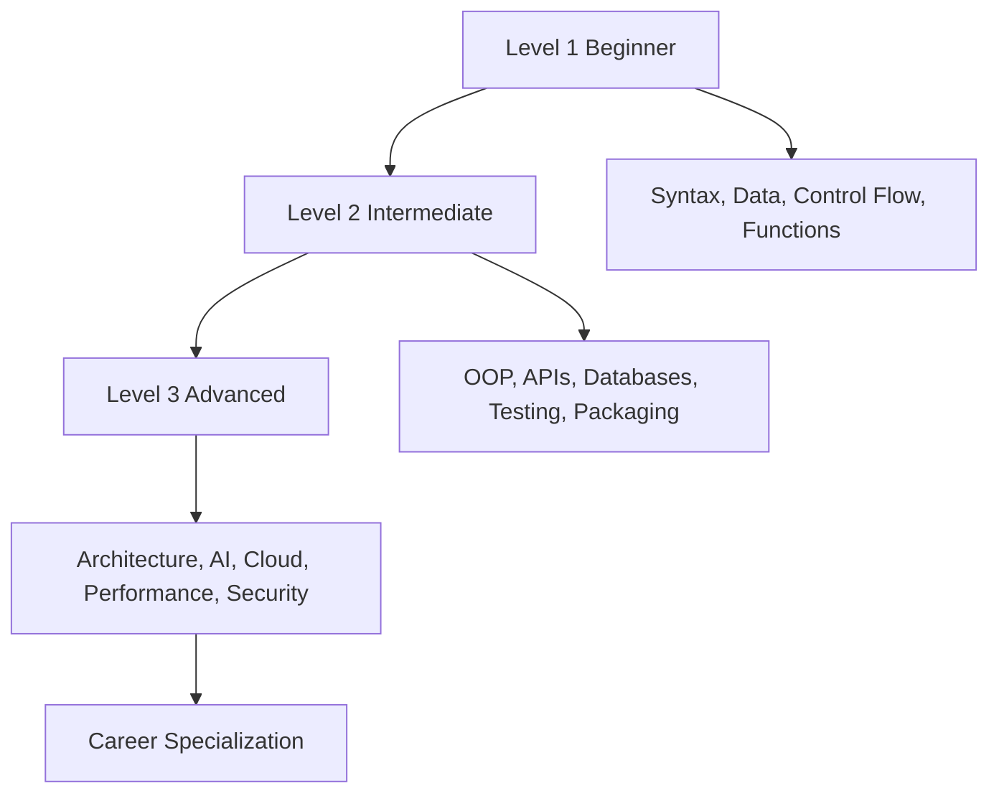

---

## Level 1: Beginner

Build the mental model and syntax confidence needed to write correct small programs.

# Introduction to Python

## Overview
- **What is it?** Python is a high-level, readable, general-purpose programming language used to build scripts, applications, data workflows, automation, and AI systems.
- **Why is it important?** Turn human-readable ideas into executable instructions quickly while keeping code maintainable.
- **Where is it used?** Learning labs, team onboarding, automation, and product engineering.

## Learning Objectives
- Gain the practical skill to explain, write, debug, and review introduction to python code.
- Cover the vocabulary, syntax, workflow, edge cases, and professional habits behind introduction to python.
- Expected outcome: you can use introduction to python in a small project and recognize when it belongs in production code.

## Real World Applications
- **Industry use cases:** Learning labs, team onboarding, automation, and product engineering.
- **Business applications:** Reduce manual work, improve reliability, support reporting, automate decisions, and ship maintainable features.
- **Career relevance:** Supports Python developer, backend engineer, data engineer, AI engineer, DevOps engineer, QA automation, and cybersecurity automation roles.

## Core Concepts

### Mental Model
- **Definition:** The main idea that gives introduction to python its structure and purpose inside a Python program.
- **Visual explanation:** `problem -> Introduction to Python model -> clear code`
- **Practical example:**

```python
apply_introduction_to_python_label = "Introduction to Python"
print(apply_introduction_to_python_label)
```

### Execution Flow
- **Definition:** The ordered steps Python follows when introduction to python code is created, executed, or integrated.
- **Visual explanation:** `input -> Python operation -> result -> feedback`
- **Practical example:**

```python
topic = "Introduction to Python"
print(f"Learning {topic}")
```

### Quality Rule
- **Definition:** The reliability habit that keeps introduction to python understandable, testable, secure, and maintainable.
- **Visual explanation:** `working code -> validation -> production confidence`
- **Practical example:**

```python
def summarize_introduction_to_python(items: list[str]) -> dict[str, int]:
    return {"topic_count": len(items), "unique_count": len(set(items))}

print(summarize_introduction_to_python(["learn", "practice", "learn"]))
```

## Infographic Summary

| Infographic Block | Key Message |
| --- | --- |
| 📌 Concept | Introduction to Python belongs to the fundamental Python practice part of Python mastery. |
| ⚡ Purpose | Turn human-readable ideas into executable instructions quickly while keeping code maintainable. |
| 🔥 Benefits | Readable syntax, strong ecosystem, cross-platform support, and fast learning curve. |
| 🎯 Use Cases | Learning labs, team onboarding, automation, and product engineering. |
| 🚀 Best Practices | Prefer readable names, small examples, explicit errors, tests, documentation, and version-aware choices. |
| ❌ Common Mistakes | Copying code without understanding it, ignoring edge cases, skipping validation, and mixing unrelated responsibilities. |

## Syntax Guide

### Basic Syntax

```python
topic_name = "Introduction to Python"
print(topic_name)
```

### Standard Structure

```python
def apply_introduction_to_python(value):
    """Apply the Introduction to Python concept to one value."""
    return value

result = apply_introduction_to_python("practice")
print(result)
```

### Code Pattern

```python
# 1. Identify the Introduction to Python problem
# 2. Apply the correct Python structure
# 3. Validate the result with tests or output
```

## Examples

### Beginner Example

```python
topic = "Introduction to Python"
print(f"Learning {topic}")
```

### Intermediate Example

```python
def summarize_introduction_to_python(items: list[str]) -> dict[str, int]:
    return {"topic_count": len(items), "unique_count": len(set(items))}

print(summarize_introduction_to_python(["learn", "practice", "learn"]))
```

### Advanced Example

```python
from dataclasses import dataclass

@dataclass(frozen=True)
class IntroductionToPythonOutcome:
    topic: str
    evidence: str

outcome = IntroductionToPythonOutcome("Introduction to Python", "production-ready understanding")
print(outcome)
```

## Workflow Diagram

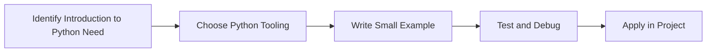

[Back to topic index](#introduction-to-python)


---

# Installing Python

## Overview
- **What is it?** Installing Python means placing the interpreter, package tools, and command-line entry points on your computer so Python code can run.
- **Why is it important?** Create a reliable local runtime for scripts, projects, notebooks, and tooling.
- **Where is it used?** Learning labs, team onboarding, automation, and product engineering.

## Learning Objectives
- Gain the practical skill to explain, write, debug, and review installing python code.
- Cover the vocabulary, syntax, workflow, edge cases, and professional habits behind installing python.
- Expected outcome: you can use installing python in a small project and recognize when it belongs in production code.

## Real World Applications
- **Industry use cases:** Learning labs, team onboarding, automation, and product engineering.
- **Business applications:** Reduce manual work, improve reliability, support reporting, automate decisions, and ship maintainable features.
- **Career relevance:** Supports Python developer, backend engineer, data engineer, AI engineer, DevOps engineer, QA automation, and cybersecurity automation roles.

## Core Concepts

### Mental Model
- **Definition:** The main idea that gives installing python its structure and purpose inside a Python program.
- **Visual explanation:** `problem -> Installing Python model -> clear code`
- **Practical example:**

```python
apply_installing_python_label = "Installing Python"
print(apply_installing_python_label)
```

### Execution Flow
- **Definition:** The ordered steps Python follows when installing python code is created, executed, or integrated.
- **Visual explanation:** `input -> Python operation -> result -> feedback`
- **Practical example:**

```python
import platform
print(platform.python_version())
```

### Quality Rule
- **Definition:** The reliability habit that keeps installing python understandable, testable, secure, and maintainable.
- **Visual explanation:** `working code -> validation -> production confidence`
- **Practical example:**

```python
import sys

if sys.version_info < (3, 12):
    raise RuntimeError("Python 3.12 or newer is recommended")
print("Python version is ready")
```

## Infographic Summary

| Infographic Block | Key Message |
| --- | --- |
| 📌 Concept | Installing Python belongs to the fundamental Python practice part of Python mastery. |
| ⚡ Purpose | Create a reliable local runtime for scripts, projects, notebooks, and tooling. |
| 🔥 Benefits | Repeatable execution, access to pip packages, and compatibility with editors and CI systems. |
| 🎯 Use Cases | Learning labs, team onboarding, automation, and product engineering. |
| 🚀 Best Practices | Prefer readable names, small examples, explicit errors, tests, documentation, and version-aware choices. |
| ❌ Common Mistakes | Copying code without understanding it, ignoring edge cases, skipping validation, and mixing unrelated responsibilities. |

## Syntax Guide

### Basic Syntax

```python
import sys
print(sys.version)
print(sys.executable)
```

### Standard Structure

```python
def apply_installing_python(value):
    """Apply the Installing Python concept to one value."""
    return value

result = apply_installing_python("practice")
print(result)
```

### Code Pattern

```python
# 1. Identify the Installing Python problem
# 2. Apply the correct Python structure
# 3. Validate the result with tests or output
```

## Examples

### Beginner Example

```python
import platform
print(platform.python_version())
```

### Intermediate Example

```python
import sys

if sys.version_info < (3, 12):
    raise RuntimeError("Python 3.12 or newer is recommended")
print("Python version is ready")
```

### Advanced Example

```python
from pathlib import Path
import sys

project = Path.cwd()
print({"python": sys.version.split()[0], "project": project.name})
```

## Workflow Diagram

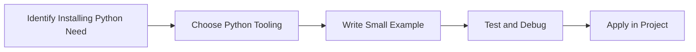

[Back to topic index](#installing-python)


---

# IDE Setup

## Overview
- **What is it?** IDE setup configures an editor with Python extensions, interpreter selection, linting, formatting, debugging, and terminal access.
- **Why is it important?** Shorten the feedback loop while writing, running, and inspecting Python programs.
- **Where is it used?** Learning labs, team onboarding, automation, and product engineering.

## Learning Objectives
- Gain the practical skill to explain, write, debug, and review ide setup code.
- Cover the vocabulary, syntax, workflow, edge cases, and professional habits behind ide setup.
- Expected outcome: you can use ide setup in a small project and recognize when it belongs in production code.

## Real World Applications
- **Industry use cases:** Learning labs, team onboarding, automation, and product engineering.
- **Business applications:** Reduce manual work, improve reliability, support reporting, automate decisions, and ship maintainable features.
- **Career relevance:** Supports Python developer, backend engineer, data engineer, AI engineer, DevOps engineer, QA automation, and cybersecurity automation roles.

## Core Concepts

### Mental Model
- **Definition:** The main idea that gives ide setup its structure and purpose inside a Python program.
- **Visual explanation:** `problem -> IDE Setup model -> clear code`
- **Practical example:**

```python
apply_ide_setup_label = "IDE Setup"
print(apply_ide_setup_label)
```

### Execution Flow
- **Definition:** The ordered steps Python follows when ide setup code is created, executed, or integrated.
- **Visual explanation:** `input -> Python operation -> result -> feedback`
- **Practical example:**

```python
message = "Run this file from your IDE"
print(message)
```

### Quality Rule
- **Definition:** The reliability habit that keeps ide setup understandable, testable, secure, and maintainable.
- **Visual explanation:** `working code -> validation -> production confidence`
- **Practical example:**

```python
def format_name(first: str, last: str) -> str:
    return f"{first.title()} {last.title()}"

print(format_name("ada", "lovelace"))
```

## Infographic Summary

| Infographic Block | Key Message |
| --- | --- |
| 📌 Concept | IDE Setup belongs to the fundamental Python practice part of Python mastery. |
| ⚡ Purpose | Shorten the feedback loop while writing, running, and inspecting Python programs. |
| 🔥 Benefits | Fewer syntax errors, easier navigation, integrated debugging, and professional workflow habits. |
| 🎯 Use Cases | Learning labs, team onboarding, automation, and product engineering. |
| 🚀 Best Practices | Prefer readable names, small examples, explicit errors, tests, documentation, and version-aware choices. |
| ❌ Common Mistakes | Copying code without understanding it, ignoring edge cases, skipping validation, and mixing unrelated responsibilities. |

## Syntax Guide

### Basic Syntax

```python
def add(left: int, right: int) -> int:
    return left + right

print(add(2, 3))
```

### Standard Structure

```python
def apply_ide_setup(value):
    """Apply the IDE Setup concept to one value."""
    return value

result = apply_ide_setup("practice")
print(result)
```

### Code Pattern

```python
# 1. Identify the IDE Setup problem
# 2. Apply the correct Python structure
# 3. Validate the result with tests or output
```

## Examples

### Beginner Example

```python
message = "Run this file from your IDE"
print(message)
```

### Intermediate Example

```python
def format_name(first: str, last: str) -> str:
    return f"{first.title()} {last.title()}"

print(format_name("ada", "lovelace"))
```

### Advanced Example

```python
import pdb

values = [1, 2, 3]
total = sum(values)
# pdb.set_trace()
print(total)
```

## Workflow Diagram

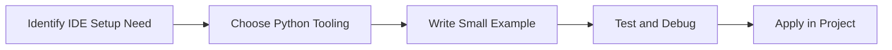

[Back to topic index](#ide-setup)


---

# Python Syntax

## Overview
- **What is it?** Python syntax is the set of grammar rules for indentation, expressions, statements, comments, imports, functions, and blocks.
- **Why is it important?** Make code understandable to both Python and other developers.
- **Where is it used?** Learning labs, team onboarding, automation, and product engineering.

## Learning Objectives
- Gain the practical skill to explain, write, debug, and review python syntax code.
- Cover the vocabulary, syntax, workflow, edge cases, and professional habits behind python syntax.
- Expected outcome: you can use python syntax in a small project and recognize when it belongs in production code.

## Real World Applications
- **Industry use cases:** Learning labs, team onboarding, automation, and product engineering.
- **Business applications:** Reduce manual work, improve reliability, support reporting, automate decisions, and ship maintainable features.
- **Career relevance:** Supports Python developer, backend engineer, data engineer, AI engineer, DevOps engineer, QA automation, and cybersecurity automation roles.

## Core Concepts

### Mental Model
- **Definition:** The main idea that gives python syntax its structure and purpose inside a Python program.
- **Visual explanation:** `problem -> Python Syntax model -> clear code`
- **Practical example:**

```python
apply_python_syntax_label = "Python Syntax"
print(apply_python_syntax_label)
```

### Execution Flow
- **Definition:** The ordered steps Python follows when python syntax code is created, executed, or integrated.
- **Visual explanation:** `input -> Python operation -> result -> feedback`
- **Practical example:**

```python
score = 10
print(score)
```

### Quality Rule
- **Definition:** The reliability habit that keeps python syntax understandable, testable, secure, and maintainable.
- **Visual explanation:** `working code -> validation -> production confidence`
- **Practical example:**

```python
price = 120
discount_rate = 0.15
final_price = price * (1 - discount_rate)
print(final_price)
```

## Infographic Summary

| Infographic Block | Key Message |
| --- | --- |
| 📌 Concept | Python Syntax belongs to the fundamental Python practice part of Python mastery. |
| ⚡ Purpose | Make code understandable to both Python and other developers. |
| 🔥 Benefits | Readable structure, fewer parser errors, and consistent team conventions. |
| 🎯 Use Cases | Learning labs, team onboarding, automation, and product engineering. |
| 🚀 Best Practices | Prefer readable names, small examples, explicit errors, tests, documentation, and version-aware choices. |
| ❌ Common Mistakes | Copying code without understanding it, ignoring edge cases, skipping validation, and mixing unrelated responsibilities. |

## Syntax Guide

### Basic Syntax

```python
customer_name = "Amina"
order_total = 149.50
is_paid = False
```

### Standard Structure

```python
def apply_python_syntax(value):
    """Apply the Python Syntax concept to one value."""
    return value

result = apply_python_syntax("practice")
print(result)
```

### Code Pattern

```python
# 1. Identify the Python Syntax problem
# 2. Apply the correct Python structure
# 3. Validate the result with tests or output
```

## Examples

### Beginner Example

```python
score = 10
print(score)
```

### Intermediate Example

```python
price = 120
discount_rate = 0.15
final_price = price * (1 - discount_rate)
print(final_price)
```

### Advanced Example

```python
from dataclasses import dataclass

@dataclass(frozen=True)
class Metric:
    name: str
    value: float

conversion_rate = Metric("conversion_rate", 0.084)
print(conversion_rate)
```

## Workflow Diagram


[Back to topic index](#python-syntax)


---

# Variables

## Overview
- **What is it?** Variables are names that reference objects in memory.
- **Why is it important?** Represent facts and state clearly.
- **Where is it used?** Software teams, education, automation, analytics, and backend development.

## Learning Objectives
- Gain the practical skill to explain, write, debug, and review variables code.
- Cover the vocabulary, syntax, workflow, edge cases, and professional habits behind variables.
- Expected outcome: you can use variables in a small project and recognize when it belongs in production code.

## Real World Applications
- **Industry use cases:** Software teams, education, automation, analytics, and backend development.
- **Business applications:** Reduce manual work, improve reliability, support reporting, automate decisions, and ship maintainable features.
- **Career relevance:** Supports Python developer, backend engineer, data engineer, AI engineer, DevOps engineer, QA automation, and cybersecurity automation roles.

## Core Concepts

### Mental Model
- **Definition:** The main idea that gives variables its structure and purpose inside a Python program.
- **Visual explanation:** `problem -> Variables model -> clear code`
- **Practical example:**

```python
apply_variables_label = "Variables"
print(apply_variables_label)
```

### Execution Flow
- **Definition:** The ordered steps Python follows when variables code is created, executed, or integrated.
- **Visual explanation:** `input -> Python operation -> result -> feedback`
- **Practical example:**

```python
score = 10
print(score)
```

### Quality Rule
- **Definition:** The reliability habit that keeps variables understandable, testable, secure, and maintainable.
- **Visual explanation:** `working code -> validation -> production confidence`
- **Practical example:**

```python
price = 120
discount_rate = 0.15
final_price = price * (1 - discount_rate)
print(final_price)
```

## Infographic Summary

| Infographic Block | Key Message |
| --- | --- |
| 📌 Concept | Variables belongs to the core programming foundation part of Python mastery. |
| ⚡ Purpose | Represent facts and state clearly. |
| 🔥 Benefits | Readable business logic and reusable values. |
| 🎯 Use Cases | Software teams, education, automation, analytics, and backend development. |
| 🚀 Best Practices | Prefer readable names, small examples, explicit errors, tests, documentation, and version-aware choices. |
| ❌ Common Mistakes | Copying code without understanding it, ignoring edge cases, skipping validation, and mixing unrelated responsibilities. |

## Syntax Guide

### Basic Syntax

```python
customer_name = "Amina"
order_total = 149.50
is_paid = False
```

### Standard Structure

```python
def apply_variables(value):
    """Apply the Variables concept to one value."""
    return value

result = apply_variables("practice")
print(result)
```

### Code Pattern

```python
# 1. Identify the Variables problem
# 2. Apply the correct Python structure
# 3. Validate the result with tests or output
```

## Examples

### Beginner Example

```python
score = 10
print(score)
```

### Intermediate Example

```python
price = 120
discount_rate = 0.15
final_price = price * (1 - discount_rate)
print(final_price)
```

### Advanced Example

```python
from dataclasses import dataclass

@dataclass(frozen=True)
class Metric:
    name: str
    value: float

conversion_rate = Metric("conversion_rate", 0.084)
print(conversion_rate)
```

## Workflow Diagram

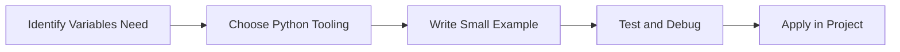

[Back to topic index](#variables)


---

# Data Types

## Overview
- **What is it?** Data types classify values such as numbers, text, booleans, sequences, mappings, and None.
- **Why is it important?** Choose operations that match the kind of value being processed.
- **Where is it used?** Software teams, education, automation, analytics, and backend development.

## Learning Objectives
- Gain the practical skill to explain, write, debug, and review data types code.
- Cover the vocabulary, syntax, workflow, edge cases, and professional habits behind data types.
- Expected outcome: you can use data types in a small project and recognize when it belongs in production code.

## Real World Applications
- **Industry use cases:** Software teams, education, automation, analytics, and backend development.
- **Business applications:** Reduce manual work, improve reliability, support reporting, automate decisions, and ship maintainable features.
- **Career relevance:** Supports Python developer, backend engineer, data engineer, AI engineer, DevOps engineer, QA automation, and cybersecurity automation roles.

## Core Concepts

### Mental Model
- **Definition:** The main idea that gives data types its structure and purpose inside a Python program.
- **Visual explanation:** `problem -> Data Types model -> clear code`
- **Practical example:**

```python
apply_data_types_label = "Data Types"
print(apply_data_types_label)
```

### Execution Flow
- **Definition:** The ordered steps Python follows when data types code is created, executed, or integrated.
- **Visual explanation:** `input -> Python operation -> result -> feedback`
- **Practical example:**

```python
value = 42
print(type(value).__name__)
```

### Quality Rule
- **Definition:** The reliability habit that keeps data types understandable, testable, secure, and maintainable.
- **Visual explanation:** `working code -> validation -> production confidence`
- **Practical example:**

```python
profile = {"name": "Noor", "skills": ["Python", "SQL"], "active": True}
print(profile["skills"][0])
```

## Infographic Summary

| Infographic Block | Key Message |
| --- | --- |
| 📌 Concept | Data Types belongs to the core programming foundation part of Python mastery. |
| ⚡ Purpose | Choose operations that match the kind of value being processed. |
| 🔥 Benefits | Correct calculations, validation, serialization, and storage. |
| 🎯 Use Cases | Software teams, education, automation, analytics, and backend development. |
| 🚀 Best Practices | Prefer readable names, small examples, explicit errors, tests, documentation, and version-aware choices. |
| ❌ Common Mistakes | Copying code without understanding it, ignoring edge cases, skipping validation, and mixing unrelated responsibilities. |

## Syntax Guide

### Basic Syntax

```python
age = 31
price = 19.99
name = "Python"
is_active = True
missing = None
```

### Standard Structure

```python
def apply_data_types(value):
    """Apply the Data Types concept to one value."""
    return value

result = apply_data_types("practice")
print(result)
```

### Code Pattern

```python
# 1. Identify the Data Types problem
# 2. Apply the correct Python structure
# 3. Validate the result with tests or output
```

## Examples

### Beginner Example

```python
value = 42
print(type(value).__name__)
```

### Intermediate Example

```python
profile = {"name": "Noor", "skills": ["Python", "SQL"], "active": True}
print(profile["skills"][0])
```

### Advanced Example

```python
from typing import TypedDict

class User(TypedDict):
    id: int
    email: str

user: User = {"id": 1, "email": "dev@example.com"}
print(user)
```

## Workflow Diagram

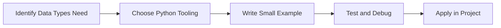

[Back to topic index](#data-types)


---

# Type Casting

## Overview
- **What is it?** Type casting converts values from one type to another, such as text to numbers.
- **Why is it important?** Normalize input before calculations, comparisons, or storage.
- **Where is it used?** Software teams, education, automation, analytics, and backend development.

## Learning Objectives
- Gain the practical skill to explain, write, debug, and review type casting code.
- Cover the vocabulary, syntax, workflow, edge cases, and professional habits behind type casting.
- Expected outcome: you can use type casting in a small project and recognize when it belongs in production code.

## Real World Applications
- **Industry use cases:** Software teams, education, automation, analytics, and backend development.
- **Business applications:** Reduce manual work, improve reliability, support reporting, automate decisions, and ship maintainable features.
- **Career relevance:** Supports Python developer, backend engineer, data engineer, AI engineer, DevOps engineer, QA automation, and cybersecurity automation roles.

## Core Concepts

### Mental Model
- **Definition:** The main idea that gives type casting its structure and purpose inside a Python program.
- **Visual explanation:** `problem -> Type Casting model -> clear code`
- **Practical example:**

```python
apply_type_casting_label = "Type Casting"
print(apply_type_casting_label)
```

### Execution Flow
- **Definition:** The ordered steps Python follows when type casting code is created, executed, or integrated.
- **Visual explanation:** `input -> Python operation -> result -> feedback`
- **Practical example:**

```python
age_text = "21"
age = int(age_text)
print(age + 1)
```

### Quality Rule
- **Definition:** The reliability habit that keeps type casting understandable, testable, secure, and maintainable.
- **Visual explanation:** `working code -> validation -> production confidence`
- **Practical example:**

```python
raw_values = ["10", "20", "30"]
values = [int(value) for value in raw_values]
print(sum(values))
```

## Infographic Summary

| Infographic Block | Key Message |
| --- | --- |
| 📌 Concept | Type Casting belongs to the core programming foundation part of Python mastery. |
| ⚡ Purpose | Normalize input before calculations, comparisons, or storage. |
| 🔥 Benefits | Safer forms, APIs, CLI tools, and data imports. |
| 🎯 Use Cases | Software teams, education, automation, analytics, and backend development. |
| 🚀 Best Practices | Prefer readable names, small examples, explicit errors, tests, documentation, and version-aware choices. |
| ❌ Common Mistakes | Copying code without understanding it, ignoring edge cases, skipping validation, and mixing unrelated responsibilities. |

## Syntax Guide

### Basic Syntax

```python
quantity = int("12")
price = float("9.99")
label = str(quantity)
```

### Standard Structure

```python
def apply_type_casting(value):
    """Apply the Type Casting concept to one value."""
    return value

result = apply_type_casting("practice")
print(result)
```

### Code Pattern

```python
# 1. Identify the Type Casting problem
# 2. Apply the correct Python structure
# 3. Validate the result with tests or output
```

## Examples

### Beginner Example

```python
age_text = "21"
age = int(age_text)
print(age + 1)
```

### Intermediate Example

```python
raw_values = ["10", "20", "30"]
values = [int(value) for value in raw_values]
print(sum(values))
```

### Advanced Example

```python
from decimal import Decimal

amount = Decimal("19.99")
tax = Decimal("0.08")
print((amount * (1 + tax)).quantize(Decimal("0.01")))
```

## Workflow Diagram

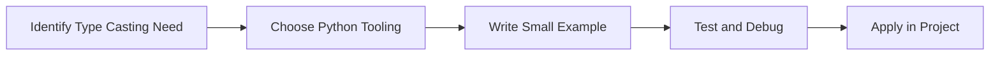

[Back to topic index](#type-casting)


---

# Input and Output

## Overview
- **What is it?** Input and output move data into and out of programs through keyboards, files, streams, APIs, and terminals.
- **Why is it important?** Let programs interact with users and external systems.
- **Where is it used?** Software teams, education, automation, analytics, and backend development.

## Learning Objectives
- Gain the practical skill to explain, write, debug, and review input and output code.
- Cover the vocabulary, syntax, workflow, edge cases, and professional habits behind input and output.
- Expected outcome: you can use input and output in a small project and recognize when it belongs in production code.

## Real World Applications
- **Industry use cases:** Software teams, education, automation, analytics, and backend development.
- **Business applications:** Reduce manual work, improve reliability, support reporting, automate decisions, and ship maintainable features.
- **Career relevance:** Supports Python developer, backend engineer, data engineer, AI engineer, DevOps engineer, QA automation, and cybersecurity automation roles.

## Core Concepts

### Mental Model
- **Definition:** The main idea that gives input and output its structure and purpose inside a Python program.
- **Visual explanation:** `problem -> Input and Output model -> clear code`
- **Practical example:**

```python
apply_input_and_output_label = "Input and Output"
print(apply_input_and_output_label)
```

### Execution Flow
- **Definition:** The ordered steps Python follows when input and output code is created, executed, or integrated.
- **Visual explanation:** `input -> Python operation -> result -> feedback`
- **Practical example:**

```python
name = "Learner"
print(f"Welcome, {name}!")
```

### Quality Rule
- **Definition:** The reliability habit that keeps input and output understandable, testable, secure, and maintainable.
- **Visual explanation:** `working code -> validation -> production confidence`
- **Practical example:**

```python
def render_invoice(customer: str, total: float) -> str:
    return f"Invoice for {customer}: ${total:.2f}"

print(render_invoice("Ada", 125.5))
```

## Infographic Summary

| Infographic Block | Key Message |
| --- | --- |
| 📌 Concept | Input and Output belongs to the core programming foundation part of Python mastery. |
| ⚡ Purpose | Let programs interact with users and external systems. |
| 🔥 Benefits | Useful scripts, reports, automation, and command-line tools. |
| 🎯 Use Cases | Software teams, education, automation, analytics, and backend development. |
| 🚀 Best Practices | Prefer readable names, small examples, explicit errors, tests, documentation, and version-aware choices. |
| ❌ Common Mistakes | Copying code without understanding it, ignoring edge cases, skipping validation, and mixing unrelated responsibilities. |

## Syntax Guide

### Basic Syntax

```python
name = input("Name: ")
print(f"Hello, {name}")
```

### Standard Structure

```python
def apply_input_and_output(value):
    """Apply the Input and Output concept to one value."""
    return value

result = apply_input_and_output("practice")
print(result)
```

### Code Pattern

```python
# 1. Identify the Input and Output problem
# 2. Apply the correct Python structure
# 3. Validate the result with tests or output
```

## Examples

### Beginner Example

```python
name = "Learner"
print(f"Welcome, {name}!")
```

### Intermediate Example

```python
def render_invoice(customer: str, total: float) -> str:
    return f"Invoice for {customer}: ${total:.2f}"

print(render_invoice("Ada", 125.5))
```

### Advanced Example

```python
import sys

sys.stdout.write("streamed output\n")
sys.stderr.write("diagnostic output\n")
```

## Workflow Diagram

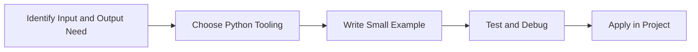

[Back to topic index](#input-and-output)


---

# Operators

## Overview
- **What is it?** Operators are symbols and keywords that combine, compare, and transform values.
- **Why is it important?** Build expressions for calculations and decisions.
- **Where is it used?** Software teams, education, automation, analytics, and backend development.

## Learning Objectives
- Gain the practical skill to explain, write, debug, and review operators code.
- Cover the vocabulary, syntax, workflow, edge cases, and professional habits behind operators.
- Expected outcome: you can use operators in a small project and recognize when it belongs in production code.

## Real World Applications
- **Industry use cases:** Software teams, education, automation, analytics, and backend development.
- **Business applications:** Reduce manual work, improve reliability, support reporting, automate decisions, and ship maintainable features.
- **Career relevance:** Supports Python developer, backend engineer, data engineer, AI engineer, DevOps engineer, QA automation, and cybersecurity automation roles.

## Core Concepts

### Mental Model
- **Definition:** The main idea that gives operators its structure and purpose inside a Python program.
- **Visual explanation:** `problem -> Operators model -> clear code`
- **Practical example:**

```python
apply_operators_label = "Operators"
print(apply_operators_label)
```

### Execution Flow
- **Definition:** The ordered steps Python follows when operators code is created, executed, or integrated.
- **Visual explanation:** `input -> Python operation -> result -> feedback`
- **Practical example:**

```python
score = 10
print(score)
```

### Quality Rule
- **Definition:** The reliability habit that keeps operators understandable, testable, secure, and maintainable.
- **Visual explanation:** `working code -> validation -> production confidence`
- **Practical example:**

```python
price = 120
discount_rate = 0.15
final_price = price * (1 - discount_rate)
print(final_price)
```

## Infographic Summary

| Infographic Block | Key Message |
| --- | --- |
| 📌 Concept | Operators belongs to the core programming foundation part of Python mastery. |
| ⚡ Purpose | Build expressions for calculations and decisions. |
| 🔥 Benefits | Concise business rules, filters, and computations. |
| 🎯 Use Cases | Software teams, education, automation, analytics, and backend development. |
| 🚀 Best Practices | Prefer readable names, small examples, explicit errors, tests, documentation, and version-aware choices. |
| ❌ Common Mistakes | Copying code without understanding it, ignoring edge cases, skipping validation, and mixing unrelated responsibilities. |

## Syntax Guide

### Basic Syntax

```python
customer_name = "Amina"
order_total = 149.50
is_paid = False
```

### Standard Structure

```python
def apply_operators(value):
    """Apply the Operators concept to one value."""
    return value

result = apply_operators("practice")
print(result)
```

### Code Pattern

```python
# 1. Identify the Operators problem
# 2. Apply the correct Python structure
# 3. Validate the result with tests or output
```

## Examples

### Beginner Example

```python
score = 10
print(score)
```

### Intermediate Example

```python
price = 120
discount_rate = 0.15
final_price = price * (1 - discount_rate)
print(final_price)
```

### Advanced Example

```python
from dataclasses import dataclass

@dataclass(frozen=True)
class Metric:
    name: str
    value: float

conversion_rate = Metric("conversion_rate", 0.084)
print(conversion_rate)
```

## Workflow Diagram

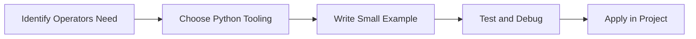

[Back to topic index](#operators)


---

# Conditional Statements

## Overview
- **What is it?** Conditional statements run different code paths based on boolean conditions.
- **Why is it important?** Represent decisions and branching business rules.
- **Where is it used?** Software teams, education, automation, analytics, and backend development.

## Learning Objectives
- Gain the practical skill to explain, write, debug, and review conditional statements code.
- Cover the vocabulary, syntax, workflow, edge cases, and professional habits behind conditional statements.
- Expected outcome: you can use conditional statements in a small project and recognize when it belongs in production code.

## Real World Applications
- **Industry use cases:** Software teams, education, automation, analytics, and backend development.
- **Business applications:** Reduce manual work, improve reliability, support reporting, automate decisions, and ship maintainable features.
- **Career relevance:** Supports Python developer, backend engineer, data engineer, AI engineer, DevOps engineer, QA automation, and cybersecurity automation roles.

## Core Concepts

### Mental Model
- **Definition:** The main idea that gives conditional statements its structure and purpose inside a Python program.
- **Visual explanation:** `problem -> Conditional Statements model -> clear code`
- **Practical example:**

```python
apply_conditional_statements_label = "Conditional Statements"
print(apply_conditional_statements_label)
```

### Execution Flow
- **Definition:** The ordered steps Python follows when conditional statements code is created, executed, or integrated.
- **Visual explanation:** `input -> Python operation -> result -> feedback`
- **Practical example:**

```python
score = 82
if score >= 60:
    print("Pass")
```

### Quality Rule
- **Definition:** The reliability habit that keeps conditional statements understandable, testable, secure, and maintainable.
- **Visual explanation:** `working code -> validation -> production confidence`
- **Practical example:**

```python
role = "admin"
can_delete = role in {"admin", "owner"}
print(can_delete)
```

## Infographic Summary

| Infographic Block | Key Message |
| --- | --- |
| 📌 Concept | Conditional Statements belongs to the core programming foundation part of Python mastery. |
| ⚡ Purpose | Represent decisions and branching business rules. |
| 🔥 Benefits | Validation, authorization, routing, and error handling. |
| 🎯 Use Cases | Software teams, education, automation, analytics, and backend development. |
| 🚀 Best Practices | Prefer readable names, small examples, explicit errors, tests, documentation, and version-aware choices. |
| ❌ Common Mistakes | Copying code without understanding it, ignoring edge cases, skipping validation, and mixing unrelated responsibilities. |

## Syntax Guide

### Basic Syntax

```python
if temperature > 30:
    print("Hot")
elif temperature > 20:
    print("Warm")
else:
    print("Cool")
```

### Standard Structure

```python
def apply_conditional_statements(value):
    """Apply the Conditional Statements concept to one value."""
    return value

result = apply_conditional_statements("practice")
print(result)
```

### Code Pattern

```python
# 1. Identify the Conditional Statements problem
# 2. Apply the correct Python structure
# 3. Validate the result with tests or output
```

## Examples

### Beginner Example

```python
score = 82
if score >= 60:
    print("Pass")
```

### Intermediate Example

```python
role = "admin"
can_delete = role in {"admin", "owner"}
print(can_delete)
```

### Advanced Example

```python
def classify_order(total: float, is_priority: bool) -> str:
    match (total >= 500, is_priority):
        case (True, True):
            return "vip-priority"
        case (True, False):
            return "vip"
        case _:
            return "standard"

print(classify_order(700, True))
```

## Workflow Diagram

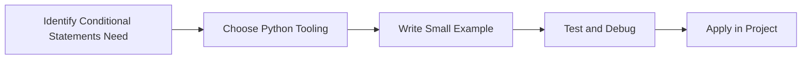

[Back to topic index](#conditional-statements)


---

# Loops

## Overview
- **What is it?** Loops repeat work over collections, ranges, streams, or conditions.
- **Why is it important?** Automate repetitive tasks without duplicating code.
- **Where is it used?** Software teams, education, automation, analytics, and backend development.

## Learning Objectives
- Gain the practical skill to explain, write, debug, and review loops code.
- Cover the vocabulary, syntax, workflow, edge cases, and professional habits behind loops.
- Expected outcome: you can use loops in a small project and recognize when it belongs in production code.

## Real World Applications
- **Industry use cases:** Software teams, education, automation, analytics, and backend development.
- **Business applications:** Reduce manual work, improve reliability, support reporting, automate decisions, and ship maintainable features.
- **Career relevance:** Supports Python developer, backend engineer, data engineer, AI engineer, DevOps engineer, QA automation, and cybersecurity automation roles.

## Core Concepts

### Mental Model
- **Definition:** The main idea that gives loops its structure and purpose inside a Python program.
- **Visual explanation:** `problem -> Loops model -> clear code`
- **Practical example:**

```python
apply_loops_label = "Loops"
print(apply_loops_label)
```

### Execution Flow
- **Definition:** The ordered steps Python follows when loops code is created, executed, or integrated.
- **Visual explanation:** `input -> Python operation -> result -> feedback`
- **Practical example:**

```python
for number in range(3):
    print(number)
```

### Quality Rule
- **Definition:** The reliability habit that keeps loops understandable, testable, secure, and maintainable.
- **Visual explanation:** `working code -> validation -> production confidence`
- **Practical example:**

```python
orders = [42, 75, 120]
total = 0
for order in orders:
    total += order
print(total)
```

## Infographic Summary

| Infographic Block | Key Message |
| --- | --- |
| 📌 Concept | Loops belongs to the core programming foundation part of Python mastery. |
| ⚡ Purpose | Automate repetitive tasks without duplicating code. |
| 🔥 Benefits | Batch processing, reporting, scraping, and simulations. |
| 🎯 Use Cases | Software teams, education, automation, analytics, and backend development. |
| 🚀 Best Practices | Prefer readable names, small examples, explicit errors, tests, documentation, and version-aware choices. |
| ❌ Common Mistakes | Copying code without understanding it, ignoring edge cases, skipping validation, and mixing unrelated responsibilities. |

## Syntax Guide

### Basic Syntax

```python
for item in items:
    print(item)

while queue:
    queue.pop(0)
```

### Standard Structure

```python
def apply_loops(value):
    """Apply the Loops concept to one value."""
    return value

result = apply_loops("practice")
print(result)
```

### Code Pattern

```python
# 1. Identify the Loops problem
# 2. Apply the correct Python structure
# 3. Validate the result with tests or output
```

## Examples

### Beginner Example

```python
for number in range(3):
    print(number)
```

### Intermediate Example

```python
orders = [42, 75, 120]
total = 0
for order in orders:
    total += order
print(total)
```

### Advanced Example

```python
from itertools import accumulate

values = [5, 10, 15]
print(list(accumulate(values)))
```

## Workflow Diagram

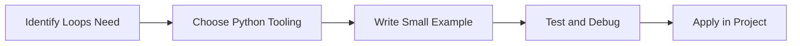

[Back to topic index](#loops)


---

# Nested Loops

## Overview
- **What is it?** Nested loops place one loop inside another to process grids, combinations, and hierarchical data.
- **Why is it important?** Traverse multi-dimensional or related datasets.
- **Where is it used?** Software teams, education, automation, analytics, and backend development.

## Learning Objectives
- Gain the practical skill to explain, write, debug, and review nested loops code.
- Cover the vocabulary, syntax, workflow, edge cases, and professional habits behind nested loops.
- Expected outcome: you can use nested loops in a small project and recognize when it belongs in production code.

## Real World Applications
- **Industry use cases:** Software teams, education, automation, analytics, and backend development.
- **Business applications:** Reduce manual work, improve reliability, support reporting, automate decisions, and ship maintainable features.
- **Career relevance:** Supports Python developer, backend engineer, data engineer, AI engineer, DevOps engineer, QA automation, and cybersecurity automation roles.

## Core Concepts

### Mental Model
- **Definition:** The main idea that gives nested loops its structure and purpose inside a Python program.
- **Visual explanation:** `problem -> Nested Loops model -> clear code`
- **Practical example:**

```python
apply_nested_loops_label = "Nested Loops"
print(apply_nested_loops_label)
```

### Execution Flow
- **Definition:** The ordered steps Python follows when nested loops code is created, executed, or integrated.
- **Visual explanation:** `input -> Python operation -> result -> feedback`
- **Practical example:**

```python
for row in range(2):
    for column in range(3):
        print(row, column)
```

### Quality Rule
- **Definition:** The reliability habit that keeps nested loops understandable, testable, secure, and maintainable.
- **Visual explanation:** `working code -> validation -> production confidence`
- **Practical example:**

```python
matrix = [[1, 2], [3, 4]]
flattened = []
for row in matrix:
    for value in row:
        flattened.append(value)
print(flattened)
```

## Infographic Summary

| Infographic Block | Key Message |
| --- | --- |
| 📌 Concept | Nested Loops belongs to the core programming foundation part of Python mastery. |
| ⚡ Purpose | Traverse multi-dimensional or related datasets. |
| 🔥 Benefits | Tables, matrices, schedules, inventory variants, and reports. |
| 🎯 Use Cases | Software teams, education, automation, analytics, and backend development. |
| 🚀 Best Practices | Prefer readable names, small examples, explicit errors, tests, documentation, and version-aware choices. |
| ❌ Common Mistakes | Copying code without understanding it, ignoring edge cases, skipping validation, and mixing unrelated responsibilities. |

## Syntax Guide

### Basic Syntax

```python
for row in grid:
    for cell in row:
        print(cell)
```

### Standard Structure

```python
def apply_nested_loops(value):
    """Apply the Nested Loops concept to one value."""
    return value

result = apply_nested_loops("practice")
print(result)
```

### Code Pattern

```python
# 1. Identify the Nested Loops problem
# 2. Apply the correct Python structure
# 3. Validate the result with tests or output
```

## Examples

### Beginner Example

```python
for row in range(2):
    for column in range(3):
        print(row, column)
```

### Intermediate Example

```python
matrix = [[1, 2], [3, 4]]
flattened = []
for row in matrix:
    for value in row:
        flattened.append(value)
print(flattened)
```

### Advanced Example

```python
pairs = [(x, y) for x in range(3) for y in range(3) if x != y]
print(pairs)
```

## Workflow Diagram

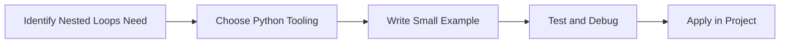

[Back to topic index](#nested-loops)


---

# Break Continue Pass

## Overview
- **What is it?** break, continue, and pass control loop flow and placeholder behavior.
- **Why is it important?** Exit early, skip work, or reserve structure intentionally.
- **Where is it used?** Software teams, education, automation, analytics, and backend development.

## Learning Objectives
- Gain the practical skill to explain, write, debug, and review break continue pass code.
- Cover the vocabulary, syntax, workflow, edge cases, and professional habits behind break continue pass.
- Expected outcome: you can use break continue pass in a small project and recognize when it belongs in production code.

## Real World Applications
- **Industry use cases:** Software teams, education, automation, analytics, and backend development.
- **Business applications:** Reduce manual work, improve reliability, support reporting, automate decisions, and ship maintainable features.
- **Career relevance:** Supports Python developer, backend engineer, data engineer, AI engineer, DevOps engineer, QA automation, and cybersecurity automation roles.

## Core Concepts

### Mental Model
- **Definition:** The main idea that gives break continue pass its structure and purpose inside a Python program.
- **Visual explanation:** `problem -> Break Continue Pass model -> clear code`
- **Practical example:**

```python
apply_break_continue_pass_label = "Break Continue Pass"
print(apply_break_continue_pass_label)
```

### Execution Flow
- **Definition:** The ordered steps Python follows when break continue pass code is created, executed, or integrated.
- **Visual explanation:** `input -> Python operation -> result -> feedback`
- **Practical example:**

```python
for number in range(5):
    if number == 3:
        break
    print(number)
```

### Quality Rule
- **Definition:** The reliability habit that keeps break continue pass understandable, testable, secure, and maintainable.
- **Visual explanation:** `working code -> validation -> production confidence`
- **Practical example:**

```python
values = [10, None, 25, 0]
for value in values:
    if value is None:
        continue
    print(value)
```

## Infographic Summary

| Infographic Block | Key Message |
| --- | --- |
| 📌 Concept | Break Continue Pass belongs to the core programming foundation part of Python mastery. |
| ⚡ Purpose | Exit early, skip work, or reserve structure intentionally. |
| 🔥 Benefits | Cleaner loops, guard clauses, and progressive implementation. |
| 🎯 Use Cases | Software teams, education, automation, analytics, and backend development. |
| 🚀 Best Practices | Prefer readable names, small examples, explicit errors, tests, documentation, and version-aware choices. |
| ❌ Common Mistakes | Copying code without understanding it, ignoring edge cases, skipping validation, and mixing unrelated responsibilities. |

## Syntax Guide

### Basic Syntax

```python
for item in items:
    if item is None:
        continue
    if item == "stop":
        break
    pass
```

### Standard Structure

```python
def apply_break_continue_pass(value):
    """Apply the Break Continue Pass concept to one value."""
    return value

result = apply_break_continue_pass("practice")
print(result)
```

### Code Pattern

```python
# 1. Identify the Break Continue Pass problem
# 2. Apply the correct Python structure
# 3. Validate the result with tests or output
```

## Examples

### Beginner Example

```python
for number in range(5):
    if number == 3:
        break
    print(number)
```

### Intermediate Example

```python
values = [10, None, 25, 0]
for value in values:
    if value is None:
        continue
    print(value)
```

### Advanced Example

```python
class FutureValidator:
    def validate(self, value):
        pass

print(FutureValidator().validate("draft"))
```

## Workflow Diagram

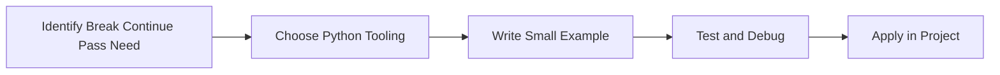

[Back to topic index](#break-continue-pass)


---

# Strings

## Overview
- **What is it?** Strings are immutable text sequences.
- **Why is it important?** Store, inspect, format, and transform text.
- **Where is it used?** Software teams, education, automation, analytics, and backend development.

## Learning Objectives
- Gain the practical skill to explain, write, debug, and review strings code.
- Cover the vocabulary, syntax, workflow, edge cases, and professional habits behind strings.
- Expected outcome: you can use strings in a small project and recognize when it belongs in production code.

## Real World Applications
- **Industry use cases:** Software teams, education, automation, analytics, and backend development.
- **Business applications:** Reduce manual work, improve reliability, support reporting, automate decisions, and ship maintainable features.
- **Career relevance:** Supports Python developer, backend engineer, data engineer, AI engineer, DevOps engineer, QA automation, and cybersecurity automation roles.

## Core Concepts

### Mental Model
- **Definition:** The main idea that gives strings its structure and purpose inside a Python program.
- **Visual explanation:** `problem -> Strings model -> clear code`
- **Practical example:**

```python
apply_strings_label = "Strings"
print(apply_strings_label)
```

### Execution Flow
- **Definition:** The ordered steps Python follows when strings code is created, executed, or integrated.
- **Visual explanation:** `input -> Python operation -> result -> feedback`
- **Practical example:**

```python
greeting = "Hello"
print(greeting + " Python")
```

### Quality Rule
- **Definition:** The reliability habit that keeps strings understandable, testable, secure, and maintainable.
- **Visual explanation:** `working code -> validation -> production confidence`
- **Practical example:**

```python
template = "{product}: ${price:.2f}"
print(template.format(product="Book", price=29.99))
```

## Infographic Summary

| Infographic Block | Key Message |
| --- | --- |
| 📌 Concept | Strings belongs to the core programming foundation part of Python mastery. |
| ⚡ Purpose | Store, inspect, format, and transform text. |
| 🔥 Benefits | User messages, logs, APIs, documents, and identifiers. |
| 🎯 Use Cases | Software teams, education, automation, analytics, and backend development. |
| 🚀 Best Practices | Prefer readable names, small examples, explicit errors, tests, documentation, and version-aware choices. |
| ❌ Common Mistakes | Copying code without understanding it, ignoring edge cases, skipping validation, and mixing unrelated responsibilities. |

## Syntax Guide

### Basic Syntax

```python
name = "Python"
print(name[0])
print(name.lower())
```

### Standard Structure

```python
def apply_strings(value):
    """Apply the Strings concept to one value."""
    return value

result = apply_strings("practice")
print(result)
```

### Code Pattern

```python
# 1. Identify the Strings problem
# 2. Apply the correct Python structure
# 3. Validate the result with tests or output
```

## Examples

### Beginner Example

```python
greeting = "Hello"
print(greeting + " Python")
```

### Intermediate Example

```python
template = "{product}: ${price:.2f}"
print(template.format(product="Book", price=29.99))
```

### Advanced Example

```python
from string import Template

template = Template("Hello, $name")
print(template.safe_substitute(name="Grace"))
```

## Workflow Diagram

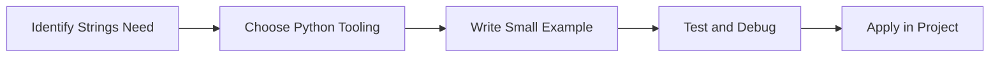

[Back to topic index](#strings)


---

# String Methods

## Overview
- **What is it?** String methods are built-in operations for searching, cleaning, splitting, joining, and formatting text.
- **Why is it important?** Make text processing reliable and expressive.
- **Where is it used?** Software teams, education, automation, analytics, and backend development.

## Learning Objectives
- Gain the practical skill to explain, write, debug, and review string methods code.
- Cover the vocabulary, syntax, workflow, edge cases, and professional habits behind string methods.
- Expected outcome: you can use string methods in a small project and recognize when it belongs in production code.

## Real World Applications
- **Industry use cases:** Software teams, education, automation, analytics, and backend development.
- **Business applications:** Reduce manual work, improve reliability, support reporting, automate decisions, and ship maintainable features.
- **Career relevance:** Supports Python developer, backend engineer, data engineer, AI engineer, DevOps engineer, QA automation, and cybersecurity automation roles.

## Core Concepts

### Mental Model
- **Definition:** The main idea that gives string methods its structure and purpose inside a Python program.
- **Visual explanation:** `problem -> String Methods model -> clear code`
- **Practical example:**

```python
apply_string_methods_label = "String Methods"
print(apply_string_methods_label)
```

### Execution Flow
- **Definition:** The ordered steps Python follows when string methods code is created, executed, or integrated.
- **Visual explanation:** `input -> Python operation -> result -> feedback`
- **Practical example:**

```python
greeting = "Hello"
print(greeting + " Python")
```

### Quality Rule
- **Definition:** The reliability habit that keeps string methods understandable, testable, secure, and maintainable.
- **Visual explanation:** `working code -> validation -> production confidence`
- **Practical example:**

```python
template = "{product}: ${price:.2f}"
print(template.format(product="Book", price=29.99))
```

## Infographic Summary

| Infographic Block | Key Message |
| --- | --- |
| 📌 Concept | String Methods belongs to the core programming foundation part of Python mastery. |
| ⚡ Purpose | Make text processing reliable and expressive. |
| 🔥 Benefits | Data cleaning, validation, parsing, search, and reporting. |
| 🎯 Use Cases | Software teams, education, automation, analytics, and backend development. |
| 🚀 Best Practices | Prefer readable names, small examples, explicit errors, tests, documentation, and version-aware choices. |
| ❌ Common Mistakes | Copying code without understanding it, ignoring edge cases, skipping validation, and mixing unrelated responsibilities. |

## Syntax Guide

### Basic Syntax

```python
name = "Python"
print(name[0])
print(name.lower())
```

### Standard Structure

```python
def apply_string_methods(value):
    """Apply the String Methods concept to one value."""
    return value

result = apply_string_methods("practice")
print(result)
```

### Code Pattern

```python
# 1. Identify the String Methods problem
# 2. Apply the correct Python structure
# 3. Validate the result with tests or output
```

## Examples

### Beginner Example

```python
greeting = "Hello"
print(greeting + " Python")
```

### Intermediate Example

```python
template = "{product}: ${price:.2f}"
print(template.format(product="Book", price=29.99))
```

### Advanced Example

```python
from string import Template

template = Template("Hello, $name")
print(template.safe_substitute(name="Grace"))
```

## Workflow Diagram

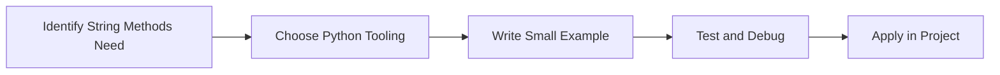

[Back to topic index](#string-methods)


---

# Lists

## Overview
- **What is it?** Lists are ordered, mutable collections.
- **Why is it important?** Store and update sequences of related items.
- **Where is it used?** Software teams, education, automation, analytics, and backend development.

## Learning Objectives
- Gain the practical skill to explain, write, debug, and review lists code.
- Cover the vocabulary, syntax, workflow, edge cases, and professional habits behind lists.
- Expected outcome: you can use lists in a small project and recognize when it belongs in production code.

## Real World Applications
- **Industry use cases:** Software teams, education, automation, analytics, and backend development.
- **Business applications:** Reduce manual work, improve reliability, support reporting, automate decisions, and ship maintainable features.
- **Career relevance:** Supports Python developer, backend engineer, data engineer, AI engineer, DevOps engineer, QA automation, and cybersecurity automation roles.

## Core Concepts

### Mental Model
- **Definition:** The main idea that gives lists its structure and purpose inside a Python program.
- **Visual explanation:** `problem -> Lists model -> clear code`
- **Practical example:**

```python
apply_lists_label = "Lists"
print(apply_lists_label)
```

### Execution Flow
- **Definition:** The ordered steps Python follows when lists code is created, executed, or integrated.
- **Visual explanation:** `input -> Python operation -> result -> feedback`
- **Practical example:**

```python
tasks = ["read", "practice", "review"]
print(tasks)
```

### Quality Rule
- **Definition:** The reliability habit that keeps lists understandable, testable, secure, and maintainable.
- **Visual explanation:** `working code -> validation -> production confidence`
- **Practical example:**

```python
scores = [88, 92, 79]
passed = [score for score in scores if score >= 80]
print(passed)
```

## Infographic Summary

| Infographic Block | Key Message |
| --- | --- |
| 📌 Concept | Lists belongs to the core programming foundation part of Python mastery. |
| ⚡ Purpose | Store and update sequences of related items. |
| 🔥 Benefits | Queues, records, batches, UI options, and data processing. |
| 🎯 Use Cases | Software teams, education, automation, analytics, and backend development. |
| 🚀 Best Practices | Prefer readable names, small examples, explicit errors, tests, documentation, and version-aware choices. |
| ❌ Common Mistakes | Copying code without understanding it, ignoring edge cases, skipping validation, and mixing unrelated responsibilities. |

## Syntax Guide

### Basic Syntax

```python
items = ["alpha", "beta"]
items.append("gamma")
print(items[0])
```

### Standard Structure

```python
def apply_lists(value):
    """Apply the Lists concept to one value."""
    return value

result = apply_lists("practice")
print(result)
```

### Code Pattern

```python
# 1. Identify the Lists problem
# 2. Apply the correct Python structure
# 3. Validate the result with tests or output
```

## Examples

### Beginner Example

```python
tasks = ["read", "practice", "review"]
print(tasks)
```

### Intermediate Example

```python
scores = [88, 92, 79]
passed = [score for score in scores if score >= 80]
print(passed)
```

### Advanced Example

```python
from bisect import insort

rankings = [10, 20, 40]
insort(rankings, 30)
print(rankings)
```

## Workflow Diagram

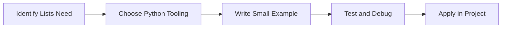

[Back to topic index](#lists)


---

# List Methods

## Overview
- **What is it?** List methods mutate, query, sort, and manage list contents.
- **Why is it important?** Maintain ordered collections efficiently.
- **Where is it used?** Software teams, education, automation, analytics, and backend development.

## Learning Objectives
- Gain the practical skill to explain, write, debug, and review list methods code.
- Cover the vocabulary, syntax, workflow, edge cases, and professional habits behind list methods.
- Expected outcome: you can use list methods in a small project and recognize when it belongs in production code.

## Real World Applications
- **Industry use cases:** Software teams, education, automation, analytics, and backend development.
- **Business applications:** Reduce manual work, improve reliability, support reporting, automate decisions, and ship maintainable features.
- **Career relevance:** Supports Python developer, backend engineer, data engineer, AI engineer, DevOps engineer, QA automation, and cybersecurity automation roles.

## Core Concepts

### Mental Model
- **Definition:** The main idea that gives list methods its structure and purpose inside a Python program.
- **Visual explanation:** `problem -> List Methods model -> clear code`
- **Practical example:**

```python
apply_list_methods_label = "List Methods"
print(apply_list_methods_label)
```

### Execution Flow
- **Definition:** The ordered steps Python follows when list methods code is created, executed, or integrated.
- **Visual explanation:** `input -> Python operation -> result -> feedback`
- **Practical example:**

```python
tasks = ["read", "practice", "review"]
print(tasks)
```

### Quality Rule
- **Definition:** The reliability habit that keeps list methods understandable, testable, secure, and maintainable.
- **Visual explanation:** `working code -> validation -> production confidence`
- **Practical example:**

```python
scores = [88, 92, 79]
passed = [score for score in scores if score >= 80]
print(passed)
```

## Infographic Summary

| Infographic Block | Key Message |
| --- | --- |
| 📌 Concept | List Methods belongs to the core programming foundation part of Python mastery. |
| ⚡ Purpose | Maintain ordered collections efficiently. |
| 🔥 Benefits | Task lists, carts, processing queues, and transformations. |
| 🎯 Use Cases | Software teams, education, automation, analytics, and backend development. |
| 🚀 Best Practices | Prefer readable names, small examples, explicit errors, tests, documentation, and version-aware choices. |
| ❌ Common Mistakes | Copying code without understanding it, ignoring edge cases, skipping validation, and mixing unrelated responsibilities. |

## Syntax Guide

### Basic Syntax

```python
items = ["alpha", "beta"]
items.append("gamma")
print(items[0])
```

### Standard Structure

```python
def apply_list_methods(value):
    """Apply the List Methods concept to one value."""
    return value

result = apply_list_methods("practice")
print(result)
```

### Code Pattern

```python
# 1. Identify the List Methods problem
# 2. Apply the correct Python structure
# 3. Validate the result with tests or output
```

## Examples

### Beginner Example

```python
tasks = ["read", "practice", "review"]
print(tasks)
```

### Intermediate Example

```python
scores = [88, 92, 79]
passed = [score for score in scores if score >= 80]
print(passed)
```

### Advanced Example

```python
from bisect import insort

rankings = [10, 20, 40]
insort(rankings, 30)
print(rankings)
```

## Workflow Diagram

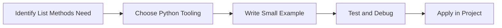

[Back to topic index](#list-methods)


---

# Tuples

## Overview
- **What is it?** Tuples are ordered, immutable collections.
- **Why is it important?** Represent fixed records and safe grouped values.
- **Where is it used?** Software teams, education, automation, analytics, and backend development.

## Learning Objectives
- Gain the practical skill to explain, write, debug, and review tuples code.
- Cover the vocabulary, syntax, workflow, edge cases, and professional habits behind tuples.
- Expected outcome: you can use tuples in a small project and recognize when it belongs in production code.

## Real World Applications
- **Industry use cases:** Software teams, education, automation, analytics, and backend development.
- **Business applications:** Reduce manual work, improve reliability, support reporting, automate decisions, and ship maintainable features.
- **Career relevance:** Supports Python developer, backend engineer, data engineer, AI engineer, DevOps engineer, QA automation, and cybersecurity automation roles.

## Core Concepts

### Mental Model
- **Definition:** The main idea that gives tuples its structure and purpose inside a Python program.
- **Visual explanation:** `problem -> Tuples model -> clear code`
- **Practical example:**

```python
apply_tuples_label = "Tuples"
print(apply_tuples_label)
```

### Execution Flow
- **Definition:** The ordered steps Python follows when tuples code is created, executed, or integrated.
- **Visual explanation:** `input -> Python operation -> result -> feedback`
- **Practical example:**

```python
coordinates = (4, 8)
print(coordinates[0])
```

### Quality Rule
- **Definition:** The reliability habit that keeps tuples understandable, testable, secure, and maintainable.
- **Visual explanation:** `working code -> validation -> production confidence`
- **Practical example:**

```python
def min_max(values):
    return min(values), max(values)

low, high = min_max([3, 9, 1])
print(low, high)
```

## Infographic Summary

| Infographic Block | Key Message |
| --- | --- |
| 📌 Concept | Tuples belongs to the core programming foundation part of Python mastery. |
| ⚡ Purpose | Represent fixed records and safe grouped values. |
| 🔥 Benefits | Coordinates, database rows, function returns, and dictionary keys. |
| 🎯 Use Cases | Software teams, education, automation, analytics, and backend development. |
| 🚀 Best Practices | Prefer readable names, small examples, explicit errors, tests, documentation, and version-aware choices. |
| ❌ Common Mistakes | Copying code without understanding it, ignoring edge cases, skipping validation, and mixing unrelated responsibilities. |

## Syntax Guide

### Basic Syntax

```python
point = (10, 20)
x, y = point
```

### Standard Structure

```python
def apply_tuples(value):
    """Apply the Tuples concept to one value."""
    return value

result = apply_tuples("practice")
print(result)
```

### Code Pattern

```python
# 1. Identify the Tuples problem
# 2. Apply the correct Python structure
# 3. Validate the result with tests or output
```

## Examples

### Beginner Example

```python
coordinates = (4, 8)
print(coordinates[0])
```

### Intermediate Example

```python
def min_max(values):
    return min(values), max(values)

low, high = min_max([3, 9, 1])
print(low, high)
```

### Advanced Example

```python
from typing import NamedTuple

class Point(NamedTuple):
    x: int
    y: int

print(Point(2, 5))
```

## Workflow Diagram

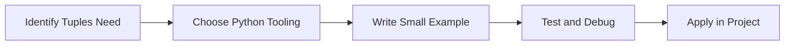

[Back to topic index](#tuples)


---

# Sets

## Overview
- **What is it?** Sets are unordered collections of unique values.
- **Why is it important?** Remove duplicates and perform membership or mathematical set operations.
- **Where is it used?** Software teams, education, automation, analytics, and backend development.

## Learning Objectives
- Gain the practical skill to explain, write, debug, and review sets code.
- Cover the vocabulary, syntax, workflow, edge cases, and professional habits behind sets.
- Expected outcome: you can use sets in a small project and recognize when it belongs in production code.

## Real World Applications
- **Industry use cases:** Software teams, education, automation, analytics, and backend development.
- **Business applications:** Reduce manual work, improve reliability, support reporting, automate decisions, and ship maintainable features.
- **Career relevance:** Supports Python developer, backend engineer, data engineer, AI engineer, DevOps engineer, QA automation, and cybersecurity automation roles.

## Core Concepts

### Mental Model
- **Definition:** The main idea that gives sets its structure and purpose inside a Python program.
- **Visual explanation:** `problem -> Sets model -> clear code`
- **Practical example:**

```python
apply_sets_label = "Sets"
print(apply_sets_label)
```

### Execution Flow
- **Definition:** The ordered steps Python follows when sets code is created, executed, or integrated.
- **Visual explanation:** `input -> Python operation -> result -> feedback`
- **Practical example:**

```python
names = {"Ada", "Ada", "Lin"}
print(names)
```

### Quality Rule
- **Definition:** The reliability habit that keeps sets understandable, testable, secure, and maintainable.
- **Visual explanation:** `working code -> validation -> production confidence`
- **Practical example:**

```python
required = {"python", "git"}
known = {"python", "sql", "git"}
print(required <= known)
```

## Infographic Summary

| Infographic Block | Key Message |
| --- | --- |
| 📌 Concept | Sets belongs to the core programming foundation part of Python mastery. |
| ⚡ Purpose | Remove duplicates and perform membership or mathematical set operations. |
| 🔥 Benefits | Access checks, tag comparisons, deduplication, and matching. |
| 🎯 Use Cases | Software teams, education, automation, analytics, and backend development. |
| 🚀 Best Practices | Prefer readable names, small examples, explicit errors, tests, documentation, and version-aware choices. |
| ❌ Common Mistakes | Copying code without understanding it, ignoring edge cases, skipping validation, and mixing unrelated responsibilities. |

## Syntax Guide

### Basic Syntax

```python
skills = {"python", "sql"}
skills.add("git")
```

### Standard Structure

```python
def apply_sets(value):
    """Apply the Sets concept to one value."""
    return value

result = apply_sets("practice")
print(result)
```

### Code Pattern

```python
# 1. Identify the Sets problem
# 2. Apply the correct Python structure
# 3. Validate the result with tests or output
```

## Examples

### Beginner Example

```python
names = {"Ada", "Ada", "Lin"}
print(names)
```

### Intermediate Example

```python
required = {"python", "git"}
known = {"python", "sql", "git"}
print(required <= known)
```

### Advanced Example

```python
active_users = {1, 2, 3}
paid_users = {2, 3, 4}
print(active_users & paid_users)
```

## Workflow Diagram

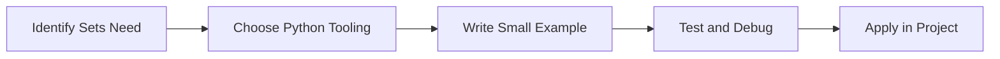

[Back to topic index](#sets)


---

# Dictionaries

## Overview
- **What is it?** Dictionaries map keys to values.
- **Why is it important?** Represent structured records and fast lookups.
- **Where is it used?** Software teams, education, automation, analytics, and backend development.

## Learning Objectives
- Gain the practical skill to explain, write, debug, and review dictionaries code.
- Cover the vocabulary, syntax, workflow, edge cases, and professional habits behind dictionaries.
- Expected outcome: you can use dictionaries in a small project and recognize when it belongs in production code.

## Real World Applications
- **Industry use cases:** Software teams, education, automation, analytics, and backend development.
- **Business applications:** Reduce manual work, improve reliability, support reporting, automate decisions, and ship maintainable features.
- **Career relevance:** Supports Python developer, backend engineer, data engineer, AI engineer, DevOps engineer, QA automation, and cybersecurity automation roles.

## Core Concepts

### Mental Model
- **Definition:** The main idea that gives dictionaries its structure and purpose inside a Python program.
- **Visual explanation:** `problem -> Dictionaries model -> clear code`
- **Practical example:**

```python
apply_dictionaries_label = "Dictionaries"
print(apply_dictionaries_label)
```

### Execution Flow
- **Definition:** The ordered steps Python follows when dictionaries code is created, executed, or integrated.
- **Visual explanation:** `input -> Python operation -> result -> feedback`
- **Practical example:**

```python
profile = {"name": "Lin", "age": 29}
print(profile["name"])
```

### Quality Rule
- **Definition:** The reliability habit that keeps dictionaries understandable, testable, secure, and maintainable.
- **Visual explanation:** `working code -> validation -> production confidence`
- **Practical example:**

```python
inventory = {"laptop": 3, "mouse": 10}
inventory["laptop"] -= 1
print(inventory)
```

## Infographic Summary

| Infographic Block | Key Message |
| --- | --- |
| 📌 Concept | Dictionaries belongs to the core programming foundation part of Python mastery. |
| ⚡ Purpose | Represent structured records and fast lookups. |
| 🔥 Benefits | JSON-like data, caches, configurations, indexes, and API payloads. |
| 🎯 Use Cases | Software teams, education, automation, analytics, and backend development. |
| 🚀 Best Practices | Prefer readable names, small examples, explicit errors, tests, documentation, and version-aware choices. |
| ❌ Common Mistakes | Copying code without understanding it, ignoring edge cases, skipping validation, and mixing unrelated responsibilities. |

## Syntax Guide

### Basic Syntax

```python
user = {"name": "Ada", "role": "admin"}
print(user["name"])
```

### Standard Structure

```python
def apply_dictionaries(value):
    """Apply the Dictionaries concept to one value."""
    return value

result = apply_dictionaries("practice")
print(result)
```

### Code Pattern

```python
# 1. Identify the Dictionaries problem
# 2. Apply the correct Python structure
# 3. Validate the result with tests or output
```

## Examples

### Beginner Example

```python
profile = {"name": "Lin", "age": 29}
print(profile["name"])
```

### Intermediate Example

```python
inventory = {"laptop": 3, "mouse": 10}
inventory["laptop"] -= 1
print(inventory)
```

### Advanced Example

```python
from collections import defaultdict

counts = defaultdict(int)
for word in ["api", "db", "api"]:
    counts[word] += 1
print(dict(counts))
```

## Workflow Diagram

```mermaid
flowchart LR
    A[Identify Dictionaries Need] --> B[Choose Python Tooling]
    B --> C[Write Small Example]
    C --> D[Test and Debug]
    D --> E[Apply in Project]
```

[Back to topic index](#dictionaries)


---

# Functions

## Overview
- **What is it?** Functions package reusable behavior behind a name.
- **Why is it important?** Reduce duplication and make programs easier to test.
- **Where is it used?** Software teams, education, automation, analytics, and backend development.

## Learning Objectives
- Gain the practical skill to explain, write, debug, and review functions code.
- Cover the vocabulary, syntax, workflow, edge cases, and professional habits behind functions.
- Expected outcome: you can use functions in a small project and recognize when it belongs in production code.

## Real World Applications
- **Industry use cases:** Software teams, education, automation, analytics, and backend development.
- **Business applications:** Reduce manual work, improve reliability, support reporting, automate decisions, and ship maintainable features.
- **Career relevance:** Supports Python developer, backend engineer, data engineer, AI engineer, DevOps engineer, QA automation, and cybersecurity automation roles.

## Core Concepts

### Mental Model
- **Definition:** The main idea that gives functions its structure and purpose inside a Python program.
- **Visual explanation:** `problem -> Functions model -> clear code`
- **Practical example:**

```python
apply_functions_label = "Functions"
print(apply_functions_label)
```

### Execution Flow
- **Definition:** The ordered steps Python follows when functions code is created, executed, or integrated.
- **Visual explanation:** `input -> Python operation -> result -> feedback`
- **Practical example:**

```python
def greet(name):
    print(f"Hello, {name}")

greet("Ada")
```

### Quality Rule
- **Definition:** The reliability habit that keeps functions understandable, testable, secure, and maintainable.
- **Visual explanation:** `working code -> validation -> production confidence`
- **Practical example:**

```python
def calculate_total(subtotal: float, tax_rate: float = 0.08) -> float:
    return subtotal * (1 + tax_rate)

print(calculate_total(100))
```

## Infographic Summary

| Infographic Block | Key Message |
| --- | --- |
| 📌 Concept | Functions belongs to the core programming foundation part of Python mastery. |
| ⚡ Purpose | Reduce duplication and make programs easier to test. |
| 🔥 Benefits | Business rules, utilities, service layers, and libraries. |
| 🎯 Use Cases | Software teams, education, automation, analytics, and backend development. |
| 🚀 Best Practices | Prefer readable names, small examples, explicit errors, tests, documentation, and version-aware choices. |
| ❌ Common Mistakes | Copying code without understanding it, ignoring edge cases, skipping validation, and mixing unrelated responsibilities. |

## Syntax Guide

### Basic Syntax

```python
def add(left, right):
    return left + right
```

### Standard Structure

```python
def apply_functions(value):
    """Apply the Functions concept to one value."""
    return value

result = apply_functions("practice")
print(result)
```

### Code Pattern

```python
# 1. Identify the Functions problem
# 2. Apply the correct Python structure
# 3. Validate the result with tests or output
```

## Examples

### Beginner Example

```python
def greet(name):
    print(f"Hello, {name}")

greet("Ada")
```

### Intermediate Example

```python
def calculate_total(subtotal: float, tax_rate: float = 0.08) -> float:
    return subtotal * (1 + tax_rate)

print(calculate_total(100))
```

### Advanced Example

```python
from functools import lru_cache

@lru_cache(maxsize=128)
def fibonacci(n: int) -> int:
    return n if n < 2 else fibonacci(n - 1) + fibonacci(n - 2)

print(fibonacci(10))
```

## Workflow Diagram

```mermaid
flowchart LR
    A[Identify Functions Need] --> B[Choose Python Tooling]
    B --> C[Write Small Example]
    C --> D[Test and Debug]
    D --> E[Apply in Project]
```

[Back to topic index](#functions)


---

# Arguments and Parameters

## Overview
- **What is it?** Parameters define function inputs; arguments are values passed at call time.
- **Why is it important?** Make functions flexible and reusable.
- **Where is it used?** Software teams, education, automation, analytics, and backend development.

## Learning Objectives
- Gain the practical skill to explain, write, debug, and review arguments and parameters code.
- Cover the vocabulary, syntax, workflow, edge cases, and professional habits behind arguments and parameters.
- Expected outcome: you can use arguments and parameters in a small project and recognize when it belongs in production code.

## Real World Applications
- **Industry use cases:** Software teams, education, automation, analytics, and backend development.
- **Business applications:** Reduce manual work, improve reliability, support reporting, automate decisions, and ship maintainable features.
- **Career relevance:** Supports Python developer, backend engineer, data engineer, AI engineer, DevOps engineer, QA automation, and cybersecurity automation roles.

## Core Concepts

### Mental Model
- **Definition:** The main idea that gives arguments and parameters its structure and purpose inside a Python program.
- **Visual explanation:** `problem -> Arguments and Parameters model -> clear code`
- **Practical example:**

```python
apply_arguments_and_parameters_label = "Arguments and Parameters"
print(apply_arguments_and_parameters_label)
```

### Execution Flow
- **Definition:** The ordered steps Python follows when arguments and parameters code is created, executed, or integrated.
- **Visual explanation:** `input -> Python operation -> result -> feedback`
- **Practical example:**

```python
def greet(name):
    print(f"Hello, {name}")

greet("Ada")
```

### Quality Rule
- **Definition:** The reliability habit that keeps arguments and parameters understandable, testable, secure, and maintainable.
- **Visual explanation:** `working code -> validation -> production confidence`
- **Practical example:**

```python
def calculate_total(subtotal: float, tax_rate: float = 0.08) -> float:
    return subtotal * (1 + tax_rate)

print(calculate_total(100))
```

## Infographic Summary

| Infographic Block | Key Message |
| --- | --- |
| 📌 Concept | Arguments and Parameters belongs to the core programming foundation part of Python mastery. |
| ⚡ Purpose | Make functions flexible and reusable. |
| 🔥 Benefits | APIs, callbacks, configuration, and reusable calculations. |
| 🎯 Use Cases | Software teams, education, automation, analytics, and backend development. |
| 🚀 Best Practices | Prefer readable names, small examples, explicit errors, tests, documentation, and version-aware choices. |
| ❌ Common Mistakes | Copying code without understanding it, ignoring edge cases, skipping validation, and mixing unrelated responsibilities. |

## Syntax Guide

### Basic Syntax

```python
def add(left, right):
    return left + right
```

### Standard Structure

```python
def apply_arguments_and_parameters(value):
    """Apply the Arguments and Parameters concept to one value."""
    return value

result = apply_arguments_and_parameters("practice")
print(result)
```

### Code Pattern

```python
# 1. Identify the Arguments and Parameters problem
# 2. Apply the correct Python structure
# 3. Validate the result with tests or output
```

## Examples

### Beginner Example

```python
def greet(name):
    print(f"Hello, {name}")

greet("Ada")
```

### Intermediate Example

```python
def calculate_total(subtotal: float, tax_rate: float = 0.08) -> float:
    return subtotal * (1 + tax_rate)

print(calculate_total(100))
```

### Advanced Example

```python
from functools import lru_cache

@lru_cache(maxsize=128)
def fibonacci(n: int) -> int:
    return n if n < 2 else fibonacci(n - 1) + fibonacci(n - 2)

print(fibonacci(10))
```

## Workflow Diagram

```mermaid
flowchart LR
    A[Identify Arguments and Parameters Need] --> B[Choose Python Tooling]
    B --> C[Write Small Example]
    C --> D[Test and Debug]
    D --> E[Apply in Project]
```

[Back to topic index](#arguments-and-parameters)


---

# Return Statements

## Overview
- **What is it?** Return statements send results back from functions.
- **Why is it important?** Separate computation from output and side effects.
- **Where is it used?** Software teams, education, automation, analytics, and backend development.

## Learning Objectives
- Gain the practical skill to explain, write, debug, and review return statements code.
- Cover the vocabulary, syntax, workflow, edge cases, and professional habits behind return statements.
- Expected outcome: you can use return statements in a small project and recognize when it belongs in production code.

## Real World Applications
- **Industry use cases:** Software teams, education, automation, analytics, and backend development.
- **Business applications:** Reduce manual work, improve reliability, support reporting, automate decisions, and ship maintainable features.
- **Career relevance:** Supports Python developer, backend engineer, data engineer, AI engineer, DevOps engineer, QA automation, and cybersecurity automation roles.

## Core Concepts

### Mental Model
- **Definition:** The main idea that gives return statements its structure and purpose inside a Python program.
- **Visual explanation:** `problem -> Return Statements model -> clear code`
- **Practical example:**

```python
apply_return_statements_label = "Return Statements"
print(apply_return_statements_label)
```

### Execution Flow
- **Definition:** The ordered steps Python follows when return statements code is created, executed, or integrated.
- **Visual explanation:** `input -> Python operation -> result -> feedback`
- **Practical example:**

```python
def greet(name):
    print(f"Hello, {name}")

greet("Ada")
```

### Quality Rule
- **Definition:** The reliability habit that keeps return statements understandable, testable, secure, and maintainable.
- **Visual explanation:** `working code -> validation -> production confidence`
- **Practical example:**

```python
def calculate_total(subtotal: float, tax_rate: float = 0.08) -> float:
    return subtotal * (1 + tax_rate)

print(calculate_total(100))
```

## Infographic Summary

| Infographic Block | Key Message |
| --- | --- |
| 📌 Concept | Return Statements belongs to the core programming foundation part of Python mastery. |
| ⚡ Purpose | Separate computation from output and side effects. |
| 🔥 Benefits | Composable logic, testing, pipelines, and service functions. |
| 🎯 Use Cases | Software teams, education, automation, analytics, and backend development. |
| 🚀 Best Practices | Prefer readable names, small examples, explicit errors, tests, documentation, and version-aware choices. |
| ❌ Common Mistakes | Copying code without understanding it, ignoring edge cases, skipping validation, and mixing unrelated responsibilities. |

## Syntax Guide

### Basic Syntax

```python
def add(left, right):
    return left + right
```

### Standard Structure

```python
def apply_return_statements(value):
    """Apply the Return Statements concept to one value."""
    return value

result = apply_return_statements("practice")
print(result)
```

### Code Pattern

```python
# 1. Identify the Return Statements problem
# 2. Apply the correct Python structure
# 3. Validate the result with tests or output
```

## Examples

### Beginner Example

```python
def greet(name):
    print(f"Hello, {name}")

greet("Ada")
```

### Intermediate Example

```python
def calculate_total(subtotal: float, tax_rate: float = 0.08) -> float:
    return subtotal * (1 + tax_rate)

print(calculate_total(100))
```

### Advanced Example

```python
from functools import lru_cache

@lru_cache(maxsize=128)
def fibonacci(n: int) -> int:
    return n if n < 2 else fibonacci(n - 1) + fibonacci(n - 2)

print(fibonacci(10))
```

## Workflow Diagram

```mermaid
flowchart LR
    A[Identify Return Statements Need] --> B[Choose Python Tooling]
    B --> C[Write Small Example]
    C --> D[Test and Debug]
    D --> E[Apply in Project]
```

[Back to topic index](#return-statements)


---

# Scope

## Overview
- **What is it?** Scope defines where names are visible and how they are resolved.
- **Why is it important?** Prevent accidental name collisions and hidden state bugs.
- **Where is it used?** Software teams, education, automation, analytics, and backend development.

## Learning Objectives
- Gain the practical skill to explain, write, debug, and review scope code.
- Cover the vocabulary, syntax, workflow, edge cases, and professional habits behind scope.
- Expected outcome: you can use scope in a small project and recognize when it belongs in production code.

## Real World Applications
- **Industry use cases:** Software teams, education, automation, analytics, and backend development.
- **Business applications:** Reduce manual work, improve reliability, support reporting, automate decisions, and ship maintainable features.
- **Career relevance:** Supports Python developer, backend engineer, data engineer, AI engineer, DevOps engineer, QA automation, and cybersecurity automation roles.

## Core Concepts

### Mental Model
- **Definition:** The main idea that gives scope its structure and purpose inside a Python program.
- **Visual explanation:** `problem -> Scope model -> clear code`
- **Practical example:**

```python
apply_scope_label = "Scope"
print(apply_scope_label)
```

### Execution Flow
- **Definition:** The ordered steps Python follows when scope code is created, executed, or integrated.
- **Visual explanation:** `input -> Python operation -> result -> feedback`
- **Practical example:**

```python
def greet(name):
    print(f"Hello, {name}")

greet("Ada")
```

### Quality Rule
- **Definition:** The reliability habit that keeps scope understandable, testable, secure, and maintainable.
- **Visual explanation:** `working code -> validation -> production confidence`
- **Practical example:**

```python
def calculate_total(subtotal: float, tax_rate: float = 0.08) -> float:
    return subtotal * (1 + tax_rate)

print(calculate_total(100))
```

## Infographic Summary

| Infographic Block | Key Message |
| --- | --- |
| 📌 Concept | Scope belongs to the core programming foundation part of Python mastery. |
| ⚡ Purpose | Prevent accidental name collisions and hidden state bugs. |
| 🔥 Benefits | Reliable functions, modules, closures, and classes. |
| 🎯 Use Cases | Software teams, education, automation, analytics, and backend development. |
| 🚀 Best Practices | Prefer readable names, small examples, explicit errors, tests, documentation, and version-aware choices. |
| ❌ Common Mistakes | Copying code without understanding it, ignoring edge cases, skipping validation, and mixing unrelated responsibilities. |

## Syntax Guide

### Basic Syntax

```python
def add(left, right):
    return left + right
```

### Standard Structure

```python
def apply_scope(value):
    """Apply the Scope concept to one value."""
    return value

result = apply_scope("practice")
print(result)
```

### Code Pattern

```python
# 1. Identify the Scope problem
# 2. Apply the correct Python structure
# 3. Validate the result with tests or output
```

## Examples

### Beginner Example

```python
def greet(name):
    print(f"Hello, {name}")

greet("Ada")
```

### Intermediate Example

```python
def calculate_total(subtotal: float, tax_rate: float = 0.08) -> float:
    return subtotal * (1 + tax_rate)

print(calculate_total(100))
```

### Advanced Example

```python
from functools import lru_cache

@lru_cache(maxsize=128)
def fibonacci(n: int) -> int:
    return n if n < 2 else fibonacci(n - 1) + fibonacci(n - 2)

print(fibonacci(10))
```

## Workflow Diagram

```mermaid
flowchart LR
    A[Identify Scope Need] --> B[Choose Python Tooling]
    B --> C[Write Small Example]
    C --> D[Test and Debug]
    D --> E[Apply in Project]
```

[Back to topic index](#scope)


---

# Lambda Functions

## Overview
- **What is it?** Lambda functions are small anonymous functions written as expressions.
- **Why is it important?** Pass simple behavior into higher-order functions.
- **Where is it used?** Software teams, education, automation, analytics, and backend development.

## Learning Objectives
- Gain the practical skill to explain, write, debug, and review lambda functions code.
- Cover the vocabulary, syntax, workflow, edge cases, and professional habits behind lambda functions.
- Expected outcome: you can use lambda functions in a small project and recognize when it belongs in production code.

## Real World Applications
- **Industry use cases:** Software teams, education, automation, analytics, and backend development.
- **Business applications:** Reduce manual work, improve reliability, support reporting, automate decisions, and ship maintainable features.
- **Career relevance:** Supports Python developer, backend engineer, data engineer, AI engineer, DevOps engineer, QA automation, and cybersecurity automation roles.

## Core Concepts

### Mental Model
- **Definition:** The main idea that gives lambda functions its structure and purpose inside a Python program.
- **Visual explanation:** `problem -> Lambda Functions model -> clear code`
- **Practical example:**

```python
apply_lambda_functions_label = "Lambda Functions"
print(apply_lambda_functions_label)
```

### Execution Flow
- **Definition:** The ordered steps Python follows when lambda functions code is created, executed, or integrated.
- **Visual explanation:** `input -> Python operation -> result -> feedback`
- **Practical example:**

```python
square = lambda number: number * number
print(square(5))
```

### Quality Rule
- **Definition:** The reliability habit that keeps lambda functions understandable, testable, secure, and maintainable.
- **Visual explanation:** `working code -> validation -> production confidence`
- **Practical example:**

```python
users = [{"name": "Ada", "score": 90}, {"name": "Lin", "score": 95}]
print(sorted(users, key=lambda user: user["score"]))
```

## Infographic Summary

| Infographic Block | Key Message |
| --- | --- |
| 📌 Concept | Lambda Functions belongs to the core programming foundation part of Python mastery. |
| ⚡ Purpose | Pass simple behavior into higher-order functions. |
| 🔥 Benefits | Sorting keys, quick transformations, callbacks, and filters. |
| 🎯 Use Cases | Software teams, education, automation, analytics, and backend development. |
| 🚀 Best Practices | Prefer readable names, small examples, explicit errors, tests, documentation, and version-aware choices. |
| ❌ Common Mistakes | Copying code without understanding it, ignoring edge cases, skipping validation, and mixing unrelated responsibilities. |

## Syntax Guide

### Basic Syntax

```python
double = lambda value: value * 2
print(double(4))
```

### Standard Structure

```python
def apply_lambda_functions(value):
    """Apply the Lambda Functions concept to one value."""
    return value

result = apply_lambda_functions("practice")
print(result)
```

### Code Pattern

```python
# 1. Identify the Lambda Functions problem
# 2. Apply the correct Python structure
# 3. Validate the result with tests or output
```

## Examples

### Beginner Example

```python
square = lambda number: number * number
print(square(5))
```

### Intermediate Example

```python
users = [{"name": "Ada", "score": 90}, {"name": "Lin", "score": 95}]
print(sorted(users, key=lambda user: user["score"]))
```

### Advanced Example

```python
from functools import reduce

product = reduce(lambda left, right: left * right, [2, 3, 4])
print(product)
```

## Workflow Diagram

```mermaid
flowchart LR
    A[Identify Lambda Functions Need] --> B[Choose Python Tooling]
    B --> C[Write Small Example]
    C --> D[Test and Debug]
    D --> E[Apply in Project]
```

[Back to topic index](#lambda-functions)


---

# Modules

## Overview
- **What is it?** Modules are Python files that expose reusable definitions.
- **Why is it important?** Organize code into importable units.
- **Where is it used?** Software teams, education, automation, analytics, and backend development.

## Learning Objectives
- Gain the practical skill to explain, write, debug, and review modules code.
- Cover the vocabulary, syntax, workflow, edge cases, and professional habits behind modules.
- Expected outcome: you can use modules in a small project and recognize when it belongs in production code.

## Real World Applications
- **Industry use cases:** Software teams, education, automation, analytics, and backend development.
- **Business applications:** Reduce manual work, improve reliability, support reporting, automate decisions, and ship maintainable features.
- **Career relevance:** Supports Python developer, backend engineer, data engineer, AI engineer, DevOps engineer, QA automation, and cybersecurity automation roles.

## Core Concepts

### Mental Model
- **Definition:** The main idea that gives modules its structure and purpose inside a Python program.
- **Visual explanation:** `problem -> Modules model -> clear code`
- **Practical example:**

```python
apply_modules_label = "Modules"
print(apply_modules_label)
```

### Execution Flow
- **Definition:** The ordered steps Python follows when modules code is created, executed, or integrated.
- **Visual explanation:** `input -> Python operation -> result -> feedback`
- **Practical example:**

```python
import platform
print(platform.python_version())
```

### Quality Rule
- **Definition:** The reliability habit that keeps modules understandable, testable, secure, and maintainable.
- **Visual explanation:** `working code -> validation -> production confidence`
- **Practical example:**

```python
import sys

if sys.version_info < (3, 12):
    raise RuntimeError("Python 3.12 or newer is recommended")
print("Python version is ready")
```

## Infographic Summary

| Infographic Block | Key Message |
| --- | --- |
| 📌 Concept | Modules belongs to the core programming foundation part of Python mastery. |
| ⚡ Purpose | Organize code into importable units. |
| 🔥 Benefits | Libraries, scripts, test helpers, and application boundaries. |
| 🎯 Use Cases | Software teams, education, automation, analytics, and backend development. |
| 🚀 Best Practices | Prefer readable names, small examples, explicit errors, tests, documentation, and version-aware choices. |
| ❌ Common Mistakes | Copying code without understanding it, ignoring edge cases, skipping validation, and mixing unrelated responsibilities. |

## Syntax Guide

### Basic Syntax

```python
import sys
print(sys.version)
print(sys.executable)
```

### Standard Structure

```python
def apply_modules(value):
    """Apply the Modules concept to one value."""
    return value

result = apply_modules("practice")
print(result)
```

### Code Pattern

```python
# 1. Identify the Modules problem
# 2. Apply the correct Python structure
# 3. Validate the result with tests or output
```

## Examples

### Beginner Example

```python
import platform
print(platform.python_version())
```

### Intermediate Example

```python
import sys

if sys.version_info < (3, 12):
    raise RuntimeError("Python 3.12 or newer is recommended")
print("Python version is ready")
```

### Advanced Example

```python
from pathlib import Path
import sys

project = Path.cwd()
print({"python": sys.version.split()[0], "project": project.name})
```

## Workflow Diagram

```mermaid
flowchart LR
    A[Identify Modules Need] --> B[Choose Python Tooling]
    B --> C[Write Small Example]
    C --> D[Test and Debug]
    D --> E[Apply in Project]
```

[Back to topic index](#modules)


---

# Packages

## Overview
- **What is it?** Packages are directories of modules organized with package metadata.
- **Why is it important?** Group related code into distributable namespaces.
- **Where is it used?** Software teams, education, automation, analytics, and backend development.

## Learning Objectives
- Gain the practical skill to explain, write, debug, and review packages code.
- Cover the vocabulary, syntax, workflow, edge cases, and professional habits behind packages.
- Expected outcome: you can use packages in a small project and recognize when it belongs in production code.

## Real World Applications
- **Industry use cases:** Software teams, education, automation, analytics, and backend development.
- **Business applications:** Reduce manual work, improve reliability, support reporting, automate decisions, and ship maintainable features.
- **Career relevance:** Supports Python developer, backend engineer, data engineer, AI engineer, DevOps engineer, QA automation, and cybersecurity automation roles.

## Core Concepts

### Mental Model
- **Definition:** The main idea that gives packages its structure and purpose inside a Python program.
- **Visual explanation:** `problem -> Packages model -> clear code`
- **Practical example:**

```python
apply_packages_label = "Packages"
print(apply_packages_label)
```

### Execution Flow
- **Definition:** The ordered steps Python follows when packages code is created, executed, or integrated.
- **Visual explanation:** `input -> Python operation -> result -> feedback`
- **Practical example:**

```python
import platform
print(platform.python_version())
```

### Quality Rule
- **Definition:** The reliability habit that keeps packages understandable, testable, secure, and maintainable.
- **Visual explanation:** `working code -> validation -> production confidence`
- **Practical example:**

```python
import sys

if sys.version_info < (3, 12):
    raise RuntimeError("Python 3.12 or newer is recommended")
print("Python version is ready")
```

## Infographic Summary

| Infographic Block | Key Message |
| --- | --- |
| 📌 Concept | Packages belongs to the core programming foundation part of Python mastery. |
| ⚡ Purpose | Group related code into distributable namespaces. |
| 🔥 Benefits | SDKs, applications, plugins, and shared internal libraries. |
| 🎯 Use Cases | Software teams, education, automation, analytics, and backend development. |
| 🚀 Best Practices | Prefer readable names, small examples, explicit errors, tests, documentation, and version-aware choices. |
| ❌ Common Mistakes | Copying code without understanding it, ignoring edge cases, skipping validation, and mixing unrelated responsibilities. |

## Syntax Guide

### Basic Syntax

```python
import sys
print(sys.version)
print(sys.executable)
```

### Standard Structure

```python
def apply_packages(value):
    """Apply the Packages concept to one value."""
    return value

result = apply_packages("practice")
print(result)
```

### Code Pattern

```python
# 1. Identify the Packages problem
# 2. Apply the correct Python structure
# 3. Validate the result with tests or output
```

## Examples

### Beginner Example

```python
import platform
print(platform.python_version())
```

### Intermediate Example

```python
import sys

if sys.version_info < (3, 12):
    raise RuntimeError("Python 3.12 or newer is recommended")
print("Python version is ready")
```

### Advanced Example

```python
from pathlib import Path
import sys

project = Path.cwd()
print({"python": sys.version.split()[0], "project": project.name})
```

## Workflow Diagram

```mermaid
flowchart LR
    A[Identify Packages Need] --> B[Choose Python Tooling]
    B --> C[Write Small Example]
    C --> D[Test and Debug]
    D --> E[Apply in Project]
```

[Back to topic index](#packages)


---

# Date and Time

## Overview
- **What is it?** Date and time APIs model timestamps, durations, calendars, and time zones.
- **Why is it important?** Handle scheduling and time-based business rules correctly.
- **Where is it used?** Software teams, education, automation, analytics, and backend development.

## Learning Objectives
- Gain the practical skill to explain, write, debug, and review date and time code.
- Cover the vocabulary, syntax, workflow, edge cases, and professional habits behind date and time.
- Expected outcome: you can use date and time in a small project and recognize when it belongs in production code.

## Real World Applications
- **Industry use cases:** Software teams, education, automation, analytics, and backend development.
- **Business applications:** Reduce manual work, improve reliability, support reporting, automate decisions, and ship maintainable features.
- **Career relevance:** Supports Python developer, backend engineer, data engineer, AI engineer, DevOps engineer, QA automation, and cybersecurity automation roles.

## Core Concepts

### Mental Model
- **Definition:** The main idea that gives date and time its structure and purpose inside a Python program.
- **Visual explanation:** `problem -> Date and Time model -> clear code`
- **Practical example:**

```python
apply_date_and_time_label = "Date and Time"
print(apply_date_and_time_label)
```

### Execution Flow
- **Definition:** The ordered steps Python follows when date and time code is created, executed, or integrated.
- **Visual explanation:** `input -> Python operation -> result -> feedback`
- **Practical example:**

```python
from datetime import date
print(date.today())
```

### Quality Rule
- **Definition:** The reliability habit that keeps date and time understandable, testable, secure, and maintainable.
- **Visual explanation:** `working code -> validation -> production confidence`
- **Practical example:**

```python
from datetime import datetime, timedelta

due_at = datetime(2026, 7, 13) + timedelta(days=14)
print(due_at.date())
```

## Infographic Summary

| Infographic Block | Key Message |
| --- | --- |
| 📌 Concept | Date and Time belongs to the core programming foundation part of Python mastery. |
| ⚡ Purpose | Handle scheduling and time-based business rules correctly. |
| 🔥 Benefits | Reports, logs, billing, reminders, and audit trails. |
| 🎯 Use Cases | Software teams, education, automation, analytics, and backend development. |
| 🚀 Best Practices | Prefer readable names, small examples, explicit errors, tests, documentation, and version-aware choices. |
| ❌ Common Mistakes | Copying code without understanding it, ignoring edge cases, skipping validation, and mixing unrelated responsibilities. |

## Syntax Guide

### Basic Syntax

```python
from datetime import datetime, timezone
now = datetime.now(timezone.utc)
```

### Standard Structure

```python
def apply_date_and_time(value):
    """Apply the Date and Time concept to one value."""
    return value

result = apply_date_and_time("practice")
print(result)
```

### Code Pattern

```python
# 1. Identify the Date and Time problem
# 2. Apply the correct Python structure
# 3. Validate the result with tests or output
```

## Examples

### Beginner Example

```python
from datetime import date
print(date.today())
```

### Intermediate Example

```python
from datetime import datetime, timedelta

due_at = datetime(2026, 7, 13) + timedelta(days=14)
print(due_at.date())
```

### Advanced Example

```python
from datetime import datetime
from zoneinfo import ZoneInfo

meeting = datetime(2026, 7, 13, 9, tzinfo=ZoneInfo("UTC"))
print(meeting.astimezone(ZoneInfo("Asia/Dubai")))
```

## Workflow Diagram

```mermaid
flowchart LR
    A[Identify Date and Time Need] --> B[Choose Python Tooling]
    B --> C[Write Small Example]
    C --> D[Test and Debug]
    D --> E[Apply in Project]
```

[Back to topic index](#date-and-time)


---

# Math Module

## Overview
- **What is it?** The math module provides numeric functions and constants.
- **Why is it important?** Perform reliable mathematical operations using the standard library.
- **Where is it used?** Software teams, education, automation, analytics, and backend development.

## Learning Objectives
- Gain the practical skill to explain, write, debug, and review math module code.
- Cover the vocabulary, syntax, workflow, edge cases, and professional habits behind math module.
- Expected outcome: you can use math module in a small project and recognize when it belongs in production code.

## Real World Applications
- **Industry use cases:** Software teams, education, automation, analytics, and backend development.
- **Business applications:** Reduce manual work, improve reliability, support reporting, automate decisions, and ship maintainable features.
- **Career relevance:** Supports Python developer, backend engineer, data engineer, AI engineer, DevOps engineer, QA automation, and cybersecurity automation roles.

## Core Concepts

### Mental Model
- **Definition:** The main idea that gives math module its structure and purpose inside a Python program.
- **Visual explanation:** `problem -> Math Module model -> clear code`
- **Practical example:**

```python
apply_math_module_label = "Math Module"
print(apply_math_module_label)
```

### Execution Flow
- **Definition:** The ordered steps Python follows when math module code is created, executed, or integrated.
- **Visual explanation:** `input -> Python operation -> result -> feedback`
- **Practical example:**

```python
import math
print(math.pi)
```

### Quality Rule
- **Definition:** The reliability habit that keeps math module understandable, testable, secure, and maintainable.
- **Visual explanation:** `working code -> validation -> production confidence`
- **Practical example:**

```python
import math

radius = 5
area = math.pi * math.pow(radius, 2)
print(round(area, 2))
```

## Infographic Summary

| Infographic Block | Key Message |
| --- | --- |
| 📌 Concept | Math Module belongs to the core programming foundation part of Python mastery. |
| ⚡ Purpose | Perform reliable mathematical operations using the standard library. |
| 🔥 Benefits | Finance, analytics, geometry, science, and simulations. |
| 🎯 Use Cases | Software teams, education, automation, analytics, and backend development. |
| 🚀 Best Practices | Prefer readable names, small examples, explicit errors, tests, documentation, and version-aware choices. |
| ❌ Common Mistakes | Copying code without understanding it, ignoring edge cases, skipping validation, and mixing unrelated responsibilities. |

## Syntax Guide

### Basic Syntax

```python
import math
print(math.sqrt(81))
```

### Standard Structure

```python
def apply_math_module(value):
    """Apply the Math Module concept to one value."""
    return value

result = apply_math_module("practice")
print(result)
```

### Code Pattern

```python
# 1. Identify the Math Module problem
# 2. Apply the correct Python structure
# 3. Validate the result with tests or output
```

## Examples

### Beginner Example

```python
import math
print(math.pi)
```

### Intermediate Example

```python
import math

radius = 5
area = math.pi * math.pow(radius, 2)
print(round(area, 2))
```

### Advanced Example

```python
import statistics

latencies = [120, 95, 140, 110]
print(statistics.mean(latencies), statistics.pstdev(latencies))
```

## Workflow Diagram

```mermaid
flowchart LR
    A[Identify Math Module Need] --> B[Choose Python Tooling]
    B --> C[Write Small Example]
    C --> D[Test and Debug]
    D --> E[Apply in Project]
```

[Back to topic index](#math-module)


---

# Random Module

## Overview
- **What is it?** The random module generates pseudo-random values.
- **Why is it important?** Support simulations, sampling, games, test data, and randomized decisions.
- **Where is it used?** Software teams, education, automation, analytics, and backend development.

## Learning Objectives
- Gain the practical skill to explain, write, debug, and review random module code.
- Cover the vocabulary, syntax, workflow, edge cases, and professional habits behind random module.
- Expected outcome: you can use random module in a small project and recognize when it belongs in production code.

## Real World Applications
- **Industry use cases:** Software teams, education, automation, analytics, and backend development.
- **Business applications:** Reduce manual work, improve reliability, support reporting, automate decisions, and ship maintainable features.
- **Career relevance:** Supports Python developer, backend engineer, data engineer, AI engineer, DevOps engineer, QA automation, and cybersecurity automation roles.

## Core Concepts

### Mental Model
- **Definition:** The main idea that gives random module its structure and purpose inside a Python program.
- **Visual explanation:** `problem -> Random Module model -> clear code`
- **Practical example:**

```python
apply_random_module_label = "Random Module"
print(apply_random_module_label)
```

### Execution Flow
- **Definition:** The ordered steps Python follows when random module code is created, executed, or integrated.
- **Visual explanation:** `input -> Python operation -> result -> feedback`
- **Practical example:**

```python
import random
print(random.choice(["red", "green", "blue"]))
```

### Quality Rule
- **Definition:** The reliability habit that keeps random module understandable, testable, secure, and maintainable.
- **Visual explanation:** `working code -> validation -> production confidence`
- **Practical example:**

```python
import random

sample = random.sample(range(100), k=5)
print(sample)
```

## Infographic Summary

| Infographic Block | Key Message |
| --- | --- |
| 📌 Concept | Random Module belongs to the core programming foundation part of Python mastery. |
| ⚡ Purpose | Support simulations, sampling, games, test data, and randomized decisions. |
| 🔥 Benefits | Experiments, demos, games, load tests, and statistical sampling. |
| 🎯 Use Cases | Software teams, education, automation, analytics, and backend development. |
| 🚀 Best Practices | Prefer readable names, small examples, explicit errors, tests, documentation, and version-aware choices. |
| ❌ Common Mistakes | Copying code without understanding it, ignoring edge cases, skipping validation, and mixing unrelated responsibilities. |

## Syntax Guide

### Basic Syntax

```python
import random
print(random.randint(1, 6))
```

### Standard Structure

```python
def apply_random_module(value):
    """Apply the Random Module concept to one value."""
    return value

result = apply_random_module("practice")
print(result)
```

### Code Pattern

```python
# 1. Identify the Random Module problem
# 2. Apply the correct Python structure
# 3. Validate the result with tests or output
```

## Examples

### Beginner Example

```python
import random
print(random.choice(["red", "green", "blue"]))
```

### Intermediate Example

```python
import random

sample = random.sample(range(100), k=5)
print(sample)
```

### Advanced Example

```python
import random

rng = random.Random(42)
print([rng.random() for _ in range(3)])
```

## Workflow Diagram

```mermaid
flowchart LR
    A[Identify Random Module Need] --> B[Choose Python Tooling]
    B --> C[Write Small Example]
    C --> D[Test and Debug]
    D --> E[Apply in Project]
```

[Back to topic index](#random-module)


---

# File Handling

## Overview
- **What is it?** File handling reads, writes, appends, and manages files safely.
- **Why is it important?** Persist and exchange data outside program memory.
- **Where is it used?** Software teams, education, automation, analytics, and backend development.

## Learning Objectives
- Gain the practical skill to explain, write, debug, and review file handling code.
- Cover the vocabulary, syntax, workflow, edge cases, and professional habits behind file handling.
- Expected outcome: you can use file handling in a small project and recognize when it belongs in production code.

## Real World Applications
- **Industry use cases:** Software teams, education, automation, analytics, and backend development.
- **Business applications:** Reduce manual work, improve reliability, support reporting, automate decisions, and ship maintainable features.
- **Career relevance:** Supports Python developer, backend engineer, data engineer, AI engineer, DevOps engineer, QA automation, and cybersecurity automation roles.

## Core Concepts

### Mental Model
- **Definition:** The main idea that gives file handling its structure and purpose inside a Python program.
- **Visual explanation:** `problem -> File Handling model -> clear code`
- **Practical example:**

```python
apply_file_handling_label = "File Handling"
print(apply_file_handling_label)
```

### Execution Flow
- **Definition:** The ordered steps Python follows when file handling code is created, executed, or integrated.
- **Visual explanation:** `input -> Python operation -> result -> feedback`
- **Practical example:**

```python
from pathlib import Path
Path("hello.txt").write_text("Hello file", encoding="utf-8")
print(Path("hello.txt").read_text(encoding="utf-8"))
```

### Quality Rule
- **Definition:** The reliability habit that keeps file handling understandable, testable, secure, and maintainable.
- **Visual explanation:** `working code -> validation -> production confidence`
- **Practical example:**

```python
from pathlib import Path

rows = ["name,score", "Ada,95"]
Path("scores.csv").write_text("\n".join(rows), encoding="utf-8")
```

## Infographic Summary

| Infographic Block | Key Message |
| --- | --- |
| 📌 Concept | File Handling belongs to the core programming foundation part of Python mastery. |
| ⚡ Purpose | Persist and exchange data outside program memory. |
| 🔥 Benefits | Logs, CSV imports, reports, configs, and backups. |
| 🎯 Use Cases | Software teams, education, automation, analytics, and backend development. |
| 🚀 Best Practices | Prefer readable names, small examples, explicit errors, tests, documentation, and version-aware choices. |
| ❌ Common Mistakes | Copying code without understanding it, ignoring edge cases, skipping validation, and mixing unrelated responsibilities. |

## Syntax Guide

### Basic Syntax

```python
from pathlib import Path
Path("notes.txt").write_text("hello", encoding="utf-8")
```

### Standard Structure

```python
def apply_file_handling(value):
    """Apply the File Handling concept to one value."""
    return value

result = apply_file_handling("practice")
print(result)
```

### Code Pattern

```python
# 1. Identify the File Handling problem
# 2. Apply the correct Python structure
# 3. Validate the result with tests or output
```

## Examples

### Beginner Example

```python
from pathlib import Path
Path("hello.txt").write_text("Hello file", encoding="utf-8")
print(Path("hello.txt").read_text(encoding="utf-8"))
```

### Intermediate Example

```python
from pathlib import Path

rows = ["name,score", "Ada,95"]
Path("scores.csv").write_text("\n".join(rows), encoding="utf-8")
```

### Advanced Example

```python
from pathlib import Path
import json

config = {"debug": False, "retries": 3}
Path("config.json").write_text(json.dumps(config, indent=2), encoding="utf-8")
```

## Workflow Diagram

```mermaid
flowchart LR
    A[Identify File Handling Need] --> B[Choose Python Tooling]
    B --> C[Write Small Example]
    C --> D[Test and Debug]
    D --> E[Apply in Project]
```

[Back to topic index](#file-handling)


---

# Exception Handling

## Overview
- **What is it?** Exception handling catches and responds to runtime failures.
- **Why is it important?** Keep programs understandable and resilient when things go wrong.
- **Where is it used?** Software teams, education, automation, analytics, and backend development.

## Learning Objectives
- Gain the practical skill to explain, write, debug, and review exception handling code.
- Cover the vocabulary, syntax, workflow, edge cases, and professional habits behind exception handling.
- Expected outcome: you can use exception handling in a small project and recognize when it belongs in production code.

## Real World Applications
- **Industry use cases:** Software teams, education, automation, analytics, and backend development.
- **Business applications:** Reduce manual work, improve reliability, support reporting, automate decisions, and ship maintainable features.
- **Career relevance:** Supports Python developer, backend engineer, data engineer, AI engineer, DevOps engineer, QA automation, and cybersecurity automation roles.

## Core Concepts

### Mental Model
- **Definition:** The main idea that gives exception handling its structure and purpose inside a Python program.
- **Visual explanation:** `problem -> Exception Handling model -> clear code`
- **Practical example:**

```python
apply_exception_handling_label = "Exception Handling"
print(apply_exception_handling_label)
```

### Execution Flow
- **Definition:** The ordered steps Python follows when exception handling code is created, executed, or integrated.
- **Visual explanation:** `input -> Python operation -> result -> feedback`
- **Practical example:**

```python
try:
    print(10 / 0)
except ZeroDivisionError:
    print("Cannot divide by zero")
```

### Quality Rule
- **Definition:** The reliability habit that keeps exception handling understandable, testable, secure, and maintainable.
- **Visual explanation:** `working code -> validation -> production confidence`
- **Practical example:**

```python
def parse_quantity(raw: str) -> int:
    try:
        return int(raw)
    except ValueError as exc:
        raise ValueError(f"Invalid quantity: {raw}") from exc

print(parse_quantity("12"))
```

## Infographic Summary

| Infographic Block | Key Message |
| --- | --- |
| 📌 Concept | Exception Handling belongs to the core programming foundation part of Python mastery. |
| ⚡ Purpose | Keep programs understandable and resilient when things go wrong. |
| 🔥 Benefits | API clients, validation, file IO, retries, and user-friendly errors. |
| 🎯 Use Cases | Software teams, education, automation, analytics, and backend development. |
| 🚀 Best Practices | Prefer readable names, small examples, explicit errors, tests, documentation, and version-aware choices. |
| ❌ Common Mistakes | Copying code without understanding it, ignoring edge cases, skipping validation, and mixing unrelated responsibilities. |

## Syntax Guide

### Basic Syntax

```python
try:
    value = int(raw_value)
except ValueError:
    value = 0
```

### Standard Structure

```python
def apply_exception_handling(value):
    """Apply the Exception Handling concept to one value."""
    return value

result = apply_exception_handling("practice")
print(result)
```

### Code Pattern

```python
# 1. Identify the Exception Handling problem
# 2. Apply the correct Python structure
# 3. Validate the result with tests or output
```

## Examples

### Beginner Example

```python
try:
    print(10 / 0)
except ZeroDivisionError:
    print("Cannot divide by zero")
```

### Intermediate Example

```python
def parse_quantity(raw: str) -> int:
    try:
        return int(raw)
    except ValueError as exc:
        raise ValueError(f"Invalid quantity: {raw}") from exc

print(parse_quantity("12"))
```

### Advanced Example

```python
class PaymentError(Exception):
    pass

def charge(amount: float) -> str:
    if amount <= 0:
        raise PaymentError("Amount must be positive")
    return "approved"

print(charge(10))
```

## Workflow Diagram

```mermaid
flowchart LR
    A[Identify Exception Handling Need] --> B[Choose Python Tooling]
    B --> C[Write Small Example]
    C --> D[Test and Debug]
    D --> E[Apply in Project]
```

[Back to topic index](#exception-handling)


---

# Debugging Basics

## Overview
- **What is it?** Debugging is the process of finding, understanding, and fixing defects.
- **Why is it important?** Use evidence instead of guesses when code behaves unexpectedly.
- **Where is it used?** Software teams, education, automation, analytics, and backend development.

## Learning Objectives
- Gain the practical skill to explain, write, debug, and review debugging basics code.
- Cover the vocabulary, syntax, workflow, edge cases, and professional habits behind debugging basics.
- Expected outcome: you can use debugging basics in a small project and recognize when it belongs in production code.

## Real World Applications
- **Industry use cases:** Software teams, education, automation, analytics, and backend development.
- **Business applications:** Reduce manual work, improve reliability, support reporting, automate decisions, and ship maintainable features.
- **Career relevance:** Supports Python developer, backend engineer, data engineer, AI engineer, DevOps engineer, QA automation, and cybersecurity automation roles.

## Core Concepts

### Mental Model
- **Definition:** The main idea that gives debugging basics its structure and purpose inside a Python program.
- **Visual explanation:** `problem -> Debugging Basics model -> clear code`
- **Practical example:**

```python
apply_debugging_basics_label = "Debugging Basics"
print(apply_debugging_basics_label)
```

### Execution Flow
- **Definition:** The ordered steps Python follows when debugging basics code is created, executed, or integrated.
- **Visual explanation:** `input -> Python operation -> result -> feedback`
- **Practical example:**

```python
topic = "Debugging Basics"
print(f"Learning {topic}")
```

### Quality Rule
- **Definition:** The reliability habit that keeps debugging basics understandable, testable, secure, and maintainable.
- **Visual explanation:** `working code -> validation -> production confidence`
- **Practical example:**

```python
def summarize_debugging_basics(items: list[str]) -> dict[str, int]:
    return {"topic_count": len(items), "unique_count": len(set(items))}

print(summarize_debugging_basics(["learn", "practice", "learn"]))
```

## Infographic Summary

| Infographic Block | Key Message |
| --- | --- |
| 📌 Concept | Debugging Basics belongs to the core programming foundation part of Python mastery. |
| ⚡ Purpose | Use evidence instead of guesses when code behaves unexpectedly. |
| 🔥 Benefits | Faster issue resolution, better tests, and reliable delivery. |
| 🎯 Use Cases | Software teams, education, automation, analytics, and backend development. |
| 🚀 Best Practices | Prefer readable names, small examples, explicit errors, tests, documentation, and version-aware choices. |
| ❌ Common Mistakes | Copying code without understanding it, ignoring edge cases, skipping validation, and mixing unrelated responsibilities. |

## Syntax Guide

### Basic Syntax

```python
topic_name = "Debugging Basics"
print(topic_name)
```

### Standard Structure

```python
def apply_debugging_basics(value):
    """Apply the Debugging Basics concept to one value."""
    return value

result = apply_debugging_basics("practice")
print(result)
```

### Code Pattern

```python
# 1. Identify the Debugging Basics problem
# 2. Apply the correct Python structure
# 3. Validate the result with tests or output
```

## Examples

### Beginner Example

```python
topic = "Debugging Basics"
print(f"Learning {topic}")
```

### Intermediate Example

```python
def summarize_debugging_basics(items: list[str]) -> dict[str, int]:
    return {"topic_count": len(items), "unique_count": len(set(items))}

print(summarize_debugging_basics(["learn", "practice", "learn"]))
```

### Advanced Example

```python
from dataclasses import dataclass

@dataclass(frozen=True)
class DebuggingBasicsOutcome:
    topic: str
    evidence: str

outcome = DebuggingBasicsOutcome("Debugging Basics", "production-ready understanding")
print(outcome)
```

## Workflow Diagram

```mermaid
flowchart LR
    A[Identify Debugging Basics Need] --> B[Choose Python Tooling]
    B --> C[Write Small Example]
    C --> D[Test and Debug]
    D --> E[Apply in Project]
```

[Back to topic index](#debugging-basics)


---

# Virtual Environments

## Overview
- **What is it?** Virtual environments isolate project dependencies from system Python and other projects.
- **Why is it important?** Keep packages reproducible and avoid version conflicts.
- **Where is it used?** Software teams, education, automation, analytics, and backend development.

## Learning Objectives
- Gain the practical skill to explain, write, debug, and review virtual environments code.
- Cover the vocabulary, syntax, workflow, edge cases, and professional habits behind virtual environments.
- Expected outcome: you can use virtual environments in a small project and recognize when it belongs in production code.

## Real World Applications
- **Industry use cases:** Software teams, education, automation, analytics, and backend development.
- **Business applications:** Reduce manual work, improve reliability, support reporting, automate decisions, and ship maintainable features.
- **Career relevance:** Supports Python developer, backend engineer, data engineer, AI engineer, DevOps engineer, QA automation, and cybersecurity automation roles.

## Core Concepts

### Mental Model
- **Definition:** The main idea that gives virtual environments its structure and purpose inside a Python program.
- **Visual explanation:** `problem -> Virtual Environments model -> clear code`
- **Practical example:**

```python
apply_virtual_environments_label = "Virtual Environments"
print(apply_virtual_environments_label)
```

### Execution Flow
- **Definition:** The ordered steps Python follows when virtual environments code is created, executed, or integrated.
- **Visual explanation:** `input -> Python operation -> result -> feedback`
- **Practical example:**

```python
import platform
print(platform.python_version())
```

### Quality Rule
- **Definition:** The reliability habit that keeps virtual environments understandable, testable, secure, and maintainable.
- **Visual explanation:** `working code -> validation -> production confidence`
- **Practical example:**

```python
import sys

if sys.version_info < (3, 12):
    raise RuntimeError("Python 3.12 or newer is recommended")
print("Python version is ready")
```

## Infographic Summary

| Infographic Block | Key Message |
| --- | --- |
| 📌 Concept | Virtual Environments belongs to the core programming foundation part of Python mastery. |
| ⚡ Purpose | Keep packages reproducible and avoid version conflicts. |
| 🔥 Benefits | Professional project setup, CI, collaboration, and deployments. |
| 🎯 Use Cases | Software teams, education, automation, analytics, and backend development. |
| 🚀 Best Practices | Prefer readable names, small examples, explicit errors, tests, documentation, and version-aware choices. |
| ❌ Common Mistakes | Copying code without understanding it, ignoring edge cases, skipping validation, and mixing unrelated responsibilities. |

## Syntax Guide

### Basic Syntax

```bash
python -m venv .venv
source .venv/bin/activate
python -m pip install requests
```

### Standard Structure

```python
def apply_virtual_environments(value):
    """Apply the Virtual Environments concept to one value."""
    return value

result = apply_virtual_environments("practice")
print(result)
```

### Code Pattern

```python
# 1. Identify the Virtual Environments problem
# 2. Apply the correct Python structure
# 3. Validate the result with tests or output
```

## Examples

### Beginner Example

```python
import platform
print(platform.python_version())
```

### Intermediate Example

```python
import sys

if sys.version_info < (3, 12):
    raise RuntimeError("Python 3.12 or newer is recommended")
print("Python version is ready")
```

### Advanced Example

```python
from pathlib import Path
import sys

project = Path.cwd()
print({"python": sys.version.split()[0], "project": project.name})
```

## Workflow Diagram

```mermaid
flowchart LR
    A[Identify Virtual Environments Need] --> B[Choose Python Tooling]
    B --> C[Write Small Example]
    C --> D[Test and Debug]
    D --> E[Apply in Project]
```

[Back to topic index](#virtual-environments)


---

# Basic Project Structure

## Overview
- **What is it?** Basic project structure organizes source code, tests, docs, and configuration into predictable folders.
- **Why is it important?** Make projects easier to navigate, test, and maintain.
- **Where is it used?** Software teams, education, automation, analytics, and backend development.

## Learning Objectives
- Gain the practical skill to explain, write, debug, and review basic project structure code.
- Cover the vocabulary, syntax, workflow, edge cases, and professional habits behind basic project structure.
- Expected outcome: you can use basic project structure in a small project and recognize when it belongs in production code.

## Real World Applications
- **Industry use cases:** Software teams, education, automation, analytics, and backend development.
- **Business applications:** Reduce manual work, improve reliability, support reporting, automate decisions, and ship maintainable features.
- **Career relevance:** Supports Python developer, backend engineer, data engineer, AI engineer, DevOps engineer, QA automation, and cybersecurity automation roles.

## Core Concepts

### Mental Model
- **Definition:** The main idea that gives basic project structure its structure and purpose inside a Python program.
- **Visual explanation:** `problem -> Basic Project Structure model -> clear code`
- **Practical example:**

```python
apply_basic_project_structure_label = "Basic Project Structure"
print(apply_basic_project_structure_label)
```

### Execution Flow
- **Definition:** The ordered steps Python follows when basic project structure code is created, executed, or integrated.
- **Visual explanation:** `input -> Python operation -> result -> feedback`
- **Practical example:**

```python
message = "Run this file from your IDE"
print(message)
```

### Quality Rule
- **Definition:** The reliability habit that keeps basic project structure understandable, testable, secure, and maintainable.
- **Visual explanation:** `working code -> validation -> production confidence`
- **Practical example:**

```python
def format_name(first: str, last: str) -> str:
    return f"{first.title()} {last.title()}"

print(format_name("ada", "lovelace"))
```

## Infographic Summary

| Infographic Block | Key Message |
| --- | --- |
| 📌 Concept | Basic Project Structure belongs to the core programming foundation part of Python mastery. |
| ⚡ Purpose | Make projects easier to navigate, test, and maintain. |
| 🔥 Benefits | Team collaboration, onboarding, packaging, and scaling. |
| 🎯 Use Cases | Software teams, education, automation, analytics, and backend development. |
| 🚀 Best Practices | Prefer readable names, small examples, explicit errors, tests, documentation, and version-aware choices. |
| ❌ Common Mistakes | Copying code without understanding it, ignoring edge cases, skipping validation, and mixing unrelated responsibilities. |

## Syntax Guide

### Basic Syntax

```python
def add(left: int, right: int) -> int:
    return left + right

print(add(2, 3))
```

### Standard Structure

```python
def apply_basic_project_structure(value):
    """Apply the Basic Project Structure concept to one value."""
    return value

result = apply_basic_project_structure("practice")
print(result)
```

### Code Pattern

```python
# 1. Identify the Basic Project Structure problem
# 2. Apply the correct Python structure
# 3. Validate the result with tests or output
```

## Examples

### Beginner Example

```python
message = "Run this file from your IDE"
print(message)
```

### Intermediate Example

```python
def format_name(first: str, last: str) -> str:
    return f"{first.title()} {last.title()}"

print(format_name("ada", "lovelace"))
```

### Advanced Example

```python
import pdb

values = [1, 2, 3]
total = sum(values)
# pdb.set_trace()
print(total)
```

## Workflow Diagram

```mermaid
flowchart LR
    A[Identify Basic Project Structure Need] --> B[Choose Python Tooling]
    B --> C[Write Small Example]
    C --> D[Test and Debug]
    D --> E[Apply in Project]
```

[Back to topic index](#basic-project-structure)


---

---

## Level 2: Intermediate

Develop professional engineering habits for larger projects, integration work, testing, and maintainability.

# Object Oriented Programming

## Overview
- **What is it?** Object Oriented Programming is a Python knowledge area focused on object-oriented design.
- **Why is it important?** Help developers apply object-oriented design techniques safely, clearly, and consistently.
- **Where is it used?** Domain modeling, application architecture, frameworks, and reusable components.

## Learning Objectives
- Gain the practical skill to explain, write, debug, and review object oriented programming code.
- Cover the vocabulary, syntax, workflow, edge cases, and professional habits behind object oriented programming.
- Expected outcome: you can use object oriented programming in a small project and recognize when it belongs in production code.

## Real World Applications
- **Industry use cases:** Domain modeling, application architecture, frameworks, and reusable components.
- **Business applications:** Reduce manual work, improve reliability, support reporting, automate decisions, and ship maintainable features.
- **Career relevance:** Supports Python developer, backend engineer, data engineer, AI engineer, DevOps engineer, QA automation, and cybersecurity automation roles.

## Core Concepts

### Model
- **Definition:** The main idea that gives object oriented programming its structure and purpose inside a Python program.
- **Visual explanation:** `problem -> Object Oriented Programming model -> clear code`
- **Practical example:**

```python
apply_object_oriented_programming_label = "Object Oriented Programming"
print(apply_object_oriented_programming_label)
```

### Interface
- **Definition:** The ordered steps Python follows when object oriented programming code is created, executed, or integrated.
- **Visual explanation:** `input -> Python operation -> result -> feedback`
- **Practical example:**

```python
class Dog:
    def speak(self):
        return "woof"

print(Dog().speak())
```

### Behavior Rule
- **Definition:** The reliability habit that keeps object oriented programming understandable, testable, secure, and maintainable.
- **Visual explanation:** `working code -> validation -> production confidence`
- **Practical example:**

```python
class Account:
    def __init__(self, balance: float = 0):
        self.balance = balance

    def deposit(self, amount: float) -> None:
        self.balance += amount

account = Account()
account.deposit(50)
print(account.balance)
```

## Infographic Summary

| Infographic Block | Key Message |
| --- | --- |
| 📌 Concept | Object Oriented Programming belongs to the object-oriented design part of Python mastery. |
| ⚡ Purpose | Help developers apply object-oriented design techniques safely, clearly, and consistently. |
| 🔥 Benefits | Stronger maintainability, better reliability, and more professional object-oriented design decisions. |
| 🎯 Use Cases | Domain modeling, application architecture, frameworks, and reusable components. |
| 🚀 Best Practices | Prefer readable names, small examples, explicit errors, tests, documentation, and version-aware choices. |
| ❌ Common Mistakes | Copying code without understanding it, ignoring edge cases, skipping validation, and mixing unrelated responsibilities. |

## Syntax Guide

### Basic Syntax

```python
class Customer:
    def __init__(self, name):
        self.name = name
```

### Standard Structure

```python
def apply_object_oriented_programming(value):
    """Apply the Object Oriented Programming concept to one value."""
    return value

result = apply_object_oriented_programming("practice")
print(result)
```

### Code Pattern

```python
# 1. Identify the Object Oriented Programming problem
# 2. Apply the correct Python structure
# 3. Validate the result with tests or output
```

## Examples

### Beginner Example

```python
class Dog:
    def speak(self):
        return "woof"

print(Dog().speak())
```

### Intermediate Example

```python
class Account:
    def __init__(self, balance: float = 0):
        self.balance = balance

    def deposit(self, amount: float) -> None:
        self.balance += amount

account = Account()
account.deposit(50)
print(account.balance)
```

### Advanced Example

```python
from dataclasses import dataclass

@dataclass
class Order:
    id: int
    total: float

    def is_large(self) -> bool:
        return self.total >= 1000

print(Order(1, 1200).is_large())
```

## Workflow Diagram

```mermaid
flowchart LR
    A[Identify Object Oriented Programming Need] --> B[Choose Python Tooling]
    B --> C[Write Small Example]
    C --> D[Test and Debug]
    D --> E[Apply in Project]
```

[Back to topic index](#object-oriented-programming)


---

# Classes

## Overview
- **What is it?** Classes is a Python knowledge area focused on object-oriented design.
- **Why is it important?** Help developers apply object-oriented design techniques safely, clearly, and consistently.
- **Where is it used?** Domain modeling, application architecture, frameworks, and reusable components.

## Learning Objectives
- Gain the practical skill to explain, write, debug, and review classes code.
- Cover the vocabulary, syntax, workflow, edge cases, and professional habits behind classes.
- Expected outcome: you can use classes in a small project and recognize when it belongs in production code.

## Real World Applications
- **Industry use cases:** Domain modeling, application architecture, frameworks, and reusable components.
- **Business applications:** Reduce manual work, improve reliability, support reporting, automate decisions, and ship maintainable features.
- **Career relevance:** Supports Python developer, backend engineer, data engineer, AI engineer, DevOps engineer, QA automation, and cybersecurity automation roles.

## Core Concepts

### Model
- **Definition:** The main idea that gives classes its structure and purpose inside a Python program.
- **Visual explanation:** `problem -> Classes model -> clear code`
- **Practical example:**

```python
apply_classes_label = "Classes"
print(apply_classes_label)
```

### Interface
- **Definition:** The ordered steps Python follows when classes code is created, executed, or integrated.
- **Visual explanation:** `input -> Python operation -> result -> feedback`
- **Practical example:**

```python
class Dog:
    def speak(self):
        return "woof"

print(Dog().speak())
```

### Behavior Rule
- **Definition:** The reliability habit that keeps classes understandable, testable, secure, and maintainable.
- **Visual explanation:** `working code -> validation -> production confidence`
- **Practical example:**

```python
class Account:
    def __init__(self, balance: float = 0):
        self.balance = balance

    def deposit(self, amount: float) -> None:
        self.balance += amount

account = Account()
account.deposit(50)
print(account.balance)
```

## Infographic Summary

| Infographic Block | Key Message |
| --- | --- |
| 📌 Concept | Classes belongs to the object-oriented design part of Python mastery. |
| ⚡ Purpose | Help developers apply object-oriented design techniques safely, clearly, and consistently. |
| 🔥 Benefits | Stronger maintainability, better reliability, and more professional object-oriented design decisions. |
| 🎯 Use Cases | Domain modeling, application architecture, frameworks, and reusable components. |
| 🚀 Best Practices | Prefer readable names, small examples, explicit errors, tests, documentation, and version-aware choices. |
| ❌ Common Mistakes | Copying code without understanding it, ignoring edge cases, skipping validation, and mixing unrelated responsibilities. |

## Syntax Guide

### Basic Syntax

```python
class Customer:
    def __init__(self, name):
        self.name = name
```

### Standard Structure

```python
def apply_classes(value):
    """Apply the Classes concept to one value."""
    return value

result = apply_classes("practice")
print(result)
```

### Code Pattern

```python
# 1. Identify the Classes problem
# 2. Apply the correct Python structure
# 3. Validate the result with tests or output
```

## Examples

### Beginner Example

```python
class Dog:
    def speak(self):
        return "woof"

print(Dog().speak())
```

### Intermediate Example

```python
class Account:
    def __init__(self, balance: float = 0):
        self.balance = balance

    def deposit(self, amount: float) -> None:
        self.balance += amount

account = Account()
account.deposit(50)
print(account.balance)
```

### Advanced Example

```python
from dataclasses import dataclass

@dataclass
class Order:
    id: int
    total: float

    def is_large(self) -> bool:
        return self.total >= 1000

print(Order(1, 1200).is_large())
```

## Workflow Diagram

```mermaid
flowchart LR
    A[Identify Classes Need] --> B[Choose Python Tooling]
    B --> C[Write Small Example]
    C --> D[Test and Debug]
    D --> E[Apply in Project]
```

[Back to topic index](#classes)


---

# Objects

## Overview
- **What is it?** Objects is a Python knowledge area focused on object-oriented design.
- **Why is it important?** Help developers apply object-oriented design techniques safely, clearly, and consistently.
- **Where is it used?** Domain modeling, application architecture, frameworks, and reusable components.

## Learning Objectives
- Gain the practical skill to explain, write, debug, and review objects code.
- Cover the vocabulary, syntax, workflow, edge cases, and professional habits behind objects.
- Expected outcome: you can use objects in a small project and recognize when it belongs in production code.

## Real World Applications
- **Industry use cases:** Domain modeling, application architecture, frameworks, and reusable components.
- **Business applications:** Reduce manual work, improve reliability, support reporting, automate decisions, and ship maintainable features.
- **Career relevance:** Supports Python developer, backend engineer, data engineer, AI engineer, DevOps engineer, QA automation, and cybersecurity automation roles.

## Core Concepts

### Model
- **Definition:** The main idea that gives objects its structure and purpose inside a Python program.
- **Visual explanation:** `problem -> Objects model -> clear code`
- **Practical example:**

```python
apply_objects_label = "Objects"
print(apply_objects_label)
```

### Interface
- **Definition:** The ordered steps Python follows when objects code is created, executed, or integrated.
- **Visual explanation:** `input -> Python operation -> result -> feedback`
- **Practical example:**

```python
class Dog:
    def speak(self):
        return "woof"

print(Dog().speak())
```

### Behavior Rule
- **Definition:** The reliability habit that keeps objects understandable, testable, secure, and maintainable.
- **Visual explanation:** `working code -> validation -> production confidence`
- **Practical example:**

```python
class Account:
    def __init__(self, balance: float = 0):
        self.balance = balance

    def deposit(self, amount: float) -> None:
        self.balance += amount

account = Account()
account.deposit(50)
print(account.balance)
```

## Infographic Summary

| Infographic Block | Key Message |
| --- | --- |
| 📌 Concept | Objects belongs to the object-oriented design part of Python mastery. |
| ⚡ Purpose | Help developers apply object-oriented design techniques safely, clearly, and consistently. |
| 🔥 Benefits | Stronger maintainability, better reliability, and more professional object-oriented design decisions. |
| 🎯 Use Cases | Domain modeling, application architecture, frameworks, and reusable components. |
| 🚀 Best Practices | Prefer readable names, small examples, explicit errors, tests, documentation, and version-aware choices. |
| ❌ Common Mistakes | Copying code without understanding it, ignoring edge cases, skipping validation, and mixing unrelated responsibilities. |

## Syntax Guide

### Basic Syntax

```python
class Customer:
    def __init__(self, name):
        self.name = name
```

### Standard Structure

```python
def apply_objects(value):
    """Apply the Objects concept to one value."""
    return value

result = apply_objects("practice")
print(result)
```

### Code Pattern

```python
# 1. Identify the Objects problem
# 2. Apply the correct Python structure
# 3. Validate the result with tests or output
```

## Examples

### Beginner Example

```python
class Dog:
    def speak(self):
        return "woof"

print(Dog().speak())
```

### Intermediate Example

```python
class Account:
    def __init__(self, balance: float = 0):
        self.balance = balance

    def deposit(self, amount: float) -> None:
        self.balance += amount

account = Account()
account.deposit(50)
print(account.balance)
```

### Advanced Example

```python
from dataclasses import dataclass

@dataclass
class Order:
    id: int
    total: float

    def is_large(self) -> bool:
        return self.total >= 1000

print(Order(1, 1200).is_large())
```

## Workflow Diagram

```mermaid
flowchart LR
    A[Identify Objects Need] --> B[Choose Python Tooling]
    B --> C[Write Small Example]
    C --> D[Test and Debug]
    D --> E[Apply in Project]
```

[Back to topic index](#objects)


---

# Constructors

## Overview
- **What is it?** Constructors is a Python knowledge area focused on object-oriented design.
- **Why is it important?** Help developers apply object-oriented design techniques safely, clearly, and consistently.
- **Where is it used?** Domain modeling, application architecture, frameworks, and reusable components.

## Learning Objectives
- Gain the practical skill to explain, write, debug, and review constructors code.
- Cover the vocabulary, syntax, workflow, edge cases, and professional habits behind constructors.
- Expected outcome: you can use constructors in a small project and recognize when it belongs in production code.

## Real World Applications
- **Industry use cases:** Domain modeling, application architecture, frameworks, and reusable components.
- **Business applications:** Reduce manual work, improve reliability, support reporting, automate decisions, and ship maintainable features.
- **Career relevance:** Supports Python developer, backend engineer, data engineer, AI engineer, DevOps engineer, QA automation, and cybersecurity automation roles.

## Core Concepts

### Mental Model
- **Definition:** The main idea that gives constructors its structure and purpose inside a Python program.
- **Visual explanation:** `problem -> Constructors model -> clear code`
- **Practical example:**

```python
apply_constructors_label = "Constructors"
print(apply_constructors_label)
```

### Execution Flow
- **Definition:** The ordered steps Python follows when constructors code is created, executed, or integrated.
- **Visual explanation:** `input -> Python operation -> result -> feedback`
- **Practical example:**

```python
class Dog:
    def speak(self):
        return "woof"

print(Dog().speak())
```

### Quality Rule
- **Definition:** The reliability habit that keeps constructors understandable, testable, secure, and maintainable.
- **Visual explanation:** `working code -> validation -> production confidence`
- **Practical example:**

```python
class Account:
    def __init__(self, balance: float = 0):
        self.balance = balance

    def deposit(self, amount: float) -> None:
        self.balance += amount

account = Account()
account.deposit(50)
print(account.balance)
```

## Infographic Summary

| Infographic Block | Key Message |
| --- | --- |
| 📌 Concept | Constructors belongs to the object-oriented design part of Python mastery. |
| ⚡ Purpose | Help developers apply object-oriented design techniques safely, clearly, and consistently. |
| 🔥 Benefits | Stronger maintainability, better reliability, and more professional object-oriented design decisions. |
| 🎯 Use Cases | Domain modeling, application architecture, frameworks, and reusable components. |
| 🚀 Best Practices | Prefer readable names, small examples, explicit errors, tests, documentation, and version-aware choices. |
| ❌ Common Mistakes | Copying code without understanding it, ignoring edge cases, skipping validation, and mixing unrelated responsibilities. |

## Syntax Guide

### Basic Syntax

```python
class Customer:
    def __init__(self, name):
        self.name = name
```

### Standard Structure

```python
def apply_constructors(value):
    """Apply the Constructors concept to one value."""
    return value

result = apply_constructors("practice")
print(result)
```

### Code Pattern

```python
# 1. Identify the Constructors problem
# 2. Apply the correct Python structure
# 3. Validate the result with tests or output
```

## Examples

### Beginner Example

```python
class Dog:
    def speak(self):
        return "woof"

print(Dog().speak())
```

### Intermediate Example

```python
class Account:
    def __init__(self, balance: float = 0):
        self.balance = balance

    def deposit(self, amount: float) -> None:
        self.balance += amount

account = Account()
account.deposit(50)
print(account.balance)
```

### Advanced Example

```python
from dataclasses import dataclass

@dataclass
class Order:
    id: int
    total: float

    def is_large(self) -> bool:
        return self.total >= 1000

print(Order(1, 1200).is_large())
```

## Workflow Diagram

```mermaid
flowchart LR
    A[Identify Constructors Need] --> B[Choose Python Tooling]
    B --> C[Write Small Example]
    C --> D[Test and Debug]
    D --> E[Apply in Project]
```

[Back to topic index](#constructors)


---

# Encapsulation

## Overview
- **What is it?** Encapsulation is a Python knowledge area focused on object-oriented design.
- **Why is it important?** Help developers apply object-oriented design techniques safely, clearly, and consistently.
- **Where is it used?** Domain modeling, application architecture, frameworks, and reusable components.

## Learning Objectives
- Gain the practical skill to explain, write, debug, and review encapsulation code.
- Cover the vocabulary, syntax, workflow, edge cases, and professional habits behind encapsulation.
- Expected outcome: you can use encapsulation in a small project and recognize when it belongs in production code.

## Real World Applications
- **Industry use cases:** Domain modeling, application architecture, frameworks, and reusable components.
- **Business applications:** Reduce manual work, improve reliability, support reporting, automate decisions, and ship maintainable features.
- **Career relevance:** Supports Python developer, backend engineer, data engineer, AI engineer, DevOps engineer, QA automation, and cybersecurity automation roles.

## Core Concepts

### Mental Model
- **Definition:** The main idea that gives encapsulation its structure and purpose inside a Python program.
- **Visual explanation:** `problem -> Encapsulation model -> clear code`
- **Practical example:**

```python
apply_encapsulation_label = "Encapsulation"
print(apply_encapsulation_label)
```

### Execution Flow
- **Definition:** The ordered steps Python follows when encapsulation code is created, executed, or integrated.
- **Visual explanation:** `input -> Python operation -> result -> feedback`
- **Practical example:**

```python
class Dog:
    def speak(self):
        return "woof"

print(Dog().speak())
```

### Quality Rule
- **Definition:** The reliability habit that keeps encapsulation understandable, testable, secure, and maintainable.
- **Visual explanation:** `working code -> validation -> production confidence`
- **Practical example:**

```python
class Account:
    def __init__(self, balance: float = 0):
        self.balance = balance

    def deposit(self, amount: float) -> None:
        self.balance += amount

account = Account()
account.deposit(50)
print(account.balance)
```

## Infographic Summary

| Infographic Block | Key Message |
| --- | --- |
| 📌 Concept | Encapsulation belongs to the object-oriented design part of Python mastery. |
| ⚡ Purpose | Help developers apply object-oriented design techniques safely, clearly, and consistently. |
| 🔥 Benefits | Stronger maintainability, better reliability, and more professional object-oriented design decisions. |
| 🎯 Use Cases | Domain modeling, application architecture, frameworks, and reusable components. |
| 🚀 Best Practices | Prefer readable names, small examples, explicit errors, tests, documentation, and version-aware choices. |
| ❌ Common Mistakes | Copying code without understanding it, ignoring edge cases, skipping validation, and mixing unrelated responsibilities. |

## Syntax Guide

### Basic Syntax

```python
class Customer:
    def __init__(self, name):
        self.name = name
```

### Standard Structure

```python
def apply_encapsulation(value):
    """Apply the Encapsulation concept to one value."""
    return value

result = apply_encapsulation("practice")
print(result)
```

### Code Pattern

```python
# 1. Identify the Encapsulation problem
# 2. Apply the correct Python structure
# 3. Validate the result with tests or output
```

## Examples

### Beginner Example

```python
class Dog:
    def speak(self):
        return "woof"

print(Dog().speak())
```

### Intermediate Example

```python
class Account:
    def __init__(self, balance: float = 0):
        self.balance = balance

    def deposit(self, amount: float) -> None:
        self.balance += amount

account = Account()
account.deposit(50)
print(account.balance)
```

### Advanced Example

```python
from dataclasses import dataclass

@dataclass
class Order:
    id: int
    total: float

    def is_large(self) -> bool:
        return self.total >= 1000

print(Order(1, 1200).is_large())
```

## Workflow Diagram

```mermaid
flowchart LR
    A[Identify Encapsulation Need] --> B[Choose Python Tooling]
    B --> C[Write Small Example]
    C --> D[Test and Debug]
    D --> E[Apply in Project]
```

[Back to topic index](#encapsulation)


---

# Inheritance

## Overview
- **What is it?** Inheritance is a Python knowledge area focused on object-oriented design.
- **Why is it important?** Help developers apply object-oriented design techniques safely, clearly, and consistently.
- **Where is it used?** Domain modeling, application architecture, frameworks, and reusable components.

## Learning Objectives
- Gain the practical skill to explain, write, debug, and review inheritance code.
- Cover the vocabulary, syntax, workflow, edge cases, and professional habits behind inheritance.
- Expected outcome: you can use inheritance in a small project and recognize when it belongs in production code.

## Real World Applications
- **Industry use cases:** Domain modeling, application architecture, frameworks, and reusable components.
- **Business applications:** Reduce manual work, improve reliability, support reporting, automate decisions, and ship maintainable features.
- **Career relevance:** Supports Python developer, backend engineer, data engineer, AI engineer, DevOps engineer, QA automation, and cybersecurity automation roles.

## Core Concepts

### Model
- **Definition:** The main idea that gives inheritance its structure and purpose inside a Python program.
- **Visual explanation:** `problem -> Inheritance model -> clear code`
- **Practical example:**

```python
apply_inheritance_label = "Inheritance"
print(apply_inheritance_label)
```

### Interface
- **Definition:** The ordered steps Python follows when inheritance code is created, executed, or integrated.
- **Visual explanation:** `input -> Python operation -> result -> feedback`
- **Practical example:**

```python
class Dog:
    def speak(self):
        return "woof"

print(Dog().speak())
```

### Behavior Rule
- **Definition:** The reliability habit that keeps inheritance understandable, testable, secure, and maintainable.
- **Visual explanation:** `working code -> validation -> production confidence`
- **Practical example:**

```python
class Account:
    def __init__(self, balance: float = 0):
        self.balance = balance

    def deposit(self, amount: float) -> None:
        self.balance += amount

account = Account()
account.deposit(50)
print(account.balance)
```

## Infographic Summary

| Infographic Block | Key Message |
| --- | --- |
| 📌 Concept | Inheritance belongs to the object-oriented design part of Python mastery. |
| ⚡ Purpose | Help developers apply object-oriented design techniques safely, clearly, and consistently. |
| 🔥 Benefits | Stronger maintainability, better reliability, and more professional object-oriented design decisions. |
| 🎯 Use Cases | Domain modeling, application architecture, frameworks, and reusable components. |
| 🚀 Best Practices | Prefer readable names, small examples, explicit errors, tests, documentation, and version-aware choices. |
| ❌ Common Mistakes | Copying code without understanding it, ignoring edge cases, skipping validation, and mixing unrelated responsibilities. |

## Syntax Guide

### Basic Syntax

```python
class Customer:
    def __init__(self, name):
        self.name = name
```

### Standard Structure

```python
def apply_inheritance(value):
    """Apply the Inheritance concept to one value."""
    return value

result = apply_inheritance("practice")
print(result)
```

### Code Pattern

```python
# 1. Identify the Inheritance problem
# 2. Apply the correct Python structure
# 3. Validate the result with tests or output
```

## Examples

### Beginner Example

```python
class Dog:
    def speak(self):
        return "woof"

print(Dog().speak())
```

### Intermediate Example

```python
class Account:
    def __init__(self, balance: float = 0):
        self.balance = balance

    def deposit(self, amount: float) -> None:
        self.balance += amount

account = Account()
account.deposit(50)
print(account.balance)
```

### Advanced Example

```python
from dataclasses import dataclass

@dataclass
class Order:
    id: int
    total: float

    def is_large(self) -> bool:
        return self.total >= 1000

print(Order(1, 1200).is_large())
```

## Workflow Diagram

```mermaid
flowchart LR
    A[Identify Inheritance Need] --> B[Choose Python Tooling]
    B --> C[Write Small Example]
    C --> D[Test and Debug]
    D --> E[Apply in Project]
```

[Back to topic index](#inheritance)


---

# Polymorphism

## Overview
- **What is it?** Polymorphism is a Python knowledge area focused on object-oriented design.
- **Why is it important?** Help developers apply object-oriented design techniques safely, clearly, and consistently.
- **Where is it used?** Domain modeling, application architecture, frameworks, and reusable components.

## Learning Objectives
- Gain the practical skill to explain, write, debug, and review polymorphism code.
- Cover the vocabulary, syntax, workflow, edge cases, and professional habits behind polymorphism.
- Expected outcome: you can use polymorphism in a small project and recognize when it belongs in production code.

## Real World Applications
- **Industry use cases:** Domain modeling, application architecture, frameworks, and reusable components.
- **Business applications:** Reduce manual work, improve reliability, support reporting, automate decisions, and ship maintainable features.
- **Career relevance:** Supports Python developer, backend engineer, data engineer, AI engineer, DevOps engineer, QA automation, and cybersecurity automation roles.

## Core Concepts

### Model
- **Definition:** The main idea that gives polymorphism its structure and purpose inside a Python program.
- **Visual explanation:** `problem -> Polymorphism model -> clear code`
- **Practical example:**

```python
apply_polymorphism_label = "Polymorphism"
print(apply_polymorphism_label)
```

### Interface
- **Definition:** The ordered steps Python follows when polymorphism code is created, executed, or integrated.
- **Visual explanation:** `input -> Python operation -> result -> feedback`
- **Practical example:**

```python
class Dog:
    def speak(self):
        return "woof"

print(Dog().speak())
```

### Behavior Rule
- **Definition:** The reliability habit that keeps polymorphism understandable, testable, secure, and maintainable.
- **Visual explanation:** `working code -> validation -> production confidence`
- **Practical example:**

```python
class Account:
    def __init__(self, balance: float = 0):
        self.balance = balance

    def deposit(self, amount: float) -> None:
        self.balance += amount

account = Account()
account.deposit(50)
print(account.balance)
```

## Infographic Summary

| Infographic Block | Key Message |
| --- | --- |
| 📌 Concept | Polymorphism belongs to the object-oriented design part of Python mastery. |
| ⚡ Purpose | Help developers apply object-oriented design techniques safely, clearly, and consistently. |
| 🔥 Benefits | Stronger maintainability, better reliability, and more professional object-oriented design decisions. |
| 🎯 Use Cases | Domain modeling, application architecture, frameworks, and reusable components. |
| 🚀 Best Practices | Prefer readable names, small examples, explicit errors, tests, documentation, and version-aware choices. |
| ❌ Common Mistakes | Copying code without understanding it, ignoring edge cases, skipping validation, and mixing unrelated responsibilities. |

## Syntax Guide

### Basic Syntax

```python
class Customer:
    def __init__(self, name):
        self.name = name
```

### Standard Structure

```python
def apply_polymorphism(value):
    """Apply the Polymorphism concept to one value."""
    return value

result = apply_polymorphism("practice")
print(result)
```

### Code Pattern

```python
# 1. Identify the Polymorphism problem
# 2. Apply the correct Python structure
# 3. Validate the result with tests or output
```

## Examples

### Beginner Example

```python
class Dog:
    def speak(self):
        return "woof"

print(Dog().speak())
```

### Intermediate Example

```python
class Account:
    def __init__(self, balance: float = 0):
        self.balance = balance

    def deposit(self, amount: float) -> None:
        self.balance += amount

account = Account()
account.deposit(50)
print(account.balance)
```

### Advanced Example

```python
from dataclasses import dataclass

@dataclass
class Order:
    id: int
    total: float

    def is_large(self) -> bool:
        return self.total >= 1000

print(Order(1, 1200).is_large())
```

## Workflow Diagram

```mermaid
flowchart LR
    A[Identify Polymorphism Need] --> B[Choose Python Tooling]
    B --> C[Write Small Example]
    C --> D[Test and Debug]
    D --> E[Apply in Project]
```

[Back to topic index](#polymorphism)


---

# Abstraction

## Overview
- **What is it?** Abstraction is a Python knowledge area focused on object-oriented design.
- **Why is it important?** Help developers apply object-oriented design techniques safely, clearly, and consistently.
- **Where is it used?** Domain modeling, application architecture, frameworks, and reusable components.

## Learning Objectives
- Gain the practical skill to explain, write, debug, and review abstraction code.
- Cover the vocabulary, syntax, workflow, edge cases, and professional habits behind abstraction.
- Expected outcome: you can use abstraction in a small project and recognize when it belongs in production code.

## Real World Applications
- **Industry use cases:** Domain modeling, application architecture, frameworks, and reusable components.
- **Business applications:** Reduce manual work, improve reliability, support reporting, automate decisions, and ship maintainable features.
- **Career relevance:** Supports Python developer, backend engineer, data engineer, AI engineer, DevOps engineer, QA automation, and cybersecurity automation roles.

## Core Concepts

### Model
- **Definition:** The main idea that gives abstraction its structure and purpose inside a Python program.
- **Visual explanation:** `problem -> Abstraction model -> clear code`
- **Practical example:**

```python
apply_abstraction_label = "Abstraction"
print(apply_abstraction_label)
```

### Interface
- **Definition:** The ordered steps Python follows when abstraction code is created, executed, or integrated.
- **Visual explanation:** `input -> Python operation -> result -> feedback`
- **Practical example:**

```python
class Dog:
    def speak(self):
        return "woof"

print(Dog().speak())
```

### Behavior Rule
- **Definition:** The reliability habit that keeps abstraction understandable, testable, secure, and maintainable.
- **Visual explanation:** `working code -> validation -> production confidence`
- **Practical example:**

```python
class Account:
    def __init__(self, balance: float = 0):
        self.balance = balance

    def deposit(self, amount: float) -> None:
        self.balance += amount

account = Account()
account.deposit(50)
print(account.balance)
```

## Infographic Summary

| Infographic Block | Key Message |
| --- | --- |
| 📌 Concept | Abstraction belongs to the object-oriented design part of Python mastery. |
| ⚡ Purpose | Help developers apply object-oriented design techniques safely, clearly, and consistently. |
| 🔥 Benefits | Stronger maintainability, better reliability, and more professional object-oriented design decisions. |
| 🎯 Use Cases | Domain modeling, application architecture, frameworks, and reusable components. |
| 🚀 Best Practices | Prefer readable names, small examples, explicit errors, tests, documentation, and version-aware choices. |
| ❌ Common Mistakes | Copying code without understanding it, ignoring edge cases, skipping validation, and mixing unrelated responsibilities. |

## Syntax Guide

### Basic Syntax

```python
class Customer:
    def __init__(self, name):
        self.name = name
```

### Standard Structure

```python
def apply_abstraction(value):
    """Apply the Abstraction concept to one value."""
    return value

result = apply_abstraction("practice")
print(result)
```

### Code Pattern

```python
# 1. Identify the Abstraction problem
# 2. Apply the correct Python structure
# 3. Validate the result with tests or output
```

## Examples

### Beginner Example

```python
class Dog:
    def speak(self):
        return "woof"

print(Dog().speak())
```

### Intermediate Example

```python
class Account:
    def __init__(self, balance: float = 0):
        self.balance = balance

    def deposit(self, amount: float) -> None:
        self.balance += amount

account = Account()
account.deposit(50)
print(account.balance)
```

### Advanced Example

```python
from dataclasses import dataclass

@dataclass
class Order:
    id: int
    total: float

    def is_large(self) -> bool:
        return self.total >= 1000

print(Order(1, 1200).is_large())
```

## Workflow Diagram

```mermaid
flowchart LR
    A[Identify Abstraction Need] --> B[Choose Python Tooling]
    B --> C[Write Small Example]
    C --> D[Test and Debug]
    D --> E[Apply in Project]
```

[Back to topic index](#abstraction)


---

# Magic Methods

## Overview
- **What is it?** Magic Methods is a Python knowledge area focused on object-oriented design.
- **Why is it important?** Help developers apply object-oriented design techniques safely, clearly, and consistently.
- **Where is it used?** Domain modeling, application architecture, frameworks, and reusable components.

## Learning Objectives
- Gain the practical skill to explain, write, debug, and review magic methods code.
- Cover the vocabulary, syntax, workflow, edge cases, and professional habits behind magic methods.
- Expected outcome: you can use magic methods in a small project and recognize when it belongs in production code.

## Real World Applications
- **Industry use cases:** Domain modeling, application architecture, frameworks, and reusable components.
- **Business applications:** Reduce manual work, improve reliability, support reporting, automate decisions, and ship maintainable features.
- **Career relevance:** Supports Python developer, backend engineer, data engineer, AI engineer, DevOps engineer, QA automation, and cybersecurity automation roles.

## Core Concepts

### Model
- **Definition:** The main idea that gives magic methods its structure and purpose inside a Python program.
- **Visual explanation:** `problem -> Magic Methods model -> clear code`
- **Practical example:**

```python
apply_magic_methods_label = "Magic Methods"
print(apply_magic_methods_label)
```

### Interface
- **Definition:** The ordered steps Python follows when magic methods code is created, executed, or integrated.
- **Visual explanation:** `input -> Python operation -> result -> feedback`
- **Practical example:**

```python
class Dog:
    def speak(self):
        return "woof"

print(Dog().speak())
```

### Behavior Rule
- **Definition:** The reliability habit that keeps magic methods understandable, testable, secure, and maintainable.
- **Visual explanation:** `working code -> validation -> production confidence`
- **Practical example:**

```python
class Account:
    def __init__(self, balance: float = 0):
        self.balance = balance

    def deposit(self, amount: float) -> None:
        self.balance += amount

account = Account()
account.deposit(50)
print(account.balance)
```

## Infographic Summary

| Infographic Block | Key Message |
| --- | --- |
| 📌 Concept | Magic Methods belongs to the object-oriented design part of Python mastery. |
| ⚡ Purpose | Help developers apply object-oriented design techniques safely, clearly, and consistently. |
| 🔥 Benefits | Stronger maintainability, better reliability, and more professional object-oriented design decisions. |
| 🎯 Use Cases | Domain modeling, application architecture, frameworks, and reusable components. |
| 🚀 Best Practices | Prefer readable names, small examples, explicit errors, tests, documentation, and version-aware choices. |
| ❌ Common Mistakes | Copying code without understanding it, ignoring edge cases, skipping validation, and mixing unrelated responsibilities. |

## Syntax Guide

### Basic Syntax

```python
class Customer:
    def __init__(self, name):
        self.name = name
```

### Standard Structure

```python
def apply_magic_methods(value):
    """Apply the Magic Methods concept to one value."""
    return value

result = apply_magic_methods("practice")
print(result)
```

### Code Pattern

```python
# 1. Identify the Magic Methods problem
# 2. Apply the correct Python structure
# 3. Validate the result with tests or output
```

## Examples

### Beginner Example

```python
class Dog:
    def speak(self):
        return "woof"

print(Dog().speak())
```

### Intermediate Example

```python
class Account:
    def __init__(self, balance: float = 0):
        self.balance = balance

    def deposit(self, amount: float) -> None:
        self.balance += amount

account = Account()
account.deposit(50)
print(account.balance)
```

### Advanced Example

```python
from dataclasses import dataclass

@dataclass
class Order:
    id: int
    total: float

    def is_large(self) -> bool:
        return self.total >= 1000

print(Order(1, 1200).is_large())
```

## Workflow Diagram

```mermaid
flowchart LR
    A[Identify Magic Methods Need] --> B[Choose Python Tooling]
    B --> C[Write Small Example]
    C --> D[Test and Debug]
    D --> E[Apply in Project]
```

[Back to topic index](#magic-methods)


---

# Iterators

## Overview
- **What is it?** Iterators is a Python knowledge area focused on professional Python patterns.
- **Why is it important?** Help developers apply professional Python patterns techniques safely, clearly, and consistently.
- **Where is it used?** Data exchange, observability, clean abstractions, and production utilities.

## Learning Objectives
- Gain the practical skill to explain, write, debug, and review iterators code.
- Cover the vocabulary, syntax, workflow, edge cases, and professional habits behind iterators.
- Expected outcome: you can use iterators in a small project and recognize when it belongs in production code.

## Real World Applications
- **Industry use cases:** Data exchange, observability, clean abstractions, and production utilities.
- **Business applications:** Reduce manual work, improve reliability, support reporting, automate decisions, and ship maintainable features.
- **Career relevance:** Supports Python developer, backend engineer, data engineer, AI engineer, DevOps engineer, QA automation, and cybersecurity automation roles.

## Core Concepts

### Mental Model
- **Definition:** The main idea that gives iterators its structure and purpose inside a Python program.
- **Visual explanation:** `problem -> Iterators model -> clear code`
- **Practical example:**

```python
apply_iterators_label = "Iterators"
print(apply_iterators_label)
```

### Execution Flow
- **Definition:** The ordered steps Python follows when iterators code is created, executed, or integrated.
- **Visual explanation:** `input -> Python operation -> result -> feedback`
- **Practical example:**

```python
def countdown(start):
    while start > 0:
        yield start
        start -= 1

print(list(countdown(3)))
```

### Quality Rule
- **Definition:** The reliability habit that keeps iterators understandable, testable, secure, and maintainable.
- **Visual explanation:** `working code -> validation -> production confidence`
- **Practical example:**

```python
def read_batches(rows, size):
    for index in range(0, len(rows), size):
        yield rows[index:index + size]

print(list(read_batches([1, 2, 3, 4], 2)))
```

## Infographic Summary

| Infographic Block | Key Message |
| --- | --- |
| 📌 Concept | Iterators belongs to the professional Python patterns part of Python mastery. |
| ⚡ Purpose | Help developers apply professional Python patterns techniques safely, clearly, and consistently. |
| 🔥 Benefits | Stronger maintainability, better reliability, and more professional professional Python patterns decisions. |
| 🎯 Use Cases | Data exchange, observability, clean abstractions, and production utilities. |
| 🚀 Best Practices | Prefer readable names, small examples, explicit errors, tests, documentation, and version-aware choices. |
| ❌ Common Mistakes | Copying code without understanding it, ignoring edge cases, skipping validation, and mixing unrelated responsibilities. |

## Syntax Guide

### Basic Syntax

```python
def numbers():
    yield 1
    yield 2
```

### Standard Structure

```python
def apply_iterators(value):
    """Apply the Iterators concept to one value."""
    return value

result = apply_iterators("practice")
print(result)
```

### Code Pattern

```python
# 1. Identify the Iterators problem
# 2. Apply the correct Python structure
# 3. Validate the result with tests or output
```

## Examples

### Beginner Example

```python
def countdown(start):
    while start > 0:
        yield start
        start -= 1

print(list(countdown(3)))
```

### Intermediate Example

```python
def read_batches(rows, size):
    for index in range(0, len(rows), size):
        yield rows[index:index + size]

print(list(read_batches([1, 2, 3, 4], 2)))
```

### Advanced Example

```python
def pipeline(values):
    yield from (value * value for value in values if value % 2 == 0)

print(list(pipeline(range(10))))
```

## Workflow Diagram

```mermaid
flowchart LR
    A[Identify Iterators Need] --> B[Choose Python Tooling]
    B --> C[Write Small Example]
    C --> D[Test and Debug]
    D --> E[Apply in Project]
```

[Back to topic index](#iterators)


---

# Generators

## Overview
- **What is it?** Generators is a Python knowledge area focused on professional Python patterns.
- **Why is it important?** Help developers apply professional Python patterns techniques safely, clearly, and consistently.
- **Where is it used?** Data exchange, observability, clean abstractions, and production utilities.

## Learning Objectives
- Gain the practical skill to explain, write, debug, and review generators code.
- Cover the vocabulary, syntax, workflow, edge cases, and professional habits behind generators.
- Expected outcome: you can use generators in a small project and recognize when it belongs in production code.

## Real World Applications
- **Industry use cases:** Data exchange, observability, clean abstractions, and production utilities.
- **Business applications:** Reduce manual work, improve reliability, support reporting, automate decisions, and ship maintainable features.
- **Career relevance:** Supports Python developer, backend engineer, data engineer, AI engineer, DevOps engineer, QA automation, and cybersecurity automation roles.

## Core Concepts

### Mental Model
- **Definition:** The main idea that gives generators its structure and purpose inside a Python program.
- **Visual explanation:** `problem -> Generators model -> clear code`
- **Practical example:**

```python
apply_generators_label = "Generators"
print(apply_generators_label)
```

### Execution Flow
- **Definition:** The ordered steps Python follows when generators code is created, executed, or integrated.
- **Visual explanation:** `input -> Python operation -> result -> feedback`
- **Practical example:**

```python
def countdown(start):
    while start > 0:
        yield start
        start -= 1

print(list(countdown(3)))
```

### Quality Rule
- **Definition:** The reliability habit that keeps generators understandable, testable, secure, and maintainable.
- **Visual explanation:** `working code -> validation -> production confidence`
- **Practical example:**

```python
def read_batches(rows, size):
    for index in range(0, len(rows), size):
        yield rows[index:index + size]

print(list(read_batches([1, 2, 3, 4], 2)))
```

## Infographic Summary

| Infographic Block | Key Message |
| --- | --- |
| 📌 Concept | Generators belongs to the professional Python patterns part of Python mastery. |
| ⚡ Purpose | Help developers apply professional Python patterns techniques safely, clearly, and consistently. |
| 🔥 Benefits | Stronger maintainability, better reliability, and more professional professional Python patterns decisions. |
| 🎯 Use Cases | Data exchange, observability, clean abstractions, and production utilities. |
| 🚀 Best Practices | Prefer readable names, small examples, explicit errors, tests, documentation, and version-aware choices. |
| ❌ Common Mistakes | Copying code without understanding it, ignoring edge cases, skipping validation, and mixing unrelated responsibilities. |

## Syntax Guide

### Basic Syntax

```python
def numbers():
    yield 1
    yield 2
```

### Standard Structure

```python
def apply_generators(value):
    """Apply the Generators concept to one value."""
    return value

result = apply_generators("practice")
print(result)
```

### Code Pattern

```python
# 1. Identify the Generators problem
# 2. Apply the correct Python structure
# 3. Validate the result with tests or output
```

## Examples

### Beginner Example

```python
def countdown(start):
    while start > 0:
        yield start
        start -= 1

print(list(countdown(3)))
```

### Intermediate Example

```python
def read_batches(rows, size):
    for index in range(0, len(rows), size):
        yield rows[index:index + size]

print(list(read_batches([1, 2, 3, 4], 2)))
```

### Advanced Example

```python
def pipeline(values):
    yield from (value * value for value in values if value % 2 == 0)

print(list(pipeline(range(10))))
```

## Workflow Diagram

```mermaid
flowchart LR
    A[Identify Generators Need] --> B[Choose Python Tooling]
    B --> C[Write Small Example]
    C --> D[Test and Debug]
    D --> E[Apply in Project]
```

[Back to topic index](#generators)


---

# Decorators

## Overview
- **What is it?** Decorators is a Python knowledge area focused on professional Python patterns.
- **Why is it important?** Help developers apply professional Python patterns techniques safely, clearly, and consistently.
- **Where is it used?** Data exchange, observability, clean abstractions, and production utilities.

## Learning Objectives
- Gain the practical skill to explain, write, debug, and review decorators code.
- Cover the vocabulary, syntax, workflow, edge cases, and professional habits behind decorators.
- Expected outcome: you can use decorators in a small project and recognize when it belongs in production code.

## Real World Applications
- **Industry use cases:** Data exchange, observability, clean abstractions, and production utilities.
- **Business applications:** Reduce manual work, improve reliability, support reporting, automate decisions, and ship maintainable features.
- **Career relevance:** Supports Python developer, backend engineer, data engineer, AI engineer, DevOps engineer, QA automation, and cybersecurity automation roles.

## Core Concepts

### Mental Model
- **Definition:** The main idea that gives decorators its structure and purpose inside a Python program.
- **Visual explanation:** `problem -> Decorators model -> clear code`
- **Practical example:**

```python
apply_decorators_label = "Decorators"
print(apply_decorators_label)
```

### Execution Flow
- **Definition:** The ordered steps Python follows when decorators code is created, executed, or integrated.
- **Visual explanation:** `input -> Python operation -> result -> feedback`
- **Practical example:**

```python
def uppercase(func):
    def wrapper():
        return func().upper()
    return wrapper

@uppercase
def message():
    return "hello"

print(message())
```

### Quality Rule
- **Definition:** The reliability habit that keeps decorators understandable, testable, secure, and maintainable.
- **Visual explanation:** `working code -> validation -> production confidence`
- **Practical example:**

```python
import time

def timer(func):
    def wrapper(*args, **kwargs):
        start = time.perf_counter()
        result = func(*args, **kwargs)
        print(round(time.perf_counter() - start, 6))
        return result
    return wrapper

@timer
def work():
    return sum(range(1000))

print(work())
```

## Infographic Summary

| Infographic Block | Key Message |
| --- | --- |
| 📌 Concept | Decorators belongs to the professional Python patterns part of Python mastery. |
| ⚡ Purpose | Help developers apply professional Python patterns techniques safely, clearly, and consistently. |
| 🔥 Benefits | Stronger maintainability, better reliability, and more professional professional Python patterns decisions. |
| 🎯 Use Cases | Data exchange, observability, clean abstractions, and production utilities. |
| 🚀 Best Practices | Prefer readable names, small examples, explicit errors, tests, documentation, and version-aware choices. |
| ❌ Common Mistakes | Copying code without understanding it, ignoring edge cases, skipping validation, and mixing unrelated responsibilities. |

## Syntax Guide

### Basic Syntax

```python
def decorator(func):
    def wrapper(*args, **kwargs):
        return func(*args, **kwargs)
    return wrapper
```

### Standard Structure

```python
def apply_decorators(value):
    """Apply the Decorators concept to one value."""
    return value

result = apply_decorators("practice")
print(result)
```

### Code Pattern

```python
# 1. Identify the Decorators problem
# 2. Apply the correct Python structure
# 3. Validate the result with tests or output
```

## Examples

### Beginner Example

```python
def uppercase(func):
    def wrapper():
        return func().upper()
    return wrapper

@uppercase
def message():
    return "hello"

print(message())
```

### Intermediate Example

```python
import time

def timer(func):
    def wrapper(*args, **kwargs):
        start = time.perf_counter()
        result = func(*args, **kwargs)
        print(round(time.perf_counter() - start, 6))
        return result
    return wrapper

@timer
def work():
    return sum(range(1000))

print(work())
```

### Advanced Example

```python
from functools import wraps

def require_role(role: str):
    def outer(func):
        @wraps(func)
        def inner(user, *args, **kwargs):
            if user.get("role") != role:
                raise PermissionError(role)
            return func(user, *args, **kwargs)
        return inner
    return outer

@require_role("admin")
def delete_user(user):
    return "deleted"

print(delete_user({"role": "admin"}))
```

## Workflow Diagram

```mermaid
flowchart LR
    A[Identify Decorators Need] --> B[Choose Python Tooling]
    B --> C[Write Small Example]
    C --> D[Test and Debug]
    D --> E[Apply in Project]
```

[Back to topic index](#decorators)


---

# Context Managers

## Overview
- **What is it?** Context Managers is a Python knowledge area focused on professional Python patterns.
- **Why is it important?** Help developers apply professional Python patterns techniques safely, clearly, and consistently.
- **Where is it used?** Data exchange, observability, clean abstractions, and production utilities.

## Learning Objectives
- Gain the practical skill to explain, write, debug, and review context managers code.
- Cover the vocabulary, syntax, workflow, edge cases, and professional habits behind context managers.
- Expected outcome: you can use context managers in a small project and recognize when it belongs in production code.

## Real World Applications
- **Industry use cases:** Data exchange, observability, clean abstractions, and production utilities.
- **Business applications:** Reduce manual work, improve reliability, support reporting, automate decisions, and ship maintainable features.
- **Career relevance:** Supports Python developer, backend engineer, data engineer, AI engineer, DevOps engineer, QA automation, and cybersecurity automation roles.

## Core Concepts

### Mental Model
- **Definition:** The main idea that gives context managers its structure and purpose inside a Python program.
- **Visual explanation:** `problem -> Context Managers model -> clear code`
- **Practical example:**

```python
apply_context_managers_label = "Context Managers"
print(apply_context_managers_label)
```

### Execution Flow
- **Definition:** The ordered steps Python follows when context managers code is created, executed, or integrated.
- **Visual explanation:** `input -> Python operation -> result -> feedback`
- **Practical example:**

```python
from pathlib import Path

with Path("note.txt").open("w", encoding="utf-8") as file:
    file.write("safe write")
```

### Quality Rule
- **Definition:** The reliability habit that keeps context managers understandable, testable, secure, and maintainable.
- **Visual explanation:** `working code -> validation -> production confidence`
- **Practical example:**

```python
from contextlib import contextmanager

@contextmanager
def managed_resource():
    print("open")
    try:
        yield "resource"
    finally:
        print("close")

with managed_resource() as resource:
    print(resource)
```

## Infographic Summary

| Infographic Block | Key Message |
| --- | --- |
| 📌 Concept | Context Managers belongs to the professional Python patterns part of Python mastery. |
| ⚡ Purpose | Help developers apply professional Python patterns techniques safely, clearly, and consistently. |
| 🔥 Benefits | Stronger maintainability, better reliability, and more professional professional Python patterns decisions. |
| 🎯 Use Cases | Data exchange, observability, clean abstractions, and production utilities. |
| 🚀 Best Practices | Prefer readable names, small examples, explicit errors, tests, documentation, and version-aware choices. |
| ❌ Common Mistakes | Copying code without understanding it, ignoring edge cases, skipping validation, and mixing unrelated responsibilities. |

## Syntax Guide

### Basic Syntax

```python
with open("file.txt", "w", encoding="utf-8") as file:
    file.write("data")
```

### Standard Structure

```python
def apply_context_managers(value):
    """Apply the Context Managers concept to one value."""
    return value

result = apply_context_managers("practice")
print(result)
```

### Code Pattern

```python
# 1. Identify the Context Managers problem
# 2. Apply the correct Python structure
# 3. Validate the result with tests or output
```

## Examples

### Beginner Example

```python
from pathlib import Path

with Path("note.txt").open("w", encoding="utf-8") as file:
    file.write("safe write")
```

### Intermediate Example

```python
from contextlib import contextmanager

@contextmanager
def managed_resource():
    print("open")
    try:
        yield "resource"
    finally:
        print("close")

with managed_resource() as resource:
    print(resource)
```

### Advanced Example

```python
from contextlib import ExitStack
from pathlib import Path

paths = [Path("a.txt"), Path("b.txt")]
with ExitStack() as stack:
    files = [stack.enter_context(path.open("w", encoding="utf-8")) for path in paths]
    for file in files:
        file.write("ok")
```

## Workflow Diagram

```mermaid
flowchart LR
    A[Identify Context Managers Need] --> B[Choose Python Tooling]
    B --> C[Write Small Example]
    C --> D[Test and Debug]
    D --> E[Apply in Project]
```

[Back to topic index](#context-managers)


---

# Regular Expressions

## Overview
- **What is it?** Regular Expressions is a Python knowledge area focused on professional Python patterns.
- **Why is it important?** Help developers apply professional Python patterns techniques safely, clearly, and consistently.
- **Where is it used?** Data exchange, observability, clean abstractions, and production utilities.

## Learning Objectives
- Gain the practical skill to explain, write, debug, and review regular expressions code.
- Cover the vocabulary, syntax, workflow, edge cases, and professional habits behind regular expressions.
- Expected outcome: you can use regular expressions in a small project and recognize when it belongs in production code.

## Real World Applications
- **Industry use cases:** Data exchange, observability, clean abstractions, and production utilities.
- **Business applications:** Reduce manual work, improve reliability, support reporting, automate decisions, and ship maintainable features.
- **Career relevance:** Supports Python developer, backend engineer, data engineer, AI engineer, DevOps engineer, QA automation, and cybersecurity automation roles.

## Core Concepts

### Mental Model
- **Definition:** The main idea that gives regular expressions its structure and purpose inside a Python program.
- **Visual explanation:** `problem -> Regular Expressions model -> clear code`
- **Practical example:**

```python
apply_regular_expressions_label = "Regular Expressions"
print(apply_regular_expressions_label)
```

### Execution Flow
- **Definition:** The ordered steps Python follows when regular expressions code is created, executed, or integrated.
- **Visual explanation:** `input -> Python operation -> result -> feedback`
- **Practical example:**

```python
import re
print(bool(re.search(r"python", "learn python")))
```

### Quality Rule
- **Definition:** The reliability habit that keeps regular expressions understandable, testable, secure, and maintainable.
- **Visual explanation:** `working code -> validation -> production confidence`
- **Practical example:**

```python
import re

emails = re.findall(r"[\w.-]+@[\w.-]+", "Contact a@x.com and b@y.com")
print(emails)
```

## Infographic Summary

| Infographic Block | Key Message |
| --- | --- |
| 📌 Concept | Regular Expressions belongs to the professional Python patterns part of Python mastery. |
| ⚡ Purpose | Help developers apply professional Python patterns techniques safely, clearly, and consistently. |
| 🔥 Benefits | Stronger maintainability, better reliability, and more professional professional Python patterns decisions. |
| 🎯 Use Cases | Data exchange, observability, clean abstractions, and production utilities. |
| 🚀 Best Practices | Prefer readable names, small examples, explicit errors, tests, documentation, and version-aware choices. |
| ❌ Common Mistakes | Copying code without understanding it, ignoring edge cases, skipping validation, and mixing unrelated responsibilities. |

## Syntax Guide

### Basic Syntax

```python
import re
match = re.search(r"\d+", "Order 42")
```

### Standard Structure

```python
def apply_regular_expressions(value):
    """Apply the Regular Expressions concept to one value."""
    return value

result = apply_regular_expressions("practice")
print(result)
```

### Code Pattern

```python
# 1. Identify the Regular Expressions problem
# 2. Apply the correct Python structure
# 3. Validate the result with tests or output
```

## Examples

### Beginner Example

```python
import re
print(bool(re.search(r"python", "learn python")))
```

### Intermediate Example

```python
import re

emails = re.findall(r"[\w.-]+@[\w.-]+", "Contact a@x.com and b@y.com")
print(emails)
```

### Advanced Example

```python
import re

pattern = re.compile(r"(?P<status>\d{3}) (?P<path>/\S+)")
match = pattern.search("200 /api/users")
print(match.groupdict() if match else {})
```

## Workflow Diagram

```mermaid
flowchart LR
    A[Identify Regular Expressions Need] --> B[Choose Python Tooling]
    B --> C[Write Small Example]
    C --> D[Test and Debug]
    D --> E[Apply in Project]
```

[Back to topic index](#regular-expressions)


---

# JSON Processing

## Overview
- **What is it?** JSON Processing is a Python knowledge area focused on professional Python patterns.
- **Why is it important?** Help developers apply professional Python patterns techniques safely, clearly, and consistently.
- **Where is it used?** Data exchange, observability, clean abstractions, and production utilities.

## Learning Objectives
- Gain the practical skill to explain, write, debug, and review json processing code.
- Cover the vocabulary, syntax, workflow, edge cases, and professional habits behind json processing.
- Expected outcome: you can use json processing in a small project and recognize when it belongs in production code.

## Real World Applications
- **Industry use cases:** Data exchange, observability, clean abstractions, and production utilities.
- **Business applications:** Reduce manual work, improve reliability, support reporting, automate decisions, and ship maintainable features.
- **Career relevance:** Supports Python developer, backend engineer, data engineer, AI engineer, DevOps engineer, QA automation, and cybersecurity automation roles.

## Core Concepts

### Task Unit
- **Definition:** The main idea that gives json processing its structure and purpose inside a Python program.
- **Visual explanation:** `problem -> JSON Processing model -> clear code`
- **Practical example:**

```python
apply_json_processing_label = "JSON Processing"
print(apply_json_processing_label)
```

### Scheduler or Worker
- **Definition:** The ordered steps Python follows when json processing code is created, executed, or integrated.
- **Visual explanation:** `input -> Python operation -> result -> feedback`
- **Practical example:**

```python
import json
print(json.dumps({"language": "Python"}))
```

### Coordination Rule
- **Definition:** The reliability habit that keeps json processing understandable, testable, secure, and maintainable.
- **Visual explanation:** `working code -> validation -> production confidence`
- **Practical example:**

```python
import json

raw = "{\"items\": [1, 2, 3]}"
payload = json.loads(raw)
print(sum(payload["items"]))
```

## Infographic Summary

| Infographic Block | Key Message |
| --- | --- |
| 📌 Concept | JSON Processing belongs to the professional Python patterns part of Python mastery. |
| ⚡ Purpose | Help developers apply professional Python patterns techniques safely, clearly, and consistently. |
| 🔥 Benefits | Stronger maintainability, better reliability, and more professional professional Python patterns decisions. |
| 🎯 Use Cases | Data exchange, observability, clean abstractions, and production utilities. |
| 🚀 Best Practices | Prefer readable names, small examples, explicit errors, tests, documentation, and version-aware choices. |
| ❌ Common Mistakes | Copying code without understanding it, ignoring edge cases, skipping validation, and mixing unrelated responsibilities. |

## Syntax Guide

### Basic Syntax

```python
import json
data = json.loads("{\"name\": \"Ada\"}")
```

### Standard Structure

```python
def apply_json_processing(value):
    """Apply the JSON Processing concept to one value."""
    return value

result = apply_json_processing("practice")
print(result)
```

### Code Pattern

```python
# 1. Identify the JSON Processing problem
# 2. Apply the correct Python structure
# 3. Validate the result with tests or output
```

## Examples

### Beginner Example

```python
import json
print(json.dumps({"language": "Python"}))
```

### Intermediate Example

```python
import json

raw = "{\"items\": [1, 2, 3]}"
payload = json.loads(raw)
print(sum(payload["items"]))
```

### Advanced Example

```python
import json
from dataclasses import asdict, dataclass

@dataclass
class Event:
    name: str
    count: int

print(json.dumps(asdict(Event("login", 3))))
```

## Workflow Diagram

```mermaid
flowchart LR
    A[Identify JSON Processing Need] --> B[Choose Python Tooling]
    B --> C[Write Small Example]
    C --> D[Test and Debug]
    D --> E[Apply in Project]
```

[Back to topic index](#json-processing)


---

# CSV Processing

## Overview
- **What is it?** CSV Processing is a Python knowledge area focused on professional Python patterns.
- **Why is it important?** Help developers apply professional Python patterns techniques safely, clearly, and consistently.
- **Where is it used?** Data exchange, observability, clean abstractions, and production utilities.

## Learning Objectives
- Gain the practical skill to explain, write, debug, and review csv processing code.
- Cover the vocabulary, syntax, workflow, edge cases, and professional habits behind csv processing.
- Expected outcome: you can use csv processing in a small project and recognize when it belongs in production code.

## Real World Applications
- **Industry use cases:** Data exchange, observability, clean abstractions, and production utilities.
- **Business applications:** Reduce manual work, improve reliability, support reporting, automate decisions, and ship maintainable features.
- **Career relevance:** Supports Python developer, backend engineer, data engineer, AI engineer, DevOps engineer, QA automation, and cybersecurity automation roles.

## Core Concepts

### Task Unit
- **Definition:** The main idea that gives csv processing its structure and purpose inside a Python program.
- **Visual explanation:** `problem -> CSV Processing model -> clear code`
- **Practical example:**

```python
apply_csv_processing_label = "CSV Processing"
print(apply_csv_processing_label)
```

### Scheduler or Worker
- **Definition:** The ordered steps Python follows when csv processing code is created, executed, or integrated.
- **Visual explanation:** `input -> Python operation -> result -> feedback`
- **Practical example:**

```python
import csv
from io import StringIO

file = StringIO("name,score\nAda,95\n")
print(list(csv.DictReader(file)))
```

### Coordination Rule
- **Definition:** The reliability habit that keeps csv processing understandable, testable, secure, and maintainable.
- **Visual explanation:** `working code -> validation -> production confidence`
- **Practical example:**

```python
import csv
from io import StringIO

output = StringIO()
writer = csv.DictWriter(output, fieldnames=["name", "score"])
writer.writeheader()
writer.writerow({"name": "Lin", "score": 98})
print(output.getvalue())
```

## Infographic Summary

| Infographic Block | Key Message |
| --- | --- |
| 📌 Concept | CSV Processing belongs to the professional Python patterns part of Python mastery. |
| ⚡ Purpose | Help developers apply professional Python patterns techniques safely, clearly, and consistently. |
| 🔥 Benefits | Stronger maintainability, better reliability, and more professional professional Python patterns decisions. |
| 🎯 Use Cases | Data exchange, observability, clean abstractions, and production utilities. |
| 🚀 Best Practices | Prefer readable names, small examples, explicit errors, tests, documentation, and version-aware choices. |
| ❌ Common Mistakes | Copying code without understanding it, ignoring edge cases, skipping validation, and mixing unrelated responsibilities. |

## Syntax Guide

### Basic Syntax

```python
import csv
rows = list(csv.DictReader(open("data.csv", newline="")))
```

### Standard Structure

```python
def apply_csv_processing(value):
    """Apply the CSV Processing concept to one value."""
    return value

result = apply_csv_processing("practice")
print(result)
```

### Code Pattern

```python
# 1. Identify the CSV Processing problem
# 2. Apply the correct Python structure
# 3. Validate the result with tests or output
```

## Examples

### Beginner Example

```python
import csv
from io import StringIO

file = StringIO("name,score\nAda,95\n")
print(list(csv.DictReader(file)))
```

### Intermediate Example

```python
import csv
from io import StringIO

output = StringIO()
writer = csv.DictWriter(output, fieldnames=["name", "score"])
writer.writeheader()
writer.writerow({"name": "Lin", "score": 98})
print(output.getvalue())
```

### Advanced Example

```python
import csv
from io import StringIO

data = StringIO("dept,total\nSales,100\nSales,150\n")
totals = {}
for row in csv.DictReader(data):
    totals[row["dept"]] = totals.get(row["dept"], 0) + int(row["total"])
print(totals)
```

## Workflow Diagram

```mermaid
flowchart LR
    A[Identify CSV Processing Need] --> B[Choose Python Tooling]
    B --> C[Write Small Example]
    C --> D[Test and Debug]
    D --> E[Apply in Project]
```

[Back to topic index](#csv-processing)


---

# XML Processing

## Overview
- **What is it?** XML Processing is a Python knowledge area focused on professional Python patterns.
- **Why is it important?** Help developers apply professional Python patterns techniques safely, clearly, and consistently.
- **Where is it used?** Data exchange, observability, clean abstractions, and production utilities.

## Learning Objectives
- Gain the practical skill to explain, write, debug, and review xml processing code.
- Cover the vocabulary, syntax, workflow, edge cases, and professional habits behind xml processing.
- Expected outcome: you can use xml processing in a small project and recognize when it belongs in production code.

## Real World Applications
- **Industry use cases:** Data exchange, observability, clean abstractions, and production utilities.
- **Business applications:** Reduce manual work, improve reliability, support reporting, automate decisions, and ship maintainable features.
- **Career relevance:** Supports Python developer, backend engineer, data engineer, AI engineer, DevOps engineer, QA automation, and cybersecurity automation roles.

## Core Concepts

### Task Unit
- **Definition:** The main idea that gives xml processing its structure and purpose inside a Python program.
- **Visual explanation:** `problem -> XML Processing model -> clear code`
- **Practical example:**

```python
apply_xml_processing_label = "XML Processing"
print(apply_xml_processing_label)
```

### Scheduler or Worker
- **Definition:** The ordered steps Python follows when xml processing code is created, executed, or integrated.
- **Visual explanation:** `input -> Python operation -> result -> feedback`
- **Practical example:**

```python
import xml.etree.ElementTree as ET
root = ET.fromstring("<course><title>Python</title></course>")
print(root.findtext("title"))
```

### Coordination Rule
- **Definition:** The reliability habit that keeps xml processing understandable, testable, secure, and maintainable.
- **Visual explanation:** `working code -> validation -> production confidence`
- **Practical example:**

```python
import xml.etree.ElementTree as ET

root = ET.Element("items")
ET.SubElement(root, "item", name="book")
print(ET.tostring(root, encoding="unicode"))
```

## Infographic Summary

| Infographic Block | Key Message |
| --- | --- |
| 📌 Concept | XML Processing belongs to the professional Python patterns part of Python mastery. |
| ⚡ Purpose | Help developers apply professional Python patterns techniques safely, clearly, and consistently. |
| 🔥 Benefits | Stronger maintainability, better reliability, and more professional professional Python patterns decisions. |
| 🎯 Use Cases | Data exchange, observability, clean abstractions, and production utilities. |
| 🚀 Best Practices | Prefer readable names, small examples, explicit errors, tests, documentation, and version-aware choices. |
| ❌ Common Mistakes | Copying code without understanding it, ignoring edge cases, skipping validation, and mixing unrelated responsibilities. |

## Syntax Guide

### Basic Syntax

```python
import xml.etree.ElementTree as ET
root = ET.fromstring("<user><name>Ada</name></user>")
```

### Standard Structure

```python
def apply_xml_processing(value):
    """Apply the XML Processing concept to one value."""
    return value

result = apply_xml_processing("practice")
print(result)
```

### Code Pattern

```python
# 1. Identify the XML Processing problem
# 2. Apply the correct Python structure
# 3. Validate the result with tests or output
```

## Examples

### Beginner Example

```python
import xml.etree.ElementTree as ET
root = ET.fromstring("<course><title>Python</title></course>")
print(root.findtext("title"))
```

### Intermediate Example

```python
import xml.etree.ElementTree as ET

root = ET.Element("items")
ET.SubElement(root, "item", name="book")
print(ET.tostring(root, encoding="unicode"))
```

### Advanced Example

```python
import xml.etree.ElementTree as ET

xml = '<orders><order total="10"/><order total="20"/></orders>'
root = ET.fromstring(xml)
print(sum(int(order.attrib["total"]) for order in root.findall("order")))
```

## Workflow Diagram

```mermaid
flowchart LR
    A[Identify XML Processing Need] --> B[Choose Python Tooling]
    B --> C[Write Small Example]
    C --> D[Test and Debug]
    D --> E[Apply in Project]
```

[Back to topic index](#xml-processing)


---

# Logging

## Overview
- **What is it?** Logging is a Python knowledge area focused on professional Python patterns.
- **Why is it important?** Help developers apply professional Python patterns techniques safely, clearly, and consistently.
- **Where is it used?** Data exchange, observability, clean abstractions, and production utilities.

## Learning Objectives
- Gain the practical skill to explain, write, debug, and review logging code.
- Cover the vocabulary, syntax, workflow, edge cases, and professional habits behind logging.
- Expected outcome: you can use logging in a small project and recognize when it belongs in production code.

## Real World Applications
- **Industry use cases:** Data exchange, observability, clean abstractions, and production utilities.
- **Business applications:** Reduce manual work, improve reliability, support reporting, automate decisions, and ship maintainable features.
- **Career relevance:** Supports Python developer, backend engineer, data engineer, AI engineer, DevOps engineer, QA automation, and cybersecurity automation roles.

## Core Concepts

### Mental Model
- **Definition:** The main idea that gives logging its structure and purpose inside a Python program.
- **Visual explanation:** `problem -> Logging model -> clear code`
- **Practical example:**

```python
apply_logging_label = "Logging"
print(apply_logging_label)
```

### Execution Flow
- **Definition:** The ordered steps Python follows when logging code is created, executed, or integrated.
- **Visual explanation:** `input -> Python operation -> result -> feedback`
- **Practical example:**

```python
import logging
logging.basicConfig(level=logging.INFO)
logging.info("Hello logs")
```

### Quality Rule
- **Definition:** The reliability habit that keeps logging understandable, testable, secure, and maintainable.
- **Visual explanation:** `working code -> validation -> production confidence`
- **Practical example:**

```python
import logging

logger = logging.getLogger("billing")
logging.basicConfig(level=logging.INFO, format="%(levelname)s:%(name)s:%(message)s")
logger.info("invoice_created")
```

## Infographic Summary

| Infographic Block | Key Message |
| --- | --- |
| 📌 Concept | Logging belongs to the professional Python patterns part of Python mastery. |
| ⚡ Purpose | Help developers apply professional Python patterns techniques safely, clearly, and consistently. |
| 🔥 Benefits | Stronger maintainability, better reliability, and more professional professional Python patterns decisions. |
| 🎯 Use Cases | Data exchange, observability, clean abstractions, and production utilities. |
| 🚀 Best Practices | Prefer readable names, small examples, explicit errors, tests, documentation, and version-aware choices. |
| ❌ Common Mistakes | Copying code without understanding it, ignoring edge cases, skipping validation, and mixing unrelated responsibilities. |

## Syntax Guide

### Basic Syntax

```python
import logging
logging.info("Application started")
```

### Standard Structure

```python
def apply_logging(value):
    """Apply the Logging concept to one value."""
    return value

result = apply_logging("practice")
print(result)
```

### Code Pattern

```python
# 1. Identify the Logging problem
# 2. Apply the correct Python structure
# 3. Validate the result with tests or output
```

## Examples

### Beginner Example

```python
import logging
logging.basicConfig(level=logging.INFO)
logging.info("Hello logs")
```

### Intermediate Example

```python
import logging

logger = logging.getLogger("billing")
logging.basicConfig(level=logging.INFO, format="%(levelname)s:%(name)s:%(message)s")
logger.info("invoice_created")
```

### Advanced Example

```python
import logging

logger = logging.getLogger("api")
handler = logging.StreamHandler()
handler.setFormatter(logging.Formatter("%(asctime)s %(levelname)s %(message)s"))
logger.addHandler(handler)
logger.setLevel(logging.INFO)
logger.info("request_complete")
```

## Workflow Diagram

```mermaid
flowchart LR
    A[Identify Logging Need] --> B[Choose Python Tooling]
    B --> C[Write Small Example]
    C --> D[Test and Debug]
    D --> E[Apply in Project]
```

[Back to topic index](#logging)


---

# Configuration Management

## Overview
- **What is it?** Configuration Management is a Python knowledge area focused on professional Python patterns.
- **Why is it important?** Help developers apply professional Python patterns techniques safely, clearly, and consistently.
- **Where is it used?** Data exchange, observability, clean abstractions, and production utilities.

## Learning Objectives
- Gain the practical skill to explain, write, debug, and review configuration management code.
- Cover the vocabulary, syntax, workflow, edge cases, and professional habits behind configuration management.
- Expected outcome: you can use configuration management in a small project and recognize when it belongs in production code.

## Real World Applications
- **Industry use cases:** Data exchange, observability, clean abstractions, and production utilities.
- **Business applications:** Reduce manual work, improve reliability, support reporting, automate decisions, and ship maintainable features.
- **Career relevance:** Supports Python developer, backend engineer, data engineer, AI engineer, DevOps engineer, QA automation, and cybersecurity automation roles.

## Core Concepts

### Mental Model
- **Definition:** The main idea that gives configuration management its structure and purpose inside a Python program.
- **Visual explanation:** `problem -> Configuration Management model -> clear code`
- **Practical example:**

```python
apply_configuration_management_label = "Configuration Management"
print(apply_configuration_management_label)
```

### Execution Flow
- **Definition:** The ordered steps Python follows when configuration management code is created, executed, or integrated.
- **Visual explanation:** `input -> Python operation -> result -> feedback`
- **Practical example:**

```python
import json
print(json.dumps({"language": "Python"}))
```

### Quality Rule
- **Definition:** The reliability habit that keeps configuration management understandable, testable, secure, and maintainable.
- **Visual explanation:** `working code -> validation -> production confidence`
- **Practical example:**

```python
import json

raw = "{\"items\": [1, 2, 3]}"
payload = json.loads(raw)
print(sum(payload["items"]))
```

## Infographic Summary

| Infographic Block | Key Message |
| --- | --- |
| 📌 Concept | Configuration Management belongs to the professional Python patterns part of Python mastery. |
| ⚡ Purpose | Help developers apply professional Python patterns techniques safely, clearly, and consistently. |
| 🔥 Benefits | Stronger maintainability, better reliability, and more professional professional Python patterns decisions. |
| 🎯 Use Cases | Data exchange, observability, clean abstractions, and production utilities. |
| 🚀 Best Practices | Prefer readable names, small examples, explicit errors, tests, documentation, and version-aware choices. |
| ❌ Common Mistakes | Copying code without understanding it, ignoring edge cases, skipping validation, and mixing unrelated responsibilities. |

## Syntax Guide

### Basic Syntax

```python
import json
data = json.loads("{\"name\": \"Ada\"}")
```

### Standard Structure

```python
def apply_configuration_management(value):
    """Apply the Configuration Management concept to one value."""
    return value

result = apply_configuration_management("practice")
print(result)
```

### Code Pattern

```python
# 1. Identify the Configuration Management problem
# 2. Apply the correct Python structure
# 3. Validate the result with tests or output
```

## Examples

### Beginner Example

```python
import json
print(json.dumps({"language": "Python"}))
```

### Intermediate Example

```python
import json

raw = "{\"items\": [1, 2, 3]}"
payload = json.loads(raw)
print(sum(payload["items"]))
```

### Advanced Example

```python
import json
from dataclasses import asdict, dataclass

@dataclass
class Event:
    name: str
    count: int

print(json.dumps(asdict(Event("login", 3))))
```

## Workflow Diagram

```mermaid
flowchart LR
    A[Identify Configuration Management Need] --> B[Choose Python Tooling]
    B --> C[Write Small Example]
    C --> D[Test and Debug]
    D --> E[Apply in Project]
```

[Back to topic index](#configuration-management)


---

# Multithreading

## Overview
- **What is it?** Multithreading is a Python knowledge area focused on execution model.
- **Why is it important?** Help developers apply execution model techniques safely, clearly, and consistently.
- **Where is it used?** High-throughput services, background jobs, io workloads, and cpu-bound processing.

## Learning Objectives
- Gain the practical skill to explain, write, debug, and review multithreading code.
- Cover the vocabulary, syntax, workflow, edge cases, and professional habits behind multithreading.
- Expected outcome: you can use multithreading in a small project and recognize when it belongs in production code.

## Real World Applications
- **Industry use cases:** High-throughput services, background jobs, io workloads, and cpu-bound processing.
- **Business applications:** Reduce manual work, improve reliability, support reporting, automate decisions, and ship maintainable features.
- **Career relevance:** Supports Python developer, backend engineer, data engineer, AI engineer, DevOps engineer, QA automation, and cybersecurity automation roles.

## Core Concepts

### Task Unit
- **Definition:** The main idea that gives multithreading its structure and purpose inside a Python program.
- **Visual explanation:** `problem -> Multithreading model -> clear code`
- **Practical example:**

```python
apply_multithreading_label = "Multithreading"
print(apply_multithreading_label)
```

### Scheduler or Worker
- **Definition:** The ordered steps Python follows when multithreading code is created, executed, or integrated.
- **Visual explanation:** `input -> Python operation -> result -> feedback`
- **Practical example:**

```python
from threading import Thread

def say_hi():
    print("hi")

thread = Thread(target=say_hi)
thread.start()
thread.join()
```

### Coordination Rule
- **Definition:** The reliability habit that keeps multithreading understandable, testable, secure, and maintainable.
- **Visual explanation:** `working code -> validation -> production confidence`
- **Practical example:**

```python
from concurrent.futures import ThreadPoolExecutor

def fetch(page):
    return f"page-{page}"

with ThreadPoolExecutor(max_workers=3) as pool:
    print(list(pool.map(fetch, range(3))))
```

## Infographic Summary

| Infographic Block | Key Message |
| --- | --- |
| 📌 Concept | Multithreading belongs to the execution model part of Python mastery. |
| ⚡ Purpose | Help developers apply execution model techniques safely, clearly, and consistently. |
| 🔥 Benefits | Stronger maintainability, better reliability, and more professional execution model decisions. |
| 🎯 Use Cases | High-throughput services, background jobs, io workloads, and cpu-bound processing. |
| 🚀 Best Practices | Prefer readable names, small examples, explicit errors, tests, documentation, and version-aware choices. |
| ❌ Common Mistakes | Copying code without understanding it, ignoring edge cases, skipping validation, and mixing unrelated responsibilities. |

## Syntax Guide

### Basic Syntax

```python
from threading import Thread
thread = Thread(target=print, args=("hi",))
thread.start()
thread.join()
```

### Standard Structure

```python
def apply_multithreading(value):
    """Apply the Multithreading concept to one value."""
    return value

result = apply_multithreading("practice")
print(result)
```

### Code Pattern

```python
# 1. Identify the Multithreading problem
# 2. Apply the correct Python structure
# 3. Validate the result with tests or output
```

## Examples

### Beginner Example

```python
from threading import Thread

def say_hi():
    print("hi")

thread = Thread(target=say_hi)
thread.start()
thread.join()
```

### Intermediate Example

```python
from concurrent.futures import ThreadPoolExecutor

def fetch(page):
    return f"page-{page}"

with ThreadPoolExecutor(max_workers=3) as pool:
    print(list(pool.map(fetch, range(3))))
```

### Advanced Example

```python
from queue import Queue
from threading import Thread

queue = Queue()
queue.put("task")

def worker():
    item = queue.get()
    print(item)
    queue.task_done()

thread = Thread(target=worker)
thread.start()
queue.join()
thread.join()
```

## Workflow Diagram

```mermaid
flowchart LR
    A[Identify Multithreading Need] --> B[Choose Python Tooling]
    B --> C[Write Small Example]
    C --> D[Test and Debug]
    D --> E[Apply in Project]
```

[Back to topic index](#multithreading)


---

# Multiprocessing

## Overview
- **What is it?** Multiprocessing is a Python knowledge area focused on execution model.
- **Why is it important?** Help developers apply execution model techniques safely, clearly, and consistently.
- **Where is it used?** High-throughput services, background jobs, io workloads, and cpu-bound processing.

## Learning Objectives
- Gain the practical skill to explain, write, debug, and review multiprocessing code.
- Cover the vocabulary, syntax, workflow, edge cases, and professional habits behind multiprocessing.
- Expected outcome: you can use multiprocessing in a small project and recognize when it belongs in production code.

## Real World Applications
- **Industry use cases:** High-throughput services, background jobs, io workloads, and cpu-bound processing.
- **Business applications:** Reduce manual work, improve reliability, support reporting, automate decisions, and ship maintainable features.
- **Career relevance:** Supports Python developer, backend engineer, data engineer, AI engineer, DevOps engineer, QA automation, and cybersecurity automation roles.

## Core Concepts

### Task Unit
- **Definition:** The main idea that gives multiprocessing its structure and purpose inside a Python program.
- **Visual explanation:** `problem -> Multiprocessing model -> clear code`
- **Practical example:**

```python
apply_multiprocessing_label = "Multiprocessing"
print(apply_multiprocessing_label)
```

### Scheduler or Worker
- **Definition:** The ordered steps Python follows when multiprocessing code is created, executed, or integrated.
- **Visual explanation:** `input -> Python operation -> result -> feedback`
- **Practical example:**

```python
from multiprocessing import cpu_count
print(cpu_count())
```

### Coordination Rule
- **Definition:** The reliability habit that keeps multiprocessing understandable, testable, secure, and maintainable.
- **Visual explanation:** `working code -> validation -> production confidence`
- **Practical example:**

```python
from multiprocessing import Pool

def square(value):
    return value * value

if __name__ == "__main__":
    with Pool(2) as pool:
        print(pool.map(square, [1, 2, 3]))
```

## Infographic Summary

| Infographic Block | Key Message |
| --- | --- |
| 📌 Concept | Multiprocessing belongs to the execution model part of Python mastery. |
| ⚡ Purpose | Help developers apply execution model techniques safely, clearly, and consistently. |
| 🔥 Benefits | Stronger maintainability, better reliability, and more professional execution model decisions. |
| 🎯 Use Cases | High-throughput services, background jobs, io workloads, and cpu-bound processing. |
| 🚀 Best Practices | Prefer readable names, small examples, explicit errors, tests, documentation, and version-aware choices. |
| ❌ Common Mistakes | Copying code without understanding it, ignoring edge cases, skipping validation, and mixing unrelated responsibilities. |

## Syntax Guide

### Basic Syntax

```python
from multiprocessing import Process
process = Process(target=print, args=("hi",))
```

### Standard Structure

```python
def apply_multiprocessing(value):
    """Apply the Multiprocessing concept to one value."""
    return value

result = apply_multiprocessing("practice")
print(result)
```

### Code Pattern

```python
# 1. Identify the Multiprocessing problem
# 2. Apply the correct Python structure
# 3. Validate the result with tests or output
```

## Examples

### Beginner Example

```python
from multiprocessing import cpu_count
print(cpu_count())
```

### Intermediate Example

```python
from multiprocessing import Pool

def square(value):
    return value * value

if __name__ == "__main__":
    with Pool(2) as pool:
        print(pool.map(square, [1, 2, 3]))
```

### Advanced Example

```python
from concurrent.futures import ProcessPoolExecutor

def score(value):
    return sum(i * i for i in range(value))

if __name__ == "__main__":
    with ProcessPoolExecutor() as pool:
        print(list(pool.map(score, [1000, 2000])))
```

## Workflow Diagram

```mermaid
flowchart LR
    A[Identify Multiprocessing Need] --> B[Choose Python Tooling]
    B --> C[Write Small Example]
    C --> D[Test and Debug]
    D --> E[Apply in Project]
```

[Back to topic index](#multiprocessing)


---

# Async Programming

## Overview
- **What is it?** Async Programming is a Python knowledge area focused on execution model.
- **Why is it important?** Help developers apply execution model techniques safely, clearly, and consistently.
- **Where is it used?** High-throughput services, background jobs, io workloads, and cpu-bound processing.

## Learning Objectives
- Gain the practical skill to explain, write, debug, and review async programming code.
- Cover the vocabulary, syntax, workflow, edge cases, and professional habits behind async programming.
- Expected outcome: you can use async programming in a small project and recognize when it belongs in production code.

## Real World Applications
- **Industry use cases:** High-throughput services, background jobs, io workloads, and cpu-bound processing.
- **Business applications:** Reduce manual work, improve reliability, support reporting, automate decisions, and ship maintainable features.
- **Career relevance:** Supports Python developer, backend engineer, data engineer, AI engineer, DevOps engineer, QA automation, and cybersecurity automation roles.

## Core Concepts

### Task Unit
- **Definition:** The main idea that gives async programming its structure and purpose inside a Python program.
- **Visual explanation:** `problem -> Async Programming model -> clear code`
- **Practical example:**

```python
apply_async_programming_label = "Async Programming"
print(apply_async_programming_label)
```

### Scheduler or Worker
- **Definition:** The ordered steps Python follows when async programming code is created, executed, or integrated.
- **Visual explanation:** `input -> Python operation -> result -> feedback`
- **Practical example:**

```python
import asyncio

async def greet():
    return "hello"

print(asyncio.run(greet()))
```

### Coordination Rule
- **Definition:** The reliability habit that keeps async programming understandable, testable, secure, and maintainable.
- **Visual explanation:** `working code -> validation -> production confidence`
- **Practical example:**

```python
import asyncio

async def fetch(number):
    await asyncio.sleep(0)
    return number * 2

async def main():
    print(await asyncio.gather(fetch(1), fetch(2)))

asyncio.run(main())
```

## Infographic Summary

| Infographic Block | Key Message |
| --- | --- |
| 📌 Concept | Async Programming belongs to the execution model part of Python mastery. |
| ⚡ Purpose | Help developers apply execution model techniques safely, clearly, and consistently. |
| 🔥 Benefits | Stronger maintainability, better reliability, and more professional execution model decisions. |
| 🎯 Use Cases | High-throughput services, background jobs, io workloads, and cpu-bound processing. |
| 🚀 Best Practices | Prefer readable names, small examples, explicit errors, tests, documentation, and version-aware choices. |
| ❌ Common Mistakes | Copying code without understanding it, ignoring edge cases, skipping validation, and mixing unrelated responsibilities. |

## Syntax Guide

### Basic Syntax

```python
import asyncio

async def main():
    await asyncio.sleep(0)

asyncio.run(main())
```

### Standard Structure

```python
def apply_async_programming(value):
    """Apply the Async Programming concept to one value."""
    return value

result = apply_async_programming("practice")
print(result)
```

### Code Pattern

```python
# 1. Identify the Async Programming problem
# 2. Apply the correct Python structure
# 3. Validate the result with tests or output
```

## Examples

### Beginner Example

```python
import asyncio

async def greet():
    return "hello"

print(asyncio.run(greet()))
```

### Intermediate Example

```python
import asyncio

async def fetch(number):
    await asyncio.sleep(0)
    return number * 2

async def main():
    print(await asyncio.gather(fetch(1), fetch(2)))

asyncio.run(main())
```

### Advanced Example

```python
import asyncio

async def worker(name, queue):
    while not queue.empty():
        item = await queue.get()
        print(name, item)
        queue.task_done()

async def main():
    queue = asyncio.Queue()
    for item in range(3):
        await queue.put(item)
    await asyncio.gather(worker("w1", queue), worker("w2", queue))

asyncio.run(main())
```

## Workflow Diagram

```mermaid
flowchart LR
    A[Identify Async Programming Need] --> B[Choose Python Tooling]
    B --> C[Write Small Example]
    C --> D[Test and Debug]
    D --> E[Apply in Project]
```

[Back to topic index](#async-programming)


---

# API Development

## Overview
- **What is it?** API Development is a Python knowledge area focused on integration.
- **Why is it important?** Help developers apply integration techniques safely, clearly, and consistently.
- **Where is it used?** Web services, persistence layers, analytics backends, and business systems.

## Learning Objectives
- Gain the practical skill to explain, write, debug, and review api development code.
- Cover the vocabulary, syntax, workflow, edge cases, and professional habits behind api development.
- Expected outcome: you can use api development in a small project and recognize when it belongs in production code.

## Real World Applications
- **Industry use cases:** Web services, persistence layers, analytics backends, and business systems.
- **Business applications:** Reduce manual work, improve reliability, support reporting, automate decisions, and ship maintainable features.
- **Career relevance:** Supports Python developer, backend engineer, data engineer, AI engineer, DevOps engineer, QA automation, and cybersecurity automation roles.

## Core Concepts

### Contract
- **Definition:** The main idea that gives api development its structure and purpose inside a Python program.
- **Visual explanation:** `problem -> API Development model -> clear code`
- **Practical example:**

```python
apply_api_development_label = "API Development"
print(apply_api_development_label)
```

### Connection Flow
- **Definition:** The ordered steps Python follows when api development code is created, executed, or integrated.
- **Visual explanation:** `input -> Python operation -> result -> feedback`
- **Practical example:**

```python
from fastapi import FastAPI

app = FastAPI()

@app.get("/")
def root():
    return {"message": "Hello API"}
```

### Reliability Boundary
- **Definition:** The reliability habit that keeps api development understandable, testable, secure, and maintainable.
- **Visual explanation:** `working code -> validation -> production confidence`
- **Practical example:**

```python
from pydantic import BaseModel

class UserIn(BaseModel):
    email: str

def create_user(user: UserIn) -> dict[str, str]:
    return {"email": user.email, "status": "created"}

print(create_user(UserIn(email="a@example.com")))
```

## Infographic Summary

| Infographic Block | Key Message |
| --- | --- |
| 📌 Concept | API Development belongs to the integration part of Python mastery. |
| ⚡ Purpose | Help developers apply integration techniques safely, clearly, and consistently. |
| 🔥 Benefits | Stronger maintainability, better reliability, and more professional integration decisions. |
| 🎯 Use Cases | Web services, persistence layers, analytics backends, and business systems. |
| 🚀 Best Practices | Prefer readable names, small examples, explicit errors, tests, documentation, and version-aware choices. |
| ❌ Common Mistakes | Copying code without understanding it, ignoring edge cases, skipping validation, and mixing unrelated responsibilities. |

## Syntax Guide

### Basic Syntax

```python
from fastapi import FastAPI
app = FastAPI()

@app.get("/health")
def health():
    return {"ok": True}
```

### Standard Structure

```python
def apply_api_development(value):
    """Apply the API Development concept to one value."""
    return value

result = apply_api_development("practice")
print(result)
```

### Code Pattern

```python
# 1. Identify the API Development problem
# 2. Apply the correct Python structure
# 3. Validate the result with tests or output
```

## Examples

### Beginner Example

```python
from fastapi import FastAPI

app = FastAPI()

@app.get("/")
def root():
    return {"message": "Hello API"}
```

### Intermediate Example

```python
from pydantic import BaseModel

class UserIn(BaseModel):
    email: str

def create_user(user: UserIn) -> dict[str, str]:
    return {"email": user.email, "status": "created"}

print(create_user(UserIn(email="a@example.com")))
```

### Advanced Example

```python
from fastapi import Depends, FastAPI

app = FastAPI()

def get_settings():
    return {"debug": False}

@app.get("/settings")
def settings(settings = Depends(get_settings)):
    return settings
```

## Workflow Diagram

```mermaid
flowchart LR
    A[Identify API Development Need] --> B[Choose Python Tooling]
    B --> C[Write Small Example]
    C --> D[Test and Debug]
    D --> E[Apply in Project]
```

[Back to topic index](#api-development)


---

# API Consumption

## Overview
- **What is it?** API Consumption is a Python knowledge area focused on integration.
- **Why is it important?** Help developers apply integration techniques safely, clearly, and consistently.
- **Where is it used?** Web services, persistence layers, analytics backends, and business systems.

## Learning Objectives
- Gain the practical skill to explain, write, debug, and review api consumption code.
- Cover the vocabulary, syntax, workflow, edge cases, and professional habits behind api consumption.
- Expected outcome: you can use api consumption in a small project and recognize when it belongs in production code.

## Real World Applications
- **Industry use cases:** Web services, persistence layers, analytics backends, and business systems.
- **Business applications:** Reduce manual work, improve reliability, support reporting, automate decisions, and ship maintainable features.
- **Career relevance:** Supports Python developer, backend engineer, data engineer, AI engineer, DevOps engineer, QA automation, and cybersecurity automation roles.

## Core Concepts

### Contract
- **Definition:** The main idea that gives api consumption its structure and purpose inside a Python program.
- **Visual explanation:** `problem -> API Consumption model -> clear code`
- **Practical example:**

```python
apply_api_consumption_label = "API Consumption"
print(apply_api_consumption_label)
```

### Connection Flow
- **Definition:** The ordered steps Python follows when api consumption code is created, executed, or integrated.
- **Visual explanation:** `input -> Python operation -> result -> feedback`
- **Practical example:**

```python
import requests

response = requests.get("https://example.com", timeout=10)
print(response.status_code)
```

### Reliability Boundary
- **Definition:** The reliability habit that keeps api consumption understandable, testable, secure, and maintainable.
- **Visual explanation:** `working code -> validation -> production confidence`
- **Practical example:**

```python
import requests

with requests.Session() as session:
    response = session.get("https://api.github.com", timeout=10)
    print(response.headers.get("content-type"))
```

## Infographic Summary

| Infographic Block | Key Message |
| --- | --- |
| 📌 Concept | API Consumption belongs to the integration part of Python mastery. |
| ⚡ Purpose | Help developers apply integration techniques safely, clearly, and consistently. |
| 🔥 Benefits | Stronger maintainability, better reliability, and more professional integration decisions. |
| 🎯 Use Cases | Web services, persistence layers, analytics backends, and business systems. |
| 🚀 Best Practices | Prefer readable names, small examples, explicit errors, tests, documentation, and version-aware choices. |
| ❌ Common Mistakes | Copying code without understanding it, ignoring edge cases, skipping validation, and mixing unrelated responsibilities. |

## Syntax Guide

### Basic Syntax

```python
import requests
response = requests.get("https://example.com", timeout=10)
```

### Standard Structure

```python
def apply_api_consumption(value):
    """Apply the API Consumption concept to one value."""
    return value

result = apply_api_consumption("practice")
print(result)
```

### Code Pattern

```python
# 1. Identify the API Consumption problem
# 2. Apply the correct Python structure
# 3. Validate the result with tests or output
```

## Examples

### Beginner Example

```python
import requests

response = requests.get("https://example.com", timeout=10)
print(response.status_code)
```

### Intermediate Example

```python
import requests

with requests.Session() as session:
    response = session.get("https://api.github.com", timeout=10)
    print(response.headers.get("content-type"))
```

### Advanced Example

```python
import requests
from requests.adapters import HTTPAdapter

session = requests.Session()
session.mount("https://", HTTPAdapter(max_retries=3))
response = session.get("https://example.com", timeout=(3, 10))
print(response.ok)
```

## Workflow Diagram

```mermaid
flowchart LR
    A[Identify API Consumption Need] --> B[Choose Python Tooling]
    B --> C[Write Small Example]
    C --> D[Test and Debug]
    D --> E[Apply in Project]
```

[Back to topic index](#api-consumption)


---

# Requests Library

## Overview
- **What is it?** Requests Library is a Python knowledge area focused on integration.
- **Why is it important?** Help developers apply integration techniques safely, clearly, and consistently.
- **Where is it used?** Web services, persistence layers, analytics backends, and business systems.

## Learning Objectives
- Gain the practical skill to explain, write, debug, and review requests library code.
- Cover the vocabulary, syntax, workflow, edge cases, and professional habits behind requests library.
- Expected outcome: you can use requests library in a small project and recognize when it belongs in production code.

## Real World Applications
- **Industry use cases:** Web services, persistence layers, analytics backends, and business systems.
- **Business applications:** Reduce manual work, improve reliability, support reporting, automate decisions, and ship maintainable features.
- **Career relevance:** Supports Python developer, backend engineer, data engineer, AI engineer, DevOps engineer, QA automation, and cybersecurity automation roles.

## Core Concepts

### Contract
- **Definition:** The main idea that gives requests library its structure and purpose inside a Python program.
- **Visual explanation:** `problem -> Requests Library model -> clear code`
- **Practical example:**

```python
apply_requests_library_label = "Requests Library"
print(apply_requests_library_label)
```

### Connection Flow
- **Definition:** The ordered steps Python follows when requests library code is created, executed, or integrated.
- **Visual explanation:** `input -> Python operation -> result -> feedback`
- **Practical example:**

```python
import requests

response = requests.get("https://example.com", timeout=10)
print(response.status_code)
```

### Reliability Boundary
- **Definition:** The reliability habit that keeps requests library understandable, testable, secure, and maintainable.
- **Visual explanation:** `working code -> validation -> production confidence`
- **Practical example:**

```python
import requests

with requests.Session() as session:
    response = session.get("https://api.github.com", timeout=10)
    print(response.headers.get("content-type"))
```

## Infographic Summary

| Infographic Block | Key Message |
| --- | --- |
| 📌 Concept | Requests Library belongs to the integration part of Python mastery. |
| ⚡ Purpose | Help developers apply integration techniques safely, clearly, and consistently. |
| 🔥 Benefits | Stronger maintainability, better reliability, and more professional integration decisions. |
| 🎯 Use Cases | Web services, persistence layers, analytics backends, and business systems. |
| 🚀 Best Practices | Prefer readable names, small examples, explicit errors, tests, documentation, and version-aware choices. |
| ❌ Common Mistakes | Copying code without understanding it, ignoring edge cases, skipping validation, and mixing unrelated responsibilities. |

## Syntax Guide

### Basic Syntax

```python
import requests
response = requests.get("https://example.com", timeout=10)
```

### Standard Structure

```python
def apply_requests_library(value):
    """Apply the Requests Library concept to one value."""
    return value

result = apply_requests_library("practice")
print(result)
```

### Code Pattern

```python
# 1. Identify the Requests Library problem
# 2. Apply the correct Python structure
# 3. Validate the result with tests or output
```

## Examples

### Beginner Example

```python
import requests

response = requests.get("https://example.com", timeout=10)
print(response.status_code)
```

### Intermediate Example

```python
import requests

with requests.Session() as session:
    response = session.get("https://api.github.com", timeout=10)
    print(response.headers.get("content-type"))
```

### Advanced Example

```python
import requests
from requests.adapters import HTTPAdapter

session = requests.Session()
session.mount("https://", HTTPAdapter(max_retries=3))
response = session.get("https://example.com", timeout=(3, 10))
print(response.ok)
```

## Workflow Diagram

```mermaid
flowchart LR
    A[Identify Requests Library Need] --> B[Choose Python Tooling]
    B --> C[Write Small Example]
    C --> D[Test and Debug]
    D --> E[Apply in Project]
```

[Back to topic index](#requests-library)


---

# Database Fundamentals

## Overview
- **What is it?** Database Fundamentals is a Python knowledge area focused on integration.
- **Why is it important?** Help developers apply integration techniques safely, clearly, and consistently.
- **Where is it used?** Web services, persistence layers, analytics backends, and business systems.

## Learning Objectives
- Gain the practical skill to explain, write, debug, and review database fundamentals code.
- Cover the vocabulary, syntax, workflow, edge cases, and professional habits behind database fundamentals.
- Expected outcome: you can use database fundamentals in a small project and recognize when it belongs in production code.

## Real World Applications
- **Industry use cases:** Web services, persistence layers, analytics backends, and business systems.
- **Business applications:** Reduce manual work, improve reliability, support reporting, automate decisions, and ship maintainable features.
- **Career relevance:** Supports Python developer, backend engineer, data engineer, AI engineer, DevOps engineer, QA automation, and cybersecurity automation roles.

## Core Concepts

### Contract
- **Definition:** The main idea that gives database fundamentals its structure and purpose inside a Python program.
- **Visual explanation:** `problem -> Database Fundamentals model -> clear code`
- **Practical example:**

```python
apply_database_fundamentals_label = "Database Fundamentals"
print(apply_database_fundamentals_label)
```

### Connection Flow
- **Definition:** The ordered steps Python follows when database fundamentals code is created, executed, or integrated.
- **Visual explanation:** `input -> Python operation -> result -> feedback`
- **Practical example:**

```python
import sqlite3
connection = sqlite3.connect(":memory:")
connection.execute("CREATE TABLE users (name TEXT)")
connection.execute("INSERT INTO users VALUES (?)", ("Ada",))
print(connection.execute("SELECT name FROM users").fetchone()[0])
```

### Reliability Boundary
- **Definition:** The reliability habit that keeps database fundamentals understandable, testable, secure, and maintainable.
- **Visual explanation:** `working code -> validation -> production confidence`
- **Practical example:**

```python
import sqlite3

with sqlite3.connect(":memory:") as connection:
    connection.execute("CREATE TABLE metrics (name TEXT, value REAL)")
    connection.executemany("INSERT INTO metrics VALUES (?, ?)", [("latency", 120.5)])
    print(connection.execute("SELECT COUNT(*) FROM metrics").fetchone()[0])
```

## Infographic Summary

| Infographic Block | Key Message |
| --- | --- |
| 📌 Concept | Database Fundamentals belongs to the integration part of Python mastery. |
| ⚡ Purpose | Help developers apply integration techniques safely, clearly, and consistently. |
| 🔥 Benefits | Stronger maintainability, better reliability, and more professional integration decisions. |
| 🎯 Use Cases | Web services, persistence layers, analytics backends, and business systems. |
| 🚀 Best Practices | Prefer readable names, small examples, explicit errors, tests, documentation, and version-aware choices. |
| ❌ Common Mistakes | Copying code without understanding it, ignoring edge cases, skipping validation, and mixing unrelated responsibilities. |

## Syntax Guide

### Basic Syntax

```python
import sqlite3
connection = sqlite3.connect(":memory:")
```

### Standard Structure

```python
def apply_database_fundamentals(value):
    """Apply the Database Fundamentals concept to one value."""
    return value

result = apply_database_fundamentals("practice")
print(result)
```

### Code Pattern

```python
# 1. Identify the Database Fundamentals problem
# 2. Apply the correct Python structure
# 3. Validate the result with tests or output
```

## Examples

### Beginner Example

```python
import sqlite3
connection = sqlite3.connect(":memory:")
connection.execute("CREATE TABLE users (name TEXT)")
connection.execute("INSERT INTO users VALUES (?)", ("Ada",))
print(connection.execute("SELECT name FROM users").fetchone()[0])
```

### Intermediate Example

```python
import sqlite3

with sqlite3.connect(":memory:") as connection:
    connection.execute("CREATE TABLE metrics (name TEXT, value REAL)")
    connection.executemany("INSERT INTO metrics VALUES (?, ?)", [("latency", 120.5)])
    print(connection.execute("SELECT COUNT(*) FROM metrics").fetchone()[0])
```

### Advanced Example

```python
import sqlite3

connection = sqlite3.connect(":memory:")
connection.row_factory = sqlite3.Row
connection.execute("CREATE TABLE users (id INTEGER, email TEXT)")
connection.execute("INSERT INTO users VALUES (?, ?)", (1, "a@example.com"))
row = connection.execute("SELECT * FROM users").fetchone()
print(dict(row))
```

## Workflow Diagram

```mermaid
flowchart LR
    A[Identify Database Fundamentals Need] --> B[Choose Python Tooling]
    B --> C[Write Small Example]
    C --> D[Test and Debug]
    D --> E[Apply in Project]
```

[Back to topic index](#database-fundamentals)


---

# SQLite

## Overview
- **What is it?** SQLite is a Python knowledge area focused on integration.
- **Why is it important?** Help developers apply integration techniques safely, clearly, and consistently.
- **Where is it used?** Web services, persistence layers, analytics backends, and business systems.

## Learning Objectives
- Gain the practical skill to explain, write, debug, and review sqlite code.
- Cover the vocabulary, syntax, workflow, edge cases, and professional habits behind sqlite.
- Expected outcome: you can use sqlite in a small project and recognize when it belongs in production code.

## Real World Applications
- **Industry use cases:** Web services, persistence layers, analytics backends, and business systems.
- **Business applications:** Reduce manual work, improve reliability, support reporting, automate decisions, and ship maintainable features.
- **Career relevance:** Supports Python developer, backend engineer, data engineer, AI engineer, DevOps engineer, QA automation, and cybersecurity automation roles.

## Core Concepts

### Contract
- **Definition:** The main idea that gives sqlite its structure and purpose inside a Python program.
- **Visual explanation:** `problem -> SQLite model -> clear code`
- **Practical example:**

```python
apply_sqlite_label = "SQLite"
print(apply_sqlite_label)
```

### Connection Flow
- **Definition:** The ordered steps Python follows when sqlite code is created, executed, or integrated.
- **Visual explanation:** `input -> Python operation -> result -> feedback`
- **Practical example:**

```python
import sqlite3
connection = sqlite3.connect(":memory:")
connection.execute("CREATE TABLE users (name TEXT)")
connection.execute("INSERT INTO users VALUES (?)", ("Ada",))
print(connection.execute("SELECT name FROM users").fetchone()[0])
```

### Reliability Boundary
- **Definition:** The reliability habit that keeps sqlite understandable, testable, secure, and maintainable.
- **Visual explanation:** `working code -> validation -> production confidence`
- **Practical example:**

```python
import sqlite3

with sqlite3.connect(":memory:") as connection:
    connection.execute("CREATE TABLE metrics (name TEXT, value REAL)")
    connection.executemany("INSERT INTO metrics VALUES (?, ?)", [("latency", 120.5)])
    print(connection.execute("SELECT COUNT(*) FROM metrics").fetchone()[0])
```

## Infographic Summary

| Infographic Block | Key Message |
| --- | --- |
| 📌 Concept | SQLite belongs to the integration part of Python mastery. |
| ⚡ Purpose | Help developers apply integration techniques safely, clearly, and consistently. |
| 🔥 Benefits | Stronger maintainability, better reliability, and more professional integration decisions. |
| 🎯 Use Cases | Web services, persistence layers, analytics backends, and business systems. |
| 🚀 Best Practices | Prefer readable names, small examples, explicit errors, tests, documentation, and version-aware choices. |
| ❌ Common Mistakes | Copying code without understanding it, ignoring edge cases, skipping validation, and mixing unrelated responsibilities. |

## Syntax Guide

### Basic Syntax

```python
import sqlite3
connection = sqlite3.connect(":memory:")
```

### Standard Structure

```python
def apply_sqlite(value):
    """Apply the SQLite concept to one value."""
    return value

result = apply_sqlite("practice")
print(result)
```

### Code Pattern

```python
# 1. Identify the SQLite problem
# 2. Apply the correct Python structure
# 3. Validate the result with tests or output
```

## Examples

### Beginner Example

```python
import sqlite3
connection = sqlite3.connect(":memory:")
connection.execute("CREATE TABLE users (name TEXT)")
connection.execute("INSERT INTO users VALUES (?)", ("Ada",))
print(connection.execute("SELECT name FROM users").fetchone()[0])
```

### Intermediate Example

```python
import sqlite3

with sqlite3.connect(":memory:") as connection:
    connection.execute("CREATE TABLE metrics (name TEXT, value REAL)")
    connection.executemany("INSERT INTO metrics VALUES (?, ?)", [("latency", 120.5)])
    print(connection.execute("SELECT COUNT(*) FROM metrics").fetchone()[0])
```

### Advanced Example

```python
import sqlite3

connection = sqlite3.connect(":memory:")
connection.row_factory = sqlite3.Row
connection.execute("CREATE TABLE users (id INTEGER, email TEXT)")
connection.execute("INSERT INTO users VALUES (?, ?)", (1, "a@example.com"))
row = connection.execute("SELECT * FROM users").fetchone()
print(dict(row))
```

## Workflow Diagram

```mermaid
flowchart LR
    A[Identify SQLite Need] --> B[Choose Python Tooling]
    B --> C[Write Small Example]
    C --> D[Test and Debug]
    D --> E[Apply in Project]
```

[Back to topic index](#sqlite)


---

# MySQL Integration

## Overview
- **What is it?** MySQL Integration is a Python knowledge area focused on integration.
- **Why is it important?** Help developers apply integration techniques safely, clearly, and consistently.
- **Where is it used?** Web services, persistence layers, analytics backends, and business systems.

## Learning Objectives
- Gain the practical skill to explain, write, debug, and review mysql integration code.
- Cover the vocabulary, syntax, workflow, edge cases, and professional habits behind mysql integration.
- Expected outcome: you can use mysql integration in a small project and recognize when it belongs in production code.

## Real World Applications
- **Industry use cases:** Web services, persistence layers, analytics backends, and business systems.
- **Business applications:** Reduce manual work, improve reliability, support reporting, automate decisions, and ship maintainable features.
- **Career relevance:** Supports Python developer, backend engineer, data engineer, AI engineer, DevOps engineer, QA automation, and cybersecurity automation roles.

## Core Concepts

### Contract
- **Definition:** The main idea that gives mysql integration its structure and purpose inside a Python program.
- **Visual explanation:** `problem -> MySQL Integration model -> clear code`
- **Practical example:**

```python
apply_mysql_integration_label = "MySQL Integration"
print(apply_mysql_integration_label)
```

### Connection Flow
- **Definition:** The ordered steps Python follows when mysql integration code is created, executed, or integrated.
- **Visual explanation:** `input -> Python operation -> result -> feedback`
- **Practical example:**

```python
import sqlite3
connection = sqlite3.connect(":memory:")
connection.execute("CREATE TABLE users (name TEXT)")
connection.execute("INSERT INTO users VALUES (?)", ("Ada",))
print(connection.execute("SELECT name FROM users").fetchone()[0])
```

### Reliability Boundary
- **Definition:** The reliability habit that keeps mysql integration understandable, testable, secure, and maintainable.
- **Visual explanation:** `working code -> validation -> production confidence`
- **Practical example:**

```python
import sqlite3

with sqlite3.connect(":memory:") as connection:
    connection.execute("CREATE TABLE metrics (name TEXT, value REAL)")
    connection.executemany("INSERT INTO metrics VALUES (?, ?)", [("latency", 120.5)])
    print(connection.execute("SELECT COUNT(*) FROM metrics").fetchone()[0])
```

## Infographic Summary

| Infographic Block | Key Message |
| --- | --- |
| 📌 Concept | MySQL Integration belongs to the integration part of Python mastery. |
| ⚡ Purpose | Help developers apply integration techniques safely, clearly, and consistently. |
| 🔥 Benefits | Stronger maintainability, better reliability, and more professional integration decisions. |
| 🎯 Use Cases | Web services, persistence layers, analytics backends, and business systems. |
| 🚀 Best Practices | Prefer readable names, small examples, explicit errors, tests, documentation, and version-aware choices. |
| ❌ Common Mistakes | Copying code without understanding it, ignoring edge cases, skipping validation, and mixing unrelated responsibilities. |

## Syntax Guide

### Basic Syntax

```python
import sqlite3
connection = sqlite3.connect(":memory:")
```

### Standard Structure

```python
def apply_mysql_integration(value):
    """Apply the MySQL Integration concept to one value."""
    return value

result = apply_mysql_integration("practice")
print(result)
```

### Code Pattern

```python
# 1. Identify the MySQL Integration problem
# 2. Apply the correct Python structure
# 3. Validate the result with tests or output
```

## Examples

### Beginner Example

```python
import sqlite3
connection = sqlite3.connect(":memory:")
connection.execute("CREATE TABLE users (name TEXT)")
connection.execute("INSERT INTO users VALUES (?)", ("Ada",))
print(connection.execute("SELECT name FROM users").fetchone()[0])
```

### Intermediate Example

```python
import sqlite3

with sqlite3.connect(":memory:") as connection:
    connection.execute("CREATE TABLE metrics (name TEXT, value REAL)")
    connection.executemany("INSERT INTO metrics VALUES (?, ?)", [("latency", 120.5)])
    print(connection.execute("SELECT COUNT(*) FROM metrics").fetchone()[0])
```

### Advanced Example

```python
import sqlite3

connection = sqlite3.connect(":memory:")
connection.row_factory = sqlite3.Row
connection.execute("CREATE TABLE users (id INTEGER, email TEXT)")
connection.execute("INSERT INTO users VALUES (?, ?)", (1, "a@example.com"))
row = connection.execute("SELECT * FROM users").fetchone()
print(dict(row))
```

## Workflow Diagram

```mermaid
flowchart LR
    A[Identify MySQL Integration Need] --> B[Choose Python Tooling]
    B --> C[Write Small Example]
    C --> D[Test and Debug]
    D --> E[Apply in Project]
```

[Back to topic index](#mysql-integration)


---

# PostgreSQL Integration

## Overview
- **What is it?** PostgreSQL Integration is a Python knowledge area focused on integration.
- **Why is it important?** Help developers apply integration techniques safely, clearly, and consistently.
- **Where is it used?** Web services, persistence layers, analytics backends, and business systems.

## Learning Objectives
- Gain the practical skill to explain, write, debug, and review postgresql integration code.
- Cover the vocabulary, syntax, workflow, edge cases, and professional habits behind postgresql integration.
- Expected outcome: you can use postgresql integration in a small project and recognize when it belongs in production code.

## Real World Applications
- **Industry use cases:** Web services, persistence layers, analytics backends, and business systems.
- **Business applications:** Reduce manual work, improve reliability, support reporting, automate decisions, and ship maintainable features.
- **Career relevance:** Supports Python developer, backend engineer, data engineer, AI engineer, DevOps engineer, QA automation, and cybersecurity automation roles.

## Core Concepts

### Contract
- **Definition:** The main idea that gives postgresql integration its structure and purpose inside a Python program.
- **Visual explanation:** `problem -> PostgreSQL Integration model -> clear code`
- **Practical example:**

```python
apply_postgresql_integration_label = "PostgreSQL Integration"
print(apply_postgresql_integration_label)
```

### Connection Flow
- **Definition:** The ordered steps Python follows when postgresql integration code is created, executed, or integrated.
- **Visual explanation:** `input -> Python operation -> result -> feedback`
- **Practical example:**

```python
import sqlite3
connection = sqlite3.connect(":memory:")
connection.execute("CREATE TABLE users (name TEXT)")
connection.execute("INSERT INTO users VALUES (?)", ("Ada",))
print(connection.execute("SELECT name FROM users").fetchone()[0])
```

### Reliability Boundary
- **Definition:** The reliability habit that keeps postgresql integration understandable, testable, secure, and maintainable.
- **Visual explanation:** `working code -> validation -> production confidence`
- **Practical example:**

```python
import sqlite3

with sqlite3.connect(":memory:") as connection:
    connection.execute("CREATE TABLE metrics (name TEXT, value REAL)")
    connection.executemany("INSERT INTO metrics VALUES (?, ?)", [("latency", 120.5)])
    print(connection.execute("SELECT COUNT(*) FROM metrics").fetchone()[0])
```

## Infographic Summary

| Infographic Block | Key Message |
| --- | --- |
| 📌 Concept | PostgreSQL Integration belongs to the integration part of Python mastery. |
| ⚡ Purpose | Help developers apply integration techniques safely, clearly, and consistently. |
| 🔥 Benefits | Stronger maintainability, better reliability, and more professional integration decisions. |
| 🎯 Use Cases | Web services, persistence layers, analytics backends, and business systems. |
| 🚀 Best Practices | Prefer readable names, small examples, explicit errors, tests, documentation, and version-aware choices. |
| ❌ Common Mistakes | Copying code without understanding it, ignoring edge cases, skipping validation, and mixing unrelated responsibilities. |

## Syntax Guide

### Basic Syntax

```python
import sqlite3
connection = sqlite3.connect(":memory:")
```

### Standard Structure

```python
def apply_postgresql_integration(value):
    """Apply the PostgreSQL Integration concept to one value."""
    return value

result = apply_postgresql_integration("practice")
print(result)
```

### Code Pattern

```python
# 1. Identify the PostgreSQL Integration problem
# 2. Apply the correct Python structure
# 3. Validate the result with tests or output
```

## Examples

### Beginner Example

```python
import sqlite3
connection = sqlite3.connect(":memory:")
connection.execute("CREATE TABLE users (name TEXT)")
connection.execute("INSERT INTO users VALUES (?)", ("Ada",))
print(connection.execute("SELECT name FROM users").fetchone()[0])
```

### Intermediate Example

```python
import sqlite3

with sqlite3.connect(":memory:") as connection:
    connection.execute("CREATE TABLE metrics (name TEXT, value REAL)")
    connection.executemany("INSERT INTO metrics VALUES (?, ?)", [("latency", 120.5)])
    print(connection.execute("SELECT COUNT(*) FROM metrics").fetchone()[0])
```

### Advanced Example

```python
import sqlite3

connection = sqlite3.connect(":memory:")
connection.row_factory = sqlite3.Row
connection.execute("CREATE TABLE users (id INTEGER, email TEXT)")
connection.execute("INSERT INTO users VALUES (?, ?)", (1, "a@example.com"))
row = connection.execute("SELECT * FROM users").fetchone()
print(dict(row))
```

## Workflow Diagram

```mermaid
flowchart LR
    A[Identify PostgreSQL Integration Need] --> B[Choose Python Tooling]
    B --> C[Write Small Example]
    C --> D[Test and Debug]
    D --> E[Apply in Project]
```

[Back to topic index](#postgresql-integration)


---

# SQLAlchemy ORM

## Overview
- **What is it?** SQLAlchemy ORM is a Python knowledge area focused on integration.
- **Why is it important?** Help developers apply integration techniques safely, clearly, and consistently.
- **Where is it used?** Web services, persistence layers, analytics backends, and business systems.

## Learning Objectives
- Gain the practical skill to explain, write, debug, and review sqlalchemy orm code.
- Cover the vocabulary, syntax, workflow, edge cases, and professional habits behind sqlalchemy orm.
- Expected outcome: you can use sqlalchemy orm in a small project and recognize when it belongs in production code.

## Real World Applications
- **Industry use cases:** Web services, persistence layers, analytics backends, and business systems.
- **Business applications:** Reduce manual work, improve reliability, support reporting, automate decisions, and ship maintainable features.
- **Career relevance:** Supports Python developer, backend engineer, data engineer, AI engineer, DevOps engineer, QA automation, and cybersecurity automation roles.

## Core Concepts

### Contract
- **Definition:** The main idea that gives sqlalchemy orm its structure and purpose inside a Python program.
- **Visual explanation:** `problem -> SQLAlchemy ORM model -> clear code`
- **Practical example:**

```python
apply_sqlalchemy_orm_label = "SQLAlchemy ORM"
print(apply_sqlalchemy_orm_label)
```

### Connection Flow
- **Definition:** The ordered steps Python follows when sqlalchemy orm code is created, executed, or integrated.
- **Visual explanation:** `input -> Python operation -> result -> feedback`
- **Practical example:**

```python
import sqlite3
connection = sqlite3.connect(":memory:")
connection.execute("CREATE TABLE users (name TEXT)")
connection.execute("INSERT INTO users VALUES (?)", ("Ada",))
print(connection.execute("SELECT name FROM users").fetchone()[0])
```

### Reliability Boundary
- **Definition:** The reliability habit that keeps sqlalchemy orm understandable, testable, secure, and maintainable.
- **Visual explanation:** `working code -> validation -> production confidence`
- **Practical example:**

```python
import sqlite3

with sqlite3.connect(":memory:") as connection:
    connection.execute("CREATE TABLE metrics (name TEXT, value REAL)")
    connection.executemany("INSERT INTO metrics VALUES (?, ?)", [("latency", 120.5)])
    print(connection.execute("SELECT COUNT(*) FROM metrics").fetchone()[0])
```

## Infographic Summary

| Infographic Block | Key Message |
| --- | --- |
| 📌 Concept | SQLAlchemy ORM belongs to the integration part of Python mastery. |
| ⚡ Purpose | Help developers apply integration techniques safely, clearly, and consistently. |
| 🔥 Benefits | Stronger maintainability, better reliability, and more professional integration decisions. |
| 🎯 Use Cases | Web services, persistence layers, analytics backends, and business systems. |
| 🚀 Best Practices | Prefer readable names, small examples, explicit errors, tests, documentation, and version-aware choices. |
| ❌ Common Mistakes | Copying code without understanding it, ignoring edge cases, skipping validation, and mixing unrelated responsibilities. |

## Syntax Guide

### Basic Syntax

```python
import sqlite3
connection = sqlite3.connect(":memory:")
```

### Standard Structure

```python
def apply_sqlalchemy_orm(value):
    """Apply the SQLAlchemy ORM concept to one value."""
    return value

result = apply_sqlalchemy_orm("practice")
print(result)
```

### Code Pattern

```python
# 1. Identify the SQLAlchemy ORM problem
# 2. Apply the correct Python structure
# 3. Validate the result with tests or output
```

## Examples

### Beginner Example

```python
import sqlite3
connection = sqlite3.connect(":memory:")
connection.execute("CREATE TABLE users (name TEXT)")
connection.execute("INSERT INTO users VALUES (?)", ("Ada",))
print(connection.execute("SELECT name FROM users").fetchone()[0])
```

### Intermediate Example

```python
import sqlite3

with sqlite3.connect(":memory:") as connection:
    connection.execute("CREATE TABLE metrics (name TEXT, value REAL)")
    connection.executemany("INSERT INTO metrics VALUES (?, ?)", [("latency", 120.5)])
    print(connection.execute("SELECT COUNT(*) FROM metrics").fetchone()[0])
```

### Advanced Example

```python
import sqlite3

connection = sqlite3.connect(":memory:")
connection.row_factory = sqlite3.Row
connection.execute("CREATE TABLE users (id INTEGER, email TEXT)")
connection.execute("INSERT INTO users VALUES (?, ?)", (1, "a@example.com"))
row = connection.execute("SELECT * FROM users").fetchone()
print(dict(row))
```

## Workflow Diagram

```mermaid
flowchart LR
    A[Identify SQLAlchemy ORM Need] --> B[Choose Python Tooling]
    B --> C[Write Small Example]
    C --> D[Test and Debug]
    D --> E[Apply in Project]
```

[Back to topic index](#sqlalchemy-orm)


---

# Unit Testing

## Overview
- **What is it?** Unit Testing is a Python knowledge area focused on delivery quality.
- **Why is it important?** Help developers apply delivery quality techniques safely, clearly, and consistently.
- **Where is it used?** Reliable releases, automation tools, reusable packages, and developer productivity.

## Learning Objectives
- Gain the practical skill to explain, write, debug, and review unit testing code.
- Cover the vocabulary, syntax, workflow, edge cases, and professional habits behind unit testing.
- Expected outcome: you can use unit testing in a small project and recognize when it belongs in production code.

## Real World Applications
- **Industry use cases:** Reliable releases, automation tools, reusable packages, and developer productivity.
- **Business applications:** Reduce manual work, improve reliability, support reporting, automate decisions, and ship maintainable features.
- **Career relevance:** Supports Python developer, backend engineer, data engineer, AI engineer, DevOps engineer, QA automation, and cybersecurity automation roles.

## Core Concepts

### Mental Model
- **Definition:** The main idea that gives unit testing its structure and purpose inside a Python program.
- **Visual explanation:** `problem -> Unit Testing model -> clear code`
- **Practical example:**

```python
apply_unit_testing_label = "Unit Testing"
print(apply_unit_testing_label)
```

### Execution Flow
- **Definition:** The ordered steps Python follows when unit testing code is created, executed, or integrated.
- **Visual explanation:** `input -> Python operation -> result -> feedback`
- **Practical example:**

```python
def add(left, right):
    return left + right

assert add(2, 3) == 5
```

### Quality Rule
- **Definition:** The reliability habit that keeps unit testing understandable, testable, secure, and maintainable.
- **Visual explanation:** `working code -> validation -> production confidence`
- **Practical example:**

```python
import unittest

def normalize(value):
    return value.strip().lower()

class TestNormalize(unittest.TestCase):
    def test_normalize(self):
        self.assertEqual(normalize(" Python "), "python")
```

## Infographic Summary

| Infographic Block | Key Message |
| --- | --- |
| 📌 Concept | Unit Testing belongs to the delivery quality part of Python mastery. |
| ⚡ Purpose | Help developers apply delivery quality techniques safely, clearly, and consistently. |
| 🔥 Benefits | Stronger maintainability, better reliability, and more professional delivery quality decisions. |
| 🎯 Use Cases | Reliable releases, automation tools, reusable packages, and developer productivity. |
| 🚀 Best Practices | Prefer readable names, small examples, explicit errors, tests, documentation, and version-aware choices. |
| ❌ Common Mistakes | Copying code without understanding it, ignoring edge cases, skipping validation, and mixing unrelated responsibilities. |

## Syntax Guide

### Basic Syntax

```python
import unittest

class TestMath(unittest.TestCase):
    def test_add(self):
        self.assertEqual(1 + 1, 2)
```

### Standard Structure

```python
def apply_unit_testing(value):
    """Apply the Unit Testing concept to one value."""
    return value

result = apply_unit_testing("practice")
print(result)
```

### Code Pattern

```python
# 1. Identify the Unit Testing problem
# 2. Apply the correct Python structure
# 3. Validate the result with tests or output
```

## Examples

### Beginner Example

```python
def add(left, right):
    return left + right

assert add(2, 3) == 5
```

### Intermediate Example

```python
import unittest

def normalize(value):
    return value.strip().lower()

class TestNormalize(unittest.TestCase):
    def test_normalize(self):
        self.assertEqual(normalize(" Python "), "python")
```

### Advanced Example

```python
from dataclasses import dataclass

@dataclass
class Cart:
    items: list[float]

    def total(self) -> float:
        return sum(self.items)

def test_cart_total():
    assert Cart([10, 15]).total() == 25
```

## Workflow Diagram

```mermaid
flowchart LR
    A[Identify Unit Testing Need] --> B[Choose Python Tooling]
    B --> C[Write Small Example]
    C --> D[Test and Debug]
    D --> E[Apply in Project]
```

[Back to topic index](#unit-testing)


---

# Pytest

## Overview
- **What is it?** Pytest is a Python knowledge area focused on delivery quality.
- **Why is it important?** Help developers apply delivery quality techniques safely, clearly, and consistently.
- **Where is it used?** Reliable releases, automation tools, reusable packages, and developer productivity.

## Learning Objectives
- Gain the practical skill to explain, write, debug, and review pytest code.
- Cover the vocabulary, syntax, workflow, edge cases, and professional habits behind pytest.
- Expected outcome: you can use pytest in a small project and recognize when it belongs in production code.

## Real World Applications
- **Industry use cases:** Reliable releases, automation tools, reusable packages, and developer productivity.
- **Business applications:** Reduce manual work, improve reliability, support reporting, automate decisions, and ship maintainable features.
- **Career relevance:** Supports Python developer, backend engineer, data engineer, AI engineer, DevOps engineer, QA automation, and cybersecurity automation roles.

## Core Concepts

### Mental Model
- **Definition:** The main idea that gives pytest its structure and purpose inside a Python program.
- **Visual explanation:** `problem -> Pytest model -> clear code`
- **Practical example:**

```python
apply_pytest_label = "Pytest"
print(apply_pytest_label)
```

### Execution Flow
- **Definition:** The ordered steps Python follows when pytest code is created, executed, or integrated.
- **Visual explanation:** `input -> Python operation -> result -> feedback`
- **Practical example:**

```python
def increment(value):
    return value + 1

def test_increment():
    assert increment(2) == 3
```

### Quality Rule
- **Definition:** The reliability habit that keeps pytest understandable, testable, secure, and maintainable.
- **Visual explanation:** `working code -> validation -> production confidence`
- **Practical example:**

```python
import pytest

@pytest.mark.parametrize("raw,expected", [("1", 1), ("2", 2)])
def test_parse_int(raw, expected):
    assert int(raw) == expected
```

## Infographic Summary

| Infographic Block | Key Message |
| --- | --- |
| 📌 Concept | Pytest belongs to the delivery quality part of Python mastery. |
| ⚡ Purpose | Help developers apply delivery quality techniques safely, clearly, and consistently. |
| 🔥 Benefits | Stronger maintainability, better reliability, and more professional delivery quality decisions. |
| 🎯 Use Cases | Reliable releases, automation tools, reusable packages, and developer productivity. |
| 🚀 Best Practices | Prefer readable names, small examples, explicit errors, tests, documentation, and version-aware choices. |
| ❌ Common Mistakes | Copying code without understanding it, ignoring edge cases, skipping validation, and mixing unrelated responsibilities. |

## Syntax Guide

### Basic Syntax

```python
def test_total():
    assert sum([1, 2]) == 3
```

### Standard Structure

```python
def apply_pytest(value):
    """Apply the Pytest concept to one value."""
    return value

result = apply_pytest("practice")
print(result)
```

### Code Pattern

```python
# 1. Identify the Pytest problem
# 2. Apply the correct Python structure
# 3. Validate the result with tests or output
```

## Examples

### Beginner Example

```python
def increment(value):
    return value + 1

def test_increment():
    assert increment(2) == 3
```

### Intermediate Example

```python
import pytest

@pytest.mark.parametrize("raw,expected", [("1", 1), ("2", 2)])
def test_parse_int(raw, expected):
    assert int(raw) == expected
```

### Advanced Example

```python
import pytest

@pytest.fixture
def user():
    return {"role": "admin"}

def test_user_role(user):
    assert user["role"] == "admin"
```

## Workflow Diagram

```mermaid
flowchart LR
    A[Identify Pytest Need] --> B[Choose Python Tooling]
    B --> C[Write Small Example]
    C --> D[Test and Debug]
    D --> E[Apply in Project]
```

[Back to topic index](#pytest)


---

# Mocking

## Overview
- **What is it?** Mocking is a Python knowledge area focused on delivery quality.
- **Why is it important?** Help developers apply delivery quality techniques safely, clearly, and consistently.
- **Where is it used?** Reliable releases, automation tools, reusable packages, and developer productivity.

## Learning Objectives
- Gain the practical skill to explain, write, debug, and review mocking code.
- Cover the vocabulary, syntax, workflow, edge cases, and professional habits behind mocking.
- Expected outcome: you can use mocking in a small project and recognize when it belongs in production code.

## Real World Applications
- **Industry use cases:** Reliable releases, automation tools, reusable packages, and developer productivity.
- **Business applications:** Reduce manual work, improve reliability, support reporting, automate decisions, and ship maintainable features.
- **Career relevance:** Supports Python developer, backend engineer, data engineer, AI engineer, DevOps engineer, QA automation, and cybersecurity automation roles.

## Core Concepts

### Mental Model
- **Definition:** The main idea that gives mocking its structure and purpose inside a Python program.
- **Visual explanation:** `problem -> Mocking model -> clear code`
- **Practical example:**

```python
apply_mocking_label = "Mocking"
print(apply_mocking_label)
```

### Execution Flow
- **Definition:** The ordered steps Python follows when mocking code is created, executed, or integrated.
- **Visual explanation:** `input -> Python operation -> result -> feedback`
- **Practical example:**

```python
from unittest.mock import Mock
notify = Mock()
notify("sent")
notify.assert_called_once_with("sent")
```

### Quality Rule
- **Definition:** The reliability habit that keeps mocking understandable, testable, secure, and maintainable.
- **Visual explanation:** `working code -> validation -> production confidence`
- **Practical example:**

```python
from unittest.mock import patch

def get_clock():
    import time
    return time.time()

with patch("time.time", return_value=123.0):
    print(get_clock())
```

## Infographic Summary

| Infographic Block | Key Message |
| --- | --- |
| 📌 Concept | Mocking belongs to the delivery quality part of Python mastery. |
| ⚡ Purpose | Help developers apply delivery quality techniques safely, clearly, and consistently. |
| 🔥 Benefits | Stronger maintainability, better reliability, and more professional delivery quality decisions. |
| 🎯 Use Cases | Reliable releases, automation tools, reusable packages, and developer productivity. |
| 🚀 Best Practices | Prefer readable names, small examples, explicit errors, tests, documentation, and version-aware choices. |
| ❌ Common Mistakes | Copying code without understanding it, ignoring edge cases, skipping validation, and mixing unrelated responsibilities. |

## Syntax Guide

### Basic Syntax

```python
from unittest.mock import Mock
service = Mock(return_value="ok")
```

### Standard Structure

```python
def apply_mocking(value):
    """Apply the Mocking concept to one value."""
    return value

result = apply_mocking("practice")
print(result)
```

### Code Pattern

```python
# 1. Identify the Mocking problem
# 2. Apply the correct Python structure
# 3. Validate the result with tests or output
```

## Examples

### Beginner Example

```python
from unittest.mock import Mock
notify = Mock()
notify("sent")
notify.assert_called_once_with("sent")
```

### Intermediate Example

```python
from unittest.mock import patch

def get_clock():
    import time
    return time.time()

with patch("time.time", return_value=123.0):
    print(get_clock())
```

### Advanced Example

```python
from unittest.mock import create_autospec

class Gateway:
    def charge(self, amount: float) -> str:
        return "approved"

gateway = create_autospec(Gateway)
gateway.charge.return_value = "approved"
print(gateway.charge(10.0))
```

## Workflow Diagram

```mermaid
flowchart LR
    A[Identify Mocking Need] --> B[Choose Python Tooling]
    B --> C[Write Small Example]
    C --> D[Test and Debug]
    D --> E[Apply in Project]
```

[Back to topic index](#mocking)


---

# Packaging Python Projects

## Overview
- **What is it?** Packaging Python Projects is a Python knowledge area focused on delivery quality.
- **Why is it important?** Help developers apply delivery quality techniques safely, clearly, and consistently.
- **Where is it used?** Reliable releases, automation tools, reusable packages, and developer productivity.

## Learning Objectives
- Gain the practical skill to explain, write, debug, and review packaging python projects code.
- Cover the vocabulary, syntax, workflow, edge cases, and professional habits behind packaging python projects.
- Expected outcome: you can use packaging python projects in a small project and recognize when it belongs in production code.

## Real World Applications
- **Industry use cases:** Reliable releases, automation tools, reusable packages, and developer productivity.
- **Business applications:** Reduce manual work, improve reliability, support reporting, automate decisions, and ship maintainable features.
- **Career relevance:** Supports Python developer, backend engineer, data engineer, AI engineer, DevOps engineer, QA automation, and cybersecurity automation roles.

## Core Concepts

### Mental Model
- **Definition:** The main idea that gives packaging python projects its structure and purpose inside a Python program.
- **Visual explanation:** `problem -> Packaging Python Projects model -> clear code`
- **Practical example:**

```python
apply_packaging_python_projects_label = "Packaging Python Projects"
print(apply_packaging_python_projects_label)
```

### Execution Flow
- **Definition:** The ordered steps Python follows when packaging python projects code is created, executed, or integrated.
- **Visual explanation:** `input -> Python operation -> result -> feedback`
- **Practical example:**

```python
import platform
print(platform.python_version())
```

### Quality Rule
- **Definition:** The reliability habit that keeps packaging python projects understandable, testable, secure, and maintainable.
- **Visual explanation:** `working code -> validation -> production confidence`
- **Practical example:**

```python
import sys

if sys.version_info < (3, 12):
    raise RuntimeError("Python 3.12 or newer is recommended")
print("Python version is ready")
```

## Infographic Summary

| Infographic Block | Key Message |
| --- | --- |
| 📌 Concept | Packaging Python Projects belongs to the delivery quality part of Python mastery. |
| ⚡ Purpose | Help developers apply delivery quality techniques safely, clearly, and consistently. |
| 🔥 Benefits | Stronger maintainability, better reliability, and more professional delivery quality decisions. |
| 🎯 Use Cases | Reliable releases, automation tools, reusable packages, and developer productivity. |
| 🚀 Best Practices | Prefer readable names, small examples, explicit errors, tests, documentation, and version-aware choices. |
| ❌ Common Mistakes | Copying code without understanding it, ignoring edge cases, skipping validation, and mixing unrelated responsibilities. |

## Syntax Guide

### Basic Syntax

```bash
python -m build
python -m twine upload dist/*
```

### Standard Structure

```python
def apply_packaging_python_projects(value):
    """Apply the Packaging Python Projects concept to one value."""
    return value

result = apply_packaging_python_projects("practice")
print(result)
```

### Code Pattern

```python
# 1. Identify the Packaging Python Projects problem
# 2. Apply the correct Python structure
# 3. Validate the result with tests or output
```

## Examples

### Beginner Example

```python
import platform
print(platform.python_version())
```

### Intermediate Example

```python
import sys

if sys.version_info < (3, 12):
    raise RuntimeError("Python 3.12 or newer is recommended")
print("Python version is ready")
```

### Advanced Example

```python
from pathlib import Path
import sys

project = Path.cwd()
print({"python": sys.version.split()[0], "project": project.name})
```

## Workflow Diagram

```mermaid
flowchart LR
    A[Identify Packaging Python Projects Need] --> B[Choose Python Tooling]
    B --> C[Write Small Example]
    C --> D[Test and Debug]
    D --> E[Apply in Project]
```

[Back to topic index](#packaging-python-projects)


---

# CLI Applications

## Overview
- **What is it?** CLI Applications is a Python knowledge area focused on delivery quality.
- **Why is it important?** Help developers apply delivery quality techniques safely, clearly, and consistently.
- **Where is it used?** Reliable releases, automation tools, reusable packages, and developer productivity.

## Learning Objectives
- Gain the practical skill to explain, write, debug, and review cli applications code.
- Cover the vocabulary, syntax, workflow, edge cases, and professional habits behind cli applications.
- Expected outcome: you can use cli applications in a small project and recognize when it belongs in production code.

## Real World Applications
- **Industry use cases:** Reliable releases, automation tools, reusable packages, and developer productivity.
- **Business applications:** Reduce manual work, improve reliability, support reporting, automate decisions, and ship maintainable features.
- **Career relevance:** Supports Python developer, backend engineer, data engineer, AI engineer, DevOps engineer, QA automation, and cybersecurity automation roles.

## Core Concepts

### Mental Model
- **Definition:** The main idea that gives cli applications its structure and purpose inside a Python program.
- **Visual explanation:** `problem -> CLI Applications model -> clear code`
- **Practical example:**

```python
apply_cli_applications_label = "CLI Applications"
print(apply_cli_applications_label)
```

### Execution Flow
- **Definition:** The ordered steps Python follows when cli applications code is created, executed, or integrated.
- **Visual explanation:** `input -> Python operation -> result -> feedback`
- **Practical example:**

```python
import argparse

parser = argparse.ArgumentParser()
parser.add_argument("--name", default="Python")
args = parser.parse_args([])
print(args.name)
```

### Quality Rule
- **Definition:** The reliability habit that keeps cli applications understandable, testable, secure, and maintainable.
- **Visual explanation:** `working code -> validation -> production confidence`
- **Practical example:**

```python
import argparse

def build_parser():
    parser = argparse.ArgumentParser()
    parser.add_argument("count", type=int)
    return parser

args = build_parser().parse_args(["3"])
print(args.count * 2)
```

## Infographic Summary

| Infographic Block | Key Message |
| --- | --- |
| 📌 Concept | CLI Applications belongs to the delivery quality part of Python mastery. |
| ⚡ Purpose | Help developers apply delivery quality techniques safely, clearly, and consistently. |
| 🔥 Benefits | Stronger maintainability, better reliability, and more professional delivery quality decisions. |
| 🎯 Use Cases | Reliable releases, automation tools, reusable packages, and developer productivity. |
| 🚀 Best Practices | Prefer readable names, small examples, explicit errors, tests, documentation, and version-aware choices. |
| ❌ Common Mistakes | Copying code without understanding it, ignoring edge cases, skipping validation, and mixing unrelated responsibilities. |

## Syntax Guide

### Basic Syntax

```python
import argparse
parser = argparse.ArgumentParser()
parser.add_argument("name")
```

### Standard Structure

```python
def apply_cli_applications(value):
    """Apply the CLI Applications concept to one value."""
    return value

result = apply_cli_applications("practice")
print(result)
```

### Code Pattern

```python
# 1. Identify the CLI Applications problem
# 2. Apply the correct Python structure
# 3. Validate the result with tests or output
```

## Examples

### Beginner Example

```python
import argparse

parser = argparse.ArgumentParser()
parser.add_argument("--name", default="Python")
args = parser.parse_args([])
print(args.name)
```

### Intermediate Example

```python
import argparse

def build_parser():
    parser = argparse.ArgumentParser()
    parser.add_argument("count", type=int)
    return parser

args = build_parser().parse_args(["3"])
print(args.count * 2)
```

### Advanced Example

```python
import argparse

parser = argparse.ArgumentParser(prog="portal")
subcommands = parser.add_subparsers(dest="command", required=True)
run = subcommands.add_parser("run")
run.add_argument("--dry-run", action="store_true")
print(parser.parse_args(["run", "--dry-run"]))
```

## Workflow Diagram

```mermaid
flowchart LR
    A[Identify CLI Applications Need] --> B[Choose Python Tooling]
    B --> C[Write Small Example]
    C --> D[Test and Debug]
    D --> E[Apply in Project]
```

[Back to topic index](#cli-applications)


---

---

## Level 3: Advanced

Move from coding fluency into architecture, platforms, data systems, AI, performance, and production operations.

# Data Structures Internals

## Overview
- **What is it?** Data Structures Internals is a Python knowledge area focused on advanced language engineering.
- **Why is it important?** Help developers apply advanced language engineering techniques safely, clearly, and consistently.
- **Where is it used?** Performance-sensitive systems, frameworks, libraries, and technical interviews.

## Learning Objectives
- Gain the practical skill to explain, write, debug, and review data structures internals code.
- Cover the vocabulary, syntax, workflow, edge cases, and professional habits behind data structures internals.
- Expected outcome: you can use data structures internals in a small project and recognize when it belongs in production code.

## Real World Applications
- **Industry use cases:** Performance-sensitive systems, frameworks, libraries, and technical interviews.
- **Business applications:** Reduce manual work, improve reliability, support reporting, automate decisions, and ship maintainable features.
- **Career relevance:** Supports Python developer, backend engineer, data engineer, AI engineer, DevOps engineer, QA automation, and cybersecurity automation roles.

## Core Concepts

### Mental Model
- **Definition:** The main idea that gives data structures internals its structure and purpose inside a Python program.
- **Visual explanation:** `problem -> Data Structures Internals model -> clear code`
- **Practical example:**

```python
apply_data_structures_internals_label = "Data Structures Internals"
print(apply_data_structures_internals_label)
```

### Execution Flow
- **Definition:** The ordered steps Python follows when data structures internals code is created, executed, or integrated.
- **Visual explanation:** `input -> Python operation -> result -> feedback`
- **Practical example:**

```python
profile = {"name": "Lin", "age": 29}
print(profile["name"])
```

### Quality Rule
- **Definition:** The reliability habit that keeps data structures internals understandable, testable, secure, and maintainable.
- **Visual explanation:** `working code -> validation -> production confidence`
- **Practical example:**

```python
inventory = {"laptop": 3, "mouse": 10}
inventory["laptop"] -= 1
print(inventory)
```

## Infographic Summary

| Infographic Block | Key Message |
| --- | --- |
| 📌 Concept | Data Structures Internals belongs to the advanced language engineering part of Python mastery. |
| ⚡ Purpose | Help developers apply advanced language engineering techniques safely, clearly, and consistently. |
| 🔥 Benefits | Stronger maintainability, better reliability, and more professional advanced language engineering decisions. |
| 🎯 Use Cases | Performance-sensitive systems, frameworks, libraries, and technical interviews. |
| 🚀 Best Practices | Prefer readable names, small examples, explicit errors, tests, documentation, and version-aware choices. |
| ❌ Common Mistakes | Copying code without understanding it, ignoring edge cases, skipping validation, and mixing unrelated responsibilities. |

## Syntax Guide

### Basic Syntax

```python
user = {"name": "Ada", "role": "admin"}
print(user["name"])
```

### Standard Structure

```python
def apply_data_structures_internals(value):
    """Apply the Data Structures Internals concept to one value."""
    return value

result = apply_data_structures_internals("practice")
print(result)
```

### Code Pattern

```python
# 1. Identify the Data Structures Internals problem
# 2. Apply the correct Python structure
# 3. Validate the result with tests or output
```

## Examples

### Beginner Example

```python
profile = {"name": "Lin", "age": 29}
print(profile["name"])
```

### Intermediate Example

```python
inventory = {"laptop": 3, "mouse": 10}
inventory["laptop"] -= 1
print(inventory)
```

### Advanced Example

```python
from collections import defaultdict

counts = defaultdict(int)
for word in ["api", "db", "api"]:
    counts[word] += 1
print(dict(counts))
```

## Workflow Diagram

```mermaid
flowchart LR
    A[Identify Data Structures Internals Need] --> B[Choose Python Tooling]
    B --> C[Write Small Example]
    C --> D[Test and Debug]
    D --> E[Apply in Project]
```

[Back to topic index](#data-structures-internals)


---

# Algorithms in Python

## Overview
- **What is it?** Algorithms in Python is a Python knowledge area focused on advanced language engineering.
- **Why is it important?** Help developers apply advanced language engineering techniques safely, clearly, and consistently.
- **Where is it used?** Performance-sensitive systems, frameworks, libraries, and technical interviews.

## Learning Objectives
- Gain the practical skill to explain, write, debug, and review algorithms in python code.
- Cover the vocabulary, syntax, workflow, edge cases, and professional habits behind algorithms in python.
- Expected outcome: you can use algorithms in python in a small project and recognize when it belongs in production code.

## Real World Applications
- **Industry use cases:** Performance-sensitive systems, frameworks, libraries, and technical interviews.
- **Business applications:** Reduce manual work, improve reliability, support reporting, automate decisions, and ship maintainable features.
- **Career relevance:** Supports Python developer, backend engineer, data engineer, AI engineer, DevOps engineer, QA automation, and cybersecurity automation roles.

## Core Concepts

### Mental Model
- **Definition:** The main idea that gives algorithms in python its structure and purpose inside a Python program.
- **Visual explanation:** `problem -> Algorithms in Python model -> clear code`
- **Practical example:**

```python
apply_algorithms_in_python_label = "Algorithms in Python"
print(apply_algorithms_in_python_label)
```

### Execution Flow
- **Definition:** The ordered steps Python follows when algorithms in python code is created, executed, or integrated.
- **Visual explanation:** `input -> Python operation -> result -> feedback`
- **Practical example:**

```python
def greet(name):
    print(f"Hello, {name}")

greet("Ada")
```

### Quality Rule
- **Definition:** The reliability habit that keeps algorithms in python understandable, testable, secure, and maintainable.
- **Visual explanation:** `working code -> validation -> production confidence`
- **Practical example:**

```python
def calculate_total(subtotal: float, tax_rate: float = 0.08) -> float:
    return subtotal * (1 + tax_rate)

print(calculate_total(100))
```

## Infographic Summary

| Infographic Block | Key Message |
| --- | --- |
| 📌 Concept | Algorithms in Python belongs to the advanced language engineering part of Python mastery. |
| ⚡ Purpose | Help developers apply advanced language engineering techniques safely, clearly, and consistently. |
| 🔥 Benefits | Stronger maintainability, better reliability, and more professional advanced language engineering decisions. |
| 🎯 Use Cases | Performance-sensitive systems, frameworks, libraries, and technical interviews. |
| 🚀 Best Practices | Prefer readable names, small examples, explicit errors, tests, documentation, and version-aware choices. |
| ❌ Common Mistakes | Copying code without understanding it, ignoring edge cases, skipping validation, and mixing unrelated responsibilities. |

## Syntax Guide

### Basic Syntax

```python
def add(left, right):
    return left + right
```

### Standard Structure

```python
def apply_algorithms_in_python(value):
    """Apply the Algorithms in Python concept to one value."""
    return value

result = apply_algorithms_in_python("practice")
print(result)
```

### Code Pattern

```python
# 1. Identify the Algorithms in Python problem
# 2. Apply the correct Python structure
# 3. Validate the result with tests or output
```

## Examples

### Beginner Example

```python
def greet(name):
    print(f"Hello, {name}")

greet("Ada")
```

### Intermediate Example

```python
def calculate_total(subtotal: float, tax_rate: float = 0.08) -> float:
    return subtotal * (1 + tax_rate)

print(calculate_total(100))
```

### Advanced Example

```python
from functools import lru_cache

@lru_cache(maxsize=128)
def fibonacci(n: int) -> int:
    return n if n < 2 else fibonacci(n - 1) + fibonacci(n - 2)

print(fibonacci(10))
```

## Workflow Diagram

```mermaid
flowchart LR
    A[Identify Algorithms in Python Need] --> B[Choose Python Tooling]
    B --> C[Write Small Example]
    C --> D[Test and Debug]
    D --> E[Apply in Project]
```

[Back to topic index](#algorithms-in-python)


---

# Design Patterns

## Overview
- **What is it?** Design Patterns is a Python knowledge area focused on advanced language engineering.
- **Why is it important?** Help developers apply advanced language engineering techniques safely, clearly, and consistently.
- **Where is it used?** Performance-sensitive systems, frameworks, libraries, and technical interviews.

## Learning Objectives
- Gain the practical skill to explain, write, debug, and review design patterns code.
- Cover the vocabulary, syntax, workflow, edge cases, and professional habits behind design patterns.
- Expected outcome: you can use design patterns in a small project and recognize when it belongs in production code.

## Real World Applications
- **Industry use cases:** Performance-sensitive systems, frameworks, libraries, and technical interviews.
- **Business applications:** Reduce manual work, improve reliability, support reporting, automate decisions, and ship maintainable features.
- **Career relevance:** Supports Python developer, backend engineer, data engineer, AI engineer, DevOps engineer, QA automation, and cybersecurity automation roles.

## Core Concepts

### Model
- **Definition:** The main idea that gives design patterns its structure and purpose inside a Python program.
- **Visual explanation:** `problem -> Design Patterns model -> clear code`
- **Practical example:**

```python
apply_design_patterns_label = "Design Patterns"
print(apply_design_patterns_label)
```

### Interface
- **Definition:** The ordered steps Python follows when design patterns code is created, executed, or integrated.
- **Visual explanation:** `input -> Python operation -> result -> feedback`
- **Practical example:**

```python
class Dog:
    def speak(self):
        return "woof"

print(Dog().speak())
```

### Behavior Rule
- **Definition:** The reliability habit that keeps design patterns understandable, testable, secure, and maintainable.
- **Visual explanation:** `working code -> validation -> production confidence`
- **Practical example:**

```python
class Account:
    def __init__(self, balance: float = 0):
        self.balance = balance

    def deposit(self, amount: float) -> None:
        self.balance += amount

account = Account()
account.deposit(50)
print(account.balance)
```

## Infographic Summary

| Infographic Block | Key Message |
| --- | --- |
| 📌 Concept | Design Patterns belongs to the advanced language engineering part of Python mastery. |
| ⚡ Purpose | Help developers apply advanced language engineering techniques safely, clearly, and consistently. |
| 🔥 Benefits | Stronger maintainability, better reliability, and more professional advanced language engineering decisions. |
| 🎯 Use Cases | Performance-sensitive systems, frameworks, libraries, and technical interviews. |
| 🚀 Best Practices | Prefer readable names, small examples, explicit errors, tests, documentation, and version-aware choices. |
| ❌ Common Mistakes | Copying code without understanding it, ignoring edge cases, skipping validation, and mixing unrelated responsibilities. |

## Syntax Guide

### Basic Syntax

```python
class Customer:
    def __init__(self, name):
        self.name = name
```

### Standard Structure

```python
def apply_design_patterns(value):
    """Apply the Design Patterns concept to one value."""
    return value

result = apply_design_patterns("practice")
print(result)
```

### Code Pattern

```python
# 1. Identify the Design Patterns problem
# 2. Apply the correct Python structure
# 3. Validate the result with tests or output
```

## Examples

### Beginner Example

```python
class Dog:
    def speak(self):
        return "woof"

print(Dog().speak())
```

### Intermediate Example

```python
class Account:
    def __init__(self, balance: float = 0):
        self.balance = balance

    def deposit(self, amount: float) -> None:
        self.balance += amount

account = Account()
account.deposit(50)
print(account.balance)
```

### Advanced Example

```python
from dataclasses import dataclass

@dataclass
class Order:
    id: int
    total: float

    def is_large(self) -> bool:
        return self.total >= 1000

print(Order(1, 1200).is_large())
```

## Workflow Diagram

```mermaid
flowchart LR
    A[Identify Design Patterns Need] --> B[Choose Python Tooling]
    B --> C[Write Small Example]
    C --> D[Test and Debug]
    D --> E[Apply in Project]
```

[Back to topic index](#design-patterns)


---

# SOLID Principles

## Overview
- **What is it?** SOLID Principles is a Python knowledge area focused on advanced language engineering.
- **Why is it important?** Help developers apply advanced language engineering techniques safely, clearly, and consistently.
- **Where is it used?** Performance-sensitive systems, frameworks, libraries, and technical interviews.

## Learning Objectives
- Gain the practical skill to explain, write, debug, and review solid principles code.
- Cover the vocabulary, syntax, workflow, edge cases, and professional habits behind solid principles.
- Expected outcome: you can use solid principles in a small project and recognize when it belongs in production code.

## Real World Applications
- **Industry use cases:** Performance-sensitive systems, frameworks, libraries, and technical interviews.
- **Business applications:** Reduce manual work, improve reliability, support reporting, automate decisions, and ship maintainable features.
- **Career relevance:** Supports Python developer, backend engineer, data engineer, AI engineer, DevOps engineer, QA automation, and cybersecurity automation roles.

## Core Concepts

### Model
- **Definition:** The main idea that gives solid principles its structure and purpose inside a Python program.
- **Visual explanation:** `problem -> SOLID Principles model -> clear code`
- **Practical example:**

```python
apply_solid_principles_label = "SOLID Principles"
print(apply_solid_principles_label)
```

### Interface
- **Definition:** The ordered steps Python follows when solid principles code is created, executed, or integrated.
- **Visual explanation:** `input -> Python operation -> result -> feedback`
- **Practical example:**

```python
class Dog:
    def speak(self):
        return "woof"

print(Dog().speak())
```

### Behavior Rule
- **Definition:** The reliability habit that keeps solid principles understandable, testable, secure, and maintainable.
- **Visual explanation:** `working code -> validation -> production confidence`
- **Practical example:**

```python
class Account:
    def __init__(self, balance: float = 0):
        self.balance = balance

    def deposit(self, amount: float) -> None:
        self.balance += amount

account = Account()
account.deposit(50)
print(account.balance)
```

## Infographic Summary

| Infographic Block | Key Message |
| --- | --- |
| 📌 Concept | SOLID Principles belongs to the advanced language engineering part of Python mastery. |
| ⚡ Purpose | Help developers apply advanced language engineering techniques safely, clearly, and consistently. |
| 🔥 Benefits | Stronger maintainability, better reliability, and more professional advanced language engineering decisions. |
| 🎯 Use Cases | Performance-sensitive systems, frameworks, libraries, and technical interviews. |
| 🚀 Best Practices | Prefer readable names, small examples, explicit errors, tests, documentation, and version-aware choices. |
| ❌ Common Mistakes | Copying code without understanding it, ignoring edge cases, skipping validation, and mixing unrelated responsibilities. |

## Syntax Guide

### Basic Syntax

```python
class Customer:
    def __init__(self, name):
        self.name = name
```

### Standard Structure

```python
def apply_solid_principles(value):
    """Apply the SOLID Principles concept to one value."""
    return value

result = apply_solid_principles("practice")
print(result)
```

### Code Pattern

```python
# 1. Identify the SOLID Principles problem
# 2. Apply the correct Python structure
# 3. Validate the result with tests or output
```

## Examples

### Beginner Example

```python
class Dog:
    def speak(self):
        return "woof"

print(Dog().speak())
```

### Intermediate Example

```python
class Account:
    def __init__(self, balance: float = 0):
        self.balance = balance

    def deposit(self, amount: float) -> None:
        self.balance += amount

account = Account()
account.deposit(50)
print(account.balance)
```

### Advanced Example

```python
from dataclasses import dataclass

@dataclass
class Order:
    id: int
    total: float

    def is_large(self) -> bool:
        return self.total >= 1000

print(Order(1, 1200).is_large())
```

## Workflow Diagram

```mermaid
flowchart LR
    A[Identify SOLID Principles Need] --> B[Choose Python Tooling]
    B --> C[Write Small Example]
    C --> D[Test and Debug]
    D --> E[Apply in Project]
```

[Back to topic index](#solid-principles)


---

# Memory Management

## Overview
- **What is it?** Memory Management is a Python knowledge area focused on advanced language engineering.
- **Why is it important?** Help developers apply advanced language engineering techniques safely, clearly, and consistently.
- **Where is it used?** Performance-sensitive systems, frameworks, libraries, and technical interviews.

## Learning Objectives
- Gain the practical skill to explain, write, debug, and review memory management code.
- Cover the vocabulary, syntax, workflow, edge cases, and professional habits behind memory management.
- Expected outcome: you can use memory management in a small project and recognize when it belongs in production code.

## Real World Applications
- **Industry use cases:** Performance-sensitive systems, frameworks, libraries, and technical interviews.
- **Business applications:** Reduce manual work, improve reliability, support reporting, automate decisions, and ship maintainable features.
- **Career relevance:** Supports Python developer, backend engineer, data engineer, AI engineer, DevOps engineer, QA automation, and cybersecurity automation roles.

## Core Concepts

### Mental Model
- **Definition:** The main idea that gives memory management its structure and purpose inside a Python program.
- **Visual explanation:** `problem -> Memory Management model -> clear code`
- **Practical example:**

```python
apply_memory_management_label = "Memory Management"
print(apply_memory_management_label)
```

### Execution Flow
- **Definition:** The ordered steps Python follows when memory management code is created, executed, or integrated.
- **Visual explanation:** `input -> Python operation -> result -> feedback`
- **Practical example:**

```python
value = 42
print(type(value).__name__)
```

### Quality Rule
- **Definition:** The reliability habit that keeps memory management understandable, testable, secure, and maintainable.
- **Visual explanation:** `working code -> validation -> production confidence`
- **Practical example:**

```python
profile = {"name": "Noor", "skills": ["Python", "SQL"], "active": True}
print(profile["skills"][0])
```

## Infographic Summary

| Infographic Block | Key Message |
| --- | --- |
| 📌 Concept | Memory Management belongs to the advanced language engineering part of Python mastery. |
| ⚡ Purpose | Help developers apply advanced language engineering techniques safely, clearly, and consistently. |
| 🔥 Benefits | Stronger maintainability, better reliability, and more professional advanced language engineering decisions. |
| 🎯 Use Cases | Performance-sensitive systems, frameworks, libraries, and technical interviews. |
| 🚀 Best Practices | Prefer readable names, small examples, explicit errors, tests, documentation, and version-aware choices. |
| ❌ Common Mistakes | Copying code without understanding it, ignoring edge cases, skipping validation, and mixing unrelated responsibilities. |

## Syntax Guide

### Basic Syntax

```python
age = 31
price = 19.99
name = "Python"
is_active = True
missing = None
```

### Standard Structure

```python
def apply_memory_management(value):
    """Apply the Memory Management concept to one value."""
    return value

result = apply_memory_management("practice")
print(result)
```

### Code Pattern

```python
# 1. Identify the Memory Management problem
# 2. Apply the correct Python structure
# 3. Validate the result with tests or output
```

## Examples

### Beginner Example

```python
value = 42
print(type(value).__name__)
```

### Intermediate Example

```python
profile = {"name": "Noor", "skills": ["Python", "SQL"], "active": True}
print(profile["skills"][0])
```

### Advanced Example

```python
from typing import TypedDict

class User(TypedDict):
    id: int
    email: str

user: User = {"id": 1, "email": "dev@example.com"}
print(user)
```

## Workflow Diagram

```mermaid
flowchart LR
    A[Identify Memory Management Need] --> B[Choose Python Tooling]
    B --> C[Write Small Example]
    C --> D[Test and Debug]
    D --> E[Apply in Project]
```

[Back to topic index](#memory-management)


---

# Garbage Collection

## Overview
- **What is it?** Garbage Collection is a Python knowledge area focused on advanced language engineering.
- **Why is it important?** Help developers apply advanced language engineering techniques safely, clearly, and consistently.
- **Where is it used?** Performance-sensitive systems, frameworks, libraries, and technical interviews.

## Learning Objectives
- Gain the practical skill to explain, write, debug, and review garbage collection code.
- Cover the vocabulary, syntax, workflow, edge cases, and professional habits behind garbage collection.
- Expected outcome: you can use garbage collection in a small project and recognize when it belongs in production code.

## Real World Applications
- **Industry use cases:** Performance-sensitive systems, frameworks, libraries, and technical interviews.
- **Business applications:** Reduce manual work, improve reliability, support reporting, automate decisions, and ship maintainable features.
- **Career relevance:** Supports Python developer, backend engineer, data engineer, AI engineer, DevOps engineer, QA automation, and cybersecurity automation roles.

## Core Concepts

### Mental Model
- **Definition:** The main idea that gives garbage collection its structure and purpose inside a Python program.
- **Visual explanation:** `problem -> Garbage Collection model -> clear code`
- **Practical example:**

```python
apply_garbage_collection_label = "Garbage Collection"
print(apply_garbage_collection_label)
```

### Execution Flow
- **Definition:** The ordered steps Python follows when garbage collection code is created, executed, or integrated.
- **Visual explanation:** `input -> Python operation -> result -> feedback`
- **Practical example:**

```python
value = 42
print(type(value).__name__)
```

### Quality Rule
- **Definition:** The reliability habit that keeps garbage collection understandable, testable, secure, and maintainable.
- **Visual explanation:** `working code -> validation -> production confidence`
- **Practical example:**

```python
profile = {"name": "Noor", "skills": ["Python", "SQL"], "active": True}
print(profile["skills"][0])
```

## Infographic Summary

| Infographic Block | Key Message |
| --- | --- |
| 📌 Concept | Garbage Collection belongs to the advanced language engineering part of Python mastery. |
| ⚡ Purpose | Help developers apply advanced language engineering techniques safely, clearly, and consistently. |
| 🔥 Benefits | Stronger maintainability, better reliability, and more professional advanced language engineering decisions. |
| 🎯 Use Cases | Performance-sensitive systems, frameworks, libraries, and technical interviews. |
| 🚀 Best Practices | Prefer readable names, small examples, explicit errors, tests, documentation, and version-aware choices. |
| ❌ Common Mistakes | Copying code without understanding it, ignoring edge cases, skipping validation, and mixing unrelated responsibilities. |

## Syntax Guide

### Basic Syntax

```python
age = 31
price = 19.99
name = "Python"
is_active = True
missing = None
```

### Standard Structure

```python
def apply_garbage_collection(value):
    """Apply the Garbage Collection concept to one value."""
    return value

result = apply_garbage_collection("practice")
print(result)
```

### Code Pattern

```python
# 1. Identify the Garbage Collection problem
# 2. Apply the correct Python structure
# 3. Validate the result with tests or output
```

## Examples

### Beginner Example

```python
value = 42
print(type(value).__name__)
```

### Intermediate Example

```python
profile = {"name": "Noor", "skills": ["Python", "SQL"], "active": True}
print(profile["skills"][0])
```

### Advanced Example

```python
from typing import TypedDict

class User(TypedDict):
    id: int
    email: str

user: User = {"id": 1, "email": "dev@example.com"}
print(user)
```

## Workflow Diagram

```mermaid
flowchart LR
    A[Identify Garbage Collection Need] --> B[Choose Python Tooling]
    B --> C[Write Small Example]
    C --> D[Test and Debug]
    D --> E[Apply in Project]
```

[Back to topic index](#garbage-collection)


---

# Python Internals

## Overview
- **What is it?** Python Internals is a Python knowledge area focused on advanced language engineering.
- **Why is it important?** Help developers apply advanced language engineering techniques safely, clearly, and consistently.
- **Where is it used?** Performance-sensitive systems, frameworks, libraries, and technical interviews.

## Learning Objectives
- Gain the practical skill to explain, write, debug, and review python internals code.
- Cover the vocabulary, syntax, workflow, edge cases, and professional habits behind python internals.
- Expected outcome: you can use python internals in a small project and recognize when it belongs in production code.

## Real World Applications
- **Industry use cases:** Performance-sensitive systems, frameworks, libraries, and technical interviews.
- **Business applications:** Reduce manual work, improve reliability, support reporting, automate decisions, and ship maintainable features.
- **Career relevance:** Supports Python developer, backend engineer, data engineer, AI engineer, DevOps engineer, QA automation, and cybersecurity automation roles.

## Core Concepts

### Mental Model
- **Definition:** The main idea that gives python internals its structure and purpose inside a Python program.
- **Visual explanation:** `problem -> Python Internals model -> clear code`
- **Practical example:**

```python
apply_python_internals_label = "Python Internals"
print(apply_python_internals_label)
```

### Execution Flow
- **Definition:** The ordered steps Python follows when python internals code is created, executed, or integrated.
- **Visual explanation:** `input -> Python operation -> result -> feedback`
- **Practical example:**

```python
value = 42
print(type(value).__name__)
```

### Quality Rule
- **Definition:** The reliability habit that keeps python internals understandable, testable, secure, and maintainable.
- **Visual explanation:** `working code -> validation -> production confidence`
- **Practical example:**

```python
profile = {"name": "Noor", "skills": ["Python", "SQL"], "active": True}
print(profile["skills"][0])
```

## Infographic Summary

| Infographic Block | Key Message |
| --- | --- |
| 📌 Concept | Python Internals belongs to the advanced language engineering part of Python mastery. |
| ⚡ Purpose | Help developers apply advanced language engineering techniques safely, clearly, and consistently. |
| 🔥 Benefits | Stronger maintainability, better reliability, and more professional advanced language engineering decisions. |
| 🎯 Use Cases | Performance-sensitive systems, frameworks, libraries, and technical interviews. |
| 🚀 Best Practices | Prefer readable names, small examples, explicit errors, tests, documentation, and version-aware choices. |
| ❌ Common Mistakes | Copying code without understanding it, ignoring edge cases, skipping validation, and mixing unrelated responsibilities. |

## Syntax Guide

### Basic Syntax

```python
age = 31
price = 19.99
name = "Python"
is_active = True
missing = None
```

### Standard Structure

```python
def apply_python_internals(value):
    """Apply the Python Internals concept to one value."""
    return value

result = apply_python_internals("practice")
print(result)
```

### Code Pattern

```python
# 1. Identify the Python Internals problem
# 2. Apply the correct Python structure
# 3. Validate the result with tests or output
```

## Examples

### Beginner Example

```python
value = 42
print(type(value).__name__)
```

### Intermediate Example

```python
profile = {"name": "Noor", "skills": ["Python", "SQL"], "active": True}
print(profile["skills"][0])
```

### Advanced Example

```python
from typing import TypedDict

class User(TypedDict):
    id: int
    email: str

user: User = {"id": 1, "email": "dev@example.com"}
print(user)
```

## Workflow Diagram

```mermaid
flowchart LR
    A[Identify Python Internals Need] --> B[Choose Python Tooling]
    B --> C[Write Small Example]
    C --> D[Test and Debug]
    D --> E[Apply in Project]
```

[Back to topic index](#python-internals)


---

# Metaclasses

## Overview
- **What is it?** Metaclasses is a Python knowledge area focused on object-oriented design.
- **Why is it important?** Help developers apply object-oriented design techniques safely, clearly, and consistently.
- **Where is it used?** Domain modeling, application architecture, frameworks, and reusable components.

## Learning Objectives
- Gain the practical skill to explain, write, debug, and review metaclasses code.
- Cover the vocabulary, syntax, workflow, edge cases, and professional habits behind metaclasses.
- Expected outcome: you can use metaclasses in a small project and recognize when it belongs in production code.

## Real World Applications
- **Industry use cases:** Domain modeling, application architecture, frameworks, and reusable components.
- **Business applications:** Reduce manual work, improve reliability, support reporting, automate decisions, and ship maintainable features.
- **Career relevance:** Supports Python developer, backend engineer, data engineer, AI engineer, DevOps engineer, QA automation, and cybersecurity automation roles.

## Core Concepts

### Model
- **Definition:** The main idea that gives metaclasses its structure and purpose inside a Python program.
- **Visual explanation:** `problem -> Metaclasses model -> clear code`
- **Practical example:**

```python
apply_metaclasses_label = "Metaclasses"
print(apply_metaclasses_label)
```

### Interface
- **Definition:** The ordered steps Python follows when metaclasses code is created, executed, or integrated.
- **Visual explanation:** `input -> Python operation -> result -> feedback`
- **Practical example:**

```python
class Dog:
    def speak(self):
        return "woof"

print(Dog().speak())
```

### Behavior Rule
- **Definition:** The reliability habit that keeps metaclasses understandable, testable, secure, and maintainable.
- **Visual explanation:** `working code -> validation -> production confidence`
- **Practical example:**

```python
class Account:
    def __init__(self, balance: float = 0):
        self.balance = balance

    def deposit(self, amount: float) -> None:
        self.balance += amount

account = Account()
account.deposit(50)
print(account.balance)
```

## Infographic Summary

| Infographic Block | Key Message |
| --- | --- |
| 📌 Concept | Metaclasses belongs to the object-oriented design part of Python mastery. |
| ⚡ Purpose | Help developers apply object-oriented design techniques safely, clearly, and consistently. |
| 🔥 Benefits | Stronger maintainability, better reliability, and more professional object-oriented design decisions. |
| 🎯 Use Cases | Domain modeling, application architecture, frameworks, and reusable components. |
| 🚀 Best Practices | Prefer readable names, small examples, explicit errors, tests, documentation, and version-aware choices. |
| ❌ Common Mistakes | Copying code without understanding it, ignoring edge cases, skipping validation, and mixing unrelated responsibilities. |

## Syntax Guide

### Basic Syntax

```python
class Customer:
    def __init__(self, name):
        self.name = name
```

### Standard Structure

```python
def apply_metaclasses(value):
    """Apply the Metaclasses concept to one value."""
    return value

result = apply_metaclasses("practice")
print(result)
```

### Code Pattern

```python
# 1. Identify the Metaclasses problem
# 2. Apply the correct Python structure
# 3. Validate the result with tests or output
```

## Examples

### Beginner Example

```python
class Dog:
    def speak(self):
        return "woof"

print(Dog().speak())
```

### Intermediate Example

```python
class Account:
    def __init__(self, balance: float = 0):
        self.balance = balance

    def deposit(self, amount: float) -> None:
        self.balance += amount

account = Account()
account.deposit(50)
print(account.balance)
```

### Advanced Example

```python
from dataclasses import dataclass

@dataclass
class Order:
    id: int
    total: float

    def is_large(self) -> bool:
        return self.total >= 1000

print(Order(1, 1200).is_large())
```

## Workflow Diagram

```mermaid
flowchart LR
    A[Identify Metaclasses Need] --> B[Choose Python Tooling]
    B --> C[Write Small Example]
    C --> D[Test and Debug]
    D --> E[Apply in Project]
```

[Back to topic index](#metaclasses)


---

# Descriptors

## Overview
- **What is it?** Descriptors is a Python knowledge area focused on advanced language engineering.
- **Why is it important?** Help developers apply advanced language engineering techniques safely, clearly, and consistently.
- **Where is it used?** Performance-sensitive systems, frameworks, libraries, and technical interviews.

## Learning Objectives
- Gain the practical skill to explain, write, debug, and review descriptors code.
- Cover the vocabulary, syntax, workflow, edge cases, and professional habits behind descriptors.
- Expected outcome: you can use descriptors in a small project and recognize when it belongs in production code.

## Real World Applications
- **Industry use cases:** Performance-sensitive systems, frameworks, libraries, and technical interviews.
- **Business applications:** Reduce manual work, improve reliability, support reporting, automate decisions, and ship maintainable features.
- **Career relevance:** Supports Python developer, backend engineer, data engineer, AI engineer, DevOps engineer, QA automation, and cybersecurity automation roles.

## Core Concepts

### Model
- **Definition:** The main idea that gives descriptors its structure and purpose inside a Python program.
- **Visual explanation:** `problem -> Descriptors model -> clear code`
- **Practical example:**

```python
apply_descriptors_label = "Descriptors"
print(apply_descriptors_label)
```

### Interface
- **Definition:** The ordered steps Python follows when descriptors code is created, executed, or integrated.
- **Visual explanation:** `input -> Python operation -> result -> feedback`
- **Practical example:**

```python
class Dog:
    def speak(self):
        return "woof"

print(Dog().speak())
```

### Behavior Rule
- **Definition:** The reliability habit that keeps descriptors understandable, testable, secure, and maintainable.
- **Visual explanation:** `working code -> validation -> production confidence`
- **Practical example:**

```python
class Account:
    def __init__(self, balance: float = 0):
        self.balance = balance

    def deposit(self, amount: float) -> None:
        self.balance += amount

account = Account()
account.deposit(50)
print(account.balance)
```

## Infographic Summary

| Infographic Block | Key Message |
| --- | --- |
| 📌 Concept | Descriptors belongs to the advanced language engineering part of Python mastery. |
| ⚡ Purpose | Help developers apply advanced language engineering techniques safely, clearly, and consistently. |
| 🔥 Benefits | Stronger maintainability, better reliability, and more professional advanced language engineering decisions. |
| 🎯 Use Cases | Performance-sensitive systems, frameworks, libraries, and technical interviews. |
| 🚀 Best Practices | Prefer readable names, small examples, explicit errors, tests, documentation, and version-aware choices. |
| ❌ Common Mistakes | Copying code without understanding it, ignoring edge cases, skipping validation, and mixing unrelated responsibilities. |

## Syntax Guide

### Basic Syntax

```python
class Customer:
    def __init__(self, name):
        self.name = name
```

### Standard Structure

```python
def apply_descriptors(value):
    """Apply the Descriptors concept to one value."""
    return value

result = apply_descriptors("practice")
print(result)
```

### Code Pattern

```python
# 1. Identify the Descriptors problem
# 2. Apply the correct Python structure
# 3. Validate the result with tests or output
```

## Examples

### Beginner Example

```python
class Dog:
    def speak(self):
        return "woof"

print(Dog().speak())
```

### Intermediate Example

```python
class Account:
    def __init__(self, balance: float = 0):
        self.balance = balance

    def deposit(self, amount: float) -> None:
        self.balance += amount

account = Account()
account.deposit(50)
print(account.balance)
```

### Advanced Example

```python
from dataclasses import dataclass

@dataclass
class Order:
    id: int
    total: float

    def is_large(self) -> bool:
        return self.total >= 1000

print(Order(1, 1200).is_large())
```

## Workflow Diagram

```mermaid
flowchart LR
    A[Identify Descriptors Need] --> B[Choose Python Tooling]
    B --> C[Write Small Example]
    C --> D[Test and Debug]
    D --> E[Apply in Project]
```

[Back to topic index](#descriptors)


---

# Concurrency

## Overview
- **What is it?** Concurrency is a Python knowledge area focused on execution model.
- **Why is it important?** Help developers apply execution model techniques safely, clearly, and consistently.
- **Where is it used?** High-throughput services, background jobs, io workloads, and cpu-bound processing.

## Learning Objectives
- Gain the practical skill to explain, write, debug, and review concurrency code.
- Cover the vocabulary, syntax, workflow, edge cases, and professional habits behind concurrency.
- Expected outcome: you can use concurrency in a small project and recognize when it belongs in production code.

## Real World Applications
- **Industry use cases:** High-throughput services, background jobs, io workloads, and cpu-bound processing.
- **Business applications:** Reduce manual work, improve reliability, support reporting, automate decisions, and ship maintainable features.
- **Career relevance:** Supports Python developer, backend engineer, data engineer, AI engineer, DevOps engineer, QA automation, and cybersecurity automation roles.

## Core Concepts

### Task Unit
- **Definition:** The main idea that gives concurrency its structure and purpose inside a Python program.
- **Visual explanation:** `problem -> Concurrency model -> clear code`
- **Practical example:**

```python
apply_concurrency_label = "Concurrency"
print(apply_concurrency_label)
```

### Scheduler or Worker
- **Definition:** The ordered steps Python follows when concurrency code is created, executed, or integrated.
- **Visual explanation:** `input -> Python operation -> result -> feedback`
- **Practical example:**

```python
import asyncio

async def greet():
    return "hello"

print(asyncio.run(greet()))
```

### Coordination Rule
- **Definition:** The reliability habit that keeps concurrency understandable, testable, secure, and maintainable.
- **Visual explanation:** `working code -> validation -> production confidence`
- **Practical example:**

```python
import asyncio

async def fetch(number):
    await asyncio.sleep(0)
    return number * 2

async def main():
    print(await asyncio.gather(fetch(1), fetch(2)))

asyncio.run(main())
```

## Infographic Summary

| Infographic Block | Key Message |
| --- | --- |
| 📌 Concept | Concurrency belongs to the execution model part of Python mastery. |
| ⚡ Purpose | Help developers apply execution model techniques safely, clearly, and consistently. |
| 🔥 Benefits | Stronger maintainability, better reliability, and more professional execution model decisions. |
| 🎯 Use Cases | High-throughput services, background jobs, io workloads, and cpu-bound processing. |
| 🚀 Best Practices | Prefer readable names, small examples, explicit errors, tests, documentation, and version-aware choices. |
| ❌ Common Mistakes | Copying code without understanding it, ignoring edge cases, skipping validation, and mixing unrelated responsibilities. |

## Syntax Guide

### Basic Syntax

```python
import asyncio

async def main():
    await asyncio.sleep(0)

asyncio.run(main())
```

### Standard Structure

```python
def apply_concurrency(value):
    """Apply the Concurrency concept to one value."""
    return value

result = apply_concurrency("practice")
print(result)
```

### Code Pattern

```python
# 1. Identify the Concurrency problem
# 2. Apply the correct Python structure
# 3. Validate the result with tests or output
```

## Examples

### Beginner Example

```python
import asyncio

async def greet():
    return "hello"

print(asyncio.run(greet()))
```

### Intermediate Example

```python
import asyncio

async def fetch(number):
    await asyncio.sleep(0)
    return number * 2

async def main():
    print(await asyncio.gather(fetch(1), fetch(2)))

asyncio.run(main())
```

### Advanced Example

```python
import asyncio

async def worker(name, queue):
    while not queue.empty():
        item = await queue.get()
        print(name, item)
        queue.task_done()

async def main():
    queue = asyncio.Queue()
    for item in range(3):
        await queue.put(item)
    await asyncio.gather(worker("w1", queue), worker("w2", queue))

asyncio.run(main())
```

## Workflow Diagram

```mermaid
flowchart LR
    A[Identify Concurrency Need] --> B[Choose Python Tooling]
    B --> C[Write Small Example]
    C --> D[Test and Debug]
    D --> E[Apply in Project]
```

[Back to topic index](#concurrency)


---

# Parallel Computing

## Overview
- **What is it?** Parallel Computing is a Python knowledge area focused on execution model.
- **Why is it important?** Help developers apply execution model techniques safely, clearly, and consistently.
- **Where is it used?** High-throughput services, background jobs, io workloads, and cpu-bound processing.

## Learning Objectives
- Gain the practical skill to explain, write, debug, and review parallel computing code.
- Cover the vocabulary, syntax, workflow, edge cases, and professional habits behind parallel computing.
- Expected outcome: you can use parallel computing in a small project and recognize when it belongs in production code.

## Real World Applications
- **Industry use cases:** High-throughput services, background jobs, io workloads, and cpu-bound processing.
- **Business applications:** Reduce manual work, improve reliability, support reporting, automate decisions, and ship maintainable features.
- **Career relevance:** Supports Python developer, backend engineer, data engineer, AI engineer, DevOps engineer, QA automation, and cybersecurity automation roles.

## Core Concepts

### Task Unit
- **Definition:** The main idea that gives parallel computing its structure and purpose inside a Python program.
- **Visual explanation:** `problem -> Parallel Computing model -> clear code`
- **Practical example:**

```python
apply_parallel_computing_label = "Parallel Computing"
print(apply_parallel_computing_label)
```

### Scheduler or Worker
- **Definition:** The ordered steps Python follows when parallel computing code is created, executed, or integrated.
- **Visual explanation:** `input -> Python operation -> result -> feedback`
- **Practical example:**

```python
from multiprocessing import cpu_count
print(cpu_count())
```

### Coordination Rule
- **Definition:** The reliability habit that keeps parallel computing understandable, testable, secure, and maintainable.
- **Visual explanation:** `working code -> validation -> production confidence`
- **Practical example:**

```python
from multiprocessing import Pool

def square(value):
    return value * value

if __name__ == "__main__":
    with Pool(2) as pool:
        print(pool.map(square, [1, 2, 3]))
```

## Infographic Summary

| Infographic Block | Key Message |
| --- | --- |
| 📌 Concept | Parallel Computing belongs to the execution model part of Python mastery. |
| ⚡ Purpose | Help developers apply execution model techniques safely, clearly, and consistently. |
| 🔥 Benefits | Stronger maintainability, better reliability, and more professional execution model decisions. |
| 🎯 Use Cases | High-throughput services, background jobs, io workloads, and cpu-bound processing. |
| 🚀 Best Practices | Prefer readable names, small examples, explicit errors, tests, documentation, and version-aware choices. |
| ❌ Common Mistakes | Copying code without understanding it, ignoring edge cases, skipping validation, and mixing unrelated responsibilities. |

## Syntax Guide

### Basic Syntax

```python
from multiprocessing import Process
process = Process(target=print, args=("hi",))
```

### Standard Structure

```python
def apply_parallel_computing(value):
    """Apply the Parallel Computing concept to one value."""
    return value

result = apply_parallel_computing("practice")
print(result)
```

### Code Pattern

```python
# 1. Identify the Parallel Computing problem
# 2. Apply the correct Python structure
# 3. Validate the result with tests or output
```

## Examples

### Beginner Example

```python
from multiprocessing import cpu_count
print(cpu_count())
```

### Intermediate Example

```python
from multiprocessing import Pool

def square(value):
    return value * value

if __name__ == "__main__":
    with Pool(2) as pool:
        print(pool.map(square, [1, 2, 3]))
```

### Advanced Example

```python
from concurrent.futures import ProcessPoolExecutor

def score(value):
    return sum(i * i for i in range(value))

if __name__ == "__main__":
    with ProcessPoolExecutor() as pool:
        print(list(pool.map(score, [1000, 2000])))
```

## Workflow Diagram

```mermaid
flowchart LR
    A[Identify Parallel Computing Need] --> B[Choose Python Tooling]
    B --> C[Write Small Example]
    C --> D[Test and Debug]
    D --> E[Apply in Project]
```

[Back to topic index](#parallel-computing)


---

# Distributed Systems

## Overview
- **What is it?** Distributed Systems is a Python knowledge area focused on systems automation.
- **Why is it important?** Help developers apply systems automation techniques safely, clearly, and consistently.
- **Where is it used?** Network services, security operations, scraping pipelines, and orchestration.

## Learning Objectives
- Gain the practical skill to explain, write, debug, and review distributed systems code.
- Cover the vocabulary, syntax, workflow, edge cases, and professional habits behind distributed systems.
- Expected outcome: you can use distributed systems in a small project and recognize when it belongs in production code.

## Real World Applications
- **Industry use cases:** Network services, security operations, scraping pipelines, and orchestration.
- **Business applications:** Reduce manual work, improve reliability, support reporting, automate decisions, and ship maintainable features.
- **Career relevance:** Supports Python developer, backend engineer, data engineer, AI engineer, DevOps engineer, QA automation, and cybersecurity automation roles.

## Core Concepts

### Task Unit
- **Definition:** The main idea that gives distributed systems its structure and purpose inside a Python program.
- **Visual explanation:** `problem -> Distributed Systems model -> clear code`
- **Practical example:**

```python
apply_distributed_systems_label = "Distributed Systems"
print(apply_distributed_systems_label)
```

### Scheduler or Worker
- **Definition:** The ordered steps Python follows when distributed systems code is created, executed, or integrated.
- **Visual explanation:** `input -> Python operation -> result -> feedback`
- **Practical example:**

```python
import requests

response = requests.get("https://example.com", timeout=10)
print(response.status_code)
```

### Coordination Rule
- **Definition:** The reliability habit that keeps distributed systems understandable, testable, secure, and maintainable.
- **Visual explanation:** `working code -> validation -> production confidence`
- **Practical example:**

```python
import requests

with requests.Session() as session:
    response = session.get("https://api.github.com", timeout=10)
    print(response.headers.get("content-type"))
```

## Infographic Summary

| Infographic Block | Key Message |
| --- | --- |
| 📌 Concept | Distributed Systems belongs to the systems automation part of Python mastery. |
| ⚡ Purpose | Help developers apply systems automation techniques safely, clearly, and consistently. |
| 🔥 Benefits | Stronger maintainability, better reliability, and more professional systems automation decisions. |
| 🎯 Use Cases | Network services, security operations, scraping pipelines, and orchestration. |
| 🚀 Best Practices | Prefer readable names, small examples, explicit errors, tests, documentation, and version-aware choices. |
| ❌ Common Mistakes | Copying code without understanding it, ignoring edge cases, skipping validation, and mixing unrelated responsibilities. |

## Syntax Guide

### Basic Syntax

```python
import requests
response = requests.get("https://example.com", timeout=10)
```

### Standard Structure

```python
def apply_distributed_systems(value):
    """Apply the Distributed Systems concept to one value."""
    return value

result = apply_distributed_systems("practice")
print(result)
```

### Code Pattern

```python
# 1. Identify the Distributed Systems problem
# 2. Apply the correct Python structure
# 3. Validate the result with tests or output
```

## Examples

### Beginner Example

```python
import requests

response = requests.get("https://example.com", timeout=10)
print(response.status_code)
```

### Intermediate Example

```python
import requests

with requests.Session() as session:
    response = session.get("https://api.github.com", timeout=10)
    print(response.headers.get("content-type"))
```

### Advanced Example

```python
import requests
from requests.adapters import HTTPAdapter

session = requests.Session()
session.mount("https://", HTTPAdapter(max_retries=3))
response = session.get("https://example.com", timeout=(3, 10))
print(response.ok)
```

## Workflow Diagram

```mermaid
flowchart LR
    A[Identify Distributed Systems Need] --> B[Choose Python Tooling]
    B --> C[Write Small Example]
    C --> D[Test and Debug]
    D --> E[Apply in Project]
```

[Back to topic index](#distributed-systems)


---

# Network Programming

## Overview
- **What is it?** Network Programming is a Python knowledge area focused on systems automation.
- **Why is it important?** Help developers apply systems automation techniques safely, clearly, and consistently.
- **Where is it used?** Network services, security operations, scraping pipelines, and orchestration.

## Learning Objectives
- Gain the practical skill to explain, write, debug, and review network programming code.
- Cover the vocabulary, syntax, workflow, edge cases, and professional habits behind network programming.
- Expected outcome: you can use network programming in a small project and recognize when it belongs in production code.

## Real World Applications
- **Industry use cases:** Network services, security operations, scraping pipelines, and orchestration.
- **Business applications:** Reduce manual work, improve reliability, support reporting, automate decisions, and ship maintainable features.
- **Career relevance:** Supports Python developer, backend engineer, data engineer, AI engineer, DevOps engineer, QA automation, and cybersecurity automation roles.

## Core Concepts

### Mental Model
- **Definition:** The main idea that gives network programming its structure and purpose inside a Python program.
- **Visual explanation:** `problem -> Network Programming model -> clear code`
- **Practical example:**

```python
apply_network_programming_label = "Network Programming"
print(apply_network_programming_label)
```

### Execution Flow
- **Definition:** The ordered steps Python follows when network programming code is created, executed, or integrated.
- **Visual explanation:** `input -> Python operation -> result -> feedback`
- **Practical example:**

```python
import requests

response = requests.get("https://example.com", timeout=10)
print(response.status_code)
```

### Quality Rule
- **Definition:** The reliability habit that keeps network programming understandable, testable, secure, and maintainable.
- **Visual explanation:** `working code -> validation -> production confidence`
- **Practical example:**

```python
import requests

with requests.Session() as session:
    response = session.get("https://api.github.com", timeout=10)
    print(response.headers.get("content-type"))
```

## Infographic Summary

| Infographic Block | Key Message |
| --- | --- |
| 📌 Concept | Network Programming belongs to the systems automation part of Python mastery. |
| ⚡ Purpose | Help developers apply systems automation techniques safely, clearly, and consistently. |
| 🔥 Benefits | Stronger maintainability, better reliability, and more professional systems automation decisions. |
| 🎯 Use Cases | Network services, security operations, scraping pipelines, and orchestration. |
| 🚀 Best Practices | Prefer readable names, small examples, explicit errors, tests, documentation, and version-aware choices. |
| ❌ Common Mistakes | Copying code without understanding it, ignoring edge cases, skipping validation, and mixing unrelated responsibilities. |

## Syntax Guide

### Basic Syntax

```python
import requests
response = requests.get("https://example.com", timeout=10)
```

### Standard Structure

```python
def apply_network_programming(value):
    """Apply the Network Programming concept to one value."""
    return value

result = apply_network_programming("practice")
print(result)
```

### Code Pattern

```python
# 1. Identify the Network Programming problem
# 2. Apply the correct Python structure
# 3. Validate the result with tests or output
```

## Examples

### Beginner Example

```python
import requests

response = requests.get("https://example.com", timeout=10)
print(response.status_code)
```

### Intermediate Example

```python
import requests

with requests.Session() as session:
    response = session.get("https://api.github.com", timeout=10)
    print(response.headers.get("content-type"))
```

### Advanced Example

```python
import requests
from requests.adapters import HTTPAdapter

session = requests.Session()
session.mount("https://", HTTPAdapter(max_retries=3))
response = session.get("https://example.com", timeout=(3, 10))
print(response.ok)
```

## Workflow Diagram

```mermaid
flowchart LR
    A[Identify Network Programming Need] --> B[Choose Python Tooling]
    B --> C[Write Small Example]
    C --> D[Test and Debug]
    D --> E[Apply in Project]
```

[Back to topic index](#network-programming)


---

# Socket Programming

## Overview
- **What is it?** Socket Programming is a Python knowledge area focused on systems automation.
- **Why is it important?** Help developers apply systems automation techniques safely, clearly, and consistently.
- **Where is it used?** Network services, security operations, scraping pipelines, and orchestration.

## Learning Objectives
- Gain the practical skill to explain, write, debug, and review socket programming code.
- Cover the vocabulary, syntax, workflow, edge cases, and professional habits behind socket programming.
- Expected outcome: you can use socket programming in a small project and recognize when it belongs in production code.

## Real World Applications
- **Industry use cases:** Network services, security operations, scraping pipelines, and orchestration.
- **Business applications:** Reduce manual work, improve reliability, support reporting, automate decisions, and ship maintainable features.
- **Career relevance:** Supports Python developer, backend engineer, data engineer, AI engineer, DevOps engineer, QA automation, and cybersecurity automation roles.

## Core Concepts

### Mental Model
- **Definition:** The main idea that gives socket programming its structure and purpose inside a Python program.
- **Visual explanation:** `problem -> Socket Programming model -> clear code`
- **Practical example:**

```python
apply_socket_programming_label = "Socket Programming"
print(apply_socket_programming_label)
```

### Execution Flow
- **Definition:** The ordered steps Python follows when socket programming code is created, executed, or integrated.
- **Visual explanation:** `input -> Python operation -> result -> feedback`
- **Practical example:**

```python
import requests

response = requests.get("https://example.com", timeout=10)
print(response.status_code)
```

### Quality Rule
- **Definition:** The reliability habit that keeps socket programming understandable, testable, secure, and maintainable.
- **Visual explanation:** `working code -> validation -> production confidence`
- **Practical example:**

```python
import requests

with requests.Session() as session:
    response = session.get("https://api.github.com", timeout=10)
    print(response.headers.get("content-type"))
```

## Infographic Summary

| Infographic Block | Key Message |
| --- | --- |
| 📌 Concept | Socket Programming belongs to the systems automation part of Python mastery. |
| ⚡ Purpose | Help developers apply systems automation techniques safely, clearly, and consistently. |
| 🔥 Benefits | Stronger maintainability, better reliability, and more professional systems automation decisions. |
| 🎯 Use Cases | Network services, security operations, scraping pipelines, and orchestration. |
| 🚀 Best Practices | Prefer readable names, small examples, explicit errors, tests, documentation, and version-aware choices. |
| ❌ Common Mistakes | Copying code without understanding it, ignoring edge cases, skipping validation, and mixing unrelated responsibilities. |

## Syntax Guide

### Basic Syntax

```python
import requests
response = requests.get("https://example.com", timeout=10)
```

### Standard Structure

```python
def apply_socket_programming(value):
    """Apply the Socket Programming concept to one value."""
    return value

result = apply_socket_programming("practice")
print(result)
```

### Code Pattern

```python
# 1. Identify the Socket Programming problem
# 2. Apply the correct Python structure
# 3. Validate the result with tests or output
```

## Examples

### Beginner Example

```python
import requests

response = requests.get("https://example.com", timeout=10)
print(response.status_code)
```

### Intermediate Example

```python
import requests

with requests.Session() as session:
    response = session.get("https://api.github.com", timeout=10)
    print(response.headers.get("content-type"))
```

### Advanced Example

```python
import requests
from requests.adapters import HTTPAdapter

session = requests.Session()
session.mount("https://", HTTPAdapter(max_retries=3))
response = session.get("https://example.com", timeout=(3, 10))
print(response.ok)
```

## Workflow Diagram

```mermaid
flowchart LR
    A[Identify Socket Programming Need] --> B[Choose Python Tooling]
    B --> C[Write Small Example]
    C --> D[Test and Debug]
    D --> E[Apply in Project]
```

[Back to topic index](#socket-programming)


---

# Cybersecurity Automation

## Overview
- **What is it?** Cybersecurity Automation is a Python knowledge area focused on systems automation.
- **Why is it important?** Help developers apply systems automation techniques safely, clearly, and consistently.
- **Where is it used?** Network services, security operations, scraping pipelines, and orchestration.

## Learning Objectives
- Gain the practical skill to explain, write, debug, and review cybersecurity automation code.
- Cover the vocabulary, syntax, workflow, edge cases, and professional habits behind cybersecurity automation.
- Expected outcome: you can use cybersecurity automation in a small project and recognize when it belongs in production code.

## Real World Applications
- **Industry use cases:** Network services, security operations, scraping pipelines, and orchestration.
- **Business applications:** Reduce manual work, improve reliability, support reporting, automate decisions, and ship maintainable features.
- **Career relevance:** Supports Python developer, backend engineer, data engineer, AI engineer, DevOps engineer, QA automation, and cybersecurity automation roles.

## Core Concepts

### Mental Model
- **Definition:** The main idea that gives cybersecurity automation its structure and purpose inside a Python program.
- **Visual explanation:** `problem -> Cybersecurity Automation model -> clear code`
- **Practical example:**

```python
apply_cybersecurity_automation_label = "Cybersecurity Automation"
print(apply_cybersecurity_automation_label)
```

### Execution Flow
- **Definition:** The ordered steps Python follows when cybersecurity automation code is created, executed, or integrated.
- **Visual explanation:** `input -> Python operation -> result -> feedback`
- **Practical example:**

```python
import re
print(bool(re.search(r"python", "learn python")))
```

### Quality Rule
- **Definition:** The reliability habit that keeps cybersecurity automation understandable, testable, secure, and maintainable.
- **Visual explanation:** `working code -> validation -> production confidence`
- **Practical example:**

```python
import re

emails = re.findall(r"[\w.-]+@[\w.-]+", "Contact a@x.com and b@y.com")
print(emails)
```

## Infographic Summary

| Infographic Block | Key Message |
| --- | --- |
| 📌 Concept | Cybersecurity Automation belongs to the systems automation part of Python mastery. |
| ⚡ Purpose | Help developers apply systems automation techniques safely, clearly, and consistently. |
| 🔥 Benefits | Stronger maintainability, better reliability, and more professional systems automation decisions. |
| 🎯 Use Cases | Network services, security operations, scraping pipelines, and orchestration. |
| 🚀 Best Practices | Prefer readable names, small examples, explicit errors, tests, documentation, and version-aware choices. |
| ❌ Common Mistakes | Copying code without understanding it, ignoring edge cases, skipping validation, and mixing unrelated responsibilities. |

## Syntax Guide

### Basic Syntax

```python
import re
match = re.search(r"\d+", "Order 42")
```

### Standard Structure

```python
def apply_cybersecurity_automation(value):
    """Apply the Cybersecurity Automation concept to one value."""
    return value

result = apply_cybersecurity_automation("practice")
print(result)
```

### Code Pattern

```python
# 1. Identify the Cybersecurity Automation problem
# 2. Apply the correct Python structure
# 3. Validate the result with tests or output
```

## Examples

### Beginner Example

```python
import re
print(bool(re.search(r"python", "learn python")))
```

### Intermediate Example

```python
import re

emails = re.findall(r"[\w.-]+@[\w.-]+", "Contact a@x.com and b@y.com")
print(emails)
```

### Advanced Example

```python
import re

pattern = re.compile(r"(?P<status>\d{3}) (?P<path>/\S+)")
match = pattern.search("200 /api/users")
print(match.groupdict() if match else {})
```

## Workflow Diagram

```mermaid
flowchart LR
    A[Identify Cybersecurity Automation Need] --> B[Choose Python Tooling]
    B --> C[Write Small Example]
    C --> D[Test and Debug]
    D --> E[Apply in Project]
```

[Back to topic index](#cybersecurity-automation)


---

# Web Scraping

## Overview
- **What is it?** Web Scraping is a Python knowledge area focused on integration.
- **Why is it important?** Help developers apply integration techniques safely, clearly, and consistently.
- **Where is it used?** Web services, persistence layers, analytics backends, and business systems.

## Learning Objectives
- Gain the practical skill to explain, write, debug, and review web scraping code.
- Cover the vocabulary, syntax, workflow, edge cases, and professional habits behind web scraping.
- Expected outcome: you can use web scraping in a small project and recognize when it belongs in production code.

## Real World Applications
- **Industry use cases:** Web services, persistence layers, analytics backends, and business systems.
- **Business applications:** Reduce manual work, improve reliability, support reporting, automate decisions, and ship maintainable features.
- **Career relevance:** Supports Python developer, backend engineer, data engineer, AI engineer, DevOps engineer, QA automation, and cybersecurity automation roles.

## Core Concepts

### Contract
- **Definition:** The main idea that gives web scraping its structure and purpose inside a Python program.
- **Visual explanation:** `problem -> Web Scraping model -> clear code`
- **Practical example:**

```python
apply_web_scraping_label = "Web Scraping"
print(apply_web_scraping_label)
```

### Connection Flow
- **Definition:** The ordered steps Python follows when web scraping code is created, executed, or integrated.
- **Visual explanation:** `input -> Python operation -> result -> feedback`
- **Practical example:**

```python
import requests

response = requests.get("https://example.com", timeout=10)
print(response.status_code)
```

### Reliability Boundary
- **Definition:** The reliability habit that keeps web scraping understandable, testable, secure, and maintainable.
- **Visual explanation:** `working code -> validation -> production confidence`
- **Practical example:**

```python
import requests

with requests.Session() as session:
    response = session.get("https://api.github.com", timeout=10)
    print(response.headers.get("content-type"))
```

## Infographic Summary

| Infographic Block | Key Message |
| --- | --- |
| 📌 Concept | Web Scraping belongs to the integration part of Python mastery. |
| ⚡ Purpose | Help developers apply integration techniques safely, clearly, and consistently. |
| 🔥 Benefits | Stronger maintainability, better reliability, and more professional integration decisions. |
| 🎯 Use Cases | Web services, persistence layers, analytics backends, and business systems. |
| 🚀 Best Practices | Prefer readable names, small examples, explicit errors, tests, documentation, and version-aware choices. |
| ❌ Common Mistakes | Copying code without understanding it, ignoring edge cases, skipping validation, and mixing unrelated responsibilities. |

## Syntax Guide

### Basic Syntax

```python
import requests
response = requests.get("https://example.com", timeout=10)
```

### Standard Structure

```python
def apply_web_scraping(value):
    """Apply the Web Scraping concept to one value."""
    return value

result = apply_web_scraping("practice")
print(result)
```

### Code Pattern

```python
# 1. Identify the Web Scraping problem
# 2. Apply the correct Python structure
# 3. Validate the result with tests or output
```

## Examples

### Beginner Example

```python
import requests

response = requests.get("https://example.com", timeout=10)
print(response.status_code)
```

### Intermediate Example

```python
import requests

with requests.Session() as session:
    response = session.get("https://api.github.com", timeout=10)
    print(response.headers.get("content-type"))
```

### Advanced Example

```python
import requests
from requests.adapters import HTTPAdapter

session = requests.Session()
session.mount("https://", HTTPAdapter(max_retries=3))
response = session.get("https://example.com", timeout=(3, 10))
print(response.ok)
```

## Workflow Diagram

```mermaid
flowchart LR
    A[Identify Web Scraping Need] --> B[Choose Python Tooling]
    B --> C[Write Small Example]
    C --> D[Test and Debug]
    D --> E[Apply in Project]
```

[Back to topic index](#web-scraping)


---

# Automation Frameworks

## Overview
- **What is it?** Automation Frameworks is a Python knowledge area focused on systems automation.
- **Why is it important?** Help developers apply systems automation techniques safely, clearly, and consistently.
- **Where is it used?** Network services, security operations, scraping pipelines, and orchestration.

## Learning Objectives
- Gain the practical skill to explain, write, debug, and review automation frameworks code.
- Cover the vocabulary, syntax, workflow, edge cases, and professional habits behind automation frameworks.
- Expected outcome: you can use automation frameworks in a small project and recognize when it belongs in production code.

## Real World Applications
- **Industry use cases:** Network services, security operations, scraping pipelines, and orchestration.
- **Business applications:** Reduce manual work, improve reliability, support reporting, automate decisions, and ship maintainable features.
- **Career relevance:** Supports Python developer, backend engineer, data engineer, AI engineer, DevOps engineer, QA automation, and cybersecurity automation roles.

## Core Concepts

### Mental Model
- **Definition:** The main idea that gives automation frameworks its structure and purpose inside a Python program.
- **Visual explanation:** `problem -> Automation Frameworks model -> clear code`
- **Practical example:**

```python
apply_automation_frameworks_label = "Automation Frameworks"
print(apply_automation_frameworks_label)
```

### Execution Flow
- **Definition:** The ordered steps Python follows when automation frameworks code is created, executed, or integrated.
- **Visual explanation:** `input -> Python operation -> result -> feedback`
- **Practical example:**

```python
def greet(name):
    print(f"Hello, {name}")

greet("Ada")
```

### Quality Rule
- **Definition:** The reliability habit that keeps automation frameworks understandable, testable, secure, and maintainable.
- **Visual explanation:** `working code -> validation -> production confidence`
- **Practical example:**

```python
def calculate_total(subtotal: float, tax_rate: float = 0.08) -> float:
    return subtotal * (1 + tax_rate)

print(calculate_total(100))
```

## Infographic Summary

| Infographic Block | Key Message |
| --- | --- |
| 📌 Concept | Automation Frameworks belongs to the systems automation part of Python mastery. |
| ⚡ Purpose | Help developers apply systems automation techniques safely, clearly, and consistently. |
| 🔥 Benefits | Stronger maintainability, better reliability, and more professional systems automation decisions. |
| 🎯 Use Cases | Network services, security operations, scraping pipelines, and orchestration. |
| 🚀 Best Practices | Prefer readable names, small examples, explicit errors, tests, documentation, and version-aware choices. |
| ❌ Common Mistakes | Copying code without understanding it, ignoring edge cases, skipping validation, and mixing unrelated responsibilities. |

## Syntax Guide

### Basic Syntax

```python
def add(left, right):
    return left + right
```

### Standard Structure

```python
def apply_automation_frameworks(value):
    """Apply the Automation Frameworks concept to one value."""
    return value

result = apply_automation_frameworks("practice")
print(result)
```

### Code Pattern

```python
# 1. Identify the Automation Frameworks problem
# 2. Apply the correct Python structure
# 3. Validate the result with tests or output
```

## Examples

### Beginner Example

```python
def greet(name):
    print(f"Hello, {name}")

greet("Ada")
```

### Intermediate Example

```python
def calculate_total(subtotal: float, tax_rate: float = 0.08) -> float:
    return subtotal * (1 + tax_rate)

print(calculate_total(100))
```

### Advanced Example

```python
from functools import lru_cache

@lru_cache(maxsize=128)
def fibonacci(n: int) -> int:
    return n if n < 2 else fibonacci(n - 1) + fibonacci(n - 2)

print(fibonacci(10))
```

## Workflow Diagram

```mermaid
flowchart LR
    A[Identify Automation Frameworks Need] --> B[Choose Python Tooling]
    B --> C[Write Small Example]
    C --> D[Test and Debug]
    D --> E[Apply in Project]
```

[Back to topic index](#automation-frameworks)


---

# ETL Development

## Overview
- **What is it?** ETL Development is a Python knowledge area focused on data engineering and analytics.
- **Why is it important?** Help developers apply data engineering and analytics techniques safely, clearly, and consistently.
- **Where is it used?** Pipelines, dashboards, feature engineering, and large-scale data platforms.

## Learning Objectives
- Gain the practical skill to explain, write, debug, and review etl development code.
- Cover the vocabulary, syntax, workflow, edge cases, and professional habits behind etl development.
- Expected outcome: you can use etl development in a small project and recognize when it belongs in production code.

## Real World Applications
- **Industry use cases:** Pipelines, dashboards, feature engineering, and large-scale data platforms.
- **Business applications:** Reduce manual work, improve reliability, support reporting, automate decisions, and ship maintainable features.
- **Career relevance:** Supports Python developer, backend engineer, data engineer, AI engineer, DevOps engineer, QA automation, and cybersecurity automation roles.

## Core Concepts

### Dataset Representation
- **Definition:** The main idea that gives etl development its structure and purpose inside a Python program.
- **Visual explanation:** `problem -> ETL Development model -> clear code`
- **Practical example:**

```python
apply_etl_development_label = "ETL Development"
print(apply_etl_development_label)
```

### Transformation Pipeline
- **Definition:** The ordered steps Python follows when etl development code is created, executed, or integrated.
- **Visual explanation:** `input -> Python operation -> result -> feedback`
- **Practical example:**

```python
import csv
from io import StringIO

file = StringIO("name,score\nAda,95\n")
print(list(csv.DictReader(file)))
```

### Validation Signal
- **Definition:** The reliability habit that keeps etl development understandable, testable, secure, and maintainable.
- **Visual explanation:** `working code -> validation -> production confidence`
- **Practical example:**

```python
import csv
from io import StringIO

output = StringIO()
writer = csv.DictWriter(output, fieldnames=["name", "score"])
writer.writeheader()
writer.writerow({"name": "Lin", "score": 98})
print(output.getvalue())
```

## Infographic Summary

| Infographic Block | Key Message |
| --- | --- |
| 📌 Concept | ETL Development belongs to the data engineering and analytics part of Python mastery. |
| ⚡ Purpose | Help developers apply data engineering and analytics techniques safely, clearly, and consistently. |
| 🔥 Benefits | Stronger maintainability, better reliability, and more professional data engineering and analytics decisions. |
| 🎯 Use Cases | Pipelines, dashboards, feature engineering, and large-scale data platforms. |
| 🚀 Best Practices | Prefer readable names, small examples, explicit errors, tests, documentation, and version-aware choices. |
| ❌ Common Mistakes | Copying code without understanding it, ignoring edge cases, skipping validation, and mixing unrelated responsibilities. |

## Syntax Guide

### Basic Syntax

```python
import csv
rows = list(csv.DictReader(open("data.csv", newline="")))
```

### Standard Structure

```python
def apply_etl_development(value):
    """Apply the ETL Development concept to one value."""
    return value

result = apply_etl_development("practice")
print(result)
```

### Code Pattern

```python
# 1. Identify the ETL Development problem
# 2. Apply the correct Python structure
# 3. Validate the result with tests or output
```

## Examples

### Beginner Example

```python
import csv
from io import StringIO

file = StringIO("name,score\nAda,95\n")
print(list(csv.DictReader(file)))
```

### Intermediate Example

```python
import csv
from io import StringIO

output = StringIO()
writer = csv.DictWriter(output, fieldnames=["name", "score"])
writer.writeheader()
writer.writerow({"name": "Lin", "score": 98})
print(output.getvalue())
```

### Advanced Example

```python
import csv
from io import StringIO

data = StringIO("dept,total\nSales,100\nSales,150\n")
totals = {}
for row in csv.DictReader(data):
    totals[row["dept"]] = totals.get(row["dept"], 0) + int(row["total"])
print(totals)
```

## Workflow Diagram

```mermaid
flowchart LR
    A[Identify ETL Development Need] --> B[Choose Python Tooling]
    B --> C[Write Small Example]
    C --> D[Test and Debug]
    D --> E[Apply in Project]
```

[Back to topic index](#etl-development)


---

# Data Engineering

## Overview
- **What is it?** Data Engineering is a Python knowledge area focused on data engineering and analytics.
- **Why is it important?** Help developers apply data engineering and analytics techniques safely, clearly, and consistently.
- **Where is it used?** Pipelines, dashboards, feature engineering, and large-scale data platforms.

## Learning Objectives
- Gain the practical skill to explain, write, debug, and review data engineering code.
- Cover the vocabulary, syntax, workflow, edge cases, and professional habits behind data engineering.
- Expected outcome: you can use data engineering in a small project and recognize when it belongs in production code.

## Real World Applications
- **Industry use cases:** Pipelines, dashboards, feature engineering, and large-scale data platforms.
- **Business applications:** Reduce manual work, improve reliability, support reporting, automate decisions, and ship maintainable features.
- **Career relevance:** Supports Python developer, backend engineer, data engineer, AI engineer, DevOps engineer, QA automation, and cybersecurity automation roles.

## Core Concepts

### Dataset Representation
- **Definition:** The main idea that gives data engineering its structure and purpose inside a Python program.
- **Visual explanation:** `problem -> Data Engineering model -> clear code`
- **Practical example:**

```python
apply_data_engineering_label = "Data Engineering"
print(apply_data_engineering_label)
```

### Transformation Pipeline
- **Definition:** The ordered steps Python follows when data engineering code is created, executed, or integrated.
- **Visual explanation:** `input -> Python operation -> result -> feedback`
- **Practical example:**

```python
import csv
from io import StringIO

file = StringIO("name,score\nAda,95\n")
print(list(csv.DictReader(file)))
```

### Validation Signal
- **Definition:** The reliability habit that keeps data engineering understandable, testable, secure, and maintainable.
- **Visual explanation:** `working code -> validation -> production confidence`
- **Practical example:**

```python
import csv
from io import StringIO

output = StringIO()
writer = csv.DictWriter(output, fieldnames=["name", "score"])
writer.writeheader()
writer.writerow({"name": "Lin", "score": 98})
print(output.getvalue())
```

## Infographic Summary

| Infographic Block | Key Message |
| --- | --- |
| 📌 Concept | Data Engineering belongs to the data engineering and analytics part of Python mastery. |
| ⚡ Purpose | Help developers apply data engineering and analytics techniques safely, clearly, and consistently. |
| 🔥 Benefits | Stronger maintainability, better reliability, and more professional data engineering and analytics decisions. |
| 🎯 Use Cases | Pipelines, dashboards, feature engineering, and large-scale data platforms. |
| 🚀 Best Practices | Prefer readable names, small examples, explicit errors, tests, documentation, and version-aware choices. |
| ❌ Common Mistakes | Copying code without understanding it, ignoring edge cases, skipping validation, and mixing unrelated responsibilities. |

## Syntax Guide

### Basic Syntax

```python
import csv
rows = list(csv.DictReader(open("data.csv", newline="")))
```

### Standard Structure

```python
def apply_data_engineering(value):
    """Apply the Data Engineering concept to one value."""
    return value

result = apply_data_engineering("practice")
print(result)
```

### Code Pattern

```python
# 1. Identify the Data Engineering problem
# 2. Apply the correct Python structure
# 3. Validate the result with tests or output
```

## Examples

### Beginner Example

```python
import csv
from io import StringIO

file = StringIO("name,score\nAda,95\n")
print(list(csv.DictReader(file)))
```

### Intermediate Example

```python
import csv
from io import StringIO

output = StringIO()
writer = csv.DictWriter(output, fieldnames=["name", "score"])
writer.writeheader()
writer.writerow({"name": "Lin", "score": 98})
print(output.getvalue())
```

### Advanced Example

```python
import csv
from io import StringIO

data = StringIO("dept,total\nSales,100\nSales,150\n")
totals = {}
for row in csv.DictReader(data):
    totals[row["dept"]] = totals.get(row["dept"], 0) + int(row["total"])
print(totals)
```

## Workflow Diagram

```mermaid
flowchart LR
    A[Identify Data Engineering Need] --> B[Choose Python Tooling]
    B --> C[Write Small Example]
    C --> D[Test and Debug]
    D --> E[Apply in Project]
```

[Back to topic index](#data-engineering)


---

# Pandas

## Overview
- **What is it?** Pandas is a Python knowledge area focused on data engineering and analytics.
- **Why is it important?** Help developers apply data engineering and analytics techniques safely, clearly, and consistently.
- **Where is it used?** Pipelines, dashboards, feature engineering, and large-scale data platforms.

## Learning Objectives
- Gain the practical skill to explain, write, debug, and review pandas code.
- Cover the vocabulary, syntax, workflow, edge cases, and professional habits behind pandas.
- Expected outcome: you can use pandas in a small project and recognize when it belongs in production code.

## Real World Applications
- **Industry use cases:** Pipelines, dashboards, feature engineering, and large-scale data platforms.
- **Business applications:** Reduce manual work, improve reliability, support reporting, automate decisions, and ship maintainable features.
- **Career relevance:** Supports Python developer, backend engineer, data engineer, AI engineer, DevOps engineer, QA automation, and cybersecurity automation roles.

## Core Concepts

### Dataset Representation
- **Definition:** The main idea that gives pandas its structure and purpose inside a Python program.
- **Visual explanation:** `problem -> Pandas model -> clear code`
- **Practical example:**

```python
apply_pandas_label = "Pandas"
print(apply_pandas_label)
```

### Transformation Pipeline
- **Definition:** The ordered steps Python follows when pandas code is created, executed, or integrated.
- **Visual explanation:** `input -> Python operation -> result -> feedback`
- **Practical example:**

```python
import pandas as pd

df = pd.DataFrame({"name": ["Ada", "Lin"], "score": [95, 98]})
print(df)
```

### Validation Signal
- **Definition:** The reliability habit that keeps pandas understandable, testable, secure, and maintainable.
- **Visual explanation:** `working code -> validation -> production confidence`
- **Practical example:**

```python
import pandas as pd

df = pd.DataFrame({"team": ["A", "A", "B"], "sales": [10, 15, 7]})
print(df.groupby("team")["sales"].sum())
```

## Infographic Summary

| Infographic Block | Key Message |
| --- | --- |
| 📌 Concept | Pandas belongs to the data engineering and analytics part of Python mastery. |
| ⚡ Purpose | Help developers apply data engineering and analytics techniques safely, clearly, and consistently. |
| 🔥 Benefits | Stronger maintainability, better reliability, and more professional data engineering and analytics decisions. |
| 🎯 Use Cases | Pipelines, dashboards, feature engineering, and large-scale data platforms. |
| 🚀 Best Practices | Prefer readable names, small examples, explicit errors, tests, documentation, and version-aware choices. |
| ❌ Common Mistakes | Copying code without understanding it, ignoring edge cases, skipping validation, and mixing unrelated responsibilities. |

## Syntax Guide

### Basic Syntax

```python
import pandas as pd
df = pd.DataFrame({"value": [1, 2, 3]})
```

### Standard Structure

```python
def apply_pandas(value):
    """Apply the Pandas concept to one value."""
    return value

result = apply_pandas("practice")
print(result)
```

### Code Pattern

```python
# 1. Identify the Pandas problem
# 2. Apply the correct Python structure
# 3. Validate the result with tests or output
```

## Examples

### Beginner Example

```python
import pandas as pd

df = pd.DataFrame({"name": ["Ada", "Lin"], "score": [95, 98]})
print(df)
```

### Intermediate Example

```python
import pandas as pd

df = pd.DataFrame({"team": ["A", "A", "B"], "sales": [10, 15, 7]})
print(df.groupby("team")["sales"].sum())
```

### Advanced Example

```python
import pandas as pd

orders = pd.DataFrame({"user_id": [1, 2], "total": [50, 75]})
users = pd.DataFrame({"user_id": [1, 2], "name": ["Ada", "Lin"]})
print(orders.merge(users, on="user_id"))
```

## Workflow Diagram

```mermaid
flowchart LR
    A[Identify Pandas Need] --> B[Choose Python Tooling]
    B --> C[Write Small Example]
    C --> D[Test and Debug]
    D --> E[Apply in Project]
```

[Back to topic index](#pandas)


---

# NumPy

## Overview
- **What is it?** NumPy is a Python knowledge area focused on data engineering and analytics.
- **Why is it important?** Help developers apply data engineering and analytics techniques safely, clearly, and consistently.
- **Where is it used?** Pipelines, dashboards, feature engineering, and large-scale data platforms.

## Learning Objectives
- Gain the practical skill to explain, write, debug, and review numpy code.
- Cover the vocabulary, syntax, workflow, edge cases, and professional habits behind numpy.
- Expected outcome: you can use numpy in a small project and recognize when it belongs in production code.

## Real World Applications
- **Industry use cases:** Pipelines, dashboards, feature engineering, and large-scale data platforms.
- **Business applications:** Reduce manual work, improve reliability, support reporting, automate decisions, and ship maintainable features.
- **Career relevance:** Supports Python developer, backend engineer, data engineer, AI engineer, DevOps engineer, QA automation, and cybersecurity automation roles.

## Core Concepts

### Dataset Representation
- **Definition:** The main idea that gives numpy its structure and purpose inside a Python program.
- **Visual explanation:** `problem -> NumPy model -> clear code`
- **Practical example:**

```python
apply_numpy_label = "NumPy"
print(apply_numpy_label)
```

### Transformation Pipeline
- **Definition:** The ordered steps Python follows when numpy code is created, executed, or integrated.
- **Visual explanation:** `input -> Python operation -> result -> feedback`
- **Practical example:**

```python
import numpy as np

values = np.array([1, 2, 3])
print(values.mean())
```

### Validation Signal
- **Definition:** The reliability habit that keeps numpy understandable, testable, secure, and maintainable.
- **Visual explanation:** `working code -> validation -> production confidence`
- **Practical example:**

```python
import numpy as np

matrix = np.array([[1, 2], [3, 4]])
print(matrix.T)
```

## Infographic Summary

| Infographic Block | Key Message |
| --- | --- |
| 📌 Concept | NumPy belongs to the data engineering and analytics part of Python mastery. |
| ⚡ Purpose | Help developers apply data engineering and analytics techniques safely, clearly, and consistently. |
| 🔥 Benefits | Stronger maintainability, better reliability, and more professional data engineering and analytics decisions. |
| 🎯 Use Cases | Pipelines, dashboards, feature engineering, and large-scale data platforms. |
| 🚀 Best Practices | Prefer readable names, small examples, explicit errors, tests, documentation, and version-aware choices. |
| ❌ Common Mistakes | Copying code without understanding it, ignoring edge cases, skipping validation, and mixing unrelated responsibilities. |

## Syntax Guide

### Basic Syntax

```python
import numpy as np
array = np.array([1, 2, 3])
```

### Standard Structure

```python
def apply_numpy(value):
    """Apply the NumPy concept to one value."""
    return value

result = apply_numpy("practice")
print(result)
```

### Code Pattern

```python
# 1. Identify the NumPy problem
# 2. Apply the correct Python structure
# 3. Validate the result with tests or output
```

## Examples

### Beginner Example

```python
import numpy as np

values = np.array([1, 2, 3])
print(values.mean())
```

### Intermediate Example

```python
import numpy as np

matrix = np.array([[1, 2], [3, 4]])
print(matrix.T)
```

### Advanced Example

```python
import numpy as np

features = np.array([[1.0, 2.0], [3.0, 4.0]])
weights = np.array([0.25, 0.75])
print(features @ weights)
```

## Workflow Diagram

```mermaid
flowchart LR
    A[Identify NumPy Need] --> B[Choose Python Tooling]
    B --> C[Write Small Example]
    C --> D[Test and Debug]
    D --> E[Apply in Project]
```

[Back to topic index](#numpy)


---

# PySpark

## Overview
- **What is it?** PySpark is a Python knowledge area focused on data engineering and analytics.
- **Why is it important?** Help developers apply data engineering and analytics techniques safely, clearly, and consistently.
- **Where is it used?** Pipelines, dashboards, feature engineering, and large-scale data platforms.

## Learning Objectives
- Gain the practical skill to explain, write, debug, and review pyspark code.
- Cover the vocabulary, syntax, workflow, edge cases, and professional habits behind pyspark.
- Expected outcome: you can use pyspark in a small project and recognize when it belongs in production code.

## Real World Applications
- **Industry use cases:** Pipelines, dashboards, feature engineering, and large-scale data platforms.
- **Business applications:** Reduce manual work, improve reliability, support reporting, automate decisions, and ship maintainable features.
- **Career relevance:** Supports Python developer, backend engineer, data engineer, AI engineer, DevOps engineer, QA automation, and cybersecurity automation roles.

## Core Concepts

### Dataset Representation
- **Definition:** The main idea that gives pyspark its structure and purpose inside a Python program.
- **Visual explanation:** `problem -> PySpark model -> clear code`
- **Practical example:**

```python
apply_pyspark_label = "PySpark"
print(apply_pyspark_label)
```

### Transformation Pipeline
- **Definition:** The ordered steps Python follows when pyspark code is created, executed, or integrated.
- **Visual explanation:** `input -> Python operation -> result -> feedback`
- **Practical example:**

```python
import pandas as pd

df = pd.DataFrame({"name": ["Ada", "Lin"], "score": [95, 98]})
print(df)
```

### Validation Signal
- **Definition:** The reliability habit that keeps pyspark understandable, testable, secure, and maintainable.
- **Visual explanation:** `working code -> validation -> production confidence`
- **Practical example:**

```python
import pandas as pd

df = pd.DataFrame({"team": ["A", "A", "B"], "sales": [10, 15, 7]})
print(df.groupby("team")["sales"].sum())
```

## Infographic Summary

| Infographic Block | Key Message |
| --- | --- |
| 📌 Concept | PySpark belongs to the data engineering and analytics part of Python mastery. |
| ⚡ Purpose | Help developers apply data engineering and analytics techniques safely, clearly, and consistently. |
| 🔥 Benefits | Stronger maintainability, better reliability, and more professional data engineering and analytics decisions. |
| 🎯 Use Cases | Pipelines, dashboards, feature engineering, and large-scale data platforms. |
| 🚀 Best Practices | Prefer readable names, small examples, explicit errors, tests, documentation, and version-aware choices. |
| ❌ Common Mistakes | Copying code without understanding it, ignoring edge cases, skipping validation, and mixing unrelated responsibilities. |

## Syntax Guide

### Basic Syntax

```python
import pandas as pd
df = pd.DataFrame({"value": [1, 2, 3]})
```

### Standard Structure

```python
def apply_pyspark(value):
    """Apply the PySpark concept to one value."""
    return value

result = apply_pyspark("practice")
print(result)
```

### Code Pattern

```python
# 1. Identify the PySpark problem
# 2. Apply the correct Python structure
# 3. Validate the result with tests or output
```

## Examples

### Beginner Example

```python
import pandas as pd

df = pd.DataFrame({"name": ["Ada", "Lin"], "score": [95, 98]})
print(df)
```

### Intermediate Example

```python
import pandas as pd

df = pd.DataFrame({"team": ["A", "A", "B"], "sales": [10, 15, 7]})
print(df.groupby("team")["sales"].sum())
```

### Advanced Example

```python
import pandas as pd

orders = pd.DataFrame({"user_id": [1, 2], "total": [50, 75]})
users = pd.DataFrame({"user_id": [1, 2], "name": ["Ada", "Lin"]})
print(orders.merge(users, on="user_id"))
```

## Workflow Diagram

```mermaid
flowchart LR
    A[Identify PySpark Need] --> B[Choose Python Tooling]
    B --> C[Write Small Example]
    C --> D[Test and Debug]
    D --> E[Apply in Project]
```

[Back to topic index](#pyspark)


---

# Machine Learning

## Overview
- **What is it?** Machine Learning is a Python knowledge area focused on AI engineering.
- **Why is it important?** Help developers apply AI engineering techniques safely, clearly, and consistently.
- **Where is it used?** Predictive products, language systems, vision applications, and model-powered automation.

## Learning Objectives
- Gain the practical skill to explain, write, debug, and review machine learning code.
- Cover the vocabulary, syntax, workflow, edge cases, and professional habits behind machine learning.
- Expected outcome: you can use machine learning in a small project and recognize when it belongs in production code.

## Real World Applications
- **Industry use cases:** Predictive products, language systems, vision applications, and model-powered automation.
- **Business applications:** Reduce manual work, improve reliability, support reporting, automate decisions, and ship maintainable features.
- **Career relevance:** Supports Python developer, backend engineer, data engineer, AI engineer, DevOps engineer, QA automation, and cybersecurity automation roles.

## Core Concepts

### Dataset Representation
- **Definition:** The main idea that gives machine learning its structure and purpose inside a Python program.
- **Visual explanation:** `problem -> Machine Learning model -> clear code`
- **Practical example:**

```python
apply_machine_learning_label = "Machine Learning"
print(apply_machine_learning_label)
```

### Transformation Pipeline
- **Definition:** The ordered steps Python follows when machine learning code is created, executed, or integrated.
- **Visual explanation:** `input -> Python operation -> result -> feedback`
- **Practical example:**

```python
import numpy as np

values = np.array([1, 2, 3])
print(values.mean())
```

### Validation Signal
- **Definition:** The reliability habit that keeps machine learning understandable, testable, secure, and maintainable.
- **Visual explanation:** `working code -> validation -> production confidence`
- **Practical example:**

```python
import numpy as np

matrix = np.array([[1, 2], [3, 4]])
print(matrix.T)
```

## Infographic Summary

| Infographic Block | Key Message |
| --- | --- |
| 📌 Concept | Machine Learning belongs to the AI engineering part of Python mastery. |
| ⚡ Purpose | Help developers apply AI engineering techniques safely, clearly, and consistently. |
| 🔥 Benefits | Stronger maintainability, better reliability, and more professional AI engineering decisions. |
| 🎯 Use Cases | Predictive products, language systems, vision applications, and model-powered automation. |
| 🚀 Best Practices | Prefer readable names, small examples, explicit errors, tests, documentation, and version-aware choices. |
| ❌ Common Mistakes | Copying code without understanding it, ignoring edge cases, skipping validation, and mixing unrelated responsibilities. |

## Syntax Guide

### Basic Syntax

```python
import numpy as np
array = np.array([1, 2, 3])
```

### Standard Structure

```python
def apply_machine_learning(value):
    """Apply the Machine Learning concept to one value."""
    return value

result = apply_machine_learning("practice")
print(result)
```

### Code Pattern

```python
# 1. Identify the Machine Learning problem
# 2. Apply the correct Python structure
# 3. Validate the result with tests or output
```

## Examples

### Beginner Example

```python
import numpy as np

values = np.array([1, 2, 3])
print(values.mean())
```

### Intermediate Example

```python
import numpy as np

matrix = np.array([[1, 2], [3, 4]])
print(matrix.T)
```

### Advanced Example

```python
import numpy as np

features = np.array([[1.0, 2.0], [3.0, 4.0]])
weights = np.array([0.25, 0.75])
print(features @ weights)
```

## Workflow Diagram

```mermaid
flowchart LR
    A[Identify Machine Learning Need] --> B[Choose Python Tooling]
    B --> C[Write Small Example]
    C --> D[Test and Debug]
    D --> E[Apply in Project]
```

[Back to topic index](#machine-learning)


---

# Deep Learning

## Overview
- **What is it?** Deep Learning is a Python knowledge area focused on AI engineering.
- **Why is it important?** Help developers apply AI engineering techniques safely, clearly, and consistently.
- **Where is it used?** Predictive products, language systems, vision applications, and model-powered automation.

## Learning Objectives
- Gain the practical skill to explain, write, debug, and review deep learning code.
- Cover the vocabulary, syntax, workflow, edge cases, and professional habits behind deep learning.
- Expected outcome: you can use deep learning in a small project and recognize when it belongs in production code.

## Real World Applications
- **Industry use cases:** Predictive products, language systems, vision applications, and model-powered automation.
- **Business applications:** Reduce manual work, improve reliability, support reporting, automate decisions, and ship maintainable features.
- **Career relevance:** Supports Python developer, backend engineer, data engineer, AI engineer, DevOps engineer, QA automation, and cybersecurity automation roles.

## Core Concepts

### Dataset Representation
- **Definition:** The main idea that gives deep learning its structure and purpose inside a Python program.
- **Visual explanation:** `problem -> Deep Learning model -> clear code`
- **Practical example:**

```python
apply_deep_learning_label = "Deep Learning"
print(apply_deep_learning_label)
```

### Transformation Pipeline
- **Definition:** The ordered steps Python follows when deep learning code is created, executed, or integrated.
- **Visual explanation:** `input -> Python operation -> result -> feedback`
- **Practical example:**

```python
import numpy as np

values = np.array([1, 2, 3])
print(values.mean())
```

### Validation Signal
- **Definition:** The reliability habit that keeps deep learning understandable, testable, secure, and maintainable.
- **Visual explanation:** `working code -> validation -> production confidence`
- **Practical example:**

```python
import numpy as np

matrix = np.array([[1, 2], [3, 4]])
print(matrix.T)
```

## Infographic Summary

| Infographic Block | Key Message |
| --- | --- |
| 📌 Concept | Deep Learning belongs to the AI engineering part of Python mastery. |
| ⚡ Purpose | Help developers apply AI engineering techniques safely, clearly, and consistently. |
| 🔥 Benefits | Stronger maintainability, better reliability, and more professional AI engineering decisions. |
| 🎯 Use Cases | Predictive products, language systems, vision applications, and model-powered automation. |
| 🚀 Best Practices | Prefer readable names, small examples, explicit errors, tests, documentation, and version-aware choices. |
| ❌ Common Mistakes | Copying code without understanding it, ignoring edge cases, skipping validation, and mixing unrelated responsibilities. |

## Syntax Guide

### Basic Syntax

```python
import numpy as np
array = np.array([1, 2, 3])
```

### Standard Structure

```python
def apply_deep_learning(value):
    """Apply the Deep Learning concept to one value."""
    return value

result = apply_deep_learning("practice")
print(result)
```

### Code Pattern

```python
# 1. Identify the Deep Learning problem
# 2. Apply the correct Python structure
# 3. Validate the result with tests or output
```

## Examples

### Beginner Example

```python
import numpy as np

values = np.array([1, 2, 3])
print(values.mean())
```

### Intermediate Example

```python
import numpy as np

matrix = np.array([[1, 2], [3, 4]])
print(matrix.T)
```

### Advanced Example

```python
import numpy as np

features = np.array([[1.0, 2.0], [3.0, 4.0]])
weights = np.array([0.25, 0.75])
print(features @ weights)
```

## Workflow Diagram

```mermaid
flowchart LR
    A[Identify Deep Learning Need] --> B[Choose Python Tooling]
    B --> C[Write Small Example]
    C --> D[Test and Debug]
    D --> E[Apply in Project]
```

[Back to topic index](#deep-learning)


---

# NLP

## Overview
- **What is it?** NLP is a Python knowledge area focused on AI engineering.
- **Why is it important?** Help developers apply AI engineering techniques safely, clearly, and consistently.
- **Where is it used?** Predictive products, language systems, vision applications, and model-powered automation.

## Learning Objectives
- Gain the practical skill to explain, write, debug, and review nlp code.
- Cover the vocabulary, syntax, workflow, edge cases, and professional habits behind nlp.
- Expected outcome: you can use nlp in a small project and recognize when it belongs in production code.

## Real World Applications
- **Industry use cases:** Predictive products, language systems, vision applications, and model-powered automation.
- **Business applications:** Reduce manual work, improve reliability, support reporting, automate decisions, and ship maintainable features.
- **Career relevance:** Supports Python developer, backend engineer, data engineer, AI engineer, DevOps engineer, QA automation, and cybersecurity automation roles.

## Core Concepts

### Dataset Representation
- **Definition:** The main idea that gives nlp its structure and purpose inside a Python program.
- **Visual explanation:** `problem -> NLP model -> clear code`
- **Practical example:**

```python
apply_nlp_label = "NLP"
print(apply_nlp_label)
```

### Transformation Pipeline
- **Definition:** The ordered steps Python follows when nlp code is created, executed, or integrated.
- **Visual explanation:** `input -> Python operation -> result -> feedback`
- **Practical example:**

```python
import re
print(bool(re.search(r"python", "learn python")))
```

### Validation Signal
- **Definition:** The reliability habit that keeps nlp understandable, testable, secure, and maintainable.
- **Visual explanation:** `working code -> validation -> production confidence`
- **Practical example:**

```python
import re

emails = re.findall(r"[\w.-]+@[\w.-]+", "Contact a@x.com and b@y.com")
print(emails)
```

## Infographic Summary

| Infographic Block | Key Message |
| --- | --- |
| 📌 Concept | NLP belongs to the AI engineering part of Python mastery. |
| ⚡ Purpose | Help developers apply AI engineering techniques safely, clearly, and consistently. |
| 🔥 Benefits | Stronger maintainability, better reliability, and more professional AI engineering decisions. |
| 🎯 Use Cases | Predictive products, language systems, vision applications, and model-powered automation. |
| 🚀 Best Practices | Prefer readable names, small examples, explicit errors, tests, documentation, and version-aware choices. |
| ❌ Common Mistakes | Copying code without understanding it, ignoring edge cases, skipping validation, and mixing unrelated responsibilities. |

## Syntax Guide

### Basic Syntax

```python
import re
match = re.search(r"\d+", "Order 42")
```

### Standard Structure

```python
def apply_nlp(value):
    """Apply the NLP concept to one value."""
    return value

result = apply_nlp("practice")
print(result)
```

### Code Pattern

```python
# 1. Identify the NLP problem
# 2. Apply the correct Python structure
# 3. Validate the result with tests or output
```

## Examples

### Beginner Example

```python
import re
print(bool(re.search(r"python", "learn python")))
```

### Intermediate Example

```python
import re

emails = re.findall(r"[\w.-]+@[\w.-]+", "Contact a@x.com and b@y.com")
print(emails)
```

### Advanced Example

```python
import re

pattern = re.compile(r"(?P<status>\d{3}) (?P<path>/\S+)")
match = pattern.search("200 /api/users")
print(match.groupdict() if match else {})
```

## Workflow Diagram

```mermaid
flowchart LR
    A[Identify NLP Need] --> B[Choose Python Tooling]
    B --> C[Write Small Example]
    C --> D[Test and Debug]
    D --> E[Apply in Project]
```

[Back to topic index](#nlp)


---

# Computer Vision

## Overview
- **What is it?** Computer Vision is a Python knowledge area focused on AI engineering.
- **Why is it important?** Help developers apply AI engineering techniques safely, clearly, and consistently.
- **Where is it used?** Predictive products, language systems, vision applications, and model-powered automation.

## Learning Objectives
- Gain the practical skill to explain, write, debug, and review computer vision code.
- Cover the vocabulary, syntax, workflow, edge cases, and professional habits behind computer vision.
- Expected outcome: you can use computer vision in a small project and recognize when it belongs in production code.

## Real World Applications
- **Industry use cases:** Predictive products, language systems, vision applications, and model-powered automation.
- **Business applications:** Reduce manual work, improve reliability, support reporting, automate decisions, and ship maintainable features.
- **Career relevance:** Supports Python developer, backend engineer, data engineer, AI engineer, DevOps engineer, QA automation, and cybersecurity automation roles.

## Core Concepts

### Dataset Representation
- **Definition:** The main idea that gives computer vision its structure and purpose inside a Python program.
- **Visual explanation:** `problem -> Computer Vision model -> clear code`
- **Practical example:**

```python
apply_computer_vision_label = "Computer Vision"
print(apply_computer_vision_label)
```

### Transformation Pipeline
- **Definition:** The ordered steps Python follows when computer vision code is created, executed, or integrated.
- **Visual explanation:** `input -> Python operation -> result -> feedback`
- **Practical example:**

```python
import numpy as np

values = np.array([1, 2, 3])
print(values.mean())
```

### Validation Signal
- **Definition:** The reliability habit that keeps computer vision understandable, testable, secure, and maintainable.
- **Visual explanation:** `working code -> validation -> production confidence`
- **Practical example:**

```python
import numpy as np

matrix = np.array([[1, 2], [3, 4]])
print(matrix.T)
```

## Infographic Summary

| Infographic Block | Key Message |
| --- | --- |
| 📌 Concept | Computer Vision belongs to the AI engineering part of Python mastery. |
| ⚡ Purpose | Help developers apply AI engineering techniques safely, clearly, and consistently. |
| 🔥 Benefits | Stronger maintainability, better reliability, and more professional AI engineering decisions. |
| 🎯 Use Cases | Predictive products, language systems, vision applications, and model-powered automation. |
| 🚀 Best Practices | Prefer readable names, small examples, explicit errors, tests, documentation, and version-aware choices. |
| ❌ Common Mistakes | Copying code without understanding it, ignoring edge cases, skipping validation, and mixing unrelated responsibilities. |

## Syntax Guide

### Basic Syntax

```python
import numpy as np
array = np.array([1, 2, 3])
```

### Standard Structure

```python
def apply_computer_vision(value):
    """Apply the Computer Vision concept to one value."""
    return value

result = apply_computer_vision("practice")
print(result)
```

### Code Pattern

```python
# 1. Identify the Computer Vision problem
# 2. Apply the correct Python structure
# 3. Validate the result with tests or output
```

## Examples

### Beginner Example

```python
import numpy as np

values = np.array([1, 2, 3])
print(values.mean())
```

### Intermediate Example

```python
import numpy as np

matrix = np.array([[1, 2], [3, 4]])
print(matrix.T)
```

### Advanced Example

```python
import numpy as np

features = np.array([[1.0, 2.0], [3.0, 4.0]])
weights = np.array([0.25, 0.75])
print(features @ weights)
```

## Workflow Diagram

```mermaid
flowchart LR
    A[Identify Computer Vision Need] --> B[Choose Python Tooling]
    B --> C[Write Small Example]
    C --> D[Test and Debug]
    D --> E[Apply in Project]
```

[Back to topic index](#computer-vision)


---

# FastAPI

## Overview
- **What is it?** FastAPI is a Python knowledge area focused on integration.
- **Why is it important?** Help developers apply integration techniques safely, clearly, and consistently.
- **Where is it used?** Web services, persistence layers, analytics backends, and business systems.

## Learning Objectives
- Gain the practical skill to explain, write, debug, and review fastapi code.
- Cover the vocabulary, syntax, workflow, edge cases, and professional habits behind fastapi.
- Expected outcome: you can use fastapi in a small project and recognize when it belongs in production code.

## Real World Applications
- **Industry use cases:** Web services, persistence layers, analytics backends, and business systems.
- **Business applications:** Reduce manual work, improve reliability, support reporting, automate decisions, and ship maintainable features.
- **Career relevance:** Supports Python developer, backend engineer, data engineer, AI engineer, DevOps engineer, QA automation, and cybersecurity automation roles.

## Core Concepts

### Contract
- **Definition:** The main idea that gives fastapi its structure and purpose inside a Python program.
- **Visual explanation:** `problem -> FastAPI model -> clear code`
- **Practical example:**

```python
apply_fastapi_label = "FastAPI"
print(apply_fastapi_label)
```

### Connection Flow
- **Definition:** The ordered steps Python follows when fastapi code is created, executed, or integrated.
- **Visual explanation:** `input -> Python operation -> result -> feedback`
- **Practical example:**

```python
from fastapi import FastAPI

app = FastAPI()

@app.get("/")
def root():
    return {"message": "Hello API"}
```

### Reliability Boundary
- **Definition:** The reliability habit that keeps fastapi understandable, testable, secure, and maintainable.
- **Visual explanation:** `working code -> validation -> production confidence`
- **Practical example:**

```python
from pydantic import BaseModel

class UserIn(BaseModel):
    email: str

def create_user(user: UserIn) -> dict[str, str]:
    return {"email": user.email, "status": "created"}

print(create_user(UserIn(email="a@example.com")))
```

## Infographic Summary

| Infographic Block | Key Message |
| --- | --- |
| 📌 Concept | FastAPI belongs to the integration part of Python mastery. |
| ⚡ Purpose | Help developers apply integration techniques safely, clearly, and consistently. |
| 🔥 Benefits | Stronger maintainability, better reliability, and more professional integration decisions. |
| 🎯 Use Cases | Web services, persistence layers, analytics backends, and business systems. |
| 🚀 Best Practices | Prefer readable names, small examples, explicit errors, tests, documentation, and version-aware choices. |
| ❌ Common Mistakes | Copying code without understanding it, ignoring edge cases, skipping validation, and mixing unrelated responsibilities. |

## Syntax Guide

### Basic Syntax

```python
from fastapi import FastAPI
app = FastAPI()

@app.get("/health")
def health():
    return {"ok": True}
```

### Standard Structure

```python
def apply_fastapi(value):
    """Apply the FastAPI concept to one value."""
    return value

result = apply_fastapi("practice")
print(result)
```

### Code Pattern

```python
# 1. Identify the FastAPI problem
# 2. Apply the correct Python structure
# 3. Validate the result with tests or output
```

## Examples

### Beginner Example

```python
from fastapi import FastAPI

app = FastAPI()

@app.get("/")
def root():
    return {"message": "Hello API"}
```

### Intermediate Example

```python
from pydantic import BaseModel

class UserIn(BaseModel):
    email: str

def create_user(user: UserIn) -> dict[str, str]:
    return {"email": user.email, "status": "created"}

print(create_user(UserIn(email="a@example.com")))
```

### Advanced Example

```python
from fastapi import Depends, FastAPI

app = FastAPI()

def get_settings():
    return {"debug": False}

@app.get("/settings")
def settings(settings = Depends(get_settings)):
    return settings
```

## Workflow Diagram

```mermaid
flowchart LR
    A[Identify FastAPI Need] --> B[Choose Python Tooling]
    B --> C[Write Small Example]
    C --> D[Test and Debug]
    D --> E[Apply in Project]
```

[Back to topic index](#fastapi)


---

# Django

## Overview
- **What is it?** Django is a Python knowledge area focused on web application engineering.
- **Why is it important?** Help developers apply web application engineering techniques safely, clearly, and consistently.
- **Where is it used?** Apis, saas platforms, internal tools, and microservice ecosystems.

## Learning Objectives
- Gain the practical skill to explain, write, debug, and review django code.
- Cover the vocabulary, syntax, workflow, edge cases, and professional habits behind django.
- Expected outcome: you can use django in a small project and recognize when it belongs in production code.

## Real World Applications
- **Industry use cases:** Apis, saas platforms, internal tools, and microservice ecosystems.
- **Business applications:** Reduce manual work, improve reliability, support reporting, automate decisions, and ship maintainable features.
- **Career relevance:** Supports Python developer, backend engineer, data engineer, AI engineer, DevOps engineer, QA automation, and cybersecurity automation roles.

## Core Concepts

### Mental Model
- **Definition:** The main idea that gives django its structure and purpose inside a Python program.
- **Visual explanation:** `problem -> Django model -> clear code`
- **Practical example:**

```python
apply_django_label = "Django"
print(apply_django_label)
```

### Execution Flow
- **Definition:** The ordered steps Python follows when django code is created, executed, or integrated.
- **Visual explanation:** `input -> Python operation -> result -> feedback`
- **Practical example:**

```python
from fastapi import FastAPI

app = FastAPI()

@app.get("/")
def root():
    return {"message": "Hello API"}
```

### Quality Rule
- **Definition:** The reliability habit that keeps django understandable, testable, secure, and maintainable.
- **Visual explanation:** `working code -> validation -> production confidence`
- **Practical example:**

```python
from pydantic import BaseModel

class UserIn(BaseModel):
    email: str

def create_user(user: UserIn) -> dict[str, str]:
    return {"email": user.email, "status": "created"}

print(create_user(UserIn(email="a@example.com")))
```

## Infographic Summary

| Infographic Block | Key Message |
| --- | --- |
| 📌 Concept | Django belongs to the web application engineering part of Python mastery. |
| ⚡ Purpose | Help developers apply web application engineering techniques safely, clearly, and consistently. |
| 🔥 Benefits | Stronger maintainability, better reliability, and more professional web application engineering decisions. |
| 🎯 Use Cases | Apis, saas platforms, internal tools, and microservice ecosystems. |
| 🚀 Best Practices | Prefer readable names, small examples, explicit errors, tests, documentation, and version-aware choices. |
| ❌ Common Mistakes | Copying code without understanding it, ignoring edge cases, skipping validation, and mixing unrelated responsibilities. |

## Syntax Guide

### Basic Syntax

```python
from fastapi import FastAPI
app = FastAPI()

@app.get("/health")
def health():
    return {"ok": True}
```

### Standard Structure

```python
def apply_django(value):
    """Apply the Django concept to one value."""
    return value

result = apply_django("practice")
print(result)
```

### Code Pattern

```python
# 1. Identify the Django problem
# 2. Apply the correct Python structure
# 3. Validate the result with tests or output
```

## Examples

### Beginner Example

```python
from fastapi import FastAPI

app = FastAPI()

@app.get("/")
def root():
    return {"message": "Hello API"}
```

### Intermediate Example

```python
from pydantic import BaseModel

class UserIn(BaseModel):
    email: str

def create_user(user: UserIn) -> dict[str, str]:
    return {"email": user.email, "status": "created"}

print(create_user(UserIn(email="a@example.com")))
```

### Advanced Example

```python
from fastapi import Depends, FastAPI

app = FastAPI()

def get_settings():
    return {"debug": False}

@app.get("/settings")
def settings(settings = Depends(get_settings)):
    return settings
```

## Workflow Diagram

```mermaid
flowchart LR
    A[Identify Django Need] --> B[Choose Python Tooling]
    B --> C[Write Small Example]
    C --> D[Test and Debug]
    D --> E[Apply in Project]
```

[Back to topic index](#django)


---

# Flask

## Overview
- **What is it?** Flask is a Python knowledge area focused on web application engineering.
- **Why is it important?** Help developers apply web application engineering techniques safely, clearly, and consistently.
- **Where is it used?** Apis, saas platforms, internal tools, and microservice ecosystems.

## Learning Objectives
- Gain the practical skill to explain, write, debug, and review flask code.
- Cover the vocabulary, syntax, workflow, edge cases, and professional habits behind flask.
- Expected outcome: you can use flask in a small project and recognize when it belongs in production code.

## Real World Applications
- **Industry use cases:** Apis, saas platforms, internal tools, and microservice ecosystems.
- **Business applications:** Reduce manual work, improve reliability, support reporting, automate decisions, and ship maintainable features.
- **Career relevance:** Supports Python developer, backend engineer, data engineer, AI engineer, DevOps engineer, QA automation, and cybersecurity automation roles.

## Core Concepts

### Mental Model
- **Definition:** The main idea that gives flask its structure and purpose inside a Python program.
- **Visual explanation:** `problem -> Flask model -> clear code`
- **Practical example:**

```python
apply_flask_label = "Flask"
print(apply_flask_label)
```

### Execution Flow
- **Definition:** The ordered steps Python follows when flask code is created, executed, or integrated.
- **Visual explanation:** `input -> Python operation -> result -> feedback`
- **Practical example:**

```python
from fastapi import FastAPI

app = FastAPI()

@app.get("/")
def root():
    return {"message": "Hello API"}
```

### Quality Rule
- **Definition:** The reliability habit that keeps flask understandable, testable, secure, and maintainable.
- **Visual explanation:** `working code -> validation -> production confidence`
- **Practical example:**

```python
from pydantic import BaseModel

class UserIn(BaseModel):
    email: str

def create_user(user: UserIn) -> dict[str, str]:
    return {"email": user.email, "status": "created"}

print(create_user(UserIn(email="a@example.com")))
```

## Infographic Summary

| Infographic Block | Key Message |
| --- | --- |
| 📌 Concept | Flask belongs to the web application engineering part of Python mastery. |
| ⚡ Purpose | Help developers apply web application engineering techniques safely, clearly, and consistently. |
| 🔥 Benefits | Stronger maintainability, better reliability, and more professional web application engineering decisions. |
| 🎯 Use Cases | Apis, saas platforms, internal tools, and microservice ecosystems. |
| 🚀 Best Practices | Prefer readable names, small examples, explicit errors, tests, documentation, and version-aware choices. |
| ❌ Common Mistakes | Copying code without understanding it, ignoring edge cases, skipping validation, and mixing unrelated responsibilities. |

## Syntax Guide

### Basic Syntax

```python
from fastapi import FastAPI
app = FastAPI()

@app.get("/health")
def health():
    return {"ok": True}
```

### Standard Structure

```python
def apply_flask(value):
    """Apply the Flask concept to one value."""
    return value

result = apply_flask("practice")
print(result)
```

### Code Pattern

```python
# 1. Identify the Flask problem
# 2. Apply the correct Python structure
# 3. Validate the result with tests or output
```

## Examples

### Beginner Example

```python
from fastapi import FastAPI

app = FastAPI()

@app.get("/")
def root():
    return {"message": "Hello API"}
```

### Intermediate Example

```python
from pydantic import BaseModel

class UserIn(BaseModel):
    email: str

def create_user(user: UserIn) -> dict[str, str]:
    return {"email": user.email, "status": "created"}

print(create_user(UserIn(email="a@example.com")))
```

### Advanced Example

```python
from fastapi import Depends, FastAPI

app = FastAPI()

def get_settings():
    return {"debug": False}

@app.get("/settings")
def settings(settings = Depends(get_settings)):
    return settings
```

## Workflow Diagram

```mermaid
flowchart LR
    A[Identify Flask Need] --> B[Choose Python Tooling]
    B --> C[Write Small Example]
    C --> D[Test and Debug]
    D --> E[Apply in Project]
```

[Back to topic index](#flask)


---

# Microservices

## Overview
- **What is it?** Microservices is a Python knowledge area focused on web application engineering.
- **Why is it important?** Help developers apply web application engineering techniques safely, clearly, and consistently.
- **Where is it used?** Apis, saas platforms, internal tools, and microservice ecosystems.

## Learning Objectives
- Gain the practical skill to explain, write, debug, and review microservices code.
- Cover the vocabulary, syntax, workflow, edge cases, and professional habits behind microservices.
- Expected outcome: you can use microservices in a small project and recognize when it belongs in production code.

## Real World Applications
- **Industry use cases:** Apis, saas platforms, internal tools, and microservice ecosystems.
- **Business applications:** Reduce manual work, improve reliability, support reporting, automate decisions, and ship maintainable features.
- **Career relevance:** Supports Python developer, backend engineer, data engineer, AI engineer, DevOps engineer, QA automation, and cybersecurity automation roles.

## Core Concepts

### Mental Model
- **Definition:** The main idea that gives microservices its structure and purpose inside a Python program.
- **Visual explanation:** `problem -> Microservices model -> clear code`
- **Practical example:**

```python
apply_microservices_label = "Microservices"
print(apply_microservices_label)
```

### Execution Flow
- **Definition:** The ordered steps Python follows when microservices code is created, executed, or integrated.
- **Visual explanation:** `input -> Python operation -> result -> feedback`
- **Practical example:**

```python
from fastapi import FastAPI

app = FastAPI()

@app.get("/")
def root():
    return {"message": "Hello API"}
```

### Quality Rule
- **Definition:** The reliability habit that keeps microservices understandable, testable, secure, and maintainable.
- **Visual explanation:** `working code -> validation -> production confidence`
- **Practical example:**

```python
from pydantic import BaseModel

class UserIn(BaseModel):
    email: str

def create_user(user: UserIn) -> dict[str, str]:
    return {"email": user.email, "status": "created"}

print(create_user(UserIn(email="a@example.com")))
```

## Infographic Summary

| Infographic Block | Key Message |
| --- | --- |
| 📌 Concept | Microservices belongs to the web application engineering part of Python mastery. |
| ⚡ Purpose | Help developers apply web application engineering techniques safely, clearly, and consistently. |
| 🔥 Benefits | Stronger maintainability, better reliability, and more professional web application engineering decisions. |
| 🎯 Use Cases | Apis, saas platforms, internal tools, and microservice ecosystems. |
| 🚀 Best Practices | Prefer readable names, small examples, explicit errors, tests, documentation, and version-aware choices. |
| ❌ Common Mistakes | Copying code without understanding it, ignoring edge cases, skipping validation, and mixing unrelated responsibilities. |

## Syntax Guide

### Basic Syntax

```python
from fastapi import FastAPI
app = FastAPI()

@app.get("/health")
def health():
    return {"ok": True}
```

### Standard Structure

```python
def apply_microservices(value):
    """Apply the Microservices concept to one value."""
    return value

result = apply_microservices("practice")
print(result)
```

### Code Pattern

```python
# 1. Identify the Microservices problem
# 2. Apply the correct Python structure
# 3. Validate the result with tests or output
```

## Examples

### Beginner Example

```python
from fastapi import FastAPI

app = FastAPI()

@app.get("/")
def root():
    return {"message": "Hello API"}
```

### Intermediate Example

```python
from pydantic import BaseModel

class UserIn(BaseModel):
    email: str

def create_user(user: UserIn) -> dict[str, str]:
    return {"email": user.email, "status": "created"}

print(create_user(UserIn(email="a@example.com")))
```

### Advanced Example

```python
from fastapi import Depends, FastAPI

app = FastAPI()

def get_settings():
    return {"debug": False}

@app.get("/settings")
def settings(settings = Depends(get_settings)):
    return settings
```

## Workflow Diagram

```mermaid
flowchart LR
    A[Identify Microservices Need] --> B[Choose Python Tooling]
    B --> C[Write Small Example]
    C --> D[Test and Debug]
    D --> E[Apply in Project]
```

[Back to topic index](#microservices)


---

# Docker with Python

## Overview
- **What is it?** Docker with Python is a Python knowledge area focused on cloud and DevOps.
- **Why is it important?** Help developers apply cloud and DevOps techniques safely, clearly, and consistently.
- **Where is it used?** Deployment automation, infrastructure operations, and scalable production delivery.

## Learning Objectives
- Gain the practical skill to explain, write, debug, and review docker with python code.
- Cover the vocabulary, syntax, workflow, edge cases, and professional habits behind docker with python.
- Expected outcome: you can use docker with python in a small project and recognize when it belongs in production code.

## Real World Applications
- **Industry use cases:** Deployment automation, infrastructure operations, and scalable production delivery.
- **Business applications:** Reduce manual work, improve reliability, support reporting, automate decisions, and ship maintainable features.
- **Career relevance:** Supports Python developer, backend engineer, data engineer, AI engineer, DevOps engineer, QA automation, and cybersecurity automation roles.

## Core Concepts

### Runtime Artifact
- **Definition:** The main idea that gives docker with python its structure and purpose inside a Python program.
- **Visual explanation:** `problem -> Docker with Python model -> clear code`
- **Practical example:**

```python
apply_docker_with_python_label = "Docker with Python"
print(apply_docker_with_python_label)
```

### Deployment Target
- **Definition:** The ordered steps Python follows when docker with python code is created, executed, or integrated.
- **Visual explanation:** `input -> Python operation -> result -> feedback`
- **Practical example:**

```python
import platform
print(platform.python_version())
```

### Operational Feedback
- **Definition:** The reliability habit that keeps docker with python understandable, testable, secure, and maintainable.
- **Visual explanation:** `working code -> validation -> production confidence`
- **Practical example:**

```python
import sys

if sys.version_info < (3, 12):
    raise RuntimeError("Python 3.12 or newer is recommended")
print("Python version is ready")
```

## Infographic Summary

| Infographic Block | Key Message |
| --- | --- |
| 📌 Concept | Docker with Python belongs to the cloud and DevOps part of Python mastery. |
| ⚡ Purpose | Help developers apply cloud and DevOps techniques safely, clearly, and consistently. |
| 🔥 Benefits | Stronger maintainability, better reliability, and more professional cloud and DevOps decisions. |
| 🎯 Use Cases | Deployment automation, infrastructure operations, and scalable production delivery. |
| 🚀 Best Practices | Prefer readable names, small examples, explicit errors, tests, documentation, and version-aware choices. |
| ❌ Common Mistakes | Copying code without understanding it, ignoring edge cases, skipping validation, and mixing unrelated responsibilities. |

## Syntax Guide

### Basic Syntax

```dockerfile
FROM python:3.12-slim
WORKDIR /app
COPY . .
CMD ["python", "main.py"]
```

### Standard Structure

```python
def apply_docker_with_python(value):
    """Apply the Docker with Python concept to one value."""
    return value

result = apply_docker_with_python("practice")
print(result)
```

### Code Pattern

```python
# 1. Identify the Docker with Python problem
# 2. Apply the correct Python structure
# 3. Validate the result with tests or output
```

## Examples

### Beginner Example

```python
import platform
print(platform.python_version())
```

### Intermediate Example

```python
import sys

if sys.version_info < (3, 12):
    raise RuntimeError("Python 3.12 or newer is recommended")
print("Python version is ready")
```

### Advanced Example

```python
from pathlib import Path
import sys

project = Path.cwd()
print({"python": sys.version.split()[0], "project": project.name})
```

## Workflow Diagram

```mermaid
flowchart LR
    A[Identify Docker with Python Need] --> B[Choose Python Tooling]
    B --> C[Write Small Example]
    C --> D[Test and Debug]
    D --> E[Apply in Project]
```

[Back to topic index](#docker-with-python)


---

# Kubernetes Integration

## Overview
- **What is it?** Kubernetes Integration is a Python knowledge area focused on cloud and DevOps.
- **Why is it important?** Help developers apply cloud and DevOps techniques safely, clearly, and consistently.
- **Where is it used?** Deployment automation, infrastructure operations, and scalable production delivery.

## Learning Objectives
- Gain the practical skill to explain, write, debug, and review kubernetes integration code.
- Cover the vocabulary, syntax, workflow, edge cases, and professional habits behind kubernetes integration.
- Expected outcome: you can use kubernetes integration in a small project and recognize when it belongs in production code.

## Real World Applications
- **Industry use cases:** Deployment automation, infrastructure operations, and scalable production delivery.
- **Business applications:** Reduce manual work, improve reliability, support reporting, automate decisions, and ship maintainable features.
- **Career relevance:** Supports Python developer, backend engineer, data engineer, AI engineer, DevOps engineer, QA automation, and cybersecurity automation roles.

## Core Concepts

### Runtime Artifact
- **Definition:** The main idea that gives kubernetes integration its structure and purpose inside a Python program.
- **Visual explanation:** `problem -> Kubernetes Integration model -> clear code`
- **Practical example:**

```python
apply_kubernetes_integration_label = "Kubernetes Integration"
print(apply_kubernetes_integration_label)
```

### Deployment Target
- **Definition:** The ordered steps Python follows when kubernetes integration code is created, executed, or integrated.
- **Visual explanation:** `input -> Python operation -> result -> feedback`
- **Practical example:**

```python
import json
print(json.dumps({"language": "Python"}))
```

### Operational Feedback
- **Definition:** The reliability habit that keeps kubernetes integration understandable, testable, secure, and maintainable.
- **Visual explanation:** `working code -> validation -> production confidence`
- **Practical example:**

```python
import json

raw = "{\"items\": [1, 2, 3]}"
payload = json.loads(raw)
print(sum(payload["items"]))
```

## Infographic Summary

| Infographic Block | Key Message |
| --- | --- |
| 📌 Concept | Kubernetes Integration belongs to the cloud and DevOps part of Python mastery. |
| ⚡ Purpose | Help developers apply cloud and DevOps techniques safely, clearly, and consistently. |
| 🔥 Benefits | Stronger maintainability, better reliability, and more professional cloud and DevOps decisions. |
| 🎯 Use Cases | Deployment automation, infrastructure operations, and scalable production delivery. |
| 🚀 Best Practices | Prefer readable names, small examples, explicit errors, tests, documentation, and version-aware choices. |
| ❌ Common Mistakes | Copying code without understanding it, ignoring edge cases, skipping validation, and mixing unrelated responsibilities. |

## Syntax Guide

### Basic Syntax

```yaml
apiVersion: apps/v1
kind: Deployment
metadata:
  name: python-api
```

### Standard Structure

```python
def apply_kubernetes_integration(value):
    """Apply the Kubernetes Integration concept to one value."""
    return value

result = apply_kubernetes_integration("practice")
print(result)
```

### Code Pattern

```python
# 1. Identify the Kubernetes Integration problem
# 2. Apply the correct Python structure
# 3. Validate the result with tests or output
```

## Examples

### Beginner Example

```python
import json
print(json.dumps({"language": "Python"}))
```

### Intermediate Example

```python
import json

raw = "{\"items\": [1, 2, 3]}"
payload = json.loads(raw)
print(sum(payload["items"]))
```

### Advanced Example

```python
import json
from dataclasses import asdict, dataclass

@dataclass
class Event:
    name: str
    count: int

print(json.dumps(asdict(Event("login", 3))))
```

## Workflow Diagram

```mermaid
flowchart LR
    A[Identify Kubernetes Integration Need] --> B[Choose Python Tooling]
    B --> C[Write Small Example]
    C --> D[Test and Debug]
    D --> E[Apply in Project]
```

[Back to topic index](#kubernetes-integration)


---

# Cloud Development

## Overview
- **What is it?** Cloud Development is a Python knowledge area focused on cloud and DevOps.
- **Why is it important?** Help developers apply cloud and DevOps techniques safely, clearly, and consistently.
- **Where is it used?** Deployment automation, infrastructure operations, and scalable production delivery.

## Learning Objectives
- Gain the practical skill to explain, write, debug, and review cloud development code.
- Cover the vocabulary, syntax, workflow, edge cases, and professional habits behind cloud development.
- Expected outcome: you can use cloud development in a small project and recognize when it belongs in production code.

## Real World Applications
- **Industry use cases:** Deployment automation, infrastructure operations, and scalable production delivery.
- **Business applications:** Reduce manual work, improve reliability, support reporting, automate decisions, and ship maintainable features.
- **Career relevance:** Supports Python developer, backend engineer, data engineer, AI engineer, DevOps engineer, QA automation, and cybersecurity automation roles.

## Core Concepts

### Runtime Artifact
- **Definition:** The main idea that gives cloud development its structure and purpose inside a Python program.
- **Visual explanation:** `problem -> Cloud Development model -> clear code`
- **Practical example:**

```python
apply_cloud_development_label = "Cloud Development"
print(apply_cloud_development_label)
```

### Deployment Target
- **Definition:** The ordered steps Python follows when cloud development code is created, executed, or integrated.
- **Visual explanation:** `input -> Python operation -> result -> feedback`
- **Practical example:**

```python
import requests

response = requests.get("https://example.com", timeout=10)
print(response.status_code)
```

### Operational Feedback
- **Definition:** The reliability habit that keeps cloud development understandable, testable, secure, and maintainable.
- **Visual explanation:** `working code -> validation -> production confidence`
- **Practical example:**

```python
import requests

with requests.Session() as session:
    response = session.get("https://api.github.com", timeout=10)
    print(response.headers.get("content-type"))
```

## Infographic Summary

| Infographic Block | Key Message |
| --- | --- |
| 📌 Concept | Cloud Development belongs to the cloud and DevOps part of Python mastery. |
| ⚡ Purpose | Help developers apply cloud and DevOps techniques safely, clearly, and consistently. |
| 🔥 Benefits | Stronger maintainability, better reliability, and more professional cloud and DevOps decisions. |
| 🎯 Use Cases | Deployment automation, infrastructure operations, and scalable production delivery. |
| 🚀 Best Practices | Prefer readable names, small examples, explicit errors, tests, documentation, and version-aware choices. |
| ❌ Common Mistakes | Copying code without understanding it, ignoring edge cases, skipping validation, and mixing unrelated responsibilities. |

## Syntax Guide

### Basic Syntax

```python
import requests
response = requests.get("https://example.com", timeout=10)
```

### Standard Structure

```python
def apply_cloud_development(value):
    """Apply the Cloud Development concept to one value."""
    return value

result = apply_cloud_development("practice")
print(result)
```

### Code Pattern

```python
# 1. Identify the Cloud Development problem
# 2. Apply the correct Python structure
# 3. Validate the result with tests or output
```

## Examples

### Beginner Example

```python
import requests

response = requests.get("https://example.com", timeout=10)
print(response.status_code)
```

### Intermediate Example

```python
import requests

with requests.Session() as session:
    response = session.get("https://api.github.com", timeout=10)
    print(response.headers.get("content-type"))
```

### Advanced Example

```python
import requests
from requests.adapters import HTTPAdapter

session = requests.Session()
session.mount("https://", HTTPAdapter(max_retries=3))
response = session.get("https://example.com", timeout=(3, 10))
print(response.ok)
```

## Workflow Diagram

```mermaid
flowchart LR
    A[Identify Cloud Development Need] --> B[Choose Python Tooling]
    B --> C[Write Small Example]
    C --> D[Test and Debug]
    D --> E[Apply in Project]
```

[Back to topic index](#cloud-development)


---

# AWS with Python

## Overview
- **What is it?** AWS with Python is a Python knowledge area focused on cloud and DevOps.
- **Why is it important?** Help developers apply cloud and DevOps techniques safely, clearly, and consistently.
- **Where is it used?** Deployment automation, infrastructure operations, and scalable production delivery.

## Learning Objectives
- Gain the practical skill to explain, write, debug, and review aws with python code.
- Cover the vocabulary, syntax, workflow, edge cases, and professional habits behind aws with python.
- Expected outcome: you can use aws with python in a small project and recognize when it belongs in production code.

## Real World Applications
- **Industry use cases:** Deployment automation, infrastructure operations, and scalable production delivery.
- **Business applications:** Reduce manual work, improve reliability, support reporting, automate decisions, and ship maintainable features.
- **Career relevance:** Supports Python developer, backend engineer, data engineer, AI engineer, DevOps engineer, QA automation, and cybersecurity automation roles.

## Core Concepts

### Runtime Artifact
- **Definition:** The main idea that gives aws with python its structure and purpose inside a Python program.
- **Visual explanation:** `problem -> AWS with Python model -> clear code`
- **Practical example:**

```python
apply_aws_with_python_label = "AWS with Python"
print(apply_aws_with_python_label)
```

### Deployment Target
- **Definition:** The ordered steps Python follows when aws with python code is created, executed, or integrated.
- **Visual explanation:** `input -> Python operation -> result -> feedback`
- **Practical example:**

```python
import requests

response = requests.get("https://example.com", timeout=10)
print(response.status_code)
```

### Operational Feedback
- **Definition:** The reliability habit that keeps aws with python understandable, testable, secure, and maintainable.
- **Visual explanation:** `working code -> validation -> production confidence`
- **Practical example:**

```python
import requests

with requests.Session() as session:
    response = session.get("https://api.github.com", timeout=10)
    print(response.headers.get("content-type"))
```

## Infographic Summary

| Infographic Block | Key Message |
| --- | --- |
| 📌 Concept | AWS with Python belongs to the cloud and DevOps part of Python mastery. |
| ⚡ Purpose | Help developers apply cloud and DevOps techniques safely, clearly, and consistently. |
| 🔥 Benefits | Stronger maintainability, better reliability, and more professional cloud and DevOps decisions. |
| 🎯 Use Cases | Deployment automation, infrastructure operations, and scalable production delivery. |
| 🚀 Best Practices | Prefer readable names, small examples, explicit errors, tests, documentation, and version-aware choices. |
| ❌ Common Mistakes | Copying code without understanding it, ignoring edge cases, skipping validation, and mixing unrelated responsibilities. |

## Syntax Guide

### Basic Syntax

```python
import requests
response = requests.get("https://example.com", timeout=10)
```

### Standard Structure

```python
def apply_aws_with_python(value):
    """Apply the AWS with Python concept to one value."""
    return value

result = apply_aws_with_python("practice")
print(result)
```

### Code Pattern

```python
# 1. Identify the AWS with Python problem
# 2. Apply the correct Python structure
# 3. Validate the result with tests or output
```

## Examples

### Beginner Example

```python
import requests

response = requests.get("https://example.com", timeout=10)
print(response.status_code)
```

### Intermediate Example

```python
import requests

with requests.Session() as session:
    response = session.get("https://api.github.com", timeout=10)
    print(response.headers.get("content-type"))
```

### Advanced Example

```python
import requests
from requests.adapters import HTTPAdapter

session = requests.Session()
session.mount("https://", HTTPAdapter(max_retries=3))
response = session.get("https://example.com", timeout=(3, 10))
print(response.ok)
```

## Workflow Diagram

```mermaid
flowchart LR
    A[Identify AWS with Python Need] --> B[Choose Python Tooling]
    B --> C[Write Small Example]
    C --> D[Test and Debug]
    D --> E[Apply in Project]
```

[Back to topic index](#aws-with-python)


---

# Azure with Python

## Overview
- **What is it?** Azure with Python is a Python knowledge area focused on cloud and DevOps.
- **Why is it important?** Help developers apply cloud and DevOps techniques safely, clearly, and consistently.
- **Where is it used?** Deployment automation, infrastructure operations, and scalable production delivery.

## Learning Objectives
- Gain the practical skill to explain, write, debug, and review azure with python code.
- Cover the vocabulary, syntax, workflow, edge cases, and professional habits behind azure with python.
- Expected outcome: you can use azure with python in a small project and recognize when it belongs in production code.

## Real World Applications
- **Industry use cases:** Deployment automation, infrastructure operations, and scalable production delivery.
- **Business applications:** Reduce manual work, improve reliability, support reporting, automate decisions, and ship maintainable features.
- **Career relevance:** Supports Python developer, backend engineer, data engineer, AI engineer, DevOps engineer, QA automation, and cybersecurity automation roles.

## Core Concepts

### Runtime Artifact
- **Definition:** The main idea that gives azure with python its structure and purpose inside a Python program.
- **Visual explanation:** `problem -> Azure with Python model -> clear code`
- **Practical example:**

```python
apply_azure_with_python_label = "Azure with Python"
print(apply_azure_with_python_label)
```

### Deployment Target
- **Definition:** The ordered steps Python follows when azure with python code is created, executed, or integrated.
- **Visual explanation:** `input -> Python operation -> result -> feedback`
- **Practical example:**

```python
import requests

response = requests.get("https://example.com", timeout=10)
print(response.status_code)
```

### Operational Feedback
- **Definition:** The reliability habit that keeps azure with python understandable, testable, secure, and maintainable.
- **Visual explanation:** `working code -> validation -> production confidence`
- **Practical example:**

```python
import requests

with requests.Session() as session:
    response = session.get("https://api.github.com", timeout=10)
    print(response.headers.get("content-type"))
```

## Infographic Summary

| Infographic Block | Key Message |
| --- | --- |
| 📌 Concept | Azure with Python belongs to the cloud and DevOps part of Python mastery. |
| ⚡ Purpose | Help developers apply cloud and DevOps techniques safely, clearly, and consistently. |
| 🔥 Benefits | Stronger maintainability, better reliability, and more professional cloud and DevOps decisions. |
| 🎯 Use Cases | Deployment automation, infrastructure operations, and scalable production delivery. |
| 🚀 Best Practices | Prefer readable names, small examples, explicit errors, tests, documentation, and version-aware choices. |
| ❌ Common Mistakes | Copying code without understanding it, ignoring edge cases, skipping validation, and mixing unrelated responsibilities. |

## Syntax Guide

### Basic Syntax

```python
import requests
response = requests.get("https://example.com", timeout=10)
```

### Standard Structure

```python
def apply_azure_with_python(value):
    """Apply the Azure with Python concept to one value."""
    return value

result = apply_azure_with_python("practice")
print(result)
```

### Code Pattern

```python
# 1. Identify the Azure with Python problem
# 2. Apply the correct Python structure
# 3. Validate the result with tests or output
```

## Examples

### Beginner Example

```python
import requests

response = requests.get("https://example.com", timeout=10)
print(response.status_code)
```

### Intermediate Example

```python
import requests

with requests.Session() as session:
    response = session.get("https://api.github.com", timeout=10)
    print(response.headers.get("content-type"))
```

### Advanced Example

```python
import requests
from requests.adapters import HTTPAdapter

session = requests.Session()
session.mount("https://", HTTPAdapter(max_retries=3))
response = session.get("https://example.com", timeout=(3, 10))
print(response.ok)
```

## Workflow Diagram

```mermaid
flowchart LR
    A[Identify Azure with Python Need] --> B[Choose Python Tooling]
    B --> C[Write Small Example]
    C --> D[Test and Debug]
    D --> E[Apply in Project]
```

[Back to topic index](#azure-with-python)


---

# GCP with Python

## Overview
- **What is it?** GCP with Python is a Python knowledge area focused on cloud and DevOps.
- **Why is it important?** Help developers apply cloud and DevOps techniques safely, clearly, and consistently.
- **Where is it used?** Deployment automation, infrastructure operations, and scalable production delivery.

## Learning Objectives
- Gain the practical skill to explain, write, debug, and review gcp with python code.
- Cover the vocabulary, syntax, workflow, edge cases, and professional habits behind gcp with python.
- Expected outcome: you can use gcp with python in a small project and recognize when it belongs in production code.

## Real World Applications
- **Industry use cases:** Deployment automation, infrastructure operations, and scalable production delivery.
- **Business applications:** Reduce manual work, improve reliability, support reporting, automate decisions, and ship maintainable features.
- **Career relevance:** Supports Python developer, backend engineer, data engineer, AI engineer, DevOps engineer, QA automation, and cybersecurity automation roles.

## Core Concepts

### Runtime Artifact
- **Definition:** The main idea that gives gcp with python its structure and purpose inside a Python program.
- **Visual explanation:** `problem -> GCP with Python model -> clear code`
- **Practical example:**

```python
apply_gcp_with_python_label = "GCP with Python"
print(apply_gcp_with_python_label)
```

### Deployment Target
- **Definition:** The ordered steps Python follows when gcp with python code is created, executed, or integrated.
- **Visual explanation:** `input -> Python operation -> result -> feedback`
- **Practical example:**

```python
import requests

response = requests.get("https://example.com", timeout=10)
print(response.status_code)
```

### Operational Feedback
- **Definition:** The reliability habit that keeps gcp with python understandable, testable, secure, and maintainable.
- **Visual explanation:** `working code -> validation -> production confidence`
- **Practical example:**

```python
import requests

with requests.Session() as session:
    response = session.get("https://api.github.com", timeout=10)
    print(response.headers.get("content-type"))
```

## Infographic Summary

| Infographic Block | Key Message |
| --- | --- |
| 📌 Concept | GCP with Python belongs to the cloud and DevOps part of Python mastery. |
| ⚡ Purpose | Help developers apply cloud and DevOps techniques safely, clearly, and consistently. |
| 🔥 Benefits | Stronger maintainability, better reliability, and more professional cloud and DevOps decisions. |
| 🎯 Use Cases | Deployment automation, infrastructure operations, and scalable production delivery. |
| 🚀 Best Practices | Prefer readable names, small examples, explicit errors, tests, documentation, and version-aware choices. |
| ❌ Common Mistakes | Copying code without understanding it, ignoring edge cases, skipping validation, and mixing unrelated responsibilities. |

## Syntax Guide

### Basic Syntax

```python
import requests
response = requests.get("https://example.com", timeout=10)
```

### Standard Structure

```python
def apply_gcp_with_python(value):
    """Apply the GCP with Python concept to one value."""
    return value

result = apply_gcp_with_python("practice")
print(result)
```

### Code Pattern

```python
# 1. Identify the GCP with Python problem
# 2. Apply the correct Python structure
# 3. Validate the result with tests or output
```

## Examples

### Beginner Example

```python
import requests

response = requests.get("https://example.com", timeout=10)
print(response.status_code)
```

### Intermediate Example

```python
import requests

with requests.Session() as session:
    response = session.get("https://api.github.com", timeout=10)
    print(response.headers.get("content-type"))
```

### Advanced Example

```python
import requests
from requests.adapters import HTTPAdapter

session = requests.Session()
session.mount("https://", HTTPAdapter(max_retries=3))
response = session.get("https://example.com", timeout=(3, 10))
print(response.ok)
```

## Workflow Diagram

```mermaid
flowchart LR
    A[Identify GCP with Python Need] --> B[Choose Python Tooling]
    B --> C[Write Small Example]
    C --> D[Test and Debug]
    D --> E[Apply in Project]
```

[Back to topic index](#gcp-with-python)


---

# DevOps Automation

## Overview
- **What is it?** DevOps Automation is a Python knowledge area focused on cloud and DevOps.
- **Why is it important?** Help developers apply cloud and DevOps techniques safely, clearly, and consistently.
- **Where is it used?** Deployment automation, infrastructure operations, and scalable production delivery.

## Learning Objectives
- Gain the practical skill to explain, write, debug, and review devops automation code.
- Cover the vocabulary, syntax, workflow, edge cases, and professional habits behind devops automation.
- Expected outcome: you can use devops automation in a small project and recognize when it belongs in production code.

## Real World Applications
- **Industry use cases:** Deployment automation, infrastructure operations, and scalable production delivery.
- **Business applications:** Reduce manual work, improve reliability, support reporting, automate decisions, and ship maintainable features.
- **Career relevance:** Supports Python developer, backend engineer, data engineer, AI engineer, DevOps engineer, QA automation, and cybersecurity automation roles.

## Core Concepts

### Runtime Artifact
- **Definition:** The main idea that gives devops automation its structure and purpose inside a Python program.
- **Visual explanation:** `problem -> DevOps Automation model -> clear code`
- **Practical example:**

```python
apply_devops_automation_label = "DevOps Automation"
print(apply_devops_automation_label)
```

### Deployment Target
- **Definition:** The ordered steps Python follows when devops automation code is created, executed, or integrated.
- **Visual explanation:** `input -> Python operation -> result -> feedback`
- **Practical example:**

```python
import argparse

parser = argparse.ArgumentParser()
parser.add_argument("--name", default="Python")
args = parser.parse_args([])
print(args.name)
```

### Operational Feedback
- **Definition:** The reliability habit that keeps devops automation understandable, testable, secure, and maintainable.
- **Visual explanation:** `working code -> validation -> production confidence`
- **Practical example:**

```python
import argparse

def build_parser():
    parser = argparse.ArgumentParser()
    parser.add_argument("count", type=int)
    return parser

args = build_parser().parse_args(["3"])
print(args.count * 2)
```

## Infographic Summary

| Infographic Block | Key Message |
| --- | --- |
| 📌 Concept | DevOps Automation belongs to the cloud and DevOps part of Python mastery. |
| ⚡ Purpose | Help developers apply cloud and DevOps techniques safely, clearly, and consistently. |
| 🔥 Benefits | Stronger maintainability, better reliability, and more professional cloud and DevOps decisions. |
| 🎯 Use Cases | Deployment automation, infrastructure operations, and scalable production delivery. |
| 🚀 Best Practices | Prefer readable names, small examples, explicit errors, tests, documentation, and version-aware choices. |
| ❌ Common Mistakes | Copying code without understanding it, ignoring edge cases, skipping validation, and mixing unrelated responsibilities. |

## Syntax Guide

### Basic Syntax

```python
import argparse
parser = argparse.ArgumentParser()
parser.add_argument("name")
```

### Standard Structure

```python
def apply_devops_automation(value):
    """Apply the DevOps Automation concept to one value."""
    return value

result = apply_devops_automation("practice")
print(result)
```

### Code Pattern

```python
# 1. Identify the DevOps Automation problem
# 2. Apply the correct Python structure
# 3. Validate the result with tests or output
```

## Examples

### Beginner Example

```python
import argparse

parser = argparse.ArgumentParser()
parser.add_argument("--name", default="Python")
args = parser.parse_args([])
print(args.name)
```

### Intermediate Example

```python
import argparse

def build_parser():
    parser = argparse.ArgumentParser()
    parser.add_argument("count", type=int)
    return parser

args = build_parser().parse_args(["3"])
print(args.count * 2)
```

### Advanced Example

```python
import argparse

parser = argparse.ArgumentParser(prog="portal")
subcommands = parser.add_subparsers(dest="command", required=True)
run = subcommands.add_parser("run")
run.add_argument("--dry-run", action="store_true")
print(parser.parse_args(["run", "--dry-run"]))
```

## Workflow Diagram

```mermaid
flowchart LR
    A[Identify DevOps Automation Need] --> B[Choose Python Tooling]
    B --> C[Write Small Example]
    C --> D[Test and Debug]
    D --> E[Apply in Project]
```

[Back to topic index](#devops-automation)


---

# CI/CD Pipelines

## Overview
- **What is it?** CI/CD Pipelines is a Python knowledge area focused on cloud and DevOps.
- **Why is it important?** Help developers apply cloud and DevOps techniques safely, clearly, and consistently.
- **Where is it used?** Deployment automation, infrastructure operations, and scalable production delivery.

## Learning Objectives
- Gain the practical skill to explain, write, debug, and review ci/cd pipelines code.
- Cover the vocabulary, syntax, workflow, edge cases, and professional habits behind ci/cd pipelines.
- Expected outcome: you can use ci/cd pipelines in a small project and recognize when it belongs in production code.

## Real World Applications
- **Industry use cases:** Deployment automation, infrastructure operations, and scalable production delivery.
- **Business applications:** Reduce manual work, improve reliability, support reporting, automate decisions, and ship maintainable features.
- **Career relevance:** Supports Python developer, backend engineer, data engineer, AI engineer, DevOps engineer, QA automation, and cybersecurity automation roles.

## Core Concepts

### Runtime Artifact
- **Definition:** The main idea that gives ci/cd pipelines its structure and purpose inside a Python program.
- **Visual explanation:** `problem -> CI/CD Pipelines model -> clear code`
- **Practical example:**

```python
apply_ci_cd_pipelines_label = "CI/CD Pipelines"
print(apply_ci_cd_pipelines_label)
```

### Deployment Target
- **Definition:** The ordered steps Python follows when ci/cd pipelines code is created, executed, or integrated.
- **Visual explanation:** `input -> Python operation -> result -> feedback`
- **Practical example:**

```python
import argparse

parser = argparse.ArgumentParser()
parser.add_argument("--name", default="Python")
args = parser.parse_args([])
print(args.name)
```

### Operational Feedback
- **Definition:** The reliability habit that keeps ci/cd pipelines understandable, testable, secure, and maintainable.
- **Visual explanation:** `working code -> validation -> production confidence`
- **Practical example:**

```python
import argparse

def build_parser():
    parser = argparse.ArgumentParser()
    parser.add_argument("count", type=int)
    return parser

args = build_parser().parse_args(["3"])
print(args.count * 2)
```

## Infographic Summary

| Infographic Block | Key Message |
| --- | --- |
| 📌 Concept | CI/CD Pipelines belongs to the cloud and DevOps part of Python mastery. |
| ⚡ Purpose | Help developers apply cloud and DevOps techniques safely, clearly, and consistently. |
| 🔥 Benefits | Stronger maintainability, better reliability, and more professional cloud and DevOps decisions. |
| 🎯 Use Cases | Deployment automation, infrastructure operations, and scalable production delivery. |
| 🚀 Best Practices | Prefer readable names, small examples, explicit errors, tests, documentation, and version-aware choices. |
| ❌ Common Mistakes | Copying code without understanding it, ignoring edge cases, skipping validation, and mixing unrelated responsibilities. |

## Syntax Guide

### Basic Syntax

```yaml
name: Python CI
on: [push]
jobs:
  test:
    runs-on: ubuntu-latest
```

### Standard Structure

```python
def apply_ci_cd_pipelines(value):
    """Apply the CI/CD Pipelines concept to one value."""
    return value

result = apply_ci_cd_pipelines("practice")
print(result)
```

### Code Pattern

```python
# 1. Identify the CI/CD Pipelines problem
# 2. Apply the correct Python structure
# 3. Validate the result with tests or output
```

## Examples

### Beginner Example

```python
import argparse

parser = argparse.ArgumentParser()
parser.add_argument("--name", default="Python")
args = parser.parse_args([])
print(args.name)
```

### Intermediate Example

```python
import argparse

def build_parser():
    parser = argparse.ArgumentParser()
    parser.add_argument("count", type=int)
    return parser

args = build_parser().parse_args(["3"])
print(args.count * 2)
```

### Advanced Example

```python
import argparse

parser = argparse.ArgumentParser(prog="portal")
subcommands = parser.add_subparsers(dest="command", required=True)
run = subcommands.add_parser("run")
run.add_argument("--dry-run", action="store_true")
print(parser.parse_args(["run", "--dry-run"]))
```

## Workflow Diagram

```mermaid
flowchart LR
    A[Identify CI/CD Pipelines Need] --> B[Choose Python Tooling]
    B --> C[Write Small Example]
    C --> D[Test and Debug]
    D --> E[Apply in Project]
```

[Back to topic index](#ci-cd-pipelines)


---

# Performance Optimization

## Overview
- **What is it?** Performance Optimization is a Python knowledge area focused on architecture.
- **Why is it important?** Help developers apply architecture techniques safely, clearly, and consistently.
- **Where is it used?** Large systems, latency reduction, scaling, reliability, and senior engineering decisions.

## Learning Objectives
- Gain the practical skill to explain, write, debug, and review performance optimization code.
- Cover the vocabulary, syntax, workflow, edge cases, and professional habits behind performance optimization.
- Expected outcome: you can use performance optimization in a small project and recognize when it belongs in production code.

## Real World Applications
- **Industry use cases:** Large systems, latency reduction, scaling, reliability, and senior engineering decisions.
- **Business applications:** Reduce manual work, improve reliability, support reporting, automate decisions, and ship maintainable features.
- **Career relevance:** Supports Python developer, backend engineer, data engineer, AI engineer, DevOps engineer, QA automation, and cybersecurity automation roles.

## Core Concepts

### Mental Model
- **Definition:** The main idea that gives performance optimization its structure and purpose inside a Python program.
- **Visual explanation:** `problem -> Performance Optimization model -> clear code`
- **Practical example:**

```python
apply_performance_optimization_label = "Performance Optimization"
print(apply_performance_optimization_label)
```

### Execution Flow
- **Definition:** The ordered steps Python follows when performance optimization code is created, executed, or integrated.
- **Visual explanation:** `input -> Python operation -> result -> feedback`
- **Practical example:**

```python
def countdown(start):
    while start > 0:
        yield start
        start -= 1

print(list(countdown(3)))
```

### Quality Rule
- **Definition:** The reliability habit that keeps performance optimization understandable, testable, secure, and maintainable.
- **Visual explanation:** `working code -> validation -> production confidence`
- **Practical example:**

```python
def read_batches(rows, size):
    for index in range(0, len(rows), size):
        yield rows[index:index + size]

print(list(read_batches([1, 2, 3, 4], 2)))
```

## Infographic Summary

| Infographic Block | Key Message |
| --- | --- |
| 📌 Concept | Performance Optimization belongs to the architecture part of Python mastery. |
| ⚡ Purpose | Help developers apply architecture techniques safely, clearly, and consistently. |
| 🔥 Benefits | Stronger maintainability, better reliability, and more professional architecture decisions. |
| 🎯 Use Cases | Large systems, latency reduction, scaling, reliability, and senior engineering decisions. |
| 🚀 Best Practices | Prefer readable names, small examples, explicit errors, tests, documentation, and version-aware choices. |
| ❌ Common Mistakes | Copying code without understanding it, ignoring edge cases, skipping validation, and mixing unrelated responsibilities. |

## Syntax Guide

### Basic Syntax

```python
def numbers():
    yield 1
    yield 2
```

### Standard Structure

```python
def apply_performance_optimization(value):
    """Apply the Performance Optimization concept to one value."""
    return value

result = apply_performance_optimization("practice")
print(result)
```

### Code Pattern

```python
# 1. Identify the Performance Optimization problem
# 2. Apply the correct Python structure
# 3. Validate the result with tests or output
```

## Examples

### Beginner Example

```python
def countdown(start):
    while start > 0:
        yield start
        start -= 1

print(list(countdown(3)))
```

### Intermediate Example

```python
def read_batches(rows, size):
    for index in range(0, len(rows), size):
        yield rows[index:index + size]

print(list(read_batches([1, 2, 3, 4], 2)))
```

### Advanced Example

```python
def pipeline(values):
    yield from (value * value for value in values if value % 2 == 0)

print(list(pipeline(range(10))))
```

## Workflow Diagram

```mermaid
flowchart LR
    A[Identify Performance Optimization Need] --> B[Choose Python Tooling]
    B --> C[Write Small Example]
    C --> D[Test and Debug]
    D --> E[Apply in Project]
```

[Back to topic index](#performance-optimization)


---

# System Design with Python

## Overview
- **What is it?** System Design with Python is a Python knowledge area focused on architecture.
- **Why is it important?** Help developers apply architecture techniques safely, clearly, and consistently.
- **Where is it used?** Large systems, latency reduction, scaling, reliability, and senior engineering decisions.

## Learning Objectives
- Gain the practical skill to explain, write, debug, and review system design with python code.
- Cover the vocabulary, syntax, workflow, edge cases, and professional habits behind system design with python.
- Expected outcome: you can use system design with python in a small project and recognize when it belongs in production code.

## Real World Applications
- **Industry use cases:** Large systems, latency reduction, scaling, reliability, and senior engineering decisions.
- **Business applications:** Reduce manual work, improve reliability, support reporting, automate decisions, and ship maintainable features.
- **Career relevance:** Supports Python developer, backend engineer, data engineer, AI engineer, DevOps engineer, QA automation, and cybersecurity automation roles.

## Core Concepts

### Mental Model
- **Definition:** The main idea that gives system design with python its structure and purpose inside a Python program.
- **Visual explanation:** `problem -> System Design with Python model -> clear code`
- **Practical example:**

```python
apply_system_design_with_python_label = "System Design with Python"
print(apply_system_design_with_python_label)
```

### Execution Flow
- **Definition:** The ordered steps Python follows when system design with python code is created, executed, or integrated.
- **Visual explanation:** `input -> Python operation -> result -> feedback`
- **Practical example:**

```python
class Dog:
    def speak(self):
        return "woof"

print(Dog().speak())
```

### Quality Rule
- **Definition:** The reliability habit that keeps system design with python understandable, testable, secure, and maintainable.
- **Visual explanation:** `working code -> validation -> production confidence`
- **Practical example:**

```python
class Account:
    def __init__(self, balance: float = 0):
        self.balance = balance

    def deposit(self, amount: float) -> None:
        self.balance += amount

account = Account()
account.deposit(50)
print(account.balance)
```

## Infographic Summary

| Infographic Block | Key Message |
| --- | --- |
| 📌 Concept | System Design with Python belongs to the architecture part of Python mastery. |
| ⚡ Purpose | Help developers apply architecture techniques safely, clearly, and consistently. |
| 🔥 Benefits | Stronger maintainability, better reliability, and more professional architecture decisions. |
| 🎯 Use Cases | Large systems, latency reduction, scaling, reliability, and senior engineering decisions. |
| 🚀 Best Practices | Prefer readable names, small examples, explicit errors, tests, documentation, and version-aware choices. |
| ❌ Common Mistakes | Copying code without understanding it, ignoring edge cases, skipping validation, and mixing unrelated responsibilities. |

## Syntax Guide

### Basic Syntax

```python
class Customer:
    def __init__(self, name):
        self.name = name
```

### Standard Structure

```python
def apply_system_design_with_python(value):
    """Apply the System Design with Python concept to one value."""
    return value

result = apply_system_design_with_python("practice")
print(result)
```

### Code Pattern

```python
# 1. Identify the System Design with Python problem
# 2. Apply the correct Python structure
# 3. Validate the result with tests or output
```

## Examples

### Beginner Example

```python
class Dog:
    def speak(self):
        return "woof"

print(Dog().speak())
```

### Intermediate Example

```python
class Account:
    def __init__(self, balance: float = 0):
        self.balance = balance

    def deposit(self, amount: float) -> None:
        self.balance += amount

account = Account()
account.deposit(50)
print(account.balance)
```

### Advanced Example

```python
from dataclasses import dataclass

@dataclass
class Order:
    id: int
    total: float

    def is_large(self) -> bool:
        return self.total >= 1000

print(Order(1, 1200).is_large())
```

## Workflow Diagram

```mermaid
flowchart LR
    A[Identify System Design with Python Need] --> B[Choose Python Tooling]
    B --> C[Write Small Example]
    C --> D[Test and Debug]
    D --> E[Apply in Project]
```

[Back to topic index](#system-design-with-python)


---

# FINAL SECTION

## Complete Python Roadmap

| Phase | Topics | Build Evidence |
| --- | --- | --- |
| Foundation | Syntax, variables, data types, casting, IO, operators, conditions, loops | Calculator, text formatter, quiz app |
| Core Programming | Strings, collections, functions, modules, packages, files, exceptions | CLI utility, file processor, reusable module |
| Professional Python | OOP, iterators, generators, decorators, context managers, regex, JSON/CSV/XML, logging | Tested library, data parser, automation tool |
| Integration | APIs, requests, databases, ORMs, configuration, packaging, CLIs | REST client, CRUD API, installable CLI |
| Production Systems | Async, multiprocessing, design patterns, security, Docker, Kubernetes, cloud, CI/CD | Deployed service with monitoring and tests |
| Specialization | Data engineering, AI, backend, DevOps, cybersecurity, performance, system design | Portfolio project aligned to target role |

## Python Career Paths

| Career Path | Focus | Portfolio Evidence |
| --- | --- | --- |
| Backend Python Engineer | APIs, databases, auth, testing, observability, and system design | A documented project with tests, README, diagrams, and deployment notes. |
| Data Engineer | ETL, SQL, orchestration, Pandas, PySpark, warehouses, and data quality | A documented project with tests, README, diagrams, and deployment notes. |
| AI/ML Engineer | NumPy, model training, NLP, computer vision, serving, and MLOps | A documented project with tests, README, diagrams, and deployment notes. |
| Automation Engineer | Scripts, CLIs, files, APIs, scheduling, and workflow automation | A documented project with tests, README, diagrams, and deployment notes. |
| DevOps / Platform Engineer | Cloud SDKs, CI/CD, containers, Kubernetes, monitoring, and infrastructure automation | A documented project with tests, README, diagrams, and deployment notes. |
| Cybersecurity Automation Engineer | Log parsing, network scripting, scanning workflows, enrichment, and response automation | A documented project with tests, README, diagrams, and deployment notes. |
| Full-Stack / Web Developer | Django, Flask, FastAPI, frontend integration, databases, and deployment | A documented project with tests, README, diagrams, and deployment notes. |

## Python Developer Roadmap

| Stage | Learn | Demonstrate |
| --- | --- | --- |
| 1 | Syntax | Write a small, readable script. |
| 2 | Data structures | Model real data and edge cases. |
| 3 | Functions | Create a reusable component. |
| 4 | OOP | Connect to external tools or services. |
| 5 | Testing | Add tests and observability. |
| 6 | Packaging | Handle errors, security, and configuration. |
| 7 | APIs | Package or deploy the solution. |
| 8 | Databases | Document tradeoffs and architecture. |
| 9 | Deployment | Build a production-style portfolio project. |

```mermaid
flowchart LR
    S1[Syntax]
    S2[Data structures]
    S1 --> S2
    S3[Functions]
    S2 --> S3
    S4[OOP]
    S3 --> S4
    S5[Testing]
    S4 --> S5
    S6[Packaging]
    S5 --> S6
    S7[APIs]
    S6 --> S7
    S8[Databases]
    S7 --> S8
    S9[Deployment]
    S8 --> S9
```

## Backend Engineer Roadmap

| Stage | Learn | Demonstrate |
| --- | --- | --- |
| 1 | HTTP | Write a small, readable script. |
| 2 | FastAPI or Django | Model real data and edge cases. |
| 3 | SQL | Create a reusable component. |
| 4 | ORMs | Connect to external tools or services. |
| 5 | Caching | Add tests and observability. |
| 6 | Auth | Handle errors, security, and configuration. |
| 7 | Observability | Package or deploy the solution. |
| 8 | Containers | Document tradeoffs and architecture. |
| 9 | System design | Build a production-style portfolio project. |

```mermaid
flowchart LR
    S1[HTTP]
    S2[FastAPI or Django]
    S1 --> S2
    S3[SQL]
    S2 --> S3
    S4[ORMs]
    S3 --> S4
    S5[Caching]
    S4 --> S5
    S6[Auth]
    S5 --> S6
    S7[Observability]
    S6 --> S7
    S8[Containers]
    S7 --> S8
    S9[System design]
    S8 --> S9
```

## Data Engineer Roadmap

| Stage | Learn | Demonstrate |
| --- | --- | --- |
| 1 | Python foundations | Write a small, readable script. |
| 2 | SQL | Model real data and edge cases. |
| 3 | Pandas | Create a reusable component. |
| 4 | ETL | Connect to external tools or services. |
| 5 | Airflow-style orchestration | Add tests and observability. |
| 6 | Spark | Handle errors, security, and configuration. |
| 7 | Warehouses | Package or deploy the solution. |
| 8 | Data quality | Document tradeoffs and architecture. |
| 9 | Cloud data platforms | Build a production-style portfolio project. |

```mermaid
flowchart LR
    S1[Python foundations]
    S2[SQL]
    S1 --> S2
    S3[Pandas]
    S2 --> S3
    S4[ETL]
    S3 --> S4
    S5[Airflow-style orchestration]
    S4 --> S5
    S6[Spark]
    S5 --> S6
    S7[Warehouses]
    S6 --> S7
    S8[Data quality]
    S7 --> S8
    S9[Cloud data platforms]
    S8 --> S9
```

## AI Engineer Roadmap

| Stage | Learn | Demonstrate |
| --- | --- | --- |
| 1 | Python | Write a small, readable script. |
| 2 | NumPy | Model real data and edge cases. |
| 3 | Pandas | Create a reusable component. |
| 4 | ML basics | Connect to external tools or services. |
| 5 | Deep learning | Add tests and observability. |
| 6 | NLP | Handle errors, security, and configuration. |
| 7 | Computer vision | Package or deploy the solution. |
| 8 | Model serving | Document tradeoffs and architecture. |
| 9 | MLOps | Build a production-style portfolio project. |

```mermaid
flowchart LR
    S1[Python]
    S2[NumPy]
    S1 --> S2
    S3[Pandas]
    S2 --> S3
    S4[ML basics]
    S3 --> S4
    S5[Deep learning]
    S4 --> S5
    S6[NLP]
    S5 --> S6
    S7[Computer vision]
    S6 --> S7
    S8[Model serving]
    S7 --> S8
    S9[MLOps]
    S8 --> S9
```

## DevOps Engineer Roadmap

| Stage | Learn | Demonstrate |
| --- | --- | --- |
| 1 | Python scripting | Write a small, readable script. |
| 2 | Linux | Model real data and edge cases. |
| 3 | Git | Create a reusable component. |
| 4 | CI/CD | Connect to external tools or services. |
| 5 | Docker | Add tests and observability. |
| 6 | Kubernetes | Handle errors, security, and configuration. |
| 7 | Cloud SDKs | Package or deploy the solution. |
| 8 | IaC | Document tradeoffs and architecture. |
| 9 | Monitoring | Build a production-style portfolio project. |

```mermaid
flowchart LR
    S1[Python scripting]
    S2[Linux]
    S1 --> S2
    S3[Git]
    S2 --> S3
    S4[CI/CD]
    S3 --> S4
    S5[Docker]
    S4 --> S5
    S6[Kubernetes]
    S5 --> S6
    S7[Cloud SDKs]
    S6 --> S7
    S8[IaC]
    S7 --> S8
    S9[Monitoring]
    S8 --> S9
```

## Cybersecurity Engineer Roadmap

| Stage | Learn | Demonstrate |
| --- | --- | --- |
| 1 | Python scripting | Write a small, readable script. |
| 2 | Networking | Model real data and edge cases. |
| 3 | Regex | Create a reusable component. |
| 4 | Requests | Connect to external tools or services. |
| 5 | Log parsing | Add tests and observability. |
| 6 | Automation | Handle errors, security, and configuration. |
| 7 | Threat intelligence | Package or deploy the solution. |
| 8 | Secure coding | Document tradeoffs and architecture. |
| 9 | Incident response | Build a production-style portfolio project. |

```mermaid
flowchart LR
    S1[Python scripting]
    S2[Networking]
    S1 --> S2
    S3[Regex]
    S2 --> S3
    S4[Requests]
    S3 --> S4
    S5[Log parsing]
    S4 --> S5
    S6[Automation]
    S5 --> S6
    S7[Threat intelligence]
    S6 --> S7
    S8[Secure coding]
    S7 --> S8
    S9[Incident response]
    S8 --> S9
```

## Recommended Folder Structure for NotebookLM

```text
Python-Mastery/
│
├── Beginner/
│   ├── 01-Introduction-to-Python.md
│   ├── 02-Installing-Python.md
│   ├── 03-IDE-Setup.md
│   └── ...
│
├── Intermediate/
│   ├── 01-Object-Oriented-Programming.md
│   ├── 02-Classes.md
│   ├── 03-Objects.md
│   └── ...
│
├── Advanced/
│   ├── 01-Data-Structures-Internals.md
│   ├── 02-Algorithms-in-Python.md
│   ├── 03-Design-Patterns.md
│   └── ...
│
├── Infographics/
├── CheatSheets/
├── Interview-Questions/
├── Projects/
├── Roadmaps/
└── README.md
```

## Documentation Portal Publishing Checklist

- Keep one canonical README for GitHub and split topic sections into individual files for NotebookLM when needed.
- Preserve Mermaid diagrams for visual learners and documentation portals that render diagrams.
- Add exercises, quizzes, and project rubrics as separate files when teaching cohorts.
- Use consistent topic names across README anchors, folder names, and lesson slides.
- Review examples periodically against the currently supported Python version.
