# PYTHON LEARNING ROADMAP

> A complete README knowledge base for learning Python from first principles to production-ready engineering.

## How to Use This Knowledge Base

- Start with **Level 1: Beginner** if you are new to programming or Python syntax.
- Move to **Level 2: Intermediate** when you can read and write small scripts comfortably.
- Study **Level 3: Advanced** when you are ready to build scalable, secure, testable, production-grade systems.
- For every topic, review the overview, objectives, real-world value, core concepts, syntax, examples, and workflow diagram.

## Table of Contents

### Level 1: Beginner

1. [Python Setup and Program Execution](#python-setup-and-program-execution)
2. [Variables, Data Types, and Operators](#variables-data-types-and-operators)
3. [Strings and Collections](#strings-and-collections)
4. [Control Flow](#control-flow)
5. [Functions, Modules, and Files](#functions-modules-and-files)

### Level 2: Intermediate

6. [Object-Oriented Programming](#object-oriented-programming)
7. [Comprehensions, Iterators, and Generators](#comprehensions-iterators-and-generators)
8. [Exceptions, Debugging, and Logging](#exceptions-debugging-and-logging)
9. [Testing, Typing, and Code Quality](#testing-typing-and-code-quality)
10. [Virtual Environments, Packaging, and Dependencies](#virtual-environments-packaging-and-dependencies)

### Level 3: Advanced

11. [Decorators, Context Managers, and Metaprogramming](#decorators-context-managers-and-metaprogramming)
12. [Concurrency, Parallelism, and Async IO](#concurrency-parallelism-and-async-io)
13. [Data Engineering, APIs, and Databases](#data-engineering-apis-and-databases)
14. [Performance, Memory, and Profiling](#performance-memory-and-profiling)
15. [Production Architecture, Security, and Deployment](#production-architecture-security-and-deployment)

---

## Level 1: Beginner

# Python Setup and Program Execution

## Overview

- **What is it?** Installing Python, writing `.py` files, using the REPL, and running programs from the terminal.
- **Why is it important?** Every Python project begins with a reliable development environment and a repeatable execution workflow.
- **Where is it used?** Local development, automation scripts, education, backend services, data notebooks, CI jobs, and cloud deployments.

## Learning Objectives

- Install and verify Python.
- Run Python code through the REPL, scripts, and modules.
- Understand files, folders, interpreters, and command-line execution.
- Expected outcome: you can create and run a Python program without relying on an IDE button.

## Real World Applications

- Automating daily business reports.
- Running data cleanup scripts.
- Building command-line tools for operations teams.
- Preparing for software engineering, data analysis, QA automation, and DevOps roles.

## Core Concepts

### Interpreter

- **Definition:** The Python program that reads and executes Python code.
- **Visual explanation:** `source code -> Python interpreter -> result`
- **Practical example:**

```python
print("Python is running")
```

### Script

- **Definition:** A `.py` file containing Python instructions.
- **Visual explanation:** `hello.py -> python hello.py -> terminal output`
- **Practical example:**

```python
# hello.py
name = "Ada"
print(f"Hello, {name}!")
```

### Module Execution

- **Definition:** Running Python code as an importable module with `python -m`.
- **Visual explanation:** `package.module -> module loader -> execution`
- **Practical example:**

```bash
python -m http.server 8000
```

## Infographic Summary

| Block | Summary |
| --- | --- |
| 📌 Concept | Python code is executed by an interpreter. |
| ⚡ Purpose | Convert readable instructions into working behavior. |
| 🔥 Benefits | Fast feedback, cross-platform execution, huge ecosystem. |
| 🎯 Use Cases | Scripts, apps, automation, APIs, data workflows. |
| 🚀 Best Practices | Use clear file names, verify versions, keep projects organized. |
| ❌ Common Mistakes | Running commands from the wrong folder, mixing Python versions, ignoring errors. |

## Syntax Guide

### Basic Syntax

```python
print("Hello, world!")
```

### Standard Structure

```python
def main():
    print("Program starts here")


if __name__ == "__main__":
    main()
```

### Code Pattern

```python
# 1. Define data
# 2. Process data
# 3. Print or return results
```

## Examples

### Beginner Example

```python
print("Welcome to Python")
```

### Intermediate Example

```python
def greet(name):
    return f"Welcome, {name}"


print(greet("Grace"))
```

### Advanced Example

```python
import argparse


def main():
    parser = argparse.ArgumentParser(description="Greeter CLI")
    parser.add_argument("name")
    args = parser.parse_args()
    print(f"Welcome, {args.name}")


if __name__ == "__main__":
    main()
```

## Workflow Diagram

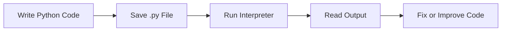

---

# Variables, Data Types, and Operators

## Overview

- **What is it?** Variables store values, data types describe values, and operators transform values.
- **Why is it important?** These are the building blocks of every Python expression and algorithm.
- **Where is it used?** Calculations, validation, form handling, analytics, business rules, and configuration.

## Learning Objectives

- Assign values to variables.
- Identify core types: `int`, `float`, `str`, `bool`, and `None`.
- Use arithmetic, comparison, logical, and assignment operators.
- Expected outcome: you can model simple facts and calculations in Python.

## Real World Applications

- Calculating invoice totals.
- Checking user permissions.
- Storing application settings.
- Preparing for roles requiring business logic, analytics, and automation.

## Core Concepts

### Variables

- **Definition:** Names that reference objects in memory.
- **Visual explanation:** `variable name -> object value`
- **Practical example:**

```python
price = 19.99
quantity = 3
```

### Data Types

- **Definition:** Categories of values that determine supported operations.
- **Visual explanation:** `42 -> int`, `"Python" -> str`, `True -> bool`
- **Practical example:**

```python
age = 30
rating = 4.8
is_active = True
missing_value = None
```

### Operators

- **Definition:** Symbols or keywords that perform operations on values.
- **Visual explanation:** `left value + operator + right value -> result`
- **Practical example:**

```python
subtotal = 100
tax = subtotal * 0.08
total = subtotal + tax
```

## Infographic Summary

| Block | Summary |
| --- | --- |
| 📌 Concept | Variables name values; types define behavior; operators create results. |
| ⚡ Purpose | Represent and transform program data. |
| 🔥 Benefits | Clear logic, reusable calculations, readable decisions. |
| 🎯 Use Cases | Pricing, eligibility, scoring, dashboards, configuration. |
| 🚀 Best Practices | Use descriptive names, avoid magic numbers, keep expressions readable. |
| ❌ Common Mistakes | Confusing `=` with `==`, comparing incompatible types, unclear variable names. |

## Syntax Guide

### Basic Syntax

```python
name = "Lin"
count = 5
is_valid = count > 0
```

### Standard Structure

```python
base_price = 50
discount_rate = 0.10
final_price = base_price * (1 - discount_rate)
```

### Code Pattern

```python
input_value = 10
calculated_value = input_value * 2
condition = calculated_value >= 20
```

## Examples

### Beginner Example

```python
apples = 4
oranges = 6
fruit_count = apples + oranges
print(fruit_count)
```

### Intermediate Example

```python
subtotal = 240.00
discount = 0.15 if subtotal >= 200 else 0
total = subtotal * (1 - discount)
print(f"Total: ${total:.2f}")
```

### Advanced Example

```python
from decimal import Decimal


subtotal = Decimal("240.00")
tax_rate = Decimal("0.0825")
total = subtotal + (subtotal * tax_rate)
print(total.quantize(Decimal("0.01")))
```

## Workflow Diagram

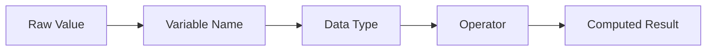

---

# Strings and Collections

## Overview

- **What is it?** Strings store text; collections store groups of values using lists, tuples, sets, and dictionaries.
- **Why is it important?** Most programs process text, records, lists of items, and key-value mappings.
- **Where is it used?** User input, APIs, reports, databases, configuration files, and data processing.

## Learning Objectives

- Manipulate strings with methods, indexing, slicing, and formatting.
- Choose the right collection type for a task.
- Add, remove, search, sort, and transform grouped data.
- Expected outcome: you can represent real-world data in Python structures.

## Real World Applications

- Cleaning customer names and addresses.
- Managing shopping carts and inventory.
- Parsing API responses.
- Supporting careers in data analytics, backend engineering, automation, and QA.

## Core Concepts

### Strings

- **Definition:** Immutable sequences of Unicode characters.
- **Visual explanation:** `"Python" -> P y t h o n`
- **Practical example:**

```python
title = "python roadmap"
print(title.title())
```

### Lists, Tuples, and Sets

- **Definition:** Containers for multiple values; lists are mutable, tuples are fixed, sets keep unique values.
- **Visual explanation:** `list -> ordered editable`, `tuple -> ordered fixed`, `set -> unique unordered`
- **Practical example:**

```python
tasks = ["learn", "practice", "build"]
coordinates = (10, 20)
unique_tags = {"python", "docs", "python"}
```

### Dictionaries

- **Definition:** Key-value mappings for fast lookup by key.
- **Visual explanation:** `key -> value`
- **Practical example:**

```python
profile = {"name": "Maya", "role": "Developer"}
print(profile["role"])
```

## Infographic Summary

| Block | Summary |
| --- | --- |
| 📌 Concept | Text and grouped data are modeled with strings and collections. |
| ⚡ Purpose | Store, search, transform, and communicate data. |
| 🔥 Benefits | Flexible modeling, fast lookup, expressive data handling. |
| 🎯 Use Cases | User profiles, orders, tags, logs, API payloads. |
| 🚀 Best Practices | Pick containers by intent, use safe lookups, keep data shapes consistent. |
| ❌ Common Mistakes | Mutating while iterating, using lists for uniqueness, assuming dict keys always exist. |

## Syntax Guide

### Basic Syntax

```python
message = "hello"
items = [1, 2, 3]
settings = {"theme": "dark"}
```

### Standard Structure

```python
users = [
    {"id": 1, "name": "Ana"},
    {"id": 2, "name": "Bo"},
]
```

### Code Pattern

```python
for item in collection:
    process(item)
```

## Examples

### Beginner Example

```python
names = ["Ada", "Grace", "Lin"]
for name in names:
    print(name.upper())
```

### Intermediate Example

```python
orders = [
    {"id": "A100", "total": 120},
    {"id": "A101", "total": 80},
]

large_orders = [order for order in orders if order["total"] >= 100]
print(large_orders)
```

### Advanced Example

```python
from collections import Counter


words = "python python data automation data".split()
frequencies = Counter(words)
print(frequencies.most_common(2))
```

## Workflow Diagram

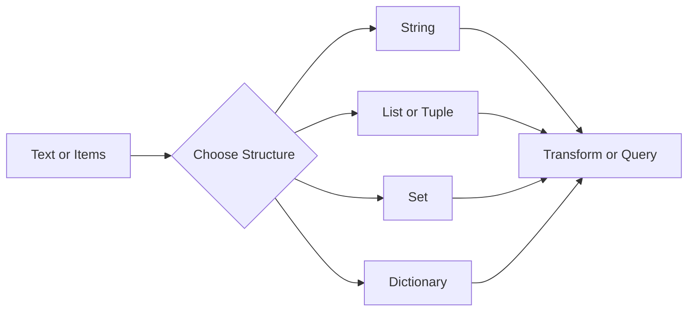

---

# Control Flow

## Overview

- **What is it?** The decision and repetition system of Python: `if`, `elif`, `else`, `for`, `while`, `break`, and `continue`.
- **Why is it important?** Programs need to choose paths and repeat work based on data.
- **Where is it used?** Validation, workflows, simulations, data processing, game logic, and automation.

## Learning Objectives

- Write conditional logic.
- Loop over ranges, strings, files, and collections.
- Control loop behavior safely.
- Expected outcome: you can build programs that react to changing input.

## Real World Applications

- Approving or rejecting transactions.
- Retrying failed operations.
- Processing rows in spreadsheets.
- Career relevance for backend logic, test automation, analytics, and scripting.

## Core Concepts

### Conditional Statements

- **Definition:** Branches that execute code when conditions are true.
- **Visual explanation:** `condition? -> yes path / no path`
- **Practical example:**

```python
if score >= 70:
    print("Pass")
else:
    print("Try again")
```

### For Loops

- **Definition:** Repetition over iterable values.
- **Visual explanation:** `collection -> one item at a time -> action`
- **Practical example:**

```python
for number in range(3):
    print(number)
```

### While Loops

- **Definition:** Repetition while a condition remains true.
- **Visual explanation:** `check condition -> run body -> check again`
- **Practical example:**

```python
attempts = 0
while attempts < 3:
    attempts += 1
```

## Infographic Summary

| Block | Summary |
| --- | --- |
| 📌 Concept | Control flow decides what runs and how often. |
| ⚡ Purpose | Add logic, branching, and repetition. |
| 🔥 Benefits | Dynamic programs, automated processing, reusable workflows. |
| 🎯 Use Cases | Validations, retries, batch jobs, user menus. |
| 🚀 Best Practices | Keep conditions readable, avoid infinite loops, reduce nesting. |
| ❌ Common Mistakes | Off-by-one errors, missing loop updates, deeply nested branches. |

## Syntax Guide

### Basic Syntax

```python
if condition:
    do_work()
else:
    handle_other_case()
```

### Standard Structure

```python
for item in items:
    if should_skip(item):
        continue
    process(item)
```

### Code Pattern

```python
while not finished:
    finished = perform_step()
```

## Examples

### Beginner Example

```python
temperature = 85

if temperature >= 80:
    print("Warm day")
else:
    print("Cool day")
```

### Intermediate Example

```python
scores = [91, 62, 75, 88]

for score in scores:
    if score < 70:
        print("Needs review")
        continue
    print("Passed")
```

### Advanced Example

```python
events = [{"type": "login"}, {"type": "purchase"}, {"type": "logout"}]

for event in events:
    match event["type"]:
        case "login":
            print("Start session")
        case "purchase":
            print("Record revenue")
        case _:
            print("Other event")
```

## Workflow Diagram

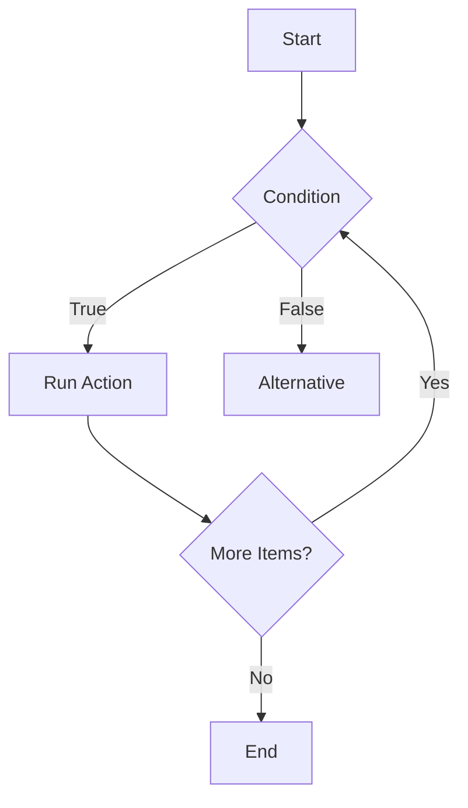

---

# Functions, Modules, and Files

## Overview

- **What is it?** Functions package reusable logic, modules organize code, and files allow persistent input and output.
- **Why is it important?** Larger programs require reuse, separation of concerns, and data persistence.
- **Where is it used?** Applications, scripts, services, libraries, command-line tools, and data pipelines.

## Learning Objectives

- Define and call functions.
- Pass arguments and return values.
- Import modules and read/write files safely.
- Expected outcome: you can split programs into reusable parts and persist data.

## Real World Applications

- Creating reusable business calculations.
- Loading configuration files.
- Exporting reports.
- Building a foundation for software engineering and automation careers.

## Core Concepts

### Functions

- **Definition:** Named blocks of reusable behavior.
- **Visual explanation:** `inputs -> function -> output`
- **Practical example:**

```python
def add_tax(amount, rate):
    return amount * (1 + rate)
```

### Modules

- **Definition:** Python files that can be imported by other Python files.
- **Visual explanation:** `helpers.py -> import helpers -> reuse`
- **Practical example:**

```python
import math

print(math.sqrt(16))
```

### Files

- **Definition:** External storage that programs can read from or write to.
- **Visual explanation:** `program <-> file system`
- **Practical example:**

```python
with open("notes.txt", "w", encoding="utf-8") as file:
    file.write("Study Python")
```

## Infographic Summary

| Block | Summary |
| --- | --- |
| 📌 Concept | Functions reuse logic, modules organize code, files persist data. |
| ⚡ Purpose | Structure programs beyond single-use scripts. |
| 🔥 Benefits | Reusability, maintainability, testability, persistence. |
| 🎯 Use Cases | Reports, tools, libraries, ETL jobs, service utilities. |
| 🚀 Best Practices | Keep functions focused, use context managers, avoid hidden global state. |
| ❌ Common Mistakes | Printing instead of returning, oversized functions, forgetting to close files. |

## Syntax Guide

### Basic Syntax

```python
def function_name(parameter):
    return parameter
```

### Standard Structure

```python
from pathlib import Path


def read_text(path):
    return Path(path).read_text(encoding="utf-8")
```

### Code Pattern

```python
def load_data(source):
    raw_data = read_source(source)
    return parse(raw_data)
```

## Examples

### Beginner Example

```python
def say_hello(name):
    print(f"Hello, {name}")


say_hello("Sam")
```

### Intermediate Example

```python
from pathlib import Path


def count_lines(path):
    return len(Path(path).read_text(encoding="utf-8").splitlines())


print(count_lines("README.md"))
```

### Advanced Example

```python
from pathlib import Path
from typing import Iterable


def load_keywords(path: Path) -> set[str]:
    return {
        line.strip().lower()
        for line in path.read_text(encoding="utf-8").splitlines()
        if line.strip()
    }


def filter_records(records: Iterable[str], keywords: set[str]) -> list[str]:
    return [record for record in records if record.lower() in keywords]
```

## Workflow Diagram

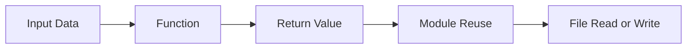

---

## Level 2: Intermediate

# Object-Oriented Programming

## Overview

- **What is it?** A programming style that organizes behavior and state into classes and objects.
- **Why is it important?** Many Python libraries, frameworks, and domain models are object-oriented.
- **Where is it used?** Web frameworks, GUI apps, simulations, data models, SDKs, plugins, and enterprise software.

## Learning Objectives

- Define classes, instances, attributes, and methods.
- Use encapsulation, inheritance, composition, and polymorphism.
- Design small domain models.
- Expected outcome: you can create reusable models that combine data and behavior.

## Real World Applications

- Modeling users, orders, invoices, and products.
- Creating framework components.
- Building maintainable SDKs and integrations.
- Career relevance for backend engineering, platform engineering, and application development.

## Core Concepts

### Class and Object

- **Definition:** A class is a blueprint; an object is a concrete instance.
- **Visual explanation:** `class Customer -> customer_1, customer_2`
- **Practical example:**

```python
class Customer:
    def __init__(self, name):
        self.name = name
```

### Encapsulation

- **Definition:** Keeping related data and behavior together behind a clear interface.
- **Visual explanation:** `object boundary -> public methods -> internal state`
- **Practical example:**

```python
class Cart:
    def __init__(self):
        self._items = []

    def add(self, item):
        self._items.append(item)
```

### Composition

- **Definition:** Building larger objects from smaller collaborating objects.
- **Visual explanation:** `Order has a Customer and LineItems`
- **Practical example:**

```python
class Order:
    def __init__(self, customer, items):
        self.customer = customer
        self.items = items
```

## Infographic Summary

| Block | Summary |
| --- | --- |
| 📌 Concept | Objects combine state and behavior. |
| ⚡ Purpose | Model real-world entities and reusable components. |
| 🔥 Benefits | Organization, reuse, extensibility, clearer domain logic. |
| 🎯 Use Cases | Apps, frameworks, SDKs, simulations, domain models. |
| 🚀 Best Practices | Prefer composition, keep classes cohesive, use dataclasses for data containers. |
| ❌ Common Mistakes | Overusing inheritance, creating god objects, exposing mutable internals. |

## Syntax Guide

### Basic Syntax

```python
class ClassName:
    def method(self):
        return "value"
```

### Standard Structure

```python
class Product:
    def __init__(self, name, price):
        self.name = name
        self.price = price

    def label(self):
        return f"{self.name}: ${self.price:.2f}"
```

### Code Pattern

```python
object_instance = ClassName(arguments)
result = object_instance.method()
```

## Examples

### Beginner Example

```python
class Dog:
    def __init__(self, name):
        self.name = name

    def speak(self):
        return "woof"


dog = Dog("Rex")
print(dog.name, dog.speak())
```

### Intermediate Example

```python
from dataclasses import dataclass


@dataclass
class InvoiceLine:
    description: str
    quantity: int
    unit_price: float

    @property
    def total(self):
        return self.quantity * self.unit_price
```

### Advanced Example

```python
from abc import ABC, abstractmethod


class PaymentGateway(ABC):
    @abstractmethod
    def charge(self, amount: float) -> str:
        raise NotImplementedError


class StripeGateway(PaymentGateway):
    def charge(self, amount: float) -> str:
        return f"Charged ${amount:.2f} through Stripe"
```

## Workflow Diagram

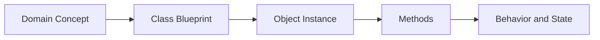

---

# Comprehensions, Iterators, and Generators

## Overview

- **What is it?** Pythonic tools for transforming streams and collections efficiently.
- **Why is it important?** They make data processing concise, readable, and memory-aware.
- **Where is it used?** ETL pipelines, web responses, file processing, analytics, and automation.

## Learning Objectives

- Write list, dict, and set comprehensions.
- Understand iterable, iterator, and generator protocols.
- Use lazy evaluation for large data.
- Expected outcome: you can process data elegantly without unnecessary memory use.

## Real World Applications

- Filtering product catalogs.
- Streaming large log files.
- Transforming API records.
- Career relevance for data engineering, backend services, and automation.

## Core Concepts

### Comprehensions

- **Definition:** Compact syntax for creating collections from iterables.
- **Visual explanation:** `source items -> expression + filter -> new collection`
- **Practical example:**

```python
squares = [number * number for number in range(5)]
```

### Iterators

- **Definition:** Objects that produce values one at a time with `next()`.
- **Visual explanation:** `iterator -> next -> value -> next -> value`
- **Practical example:**

```python
numbers = iter([1, 2, 3])
print(next(numbers))
```

### Generators

- **Definition:** Functions or expressions that lazily yield values.
- **Visual explanation:** `yield -> pause -> resume`
- **Practical example:**

```python
def countdown(start):
    while start > 0:
        yield start
        start -= 1
```

## Infographic Summary

| Block | Summary |
| --- | --- |
| 📌 Concept | Transform and stream values with concise iteration tools. |
| ⚡ Purpose | Process data cleanly and efficiently. |
| 🔥 Benefits | Less boilerplate, lower memory usage, clearer transformations. |
| 🎯 Use Cases | Log processing, filtering, ETL, pagination, pipelines. |
| 🚀 Best Practices | Keep comprehensions simple, use generators for large streams, name complex steps. |
| ❌ Common Mistakes | Nesting unreadable comprehensions, exhausting iterators accidentally, materializing huge lists. |

## Syntax Guide

### Basic Syntax

```python
result = [expression for item in iterable if condition]
```

### Standard Structure

```python
def generate_items(source):
    for item in source:
        if is_valid(item):
            yield transform(item)
```

### Code Pattern

```python
pipeline = (transform(item) for item in source if is_valid(item))
```

## Examples

### Beginner Example

```python
numbers = [1, 2, 3, 4]
doubled = [number * 2 for number in numbers]
print(doubled)
```

### Intermediate Example

```python
users = [
    {"name": "Ari", "active": True},
    {"name": "Bea", "active": False},
]

active_names = [user["name"] for user in users if user["active"]]
print(active_names)
```

### Advanced Example

```python
from pathlib import Path


def matching_lines(path: Path, keyword: str):
    with path.open(encoding="utf-8") as file:
        for line in file:
            if keyword in line:
                yield line.rstrip()
```

## Workflow Diagram

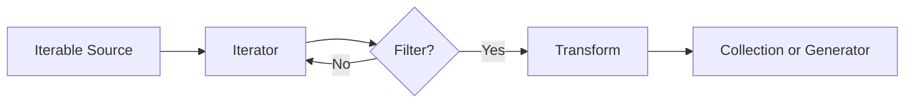

---

# Exceptions, Debugging, and Logging

## Overview

- **What is it?** Techniques for detecting, handling, diagnosing, and recording runtime problems.
- **Why is it important?** Real programs must fail safely and provide useful information when things go wrong.
- **Where is it used?** APIs, data jobs, CLIs, background workers, integrations, and production services.

## Learning Objectives

- Use `try`, `except`, `else`, and `finally`.
- Raise meaningful exceptions.
- Debug with tracebacks and log structured events.
- Expected outcome: you can build programs that are diagnosable and resilient.

## Real World Applications

- Handling payment failures.
- Recording service health problems.
- Recovering from missing files or invalid input.
- Career relevance for reliable backend, DevOps, data, and QA work.

## Core Concepts

### Exceptions

- **Definition:** Objects representing runtime errors or exceptional conditions.
- **Visual explanation:** `normal flow -> error raised -> handler`
- **Practical example:**

```python
try:
    number = int("42")
except ValueError:
    number = 0
```

### Debugging

- **Definition:** The process of finding and fixing defects using evidence.
- **Visual explanation:** `symptom -> traceback -> cause -> fix`
- **Practical example:**

```python
def divide(a, b):
    breakpoint()
    return a / b
```

### Logging

- **Definition:** Recording runtime events for humans and systems to inspect later.
- **Visual explanation:** `application event -> logger -> console/file/monitoring`
- **Practical example:**

```python
import logging

logging.warning("Cache miss for user profile")
```

## Infographic Summary

| Block | Summary |
| --- | --- |
| 📌 Concept | Exceptions signal problems; logs preserve operational evidence. |
| ⚡ Purpose | Fail safely and diagnose quickly. |
| 🔥 Benefits | Reliability, observability, easier maintenance. |
| 🎯 Use Cases | APIs, batch jobs, integrations, validation, monitoring. |
| 🚀 Best Practices | Catch specific exceptions, log context, preserve tracebacks. |
| ❌ Common Mistakes | Bare `except`, swallowing errors, using `print` as production logging. |

## Syntax Guide

### Basic Syntax

```python
try:
    risky_operation()
except SpecificError as error:
    handle(error)
```

### Standard Structure

```python
try:
    result = load_data()
except FileNotFoundError as error:
    logger.exception("Required file is missing")
    raise
else:
    process(result)
finally:
    cleanup()
```

### Code Pattern

```python
if not valid:
    raise ValueError("Explain what was invalid")
```

## Examples

### Beginner Example

```python
try:
    age = int(input("Age: "))
except ValueError:
    print("Please enter a number")
```

### Intermediate Example

```python
import logging


logger = logging.getLogger(__name__)

try:
    total = 10 / 0
except ZeroDivisionError:
    logger.exception("Calculation failed")
```

### Advanced Example

```python
class ConfigurationError(RuntimeError):
    pass


def require_setting(settings: dict, key: str) -> str:
    try:
        return settings[key]
    except KeyError as error:
        raise ConfigurationError(f"Missing required setting: {key}") from error
```

## Workflow Diagram

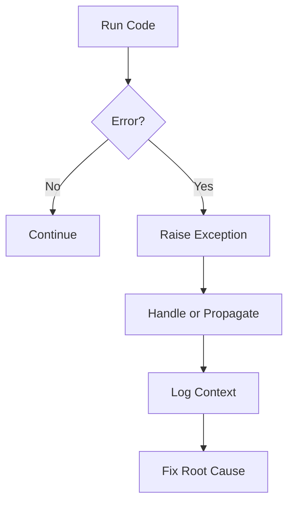

---

# Testing, Typing, and Code Quality

## Overview

- **What is it?** Practices and tools that verify behavior, document intent, and keep code maintainable.
- **Why is it important?** Tests and types reduce regressions and make change safer.
- **Where is it used?** Professional software teams, open-source projects, CI pipelines, APIs, libraries, and data systems.

## Learning Objectives

- Write unit tests and assertions.
- Use type hints for functions and data structures.
- Understand linting, formatting, and static analysis.
- Expected outcome: you can improve confidence and readability in Python projects.

## Real World Applications

- Preventing checkout bugs in ecommerce.
- Validating data transformation rules.
- Enforcing team code standards.
- Career relevance for any professional Python role.

## Core Concepts

### Unit Tests

- **Definition:** Small automated checks for isolated behavior.
- **Visual explanation:** `input -> function -> expected output`
- **Practical example:**

```python
def test_addition():
    assert 2 + 2 == 4
```

### Type Hints

- **Definition:** Optional annotations that describe expected value types.
- **Visual explanation:** `function parameter: type -> return type`
- **Practical example:**

```python
def greet(name: str) -> str:
    return f"Hello, {name}"
```

### Code Quality Tools

- **Definition:** Automated checks for formatting, style, defects, and consistency.
- **Visual explanation:** `code -> formatter/linter/type checker -> feedback`
- **Practical example:**

```bash
python -m pytest
```

## Infographic Summary

| Block | Summary |
| --- | --- |
| 📌 Concept | Tests prove behavior; types communicate contracts; tools enforce quality. |
| ⚡ Purpose | Make code safer to change. |
| 🔥 Benefits | Fewer regressions, clearer APIs, easier collaboration. |
| 🎯 Use Cases | CI/CD, libraries, services, analytics pipelines, refactors. |
| 🚀 Best Practices | Test behavior, type public interfaces, automate checks in CI. |
| ❌ Common Mistakes | Testing implementation details, ignoring failing tests, using vague types everywhere. |

## Syntax Guide

### Basic Syntax

```python
def add(a: int, b: int) -> int:
    return a + b
```

### Standard Structure

```python
def test_add_returns_sum():
    assert add(2, 3) == 5
```

### Code Pattern

```python
Arrange data -> Act on system -> Assert expected result
```

## Examples

### Beginner Example

```python
def double(number):
    return number * 2


assert double(4) == 8
```

### Intermediate Example

```python
def normalize_email(email: str) -> str:
    return email.strip().lower()


def test_normalize_email():
    assert normalize_email(" USER@EXAMPLE.COM ") == "user@example.com"
```

### Advanced Example

```python
from typing import Protocol


class Sender(Protocol):
    def send(self, message: str) -> None:
        ...


def notify(sender: Sender, message: str) -> None:
    sender.send(message)
```

## Workflow Diagram

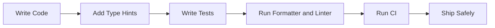

---

# Virtual Environments, Packaging, and Dependencies

## Overview

- **What is it?** Project isolation, third-party library management, and distribution practices.
- **Why is it important?** Real projects depend on external packages and need reproducible environments.
- **Where is it used?** Every modern Python app, data project, package, service, and deployment pipeline.

## Learning Objectives

- Create and activate virtual environments.
- Install and pin dependencies.
- Understand project metadata and packaging basics.
- Expected outcome: you can manage project dependencies without polluting system Python.

## Real World Applications

- Sharing reproducible analysis notebooks.
- Deploying web services.
- Publishing internal tools.
- Career relevance for professional software, DevOps, data science, and ML engineering.

## Core Concepts

### Virtual Environment

- **Definition:** An isolated Python environment with its own packages.
- **Visual explanation:** `project -> .venv -> isolated dependencies`
- **Practical example:**

```bash
python -m venv .venv
```

### Dependency

- **Definition:** External code your project imports and relies on.
- **Visual explanation:** `your code -> package -> reusable capability`
- **Practical example:**

```bash
python -m pip install requests
```

### Project Metadata

- **Definition:** Configuration describing package name, version, dependencies, and tooling.
- **Visual explanation:** `pyproject.toml -> build/install/test tools`
- **Practical example:**

```toml
[project]
name = "example"
version = "0.1.0"
```

## Infographic Summary

| Block | Summary |
| --- | --- |
| 📌 Concept | Isolate projects and declare dependencies. |
| ⚡ Purpose | Make development and deployment reproducible. |
| 🔥 Benefits | Fewer version conflicts, easier onboarding, cleaner builds. |
| 🎯 Use Cases | Apps, packages, data projects, automation tools. |
| 🚀 Best Practices | Use one environment per project, commit dependency manifests, avoid global installs. |
| ❌ Common Mistakes | Installing into system Python, unpinned production dependencies, mixing package managers blindly. |

## Syntax Guide

### Basic Syntax

```bash
python -m venv .venv
python -m pip install package-name
```

### Standard Structure

```text
project/
  pyproject.toml
  src/
  tests/
  README.md
```

### Code Pattern

```python
import third_party_package

result = third_party_package.do_work()
```

## Examples

### Beginner Example

```bash
python -m venv .venv
source .venv/bin/activate
python -m pip install rich
```

### Intermediate Example

```python
from importlib.metadata import version


print(version("pip"))
```

### Advanced Example

```toml
[build-system]
requires = ["hatchling"]
build-backend = "hatchling.build"

[project]
name = "acme-tools"
version = "0.1.0"
requires-python = ">=3.11"
dependencies = ["requests"]
```

## Workflow Diagram

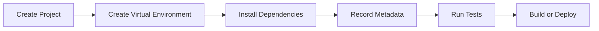

---

## Level 3: Advanced

# Decorators, Context Managers, and Metaprogramming

## Overview

- **What is it?** Advanced language features for modifying behavior, managing resources, and creating code that works with code.
- **Why is it important?** Many frameworks use these features for routing, validation, transactions, plugins, and resource safety.
- **Where is it used?** Web frameworks, ORMs, test frameworks, observability tooling, SDKs, and internal platforms.

## Learning Objectives

- Write and apply decorators.
- Build context managers with classes and `contextlib`.
- Understand reflection, descriptors, and dynamic attributes at a practical level.
- Expected outcome: you can use advanced Python features responsibly and read framework internals with confidence.

## Real World Applications

- Timing function calls.
- Opening and closing database transactions.
- Registering web routes.
- Career relevance for framework development, platform engineering, and senior backend roles.

## Core Concepts

### Decorators

- **Definition:** Callables that wrap or modify another callable.
- **Visual explanation:** `function -> decorator -> enhanced function`
- **Practical example:**

```python
def uppercase(func):
    def wrapper():
        return func().upper()
    return wrapper
```

### Context Managers

- **Definition:** Objects that define setup and cleanup around a block.
- **Visual explanation:** `enter -> with block -> exit`
- **Practical example:**

```python
with open("data.txt", encoding="utf-8") as file:
    content = file.read()
```

### Metaprogramming

- **Definition:** Code that inspects, creates, or changes code structures at runtime.
- **Visual explanation:** `program -> inspect object -> adapt behavior`
- **Practical example:**

```python
method_names = [name for name in dir(str) if name.startswith("is")]
```

## Infographic Summary

| Block | Summary |
| --- | --- |
| 📌 Concept | Python can wrap behavior, manage resources, and inspect itself. |
| ⚡ Purpose | Add reusable cross-cutting behavior and safe lifecycle management. |
| 🔥 Benefits | Cleaner APIs, less duplication, framework-level expressiveness. |
| 🎯 Use Cases | Routing, caching, transactions, plugins, instrumentation. |
| 🚀 Best Practices | Preserve metadata, keep magic visible, prefer simple functions when possible. |
| ❌ Common Mistakes | Hiding side effects, writing unreadable decorators, overusing dynamic behavior. |

## Syntax Guide

### Basic Syntax

```python
@decorator
def function():
    pass
```

### Standard Structure

```python
from functools import wraps


def decorator(func):
    @wraps(func)
    def wrapper(*args, **kwargs):
        return func(*args, **kwargs)
    return wrapper
```

### Code Pattern

```python
with resource_manager() as resource:
    use(resource)
```

## Examples

### Beginner Example

```python
def announce(func):
    def wrapper():
        print("Calling function")
        return func()
    return wrapper


@announce
def greet():
    print("Hello")


greet()
```

### Intermediate Example

```python
from contextlib import contextmanager


@contextmanager
def managed_message():
    print("start")
    try:
        yield
    finally:
        print("end")


with managed_message():
    print("working")
```

### Advanced Example

```python
from functools import wraps
from time import perf_counter


def timed(func):
    @wraps(func)
    def wrapper(*args, **kwargs):
        start = perf_counter()
        try:
            return func(*args, **kwargs)
        finally:
            print(f"{func.__name__} took {perf_counter() - start:.4f}s")
    return wrapper
```

## Workflow Diagram

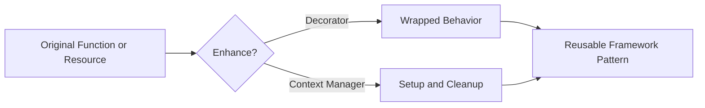

---

# Concurrency, Parallelism, and Async IO

## Overview

- **What is it?** Techniques for doing overlapping work with threads, processes, and asynchronous tasks.
- **Why is it important?** Modern applications handle network calls, background jobs, CPU-heavy work, and many users at once.
- **Where is it used?** Web servers, crawlers, ETL, queues, ML preprocessing, GUI apps, and high-throughput services.

## Learning Objectives

- Distinguish concurrency from parallelism.
- Use threads for I/O-bound work and processes for CPU-bound work.
- Understand `async` and `await` for cooperative multitasking.
- Expected outcome: you can select an execution model based on workload characteristics.

## Real World Applications

- Fetching many API pages.
- Processing images in parallel.
- Serving concurrent web requests.
- Career relevance for backend, data engineering, platform, and infrastructure roles.

## Core Concepts

### Concurrency

- **Definition:** Managing multiple tasks during overlapping time periods.
- **Visual explanation:** `task A waits -> task B runs -> task A resumes`
- **Practical example:**

```python
from concurrent.futures import ThreadPoolExecutor
```

### Parallelism

- **Definition:** Running multiple tasks at the same instant on multiple CPU cores.
- **Visual explanation:** `core 1 -> task A`, `core 2 -> task B`
- **Practical example:**

```python
from concurrent.futures import ProcessPoolExecutor
```

### Async IO

- **Definition:** Single-threaded cooperative concurrency for non-blocking I/O.
- **Visual explanation:** `event loop -> await I/O -> run another task`
- **Practical example:**

```python
import asyncio


async def main():
    await asyncio.sleep(1)
```

## Infographic Summary

| Block | Summary |
| --- | --- |
| 📌 Concept | Use overlapping execution to improve throughput and responsiveness. |
| ⚡ Purpose | Keep systems busy while waiting or divide heavy work across cores. |
| 🔥 Benefits | Faster I/O workflows, scalable services, better resource usage. |
| 🎯 Use Cases | Web APIs, crawlers, queues, image processing, streaming. |
| 🚀 Best Practices | Match tool to workload, set timeouts, handle cancellation, avoid shared mutable state. |
| ❌ Common Mistakes | Using threads for CPU speedups, blocking inside async code, ignoring race conditions. |

## Syntax Guide

### Basic Syntax

```python
async def task():
    await async_operation()
```

### Standard Structure

```python
import asyncio


async def main():
    results = await asyncio.gather(task_one(), task_two())
    return results


asyncio.run(main())
```

### Code Pattern

```python
choose_model = "threads for I/O, processes for CPU, async for many non-blocking operations"
```

## Examples

### Beginner Example

```python
import time


for step in range(3):
    print("Working", step)
    time.sleep(1)
```

### Intermediate Example

```python
from concurrent.futures import ThreadPoolExecutor


def download(url):
    return f"Downloaded {url}"


urls = ["https://example.com/a", "https://example.com/b"]
with ThreadPoolExecutor() as executor:
    print(list(executor.map(download, urls)))
```

### Advanced Example

```python
import asyncio


async def fetch(name: str) -> str:
    await asyncio.sleep(1)
    return f"response:{name}"


async def main():
    results = await asyncio.gather(fetch("a"), fetch("b"), fetch("c"))
    print(results)


asyncio.run(main())
```

## Workflow Diagram

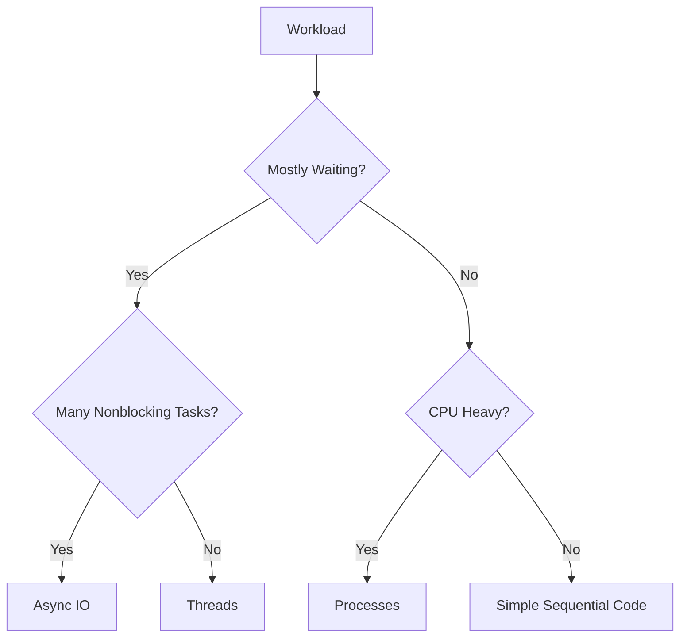

---

# Data Engineering, APIs, and Databases

## Overview

- **What is it?** Reading, validating, transforming, transporting, and storing data using Python.
- **Why is it important?** Most business systems are data systems, and Python is widely used across data workflows.
- **Where is it used?** ETL, analytics, integrations, reporting, backend APIs, dashboards, and operational databases.

## Learning Objectives

- Work with JSON, CSV, and structured records.
- Call APIs and handle responses.
- Query databases and design simple data pipelines.
- Expected outcome: you can move data between files, services, and storage systems.

## Real World Applications

- Syncing CRM data to a warehouse.
- Importing vendor CSV files.
- Building reporting APIs.
- Career relevance for data engineering, analytics engineering, backend, and automation.

## Core Concepts

### Serialization

- **Definition:** Converting objects to portable formats like JSON or CSV.
- **Visual explanation:** `Python object <-> JSON text`
- **Practical example:**

```python
import json

payload = json.dumps({"status": "ok"})
```

### APIs

- **Definition:** Interfaces that allow systems to exchange data over defined contracts.
- **Visual explanation:** `client -> HTTP request -> server -> response`
- **Practical example:**

```python
from urllib.request import urlopen
```

### Databases

- **Definition:** Systems for storing and querying durable structured data.
- **Visual explanation:** `application -> query -> database -> rows`
- **Practical example:**

```python
import sqlite3

connection = sqlite3.connect(":memory:")
```

## Infographic Summary

| Block | Summary |
| --- | --- |
| 📌 Concept | Python connects files, APIs, transformations, and databases. |
| ⚡ Purpose | Turn raw data into useful, reliable information flows. |
| 🔥 Benefits | Automation, integration, analytics, durable storage. |
| 🎯 Use Cases | ETL, dashboards, sync jobs, imports, exports, APIs. |
| 🚀 Best Practices | Validate inputs, use parameterized SQL, handle pagination and retries. |
| ❌ Common Mistakes | Trusting external data blindly, building SQL with string interpolation, ignoring encoding. |

## Syntax Guide

### Basic Syntax

```python
import json

data = json.loads('{"name": "Python"}')
```

### Standard Structure

```python
import csv


with open("data.csv", newline="", encoding="utf-8") as file:
    rows = list(csv.DictReader(file))
```

### Code Pattern

```python
extract -> validate -> transform -> load
```

## Examples

### Beginner Example

```python
import json


record = {"name": "Ada", "language": "Python"}
print(json.dumps(record, indent=2))
```

### Intermediate Example

```python
import csv
from io import StringIO


data = "name,score\nAda,95\nGrace,98\n"
reader = csv.DictReader(StringIO(data))
scores = {row["name"]: int(row["score"]) for row in reader}
print(scores)
```

### Advanced Example

```python
import sqlite3


with sqlite3.connect(":memory:") as connection:
    connection.execute("CREATE TABLE users (id INTEGER PRIMARY KEY, email TEXT)")
    connection.execute("INSERT INTO users (email) VALUES (?)", ("user@example.com",))
    rows = connection.execute("SELECT email FROM users WHERE id = ?", (1,)).fetchall()
    print(rows)
```

## Workflow Diagram

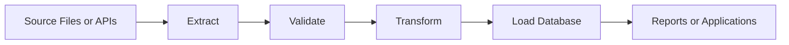

---

# Performance, Memory, and Profiling

## Overview

- **What is it?** Measuring and improving runtime speed, memory use, and algorithmic efficiency.
- **Why is it important?** Optimization without measurement wastes effort; measured improvements reduce cost and latency.
- **Where is it used?** APIs, data pipelines, ML preprocessing, batch jobs, scientific computing, and high-traffic services.

## Learning Objectives

- Recognize algorithmic complexity.
- Profile code before optimizing.
- Use efficient data structures, lazy evaluation, and caching.
- Expected outcome: you can improve performance based on evidence.

## Real World Applications

- Reducing API latency.
- Making batch jobs cheaper.
- Processing larger datasets.
- Career relevance for senior engineering, data platforms, and performance-sensitive systems.

## Core Concepts

### Complexity

- **Definition:** How runtime or memory grows as input size grows.
- **Visual explanation:** `n items -> O(n) scan`, `nested loops -> O(n^2)`
- **Practical example:**

```python
lookup = set(["a", "b", "c"])
print("a" in lookup)
```

### Profiling

- **Definition:** Measuring where code spends time or memory.
- **Visual explanation:** `program -> profiler -> hot spots`
- **Practical example:**

```python
import cProfile

cProfile.run("sum(range(1_000_000))")
```

### Caching

- **Definition:** Reusing previous results to avoid repeated work.
- **Visual explanation:** `input -> cache? -> result`
- **Practical example:**

```python
from functools import lru_cache
```

## Infographic Summary

| Block | Summary |
| --- | --- |
| 📌 Concept | Measure first, then optimize the bottleneck. |
| ⚡ Purpose | Improve speed, memory, throughput, and cost. |
| 🔥 Benefits | Lower latency, lower infrastructure spend, scalable workloads. |
| 🎯 Use Cases | APIs, ETL, ML, simulations, batch jobs. |
| 🚀 Best Practices | Profile realistic workloads, prefer better algorithms, document tradeoffs. |
| ❌ Common Mistakes | Premature optimization, optimizing cold paths, hiding complexity behind clever code. |

## Syntax Guide

### Basic Syntax

```python
from time import perf_counter

start = perf_counter()
run_work()
elapsed = perf_counter() - start
```

### Standard Structure

```python
from functools import lru_cache


@lru_cache(maxsize=128)
def expensive_lookup(key):
    return compute_value(key)
```

### Code Pattern

```python
measure -> identify bottleneck -> optimize -> remeasure
```

## Examples

### Beginner Example

```python
numbers = list(range(1000))
print(sum(numbers))
```

### Intermediate Example

```python
from time import perf_counter


start = perf_counter()
result = sum(number * number for number in range(1_000_000))
print(result, perf_counter() - start)
```

### Advanced Example

```python
from functools import lru_cache


@lru_cache(maxsize=None)
def fibonacci(number: int) -> int:
    if number < 2:
        return number
    return fibonacci(number - 1) + fibonacci(number - 2)


print(fibonacci(40))
```

## Workflow Diagram

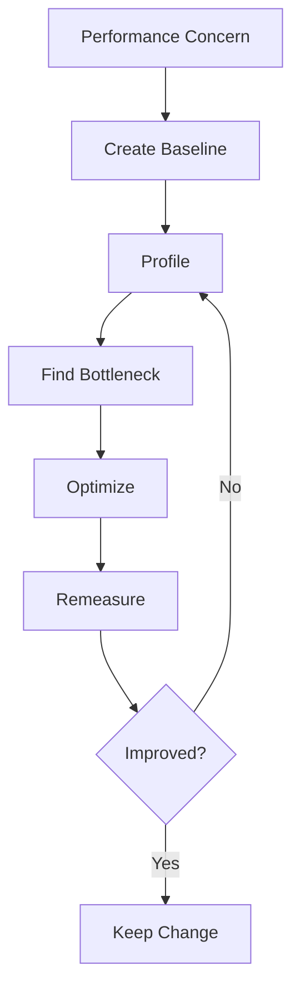

---

# Production Architecture, Security, and Deployment

## Overview

- **What is it?** Designing Python systems that are maintainable, secure, observable, configurable, and deployable.
- **Why is it important?** Production software must serve users reliably and protect data beyond local development.
- **Where is it used?** SaaS platforms, internal tools, APIs, cloud services, data platforms, and automation systems.

## Learning Objectives

- Structure applications by responsibility.
- Manage configuration and secrets safely.
- Understand security, observability, deployment, and operational readiness.
- Expected outcome: you can reason about Python systems as production products.

## Real World Applications

- Deploying APIs to cloud infrastructure.
- Building secure internal automation.
- Monitoring services with logs and metrics.
- Career relevance for senior backend, DevOps, SRE, platform, and tech lead roles.

## Core Concepts

### Architecture

- **Definition:** The organization of components, responsibilities, boundaries, and dependencies.
- **Visual explanation:** `interface -> service layer -> data layer -> external systems`
- **Practical example:**

```python
def create_user(command, repository, notifier):
    user = repository.save(command.email)
    notifier.send(f"Created {user.email}")
    return user
```

### Security

- **Definition:** Protecting systems, data, credentials, and users from misuse or attack.
- **Visual explanation:** `input -> validate -> authorize -> process -> audit`
- **Practical example:**

```python
import secrets

token = secrets.token_urlsafe(32)
```

### Deployment and Observability

- **Definition:** Releasing software into an environment and monitoring its behavior.
- **Visual explanation:** `code -> build -> deploy -> logs/metrics/traces`
- **Practical example:**

```python
import os

database_url = os.environ["DATABASE_URL"]
```

## Infographic Summary

| Block | Summary |
| --- | --- |
| 📌 Concept | Production Python combines design, security, operations, and delivery. |
| ⚡ Purpose | Serve real users safely and reliably. |
| 🔥 Benefits | Maintainability, resilience, compliance, faster delivery. |
| 🎯 Use Cases | APIs, SaaS, internal platforms, data services, automation. |
| 🚀 Best Practices | Separate concerns, validate inputs, use environment config, monitor behavior. |
| ❌ Common Mistakes | Hardcoding secrets, skipping authentication, no health checks, no rollback plan. |

## Syntax Guide

### Basic Syntax

```python
import os

debug = os.getenv("DEBUG", "false").lower() == "true"
```

### Standard Structure

```text
app/
  api/
  services/
  repositories/
  settings.py
  main.py
tests/
```

### Code Pattern

```python
request -> validate -> authorize -> service -> repository -> response
```

## Examples

### Beginner Example

```python
import os


app_name = os.getenv("APP_NAME", "python-app")
print(f"Starting {app_name}")
```

### Intermediate Example

```python
from dataclasses import dataclass
import os


@dataclass(frozen=True)
class Settings:
    database_url: str
    debug: bool = False


settings = Settings(
    database_url=os.environ["DATABASE_URL"],
    debug=os.getenv("DEBUG", "false").lower() == "true",
)
```

### Advanced Example

```python
import logging
from typing import Protocol


logger = logging.getLogger(__name__)


class UserRepository(Protocol):
    def create(self, email: str) -> dict:
        ...


def register_user(email: str, repository: UserRepository) -> dict:
    if "@" not in email:
        raise ValueError("Invalid email address")

    user = repository.create(email)
    logger.info("user_registered", extra={"user_id": user["id"]})
    return user
```

## Workflow Diagram

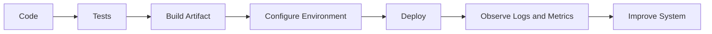

---

## Capstone Learning Path

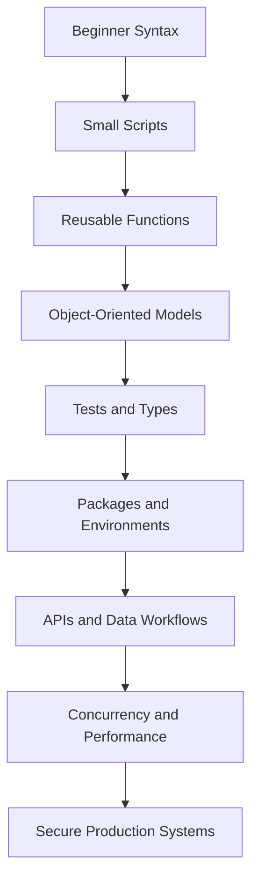

## Recommended Practice Projects

| Level | Project | Skills Practiced |
| --- | --- | --- |
| Beginner | Expense calculator CLI | Variables, input, control flow, functions |
| Beginner | Contact book file app | Collections, files, modules |
| Intermediate | Inventory tracker | OOP, testing, exceptions, typing |
| Intermediate | CSV report generator | Iterators, data handling, packaging |
| Advanced | Async API aggregator | Async IO, APIs, logging, retries |
| Advanced | Production-ready service skeleton | Architecture, config, security, deployment |

## Final Checklist

- [ ] I can run Python code from the command line.
- [ ] I can model data with variables, strings, and collections.
- [ ] I can control program flow with conditions and loops.
- [ ] I can organize code with functions, modules, and files.
- [ ] I can design classes and object relationships.
- [ ] I can process data with comprehensions, iterators, and generators.
- [ ] I can handle errors and log useful diagnostic information.
- [ ] I can write tests and type hints for important behavior.
- [ ] I can manage dependencies and package structure.
- [ ] I can use decorators, context managers, and introspection carefully.
- [ ] I can choose between sequential, threaded, process-based, and async workflows.
- [ ] I can work with files, APIs, and databases safely.
- [ ] I can profile code and optimize based on evidence.
- [ ] I can design, secure, deploy, and observe production Python systems.