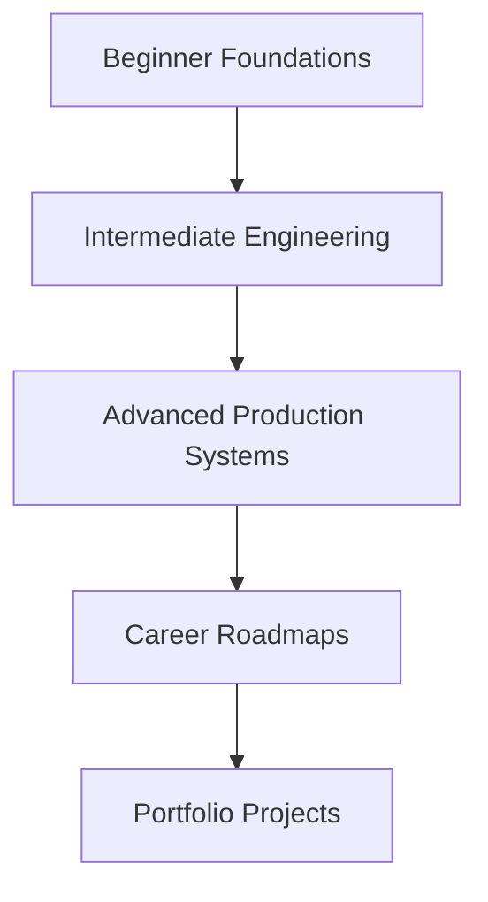

# Python Learning Roadmap Curriculum Directory

This folder is the deep-dive companion curriculum for the complete single-page knowledge base in the repository root [`README.md`](../README.md). The root README contains an explicit section for every requested Python topic across beginner, intermediate, and advanced levels.

For one self-contained Markdown document per topic, use the portable [`Python-Mastery/`](../Python-Mastery/) edition. It mirrors all 110 lessons and adds dedicated indexes for infographics, cheat sheets, interview questions, projects, and career roadmaps.

## Learning Levels

| Level | Focus | Root README Section |
| --- | --- | --- |
| Level 1: Beginner | 35 topics | [Level 1: Beginner](../README.md#level-1-beginner) |
| Level 2: Intermediate | 35 topics | [Level 2: Intermediate](../README.md#level-2-intermediate) |
| Level 3: Advanced | 40 topics | [Level 3: Advanced](../README.md#level-3-advanced) |

## Complete Topic Index

### Level 1: Beginner

01. [Introduction to Python](../README.md#introduction-to-python)
02. [Installing Python](../README.md#installing-python)
03. [IDE Setup](../README.md#ide-setup)
04. [Python Syntax](../README.md#python-syntax)
05. [Variables](../README.md#variables)
06. [Data Types](../README.md#data-types)
07. [Type Casting](../README.md#type-casting)
08. [Input and Output](../README.md#input-and-output)
09. [Operators](../README.md#operators)
10. [Conditional Statements](../README.md#conditional-statements)
11. [Loops](../README.md#loops)
12. [Nested Loops](../README.md#nested-loops)
13. [Break Continue Pass](../README.md#break-continue-pass)
14. [Strings](../README.md#strings)
15. [String Methods](../README.md#string-methods)
16. [Lists](../README.md#lists)
17. [List Methods](../README.md#list-methods)
18. [Tuples](../README.md#tuples)
19. [Sets](../README.md#sets)
20. [Dictionaries](../README.md#dictionaries)
21. [Functions](../README.md#functions)
22. [Arguments and Parameters](../README.md#arguments-and-parameters)
23. [Return Statements](../README.md#return-statements)
24. [Scope](../README.md#scope)
25. [Lambda Functions](../README.md#lambda-functions)
26. [Modules](../README.md#modules)
27. [Packages](../README.md#packages)
28. [Date and Time](../README.md#date-and-time)
29. [Math Module](../README.md#math-module)
30. [Random Module](../README.md#random-module)
31. [File Handling](../README.md#file-handling)
32. [Exception Handling](../README.md#exception-handling)
33. [Debugging Basics](../README.md#debugging-basics)
34. [Virtual Environments](../README.md#virtual-environments)
35. [Basic Project Structure](../README.md#basic-project-structure)

### Level 2: Intermediate

01. [Object Oriented Programming](../README.md#object-oriented-programming)
02. [Classes](../README.md#classes)
03. [Objects](../README.md#objects)
04. [Constructors](../README.md#constructors)
05. [Encapsulation](../README.md#encapsulation)
06. [Inheritance](../README.md#inheritance)
07. [Polymorphism](../README.md#polymorphism)
08. [Abstraction](../README.md#abstraction)
09. [Magic Methods](../README.md#magic-methods)
10. [Iterators](../README.md#iterators)
11. [Generators](../README.md#generators)
12. [Decorators](../README.md#decorators)
13. [Context Managers](../README.md#context-managers)
14. [Regular Expressions](../README.md#regular-expressions)
15. [JSON Processing](../README.md#json-processing)
16. [CSV Processing](../README.md#csv-processing)
17. [XML Processing](../README.md#xml-processing)
18. [Logging](../README.md#logging)
19. [Configuration Management](../README.md#configuration-management)
20. [Multithreading](../README.md#multithreading)
21. [Multiprocessing](../README.md#multiprocessing)
22. [Async Programming](../README.md#async-programming)
23. [API Development](../README.md#api-development)
24. [API Consumption](../README.md#api-consumption)
25. [Requests Library](../README.md#requests-library)
26. [Database Fundamentals](../README.md#database-fundamentals)
27. [SQLite](../README.md#sqlite)
28. [MySQL Integration](../README.md#mysql-integration)
29. [PostgreSQL Integration](../README.md#postgresql-integration)
30. [SQLAlchemy ORM](../README.md#sqlalchemy-orm)
31. [Unit Testing](../README.md#unit-testing)
32. [Pytest](../README.md#pytest)
33. [Mocking](../README.md#mocking)
34. [Packaging Python Projects](../README.md#packaging-python-projects)
35. [CLI Applications](../README.md#cli-applications)

### Level 3: Advanced

01. [Data Structures Internals](../README.md#data-structures-internals)
02. [Algorithms in Python](../README.md#algorithms-in-python)
03. [Design Patterns](../README.md#design-patterns)
04. [SOLID Principles](../README.md#solid-principles)
05. [Memory Management](../README.md#memory-management)
06. [Garbage Collection](../README.md#garbage-collection)
07. [Python Internals](../README.md#python-internals)
08. [Metaclasses](../README.md#metaclasses)
09. [Descriptors](../README.md#descriptors)
10. [Concurrency](../README.md#concurrency)
11. [Parallel Computing](../README.md#parallel-computing)
12. [Distributed Systems](../README.md#distributed-systems)
13. [Network Programming](../README.md#network-programming)
14. [Socket Programming](../README.md#socket-programming)
15. [Cybersecurity Automation](../README.md#cybersecurity-automation)
16. [Web Scraping](../README.md#web-scraping)
17. [Automation Frameworks](../README.md#automation-frameworks)
18. [ETL Development](../README.md#etl-development)
19. [Data Engineering](../README.md#data-engineering)
20. [Pandas](../README.md#pandas)
21. [NumPy](../README.md#numpy)
22. [PySpark](../README.md#pyspark)
23. [Machine Learning](../README.md#machine-learning)
24. [Deep Learning](../README.md#deep-learning)
25. [NLP](../README.md#nlp)
26. [Computer Vision](../README.md#computer-vision)
27. [FastAPI](../README.md#fastapi)
28. [Django](../README.md#django)
29. [Flask](../README.md#flask)
30. [Microservices](../README.md#microservices)
31. [Docker with Python](../README.md#docker-with-python)
32. [Kubernetes Integration](../README.md#kubernetes-integration)
33. [Cloud Development](../README.md#cloud-development)
34. [AWS with Python](../README.md#aws-with-python)
35. [Azure with Python](../README.md#azure-with-python)
36. [GCP with Python](../README.md#gcp-with-python)
37. [DevOps Automation](../README.md#devops-automation)
38. [CI/CD Pipelines](../README.md#ci-cd-pipelines)
39. [Performance Optimization](../README.md#performance-optimization)
40. [System Design with Python](../README.md#system-design-with-python)

## Existing Nested Curriculum

The existing nested folders remain useful as expanded learning modules and practice spaces. They currently group related topics into broader units while the root README provides the complete topic-by-topic knowledge base requested for documentation portals.

```text
python-learning-roadmap/
  level-1-beginner/
  level-2-intermediate/
  level-3-advanced/
```

## Recommended NotebookLM Export Structure

```text
Python-Mastery/
│
├── Beginner/
├── Intermediate/
├── Advanced/
├── Infographics/
├── CheatSheets/
├── Interview-Questions/
├── Projects/
├── Roadmaps/
└── README.md
```

## Curriculum Flow


