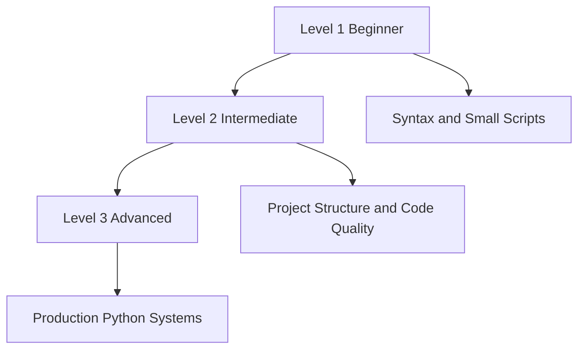

# Python Learning Roadmap Curriculum Directory

This folder converts the complete Python knowledge base into a formal nested curriculum. It is designed for students, instructors, mentors, and self-paced learners who need clear study paths and topic-level learning material.

## Directory Structure

```text
python-learning-roadmap/
  README.md
  level-1-beginner/
    README.md
    01-topic-name/
      README.md
  level-2-intermediate/
    README.md
    06-topic-name/
      README.md
  level-3-advanced/
    README.md
    11-topic-name/
      README.md
```

## Learning Levels

- [Level 1: Beginner](./level-1-beginner/): Build a reliable foundation in Python syntax, data modeling, control flow, reusable functions, modules, and files.
- [Level 2: Intermediate](./level-2-intermediate/): Develop professional habits around object-oriented design, iteration patterns, error handling, testing, typing, and dependency management.
- [Level 3: Advanced](./level-3-advanced/): Advance into production-grade Python with decorators, context managers, concurrency, data systems, profiling, security, and deployment.

## Complete Topic Index

- [Python Setup and Program Execution](./level-1-beginner/01-python-setup-and-program-execution/)
- [Variables, Data Types, and Operators](./level-1-beginner/02-variables-data-types-and-operators/)
- [Strings and Collections](./level-1-beginner/03-strings-and-collections/)
- [Control Flow](./level-1-beginner/04-control-flow/)
- [Functions, Modules, and Files](./level-1-beginner/05-functions-modules-and-files/)
- [Object-Oriented Programming](./level-2-intermediate/06-object-oriented-programming/)
- [Comprehensions, Iterators, and Generators](./level-2-intermediate/07-comprehensions-iterators-and-generators/)
- [Exceptions, Debugging, and Logging](./level-2-intermediate/08-exceptions-debugging-and-logging/)
- [Testing, Typing, and Code Quality](./level-2-intermediate/09-testing-typing-and-code-quality/)
- [Virtual Environments, Packaging, and Dependencies](./level-2-intermediate/10-virtual-environments-packaging-and-dependencies/)
- [Decorators, Context Managers, and Metaprogramming](./level-3-advanced/11-decorators-context-managers-and-metaprogramming/)
- [Concurrency, Parallelism, and Async IO](./level-3-advanced/12-concurrency-parallelism-and-async-io/)
- [Data Engineering, APIs, and Databases](./level-3-advanced/13-data-engineering-apis-and-databases/)
- [Performance, Memory, and Profiling](./level-3-advanced/14-performance-memory-and-profiling/)
- [Production Architecture, Security, and Deployment](./level-3-advanced/15-production-architecture-security-and-deployment/)

## Student Learning Method

1. Read the level overview first.
2. Open one topic folder at a time.
3. Study the formal explanation, infographic summary, syntax guide, and workflow diagram.
4. Run the beginner example exactly as written.
5. Modify the intermediate example to use new data.
6. Explain the advanced example in plain language.
7. Complete the guided practice tasks and self-check questions.

## Instructor Quality Standard

- Every topic includes conceptual explanation, practical code, common mistakes, and evidence of mastery.
- Examples progress from beginner to advanced so students can see how ideas grow in complexity.
- Workflow diagrams help visual learners understand the sequence of operations.
- Practice tasks encourage active recall and applied understanding rather than passive reading.

## Curriculum Flow


