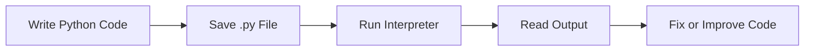

# Python Setup and Program Execution

## Overview

- **What is it?** Installing Python, writing `.py` files, using the REPL, and running programs from the terminal.
- **Why is it important?** Every Python project begins with a reliable development environment and a repeatable execution workflow.
- **Where is it used?** Local development, automation scripts, education, backend services, data notebooks, CI jobs, and cloud deployments.

## Learning Objectives

- Install and verify Python.
- Run Python code through the REPL, scripts, and modules.
- Understand files, folders, interpreters, and command-line execution.
- Expected outcome: you can create and run a Python program without relying on an IDE button.

## Real World Applications

- Automating daily business reports.
- Running data cleanup scripts.
- Building command-line tools for operations teams.
- Preparing for software engineering, data analysis, QA automation, and DevOps roles.

## Core Concepts

### Interpreter

- **Definition:** The Python program that reads and executes Python code.
- **Visual explanation:** `source code -> Python interpreter -> result`
- **Practical example:**

```python
print("Python is running")
```

### Script

- **Definition:** A `.py` file containing Python instructions.
- **Visual explanation:** `hello.py -> python hello.py -> terminal output`
- **Practical example:**

```python
# hello.py
name = "Ada"
print(f"Hello, {name}!")
```

### Module Execution

- **Definition:** Running Python code as an importable module with `python -m`.
- **Visual explanation:** `package.module -> module loader -> execution`
- **Practical example:**

```bash
python -m http.server 8000
```

## Infographic Summary

| Block | Summary |
| --- | --- |
| 📌 Concept | Python code is executed by an interpreter. |
| ⚡ Purpose | Convert readable instructions into working behavior. |
| 🔥 Benefits | Fast feedback, cross-platform execution, huge ecosystem. |
| 🎯 Use Cases | Scripts, apps, automation, APIs, data workflows. |
| 🚀 Best Practices | Use clear file names, verify versions, keep projects organized. |
| ❌ Common Mistakes | Running commands from the wrong folder, mixing Python versions, ignoring errors. |

## Syntax Guide

### Basic Syntax

```python
print("Hello, world!")
```

### Standard Structure

```python
def main():
    print("Program starts here")


if __name__ == "__main__":
    main()
```

### Code Pattern

```python
# 1. Define data
# 2. Process data
# 3. Print or return results
```

## Examples

### Beginner Example

```python
print("Welcome to Python")
```

### Intermediate Example

```python
def greet(name):
    return f"Welcome, {name}"


print(greet("Grace"))
```

### Advanced Example

```python
import argparse


def main():
    parser = argparse.ArgumentParser(description="Greeter CLI")
    parser.add_argument("name")
    args = parser.parse_args()
    print(f"Welcome, {args.name}")


if __name__ == "__main__":
    main()
```

## Workflow Diagram



---

## Student Learning Support

### Curriculum Metadata

| Field | Details |
| --- | --- |
| Roadmap level | Level 1: Beginner |
| Topic number | 1 |
| Difficulty | Foundational |
| Recommended study format | One focused study session |
| Best studied after | Basic computer file navigation, Ability to open a terminal or command prompt |

### Before You Start

- Basic computer file navigation
- Ability to open a terminal or command prompt

### Key Vocabulary

- Interpreter
- Script
- REPL
- Module
- Working directory

### Student Study Plan

1. Read the overview and learning objectives before running any code.
2. Type each beginner example manually to build muscle memory.
3. Modify the intermediate example with your own data.
4. Explain the advanced example line by line in plain language.
5. Complete the practice tasks and compare your output with the expected behavior.

### Guided Practice Tasks

- Create a file named hello.py and run it from the terminal.
- Run one command with python3 -m and explain what happened.
- Add a main() function and call it with the __name__ guard.

### Self-Check Questions

- Can I explain the difference between a script and the interpreter?
- Can I run a Python file from the folder where it is saved?
- Can I identify the active Python version?

### Evidence of Mastery

A student can create, run, and explain a small Python script without relying on an IDE run button.

### Instructor Notes

- Ask the student to explain their code before asking them to optimize it.
- Encourage small, frequent experiments in the Python interpreter.
- Review mistakes as feedback about the mental model, not as failure.
