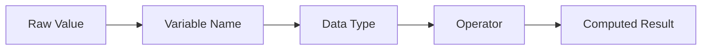

# Variables, Data Types, and Operators

## Overview

- **What is it?** Variables store values, data types describe values, and operators transform values.
- **Why is it important?** These are the building blocks of every Python expression and algorithm.
- **Where is it used?** Calculations, validation, form handling, analytics, business rules, and configuration.

## Learning Objectives

- Assign values to variables.
- Identify core types: `int`, `float`, `str`, `bool`, and `None`.
- Use arithmetic, comparison, logical, and assignment operators.
- Expected outcome: you can model simple facts and calculations in Python.

## Real World Applications

- Calculating invoice totals.
- Checking user permissions.
- Storing application settings.
- Preparing for roles requiring business logic, analytics, and automation.

## Core Concepts

### Variables

- **Definition:** Names that reference objects in memory.
- **Visual explanation:** `variable name -> object value`
- **Practical example:**

```python
price = 19.99
quantity = 3
```

### Data Types

- **Definition:** Categories of values that determine supported operations.
- **Visual explanation:** `42 -> int`, `"Python" -> str`, `True -> bool`
- **Practical example:**

```python
age = 30
rating = 4.8
is_active = True
missing_value = None
```

### Operators

- **Definition:** Symbols or keywords that perform operations on values.
- **Visual explanation:** `left value + operator + right value -> result`
- **Practical example:**

```python
subtotal = 100
tax = subtotal * 0.08
total = subtotal + tax
```

## Infographic Summary

| Block | Summary |
| --- | --- |
| 📌 Concept | Variables name values; types define behavior; operators create results. |
| ⚡ Purpose | Represent and transform program data. |
| 🔥 Benefits | Clear logic, reusable calculations, readable decisions. |
| 🎯 Use Cases | Pricing, eligibility, scoring, dashboards, configuration. |
| 🚀 Best Practices | Use descriptive names, avoid magic numbers, keep expressions readable. |
| ❌ Common Mistakes | Confusing `=` with `==`, comparing incompatible types, unclear variable names. |

## Syntax Guide

### Basic Syntax

```python
name = "Lin"
count = 5
is_valid = count > 0
```

### Standard Structure

```python
base_price = 50
discount_rate = 0.10
final_price = base_price * (1 - discount_rate)
```

### Code Pattern

```python
input_value = 10
calculated_value = input_value * 2
condition = calculated_value >= 20
```

## Examples

### Beginner Example

```python
apples = 4
oranges = 6
fruit_count = apples + oranges
print(fruit_count)
```

### Intermediate Example

```python
subtotal = 240.00
discount = 0.15 if subtotal >= 200 else 0
total = subtotal * (1 - discount)
print(f"Total: ${total:.2f}")
```

### Advanced Example

```python
from decimal import Decimal


subtotal = Decimal("240.00")
tax_rate = Decimal("0.0825")
total = subtotal + (subtotal * tax_rate)
print(total.quantize(Decimal("0.01")))
```

## Workflow Diagram



---

## Student Learning Support

### Curriculum Metadata

| Field | Details |
| --- | --- |
| Roadmap level | Level 1: Beginner |
| Topic number | 2 |
| Difficulty | Foundational |
| Recommended study format | One focused study session |
| Best studied after | Python can run locally, Basic arithmetic knowledge |

### Before You Start

- Python can run locally
- Basic arithmetic knowledge

### Key Vocabulary

- Variable
- Object
- Type
- Expression
- Operator
- Boolean

### Student Study Plan

1. Read the overview and learning objectives before running any code.
2. Type each beginner example manually to build muscle memory.
3. Modify the intermediate example with your own data.
4. Explain the advanced example line by line in plain language.
5. Complete the practice tasks and compare your output with the expected behavior.

### Guided Practice Tasks

- Calculate subtotal, tax, and total for a purchase.
- Compare two values and print a decision message.
- Convert user input from text to a number safely.

### Self-Check Questions

- Can I choose meaningful variable names?
- Can I explain the difference between = and ==?
- Can I predict the result type of a simple expression?

### Evidence of Mastery

A student can model simple business facts and calculations with clear variable names and correct operators.

### Instructor Notes

- Ask the student to explain their code before asking them to optimize it.
- Encourage small, frequent experiments in the Python interpreter.
- Review mistakes as feedback about the mental model, not as failure.
