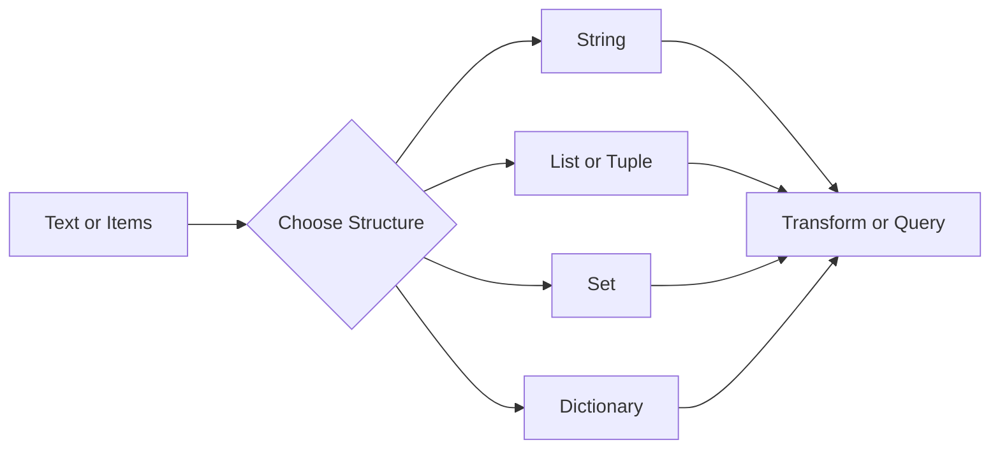

# Strings and Collections

## Overview

- **What is it?** Strings store text; collections store groups of values using lists, tuples, sets, and dictionaries.
- **Why is it important?** Most programs process text, records, lists of items, and key-value mappings.
- **Where is it used?** User input, APIs, reports, databases, configuration files, and data processing.

## Learning Objectives

- Manipulate strings with methods, indexing, slicing, and formatting.
- Choose the right collection type for a task.
- Add, remove, search, sort, and transform grouped data.
- Expected outcome: you can represent real-world data in Python structures.

## Real World Applications

- Cleaning customer names and addresses.
- Managing shopping carts and inventory.
- Parsing API responses.
- Supporting careers in data analytics, backend engineering, automation, and QA.

## Core Concepts

### Strings

- **Definition:** Immutable sequences of Unicode characters.
- **Visual explanation:** `"Python" -> P y t h o n`
- **Practical example:**

```python
title = "python roadmap"
print(title.title())
```

### Lists, Tuples, and Sets

- **Definition:** Containers for multiple values; lists are mutable, tuples are fixed, sets keep unique values.
- **Visual explanation:** `list -> ordered editable`, `tuple -> ordered fixed`, `set -> unique unordered`
- **Practical example:**

```python
tasks = ["learn", "practice", "build"]
coordinates = (10, 20)
unique_tags = {"python", "docs", "python"}
```

### Dictionaries

- **Definition:** Key-value mappings for fast lookup by key.
- **Visual explanation:** `key -> value`
- **Practical example:**

```python
profile = {"name": "Maya", "role": "Developer"}
print(profile["role"])
```

## Infographic Summary

| Block | Summary |
| --- | --- |
| 📌 Concept | Text and grouped data are modeled with strings and collections. |
| ⚡ Purpose | Store, search, transform, and communicate data. |
| 🔥 Benefits | Flexible modeling, fast lookup, expressive data handling. |
| 🎯 Use Cases | User profiles, orders, tags, logs, API payloads. |
| 🚀 Best Practices | Pick containers by intent, use safe lookups, keep data shapes consistent. |
| ❌ Common Mistakes | Mutating while iterating, using lists for uniqueness, assuming dict keys always exist. |

## Syntax Guide

### Basic Syntax

```python
message = "hello"
items = [1, 2, 3]
settings = {"theme": "dark"}
```

### Standard Structure

```python
users = [
    {"id": 1, "name": "Ana"},
    {"id": 2, "name": "Bo"},
]
```

### Code Pattern

```python
for item in collection:
    process(item)
```

## Examples

### Beginner Example

```python
names = ["Ada", "Grace", "Lin"]
for name in names:
    print(name.upper())
```

### Intermediate Example

```python
orders = [
    {"id": "A100", "total": 120},
    {"id": "A101", "total": 80},
]

large_orders = [order for order in orders if order["total"] >= 100]
print(large_orders)
```

### Advanced Example

```python
from collections import Counter


words = "python python data automation data".split()
frequencies = Counter(words)
print(frequencies.most_common(2))
```

## Workflow Diagram



---

## Student Learning Support

### Curriculum Metadata

| Field | Details |
| --- | --- |
| Roadmap level | Level 1: Beginner |
| Topic number | 3 |
| Difficulty | Foundational |
| Recommended study format | Two focused study sessions |
| Best studied after | Variables and basic data types, Simple print statements |

### Before You Start

- Variables and basic data types
- Simple print statements

### Key Vocabulary

- String
- List
- Tuple
- Set
- Dictionary
- Index
- Key

### Student Study Plan

1. Read the overview and learning objectives before running any code.
2. Type each beginner example manually to build muscle memory.
3. Modify the intermediate example with your own data.
4. Explain the advanced example line by line in plain language.
5. Complete the practice tasks and compare your output with the expected behavior.

### Guided Practice Tasks

- Normalize a list of names using string methods.
- Create a dictionary that represents a student profile.
- Use a set to remove duplicate tags.

### Self-Check Questions

- Can I explain when to use a list instead of a dictionary?
- Can I access values by index and by key?
- Can I avoid changing a collection while looping through it?

### Evidence of Mastery

A student can select an appropriate container and perform common read, update, search, and transformation operations.

### Instructor Notes

- Ask the student to explain their code before asking them to optimize it.
- Encourage small, frequent experiments in the Python interpreter.
- Review mistakes as feedback about the mental model, not as failure.

---

## More Nested Student Breakdown

For smaller study units, open the [`deep-dive/`](./deep-dive/) directory. It breaks this topic into overview, objectives, applications, concepts, syntax, examples, workflow, questions, code files, and answer guidance.

