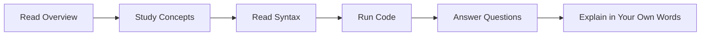

# Deep Breakdown: Strings and Collections

This folder breaks the topic into smaller student-learning units. Use it after reading the main topic README.

## Student Goal

Represent text and groups of related values.

## Learning Scenario

A student stores names, profile details, unique tags, and order records for a small app.

## Nested Sections

| Order | Section | Purpose |
| --- | --- | --- |
| 01 | [Overview Breakdown](./01-overview/) | Understand the topic in plain language before learning syntax. |
| 02 | [Learning Objectives Breakdown](./02-learning-objectives/) | Convert objectives into measurable student outcomes. |
| 03 | [Real World Applications Breakdown](./03-real-world-applications/) | Connect the topic to jobs, business workflows, and software products. |
| 04 | [Core Concepts Breakdown](./04-core-concepts/) | Study each core idea with definition, mental model, and miniature example. |
| 05 | [Infographic Summary Breakdown](./05-infographic-summary/) | Review the topic as quick memory blocks for revision. |
| 06 | [Syntax Guide Breakdown](./06-syntax-guide/) | Learn the shape of the code before memorizing details. |
| 07 | [Examples Breakdown](./07-examples/) | Run code at beginner, intermediate, and advanced levels. |
| 08 | [Workflow Diagram Breakdown](./08-workflow-diagram/) | Trace the sequence of steps visually and verbally. |
| 09 | [Practice and Questions](./09-practice-questions/) | Answer questions, complete tasks, and prove understanding. |

## Suggested Student Flow

