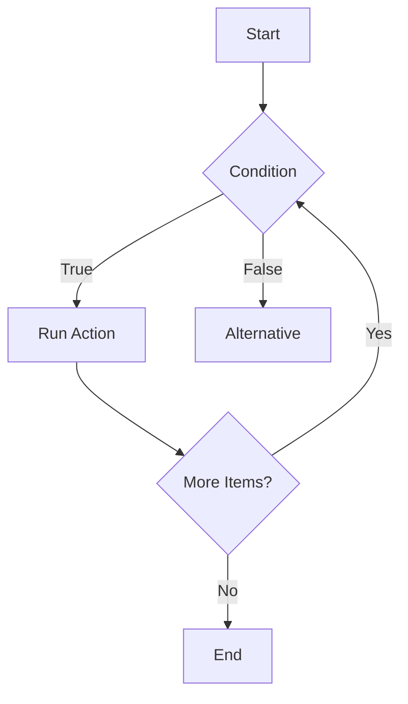

# Control Flow

## Overview

- **What is it?** The decision and repetition system of Python: `if`, `elif`, `else`, `for`, `while`, `break`, and `continue`.
- **Why is it important?** Programs need to choose paths and repeat work based on data.
- **Where is it used?** Validation, workflows, simulations, data processing, game logic, and automation.

## Learning Objectives

- Write conditional logic.
- Loop over ranges, strings, files, and collections.
- Control loop behavior safely.
- Expected outcome: you can build programs that react to changing input.

## Real World Applications

- Approving or rejecting transactions.
- Retrying failed operations.
- Processing rows in spreadsheets.
- Career relevance for backend logic, test automation, analytics, and scripting.

## Core Concepts

### Conditional Statements

- **Definition:** Branches that execute code when conditions are true.
- **Visual explanation:** `condition? -> yes path / no path`
- **Practical example:**

```python
if score >= 70:
    print("Pass")
else:
    print("Try again")
```

### For Loops

- **Definition:** Repetition over iterable values.
- **Visual explanation:** `collection -> one item at a time -> action`
- **Practical example:**

```python
for number in range(3):
    print(number)
```

### While Loops

- **Definition:** Repetition while a condition remains true.
- **Visual explanation:** `check condition -> run body -> check again`
- **Practical example:**

```python
attempts = 0
while attempts < 3:
    attempts += 1
```

## Infographic Summary

| Block | Summary |
| --- | --- |
| 📌 Concept | Control flow decides what runs and how often. |
| ⚡ Purpose | Add logic, branching, and repetition. |
| 🔥 Benefits | Dynamic programs, automated processing, reusable workflows. |
| 🎯 Use Cases | Validations, retries, batch jobs, user menus. |
| 🚀 Best Practices | Keep conditions readable, avoid infinite loops, reduce nesting. |
| ❌ Common Mistakes | Off-by-one errors, missing loop updates, deeply nested branches. |

## Syntax Guide

### Basic Syntax

```python
if condition:
    do_work()
else:
    handle_other_case()
```

### Standard Structure

```python
for item in items:
    if should_skip(item):
        continue
    process(item)
```

### Code Pattern

```python
while not finished:
    finished = perform_step()
```

## Examples

### Beginner Example

```python
temperature = 85

if temperature >= 80:
    print("Warm day")
else:
    print("Cool day")
```

### Intermediate Example

```python
scores = [91, 62, 75, 88]

for score in scores:
    if score < 70:
        print("Needs review")
        continue
    print("Passed")
```

### Advanced Example

```python
events = [{"type": "login"}, {"type": "purchase"}, {"type": "logout"}]

for event in events:
    match event["type"]:
        case "login":
            print("Start session")
        case "purchase":
            print("Record revenue")
        case _:
            print("Other event")
```

## Workflow Diagram



---

## Student Learning Support

### Curriculum Metadata

| Field | Details |
| --- | --- |
| Roadmap level | Level 1: Beginner |
| Topic number | 4 |
| Difficulty | Foundational |
| Recommended study format | Two focused study sessions |
| Best studied after | Boolean expressions, Collections and variables |

### Before You Start

- Boolean expressions
- Collections and variables

### Key Vocabulary

- Condition
- Branch
- Loop
- Iterable
- break
- continue

### Student Study Plan

1. Read the overview and learning objectives before running any code.
2. Type each beginner example manually to build muscle memory.
3. Modify the intermediate example with your own data.
4. Explain the advanced example line by line in plain language.
5. Complete the practice tasks and compare your output with the expected behavior.

### Guided Practice Tasks

- Write a grade classifier using if, elif, and else.
- Loop through a list of orders and mark large orders.
- Build a simple retry loop with a maximum attempt count.

### Self-Check Questions

- Can I trace which branch will execute?
- Can I explain why a loop stops?
- Can I reduce unnecessary nesting?

### Evidence of Mastery

A student can write readable decision logic and loops that terminate correctly.

### Instructor Notes

- Ask the student to explain their code before asking them to optimize it.
- Encourage small, frequent experiments in the Python interpreter.
- Review mistakes as feedback about the mental model, not as failure.
