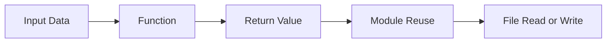

# Functions, Modules, and Files

## Overview

- **What is it?** Functions package reusable logic, modules organize code, and files allow persistent input and output.
- **Why is it important?** Larger programs require reuse, separation of concerns, and data persistence.
- **Where is it used?** Applications, scripts, services, libraries, command-line tools, and data pipelines.

## Learning Objectives

- Define and call functions.
- Pass arguments and return values.
- Import modules and read/write files safely.
- Expected outcome: you can split programs into reusable parts and persist data.

## Real World Applications

- Creating reusable business calculations.
- Loading configuration files.
- Exporting reports.
- Building a foundation for software engineering and automation careers.

## Core Concepts

### Functions

- **Definition:** Named blocks of reusable behavior.
- **Visual explanation:** `inputs -> function -> output`
- **Practical example:**

```python
def add_tax(amount, rate):
    return amount * (1 + rate)
```

### Modules

- **Definition:** Python files that can be imported by other Python files.
- **Visual explanation:** `helpers.py -> import helpers -> reuse`
- **Practical example:**

```python
import math

print(math.sqrt(16))
```

### Files

- **Definition:** External storage that programs can read from or write to.
- **Visual explanation:** `program <-> file system`
- **Practical example:**

```python
with open("notes.txt", "w", encoding="utf-8") as file:
    file.write("Study Python")
```

## Infographic Summary

| Block | Summary |
| --- | --- |
| 📌 Concept | Functions reuse logic, modules organize code, files persist data. |
| ⚡ Purpose | Structure programs beyond single-use scripts. |
| 🔥 Benefits | Reusability, maintainability, testability, persistence. |
| 🎯 Use Cases | Reports, tools, libraries, ETL jobs, service utilities. |
| 🚀 Best Practices | Keep functions focused, use context managers, avoid hidden global state. |
| ❌ Common Mistakes | Printing instead of returning, oversized functions, forgetting to close files. |

## Syntax Guide

### Basic Syntax

```python
def function_name(parameter):
    return parameter
```

### Standard Structure

```python
from pathlib import Path


def read_text(path):
    return Path(path).read_text(encoding="utf-8")
```

### Code Pattern

```python
def load_data(source):
    raw_data = read_source(source)
    return parse(raw_data)
```

## Examples

### Beginner Example

```python
def say_hello(name):
    print(f"Hello, {name}")


say_hello("Sam")
```

### Intermediate Example

```python
from pathlib import Path


def count_lines(path):
    return len(Path(path).read_text(encoding="utf-8").splitlines())


print(count_lines("README.md"))
```

### Advanced Example

```python
from pathlib import Path
from typing import Iterable


def load_keywords(path: Path) -> set[str]:
    return {
        line.strip().lower()
        for line in path.read_text(encoding="utf-8").splitlines()
        if line.strip()
    }


def filter_records(records: Iterable[str], keywords: set[str]) -> list[str]:
    return [record for record in records if record.lower() in keywords]
```

## Workflow Diagram



---

## Student Learning Support

### Curriculum Metadata

| Field | Details |
| --- | --- |
| Roadmap level | Level 1: Beginner |
| Topic number | 5 |
| Difficulty | Foundational to applied |
| Recommended study format | Two focused study sessions |
| Best studied after | Control flow, Strings and collections |

### Before You Start

- Control flow
- Strings and collections

### Key Vocabulary

- Function
- Parameter
- Argument
- Return value
- Module
- Path

### Student Study Plan

1. Read the overview and learning objectives before running any code.
2. Type each beginner example manually to build muscle memory.
3. Modify the intermediate example with your own data.
4. Explain the advanced example line by line in plain language.
5. Complete the practice tasks and compare your output with the expected behavior.

### Guided Practice Tasks

- Refactor repeated code into a function.
- Create a helper module and import it from another file.
- Read a text file and count non-empty lines.

### Self-Check Questions

- Can I explain why return is different from print?
- Can I keep functions focused on one responsibility?
- Can I read or write a file with a context manager?

### Evidence of Mastery

A student can organize a small program into reusable functions and modules while safely reading and writing files.

### Instructor Notes

- Ask the student to explain their code before asking them to optimize it.
- Encourage small, frequent experiments in the Python interpreter.
- Review mistakes as feedback about the mental model, not as failure.

---

## More Nested Student Breakdown

For smaller study units, open the [`deep-dive/`](./deep-dive/) directory. It breaks this topic into overview, objectives, applications, concepts, syntax, examples, workflow, questions, code files, and answer guidance.

