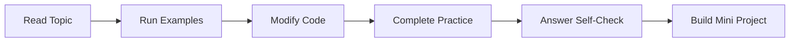

# Level 1: Beginner

## Formal Level Overview

Build a reliable foundation in Python syntax, data modeling, control flow, reusable functions, modules, and files.

## Student Outcome

Students can write small scripts, understand errors, and solve beginner automation problems with confidence.

## Recommended Study Order

| Order | Topic | Difficulty | Evidence of Mastery |
| --- | --- | --- | --- |
| 1 | [Python Setup and Program Execution](./01-python-setup-and-program-execution/) | Foundational | A student can create, run, and explain a small Python script without relying on an IDE run button. |
| 2 | [Variables, Data Types, and Operators](./02-variables-data-types-and-operators/) | Foundational | A student can model simple business facts and calculations with clear variable names and correct operators. |
| 3 | [Strings and Collections](./03-strings-and-collections/) | Foundational | A student can select an appropriate container and perform common read, update, search, and transformation operations. |
| 4 | [Control Flow](./04-control-flow/) | Foundational | A student can write readable decision logic and loops that terminate correctly. |
| 5 | [Functions, Modules, and Files](./05-functions-modules-and-files/) | Foundational to applied | A student can organize a small program into reusable functions and modules while safely reading and writing files. |

## How Students Should Use This Level

1. Study topics in order unless an instructor assigns a different route.
2. Complete the guided practice tasks inside each topic folder.
3. Keep a notebook of vocabulary, common mistakes, and corrected examples.
4. Build one small project after finishing all topics in this level.

## Level Workflow

