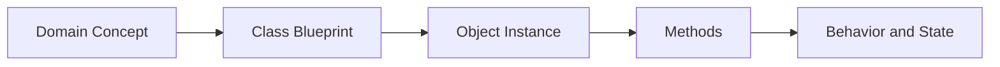

# Object-Oriented Programming

## Overview

- **What is it?** A programming style that organizes behavior and state into classes and objects.
- **Why is it important?** Many Python libraries, frameworks, and domain models are object-oriented.
- **Where is it used?** Web frameworks, GUI apps, simulations, data models, SDKs, plugins, and enterprise software.

## Learning Objectives

- Define classes, instances, attributes, and methods.
- Use encapsulation, inheritance, composition, and polymorphism.
- Design small domain models.
- Expected outcome: you can create reusable models that combine data and behavior.

## Real World Applications

- Modeling users, orders, invoices, and products.
- Creating framework components.
- Building maintainable SDKs and integrations.
- Career relevance for backend engineering, platform engineering, and application development.

## Core Concepts

### Class and Object

- **Definition:** A class is a blueprint; an object is a concrete instance.
- **Visual explanation:** `class Customer -> customer_1, customer_2`
- **Practical example:**

```python
class Customer:
    def __init__(self, name):
        self.name = name
```

### Encapsulation

- **Definition:** Keeping related data and behavior together behind a clear interface.
- **Visual explanation:** `object boundary -> public methods -> internal state`
- **Practical example:**

```python
class Cart:
    def __init__(self):
        self._items = []

    def add(self, item):
        self._items.append(item)
```

### Composition

- **Definition:** Building larger objects from smaller collaborating objects.
- **Visual explanation:** `Order has a Customer and LineItems`
- **Practical example:**

```python
class Order:
    def __init__(self, customer, items):
        self.customer = customer
        self.items = items
```

## Infographic Summary

| Block | Summary |
| --- | --- |
| 📌 Concept | Objects combine state and behavior. |
| ⚡ Purpose | Model real-world entities and reusable components. |
| 🔥 Benefits | Organization, reuse, extensibility, clearer domain logic. |
| 🎯 Use Cases | Apps, frameworks, SDKs, simulations, domain models. |
| 🚀 Best Practices | Prefer composition, keep classes cohesive, use dataclasses for data containers. |
| ❌ Common Mistakes | Overusing inheritance, creating god objects, exposing mutable internals. |

## Syntax Guide

### Basic Syntax

```python
class ClassName:
    def method(self):
        return "value"
```

### Standard Structure

```python
class Product:
    def __init__(self, name, price):
        self.name = name
        self.price = price

    def label(self):
        return f"{self.name}: ${self.price:.2f}"
```

### Code Pattern

```python
object_instance = ClassName(arguments)
result = object_instance.method()
```

## Examples

### Beginner Example

```python
class Dog:
    def __init__(self, name):
        self.name = name

    def speak(self):
        return "woof"


dog = Dog("Rex")
print(dog.name, dog.speak())
```

### Intermediate Example

```python
from dataclasses import dataclass


@dataclass
class InvoiceLine:
    description: str
    quantity: int
    unit_price: float

    @property
    def total(self):
        return self.quantity * self.unit_price
```

### Advanced Example

```python
from abc import ABC, abstractmethod


class PaymentGateway(ABC):
    @abstractmethod
    def charge(self, amount: float) -> str:
        raise NotImplementedError


class StripeGateway(PaymentGateway):
    def charge(self, amount: float) -> str:
        return f"Charged ${amount:.2f} through Stripe"
```

## Workflow Diagram



---

## Student Learning Support

### Curriculum Metadata

| Field | Details |
| --- | --- |
| Roadmap level | Level 2: Intermediate |
| Topic number | 6 |
| Difficulty | Intermediate |
| Recommended study format | Two to three focused study sessions |
| Best studied after | Functions, Collections, Basic modules |

### Before You Start

- Functions
- Collections
- Basic modules

### Key Vocabulary

- Class
- Object
- Method
- Attribute
- Encapsulation
- Composition

### Student Study Plan

1. Read the overview and learning objectives before running any code.
2. Type each beginner example manually to build muscle memory.
3. Modify the intermediate example with your own data.
4. Explain the advanced example line by line in plain language.
5. Complete the practice tasks and compare your output with the expected behavior.

### Guided Practice Tasks

- Create a Product class with price and label behavior.
- Use a dataclass for an invoice line.
- Model an order using composition instead of inheritance.

### Self-Check Questions

- Can I distinguish a class from an instance?
- Can I decide when a dataclass is appropriate?
- Can I explain why composition is often safer than inheritance?

### Evidence of Mastery

A student can model a small domain with cohesive classes and clear object responsibilities.

### Instructor Notes

- Ask the student to explain their code before asking them to optimize it.
- Encourage small, frequent experiments in the Python interpreter.
- Review mistakes as feedback about the mental model, not as failure.
