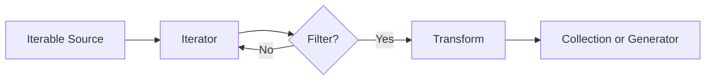

# Comprehensions, Iterators, and Generators

## Overview

- **What is it?** Pythonic tools for transforming streams and collections efficiently.
- **Why is it important?** They make data processing concise, readable, and memory-aware.
- **Where is it used?** ETL pipelines, web responses, file processing, analytics, and automation.

## Learning Objectives

- Write list, dict, and set comprehensions.
- Understand iterable, iterator, and generator protocols.
- Use lazy evaluation for large data.
- Expected outcome: you can process data elegantly without unnecessary memory use.

## Real World Applications

- Filtering product catalogs.
- Streaming large log files.
- Transforming API records.
- Career relevance for data engineering, backend services, and automation.

## Core Concepts

### Comprehensions

- **Definition:** Compact syntax for creating collections from iterables.
- **Visual explanation:** `source items -> expression + filter -> new collection`
- **Practical example:**

```python
squares = [number * number for number in range(5)]
```

### Iterators

- **Definition:** Objects that produce values one at a time with `next()`.
- **Visual explanation:** `iterator -> next -> value -> next -> value`
- **Practical example:**

```python
numbers = iter([1, 2, 3])
print(next(numbers))
```

### Generators

- **Definition:** Functions or expressions that lazily yield values.
- **Visual explanation:** `yield -> pause -> resume`
- **Practical example:**

```python
def countdown(start):
    while start > 0:
        yield start
        start -= 1
```

## Infographic Summary

| Block | Summary |
| --- | --- |
| 📌 Concept | Transform and stream values with concise iteration tools. |
| ⚡ Purpose | Process data cleanly and efficiently. |
| 🔥 Benefits | Less boilerplate, lower memory usage, clearer transformations. |
| 🎯 Use Cases | Log processing, filtering, ETL, pagination, pipelines. |
| 🚀 Best Practices | Keep comprehensions simple, use generators for large streams, name complex steps. |
| ❌ Common Mistakes | Nesting unreadable comprehensions, exhausting iterators accidentally, materializing huge lists. |

## Syntax Guide

### Basic Syntax

```python
result = [expression for item in iterable if condition]
```

### Standard Structure

```python
def generate_items(source):
    for item in source:
        if is_valid(item):
            yield transform(item)
```

### Code Pattern

```python
pipeline = (transform(item) for item in source if is_valid(item))
```

## Examples

### Beginner Example

```python
numbers = [1, 2, 3, 4]
doubled = [number * 2 for number in numbers]
print(doubled)
```

### Intermediate Example

```python
users = [
    {"name": "Ari", "active": True},
    {"name": "Bea", "active": False},
]

active_names = [user["name"] for user in users if user["active"]]
print(active_names)
```

### Advanced Example

```python
from pathlib import Path


def matching_lines(path: Path, keyword: str):
    with path.open(encoding="utf-8") as file:
        for line in file:
            if keyword in line:
                yield line.rstrip()
```

## Workflow Diagram



---

## Student Learning Support

### Curriculum Metadata

| Field | Details |
| --- | --- |
| Roadmap level | Level 2: Intermediate |
| Topic number | 7 |
| Difficulty | Intermediate |
| Recommended study format | Two focused study sessions |
| Best studied after | Loops, Collections, Functions |

### Before You Start

- Loops
- Collections
- Functions

### Key Vocabulary

- Comprehension
- Iterable
- Iterator
- Generator
- yield
- Lazy evaluation

### Student Study Plan

1. Read the overview and learning objectives before running any code.
2. Type each beginner example manually to build muscle memory.
3. Modify the intermediate example with your own data.
4. Explain the advanced example line by line in plain language.
5. Complete the practice tasks and compare your output with the expected behavior.

### Guided Practice Tasks

- Rewrite a loop as a list comprehension.
- Create a generator that streams matching lines from a file.
- Explain what happens after an iterator is exhausted.

### Self-Check Questions

- Can I keep comprehensions readable?
- Can I choose a generator for large data?
- Can I describe lazy evaluation in plain language?

### Evidence of Mastery

A student can transform and stream data using idiomatic Python without wasting memory.

### Instructor Notes

- Ask the student to explain their code before asking them to optimize it.
- Encourage small, frequent experiments in the Python interpreter.
- Review mistakes as feedback about the mental model, not as failure.

---

## More Nested Student Breakdown

For smaller study units, open the [`deep-dive/`](./deep-dive/) directory. It breaks this topic into overview, objectives, applications, concepts, syntax, examples, workflow, questions, code files, and answer guidance.

