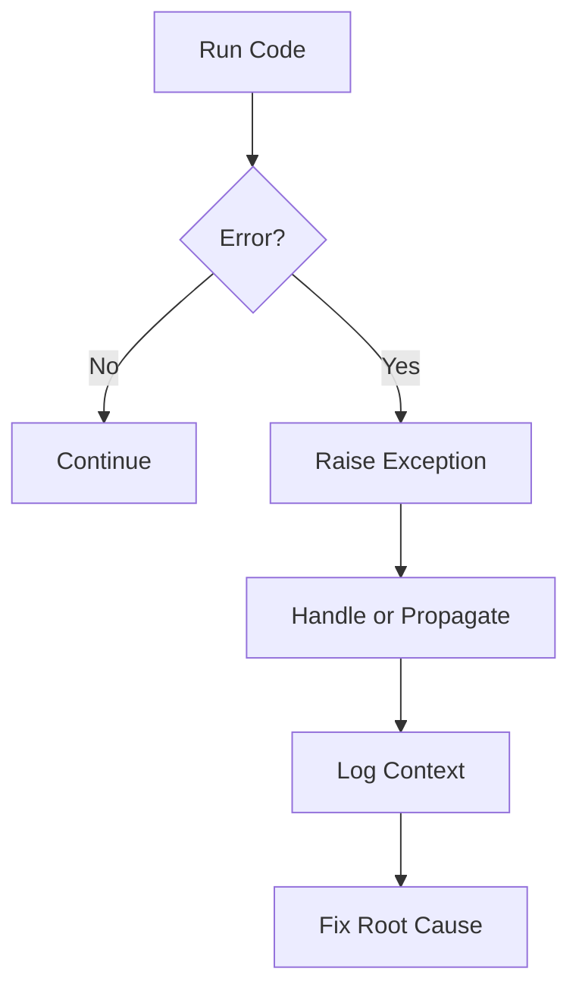

# Exceptions, Debugging, and Logging

## Overview

- **What is it?** Techniques for detecting, handling, diagnosing, and recording runtime problems.
- **Why is it important?** Real programs must fail safely and provide useful information when things go wrong.
- **Where is it used?** APIs, data jobs, CLIs, background workers, integrations, and production services.

## Learning Objectives

- Use `try`, `except`, `else`, and `finally`.
- Raise meaningful exceptions.
- Debug with tracebacks and log structured events.
- Expected outcome: you can build programs that are diagnosable and resilient.

## Real World Applications

- Handling payment failures.
- Recording service health problems.
- Recovering from missing files or invalid input.
- Career relevance for reliable backend, DevOps, data, and QA work.

## Core Concepts

### Exceptions

- **Definition:** Objects representing runtime errors or exceptional conditions.
- **Visual explanation:** `normal flow -> error raised -> handler`
- **Practical example:**

```python
try:
    number = int("42")
except ValueError:
    number = 0
```

### Debugging

- **Definition:** The process of finding and fixing defects using evidence.
- **Visual explanation:** `symptom -> traceback -> cause -> fix`
- **Practical example:**

```python
def divide(a, b):
    breakpoint()
    return a / b
```

### Logging

- **Definition:** Recording runtime events for humans and systems to inspect later.
- **Visual explanation:** `application event -> logger -> console/file/monitoring`
- **Practical example:**

```python
import logging

logging.warning("Cache miss for user profile")
```

## Infographic Summary

| Block | Summary |
| --- | --- |
| 📌 Concept | Exceptions signal problems; logs preserve operational evidence. |
| ⚡ Purpose | Fail safely and diagnose quickly. |
| 🔥 Benefits | Reliability, observability, easier maintenance. |
| 🎯 Use Cases | APIs, batch jobs, integrations, validation, monitoring. |
| 🚀 Best Practices | Catch specific exceptions, log context, preserve tracebacks. |
| ❌ Common Mistakes | Bare `except`, swallowing errors, using `print` as production logging. |

## Syntax Guide

### Basic Syntax

```python
try:
    risky_operation()
except SpecificError as error:
    handle(error)
```

### Standard Structure

```python
try:
    result = load_data()
except FileNotFoundError as error:
    logger.exception("Required file is missing")
    raise
else:
    process(result)
finally:
    cleanup()
```

### Code Pattern

```python
if not valid:
    raise ValueError("Explain what was invalid")
```

## Examples

### Beginner Example

```python
try:
    age = int(input("Age: "))
except ValueError:
    print("Please enter a number")
```

### Intermediate Example

```python
import logging


logger = logging.getLogger(__name__)

try:
    total = 10 / 0
except ZeroDivisionError:
    logger.exception("Calculation failed")
```

### Advanced Example

```python
class ConfigurationError(RuntimeError):
    pass


def require_setting(settings: dict, key: str) -> str:
    try:
        return settings[key]
    except KeyError as error:
        raise ConfigurationError(f"Missing required setting: {key}") from error
```

## Workflow Diagram



---

## Student Learning Support

### Curriculum Metadata

| Field | Details |
| --- | --- |
| Roadmap level | Level 2: Intermediate |
| Topic number | 8 |
| Difficulty | Intermediate |
| Recommended study format | Two focused study sessions |
| Best studied after | Functions, Files, Control flow |

### Before You Start

- Functions
- Files
- Control flow

### Key Vocabulary

- Exception
- Traceback
- Handler
- Logger
- Log level
- Root cause

### Student Study Plan

1. Read the overview and learning objectives before running any code.
2. Type each beginner example manually to build muscle memory.
3. Modify the intermediate example with your own data.
4. Explain the advanced example line by line in plain language.
5. Complete the practice tasks and compare your output with the expected behavior.

### Guided Practice Tasks

- Catch a specific ValueError and recover with a default.
- Raise a custom exception for invalid configuration.
- Replace print diagnostics with logging.

### Self-Check Questions

- Can I avoid bare except blocks?
- Can I read a traceback from bottom to top?
- Can I log enough context to diagnose a failure?

### Evidence of Mastery

A student can diagnose failures, handle expected errors, and leave useful operational evidence.

### Instructor Notes

- Ask the student to explain their code before asking them to optimize it.
- Encourage small, frequent experiments in the Python interpreter.
- Review mistakes as feedback about the mental model, not as failure.
