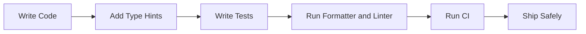

# Testing, Typing, and Code Quality

## Overview

- **What is it?** Practices and tools that verify behavior, document intent, and keep code maintainable.
- **Why is it important?** Tests and types reduce regressions and make change safer.
- **Where is it used?** Professional software teams, open-source projects, CI pipelines, APIs, libraries, and data systems.

## Learning Objectives

- Write unit tests and assertions.
- Use type hints for functions and data structures.
- Understand linting, formatting, and static analysis.
- Expected outcome: you can improve confidence and readability in Python projects.

## Real World Applications

- Preventing checkout bugs in ecommerce.
- Validating data transformation rules.
- Enforcing team code standards.
- Career relevance for any professional Python role.

## Core Concepts

### Unit Tests

- **Definition:** Small automated checks for isolated behavior.
- **Visual explanation:** `input -> function -> expected output`
- **Practical example:**

```python
def test_addition():
    assert 2 + 2 == 4
```

### Type Hints

- **Definition:** Optional annotations that describe expected value types.
- **Visual explanation:** `function parameter: type -> return type`
- **Practical example:**

```python
def greet(name: str) -> str:
    return f"Hello, {name}"
```

### Code Quality Tools

- **Definition:** Automated checks for formatting, style, defects, and consistency.
- **Visual explanation:** `code -> formatter/linter/type checker -> feedback`
- **Practical example:**

```bash
python -m pytest
```

## Infographic Summary

| Block | Summary |
| --- | --- |
| 📌 Concept | Tests prove behavior; types communicate contracts; tools enforce quality. |
| ⚡ Purpose | Make code safer to change. |
| 🔥 Benefits | Fewer regressions, clearer APIs, easier collaboration. |
| 🎯 Use Cases | CI/CD, libraries, services, analytics pipelines, refactors. |
| 🚀 Best Practices | Test behavior, type public interfaces, automate checks in CI. |
| ❌ Common Mistakes | Testing implementation details, ignoring failing tests, using vague types everywhere. |

## Syntax Guide

### Basic Syntax

```python
def add(a: int, b: int) -> int:
    return a + b
```

### Standard Structure

```python
def test_add_returns_sum():
    assert add(2, 3) == 5
```

### Code Pattern

```python
Arrange data -> Act on system -> Assert expected result
```

## Examples

### Beginner Example

```python
def double(number):
    return number * 2


assert double(4) == 8
```

### Intermediate Example

```python
def normalize_email(email: str) -> str:
    return email.strip().lower()


def test_normalize_email():
    assert normalize_email(" USER@EXAMPLE.COM ") == "user@example.com"
```

### Advanced Example

```python
from typing import Protocol


class Sender(Protocol):
    def send(self, message: str) -> None:
        ...


def notify(sender: Sender, message: str) -> None:
    sender.send(message)
```

## Workflow Diagram



---

## Student Learning Support

### Curriculum Metadata

| Field | Details |
| --- | --- |
| Roadmap level | Level 2: Intermediate |
| Topic number | 9 |
| Difficulty | Intermediate |
| Recommended study format | Two focused study sessions |
| Best studied after | Functions, Modules, Exceptions |

### Before You Start

- Functions
- Modules
- Exceptions

### Key Vocabulary

- Assertion
- Unit test
- Fixture
- Type hint
- Protocol
- Linter

### Student Study Plan

1. Read the overview and learning objectives before running any code.
2. Type each beginner example manually to build muscle memory.
3. Modify the intermediate example with your own data.
4. Explain the advanced example line by line in plain language.
5. Complete the practice tasks and compare your output with the expected behavior.

### Guided Practice Tasks

- Write tests for a pure calculation function.
- Add type hints to a public function.
- Run a formatter or linter and address one issue.

### Self-Check Questions

- Can I test behavior instead of implementation details?
- Can I explain a function signature using type hints?
- Can I make code easier to review with automated checks?

### Evidence of Mastery

A student can protect important behavior with tests and make intent clearer with types and tooling.

### Instructor Notes

- Ask the student to explain their code before asking them to optimize it.
- Encourage small, frequent experiments in the Python interpreter.
- Review mistakes as feedback about the mental model, not as failure.

---

## More Nested Student Breakdown

For smaller study units, open the [`deep-dive/`](./deep-dive/) directory. It breaks this topic into overview, objectives, applications, concepts, syntax, examples, workflow, questions, code files, and answer guidance.

