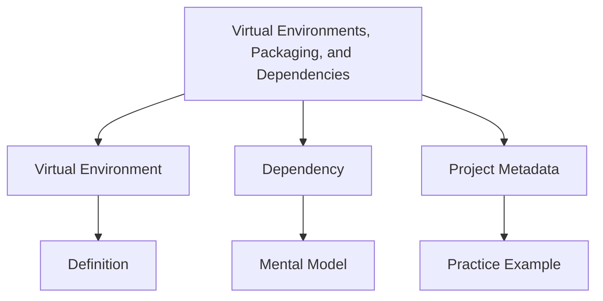

# Core Concepts Breakdown: Virtual Environments, Packaging, and Dependencies

## Concept Map

## Concept Study Cards

### Virtual Environment

- **Definition:** First major idea students must recognize in this topic.
- **Mental model:** Ask, "What role does this play in the program?"
- **Try it:** Find one line in the topic README that demonstrates this idea.

### Dependency

- **Definition:** Second major idea that adds depth or structure.
- **Mental model:** Ask, "What changes when this idea is added?"
- **Try it:** Modify an example so this concept becomes visible.

### Project Metadata

- **Definition:** Third major idea that helps students move toward practical use.
- **Mental model:** Ask, "What mistake might happen if I misunderstand this?"
- **Try it:** Write one sentence explaining this concept to a beginner.

## Concept Questions

- Which concept is easiest for you and why?
- Which concept is most likely to cause mistakes?
- How do the three concepts work together?

