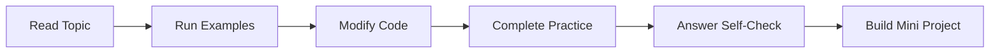

# Level 2: Intermediate

## Formal Level Overview

Develop professional habits around object-oriented design, iteration patterns, error handling, testing, typing, and dependency management.

## Student Outcome

Students can structure maintainable Python projects and reason about quality, reuse, and reliability.

## Recommended Study Order

| Order | Topic | Difficulty | Evidence of Mastery |
| --- | --- | --- | --- |
| 6 | [Object-Oriented Programming](./06-object-oriented-programming/) | Intermediate | A student can model a small domain with cohesive classes and clear object responsibilities. |
| 7 | [Comprehensions, Iterators, and Generators](./07-comprehensions-iterators-and-generators/) | Intermediate | A student can transform and stream data using idiomatic Python without wasting memory. |
| 8 | [Exceptions, Debugging, and Logging](./08-exceptions-debugging-and-logging/) | Intermediate | A student can diagnose failures, handle expected errors, and leave useful operational evidence. |
| 9 | [Testing, Typing, and Code Quality](./09-testing-typing-and-code-quality/) | Intermediate | A student can protect important behavior with tests and make intent clearer with types and tooling. |
| 10 | [Virtual Environments, Packaging, and Dependencies](./10-virtual-environments-packaging-and-dependencies/) | Intermediate | A student can isolate a Python project and describe how its dependencies are declared and installed. |

## How Students Should Use This Level

1. Study topics in order unless an instructor assigns a different route.
2. Complete the guided practice tasks inside each topic folder.
3. Keep a notebook of vocabulary, common mistakes, and corrected examples.
4. Build one small project after finishing all topics in this level.

## Level Workflow

