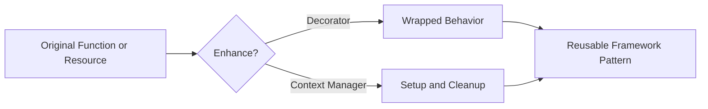

# Decorators, Context Managers, and Metaprogramming

## Overview

- **What is it?** Advanced language features for modifying behavior, managing resources, and creating code that works with code.
- **Why is it important?** Many frameworks use these features for routing, validation, transactions, plugins, and resource safety.
- **Where is it used?** Web frameworks, ORMs, test frameworks, observability tooling, SDKs, and internal platforms.

## Learning Objectives

- Write and apply decorators.
- Build context managers with classes and `contextlib`.
- Understand reflection, descriptors, and dynamic attributes at a practical level.
- Expected outcome: you can use advanced Python features responsibly and read framework internals with confidence.

## Real World Applications

- Timing function calls.
- Opening and closing database transactions.
- Registering web routes.
- Career relevance for framework development, platform engineering, and senior backend roles.

## Core Concepts

### Decorators

- **Definition:** Callables that wrap or modify another callable.
- **Visual explanation:** `function -> decorator -> enhanced function`
- **Practical example:**

```python
def uppercase(func):
    def wrapper():
        return func().upper()
    return wrapper
```

### Context Managers

- **Definition:** Objects that define setup and cleanup around a block.
- **Visual explanation:** `enter -> with block -> exit`
- **Practical example:**

```python
with open("data.txt", encoding="utf-8") as file:
    content = file.read()
```

### Metaprogramming

- **Definition:** Code that inspects, creates, or changes code structures at runtime.
- **Visual explanation:** `program -> inspect object -> adapt behavior`
- **Practical example:**

```python
method_names = [name for name in dir(str) if name.startswith("is")]
```

## Infographic Summary

| Block | Summary |
| --- | --- |
| 📌 Concept | Python can wrap behavior, manage resources, and inspect itself. |
| ⚡ Purpose | Add reusable cross-cutting behavior and safe lifecycle management. |
| 🔥 Benefits | Cleaner APIs, less duplication, framework-level expressiveness. |
| 🎯 Use Cases | Routing, caching, transactions, plugins, instrumentation. |
| 🚀 Best Practices | Preserve metadata, keep magic visible, prefer simple functions when possible. |
| ❌ Common Mistakes | Hiding side effects, writing unreadable decorators, overusing dynamic behavior. |

## Syntax Guide

### Basic Syntax

```python
@decorator
def function():
    pass
```

### Standard Structure

```python
from functools import wraps


def decorator(func):
    @wraps(func)
    def wrapper(*args, **kwargs):
        return func(*args, **kwargs)
    return wrapper
```

### Code Pattern

```python
with resource_manager() as resource:
    use(resource)
```

## Examples

### Beginner Example

```python
def announce(func):
    def wrapper():
        print("Calling function")
        return func()
    return wrapper


@announce
def greet():
    print("Hello")


greet()
```

### Intermediate Example

```python
from contextlib import contextmanager


@contextmanager
def managed_message():
    print("start")
    try:
        yield
    finally:
        print("end")


with managed_message():
    print("working")
```

### Advanced Example

```python
from functools import wraps
from time import perf_counter


def timed(func):
    @wraps(func)
    def wrapper(*args, **kwargs):
        start = perf_counter()
        try:
            return func(*args, **kwargs)
        finally:
            print(f"{func.__name__} took {perf_counter() - start:.4f}s")
    return wrapper
```

## Workflow Diagram



---

## Student Learning Support

### Curriculum Metadata

| Field | Details |
| --- | --- |
| Roadmap level | Level 3: Advanced |
| Topic number | 11 |
| Difficulty | Advanced |
| Recommended study format | Two to three focused study sessions |
| Best studied after | Functions as objects, OOP basics, Exceptions |

### Before You Start

- Functions as objects
- OOP basics
- Exceptions

### Key Vocabulary

- Decorator
- Wrapper
- Context manager
- __enter__
- __exit__
- Introspection

### Student Study Plan

1. Read the overview and learning objectives before running any code.
2. Type each beginner example manually to build muscle memory.
3. Modify the intermediate example with your own data.
4. Explain the advanced example line by line in plain language.
5. Complete the practice tasks and compare your output with the expected behavior.

### Guided Practice Tasks

- Write a decorator that logs function calls.
- Create a context manager with contextlib.contextmanager.
- Inspect an object with dir and getattr.

### Self-Check Questions

- Can I preserve metadata with functools.wraps?
- Can I guarantee cleanup with a context manager?
- Can I avoid unnecessary magic in application code?

### Evidence of Mastery

A student can use advanced language features to reduce duplication while keeping behavior understandable.

### Instructor Notes

- Ask the student to explain their code before asking them to optimize it.
- Encourage small, frequent experiments in the Python interpreter.
- Review mistakes as feedback about the mental model, not as failure.
