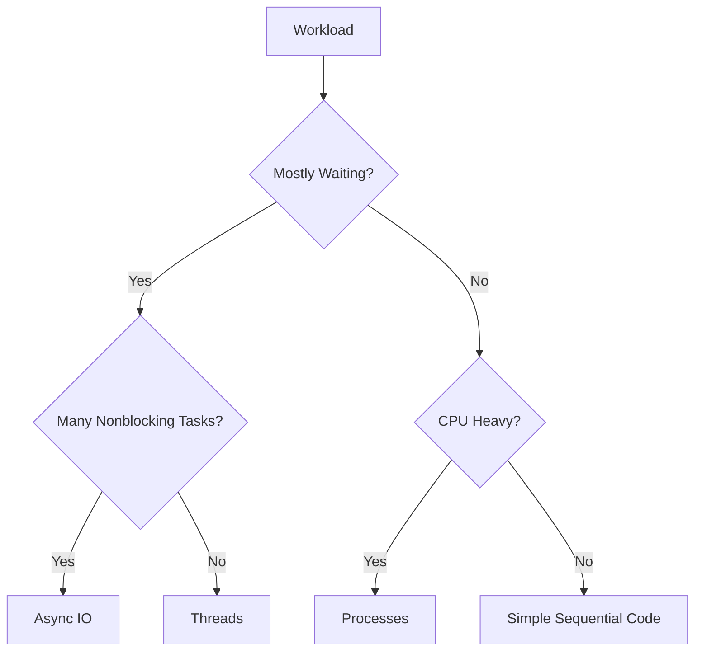

# Concurrency, Parallelism, and Async IO

## Overview

- **What is it?** Techniques for doing overlapping work with threads, processes, and asynchronous tasks.
- **Why is it important?** Modern applications handle network calls, background jobs, CPU-heavy work, and many users at once.
- **Where is it used?** Web servers, crawlers, ETL, queues, ML preprocessing, GUI apps, and high-throughput services.

## Learning Objectives

- Distinguish concurrency from parallelism.
- Use threads for I/O-bound work and processes for CPU-bound work.
- Understand `async` and `await` for cooperative multitasking.
- Expected outcome: you can select an execution model based on workload characteristics.

## Real World Applications

- Fetching many API pages.
- Processing images in parallel.
- Serving concurrent web requests.
- Career relevance for backend, data engineering, platform, and infrastructure roles.

## Core Concepts

### Concurrency

- **Definition:** Managing multiple tasks during overlapping time periods.
- **Visual explanation:** `task A waits -> task B runs -> task A resumes`
- **Practical example:**

```python
from concurrent.futures import ThreadPoolExecutor
```

### Parallelism

- **Definition:** Running multiple tasks at the same instant on multiple CPU cores.
- **Visual explanation:** `core 1 -> task A`, `core 2 -> task B`
- **Practical example:**

```python
from concurrent.futures import ProcessPoolExecutor
```

### Async IO

- **Definition:** Single-threaded cooperative concurrency for non-blocking I/O.
- **Visual explanation:** `event loop -> await I/O -> run another task`
- **Practical example:**

```python
import asyncio


async def main():
    await asyncio.sleep(1)
```

## Infographic Summary

| Block | Summary |
| --- | --- |
| 📌 Concept | Use overlapping execution to improve throughput and responsiveness. |
| ⚡ Purpose | Keep systems busy while waiting or divide heavy work across cores. |
| 🔥 Benefits | Faster I/O workflows, scalable services, better resource usage. |
| 🎯 Use Cases | Web APIs, crawlers, queues, image processing, streaming. |
| 🚀 Best Practices | Match tool to workload, set timeouts, handle cancellation, avoid shared mutable state. |
| ❌ Common Mistakes | Using threads for CPU speedups, blocking inside async code, ignoring race conditions. |

## Syntax Guide

### Basic Syntax

```python
async def task():
    await async_operation()
```

### Standard Structure

```python
import asyncio


async def main():
    results = await asyncio.gather(task_one(), task_two())
    return results


asyncio.run(main())
```

### Code Pattern

```python
choose_model = "threads for I/O, processes for CPU, async for many non-blocking operations"
```

## Examples

### Beginner Example

```python
import time


for step in range(3):
    print("Working", step)
    time.sleep(1)
```

### Intermediate Example

```python
from concurrent.futures import ThreadPoolExecutor


def download(url):
    return f"Downloaded {url}"


urls = ["https://example.com/a", "https://example.com/b"]
with ThreadPoolExecutor() as executor:
    print(list(executor.map(download, urls)))
```

### Advanced Example

```python
import asyncio


async def fetch(name: str) -> str:
    await asyncio.sleep(1)
    return f"response:{name}"


async def main():
    results = await asyncio.gather(fetch("a"), fetch("b"), fetch("c"))
    print(results)


asyncio.run(main())
```

## Workflow Diagram



---

## Student Learning Support

### Curriculum Metadata

| Field | Details |
| --- | --- |
| Roadmap level | Level 3: Advanced |
| Topic number | 12 |
| Difficulty | Advanced |
| Recommended study format | Three focused study sessions |
| Best studied after | Functions, Exceptions, Generators, Basic networking concepts |

### Before You Start

- Functions
- Exceptions
- Generators
- Basic networking concepts

### Key Vocabulary

- Concurrency
- Parallelism
- Thread
- Process
- Event loop
- Coroutine

### Student Study Plan

1. Read the overview and learning objectives before running any code.
2. Type each beginner example manually to build muscle memory.
3. Modify the intermediate example with your own data.
4. Explain the advanced example line by line in plain language.
5. Complete the practice tasks and compare your output with the expected behavior.

### Guided Practice Tasks

- Use ThreadPoolExecutor for several simulated I/O tasks.
- Use asyncio.gather for concurrent coroutines.
- Explain when ProcessPoolExecutor is appropriate.

### Self-Check Questions

- Can I classify a workload as I/O-bound or CPU-bound?
- Can I avoid blocking calls inside async code?
- Can I explain race conditions at a high level?

### Evidence of Mastery

A student can select a safe execution model for a workload and explain the tradeoffs.

### Instructor Notes

- Ask the student to explain their code before asking them to optimize it.
- Encourage small, frequent experiments in the Python interpreter.
- Review mistakes as feedback about the mental model, not as failure.
