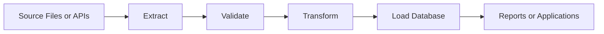

# Data Engineering, APIs, and Databases

## Overview

- **What is it?** Reading, validating, transforming, transporting, and storing data using Python.
- **Why is it important?** Most business systems are data systems, and Python is widely used across data workflows.
- **Where is it used?** ETL, analytics, integrations, reporting, backend APIs, dashboards, and operational databases.

## Learning Objectives

- Work with JSON, CSV, and structured records.
- Call APIs and handle responses.
- Query databases and design simple data pipelines.
- Expected outcome: you can move data between files, services, and storage systems.

## Real World Applications

- Syncing CRM data to a warehouse.
- Importing vendor CSV files.
- Building reporting APIs.
- Career relevance for data engineering, analytics engineering, backend, and automation.

## Core Concepts

### Serialization

- **Definition:** Converting objects to portable formats like JSON or CSV.
- **Visual explanation:** `Python object <-> JSON text`
- **Practical example:**

```python
import json

payload = json.dumps({"status": "ok"})
```

### APIs

- **Definition:** Interfaces that allow systems to exchange data over defined contracts.
- **Visual explanation:** `client -> HTTP request -> server -> response`
- **Practical example:**

```python
from urllib.request import urlopen
```

### Databases

- **Definition:** Systems for storing and querying durable structured data.
- **Visual explanation:** `application -> query -> database -> rows`
- **Practical example:**

```python
import sqlite3

connection = sqlite3.connect(":memory:")
```

## Infographic Summary

| Block | Summary |
| --- | --- |
| 📌 Concept | Python connects files, APIs, transformations, and databases. |
| ⚡ Purpose | Turn raw data into useful, reliable information flows. |
| 🔥 Benefits | Automation, integration, analytics, durable storage. |
| 🎯 Use Cases | ETL, dashboards, sync jobs, imports, exports, APIs. |
| 🚀 Best Practices | Validate inputs, use parameterized SQL, handle pagination and retries. |
| ❌ Common Mistakes | Trusting external data blindly, building SQL with string interpolation, ignoring encoding. |

## Syntax Guide

### Basic Syntax

```python
import json

data = json.loads('{"name": "Python"}')
```

### Standard Structure

```python
import csv


with open("data.csv", newline="", encoding="utf-8") as file:
    rows = list(csv.DictReader(file))
```

### Code Pattern

```python
extract -> validate -> transform -> load
```

## Examples

### Beginner Example

```python
import json


record = {"name": "Ada", "language": "Python"}
print(json.dumps(record, indent=2))
```

### Intermediate Example

```python
import csv
from io import StringIO


data = "name,score\nAda,95\nGrace,98\n"
reader = csv.DictReader(StringIO(data))
scores = {row["name"]: int(row["score"]) for row in reader}
print(scores)
```

### Advanced Example

```python
import sqlite3


with sqlite3.connect(":memory:") as connection:
    connection.execute("CREATE TABLE users (id INTEGER PRIMARY KEY, email TEXT)")
    connection.execute("INSERT INTO users (email) VALUES (?)", ("user@example.com",))
    rows = connection.execute("SELECT email FROM users WHERE id = ?", (1,)).fetchall()
    print(rows)
```

## Workflow Diagram



---

## Student Learning Support

### Curriculum Metadata

| Field | Details |
| --- | --- |
| Roadmap level | Level 3: Advanced |
| Topic number | 13 |
| Difficulty | Advanced |
| Recommended study format | Three focused study sessions |
| Best studied after | Files, Collections, Exceptions, Basic SQL awareness |

### Before You Start

- Files
- Collections
- Exceptions
- Basic SQL awareness

### Key Vocabulary

- Serialization
- JSON
- CSV
- API
- SQL
- ETL

### Student Study Plan

1. Read the overview and learning objectives before running any code.
2. Type each beginner example manually to build muscle memory.
3. Modify the intermediate example with your own data.
4. Explain the advanced example line by line in plain language.
5. Complete the practice tasks and compare your output with the expected behavior.

### Guided Practice Tasks

- Parse JSON into Python dictionaries.
- Read CSV rows with csv.DictReader.
- Insert and query data using parameterized SQLite statements.

### Self-Check Questions

- Can I validate external data before trusting it?
- Can I avoid SQL string interpolation?
- Can I describe extract-transform-load in order?

### Evidence of Mastery

A student can move data between files, APIs, transformations, and databases safely.

### Instructor Notes

- Ask the student to explain their code before asking them to optimize it.
- Encourage small, frequent experiments in the Python interpreter.
- Review mistakes as feedback about the mental model, not as failure.

---

## More Nested Student Breakdown

For smaller study units, open the [`deep-dive/`](./deep-dive/) directory. It breaks this topic into overview, objectives, applications, concepts, syntax, examples, workflow, questions, code files, and answer guidance.

