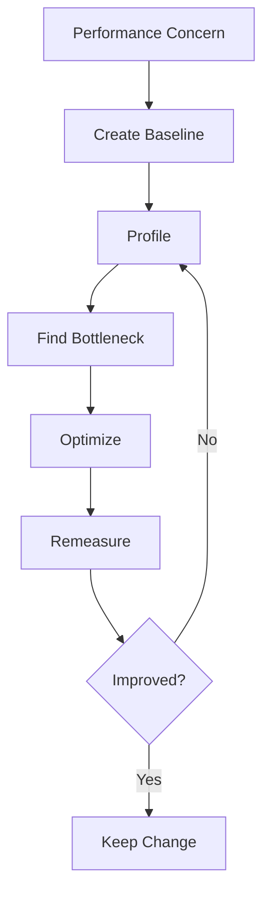

# Performance, Memory, and Profiling

## Overview

- **What is it?** Measuring and improving runtime speed, memory use, and algorithmic efficiency.
- **Why is it important?** Optimization without measurement wastes effort; measured improvements reduce cost and latency.
- **Where is it used?** APIs, data pipelines, ML preprocessing, batch jobs, scientific computing, and high-traffic services.

## Learning Objectives

- Recognize algorithmic complexity.
- Profile code before optimizing.
- Use efficient data structures, lazy evaluation, and caching.
- Expected outcome: you can improve performance based on evidence.

## Real World Applications

- Reducing API latency.
- Making batch jobs cheaper.
- Processing larger datasets.
- Career relevance for senior engineering, data platforms, and performance-sensitive systems.

## Core Concepts

### Complexity

- **Definition:** How runtime or memory grows as input size grows.
- **Visual explanation:** `n items -> O(n) scan`, `nested loops -> O(n^2)`
- **Practical example:**

```python
lookup = set(["a", "b", "c"])
print("a" in lookup)
```

### Profiling

- **Definition:** Measuring where code spends time or memory.
- **Visual explanation:** `program -> profiler -> hot spots`
- **Practical example:**

```python
import cProfile

cProfile.run("sum(range(1_000_000))")
```

### Caching

- **Definition:** Reusing previous results to avoid repeated work.
- **Visual explanation:** `input -> cache? -> result`
- **Practical example:**

```python
from functools import lru_cache
```

## Infographic Summary

| Block | Summary |
| --- | --- |
| 📌 Concept | Measure first, then optimize the bottleneck. |
| ⚡ Purpose | Improve speed, memory, throughput, and cost. |
| 🔥 Benefits | Lower latency, lower infrastructure spend, scalable workloads. |
| 🎯 Use Cases | APIs, ETL, ML, simulations, batch jobs. |
| 🚀 Best Practices | Profile realistic workloads, prefer better algorithms, document tradeoffs. |
| ❌ Common Mistakes | Premature optimization, optimizing cold paths, hiding complexity behind clever code. |

## Syntax Guide

### Basic Syntax

```python
from time import perf_counter

start = perf_counter()
run_work()
elapsed = perf_counter() - start
```

### Standard Structure

```python
from functools import lru_cache


@lru_cache(maxsize=128)
def expensive_lookup(key):
    return compute_value(key)
```

### Code Pattern

```python
measure -> identify bottleneck -> optimize -> remeasure
```

## Examples

### Beginner Example

```python
numbers = list(range(1000))
print(sum(numbers))
```

### Intermediate Example

```python
from time import perf_counter


start = perf_counter()
result = sum(number * number for number in range(1_000_000))
print(result, perf_counter() - start)
```

### Advanced Example

```python
from functools import lru_cache


@lru_cache(maxsize=None)
def fibonacci(number: int) -> int:
    if number < 2:
        return number
    return fibonacci(number - 1) + fibonacci(number - 2)


print(fibonacci(40))
```

## Workflow Diagram



---

## Student Learning Support

### Curriculum Metadata

| Field | Details |
| --- | --- |
| Roadmap level | Level 3: Advanced |
| Topic number | 14 |
| Difficulty | Advanced |
| Recommended study format | Two focused study sessions |
| Best studied after | Data structures, Functions, Generators |

### Before You Start

- Data structures
- Functions
- Generators

### Key Vocabulary

- Complexity
- Baseline
- Profiler
- Hot spot
- Caching
- Memory footprint

### Student Study Plan

1. Read the overview and learning objectives before running any code.
2. Type each beginner example manually to build muscle memory.
3. Modify the intermediate example with your own data.
4. Explain the advanced example line by line in plain language.
5. Complete the practice tasks and compare your output with the expected behavior.

### Guided Practice Tasks

- Compare list membership with set membership.
- Measure a function with perf_counter.
- Use lru_cache for repeated recursive calls.

### Self-Check Questions

- Can I explain why measuring comes before optimizing?
- Can I identify an O(n^2) pattern?
- Can I verify that an optimization improved the baseline?

### Evidence of Mastery

A student can improve performance with evidence instead of guesswork.

### Instructor Notes

- Ask the student to explain their code before asking them to optimize it.
- Encourage small, frequent experiments in the Python interpreter.
- Review mistakes as feedback about the mental model, not as failure.

---

## More Nested Student Breakdown

For smaller study units, open the [`deep-dive/`](./deep-dive/) directory. It breaks this topic into overview, objectives, applications, concepts, syntax, examples, workflow, questions, code files, and answer guidance.

