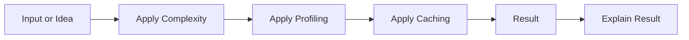

# Workflow Diagram Breakdown: Performance, Memory, and Profiling

## Student Workflow

## Diagram Reading Questions

- What is the first step?
- What changes in the middle step?
- What output or result should appear at the end?

