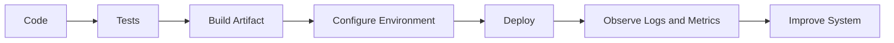

# Production Architecture, Security, and Deployment

## Overview

- **What is it?** Designing Python systems that are maintainable, secure, observable, configurable, and deployable.
- **Why is it important?** Production software must serve users reliably and protect data beyond local development.
- **Where is it used?** SaaS platforms, internal tools, APIs, cloud services, data platforms, and automation systems.

## Learning Objectives

- Structure applications by responsibility.
- Manage configuration and secrets safely.
- Understand security, observability, deployment, and operational readiness.
- Expected outcome: you can reason about Python systems as production products.

## Real World Applications

- Deploying APIs to cloud infrastructure.
- Building secure internal automation.
- Monitoring services with logs and metrics.
- Career relevance for senior backend, DevOps, SRE, platform, and tech lead roles.

## Core Concepts

### Architecture

- **Definition:** The organization of components, responsibilities, boundaries, and dependencies.
- **Visual explanation:** `interface -> service layer -> data layer -> external systems`
- **Practical example:**

```python
def create_user(command, repository, notifier):
    user = repository.save(command.email)
    notifier.send(f"Created {user.email}")
    return user
```

### Security

- **Definition:** Protecting systems, data, credentials, and users from misuse or attack.
- **Visual explanation:** `input -> validate -> authorize -> process -> audit`
- **Practical example:**

```python
import secrets

token = secrets.token_urlsafe(32)
```

### Deployment and Observability

- **Definition:** Releasing software into an environment and monitoring its behavior.
- **Visual explanation:** `code -> build -> deploy -> logs/metrics/traces`
- **Practical example:**

```python
import os

database_url = os.environ["DATABASE_URL"]
```

## Infographic Summary

| Block | Summary |
| --- | --- |
| 📌 Concept | Production Python combines design, security, operations, and delivery. |
| ⚡ Purpose | Serve real users safely and reliably. |
| 🔥 Benefits | Maintainability, resilience, compliance, faster delivery. |
| 🎯 Use Cases | APIs, SaaS, internal platforms, data services, automation. |
| 🚀 Best Practices | Separate concerns, validate inputs, use environment config, monitor behavior. |
| ❌ Common Mistakes | Hardcoding secrets, skipping authentication, no health checks, no rollback plan. |

## Syntax Guide

### Basic Syntax

```python
import os

debug = os.getenv("DEBUG", "false").lower() == "true"
```

### Standard Structure

```text
app/
  api/
  services/
  repositories/
  settings.py
  main.py
tests/
```

### Code Pattern

```python
request -> validate -> authorize -> service -> repository -> response
```

## Examples

### Beginner Example

```python
import os


app_name = os.getenv("APP_NAME", "python-app")
print(f"Starting {app_name}")
```

### Intermediate Example

```python
from dataclasses import dataclass
import os


@dataclass(frozen=True)
class Settings:
    database_url: str
    debug: bool = False


settings = Settings(
    database_url=os.environ["DATABASE_URL"],
    debug=os.getenv("DEBUG", "false").lower() == "true",
)
```

### Advanced Example

```python
import logging
from typing import Protocol


logger = logging.getLogger(__name__)


class UserRepository(Protocol):
    def create(self, email: str) -> dict:
        ...


def register_user(email: str, repository: UserRepository) -> dict:
    if "@" not in email:
        raise ValueError("Invalid email address")

    user = repository.create(email)
    logger.info("user_registered", extra={"user_id": user["id"]})
    return user
```

## Workflow Diagram



---

## Student Learning Support

### Curriculum Metadata

| Field | Details |
| --- | --- |
| Roadmap level | Level 3: Advanced |
| Topic number | 15 |
| Difficulty | Advanced |
| Recommended study format | Three focused study sessions |
| Best studied after | Testing, Packaging, Logging, APIs |

### Before You Start

- Testing
- Packaging
- Logging
- APIs

### Key Vocabulary

- Architecture
- Configuration
- Secret
- Authentication
- Deployment
- Observability

### Student Study Plan

1. Read the overview and learning objectives before running any code.
2. Type each beginner example manually to build muscle memory.
3. Modify the intermediate example with your own data.
4. Explain the advanced example line by line in plain language.
5. Complete the practice tasks and compare your output with the expected behavior.

### Guided Practice Tasks

- Read configuration from environment variables.
- Separate service logic from data access logic.
- Add structured log context to an important operation.

### Self-Check Questions

- Can I avoid hardcoding secrets?
- Can I explain request validation and authorization order?
- Can I name the signals needed to observe a deployed service?

### Evidence of Mastery

A student can reason about a Python project as a secure, observable, deployable system.

### Instructor Notes

- Ask the student to explain their code before asking them to optimize it.
- Encourage small, frequent experiments in the Python interpreter.
- Review mistakes as feedback about the mental model, not as failure.

---

## More Nested Student Breakdown

For smaller study units, open the [`deep-dive/`](./deep-dive/) directory. It breaks this topic into overview, objectives, applications, concepts, syntax, examples, workflow, questions, code files, and answer guidance.

