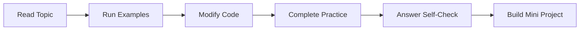

# Level 3: Advanced

## Formal Level Overview

Advance into production-grade Python with decorators, context managers, concurrency, data systems, profiling, security, and deployment.

## Student Outcome

Students can design, optimize, secure, and explain Python systems that resemble professional software.

## Recommended Study Order

| Order | Topic | Difficulty | Evidence of Mastery |
| --- | --- | --- | --- |
| 11 | [Decorators, Context Managers, and Metaprogramming](./11-decorators-context-managers-and-metaprogramming/) | Advanced | A student can use advanced language features to reduce duplication while keeping behavior understandable. |
| 12 | [Concurrency, Parallelism, and Async IO](./12-concurrency-parallelism-and-async-io/) | Advanced | A student can select a safe execution model for a workload and explain the tradeoffs. |
| 13 | [Data Engineering, APIs, and Databases](./13-data-engineering-apis-and-databases/) | Advanced | A student can move data between files, APIs, transformations, and databases safely. |
| 14 | [Performance, Memory, and Profiling](./14-performance-memory-and-profiling/) | Advanced | A student can improve performance with evidence instead of guesswork. |
| 15 | [Production Architecture, Security, and Deployment](./15-production-architecture-security-and-deployment/) | Advanced | A student can reason about a Python project as a secure, observable, deployable system. |

## How Students Should Use This Level

1. Study topics in order unless an instructor assigns a different route.
2. Complete the guided practice tasks inside each topic folder.
3. Keep a notebook of vocabulary, common mistakes, and corrected examples.
4. Build one small project after finishing all topics in this level.

## Level Workflow

